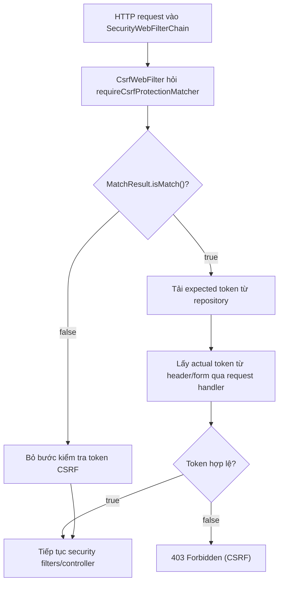

# Tùy chỉnh ServerWebExchangeMatcher cho yêu cầu được kiểm tra

> **Chương:** CSRF trên Reactive  
> **Trọng tâm:** Tùy chỉnh **request nào phải có CSRF token** trong Spring Security WebFlux thông qua `ServerWebExchangeMatcher` và `ServerHttpSecurity.CsrfSpec.requireCsrfProtectionMatcher(...)`; bảo toàn chính sách mặc định, giới hạn ngoại lệ thật hẹp và kiểm thử các request nhạy cảm.

Trong module `SPRING_SECURITY_HTTP_PROTECTION`, người học áp dụng các lớp phòng vệ HTTP và trình duyệt của Spring Security, từ CSRF, CORS, security headers, CSP, HSTS đến HTTP firewall và bảo vệ session. Module bao quát cả Servlet lẫn Reactive, kèm kiểm thử tình huống tấn công và chẩn đoán xung đột khi triển khai. Bài này đi sâu vào **Spring WebFlux**: khi ứng dụng vừa có form/SPA dùng cookie, vừa có endpoint nhận webhook của hệ thống ngoài, làm sao chọn chính xác request cần kiểm tra CSRF **mà không vô tình bỏ bảo vệ login, logout và API dùng session**?

## 1. Vấn đề mà matcher giải quyết

Một trình duyệt đã đăng nhập có thể tự gửi cookie khi thực hiện yêu cầu đến đúng website. Trang độc hại có thể lợi dụng hành vi này để cố gắng tạo request thay đổi trạng thái. Với những request như vậy, `CsrfWebFilter` thường yêu cầu CSRF token mà client chủ động gửi qua header hoặc form, thay vì chỉ dựa vào cookie.

Không phải mọi HTTP request đều cần kiểm tra CSRF. Ví dụ:

- `GET /products` chỉ đọc dữ liệu: thông thường không yêu cầu token.
- `POST /account/profile` dùng session đăng nhập: **phải yêu cầu** token.
- `POST /login` và `POST /logout`: vẫn có rủi ro giả mạo thao tác; **không tự ý loại trừ**.
- `POST /integrations/partner/events` nhận webhook do server đối tác ký và gửi trực tiếp, không sử dụng cookie phiên browser: có thể xem xét **ngoại lệ riêng** nếu server xác minh chữ ký và chống phát lại đúng cách.

`ServerWebExchangeMatcher` là hợp đồng quyết định **request có khớp một điều kiện hay không**. Với CSRF, kết quả **match** nghĩa là **request cần qua bước kiểm tra CSRF**; **not match** nghĩa là **không yêu cầu token ở bước CSRF**. Đây **không phải** kết quả phân quyền hoặc bằng chứng request an toàn.



**Đặc biệt quan trọng:** Ngoại lệ CSRF **không tự làm request được phép truy cập**. Các lớp authentication, authorization, kiểm tra chữ ký webhook, rate limit và validation vẫn phải hoạt động.

## 2. Matcher mặc định: chỉ kiểm tra các HTTP method không an toàn

Spring Security WebFlux **bật CSRF mặc định**. Matcher mặc định được công bố qua `CsrfWebFilter.DEFAULT_CSRF_MATCHER`, dùng nguyên tắc: **không đòi CSRF token cho `GET`, `HEAD`, `TRACE`, `OPTIONS`; kiểm tra các method còn lại**. Những HTTP method không an toàn thường gặp gồm `POST`, `PUT`, `PATCH`, `DELETE`.

| Method | Matcher mặc định yêu cầu CSRF? | Giải thích |
| --- | --- | --- |
| `GET` | Không | Method an toàn, endpoint chỉ được đọc. |
| `HEAD` | Không | Không dùng để thay đổi trạng thái. |
| `OPTIONS` | Không | Quan trọng với CORS preflight. |
| `TRACE` | Không | Thuộc nhóm được mặc định miễn CSRF; có thể vô hiệu hóa TRACE ở tầng HTTP nếu không cần. |
| `POST` | **Có** | Gửi form, login, logout, tạo dữ liệu. |
| `PUT` | **Có** | Thay thế hoặc cập nhật tài nguyên. |
| `PATCH` | **Có** | Cập nhật một phần tài nguyên. |
| `DELETE` | **Có** | Xóa tài nguyên. |
| Method tùy chỉnh | Thông thường có | Nếu không nằm trong danh sách method an toàn mặc định. |

Javadoc `ServerHttpSecurity.CsrfSpec` mô tả ngắn mặc định là PUT/POST/DELETE; khi lập chính sách thực tế, cần nhớ **PATCH cũng thuộc nhóm unsafe**. Cách ít rủi ro nhất là **tái sử dụng `CsrfWebFilter.DEFAULT_CSRF_MATCHER`** thay vì tự liệt kê chỉ ba method.

Đừng dùng GET để thay đổi trạng thái, ví dụ `GET /account/delete`. Matcher mặc định không bảo vệ CSRF cho GET vì dựa trên REST semantics đúng; nếu ứng dụng cố tình làm side effect trong GET, cần sửa thiết kế API thay vì xem việc loại trừ GET là một lỗi của Spring Security.

## 3. API Reactive: `Mono<MatchResult>` chứ không phải Boolean

Interface đúng cho WebFlux:

```java
package org.springframework.security.web.server.util.matcher;

public interface ServerWebExchangeMatcher {
    Mono<MatchResult> matches(ServerWebExchange exchange);
}
```

Trong đó:

- `matches(exchange)` nhận `ServerWebExchange`, trả một publisher `Mono<ServerWebExchangeMatcher.MatchResult>`.
- `MatchResult.isMatch()` cho biết có khớp hay không.
- `MatchResult.match()` và `MatchResult.notMatch()` là **factory trả sẵn `Mono<MatchResult>`**; không cần bọc `Mono.just(...)` thêm lần nữa.
- `MatchResult` cũng có `getVariables()` để trả biến đường dẫn nếu matcher tương ứng hỗ trợ.

Ví dụ matcher đơn giản tự viết (dành để hiểu hợp đồng, chưa áp dụng ngoại lệ):

```java
import org.springframework.http.HttpMethod;
import org.springframework.security.web.server.util.matcher.ServerWebExchangeMatcher;

ServerWebExchangeMatcher onlyPost = exchange ->
    HttpMethod.POST.equals(exchange.getRequest().getMethod())
        ? ServerWebExchangeMatcher.MatchResult.match()
        : ServerWebExchangeMatcher.MatchResult.notMatch();
```

Nếu đưa **`onlyPost`** vào `requireCsrfProtectionMatcher(...)` thì chỉ method POST cần CSRF; **PUT/PATCH/DELETE không còn được bảo vệ**. Ví dụ trên để học API, **không phải matcher khuyến nghị dùng cho sản phẩm thực tế**.

### Các matcher dựng sẵn

| Thành phần | Ngữ nghĩa |
| --- | --- |
| `ServerWebExchangeMatchers.pathMatchers("/account/**")` | Match đường dẫn tương ứng, không giới hạn method. |
| `ServerWebExchangeMatchers.pathMatchers(HttpMethod.POST, "/x")` | Match **đồng thời method POST và path /x**. |
| `new AndServerWebExchangeMatcher(a, b)` | Match khi **cả a và b** khớp. |
| `new OrServerWebExchangeMatcher(a, b)` | Match khi **ít nhất một** matcher khớp. |
| `new NegatedServerWebExchangeMatcher(a)` | Đảo kết quả của a. |
| `CsrfWebFilter.DEFAULT_CSRF_MATCHER` | Match các HTTP method mặc định phải kiểm tra CSRF. |

`ServerWebExchangeMatchers.matchers(a, b)` cũng tạo **OR matcher**, không phải AND. Nhầm OR/AND trong chính sách CSRF có thể tạo lỗ hổng: một matcher quá hẹp sẽ bỏ qua request unsafe mà bạn không chủ ý.

## 4. Cách cấu hình: `requireCsrfProtectionMatcher(...)`

Trong Spring Security WebFlux, gọi phương thức trên **`ServerHttpSecurity.CsrfSpec`**:

```java
import org.springframework.context.annotation.Bean;
import org.springframework.context.annotation.Configuration;
import org.springframework.security.config.annotation.web.reactive.EnableWebFluxSecurity;
import org.springframework.security.config.web.server.ServerHttpSecurity;
import org.springframework.security.web.server.SecurityWebFilterChain;
import org.springframework.security.web.server.csrf.CsrfWebFilter;

@Configuration
@EnableWebFluxSecurity
public class ReactiveSecurityConfig {
    @Bean
    SecurityWebFilterChain securityWebFilterChain(ServerHttpSecurity http) {
        return http
            .authorizeExchange(exchanges -> exchanges
                .pathMatchers("/login", "/public/**").permitAll()
                .anyExchange().authenticated())
            .csrf(csrf -> csrf
                .requireCsrfProtectionMatcher(CsrfWebFilter.DEFAULT_CSRF_MATCHER))
            .build();
    }
}
```

Ví dụ này **không thay đổi hành vi mặc định**; nó chỉ chỉ ra chỗ cấu hình. Không cần viết matcher mới khi ứng dụng chỉ có form/SPA thông thường.

**Đừng nhầm `permitAll()` với tắt CSRF.** `authorizeExchange().pathMatchers("/login").permitAll()` chỉ cho phép chưa đăng nhập truy cập endpoint phù hợp. Nếu `POST /login` khớp matcher CSRF, request vẫn phải gửi token hợp lệ; đó là một lớp bảo vệ khác với xác thực.

## 5. Ví dụ chính: chỉ loại trừ webhook POST có xác minh riêng

Giả sử ứng dụng có những endpoint:

- `POST /account/profile`: request từ trình duyệt đã đăng nhập, cần CSRF.
- `POST /login` và `POST /logout`: cần CSRF.
- `POST /integrations/partner/events`: webhook **server-to-server**, đối tác ký payload bằng HMAC; backend xác minh chữ ký, timestamp và chống phát lại trước khi xử lý.

Ta muốn **giữ toàn bộ chính sách mặc định**, chỉ **loại trừ duy nhất method POST tại đường dẫn webhook chính xác**. Dùng công thức:

```text
REQUIRE_CSRF = DEFAULT_UNSAFE_METHODS AND NOT(SIGNED_WEBHOOK_POST_PATH)
```

Tên `SIGNED_WEBHOOK_POST_PATH` ở đây chỉ chỉ **tuyến webhook dành riêng cho luồng có chữ ký**, không có nghĩa matcher đã xác minh chữ ký. **Xác minh chữ ký bắt buộc được triển khai riêng** trong xử lý webhook.

### Cấu hình đầy đủ

```java
import org.springframework.context.annotation.Bean;
import org.springframework.context.annotation.Configuration;
import org.springframework.http.HttpMethod;
import org.springframework.security.config.annotation.web.reactive.EnableWebFluxSecurity;
import org.springframework.security.config.web.server.ServerHttpSecurity;
import org.springframework.security.web.server.SecurityWebFilterChain;
import org.springframework.security.web.server.csrf.CsrfWebFilter;
import org.springframework.security.web.server.util.matcher.AndServerWebExchangeMatcher;
import org.springframework.security.web.server.util.matcher.NegatedServerWebExchangeMatcher;
import org.springframework.security.web.server.util.matcher.ServerWebExchangeMatcher;
import org.springframework.security.web.server.util.matcher.ServerWebExchangeMatchers;

@Configuration
@EnableWebFluxSecurity
public class PartnerWebhookSecurityConfig {

    @Bean
    SecurityWebFilterChain securityWebFilterChain(ServerHttpSecurity http) {
        // Ngoại lệ chỉ đúng một method + path, không dùng "/api/**".
        ServerWebExchangeMatcher partnerWebhookPost =
            ServerWebExchangeMatchers.pathMatchers(
                HttpMethod.POST, "/integrations/partner/events");

        ServerWebExchangeMatcher requireCsrf =
            new AndServerWebExchangeMatcher(
                CsrfWebFilter.DEFAULT_CSRF_MATCHER,
                new NegatedServerWebExchangeMatcher(partnerWebhookPost));

        return http
            .authorizeExchange(exchanges -> exchanges
                .pathMatchers(HttpMethod.POST,
                    "/integrations/partner/events").permitAll()
                .pathMatchers("/login", "/public/**").permitAll()
                .anyExchange().authenticated())
            .csrf(csrf -> csrf
                .requireCsrfProtectionMatcher(requireCsrf))
            .build();
    }
}
```

**Giải thích từng lớp:**

1. `pathMatchers(HttpMethod.POST, "/integrations/partner/events")` chỉ khớp POST đúng đường dẫn webhook.
2. `NegatedServerWebExchangeMatcher` đảo kết quả: các request **khác** webhook POST đều khớp phép NOT.
3. `AndServerWebExchangeMatcher` yêu cầu **vừa** là method không an toàn theo mặc định, **vừa** không phải webhook POST. Điều này giữ CSRF cho các request `POST /account/profile`, `POST /login`, `POST /logout`, `PUT`, `PATCH`, `DELETE`.
4. `permitAll()` ở webhook chỉ loại bỏ yêu cầu **đăng nhập bằng session** đối với endpoint này. Nó **không** kiểm tra HMAC; bộ xác minh webhook vẫn phải được thực thi trước mọi tác dụng phụ.

Phần cấu hình này **là ví dụ hoàn chỉnh về matcher nhưng chưa phải hệ thống webhook hoàn chỉnh**: hãy cài đặt cơ chế xác thực webhook đúng chuẩn của đối tác trước khi tiếp nhận traffic sản xuất. Nếu webhook không có cơ chế bảo vệ thay thế đáng tin cậy, **không tạo ngoại lệ CSRF**.

### Ma trận áp dụng của matcher trên

| HTTP request | `DEFAULT_CSRF_MATCHER` | Có phải webhook POST? | Kết quả: cần CSRF? |
| --- | --- | --- | --- |
| `GET /account/profile` | Không | Không | Không |
| `HEAD /account/profile` | Không | Không | Không |
| `OPTIONS /integrations/partner/events` | Không | Không | Không |
| `POST /account/profile` | Có | Không | **Có** |
| `POST /login` | Có | Không | **Có** |
| `POST /logout` | Có | Không | **Có** |
| `PUT /account/profile` | Có | Không | **Có** |
| `PATCH /account/profile` | Có | Không | **Có** |
| `DELETE /account/profile` | Có | Không | **Có** |
| `POST /integrations/partner/events` | Có | Có | **Không — ngoại lệ hẹp** |
| `PUT /integrations/partner/events` | Có | Không | **Có** |
| `POST /integrations/partner/events/extra` | Có | Không | **Có** |
| `POST /integrations/other/events` | Có | Không | **Có** |

Điểm quan trọng là trường hợp `PUT /integrations/partner/events` **vẫn cần CSRF** dù đường dẫn trùng webhook: ngoại lệ ràng buộc **cả method lẫn path**. Endpoint không hỗ trợ PUT có thể trả 405 ở tầng định tuyến, nhưng matcher vẫn phải giữ chính sách an toàn khi có route mới được thêm về sau.

## 6. Khi có nhiều webhook: kết hợp bằng OR rồi phủ định

Giả sử có **hai** endpoint POST nhận callback từ hai nhà cung cấp độc lập, cả hai đã có xác minh chữ ký riêng. Có thể gom **danh sách ngoại lệ xác định** bằng OR:

```java
import org.springframework.http.HttpMethod;
import org.springframework.security.web.server.csrf.CsrfWebFilter;
import org.springframework.security.web.server.util.matcher.AndServerWebExchangeMatcher;
import org.springframework.security.web.server.util.matcher.NegatedServerWebExchangeMatcher;
import org.springframework.security.web.server.util.matcher.OrServerWebExchangeMatcher;
import org.springframework.security.web.server.util.matcher.ServerWebExchangeMatcher;
import org.springframework.security.web.server.util.matcher.ServerWebExchangeMatchers;

ServerWebExchangeMatcher allowedCallbacks =
    new OrServerWebExchangeMatcher(
        ServerWebExchangeMatchers.pathMatchers(
            HttpMethod.POST, "/integrations/partner/events"),
        ServerWebExchangeMatchers.pathMatchers(
            HttpMethod.POST, "/integrations/billing/events"));

ServerWebExchangeMatcher requireCsrf =
    new AndServerWebExchangeMatcher(
        CsrfWebFilter.DEFAULT_CSRF_MATCHER,
        new NegatedServerWebExchangeMatcher(allowedCallbacks));

// Truyền requireCsrf vào .csrf(csrf -> csrf.requireCsrfProtectionMatcher(...)).
```

Vì `allowedCallbacks` có dạng `A OR B`, cả hai webhook POST được loại trừ. Nếu nhầm thành `AndServerWebExchangeMatcher(A, B)`, không request nào có thể đồng thời khớp cả hai path; kết quả sẽ là **không webhook nào được loại trừ**. Sai ở chiều ngược lại có thể nguy hiểm hơn: một matcher `NOT /api/**` quá rộng làm mất CSRF của hàng loạt endpoint dùng cookie.

Nên quản lý ngoại lệ như một **danh sách được xét duyệt**, trong đó mỗi endpoint có chủ sở hữu, cơ chế xác thực độc lập, kiểm thử và đánh giá rủi ro khi thay đổi đường dẫn. Không dùng `/integrations/**` làm ngoại lệ hàng loạt nếu chỉ có một webhook cần miễn.

## 7. Viết matcher riêng: Reactive và không chặn

Khi yêu cầu chính sách phức tạp hơn tổ hợp `AND`/`OR`/`NOT`, bạn có thể viết `ServerWebExchangeMatcher` tùy chỉnh. Nhưng nên ưu tiên matcher dựng sẵn vì chúng dễ đọc, dễ kiểm thử và ít nguy cơ xử lý nhầm đường dẫn.

Ví dụ dưới mô phỏng công thức ở mục 5 mà **không thay thế matcher method mặc định**:

```java
import org.springframework.http.HttpMethod;
import org.springframework.security.web.server.csrf.CsrfWebFilter;
import org.springframework.security.web.server.util.matcher.ServerWebExchangeMatcher;
import org.springframework.web.server.ServerWebExchange;
import reactor.core.publisher.Mono;

final class RequireCsrfExceptPartnerWebhook
        implements ServerWebExchangeMatcher {

    @Override
    public Mono<MatchResult> matches(ServerWebExchange exchange) {
        return CsrfWebFilter.DEFAULT_CSRF_MATCHER.matches(exchange)
            .flatMap(defaultResult -> {
                if (!defaultResult.isMatch()) {
                    return MatchResult.notMatch();
                }

                boolean webhookPost =
                    HttpMethod.POST.equals(exchange.getRequest().getMethod())
                    && "/integrations/partner/events".equals(
                        exchange.getRequest().getPath().pathWithinApplication().value());

                return webhookPost
                    ? MatchResult.notMatch()
                    : MatchResult.match();
            });
    }
}
```

Khi cấu hình, truyền `new RequireCsrfExceptPartnerWebhook()` vào `.requireCsrfProtectionMatcher(...)`. Đây là ví dụ để hiểu `Mono<MatchResult>`; ở tình huống thực tế, **tổ hợp matcher dựng sẵn ở mục 5 được ưu tiên** vì so path bằng literal dễ sai khi có trailing slash, context path, gateway rewrite hoặc định nghĩa route khác.

**Quy tắc khi viết matcher Reactive:**

- Trả `MatchResult.match()` / `notMatch()` dưới dạng publisher; không trả `Mono<Boolean>`.
- Không gọi `block()` trên event loop và không `subscribe()` thủ công bên trong matcher.
- Không dựa vào `X-Requested-With`, `Content-Type`, `Origin` hoặc header do client tự khai làm **điều kiện duy nhất để bỏ CSRF**. Chúng không xác thực được người gửi.
- Tránh đọc request body trong matcher. Body Reactive có thể chỉ được consume một lần; tự đọc trước controller có thể gây lỗi stream hoặc tạo bề mặt DoS.
- Xử lý lỗi matcher như lỗi cấu hình/chuỗi bảo mật, **không tự chuyển mọi lỗi thành `notMatch()`**; làm vậy có thể vô tình bỏ bảo vệ khi hệ thống gặp sự cố.

## 8. Vì sao một số cách cấu hình là nguy hiểm?

### 8.1. Chỉ matcher path mà quên method

Một cấu hình dễ bị viết nhầm:

```java
// KHÔNG KHUYẾN NGHỊ cho ứng dụng có session/cookie browser.
.csrf(csrf -> csrf.requireCsrfProtectionMatcher(
    ServerWebExchangeMatchers.pathMatchers("/account/**")))
```

Đây là **thay thế hoàn toàn matcher mặc định**: CSRF chỉ được kiểm tra trên `/account/**` cho **cả GET**, trong khi `POST /login`, `POST /logout`, `POST /orders` hoặc những API khác có thể **không cần token** dù chúng thay đổi trạng thái. Ngoài ra GET `/account/**` có thể bị yêu cầu token ngoài ý muốn.

Đừng coi `requireCsrfProtectionMatcher(...)` là thao tác “thêm một matcher” vào mặc định; nó **thiết lập matcher được dùng để quyết định CSRF**. Nếu muốn loại trừ một tuyến hẹp, dùng:

```text
DEFAULT_CSRF_MATCHER AND NOT(EXACT_EXCEPTION)
```

### 8.2. Bỏ qua toàn bộ `/api/**` vì tưởng API dùng JSON là an toàn

JSON API **không mặc nhiên miễn CSRF**. Nếu frontend browser đăng nhập bằng cookie/session, một số kiểu request cross-site vẫn có thể dẫn đến tác dụng ngoài ý muốn (đặc biệt khi middleware, CORS, content type hoặc endpoint được mở rộng). Không bỏ CSRF chỉ vì route có tiền tố `/api`, `Content-Type: application/json` hoặc sử dụng `fetch`.

Một API chỉ nhận bearer token do client tự chủ động gửi trong `Authorization` và **không bao giờ dùng cookie/session của browser** có thể có mô hình rủi ro khác. Khi đó, cân nhắc security chain riêng và đánh giá nguồn credential; không tự tắt CSRF cho cả hệ thống nếu còn endpoint browser khác.

### 8.3. Nhầm `authorizeExchange`, `securityMatcher` và CSRF matcher

| Cấu hình | Quyết định |
| --- | --- |
| `securityMatcher(...)` của `ServerHttpSecurity` | **SecurityWebFilterChain nào áp dụng** cho request. |
| `authorizeExchange(...).pathMatchers(...).permitAll()` | Người gọi có cần quyền/xác thực để truy cập hay không. |
| `csrf(...).requireCsrfProtectionMatcher(...)` | Request **có phải cung cấp CSRF token** hay không. |

Nếu security chain đang chọn **không chứa CSRF filter**, matcher CSRF của chain khác **không chạy**. Vì vậy trước khi sửa matcher, kiểm tra thứ tự của các `SecurityWebFilterChain`, `securityMatcher` và route thực tế. Không sử dụng `permitAll()` như một “cách bỏ qua CSRF”; nó không có tác dụng đó.

**Lưu ý khác biệt Servlet:** Các ví dụ dùng `ignoringRequestMatchers(...)` trong `CsrfConfigurer` dành cho `HttpSecurity` (Servlet) **không phải cách cấu hình `ServerHttpSecurity.CsrfSpec` của WebFlux**. Với WebFlux dùng `requireCsrfProtectionMatcher(ServerWebExchangeMatcher)` như ở trên, hoặc thiết kế các chain riêng một cách có kiểm soát.

## 9. Điều kiện để webhook được miễn CSRF an toàn

CSRF bảo vệ các request mà browser có thể tự gửi credential. Một webhook server-to-server không dùng cookie phiên thường **không phù hợp** với cơ chế CSRF token lấy từ form, nhưng điều đó **không đồng nghĩa có thể tiếp nhận request ẩn danh mà không xác thực**.

Nếu loại trừ `POST /integrations/partner/events`, tối thiểu cần:

1. **Xác minh nguồn webhook:** Kiểm tra HMAC/signature trên **payload bytes** và dữ liệu canonical theo tài liệu nhà cung cấp, dùng secret lưu an toàn; hoặc mTLS/credential mạnh nếu là giao thức phù hợp.
2. **Chống phát lại:** Kiểm tra timestamp trong khoảng thời gian cho phép, event ID/nonce đã xử lý; lưu trạng thái chống replay phù hợp giữa nhiều node.
3. **So sánh an toàn:** Dùng so sánh constant-time với chữ ký kỳ vọng và xử lý missing/bad signature như yêu cầu **không được xác thực**.
4. **Giới hạn đầu vào:** Giới hạn request size, xử lý idempotency, rate limit, kiểm soát loại sự kiện và các thao tác nghiệp vụ.
5. **Không gắn session browser:** Không dùng cookie đăng nhập của người dùng làm cơ sở chấp nhận webhook; tránh reuse cùng route cho yêu cầu HTML và webhook.

Matcher **chỉ làm nhiệm vụ phân loại request**, không kiểm chứng chữ ký. Không được làm kiểu “nếu header `X-Webhook-Signature` tồn tại thì bỏ CSRF” rồi quên kiểm tra chữ ký trong webhook handler; kẻ tấn công có thể tự gửi một header có tên tương tự.

Nếu webhook bị `403` sau khi loại trừ CSRF, hãy kiểm tra **chữ ký, authentication, authorization hoặc policy khác**, không mặc định ngoại lệ CSRF chưa hoạt động.

## 10. Kiểm thử matcher bằng Reactor StepVerifier

Matcher là một publisher Reactive; có thể **kiểm thử chính logic matcher** mà chưa cần khởi động ứng dụng. Bài test sau dùng `spring-test`, `spring-security-web`, `reactor-test` và JUnit 5.

```java
import org.junit.jupiter.api.Test;
import org.springframework.http.HttpMethod;
import org.springframework.mock.http.server.reactive.MockServerHttpRequest;
import org.springframework.mock.web.server.MockServerWebExchange;
import org.springframework.security.web.server.csrf.CsrfWebFilter;
import org.springframework.security.web.server.util.matcher.AndServerWebExchangeMatcher;
import org.springframework.security.web.server.util.matcher.NegatedServerWebExchangeMatcher;
import org.springframework.security.web.server.util.matcher.ServerWebExchangeMatcher;
import org.springframework.security.web.server.util.matcher.ServerWebExchangeMatchers;
import reactor.test.StepVerifier;

import static org.junit.jupiter.api.Assertions.assertEquals;

class CsrfRequestMatcherTest {

    private final ServerWebExchangeMatcher matcher =
        new AndServerWebExchangeMatcher(
            CsrfWebFilter.DEFAULT_CSRF_MATCHER,
            new NegatedServerWebExchangeMatcher(
                ServerWebExchangeMatchers.pathMatchers(
                    HttpMethod.POST, "/integrations/partner/events")));

    private void assertMatch(HttpMethod method, String path, boolean required) {
        var exchange = MockServerWebExchange.from(
            MockServerHttpRequest.method(method, path));
        StepVerifier.create(matcher.matches(exchange))
            .assertNext(result -> assertEquals(
                required, result.isMatch(), method + " " + path))
            .verifyComplete();
    }

    @Test
    void safeMethodsDoNotRequireToken() {
        assertMatch(HttpMethod.GET, "/account/profile", false);
        assertMatch(HttpMethod.HEAD, "/account/profile", false);
        assertMatch(HttpMethod.OPTIONS, "/integrations/partner/events", false);
    }

    @Test
    void browserMutationsRemainProtected() {
        assertMatch(HttpMethod.POST, "/account/profile", true);
        assertMatch(HttpMethod.PUT, "/account/profile", true);
        assertMatch(HttpMethod.PATCH, "/account/profile", true);
        assertMatch(HttpMethod.DELETE, "/account/profile", true);
        assertMatch(HttpMethod.POST, "/login", true);
        assertMatch(HttpMethod.POST, "/logout", true);
    }

    @Test
    void onlyExactWebhookPostIsExcluded() {
        assertMatch(HttpMethod.POST, "/integrations/partner/events", false);
        assertMatch(HttpMethod.PUT, "/integrations/partner/events", true);
        assertMatch(HttpMethod.POST, "/integrations/other/events", true);
        assertMatch(HttpMethod.POST,
            "/integrations/partner/events/extra", true);
    }
}
```

**Giới hạn của unit test:** `result.isMatch() == true` chỉ chứng minh request **phải qua bước CSRF**. Nó chưa chứng minh filter thực sự trả `403` cho request thiếu token, hoặc webhook đã kiểm tra HMAC. Cần thêm test tích hợp cho security chain, session/cookie và xác minh webhook.

### Ma trận kiểm thử tích hợp

| Request | Có CSRF token? | Kỳ vọng |
| --- | --- | --- |
| `GET /account/profile` | Không | Không bị chặn **vì CSRF**; vẫn chịu authentication/authorization. |
| `POST /account/profile`, cookie hợp lệ | Thiếu | **403 do CSRF** nếu chain/handler được cấu hình đúng. |
| `POST /account/profile`, cookie hợp lệ | Token đúng | Qua bước CSRF; controller/quyền quyết định kết quả cuối. |
| `POST /login` hoặc `POST /logout` | Thiếu | Vẫn yêu cầu CSRF, không bị loại trừ bởi webhook matcher. |
| `POST /integrations/partner/events` | Thiếu | Không bị chặn **chỉ vì CSRF**; chữ ký webhook giả/thiếu phải bị từ chối bởi cơ chế khác. |
| `POST /integrations/partner/events` | Không | Chỉ xử lý thành công nếu webhook signature và các quy tắc nghiệp vụ hợp lệ. |
| `POST /integrations/other/events` | Thiếu | **Vẫn yêu cầu CSRF** nếu request thuộc chain này. |
| `PUT /integrations/partner/events` | Thiếu | **Vẫn yêu cầu CSRF**, hoặc có thể bị route từ chối do method không hỗ trợ. |

Với `WebTestClient` và `spring-security-test`, có thể kiểm tra đường bảo vệ CSRF của endpoint browser:

```java
// Thân bài test; client đã được bind application context
// và .apply(springSecurity()); POST /account/profile trả 2xx khi hợp lệ.
// Static imports: SecurityMockServerConfigurers.mockUser(), csrf().

client.mutateWith(mockUser())
    .post().uri("/account/profile")
    .exchange()
    .expectStatus().isForbidden();

client.mutateWith(mockUser()).mutateWith(csrf())
    .post().uri("/account/profile")
    .exchange()
    .expectStatus().is2xxSuccessful();
```

`csrf()` là tiện ích dành cho **test**, không tái hiện đầy đủ quá trình client thực lấy token và giữ cookie. Với bài kiểm thử HTTP end-to-end, mở `GET /csrf` hoặc trang form để lấy token, giữ cookie/session và gửi lại token đúng trong POST. Riêng webhook cần có **bài test chữ ký giả, chữ ký hợp lệ, timestamp sai và replay**; không dùng kết quả “matcher notMatch” làm bằng chứng webhook đã an toàn.

## 11. Chẩn đoán khi matcher gây lỗi

| Triệu chứng | Nguyên nhân có thể | Cách khắc phục |
| --- | --- | --- |
| `POST /account/profile` thiếu token vẫn đi qua | Matcher chỉ match `/webhooks/**` hoặc path/method quá hẹp | Bắt đầu bằng `CsrfWebFilter.DEFAULT_CSRF_MATCHER`, chỉ thêm phủ định cho ngoại lệ hẹp. |
| `POST /login` hoặc `POST /logout` không cần CSRF | Scope matcher chỉ bảo vệ `/account/**` | Kiểm tra toàn bộ unsafe endpoints, đặc biệt login/logout; tránh matcher chỉ theo path. |
| `GET /account/profile` bị yêu cầu token | Dùng `pathMatchers("/account/**")` trực tiếp làm require matcher | Dùng default unsafe matcher trong biểu thức AND; GET phải được xử lý như method an toàn. |
| `POST` webhook vẫn trả `403` | Matcher không khớp path/method; hoặc chữ ký/quyền truy cập khác chặn | Test `matcher.matches(exchange)` trước, sau đó truy nguồn gốc `403` từ các filter khác. |
| Ngoại lệ webhook áp dụng cho quá nhiều route | Dùng `/integrations/**` hoặc `/api/**` | Thay bằng exact path và method, test negative cases. |
| `PUT`/`PATCH` bị bỏ CSRF | Custom matcher chỉ liệt kê `POST` | Dùng `DEFAULT_CSRF_MATCHER` để giữ toàn bộ các method không an toàn. |
| Một chain bảo vệ, chain khác không | `securityMatcher(...)`/chain order khác nhau | Kiểm tra SecurityWebFilterChain được chọn trước khi đánh giá matcher CSRF. |
| CORS preflight `OPTIONS` thất bại | CORS policy, không phải token CSRF | Kiểm tra allowed origin, credentials và request header; đừng tắt CSRF. |
| Token có nhưng POST vẫn `403` | Session/cookie không khớp, raw/masked token không tương thích request handler | Kiểm tra repository, `CsrfToken`, cookie và handler XOR riêng. |
| Webhook thiếu chữ ký vẫn cập nhật dữ liệu | Đã loại trừ CSRF nhưng không có xác thực webhook độc lập | Chặn xử lý nghiệp vụ cho đến khi xác minh chữ ký, timestamp và replay. |

**Thứ tự điều tra hiệu quả:** HTTP method/path thực tế → security chain được chọn → matcher có match không → nếu có, token kỳ vọng/actual token → nếu không, cơ chế xác thực webhook/authorization → CORS, cookie và proxy. Không log giá trị CSRF token, cookie phiên hay webhook secret; chỉ ghi kết quả phân loại, mã lỗi và request ID được quản lý an toàn.

## 12. Bài thực hành và ghi nhớ

**Bài tập:** Xây ứng dụng WebFlux có `GET /products`, `POST /account/profile`, `POST /login`, `POST /logout` và `POST /integrations/partner/events`. Dùng `DEFAULT_CSRF_MATCHER` kết hợp `AND NOT` để loại trừ **duy nhất** webhook POST. Viết unit test cho tất cả các trường hợp trong bảng mục 5, đặc biệt thêm `PATCH` và `PUT`. Sau đó dùng `WebTestClient` chứng minh:

1. POST browser thiếu CSRF token bị chặn; POST có token đúng và cookie hợp lệ qua bước CSRF.
2. POST login/logout vẫn thuộc diện kiểm tra CSRF, dù các endpoint này có thể cho phép chưa đăng nhập.
3. POST webhook không bị chặn **vì CSRF**, nhưng payload thiếu/sai HMAC, timestamp quá cũ hoặc replay vẫn phải bị từ chối bởi xác minh webhook.
4. Mở rộng route `/integrations/partner/events/extra` không tự được miễn; nếu có thay đổi chính sách, cần xét duyệt và sửa test.

**Điểm cần nhớ:**

- `ServerWebExchangeMatcher.matches(...)` trả **`Mono<MatchResult>`**, không phải `boolean` hay `Mono<Boolean>`.
- `requireCsrfProtectionMatcher(...)` **thay thế điều kiện cần CSRF của chain**, không chỉ “bổ sung” một rule.
- Cách an toàn cho ngoại lệ hẹp là **`CsrfWebFilter.DEFAULT_CSRF_MATCHER AND NOT(exact exception)`**.
- Không trộn lẫn ba khái niệm **security chain selection**, **authorization** và **CSRF requirement**.
- Chỉ loại trừ CSRF khi có cơ sở rủi ro rõ ràng và cơ chế bảo vệ thay thế; đặc biệt không bỏ CSRF toàn bộ API dùng browser cookie.

## Tài liệu tham khảo chính thức

- [Spring Security — CSRF cho WebFlux](https://docs.spring.io/spring-security/reference/reactive/exploits/csrf.html)
- [Spring Security API — ServerHttpSecurity.CsrfSpec](https://docs.spring.io/spring-security/reference/api/java/org/springframework/security/config/web/server/ServerHttpSecurity.CsrfSpec.html)
- [Spring Security API — CsrfWebFilter và DEFAULT_CSRF_MATCHER](https://docs.spring.io/spring-security/reference/api/java/org/springframework/security/web/server/csrf/CsrfWebFilter.html)
- [Spring Security API — ServerWebExchangeMatcher](https://docs.spring.io/spring-security/reference/api/java/org/springframework/security/web/server/util/matcher/ServerWebExchangeMatcher.html)
- [Spring Security API — ServerWebExchangeMatchers](https://docs.spring.io/spring-security/reference/api/java/org/springframework/security/web/server/util/matcher/ServerWebExchangeMatchers.html)
- [Spring Security API — AndServerWebExchangeMatcher](https://docs.spring.io/spring-security/reference/api/java/org/springframework/security/web/server/util/matcher/AndServerWebExchangeMatcher.html)
- [Spring Security API — NegatedServerWebExchangeMatcher](https://docs.spring.io/spring-security/reference/api/java/org/springframework/security/web/server/util/matcher/NegatedServerWebExchangeMatcher.html)
- [Spring Security API — MatchResult](https://docs.spring.io/spring-security/reference/api/java/org/springframework/security/web/server/util/matcher/ServerWebExchangeMatcher.MatchResult.html)
- [Spring Security — Reactive CSRF testing](https://docs.spring.io/spring-security/reference/reactive/test/web/csrf.html)
