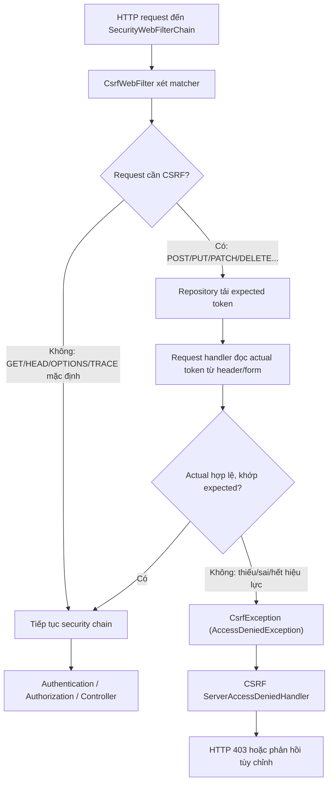

# ServerAccessDeniedHandler và xử lý lỗi CSRF

> **Chương:** CSRF trên Reactive  
> **Phạm vi:** Spring Security **WebFlux**, `CsrfWebFilter`, `ServerAccessDeniedHandler` và `ServerHttpSecurity.CsrfSpec.accessDeniedHandler(...)`.  
> **Mục tiêu:** Phân biệt CSRF `403` với lỗi xác thực/phân quyền; trả phản hồi JSON hoặc HTML hữu ích nhưng không tiết lộ token; kiểm thử đường từ chối ngay tại security filter.

Trong module `SPRING_SECURITY_HTTP_PROTECTION`, người học áp dụng các lớp phòng vệ HTTP và trình duyệt của Spring Security, từ CSRF, CORS, security headers, CSP, HSTS tới HTTP firewall và bảo vệ session. Người học cấu hình cả Servlet và Reactive, kiểm thử tình huống tấn công và chẩn đoán xung đột bảo mật khi triển khai. Bài này tập trung vào câu hỏi thực tế trên **Reactive/WebFlux**: vì sao một request `POST` trả `403 Forbidden` trước khi vào controller, và làm thế nào để phản hồi cho frontend một thông báo nhất quán mà **không nới lỏng bảo vệ CSRF**?

## 1. Luồng từ chối CSRF trong WebFlux

Trình duyệt có thể tự gửi cookie xác thực theo một yêu cầu bị website độc hại kích hoạt. CSRF protection yêu cầu frontend hợp lệ **chủ động gửi token** trong header hoặc form parameter bên cạnh cookie/session liên quan. `CsrfWebFilter` kiểm tra token trước khi cho request không an toàn tiếp tục.



Mặc định, khi token CSRF không hợp lệ, handler của `CsrfWebFilter` trả **HTTP 403 Forbidden**. Phản hồi này không đồng nghĩa người dùng đã đăng nhập và không có quyền; một request chưa xác thực nhưng thiếu CSRF token cũng có thể bị từ chối ở bước CSRF trước khi xử lý xác thực/phân quyền khác.

Các nguyên nhân thường gặp:

| Tình huống | Đường đi lỗi |
| --- | --- |
| `POST /profile` không có header/form token | `CsrfWebFilter` không tìm được actual token hợp lệ → CSRF denied. |
| `POST /profile` có token sai | Token không khớp expected token trong repository → CSRF denied. |
| Token lấy từ phiên cũ sau khi session hết hạn | Repository của phiên hiện tại không có expected token tương ứng → CSRF denied. |
| SPA gửi raw cookie token với XOR handler mặc định | Dạng token không khớp cơ chế giải mã → có thể bị CSRF denied. |
| Người dùng đã xác thực nhưng thiếu quyền `ADMIN` | **Authorization denied**, không phải lỗi CSRF nếu token đã hợp lệ. |
| Browser khác origin không qua được `OPTIONS` preflight | Thường là **CORS**, request POST thực tế có thể chưa được gửi. |

**Không coi mọi `403` là CSRF.** Muốn chẩn đoán chính xác phải biết security chain, filter từ chối, HTTP method và đường đi token.

## 2. Hợp đồng `ServerAccessDeniedHandler`

Giao diện dành cho WebFlux nằm ở package:

```java
org.springframework.security.web.server.authorization.ServerAccessDeniedHandler
```

Chữ ký:

```java
public interface ServerAccessDeniedHandler {
    Mono<Void> handle(
        ServerWebExchange exchange,
        AccessDeniedException denied);
}
```

Hai tham số có ý nghĩa:

- `ServerWebExchange exchange`: request và response hiện tại; dùng để lấy method/path, đặt HTTP status, response headers và ghi response body.
- `AccessDeniedException denied`: lỗi security đã từ chối truy cập. Trong luồng CSRF Reactive, Spring Security có `org.springframework.security.web.server.csrf.CsrfException` **kế thừa `AccessDeniedException`**.

Kết quả `Mono<Void>` biểu diễn **thao tác hoàn tất phản hồi HTTP**, không phải đối tượng body DTO. Nếu handler muốn ghi JSON/HTML, nó phải trả `Mono<Void>` từ `ServerHttpResponse.writeWith(...)` để WebFlux subscribe. Không gọi `block()` trong event loop hoặc `subscribe()` thủ công rồi trả `Mono.empty()`: như vậy có thể ghi body sau khi response đã commit.

Spring Security có `HttpStatusServerAccessDeniedHandler`, nhận `HttpStatus` ở constructor và chỉ đặt status tương ứng. Handler mặc định cho CSRF tương đương phản hồi `403`; nếu chỉ cần status mà không cần body riêng, **giữ mặc định** là lựa chọn đơn giản, ít rủi ro.

### Lưu ý về exception trên Reactive và Servlet

| WebFlux | Servlet |
| --- | --- |
| `org.springframework.security.web.server.csrf.CsrfException` | `org.springframework.security.web.csrf.CsrfException` |
| `ServerAccessDeniedHandler` | `AccessDeniedHandler` |
| `ServerWebExchange` | `HttpServletRequest`/`HttpServletResponse` |
| `ServerHttpSecurity.CsrfSpec` | `HttpSecurity`/`CsrfConfigurer` |
| `Mono<Void>` | Thao tác đồng bộ của Servlet handler |

**Không import `InvalidCsrfTokenException` hoặc `MissingCsrfTokenException` từ package Servlet** rồi mặc định kỳ vọng WebFlux phát những subtype đó. Với WebFlux, hãy bám vào hợp đồng Reactive `CsrfException`/`AccessDeniedException` và API của phiên bản đang triển khai. Đặc biệt, **không trả `denied.getMessage()` ra client**, vì thông điệp nội bộ có thể chứa chi tiết nhạy cảm hoặc thay đổi theo phiên bản.

## 3. Hai điểm cấu hình handler có tên giống nhau nhưng mục đích khác nhau

Spring Security WebFlux cung cấp hai hook dễ bị nhầm:

| Vị trí cấu hình | Xử lý trường hợp nào? | Ý nghĩa |
| --- | --- | --- |
| `http.csrf(csrf -> csrf.accessDeniedHandler(...))` | **CSRF token không hợp lệ** trong `CsrfWebFilter` | Chỉ định handler cho đường từ chối CSRF. |
| `http.exceptionHandling(errors -> errors.accessDeniedHandler(...))` | **Access denied ở lớp security exception translation**, như người đã xác thực nhưng thiếu quyền | Định dạng phản hồi từ chối quyền truy cập thông thường. |
| `http.exceptionHandling(errors -> errors.authenticationEntryPoint(...))` | Cần **bắt đầu xác thực**, như request không có credential đủ điều kiện | Có thể là `401` đối với API hoặc redirect login đối với form. |

Hai handler đầu **cùng thực hiện giao diện `ServerAccessDeniedHandler`**, nhưng đặt ở **vị trí khác nhau trong filter chain**. Để tùy chỉnh chính xác lỗi CSRF, **đăng ký handler trong `csrf(...)`**, không chỉ thay `exceptionHandling(...)` rồi giả định nó bao phủ mọi tình huống.

Mã cấu hình khái niệm:

```java
http
    .csrf(csrf -> csrf
        .accessDeniedHandler(csrfDeniedHandler))
    .exceptionHandling(errors -> errors
        .accessDeniedHandler(generalAccessDeniedHandler));
```

Ở đây `csrfDeniedHandler` chỉ nhận đường từ chối CSRF do `CsrfWebFilter` điều khiển, còn `generalAccessDeniedHandler` dùng cho các trường hợp thiếu quyền ở bước xử lý exception tương ứng. **Đừng tự ý trả `401` cho mọi lỗi CSRF**, hoặc dùng một handler `403` chung để đoán rằng tài khoản thiếu quyền.

### `@RestControllerAdvice` có xử lý được mọi lỗi CSRF không?

Không nên dựa vào `@ExceptionHandler(CsrfException.class)` trong controller advice như cơ chế chính cho lỗi CSRF. `CsrfWebFilter` xử lý request **trước controller** và có **access denied handler riêng**; lỗi có thể được chuyển thành HTTP response ngay trong security chain thay vì đi qua luồng controller advice.

Nếu cần thông báo lỗi CSRF nhất quán, cấu hình tại `csrf(...).accessDeniedHandler(...)`. Controller advice vẫn hữu ích cho lỗi validation/nghiệp vụ phát sinh trong controller, nhưng không thay thế security handler.

## 4. Cấu hình tối thiểu: giữ `403` mặc định

Ứng dụng có thể không cần mã xử lý lỗi riêng. Cấu hình sau cho phép truy cập endpoint lấy token, bảo vệ các request ghi dữ liệu và dùng hành vi mặc định của Spring Security:

```java
import org.springframework.context.annotation.Bean;
import org.springframework.context.annotation.Configuration;
import org.springframework.security.config.Customizer;
import org.springframework.security.config.annotation.web.reactive.EnableWebFluxSecurity;
import org.springframework.security.config.web.server.ServerHttpSecurity;
import org.springframework.security.web.server.SecurityWebFilterChain;

@Configuration
@EnableWebFluxSecurity
class ReactiveSecurityConfig {

    @Bean
    SecurityWebFilterChain securityWebFilterChain(ServerHttpSecurity http) {
        return http
            .authorizeExchange(exchanges -> exchanges
                .pathMatchers("/csrf", "/login", "/assets/**").permitAll()
                .anyExchange().authenticated())
            .formLogin(Customizer.withDefaults())
            .csrf(Customizer.withDefaults())
            .build();
    }
}
```

`csrf(Customizer.withDefaults())` chỉ ghi rõ ý định: CSRF bật mặc định trong WebFlux. Theo matcher mặc định, `GET`, `HEAD`, `OPTIONS`, `TRACE` không cần token; `POST`, `PUT`, `PATCH`, `DELETE` cần token. `permitAll()` với `/login` **không tự tắt CSRF** đối với `POST /login`.

Nếu muốn giữ nguyên `403` nhưng thay handler tường minh:

```java
import org.springframework.http.HttpStatus;
import org.springframework.security.web.server.authorization.HttpStatusServerAccessDeniedHandler;

// Thay .csrf(Customizer.withDefaults()) trong builder:
.csrf(csrf -> csrf.accessDeniedHandler(
    new HttpStatusServerAccessDeniedHandler(HttpStatus.FORBIDDEN)))
```

Không trả `200 OK` để che đi lỗi token: client, gateway, telemetry và test cần phân biệt request thành công với request đã bị từ chối.

## 5. Tùy chỉnh JSON `403` cho API/SPA

API có thể muốn frontend nhận một mã lỗi ổn định như `CSRF_REJECTED`, thay vì một phản hồi trống hoặc HTML mặc định. Điều đó giúp giao diện hiển thị thông báo có ích mà **không tiết lộ token**.

Ví dụ response:

```http
HTTP/1.1 403 Forbidden
Content-Type: application/json
Cache-Control: no-store

{"code":"CSRF_REJECTED","message":"Không thể xác minh yêu cầu. Hãy tải lại trang và thử lại."}
```

Phần body là thông báo **cố định và không chứa dữ liệu do client điều khiển**. Ứng dụng có thể chọn tiếng Việt có dấu, nhưng để minh họa response không cần xử lý escape hoặc localization phức tạp.

### 5.1. Triển khai `JsonCsrfAccessDeniedHandler`

```java
import java.nio.charset.StandardCharsets;
import org.springframework.http.CacheControl;
import org.springframework.http.HttpStatus;
import org.springframework.http.MediaType;
import org.springframework.security.access.AccessDeniedException;
import org.springframework.security.web.server.authorization.ServerAccessDeniedHandler;
import org.springframework.web.server.ServerWebExchange;
import reactor.core.publisher.Mono;

public final class JsonCsrfAccessDeniedHandler
        implements ServerAccessDeniedHandler {

    private static final String BODY =
        "{\"code\":\"CSRF_REJECTED\","
        + "\"message\":\"Không thể xác minh yêu cầu. Hãy tải lại trang và thử lại.\"}";

    @Override
    public Mono<Void> handle(
            ServerWebExchange exchange, AccessDeniedException denied) {

        var response = exchange.getResponse();
        response.setStatusCode(HttpStatus.FORBIDDEN);
        response.getHeaders().setContentType(MediaType.APPLICATION_JSON);
        response.getHeaders().setCacheControl(CacheControl.noStore());

        // Mỗi lần gọi tạo DataBuffer cho chính response hiện tại.
        byte[] bytes = BODY.getBytes(StandardCharsets.UTF_8);
        var dataBuffer = response.bufferFactory().wrap(bytes);
        return response.writeWith(Mono.just(dataBuffer));
    }
}
```

**Vì sao cách viết này đúng?**

1. `response.setStatusCode(HttpStatus.FORBIDDEN)` giữ đúng HTTP semantics.
2. `Content-Type: application/json` cho client biết cấu trúc phản hồi.
3. `Cache-Control: no-store` tránh lưu phản hồi lỗi có liên hệ với trạng thái bảo mật của người dùng.
4. `response.writeWith(Mono.just(dataBuffer))` trả **publisher ghi body** cho WebFlux, không chặn event loop.
5. Body **không lấy `denied.getMessage()`**, expected token, actual token, cookie, session ID hoặc chi tiết người dùng.

Handler không cần gọi `exchange.getResponse().setComplete()` **sau** khi đã trả `writeWith(...)`; thao tác ghi response tự biểu diễn completion. Tránh ghi hai lần body hoặc tạo publisher ghi phản hồi song song.

### 5.2. Đăng ký handler đúng vào `CsrfSpec`

```java
import org.springframework.context.annotation.Bean;
import org.springframework.context.annotation.Configuration;
import org.springframework.security.config.annotation.web.reactive.EnableWebFluxSecurity;
import org.springframework.security.config.web.server.ServerHttpSecurity;
import org.springframework.security.web.server.SecurityWebFilterChain;
import org.springframework.security.web.server.authorization.ServerAccessDeniedHandler;

@Configuration
@EnableWebFluxSecurity
class ApiCsrfSecurityConfig {

    @Bean
    ServerAccessDeniedHandler jsonCsrfDeniedHandler() {
        return new JsonCsrfAccessDeniedHandler();
    }

    @Bean
    SecurityWebFilterChain securityWebFilterChain(
            ServerHttpSecurity http,
            ServerAccessDeniedHandler jsonCsrfDeniedHandler) {

        return http
            .authorizeExchange(exchanges -> exchanges
                .pathMatchers("/csrf", "/login").permitAll()
                .anyExchange().authenticated())
            .csrf(csrf -> csrf
                .accessDeniedHandler(jsonCsrfDeniedHandler))
            .build();
    }
}
```

Đây là **phương án thay thế** cấu hình ở mục 4; không đăng ký đồng thời hai `SecurityWebFilterChain` áp dụng cùng request khi chưa thiết kế matcher/thứ tự. Bean handler tái sử dụng được vì không giữ trạng thái mutable của từng request.

**Không đặt JSON error handler vào `http.exceptionHandling(...)` và bỏ quên `csrf(...)`.** Lỗi CSRF có đường handler riêng; nếu muốn cả lỗi authorization cũng trả JSON, cấu hình riêng general access denied handler và phân biệt `code`, không trộn hai nguyên nhân.

## 6. Form/HTML: hiển thị lỗi an toàn, không làm mất ý nghĩa `403`

Với trang server-rendered, có thể hiển thị thông báo đại loại **“Biểu mẫu không còn hợp lệ. Hãy tải lại trang và thử lại.”**. Không nên tiết lộ raw/masked token hay session ID, và không tự chuyển một request bị từ chối thành thao tác thành công.

Một handler trả trang HTML tĩnh đơn giản:

```java
import java.nio.charset.StandardCharsets;
import org.springframework.http.CacheControl;
import org.springframework.http.HttpStatus;
import org.springframework.http.MediaType;
import org.springframework.security.access.AccessDeniedException;
import org.springframework.security.web.server.authorization.ServerAccessDeniedHandler;
import org.springframework.web.server.ServerWebExchange;
import reactor.core.publisher.Mono;

final class HtmlCsrfAccessDeniedHandler
        implements ServerAccessDeniedHandler {

    private static final String PAGE = """
        <!doctype html>
        <html lang="vi">
          <head><meta charset="utf-8"><title>Yêu cầu không hợp lệ</title></head>
          <body>
            <h1>Không thể xác minh biểu mẫu</h1>
            <p>Hãy tải lại trang để nhận biểu mẫu mới rồi thử lại.</p>
          </body>
        </html>
        """;

    @Override
    public Mono<Void> handle(
            ServerWebExchange exchange, AccessDeniedException denied) {

        var response = exchange.getResponse();
        response.setStatusCode(HttpStatus.FORBIDDEN);
        response.getHeaders().setContentType(MediaType.TEXT_HTML);
        response.getHeaders().setCacheControl(CacheControl.noStore());

        return response.writeWith(Mono.just(
            response.bufferFactory().wrap(PAGE.getBytes(StandardCharsets.UTF_8))));
    }
}
```

Ví dụ dùng **Java text block (Java 15+)**; với dự án dùng Java cũ hơn, đổi thành chuỗi nối thông thường. HTML là nội dung **tĩnh**; nếu muốn hiện request ID hay đường dẫn thì phải escape đúng ngữ cảnh để tránh phản xạ XSS.

Có thể cân nhắc phân phối handler HTML/JSON theo route hoặc `Accept`. Tuy nhiên, **đừng tin `Accept: text/html` như một điều kiện xác thực**, và đừng cho client tự chọn một luồng bỏ qua CSRF. Đó chỉ là lựa chọn **định dạng phản hồi lỗi**, không thay kết quả matcher/token validation.

Đối với HTML form bị từ chối, **không tự động replay thao tác POST** sau khi tải token mới. Hãy để người dùng kiểm tra lại biểu mẫu và chủ động gửi lại, nhất là các giao dịch có side effect.

## 7. Phân biệt `403` CSRF, `403` thiếu quyền và `401` chưa xác thực

Status code không đủ để tìm nguyên nhân. Cần xét **thời điểm từ chối** và handler được gọi:

| Ví dụ | Cơ chế có thể xử lý | Kết quả thường gặp |
| --- | --- | --- |
| `POST /api/profile` thiếu CSRF token | `CsrfWebFilter` → **CSRF denied handler** | `403`, body `CSRF_REJECTED` nếu tùy chỉnh. |
| `POST /api/profile` có token sai | `CsrfWebFilter` → **CSRF denied handler** | `403`. |
| `GET /admin` chưa đăng nhập | Authentication entry point của security chain | `401` đối với API hoặc redirect login với form login. |
| `GET /admin` đã đăng nhập, thiếu quyền `ADMIN` | Exception handling access denied handler | Thường `403`, **không phải CSRF**. |
| `POST /admin` thiếu quyền **và** thiếu token | Có thể bị CSRF chặn sớm | Không thể suy ra nguyên nhân chỉ từ `403`. |
| `OPTIONS` preflight sai origin/header | CORS layer | Trình duyệt có thể chặn trước khi gửi POST thực. |
| API có `Authentication` thất bại | Authentication mechanism/entry point | `401`/redirect hoặc phản hồi đặc thù cấu hình. |

Để định dạng thêm lỗi **authorization**, ví dụ ở một cấu hình riêng:

```java
import org.springframework.http.HttpStatus;
import org.springframework.security.web.server.authorization.HttpStatusServerAccessDeniedHandler;

// Áp dụng trong http builder, độc lập với .csrf(...):
.exceptionHandling(errors -> errors
    .accessDeniedHandler(
        new HttpStatusServerAccessDeniedHandler(HttpStatus.FORBIDDEN)))
```

Đoạn trên chỉ tùy chỉnh lỗi thiếu quyền, **không thay thế** `csrf(...).accessDeniedHandler(...)`. `ServerAuthenticationEntryPoint` lại là hợp đồng riêng cho những request cần bắt đầu xác thực. Không ép tất cả các trường hợp thành một mã `CSRF_REJECTED`, vì sẽ khiến frontend chẩn đoán sai và che giấu bug phân quyền.

## 8. Frontend xử lý `CSRF_REJECTED` như thế nào?

Với SPA, nhận `403` và mã lỗi `CSRF_REJECTED` là tín hiệu để **xác định lại token**, không phải tín hiệu để bỏ qua bảo vệ. Một ví dụ đơn giản:

```javascript
async function requestCsrfToken() {
  const response = await fetch("/csrf", {
    credentials: "same-origin",
    cache: "no-store"
  });
  if (!response.ok) throw new Error("Không thể lấy CSRF token");
  return response.json(); // {headerName, parameterName, token}
}

async function updateProfile(payload) {
  const csrf = await requestCsrfToken();
  const response = await fetch("/api/profile", {
    method: "POST",
    credentials: "same-origin",
    headers: {
      "Content-Type": "application/json",
      [csrf.headerName]: csrf.token
    },
    body: JSON.stringify(payload)
  });

  if (response.status === 403) {
    const type = response.headers.get("Content-Type") || "";
    const error = type.includes("application/json")
      ? await response.json().catch(() => null)
      : null;
    if (error?.code === "CSRF_REJECTED") {
      throw new Error("Phiên biểu mẫu cần được làm mới trước khi thử lại");
    }
    throw new Error("Yêu cầu bị từ chối vì lý do bảo mật");
  }
  if (!response.ok) throw new Error("Không thể cập nhật hồ sơ");
  return response;
}
```

Lấy token qua `GET /csrf` ở đây là một **hợp đồng ứng dụng**: cần có endpoint phát `Mono<CsrfToken>` từ `ServerWebExchange`, gửi tên header/token đúng request handler và giữ cookie/session. Với `WebSessionServerCsrfTokenRepository`, token phụ thuộc phiên; sau logout/session timeout phải lấy lại theo phiên hiện tại.

**Không triển khai vòng lặp tự động retry vô hạn khi gặp `403`.** Khi token vừa hết hạn, frontend có thể tải lại form hoặc hướng người dùng lấy token mới rồi gửi lại có chủ đích. Với request thanh toán/xóa dữ liệu, cần bảo vệ khỏi việc chạy lại tác dụng phụ ngoài ý muốn; CSRF error thông thường chặn trước controller, nhưng thiết kế retry vẫn phải dựa vào hợp đồng idempotency/nghiệp vụ.

### Tại sao không tự động đổi thành redirect `302`?

Với `fetch`, redirect có thể được trình duyệt theo tự động; JavaScript nhận trang login HTML thay vì JSON như mong đợi, làm khó chẩn đoán. Nếu muốn hiển thị giao diện lấy lại token, **trả mã `403` nhất quán** và để client quyết định thao tác UX. Đối với form browser, có thể trả trang HTML lỗi `403` thay vì redirect mơ hồ khiến người dùng nghĩ giao dịch đã được xử lý.

## 9. Kiểm thử handler trực tiếp với `StepVerifier`

Kiểm thử riêng handler xác nhận HTTP status, headers và body, không cần chạy toàn bộ server. Ví dụ JUnit 5 với `spring-test`, `reactor-test` và Spring Security:

```java
import org.junit.jupiter.api.Test;
import org.springframework.http.HttpStatus;
import org.springframework.http.MediaType;
import org.springframework.mock.http.server.reactive.MockServerHttpRequest;
import org.springframework.mock.web.server.MockServerWebExchange;
import org.springframework.security.web.server.csrf.CsrfException;
import reactor.test.StepVerifier;

import static org.junit.jupiter.api.Assertions.*;

class JsonCsrfAccessDeniedHandlerTest {

    @Test
    void sends403JsonWithoutLeakingExceptionDetails() {
        var exchange = MockServerWebExchange.from(
            MockServerHttpRequest.post("/api/profile"));

        var handler = new JsonCsrfAccessDeniedHandler();
        // Thông điệp mô phỏng chứa thông tin không được rò rỉ.
        var denied = new CsrfException("INTERNAL-SENSITIVE-TOKEN");

        StepVerifier.create(handler.handle(exchange, denied))
            .verifyComplete();

        assertEquals(
            HttpStatus.FORBIDDEN, exchange.getResponse().getStatusCode());
        assertEquals(
            MediaType.APPLICATION_JSON,
            exchange.getResponse().getHeaders().getContentType());
        assertEquals(
            "no-store",
            exchange.getResponse().getHeaders().getCacheControl());

        StepVerifier.create(exchange.getResponse().getBodyAsString())
            .assertNext(body -> {
                assertTrue(body.contains("\"code\":\"CSRF_REJECTED\""));
                assertFalse(body.contains("INTERNAL-SENSITIVE-TOKEN"));
            })
            .verifyComplete();
    }
}
```

Đây là **unit test response handler**. Nó không chứng minh `CsrfWebFilter` đã gọi đúng handler, bởi trong test ta tự gọi `handle(...)`. Hãy có thêm test HTTP tích hợp để xác minh đường xử lý security chain.

## 10. Kiểm thử tích hợp CSRF bằng `WebTestClient`

Ví dụ controller thử nghiệm trả `204 No Content` khi tới được bước nghiệp vụ:

```java
import org.springframework.http.ResponseEntity;
import org.springframework.web.bind.annotation.PostMapping;
import org.springframework.web.bind.annotation.RestController;
import reactor.core.publisher.Mono;

@RestController
class DemoProfileController {

    @PostMapping("/api/profile")
    Mono<ResponseEntity<Void>> update() {
        return Mono.just(ResponseEntity.noContent().build());
    }
}
```

Với `spring-security-test`, một `WebTestClient` đã bind vào application context và áp dụng `springSecurity()`, có thể kiểm tra các trường hợp:

```java
// Trích thân các bài test. Import static:
// SecurityMockServerConfigurers.mockUser và csrf.
// Config Spring Security dùng .csrf(csrf -> csrf
//     .accessDeniedHandler(new JsonCsrfAccessDeniedHandler())).

// 1. Người dùng có xác thực, nhưng request không có token.
client.mutateWith(mockUser())
    .post().uri("/api/profile")
    .exchange()
    .expectStatus().isForbidden()
    .expectHeader().contentTypeCompatibleWith(MediaType.APPLICATION_JSON)
    .expectBody()
    .jsonPath("$.code").isEqualTo("CSRF_REJECTED");

// 2. Test mutator cung cấp CSRF token hợp lệ.
client.mutateWith(mockUser()).mutateWith(csrf())
    .post().uri("/api/profile")
    .exchange()
    .expectStatus().isNoContent();
```

`mockUser()` trong test bảo đảm kết quả đầu tiên không bị nhầm với thiếu xác thực. `csrf()` là **test mutator**, không phải cách frontend production tạo token. Với các trường hợp còn lại, bổ sung test request thực có cookie jar và token từ `GET /csrf` hoặc form:

| Kịch bản | Kỳ vọng chính |
| --- | --- |
| `POST /api/profile` không token | `403` với mã `CSRF_REJECTED`, controller không được gọi. |
| `POST` token sai nhưng session/cookie có mặt | `403` CSRF. |
| `POST` token đúng và đúng phiên/cookie | Qua bước CSRF; controller có thể trả `204`. |
| `GET /admin` có đăng nhập nhưng thiếu quyền | `403` authorization, **không** có mã `CSRF_REJECTED` từ CSRF handler. |
| `GET /admin` chưa đăng nhập | Authentication entry point, tùy cấu hình `401` hoặc redirect. |
| `POST` giữ token cũ sau session timeout | Bị từ chối, client phải lấy token mới theo phiên hiện tại. |
| Frontend khác origin, preflight không hợp lệ | Lỗi CORS, không suy đoán từ mã CSRF handler. |

**Quan trọng:** Khi mock authorization test, giữ cùng security chain và chú ý thứ tự filter. Đối với test end-to-end, dùng chính publisher từ request GET để nhận token, cookie tương ứng, rồi POST qua HTTP; test mutator có thể bỏ qua những lỗi browser cookie/XOR/CORS thực tế.

## 11. Chẩn đoán tại sao `403` xuất hiện

| Triệu chứng | Nguyên nhân cần kiểm tra | Hướng xử lý |
| --- | --- | --- |
| POST luôn `403` và controller không được gọi | Thiếu CSRF token hoặc token sai | Kiểm tra `CsrfWebFilter`, request header/form và repository. |
| Đã cấu hình `exceptionHandling(...).accessDeniedHandler(...)` nhưng CSRF response không đổi | Gắn handler ở vị trí authorization, không phải CSRF | Dùng **`csrf(...).accessDeniedHandler(...)`**. |
| `@RestControllerAdvice` không bắt được lỗi CSRF | Security filter xử lý trước controller | Cấu hình `ServerAccessDeniedHandler` cho `CsrfSpec`. |
| SPA có cookie `XSRF-TOKEN` nhưng vẫn `403` | Chưa gửi `X-XSRF-TOKEN`, cookie không đúng scope hoặc XOR handler không nhận raw token | Kiểm tra cookie/header và chiến lược raw/masked. |
| Token từ `GET /csrf` khác chuỗi trong session | XOR masking mặc định từ Spring Security 6 | Gửi nguyên token handler công bố; đừng so chuỗi masked trực tiếp với raw. |
| Chỉ sau login/logout hoặc hết session mới lỗi | Token cũ không còn tương ứng expected token mới | Làm mới token qua GET/view, giữ cookie/session hiện hành. |
| JSON body có trường `_csrf` mà vẫn `403` | Handler WebFlux chuẩn đọc header hoặc form, không tự parse JSON body | Đặt token trong header phù hợp repository. |
| Upload multipart có hidden token bị từ chối | Mặc định không đọc token từ multipart body | Ưu tiên gửi header; chỉ bật multipart parsing khi cần. |
| `GET /admin` trả `403` nhưng không có `CSRF_REJECTED` | Authorization denied | Kiểm tra quyền/roles và `exceptionHandling`. |
| Browser không gửi POST sau OPTIONS | CORS preflight không thành công | Kiểm tra allowed origins, headers và credentials. |
| `403` sau khi tự viết response handler nhưng body trống/sai | Không trả publisher ghi body, response commit sớm hoặc xử lý subscribe thủ công | Trả `Mono<Void>` từ `writeWith(...)`; không gọi `subscribe()` thủ công. |

Quy trình rà soát: **HTTP method → security chain → CSRF matcher → repository → actual token từ header/form → request handler raw/XOR → CSRF handler hay authorization handler → status/body trả về**. Bật logging bảo mật có kiểm soát khi chẩn đoán, tránh lưu giá trị token, cookie, session ID hoặc toàn bộ `AccessDeniedException.getMessage()` vào log/telemetry.

### Logging và metrics không tiết lộ dữ liệu

Trong môi trường vận hành, nên ghi nhận **loại lỗi**, HTTP method, route template được chuẩn hóa, request ID và số lượng từ chối; **không ghi URL query nguyên vẹn, raw token, masked token, Cookie hoặc Authorization header**. Không đưa `denied.getMessage()` vào structured log mặc định vì có thể chứa chuỗi nhạy cảm tùy trường hợp/phiên bản.

Ví dụ quy ước sự kiện:

```text
security_event=csrf_rejected
method=POST
route=/api/profile
status=403
error_code=CSRF_REJECTED
```

Nếu có yêu cầu phân biệt “hết hạn phiên” với “token sai”, hãy dùng tín hiệu đáng tin cậy ở tầng session/repository và test đặc thù ứng dụng. **Không suy ra tuyệt đối từ một `CsrfException`** rằng người dùng đã hết phiên; đó cũng có thể là một request tấn công hoặc client gửi sai token.

## 12. Bài thực hành và những điểm cần nhớ

**Bài tập:** Tạo WebFlux app có `GET /csrf`, `POST /api/profile` và `GET /admin`. Bật `JsonCsrfAccessDeniedHandler` ở `CsrfSpec`, giữ authorization handler độc lập. Từ `WebTestClient` hoặc browser, kiểm tra:

1. POST thiếu token → **403 `CSRF_REJECTED`**; POST token đúng → đi tới controller.
2. POST token sai, cookie session khác hoặc token cũ → lỗi CSRF, response không lộ token.
3. GET admin với user thiếu quyền → lỗi authorization, không giả danh `CSRF_REJECTED`.
4. Trên frontend SPA, sau khi nhận CSRF error, lấy lại token theo phiên hiện tại và hiển thị hướng dẫn rõ ràng; không retry vô hạn hoặc tự thực hiện lại giao dịch nhạy cảm.
5. Kiểm tra CORS preflight, session timeout, cookie policy và XOR masking nếu hệ thống có frontend khác origin hoặc repository cookie.

**Cần ghi nhớ:**

- `ServerAccessDeniedHandler.handle(exchange, denied)` trả **`Mono<Void>`** và có thể thiết lập status/header/body trước khi request kết thúc.
- **`csrf(...).accessDeniedHandler(...)`** xử lý lỗi token CSRF; **`exceptionHandling(...).accessDeniedHandler(...)`** xử lý lỗi quyền truy cập ở luồng exception translation. Chúng không đồng nghĩa.
- **Giữ `403` khi CSRF không hợp lệ**; phản hồi rõ mã lỗi cho frontend nhưng **không tiết lộ token, cookie hoặc thông điệp exception nội bộ**.
- Controller advice không phải điểm thay thế đáng tin cậy cho CSRF error xử lý trong security filter.
- CSRF phải phối hợp với xác thực, phân quyền, session, CORS, CSP, HTTPS và các security headers trong `SPRING_SECURITY_HTTP_PROTECTION`.

## Tài liệu tham khảo chính thức

- [Spring Security — CSRF trên WebFlux](https://docs.spring.io/spring-security/reference/reactive/exploits/csrf.html)
- [Spring Security API — ServerHttpSecurity.CsrfSpec](https://docs.spring.io/spring-security/reference/api/java/org/springframework/security/config/web/server/ServerHttpSecurity.CsrfSpec.html)
- [Spring Security API — ServerAccessDeniedHandler](https://docs.spring.io/spring-security/reference/api/java/org/springframework/security/web/server/authorization/ServerAccessDeniedHandler.html)
- [Spring Security API — HttpStatusServerAccessDeniedHandler](https://docs.spring.io/spring-security/reference/api/java/org/springframework/security/web/server/authorization/HttpStatusServerAccessDeniedHandler.html)
- [Spring Security API — ServerHttpSecurity.ExceptionHandlingSpec](https://docs.spring.io/spring-security/reference/api/java/org/springframework/security/config/web/server/ServerHttpSecurity.ExceptionHandlingSpec.html)
- [Spring Security API — CsrfWebFilter](https://docs.spring.io/spring-security/reference/api/java/org/springframework/security/web/server/csrf/CsrfWebFilter.html)
- [Spring Security API — CsrfException (WebFlux)](https://docs.spring.io/spring-security/reference/api/java/org/springframework/security/web/server/csrf/CsrfException.html)
- [Spring Security — Reactive CSRF Testing](https://docs.spring.io/spring-security/reference/reactive/test/web/csrf.html)
