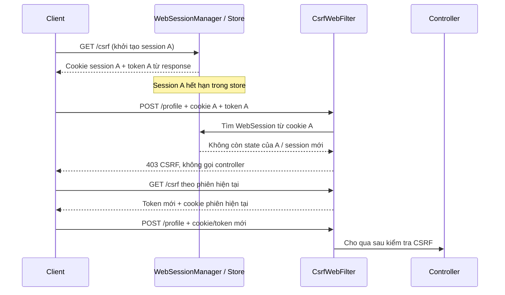

# Kiểm thử vòng đời token khi WebSession thay đổi

> **Chương:** CSRF trên Reactive  
> **Trọng tâm:** Kiểm thử một CSRF token từ khi được cấp cho `WebSession`, tái sử dụng ở các HTTP request tiếp theo, đến khi session đổi ID, bị vô hiệu hóa, hết hạn hoặc token bị xóa. Phân biệt rõ **token kỳ vọng** trong repository, **token đã masking** được xuất cho client và **session ID**.

Trong module `SPRING_SECURITY_HTTP_PROTECTION`, người học áp dụng các lớp phòng vệ HTTP và trình duyệt của Spring Security: CSRF, CORS, security headers, CSP, HSTS, HTTP firewall và bảo vệ session. Module hướng đến cả Servlet và Reactive, thực hành kiểm thử các tình huống tấn công web và xử lý xung đột bảo mật khi triển khai. Bài này tập trung vào **Spring WebFlux** và câu hỏi thường gặp khi tích hợp SPA hoặc biểu mẫu: *Tại sao form vừa tải vẫn POST được, nhưng form giữ lâu lại trả `403`? Khi ID của session đổi thì có bắt buộc CSRF token cũng đổi không?*

## 1. Ba đối tượng dễ bị nhầm với nhau

Trong Spring Security WebFlux, `CsrfWebFilter` mặc định dùng `WebSessionServerCsrfTokenRepository` để lưu **token kỳ vọng** bên trong `WebSession`. Khi client gửi request thay đổi trạng thái, server tải token kỳ vọng rồi so với token thực tế client chủ động gửi qua header hoặc form parameter.

| Đối tượng | Bản chất | Đổi trong trường hợp nào? |
| --- | --- | --- |
| **`WebSession.getId()`** | Định danh session mà browser thường tham chiếu bằng cookie phiên. | Khi session được tạo, ID được thay qua `changeSessionId()`, session hết hạn hoặc client chuyển session. |
| **Raw CSRF token** | Bí mật do `ServerCsrfTokenRepository` tạo và lưu như thuộc tính trong `WebSession`. | Khi chưa có token và cần tạo mới, token bị xóa/thu hồi, session bị thay bằng session mới, hoặc chính sách ứng dụng chủ động tạo lại. |
| **Token xuất cho view/client** | Giá trị `CsrfToken.getToken()` sau khi `ServerCsrfTokenRequestHandler` xử lý. | Có thể thay đổi giữa hai lần GET **chỉ vì XOR masking**, dù raw token không đổi. |

**Đổi session ID không tự động đồng nghĩa xóa token.** Hợp đồng `WebSession.changeSessionId()` đổi định danh của **cùng session**, không tuyên bố xóa thuộc tính. Ngược lại, `WebSession.invalidate()` vô hiệu hóa session và xóa trạng thái lưu trữ. Vì vậy cần kiểm thử **ID thay đổi** và **session bị thay thế/vô hiệu hóa** như hai sự kiện riêng biệt.

Từ Spring Security **6.0**, `XorServerCsrfTokenRequestAttributeHandler` là handler mặc định để giảm nguy cơ BREACH. Nó có thể tạo một **masked token** khác nhau ở mỗi lần xuất. Nếu chỉ gọi `GET /csrf` hai lần và thấy chuỗi token khác nhau, bạn **chưa chứng minh** raw token trong `WebSession` đã bị thay.

## 2. Vòng đời token thông thường

Luồng lý tưởng đối với người dùng mở form rồi gửi POST:

```mermaid
sequenceDiagram
    participant B as Browser
    participant F as CsrfWebFilter
    participant R as WebSessionServerCsrfTokenRepository
    participant S as WebSession
    participant A as Controller

    B->>F: GET /csrf (chưa có token)
    F->>A: Mono<CsrfToken> trong exchange
    A->>A: Consume publisher để tạo response
    A->>R: Tải token, hoặc sinh mới nếu chưa có
    R->>S: Lưu raw CSRF token khi cần
    A-->>B: Masked token + session cookie tương ứng
    B->>F: POST /profile + session cookie + masked token
    F->>R: loadToken(exchange)
    R->>S: Đọc raw token từ WebSession
    R-->>F: Expected raw token
    F->>F: Resolver bỏ XOR masking; so actual và expected
    F->>A: Nếu khớp, cho request tiếp tục
    A-->>B: HTTP 2xx nếu nghiệp vụ thành công
```

`CsrfWebFilter` công bố `Mono<CsrfToken>` trong `ServerWebExchange` dưới key **`CsrfToken.class.getName()`**. Token mới chỉ cần được sinh/lưu khi publisher được **subscribe** trong pipeline. Một GET chỉ đọc dữ liệu, không xuất token, có thể không cần tạo token. Ngược lại, GET render form hoặc `GET /csrf` trả JSON phải consume publisher.

**Hai HTTP request dùng chung session** khi cookie phiên ở request thứ hai trỏ tới đúng state mà request thứ nhất đã lưu. Dùng chung một chuỗi token mà **không** gửi đúng cookie/session không phải là một phép kiểm thử thành công.

### Ma trận trạng thái cần kiểm tra

| Trạng thái ban đầu | Hành động | Raw token kỳ vọng sau hành động | Hành vi với token cũ |
| --- | --- | --- | --- |
| Chưa có token | GET cấp token và consume `Mono` | Được tạo/lưu khi cần | Request kế tiếp có thể gửi token vừa cấp. |
| Session A có token A | GET/POST khác trên **cùng session A** | Thường vẫn là A | Token hợp lệ nếu gửi đúng dạng header/form. |
| Session A có token A | Gọi `changeSessionId()` trên **cùng session A** | Thuộc tính token thường vẫn là A | Token A vẫn tương ứng session đó; **cập nhật cookie theo ID mới**. |
| Session A có token A | `saveToken(exchange, null)` | Không còn token kỳ vọng A trong repository | Token A không còn hợp lệ sau thu hồi. |
| Session A có token A | `invalidate()`, thay bằng session B | B không chứa token A | POST dùng A với session B bị CSRF từ chối. |
| Session A hết hạn trong session store | Browser gửi cookie cũ | Session store không tải được token A | Token A không được chấp nhận; cần cấp token mới cho session mới. |
| Người dùng logout | Logout handler xóa token và/hoặc session theo cấu hình | Token cũ không còn là token kỳ vọng | Form cũ cần lấy token mới trước khi ghi dữ liệu. |
| Client gọi GET lần hai khi XOR bật | Handler tạo masking mới | Raw token có thể vẫn là A | Chuỗi masked có thể khác, nhưng hai chuỗi hợp lệ vẫn liên quan đến A. |

**Lưu ý:** Một `POST` sai token vẫn có thể khiến framework chuẩn bị token mới theo cơ chế deferred token. **Đừng kết luận “không có token trong session sau POST lỗi” là điều kiện bắt buộc.** Điều bất biến cần kiểm tra là request không được thực hiện thao tác ghi khi actual token không hợp lệ.

## 3. Phân biệt đổi ID, xóa token, invalidate và timeout

### 3.1. `WebSession.changeSessionId()`

`changeSessionId()` tạo **định danh mới cho cùng session**, phục vụ các chính sách liên quan tới vòng đời session, chẳng hạn chống session fixation. API không yêu cầu xóa toàn bộ attributes. Nếu token CSRF đang nằm trong attributes và không bị một thành phần khác thu hồi, token có thể tiếp tục hợp lệ.

**Điều cần test:** ID trước và sau khác nhau, repository vẫn tải được raw token, và browser dùng **cookie phiên mới** ở request sau. Không cố gắn cookie ID cũ sau khi server đã đổi ID rồi xem đó là tình huống “cùng session”.

Một số phiên bản/triển khai repository có thể xoay ID session khi lưu hoặc xóa token. Vì vậy **không viết assertion rằng `saveToken(...)` phải giữ nguyên `WebSession.getId()`**. Kiểm thử hợp đồng bền vững hơn là: token có được lưu/tải hay không và request với session hiện hành có hợp lệ hay không.

### 3.2. `WebSession.invalidate()`

`invalidate()` làm session hiện tại không còn được dùng và xóa state của nó. Nếu một client được gắn với session **mới**, `WebSessionServerCsrfTokenRepository.loadToken(...)` không thể tải token vốn nằm trong session cũ. Token cũ không được hợp lệ hóa chỉ vì client biết chuỗi ký tự.

**Điều cần test:** Session B mới không có expected token A; POST kèm token A và session B phải bị CSRF từ chối. Việc yêu cầu GET tiếp theo sẽ tạo/lưu token B khi publisher được consume.

### 3.3. Hết hạn do idle timeout

Session hết hạn khi session store quyết định không còn phục vụ session dựa trên thời gian và chính sách TTL/idle. Trong WebFlux, `WebSession.setMaxIdleTime(Duration)` điều chỉnh chính sách của session, nhưng **không đồng nghĩa chỉ gọi setter là session đã hết hạn**. Với hệ lưu trữ thực, expiry phải được xử lý qua `WebSessionStore`/`WebSessionManager` hoặc Spring Session.

**Điều cần test:** Để thời gian của store vượt ngưỡng một cách kiểm soát, request với cookie cũ không khôi phục lại expected token A; POST token A bị chặn. Không dùng `Thread.sleep(...)` khiến CI chậm, chập chờn; nên dùng clock kiểm thử có thể điều khiển hoặc store cấu hình TTL ngắn trong một integration test riêng.

### 3.4. Xóa token mà không nhất thiết hủy session

Hợp đồng `ServerCsrfTokenRepository.saveToken(exchange, null)` có ý nghĩa **xóa token**. Session có thể tiếp tục tồn tại để giữ những dữ liệu khác, nhưng token CSRF cũ không còn là expected token.

Trong luồng logout, Spring Security có `CsrfServerLogoutHandler` dùng repository để **xóa CSRF token**. Một lần logout thường còn liên quan đến security context/session; khi cấu hình logout tùy chỉnh, phải kiểm tra thực tế những handler nào được giữ lại. Không tự giả định một login thành công luôn xóa token theo cùng cách của Servlet; chính sách xác thực và vòng đời session có thể khác nhau theo cấu hình WebFlux.

## 4. Cấu hình ứng dụng để kiểm thử

Trong Spring Security WebFlux, mặc định có CSRF filter, `WebSessionServerCsrfTokenRepository` và (từ Spring Security 6+) handler XOR. Ví dụ dùng session login và cho phép GET lấy token:

```java
import org.springframework.context.annotation.Bean;
import org.springframework.context.annotation.Configuration;
import org.springframework.security.config.Customizer;
import org.springframework.security.config.annotation.web.reactive.EnableWebFluxSecurity;
import org.springframework.security.config.web.server.ServerHttpSecurity;
import org.springframework.security.web.server.SecurityWebFilterChain;

@Configuration
@EnableWebFluxSecurity
public class ReactiveSecurityConfig {

    @Bean
    SecurityWebFilterChain securityWebFilterChain(ServerHttpSecurity http) {
        return http
            .authorizeExchange(exchanges -> exchanges
                .pathMatchers("/csrf", "/login", "/assets/**").permitAll()
                .anyExchange().authenticated())
            .formLogin(Customizer.withDefaults())
            .csrf(Customizer.withDefaults())
            .build();
    }
}
```

`csrf(Customizer.withDefaults())` chỉ nói rõ chủ đích; CSRF vốn bật mặc định. `permitAll()` cho `GET /csrf` không tự tắt CSRF trên `POST /login`, `POST /profile` hoặc `POST /logout`. Người dùng phải gửi token hợp lệ nếu request là method unsafe theo matcher mặc định.

### 4.1. Endpoint cấp token cho client

Controller sau trả **token do request handler công bố**, không truy cập raw token của repository:

```java
import org.springframework.http.CacheControl;
import org.springframework.http.ResponseEntity;
import org.springframework.security.web.server.csrf.CsrfToken;
import org.springframework.web.bind.annotation.GetMapping;
import org.springframework.web.bind.annotation.RestController;
import org.springframework.web.server.ServerWebExchange;
import reactor.core.publisher.Mono;

@RestController
class CsrfTokenController {
    record TokenView(String headerName, String parameterName, String token) {}

    @GetMapping("/csrf")
    Mono<ResponseEntity<TokenView>> csrf(ServerWebExchange exchange) {
        Mono<CsrfToken> publisher =
            exchange.getAttribute(CsrfToken.class.getName());

        if (publisher == null) {
            return Mono.error(new IllegalStateException(
                "CsrfWebFilter chưa công bố token trên exchange"));
        }

        return publisher.map(csrf -> ResponseEntity.ok()
            .cacheControl(CacheControl.noStore())
            .body(new TokenView(
                csrf.getHeaderName(),
                csrf.getParameterName(),
                csrf.getToken())));
    }
}
```

`map` làm việc nhận token trở thành một phần của `Mono<ResponseEntity<...>>` mà WebFlux sẽ subscribe. Không `subscribe()` thủ công vì response có thể commit trước khi token mới được lưu. `Cache-Control: no-store` tránh vô tình cache giá trị theo session.

### 4.2. Endpoint POST dùng để xác nhận CSRF

Ví dụ đơn giản: chỉ cần endpoint trả `204` nếu mọi security filter cho request tiếp tục.

```java
import org.springframework.http.ResponseEntity;
import org.springframework.web.bind.annotation.PostMapping;
import org.springframework.web.bind.annotation.RestController;
import reactor.core.publisher.Mono;

@RestController
class ProfileController {
    @PostMapping("/profile")
    Mono<ResponseEntity<Void>> updateProfile() {
        return Mono.just(ResponseEntity.noContent().build());
    }
}
```

Đây chỉ là endpoint demo, không lưu dữ liệu. Trong thực tế cần authentication/authorization và validation; `204` chỉ chứng minh request vượt qua các lớp bảo vệ đã cấu hình.

## 5. Unit test repository: dùng `MockWebSession` đúng cách

Muốn kiểm tra **logic lưu token theo session**, dùng `WebSessionServerCsrfTokenRepository` thật với `MockServerWebExchange.Builder.session(WebSession)` và `MockWebSession`. Quan trọng: **tạo exchange mới cho request mới**, nhưng dùng **cùng đối tượng `MockWebSession`** khi mô phỏng cùng session.

Phụ thuộc cần thiết: `spring-security-web`, `spring-test`, `reactor-test` và JUnit 5. Ví dụ sau không khởi động web server.

### 5.1. Tạo helper cho exchange theo session

```java
import org.springframework.mock.http.server.reactive.MockServerHttpRequest;
import org.springframework.mock.web.server.MockServerWebExchange;
import org.springframework.mock.web.server.MockWebSession;

// Trong class test:
static MockServerWebExchange getExchange(MockWebSession session) {
    return MockServerWebExchange.builder(
            MockServerHttpRequest.get("/csrf"))
        .session(session)
        .build();
}
```

`MockServerWebExchange.from(request)` là cách tạo nhanh một exchange, nhưng nếu bạn gọi nó **hai lần không truyền session**, đừng mặc định hai exchange dùng cùng trạng thái. `builder(...).session(session)` làm rõ chủ đích của bài test.

### 5.2. Test token được lưu và tải qua request mới của cùng session

```java
import java.util.concurrent.atomic.AtomicReference;
import org.junit.jupiter.api.Test;
import org.springframework.mock.http.server.reactive.MockServerHttpRequest;
import org.springframework.mock.web.server.MockServerWebExchange;
import org.springframework.mock.web.server.MockWebSession;
import org.springframework.security.web.server.csrf.CsrfToken;
import org.springframework.security.web.server.csrf.WebSessionServerCsrfTokenRepository;
import reactor.test.StepVerifier;

import static org.junit.jupiter.api.Assertions.*;

class WebSessionCsrfLifecycleTest {

    private MockServerWebExchange exchange(MockWebSession session) {
        return MockServerWebExchange.builder(
                MockServerHttpRequest.get("/csrf"))
            .session(session)
            .build();
    }

    @Test
    void sameWebSessionRetainsRawTokenAcrossRequests() {
        var repository = new WebSessionServerCsrfTokenRepository();
        var session = new MockWebSession();
        var firstGet = exchange(session);
        var secondGet = exchange(session); // Request khác, cùng session.
        var generated = new AtomicReference<CsrfToken>();

        StepVerifier.create(repository.generateToken(firstGet)
                .flatMap(token -> repository.saveToken(firstGet, token)
                    .thenReturn(token)))
            .assertNext(generated::set)
            .verifyComplete();

        StepVerifier.create(repository.loadToken(secondGet))
            .assertNext(loaded -> {
                assertEquals(generated.get().getToken(), loaded.getToken());
                assertEquals(generated.get().getHeaderName(),
                    loaded.getHeaderName());
            })
            .verifyComplete();
    }
}
```

Ở đây `generateToken` và `saveToken` được gọi **thủ công trong test repository** để kiểm tra hợp đồng độc lập; controller production nên dùng `Mono<CsrfToken>` của `CsrfWebFilter` thay vì tự sinh/lưu lại.

### 5.3. Test thay session ID nhưng không mất token

Thêm phương thức sau vào cùng class `WebSessionCsrfLifecycleTest` (dùng helper `exchange(...)` ở trên):

```java
@Test
void changingSessionIdDoesNotDiscardStoredCsrfToken() {
    var repository = new WebSessionServerCsrfTokenRepository();
    var session = new MockWebSession();
    var before = exchange(session);
    var issued = new AtomicReference<CsrfToken>();

    StepVerifier.create(repository.generateToken(before)
            .flatMap(token -> repository.saveToken(before, token)
                .thenReturn(token)))
        .assertNext(issued::set)
        .verifyComplete();

    // Đo ID ngay sau khi lưu; không giả định saveToken giữ nguyên ID.
    String oldId = session.getId();
    StepVerifier.create(session.changeSessionId()).verifyComplete();
    assertNotEquals(oldId, session.getId());

    StepVerifier.create(repository.loadToken(exchange(session)))
        .assertNext(loaded ->
            assertEquals(issued.get().getToken(), loaded.getToken()))
        .verifyComplete();
}
```

**Điểm mấu chốt:** `changeSessionId()` làm thay đổi ID nhưng `MockWebSession` vẫn là session đã lưu token. Test đọc lại **thuộc tính repository** thay vì so chuỗi masked trên HTML. Trong HTTP thực, cookie mới phải được browser gửi đúng; nếu cố sử dụng ID cũ sau khi ID được đổi, request có thể bị gắn với session mới và token A không còn phù hợp.

### 5.4. Test xóa token và session mới không có token cũ

```java
@Test
void deletingTokenDoesNotRequireReusingOldToken() {
    var repository = new WebSessionServerCsrfTokenRepository();
    var session = new MockWebSession();
    var exchange = exchange(session);

    StepVerifier.create(repository.generateToken(exchange)
            .flatMap(token -> repository.saveToken(exchange, token)))
        .verifyComplete();

    StepVerifier.create(repository.loadToken(exchange(session)))
        .expectNextCount(1)
        .verifyComplete();

    StepVerifier.create(repository.saveToken(exchange, null))
        .verifyComplete();

    // Sau khi xóa, loadToken không phát CsrfToken.
    StepVerifier.create(repository.loadToken(exchange(session)))
        .verifyComplete();
}

@Test
void freshSessionDoesNotContainPreviousSessionToken() {
    var repository = new WebSessionServerCsrfTokenRepository();
    var sessionA = new MockWebSession();
    var sessionB = new MockWebSession();

    StepVerifier.create(repository.generateToken(exchange(sessionA))
            .flatMap(token ->
                repository.saveToken(exchange(sessionA), token)))
        .verifyComplete();

    StepVerifier.create(repository.loadToken(exchange(sessionA)))
        .expectNextCount(1)
        .verifyComplete();

    // Không copy attributes của A sang B.
    StepVerifier.create(repository.loadToken(exchange(sessionB)))
        .verifyComplete();
}

@Test
void invalidatingWebSessionRemovesStoredToken() {
    var repository = new WebSessionServerCsrfTokenRepository();
    var session = new MockWebSession();
    var first = exchange(session);

    StepVerifier.create(repository.generateToken(first)
            .flatMap(token -> repository.saveToken(first, token)))
        .verifyComplete();
    assertFalse(session.getAttributes().isEmpty());

    StepVerifier.create(session.invalidate()).verifyComplete();
    assertTrue(session.getAttributes().isEmpty());

    // Sau invalidate, mô phỏng session mới mà manager sẽ cấp.
    StepVerifier.create(repository.loadToken(exchange(new MockWebSession())))
        .verifyComplete();
}
```

`saveToken(exchange, null)` là thao tác **xóa token** theo hợp đồng repository. `MockWebSession` B mới có thể dùng làm đại diện cho một session mới sau expiry/invalidation, nhưng nó **không tự chứng minh cơ chế TTL của session store hoạt động**. Hãy kiểm thử expiry thật ở tầng integration riêng.

## 6. Test `CsrfWebFilter`: token từ session A không dùng được ở session B

Test repository chứng minh token nằm ở đâu; một **test filter** cần chứng minh request unsafe bị chặn khi token không khớp với session hiện tại. Để tách vấn đề session khỏi XOR masking, ví dụ này chủ động dùng `ServerCsrfTokenRequestAttributeHandler` (plain) **chỉ trong unit test**.

```java
import java.util.concurrent.atomic.AtomicInteger;
import java.util.concurrent.atomic.AtomicReference;
import org.junit.jupiter.api.Test;
import org.springframework.http.HttpStatus;
import org.springframework.mock.http.server.reactive.MockServerHttpRequest;
import org.springframework.mock.web.server.MockServerWebExchange;
import org.springframework.mock.web.server.MockWebSession;
import org.springframework.security.web.server.csrf.CsrfToken;
import org.springframework.security.web.server.csrf.CsrfWebFilter;
import org.springframework.security.web.server.csrf.ServerCsrfTokenRequestAttributeHandler;
import org.springframework.security.web.server.csrf.WebSessionServerCsrfTokenRepository;
import org.springframework.web.server.WebFilterChain;
import reactor.core.publisher.Mono;
import reactor.test.StepVerifier;

import static org.junit.jupiter.api.Assertions.*;

class CsrfFilterSessionBoundaryTest {

    @Test
    void oldTokenCannotAuthorizePostInNewSession() {
        var repository = new WebSessionServerCsrfTokenRepository();
        var sessionA = new MockWebSession();
        var sessionB = new MockWebSession();
        var firstGet = MockServerWebExchange.builder(
                MockServerHttpRequest.get("/csrf"))
            .session(sessionA)
            .build();
        var tokenA = new AtomicReference<CsrfToken>();

        StepVerifier.create(repository.generateToken(firstGet)
                .flatMap(token -> repository.saveToken(firstGet, token)
                    .thenReturn(token)))
            .assertNext(tokenA::set)
            .verifyComplete();

        var filter = new CsrfWebFilter();
        filter.setCsrfTokenRepository(repository);
        // Dùng plain handler để test raw token; production có thể dùng XOR.
        filter.setRequestHandler(new ServerCsrfTokenRequestAttributeHandler());

        var hits = new AtomicInteger();
        WebFilterChain protectedController = current -> {
            hits.incrementAndGet();
            return Mono.empty();
        };

        // POST có token A nhưng session B hoàn toàn khác.
        var wrong = MockServerWebExchange.builder(
                MockServerHttpRequest.post("/profile")
                    .header(tokenA.get().getHeaderName(),
                            tokenA.get().getToken()))
            .session(sessionB)
            .build();

        StepVerifier.create(filter.filter(wrong, protectedController))
            .verifyComplete();
        assertEquals(HttpStatus.FORBIDDEN, wrong.getResponse().getStatusCode());
        assertEquals(0, hits.get()); // Controller không được thực thi.

        // Cùng token A nhưng request gắn session A đúng.
        var right = MockServerWebExchange.builder(
                MockServerHttpRequest.post("/profile")
                    .header(tokenA.get().getHeaderName(),
                            tokenA.get().getToken()))
            .session(sessionA)
            .build();

        StepVerifier.create(filter.filter(right, protectedController))
            .verifyComplete();
        assertEquals(1, hits.get());
        assertNotEquals(HttpStatus.FORBIDDEN, right.getResponse().getStatusCode());
    }
}
```

Trong phép thử, `hits` chỉ tăng nếu filter đã gọi tiếp chuỗi xử lý. Một request token sai có thể bị filter từ chối **mà không ném exception ra StepVerifier**, vì `ServerAccessDeniedHandler` đã chuyển lỗi thành response `403`. Vì vậy phải kiểm tra **HTTP status và số lần controller được gọi**, không chỉ `verifyComplete()`.

Test này xác minh **phân tách phiên** trên repository và filter với plain token. Ứng dụng thật dùng XOR cần test thêm việc frontend lấy masked token từ GET và gửi lại; không đổi production handler sang plain chỉ để làm test pass.

## 7. Kiểm thử HTTP từ GET cấp token đến POST cùng phiên

Unit test repository với `MockWebSession` **chưa** chứng minh cookie phiên thực sự được cấp và browser gửi lại. Để kiểm tra toàn bộ security chain, sử dụng `WebTestClient` bind vào application context và **truyền cookie lấy từ response GET sang request POST**. Không thay thế test này bằng việc gọi hai HTTP request không chia sẻ cookie.

### 7.1. Cấu hình WebTestClient

Ví dụ class tích hợp dùng Spring Security Test:

```java
import org.junit.jupiter.api.BeforeEach;
import org.springframework.beans.factory.annotation.Autowired;
import org.springframework.context.ApplicationContext;
import org.springframework.test.web.reactive.server.WebTestClient;

import static org.springframework.security.test.web.reactive.server.SecurityMockServerConfigurers.springSecurity;

class CsrfSessionHttpTest {
    @Autowired
    ApplicationContext context;

    WebTestClient client;

    @BeforeEach
    void setup() {
        client = WebTestClient.bindToApplicationContext(context)
            .apply(springSecurity())
            .configureClient()
            .build();
    }
}
```

Đoạn code là **khung class tích hợp**: cần có application context chứa `SecurityWebFilterChain` ở mục 4 và hai controller ví dụ. Nếu test dùng `@SpringBootTest`/`@AutoConfigureWebTestClient`, có thể nhận `WebTestClient` do Spring tạo; không cần tạo một client thứ hai.

### 7.2. Kịch bản lấy masked token và gửi lại bằng đúng cookie

Ví dụ sau là **phương thức bổ sung** trong `CsrfSessionHttpTest`. Nó dùng tên cookie `SESSION`, là mặc định thường gặp của `CookieWebSessionIdResolver` trong WebFlux; nếu ứng dụng đổi tên cookie session hoặc có cấu hình gateway đặc thù, cập nhật test theo resolver thực tế.

```java
import org.junit.jupiter.api.Test;
import org.springframework.http.ResponseCookie;
import org.springframework.test.web.reactive.server.EntityExchangeResult;

import static org.junit.jupiter.api.Assertions.*;
import static org.springframework.security.test.web.reactive.server.SecurityMockServerConfigurers.mockUser;

record CsrfPayload(String headerName, String parameterName, String token) {}

// Đưa phương thức dưới đây vào CsrfSessionHttpTest.
@Test
void csrfFromGetWorksOnPostWithSameSessionCookie() {
    EntityExchangeResult<CsrfPayload> get = client
        .get().uri("/csrf")
        .exchange()
        .expectStatus().isOk()
        .expectBody(CsrfPayload.class)
        .returnResult();

    CsrfPayload payload = get.getResponseBody();
    ResponseCookie sessionCookie =
        get.getResponseCookies().getFirst("SESSION");

    assertNotNull(payload);
    assertNotNull(sessionCookie);
    assertNotNull(payload.token());

    // Đây là POST thực gửi header mà GET đã cấp.
    // mockUser() chỉ tạo authentication cho test, không tạo CSRF token.
    client.mutateWith(mockUser())
        .post().uri("/profile")
        .cookie(sessionCookie.getName(), sessionCookie.getValue())
        .header(payload.headerName(), payload.token())
        .exchange()
        .expectStatus().isNoContent();
}
```

**Điểm then chốt:** `getResponseBody()` lấy token **đã đi qua request handler**, thường là masked token trong Spring Security 6+. Header POST dùng **chính giá trị đó**. Cookie POST lấy từ response GET, không hardcode ID mới. `mockUser()` chỉ mô phỏng authentication và **không phải** tiện ích `csrf()`; vì vậy test vẫn thật sự kiểm tra CSRF filter/repository.

Nếu nhận `403` dù đã gửi token, kiểm tra xem GET có sinh `Set-Cookie`, tên cookie đúng chưa, và code có thật sự gửi cùng cookie khi POST. Trong ứng dụng có login thật, kiểm tra riêng luồng authentication/session persistence thay vì chỉ dựa vào mock user.

### 7.3. Kịch bản lấy token ở session A nhưng gửi cùng cookie session B

Một test bổ sung có thể gọi `GET /csrf` **hai lần không gửi lại cookie cũ** để nhận hai session độc lập. Lưu riêng token A/cookie A và token B/cookie B. Sau đó:

```text
GET /csrf (browser A) -> tokenA + cookieA
GET /csrf (browser B, không gửi cookieA) -> tokenB + cookieB

POST /profile: cookieA + tokenA -> qua CSRF
POST /profile: cookieB + tokenA -> CSRF 403
POST /profile: cookieB + tokenB -> qua CSRF
POST /profile: thiếu cookie + tokenA -> CSRF 403
```

Đây là **ma trận HTTP request**, không phải mã chạy độc lập. Khi thử nghiệm, cần giữ authentication giống nhau (hoặc dùng test authentication), để sự khác biệt `403` xuất phát từ CSRF chứ không phải phân quyền.

**Không so riêng tokenA.token và tokenB.token để kết luận**: XOR masking khiến chuỗi xuất ra khác nhau ngay cả khi raw token cùng session chưa thay. Phép kiểm chứng quan trọng hơn là **sự kết hợp giữa token, cookie và kết quả của unsafe request**.

### 7.4. Khi nào dùng `csrf()` test mutator?

Trong `spring-security-test`, có thể kiểm tra nhanh luồng filter:

```java
// Ví dụ trong test với WebTestClient gắn springSecurity().
client.mutateWith(mockUser())
    .post().uri("/profile")
    .exchange()
    .expectStatus().isForbidden();

client.mutateWith(mockUser()).mutateWith(csrf())
    .post().uri("/profile")
    .exchange()
    .expectStatus().isNoContent();
```

Đoạn trên cần import static `SecurityMockServerConfigurers.csrf`. Nó phù hợp kiểm tra **request thiếu token và token hợp lệ** ở mức filter. Tuy nhiên `csrf()` cấp dữ liệu giả cho test, **không xác minh được quy trình cấp `Set-Cookie` hoặc giữ `WebSession` giữa hai request**. Vì thế bài học này phải có thêm HTTP test như mục 7.2.

## 8. Kiểm thử khi session hết hạn

**Hết hạn theo thời gian khác với gọi `invalidate()` trực tiếp.** Một `MockWebSession` được truyền thẳng vào `MockServerWebExchange.Builder.session(...)` vẫn là đối tượng cụ thể mà test đã cung cấp; test đó không tự mô phỏng `WebSessionManager` đọc cookie cũ, tra cứu session store rồi nhận ra TTL hết hạn.

Muốn test expiry một cách đáng tin cậy, cần:

1. Sử dụng `WebSessionManager`/`WebSessionStore` hoặc **Spring Session Reactive** thực trong integration test, không chỉ một `MockWebSession` tái sử dụng.
2. Cấu hình idle timeout ngắn **chỉ cho test**, hoặc sử dụng clock/store có thể điều khiển.
3. Gọi GET để tạo session A và token A, ghi lại cookie session (không ghi giá trị cookie vào log).
4. Làm store hết hạn A, xác minh session cũ không còn được khôi phục khi nhận cookie A.
5. Gửi POST kèm **cookie cũ + token A** và xác nhận `403` do CSRF; không có side effect trong controller.
6. Lấy token mới qua GET trong session hiện hành, rồi POST với cookie/token mới để xác nhận hệ thống phục hồi đúng.



**Không dùng thời gian ngủ cố định trong CI nếu có thể tránh**: `Thread.sleep(...)` có thể làm test chậm và không ổn định do scheduler, thời gian hệ thống, cache/store phân tán. Tùy implementation, có thể inject `Clock` hoặc fake/session store điều khiển được, rồi kích hoạt expiry theo cách được hỗ trợ.

Điểm cần ghi nhận là **repository không tìm được token A gắn với phiên hiện tại**. `CsrfWebFilter` có thể chuẩn bị token mới khi phải kiểm tra POST, nhưng token vừa tạo không được coi là token A hợp lệ; controller phải không được chạy.

## 9. Logout, login và chính sách thu hồi token

### 9.1. Logout nên được kiểm thử như một hành động unsafe

Spring Security WebFlux mặc định bảo vệ **POST /logout** bằng CSRF. `CsrfServerLogoutHandler` có trách nhiệm xóa CSRF token qua `ServerCsrfTokenRepository` khi logout; các logout handler khác có thể xóa security context hoặc session tùy cấu hình.

Kịch bản test nên gồm:

| Bước | Yêu cầu | Kỳ vọng |
| --- | --- | --- |
| 1 | GET trang logout/form hoặc `/csrf` với session A | Nhận token A và cookie A. |
| 2 | POST `/logout` với cookie A, **thiếu token** | Bị CSRF từ chối, không hoàn tất logout chỉ vì cookie có mặt. |
| 3 | POST `/logout` với cookie A và token A | Qua CSRF và hoàn tất luồng logout đã cấu hình. |
| 4 | Kiểm tra repository/session sau logout | Token A đã bị xóa theo logout handler, hoặc toàn bộ session A bị vô hiệu hóa. |
| 5 | GET trang mới hoặc `/csrf` | Cấp token phù hợp với session hiện tại nếu cần. |
| 6 | POST với **token A cũ**, dù dùng cookie mới | Không được chấp nhận khi expected token tương ứng đã bị thu hồi. |

Nếu ứng dụng **tùy chỉnh logout handler**, hãy kiểm tra có còn áp dụng thành phần xóa CSRF token hay không. Không sửa `GET /logout` để thực hiện logout cho tiện: GET không được matcher CSRF mặc định yêu cầu token, khiến thao tác này dễ bị giả mạo.

### 9.2. Login không đồng nghĩa với mọi phiên bản đều xóa token

CSRF cũng nên bảo vệ request đăng nhập để chống login CSRF. Sau login, một ứng dụng có thể xoay session ID nhằm giảm nguy cơ session fixation, thay session hoặc thay đổi state của authentication.

**Không khẳng định “cứ login là raw CSRF token đổi”** như quy tắc bất biến. Với WebFlux, phải kiểm tra **cấu hình authentication, session manager, repository và các hook thu hồi token** của ứng dụng. Nếu chỉ đổi session ID của cùng session, thuộc tính token có thể vẫn còn. Nếu thay bằng session mới hoặc xóa token, form/SPAs giữ token cũ phải yêu cầu token mới.

Một bài test chất lượng cần kiểm tra:

- POST login **thiếu CSRF token** bị chặn trước xác thực (trừ khi có ngoại lệ cố ý đã được đánh giá an ninh).
- Login hợp lệ có CSRF token và credential chính xác hoàn tất.
- Cookie/session sau login thuộc session nào? Có đổi ID mà vẫn giữ attributes hay tạo session mới?
- Lấy lại token từ `GET /csrf` hoặc form sau login, rồi POST unsafe với cookie/token hiện hành thành công.
- Token cũ chỉ bị từ chối khi thật sự đã bị thu hồi hoặc không còn thuộc expected state. Không dự đoán dựa trên việc chuỗi masked hay cookie ID thay đổi.

### 9.3. Nhiều tab, thao tác đồng thời và race condition

Khi người dùng mở **hai tab** của cùng một session, mỗi tab có thể nhận masked token khác nhau vì XOR dù raw token giống nhau. Nếu một tab logout hoặc session hết hạn, tab kia giữ form cũ sẽ không còn gửi request hợp lệ.

Nếu `changeSessionId` xảy ra trong khi browser đang có các request song song, cookie cũ/mới có thể không đến server theo thứ tự bạn dự đoán. Test end-to-end nên xác minh sau khi cookie mới được nhận, nhưng **không dựa vào giả định rằng session ID luôn giữ nguyên từ GET đến GET**, đặc biệt khi repository hoặc chính sách đăng nhập có thể đổi ID.

Đối với request ghi dữ liệu, chỉ retry sau khi có trạng thái phiên/token rõ ràng và người dùng xác nhận nếu nghiệp vụ nhạy cảm. Không tự động replay giao dịch thanh toán/xóa dữ liệu vô hạn khi nhận `403`.

## 10. Điều gì thay đổi khi dùng CookieServerCsrfTokenRepository?

Khi cấu hình `CookieServerCsrfTokenRepository`, expected token không còn được giữ **trong `WebSession` theo cách mặc định** mà ở cookie `XSRF-TOKEN`. Vì thế:

| Kiểm thử | WebSession repository | Cookie repository |
| --- | --- | --- |
| Tạo expected token | Lưu trong `WebSession` | Gửi `Set-Cookie: XSRF-TOKEN=...` |
| POST cùng phiên | Cần đúng session + header/form token | Cần cookie token + header/form token phù hợp |
| `changeSessionId()` | Chưa đủ kết luận token đổi | Việc đổi session ID có thể không động đến cookie CSRF riêng |
| Session timeout | Token cũ mất cùng session A | CSRF cookie có thể tồn tại lâu hơn session, tùy cookie policy |
| Logout/thu hồi token | Xóa thuộc tính hoặc invalidation theo handler | Cần bảo đảm cookie token được xóa/thu hồi theo policy |
| SPA đọc token | Thường lấy từ view/`GET /csrf` | Có thể đọc cookie nếu `HttpOnly=false`, với handler tương thích |

Không coi cookie repository là cách “sửa” session timeout không có đánh đổi. Cookie token nằm ở client có vòng đời và thuộc tính riêng (`Secure`, `HttpOnly`, `SameSite`, `Path`, `Domain`), không nhất thiết đồng bộ với vòng đời authentication. Nếu JavaScript đọc token thô từ cookie, handler XOR mặc định có thể không chấp nhận raw token trong header; cần cấu hình plain hoặc hybrid handler phù hợp và đánh giá BREACH.

Với bài **“Kiểm thử vòng đời token khi WebSession thay đổi”**, dùng `WebSessionServerCsrfTokenRepository` làm đối tượng chính. Chuyển sang cookie repository chỉ để đối chiếu **ranh giới của các phép kiểm thử**, không phải thay thế chủ đề.

## 11. Bộ kiểm thử hồi quy sau nâng cấp hoặc thay đổi session store

Đối với ứng dụng có xác thực cookie, nên duy trì ma trận sau qua mỗi lần đổi Spring Security, WebFlux, Spring Session/Redis hoặc gateway:

| ID | Điều kiện | Thao tác | Kết quả cần xác minh |
| --- | --- | --- | --- |
| S01 | Session mới, chưa cấp token | GET `/csrf` | Trả token; session lưu expected token mới khi được consume. |
| S02 | Session A có token A | GET rồi POST đúng cookie/token A | Qua CSRF, controller được gọi. |
| S03 | Session A có token A | POST thiếu actual token | `403`, controller không chạy. |
| S04 | Session A có token A | POST token ngẫu nhiên | `403`, không có side effect. |
| S05 | Session A có token A | `changeSessionId()` của cùng session, tiếp tục với cookie mới | Token expected vẫn được xác minh theo state thực; không tự xem ID mới là token mới. |
| S06 | Session A có token A | `saveToken(exchange, null)` | Repository không tải được token A nữa. |
| S07 | Session A có token A | Invalidated A → tạo B | Token A không được chấp nhận trong B. |
| S08 | Session A hết hạn | POST với cookie A cũ và token A | CSRF từ chối, controller không chạy. |
| S09 | Session mới sau timeout | GET token B rồi POST cùng cookie/token B | Qua CSRF nếu xác thực phù hợp. |
| S10 | Session có nhiều tab | Hai GET nhận masked token khác nhau, POST hợp lệ | Không so chuỗi masked để kết luận raw token đã đổi. |
| S11 | Session A hợp lệ | POST logout có token; thử lại token A | Token bị thu hồi/không còn thuộc expected state. |
| S12 | Session A trước login | POST login hợp lệ; kiểm tra cookie/attributes/token sau login | Hành vi theo cấu hình xác thực cụ thể, không áp quy tắc xoay token máy móc. |
| S13 | GET và POST có cookie khác nhau | Dùng token A với cookie B | `403` do CSRF, không bị nhầm với authorization. |
| S14 | API nhận JSON | JSON body chỉ có `"_csrf"`, không header | Bị CSRF từ chối; client phải gửi header. |
| S15 | Đổi session store/backend | Dùng cookie được cấp ở node A tại node B | Không mất CSRF token nếu state thực sự được chia sẻ/persist đúng. |

**Không chỉ assert HTTP status:** Với request bị từ chối, cần kiểm tra endpoint **không ghi dữ liệu**, ví dụ qua spy service, mock repository nghiệp vụ hoặc số bản ghi trước/sau. Ngược lại, khi test token hợp lệ, bảo đảm request vượt CSRF nhưng vẫn tôn trọng authentication/authorization.

### Phân biệt unit test và integration test

| Lớp test | Thứ nó xác minh tốt | Điều nó **không** tự xác minh |
| --- | --- | --- |
| `WebSessionServerCsrfTokenRepository` + `MockWebSession` | Lưu, tải, xóa token; cùng hay khác WebSession. | Cookie thật, timeout TTL trong store, security chain. |
| `CsrfWebFilter` + `MockServerWebExchange` | Request hợp lệ/sai token có qua filter hay bị 403. | Login/logout toàn chain, browser cookie jar, proxy. |
| `WebTestClient` + Spring Security | Token GET → POST, CSRF filter và endpoint. | Session store phân tán nếu test chỉ dùng in-memory. |
| Test với Spring Session/Redis hoặc session store tương đương | TTL, persistence, nhiều node và stale session cookie. | Không tự thay thế test UI/browser/CORS. |
| Browser E2E | Form, fetch header, cookie policy, redirect, hai tab. | Không đủ để chứng minh logic repository nếu thiếu test kỹ thuật. |

## 12. Chẩn đoán lỗi `403` liên quan WebSession

| Triệu chứng | Giả thuyết cần kiểm tra | Cách xác minh |
| --- | --- | --- |
| POST đầu tiên sau GET `/csrf` bị `403` | Cookie session từ GET không được gửi lại; hoặc token chưa được subscribe/lưu | Quan sát `Set-Cookie` ở GET và `Cookie` ở POST; kiểm tra endpoint trả `Mono`. |
| POST chỉ lỗi sau khi form mở lâu | WebSession hết hạn; expected token cũ không còn | Test với timeout kiểm soát, xác minh store đã bỏ session A. |
| Sau đổi session ID, token “không còn hợp lệ” | Client vẫn gửi **cookie ID cũ**, bị map sang session mới | Kiểm tra cookie response mới và request sau; đừng chỉ so ID. |
| Sau `changeSessionId()`, unit test bảo raw token phải đổi rồi thất bại | Nhầm đổi ID với thay session/thu hồi token | Đọc lại thuộc tính từ repository trong **cùng session**; token có thể giữ nguyên. |
| Sau logout, form ở tab khác bị `403` | Logout đã xóa CSRF token hoặc session | Đây thường là hành vi mong đợi; lấy token mới cho phiên hiện tại. |
| Sau login, token trên HTML trông khác | XOR masking hoặc token thực sự được cấp lại | Kiểm tra raw token trong repository ở test; không so mỗi masked token. |
| Cùng một test pass ở memory nhưng fail với Redis | Session persistence/TTL, cookie resolver, serialization hoặc cluster routing | Test nhiều request/nhiều node với store thật và đúng session cookie. |
| `GET /csrf` không có session cookie | Publisher chưa được consume, session chưa start, response commit sớm hoặc cookie policy | Đảm bảo `map`/`then` nằm trong HTTP pipeline và xem headers. |
| Token header đúng nhưng POST `403` | XOR handler mong masked token, client gửi raw; hoặc cookie không khớp | Kiểm tra `CsrfToken.getHeaderName()`, dạng token và repository. |
| Có `403` mà không có lỗi CSRF cụ thể | Authorization cũng có thể trả 403 | Phân biệt handler CSRF và authorization trong log/test. |
| Session ID đổi trong quá trình lưu token | Repository hoặc session strategy có thể xoay ID | Không assert ID bất biến; kiểm tra cookie ID hiện hành và expected token. |

Khi điều tra, đi theo thứ tự **security chain → CSRF matcher → cookie của GET và POST → `WebSession` thực được tải → repository expected token → raw/masked handler → actual token trong header/form → kết quả filter/controller**. Không log token, session ID nguyên vẹn, cookie hoặc thông điệp chứa bí mật. Có thể log request ID, route template, HTTP method, loại lỗi và session-state category đã được ẩn danh phù hợp.

## 13. Bài thực hành

1. Viết unit test với `MockWebSession` như mục 5: tạo/lưu token A, đọc từ request thứ hai của cùng session và xác minh raw token vẫn giữ.
2. Thực hiện `changeSessionId()` sau khi lưu token; xác nhận session ID mới khác ID ngay trước thao tác và token vẫn tải được. Sau đó xóa token bằng `saveToken(exchange, null)` và xác nhận `loadToken` rỗng.
3. Tạo session B mới; test `CsrfWebFilter` từ chối POST với token A + session B, còn POST với token A + session A qua được CSRF.
4. Dùng `WebTestClient` thực hiện `GET /csrf` → lấy token/cookie → `POST /profile`. Thử cố ý bỏ cookie, thay cookie của client khác, thiếu token và sử dụng token sai.
5. Thử logout và một phiên được cho hết hạn trong session store; xác minh request với token cũ không thực hiện tác dụng phụ, sau đó GET token mới rồi POST thành công.
6. Lặp lại với hai tab, login và Spring Session store (nếu có), ghi **trạng thái và HTTP status**, không ghi giá trị token hoặc cookie bí mật.

**Câu hỏi tự kiểm tra:** Vì sao `WebSession.changeSessionId()` không nhất thiết làm token CSRF đổi? Vì sao `invalidate()` và timeout là hai cách làm mất expected state của session? Vì sao hai masked token khác nhau qua hai GET vẫn có thể hợp lệ với cùng raw token? Vì sao test chỉ dùng `csrf()` không chứng minh vòng đời cookie?

## 14. Tổng kết

- **Raw CSRF token mặc định thuộc về `WebSession`** qua `WebSessionServerCsrfTokenRepository`; request khác muốn dùng lại token phải gắn đúng session state.
- **`changeSessionId()` không đồng nghĩa `invalidate()`**: xoay ID giữ session hiện hành; invalidate hoặc expiry làm session cũ không còn phục vụ request. Đừng coi chuỗi cookie ID và token là cùng một giá trị.
- **`saveToken(exchange, null)` xóa token kỳ vọng**; logout có thể thu hồi token. Không mặc định login luôn xoay raw token; kiểm tra cấu hình thực tế.
- **XOR masking có thể thay chuỗi token được công bố ở mỗi GET**, không chứng minh raw token thay đổi.
- **Kiểm thử có phân tầng**: repository + mock session, CSRF filter + mock exchange, WebTestClient với cookie GET → POST, rồi session store thực cho timeout/cluster.
- **CSRF không thay các lớp khác**: xác thực, phân quyền, CORS, CSP, HTTPS/HSTS và bảo vệ session phải tiếp tục phối hợp trong module `SPRING_SECURITY_HTTP_PROTECTION`.

## Tài liệu tham khảo chính thức

- [Spring Security — CSRF trong WebFlux](https://docs.spring.io/spring-security/reference/reactive/exploits/csrf.html)
- [Spring Security — CsrfWebFilter API](https://docs.spring.io/spring-security/reference/api/java/org/springframework/security/web/server/csrf/CsrfWebFilter.html)
- [Spring Security — WebSessionServerCsrfTokenRepository API](https://docs.spring.io/spring-security/reference/api/java/org/springframework/security/web/server/csrf/WebSessionServerCsrfTokenRepository.html)
- [Spring Security — ServerCsrfTokenRepository API](https://docs.spring.io/spring-security/reference/api/java/org/springframework/security/web/server/csrf/ServerCsrfTokenRepository.html)
- [Spring Security — CsrfServerLogoutHandler API](https://docs.spring.io/spring-security/reference/api/java/org/springframework/security/web/server/csrf/CsrfServerLogoutHandler.html)
- [Spring Framework — WebSession API](https://docs.spring.io/spring-framework/docs/current/javadoc-api/org/springframework/web/server/WebSession.html)
- [Spring Framework — MockWebSession API](https://docs.spring.io/spring-framework/docs/current/javadoc-api/org/springframework/mock/web/server/MockWebSession.html)
- [Spring Framework — MockServerWebExchange.Builder API](https://docs.spring.io/spring-framework/docs/current/javadoc-api/org/springframework/mock/web/server/MockServerWebExchange.Builder.html)
- [Spring Framework — CookieWebSessionIdResolver API](https://docs.spring.io/spring-framework/docs/current/javadoc-api/org/springframework/web/server/session/CookieWebSessionIdResolver.html)
- [Spring Security — Reactive CSRF Testing](https://docs.spring.io/spring-security/reference/reactive/test/web/csrf.html)
- [Spring Session — WebSession Integration](https://docs.spring.io/spring-session/reference/web-session.html)
