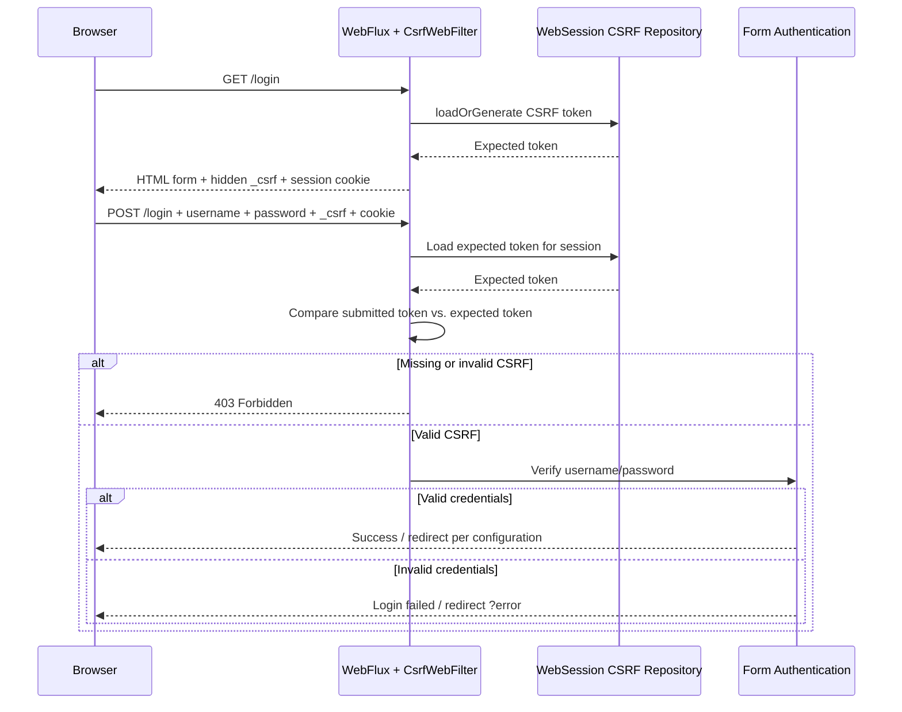

# Integrating CSRF Tokens into Login Forms in Spring Security Reactive

A **Spring WebFlux** login form typically submits `username` and `password` via `POST /login`. Spring Security Reactive authenticates these two fields, yet before allowing the POST request to proceed, the system also checks a **CSRF token**. That is why a form with completely valid username/password can still return **403 Forbidden**: the request does not carry a valid CSRF token, or the token does not match the state expected by the server.

This lesson walks through integrating CSRF tokens into **reactive form login**: why protection is needed even before the user logs in, how `CsrfWebFilter` generates/validates tokens, how Thymeleaf auto-inserts hidden inputs, how to render tokens manually for custom forms, how to send tokens via JavaScript/headers, testing with browsers, `curl`, and `WebTestClient`, and common implementation mistakes.

**Technical scope:** Java 17+, Spring Boot 3.x, Spring Security 6.x, Spring WebFlux (Reactor). Uses `ServerHttpSecurity`, `SecurityWebFilterChain`, `ServerCsrfTokenRepository`, `CsrfToken`, and `ServerWebExchange`. Do not copy Servlet MVC APIs like `HttpSecurity`, `HttpServletRequest`, or `CsrfTokenRepository` into WebFlux examples.

## 1. Why Does the Login Page Itself Need CSRF?

**CSRF — Cross-Site Request Forgery** — is an attack that causes a victim's browser to send a request to an application the victim uses while the request originates from an untrusted site. The risk arises when the browser **automatically attaches credentials** such as session cookies, or in some cases browser-saved credentials.

For login, the risk is not limited to "a stranger mutating a logged-in user's data." A **login CSRF** scenario works like this:

1. The attacker owns a separate account on the target application.
2. The attacker tricks or forces the victim's browser into sending `POST /login` with the **attacker's credentials**.
3. If the app accepts login POSTs without a CSRF token, the victim's browser can get bound to **the attacker's account session**.
4. Believing they are using their own account, the victim enters sensitive data into that session; the data may be recorded under the attacker-controlled account.

Therefore **`POST /login` must still be CSRF-protected**, even though the user is not yet authenticated. Spring Security WebFlux applies CSRF to login automatically under its default policy.

A CSRF token **does not replace** passwords, MFA, account checks, brute-force defenses, or authorization. It only proves that a state-changing request came from a flow with access to a valid token issued by the application, rather than relying solely on cookies/credentials attached automatically by the browser.

### HTTP Method Principles

| Method | Conventional Meaning | Spring Security CSRF Default |
| --- | --- | --- |
| `GET`, `HEAD`, `OPTIONS`, `TRACE` | Read-only, should not mutate state | Usually does not require a CSRF token |
| `POST`, `PUT`, `PATCH`, `DELETE` | Can mutate state | Requires a CSRF token when CSRF is enabled |
| `GET /login` | Displays the page with form and token | No CSRF token needed to fetch the page |
| `POST /login` | Creates/establishes login state | **Must include a valid CSRF token** |
| `POST /logout` | Ends the session | **Must include a valid CSRF token** |

"Safe GET" is a **security convention the application must honor**. Never place password changes, order creation, or actual logout on a GET URL merely because GET is not CSRF-checked by default.

## 2. From GET Form to POST Login: Token Lifecycle



Key takeaways:

- **Tokens are issued by the server** when the client loads the form page; never generate UUIDs or `Math.random()` strings on the frontend to fake tokens.
- The browser must send the **same session/cookie matching** that token. A valid CSRF token belonging to a different session will still be rejected.
- The form must submit the token in the **request parameter** or configured header. Merely having a CSRF cookie is not always enough: the synchronizer-token pattern requires the client to actively place the value in a field/header.
- CSRF is verified **before** login succeeds. A bad token usually yields **403**, whereas a wrong password after valid CSRF follows the **authentication failure flow**.
- Tokens can be loaded/generated **lazily** as a `Mono<CsrfToken>`; calling a getter without subscribing to the publisher is not enough for the token to appear in HTML.
- Successful login can rotate the session or CSRF state per configuration. Never cache a token forever from a single form render.

## 3. Classes/APIs to Know in Spring Security WebFlux

| API | Role |
| --- | --- |
| `CsrfWebFilter` | Filter checking CSRF on protected requests |
| `ServerCsrfTokenRepository` | Contract `generateToken`, `saveToken`, `loadToken` based on `ServerWebExchange` |
| `WebSessionServerCsrfTokenRepository` | Default repository storing the expected token in `WebSession` |
| `CookieServerCsrfTokenRepository` | Option storing the CSRF token in a cookie, often considered when JavaScript must read/send tokens |
| `CsrfToken` | Holds `getParameterName()`, `getHeaderName()`, and `getToken()` |
| `ServerCsrfTokenRequestHandler` | Exposes the token to requests/views and resolves tokens sent by clients |
| `XorServerCsrfTokenRequestAttributeHandler` | Default handler since Spring Security 6.0, adding an XOR representation layer to mitigate certain BREACH attacks |
| `ServerCsrfTokenRequestAttributeHandler` | Simpler handler that can be configured instead, without the comparable XOR/BREACH layer |
| `ServerHttpSecurity.CsrfSpec` | DSL configuring CSRF for a `SecurityWebFilterChain` |
| `CsrfRequestDataValueProcessor` | Connects Spring view rendering to adding tokens to HTML forms |

In Spring Security 6.x, `CsrfWebFilter` places a **`Mono<CsrfToken>`** in `ServerWebExchange` attributes under key:

```java
CsrfToken.class.getName()
```

That means the key equals the string `org.springframework.security.web.server.csrf.CsrfToken`, not a Java Servlet request attribute. Views/Thymeleaf can subscribe and supply the token as a hidden field. With other view technologies, you must convert the publisher into a value your template can render.

### Raw Token, Rendered Value, and Cookie Token

Since Spring Security 6.0, `XorServerCsrfTokenRequestAttributeHandler` is used by default for stronger protection against BREACH risks. Consequently, **the token value rendered in HTML may be XOR-masked**, differing from the base token stored in the repository. Spring Security knows how to decode/unmask it when the request comes back.

Therefore, **do not manually compare** the hidden input's `value` string against the value in `WebSession`/cookie and conclude the token is wrong. Do not Base64-encode, hash, double-XOR, or alter the rendered value before submitting. For standard forms, submit verbatim the value supplied by the framework.

The default WebSession repository fits server-rendered form login well. You do not need to switch to cookie tokens or disable XOR just to make a Thymeleaf form work.

## 4. Three Conditions for a Valid CSRF Login POST

A complete login form has:

1. **Right action and method:** POST to the URL configured by `ServerHttpSecurity.formLogin()`, defaulting to `/login` or a custom login URL.
2. **Right login fields:** `username` and `password` by default.
3. **Valid CSRF token:** a hidden field with `name` equal to `CsrfToken.getParameterName()` (usually `_csrf`) and `value` equal to `CsrfToken.getToken()` rendered for the corresponding request/session.

Example **server-rendered HTML**:

```html
<form action="/login" method="post">
  <label>Username <input type="text" name="username"></label>
  <label>Password <input type="password" name="password"></label>
  <input type="hidden" name="_csrf" value="TOKEN_FROM_CURRENT_PAGE">
  <button type="submit">Sign in</button>
</form>
```

`TOKEN_FROM_CURRENT_PAGE` in the sample above is an **illustrative placeholder**, not a usable value for logging in. On a real page, the server/template replaces it with a dynamic token. Never put real tokens in documentation or logs.

**`GET /login` being `permitAll` does not exempt `POST /login` from CSRF.** Authorization and CSRF are two independent checks: letting unauthenticated users open the login page is right; dropping CSRF on the session-creating action is an entirely different security change.

## 5. Runnable Example: Spring Boot WebFlux + Thymeleaf Auto-Injecting CSRF

This is the simplest path and should be the first choice for **server-rendered form login** apps. The example uses Java 17+ files and an HTML template in a **Spring Boot 3.x / Spring Security 6.x project**.

### 5.1. Dependencies

In a Gradle project with the Spring Boot plugin and repositories already configured:

```groovy
dependencies {
    implementation 'org.springframework.boot:spring-boot-starter-webflux'
    implementation 'org.springframework.boot:spring-boot-starter-security'
    implementation 'org.springframework.boot:spring-boot-starter-thymeleaf'

    testImplementation 'org.springframework.boot:spring-boot-starter-test'
    testImplementation 'org.springframework.security:spring-security-test'
}
```

Do not add `spring-boot-starter-web` for the demo because this lesson uses **Spring WebFlux**, not Spring MVC/Servlet. Keep starter versions aligned via the project's Spring Boot BOM.

### 5.2. `src/main/java/demo/csrf/CsrfLoginApplication.java`

```java
package demo.csrf;

import org.springframework.boot.SpringApplication;
import org.springframework.boot.autoconfigure.SpringBootApplication;

@SpringBootApplication
public class CsrfLoginApplication {
    public static void main(String[] args) {
        SpringApplication.run(CsrfLoginApplication.class, args);
    }
}
```

### 5.3. `src/main/java/demo/csrf/SecurityConfig.java`

```java
package demo.csrf;

import org.springframework.context.annotation.Bean;
import org.springframework.context.annotation.Configuration;
import org.springframework.security.config.Customizer;
import org.springframework.security.config.annotation.web.reactive.EnableWebFluxSecurity;
import org.springframework.security.config.web.server.ServerHttpSecurity;
import org.springframework.security.core.userdetails.ReactiveUserDetailsService;
import org.springframework.security.core.userdetails.User;
import org.springframework.security.core.userdetails.UserDetails;
import org.springframework.security.crypto.factory.PasswordEncoderFactories;
import org.springframework.security.crypto.password.PasswordEncoder;
import org.springframework.security.provisioning.MapReactiveUserDetailsService;
import org.springframework.security.web.server.SecurityWebFilterChain;

@Configuration
@EnableWebFluxSecurity
public class SecurityConfig {

    @Bean
    SecurityWebFilterChain securityWebFilterChain(ServerHttpSecurity http) {
        return http
            .authorizeExchange(exchanges -> exchanges
                .pathMatchers("/login", "/public/**").permitAll()
                .anyExchange().authenticated())
            .formLogin(form -> form.loginPage("/login"))
            .httpBasic(basic -> basic.disable())
            .csrf(Customizer.withDefaults())
            .logout(Customizer.withDefaults())
            .build();
    }

    @Bean
    ReactiveUserDetailsService users() {
        PasswordEncoder encoder =
            PasswordEncoderFactories.createDelegatingPasswordEncoder();

        UserDetails reader = User.withUsername("reader")
            .password(encoder.encode("demo123"))
            .roles("READER")
            .build();

        return new MapReactiveUserDetailsService(reader);
    }
}
```

Meaning of the configuration:

- `.formLogin(form -> form.loginPage("/login"))`: the application **serves `GET /login` itself**; Spring Security handles the corresponding POST login. Because a custom login page is chosen, do not expect the default login page to still be generated.
- `.pathMatchers("/login", "/public/**").permitAll()`: unauthenticated users can still reach the login page. This rule **does not disable CSRF**.
- `.csrf(Customizer.withDefaults())`: keeps default CSRF enabled, including POST login protection.
- `.httpBasic(...disable())`: prevents browsers from getting a Basic prompt so the example focuses solely on form login.
- `.logout(Customizer.withDefaults())`: keeps protected logout handling; if you build a custom logout form, its POST must also send a CSRF token.
- User `reader/demo123` is for **local demo** use. The password is encoded when creating the user; never use these sample credentials in production.

### 5.4. `src/main/java/demo/csrf/LoginPageController.java`

```java
package demo.csrf;

import org.springframework.stereotype.Controller;
import org.springframework.web.bind.annotation.GetMapping;

@Controller
public class LoginPageController {
    @GetMapping("/login")
    public String loginPage() {
        return "login";
    }
}
```

This is a `@Controller` returning a **view name**, not a `@RestController` returning raw HTML strings. Spring Boot Thymeleaf looks up `src/main/resources/templates/login.html`.

### 5.5. `src/main/resources/templates/login.html`

```html
<!DOCTYPE html>
<html lang="en" xmlns:th="http://www.thymeleaf.org">
<head>
    <meta charset="UTF-8">
    <title>Sign in</title>
</head>
<body>
<h1>Sign in</h1>

<p th:if="${param.error}">Invalid login credentials.</p>

<form th:action="@{/login}" method="post">
    <label for="username">Username</label>
    <input id="username" name="username" type="text"
           autocomplete="username" required>

    <label for="password">Password</label>
    <input id="password" name="password" type="password"
           autocomplete="current-password" required>

    <button type="submit">Sign in</button>
</form>
</body>
</html>
```

**Why does the template not have an `<input type="hidden"...>` line?** Because Thymeleaf integrates with `CsrfRequestDataValueProcessor`. For forms using `th:action` and method `post`, Thymeleaf can **auto-inject the hidden CSRF input** when rendering. When viewing the **rendered HTML** (not the raw template file), you will see a field equivalent to:

```html
<input type="hidden" name="_csrf" value="VALUE_GENERATED_FOR_THIS_REQUEST">
```

The actual value will differ from the placeholder string above and may be represented as an XOR-masked token. **Do not add another hidden `_csrf` manually** if automatic integration is already working; duplicate injection can produce multiple `_csrf` values and cause hard-to-trace failures.

An important rule when using Thymeleaf: `th:action` must be processed by Thymeleaf inside a Spring-rendered view. Static HTML files served as-is, forms built by JavaScript bypassing Thymeleaf, or HTML loaded from a CDN without server-side rendering will **not magically get a CSRF input**.

### 5.6. `src/main/java/demo/csrf/DemoController.java`

```java
package demo.csrf;

import org.springframework.security.core.context.ReactiveSecurityContextHolder;
import org.springframework.web.bind.annotation.GetMapping;
import org.springframework.web.bind.annotation.RestController;
import reactor.core.publisher.Mono;

@RestController
public class DemoController {

    @GetMapping("/public/ping")
    public Mono<String> ping() {
        return Mono.just("pong");
    }

    @GetMapping("/private/whoami")
    public Mono<String> whoami() {
        return ReactiveSecurityContextHolder.getContext()
            .map(ctx -> ctx.getAuthentication().getName());
    }
}
```

`/private/whoami` simply returns the username from the **authenticated request's SecurityContext**. It does not need to know about the CSRF token, because CSRF is checked in the WebFilter and this endpoint is a GET.

### 5.7. Running the App and Observing

From the project directory with the Gradle wrapper:

```bash
# Linux/macOS
./gradlew bootRun

# Windows
gradlew.bat bootRun
```

Browser walkthrough:

1. Open `http://localhost:8080/private/whoami`. If not logged in, the browser redirects to `/login` via the form login entry point.
2. Open Developer Tools → Elements and inspect the **rendered DOM**. Inside the form there must be a hidden input named `_csrf` (or your customized parameter name) with a non-empty value.
3. Open the Network tab, enter `reader` / `demo123`, and click Sign in. Verify `POST /login` sends `username`, `password`, `_csrf`, and the matching session cookie.
4. Once succeeded, visit `/private/whoami` again: expected body is `reader`.
5. Never copy real passwords/cookies/tokens into tickets, screenshots, or shared logs. The local example omits HTTPS only for learning; real deployments must use HTTPS.

Typical statuses:

| Request | Expected Outcome |
| --- | --- |
| `GET /login` | `200 OK` with login HTML and hidden CSRF input |
| `POST /login` missing CSRF | `403 Forbidden` |
| `POST /login` valid CSRF, wrong username/password | Follows authentication failure flow, usually redirects `/login?error` |
| `POST /login` valid CSRF, valid credentials | Succeeds, usually redirects per success handler |
| `GET /private/whoami` after valid login session | `200 OK`, body `reader` |
| `GET /private/whoami` not logged in | Usually redirects to the login page |

Do not guess the exact `Location` of a success redirect if the app has a request cache or custom success handler; check the status and confirm login actually persists.

## 6. How to Insert the CSRF Token **Manually** Without Thymeleaf Auto-Injection

Another view engine, a form processed via plain `action`, or a custom-built frontend must fetch the token and place it into HTML explicitly. Spring Security WebFlux places `Mono<CsrfToken>` in `ServerWebExchange` under key `CsrfToken.class.getName()`.

### 6.1. Exact Reactive Sequence

1. Retrieve the token **publisher** from the exchange attribute.
2. Subscribe via `flatMap`/`map` by **returning a `Mono`**, never calling `.block()` inside a request.
3. Add `CsrfToken` to the model/view, e.g., named `_csrf`.
4. Render `getParameterName()` and `getToken()` into a hidden input.
5. Browser submits the exact rendered value along with the same session/cookie in the POST.

Example replacing the **entire** `LoginPageController` in section 5.4 to supply the `_csrf` model explicitly:

```java
package demo.csrf;

import org.springframework.security.web.server.csrf.CsrfToken;
import org.springframework.stereotype.Controller;
import org.springframework.ui.Model;
import org.springframework.web.bind.annotation.GetMapping;
import org.springframework.web.server.ServerWebExchange;
import reactor.core.publisher.Mono;

@Controller
public class LoginPageController {

    @GetMapping("/login")
    public Mono<String> loginPage(Model model, ServerWebExchange exchange) {
        Mono<CsrfToken> tokenPublisher =
            exchange.getAttribute(CsrfToken.class.getName());

        if (tokenPublisher == null) {
            return Mono.error(new IllegalStateException(
                "CSRF publisher unavailable for login view"));
        }

        return tokenPublisher.map(token -> {
            model.addAttribute("_csrf", token);
            return "login";
        });
    }
}
```

This is an **alternative approach**; do not keep two `LoginPageController`s mapping `GET /login` in the same app. The error `CSRF publisher unavailable` indicates CSRF/filter config is missing in the GET flow; never fix it with a hardcoded token.

If choosing this approach, `templates/login.html` can use a **plain `action` form** and add an explicit hidden field:

```html
<form action="/login" method="post">
    <label>Username
        <input type="text" name="username" required>
    </label>
    <label>Password
        <input type="password" name="password" required>
    </label>
    <input type="hidden"
           th:name="${_csrf.parameterName}"
           th:value="${_csrf.token}">
    <button type="submit">Sign in</button>
</form>
```

The `th:name` and `th:value` expressions are resolved by Thymeleaf from the `_csrf` model attribute. This is the **manual sample**, distinct from the `th:action` example in section 5.5. **Choose one token-injection method per form**; do not combine automatic and manual injection into two duplicate hidden inputs.

Never call `.block()` in `@GetMapping`, and never use `csrfPublisher.subscribe(...)` to mutate the model outside the returned pipeline: those patterns can block the event loop or render the response before the token reaches the model.

### 6.2. Using `@ControllerAdvice`

Spring Security WebFlux documentation also describes how a `@ControllerAdvice` with a `@ModelAttribute` method returning `Mono<CsrfToken>` places the token into the exchange attribute named `_csrf` (via `CsrfRequestDataValueProcessor.DEFAULT_CSRF_ATTR_NAME`). This is helpful when many views need the token.

However, **no advice is needed** for the automatic Thymeleaf demo in section 5. Avoid setting `_csrf` yourself while also adding inputs to every form without verifying the rendered output. When HTML is rendered entirely by a frontend outside Spring, a Spring controller advice **cannot modify HTML served from a CDN**: design a dedicated token-issuing endpoint or cookie token and protect data/cookies properly.

## 7. Defaults and Customizing `ServerCsrfTokenRepository`

Spring Security 6.x **enables CSRF by default**. WebFlux's default repository is `WebSessionServerCsrfTokenRepository`, which stores the expected token in `WebSession`.

The default configuration can be expressed explicitly in the DSL:

```java
// Illustrative snippet inside @Bean SecurityWebFilterChain.
return http
    .csrf(csrf -> csrf
        .csrfTokenRepository(
            new WebSessionServerCsrfTokenRepository()))
    .build();
```

This snippet requires importing `WebSessionServerCsrfTokenRepository`; authorization/login sections of the app must still be configured appropriately. **You do not need to repeat this repository config** just to run the demo in section 5, as Spring Security already picks the right default.

### When Is CookieServerCsrfTokenRepository Useful?

A JavaScript application may choose to store the token in a cookie (default name `XSRF-TOKEN`) and send it via a header such as `X-XSRF-TOKEN` or request parameter `_csrf`.

```java
// Option for apps where JS needs to read the token from a cookie;
// not the recommended default configuration for Thymeleaf forms.
.csrf(csrf -> csrf.csrfTokenRepository(
    CookieServerCsrfTokenRepository.withHttpOnlyFalse()))
```

`withHttpOnlyFalse()` allows JavaScript to read the cookie. Consider this only if the client must read the cookie to attach the token to a header and you understand the risks if XSS occurs; if JS does not need to read it, prefer HttpOnly (such as an appropriately configured `CookieServerCsrfTokenRepository`). Cookie and header names are customizable.

**Spring Security 6.x note:** the XOR/BREACH handler can produce a rendered token representation that differs from the raw cookie value. When using an SPA + cookie token, cross-check how `ServerCsrfTokenRequestHandler` handles **headers** and **form parameters** in your project's version; do not assume copying the cookie verbatim into a header works with every handler configuration. The server-rendered form path using Thymeleaf in section 5 avoids most of this complexity.

### Do Not Put CSRF Tokens in URLs

Never place `_csrf` in query strings or HTML `action="/login?_csrf=..."` as your primary implementation. URLs easily leak into access logs, browser history, Referer headers, and analytics systems. Prefer hidden fields in URL-encoded forms or client-attached headers.

## 8. XOR/BREACH: Why Can the Token in HTML Differ from the Server-Stored Token?

Spring Security 6.x uses `XorServerCsrfTokenRequestAttributeHandler` by default for WebFlux to reduce token exposure via certain **compression side channels (BREACH)**.

- The repository stores the **expected token** to compare against requests.
- The request handler provides a **token value suited for rendering**; this value can be XOR-masked and change between renders.
- When the form submits, the handler decodes the client-submitted value and Spring Security verifies it against the expected token.
- Thus you cannot manually string-compare HTML against the cookie/session and claim it is right or wrong.

Do not proactively switch the handler to `ServerCsrfTokenRequestAttributeHandler` merely because the rendered token does not match the session value; switching removes a BREACH mitigation layer. Only customize when there is a clear integration requirement backed by security tests.

**Easy rule to remember:** for ordinary HTML forms, **render and submit back the exact `CsrfToken.getToken()` supplied to the view by the framework**; do not guess, decode, or transform it yourself.

## 9. Testing Requests with `curl`: Keeping Cookies and Tokens Aligned

`curl` does not run Thymeleaf or carry cookies across independent commands without a cookie jar. To simulate a browser, fetch the login page, save cookies, extract the rendered token, and POST with the **same cookie**.

On Linux/macOS or environments with curl:

```bash
# Step 1: fetch form and save cookies (including session CSRF state).
curl -sS -c login-cookies.txt \
  http://localhost:8080/login \
  -o login-page.html

# Step 2: inspect login-page.html, get value of input with name="_csrf".
# Do not send the placeholder value from documentation.
# Step 3: POST keeping the cookie jar and using the extracted token.
curl -i -b login-cookies.txt -c login-cookies.txt \
  --data-urlencode "username=reader" \
  --data-urlencode "password=demo123" \
  --data-urlencode "_csrf=PASTE_ACTUAL_TOKEN_FROM_LOGIN_PAGE" \
  http://localhost:8080/login

# Step 4: use post-login cookie to call protected endpoint.
curl -i -b login-cookies.txt \
  http://localhost:8080/private/whoami
```

The value `PASTE_ACTUAL_TOKEN_FROM_LOGIN_PAGE` is only a **placeholder** and must be replaced with the actual token from the HTML just downloaded. Never send tokens in URLs. With `curl --data-urlencode`, `+`, `/`, `=`, and special characters in the token are properly encoded for `application/x-www-form-urlencoded`.

**Test failure cases** using a fresh request or appropriate cookie jar:

```bash
# POST without CSRF token: expect 403 when CSRF is enabled.
curl -i -b login-cookies.txt \
  --data "username=reader&password=demo123" \
  http://localhost:8080/login

# POST with intentionally wrong token: expect 403.
curl -i -b login-cookies.txt \
  --data-urlencode "username=reader" \
  --data-urlencode "password=demo123" \
  --data-urlencode "_csrf=invalid-token" \
  http://localhost:8080/login
```

**Why different statuses with the same credentials?** Because a request that fails the CSRF filter never reaches username/password verification. In logs and monitoring, distinguish **CSRF validation failures** from **authentication failures**; never display both as "Wrong password".

The commands above test local demo accounts; never use real credentials over unencrypted HTTP without TLS.

## 10. Automated Testing with WebTestClient and `spring-security-test`

To test CSRF independently of the UI, `spring-security-test` provides `SecurityMockServerConfigurers.csrf()` for `WebTestClient`. This helper attaches a **valid** test CSRF token to the test request to confirm the authentication mechanism is not blocked at the CSRF step.

File `src/test/java/demo/csrf/CsrfLoginTest.java`:

```java
package demo.csrf;

import org.junit.jupiter.api.Test;
import org.springframework.beans.factory.annotation.Autowired;
import org.springframework.boot.test.context.SpringBootTest;
import org.springframework.boot.test.autoconfigure.web.reactive.AutoConfigureWebTestClient;
import org.springframework.http.MediaType;
import org.springframework.test.web.reactive.server.WebTestClient;
import org.springframework.web.reactive.function.BodyInserters;

import static org.springframework.security.test.web.reactive.server
    .SecurityMockServerConfigurers.csrf;

@SpringBootTest(webEnvironment = SpringBootTest.WebEnvironment.MOCK)
@AutoConfigureWebTestClient
class CsrfLoginTest {

    @Autowired
    WebTestClient client;

    @Test
    void loginPageIsPublic() {
        client.get().uri("/login")
            .exchange()
            .expectStatus().isOk();
    }

    @Test
    void loginPostWithoutCsrfIsRejected() {
        client.post().uri("/login")
            .contentType(MediaType.APPLICATION_FORM_URLENCODED)
            .body(BodyInserters.fromFormData("username", "reader")
                .with("password", "demo123"))
            .exchange()
            .expectStatus().isForbidden();
    }

    @Test
    void loginPostWithValidCsrfCanAuthenticate() {
        client.mutateWith(csrf())
            .post().uri("/login")
            .contentType(MediaType.APPLICATION_FORM_URLENCODED)
            .body(BodyInserters.fromFormData("username", "reader")
                .with("password", "demo123"))
            .exchange()
            .expectStatus().is3xxRedirection();
    }

    @Test
    void wrongPasswordIsNotConfusedWithMissingCsrf() {
        client.mutateWith(csrf())
            .post().uri("/login")
            .contentType(MediaType.APPLICATION_FORM_URLENCODED)
            .body(BodyInserters.fromFormData("username", "reader")
                .with("password", "wrong"))
            .exchange()
            .expectStatus().is3xxRedirection();
    }
}
```

**Notes when using test support:** `mutateWith(csrf())` simulates valid CSRF in `WebTestClient` for testing filters. It **does not** verify that the Thymeleaf template actually rendered a hidden input or that a browser sent the right cookie. For end-to-end UI integration testing, use the browser/curl flows in sections 5 and 9, or an HTTP test that fetches the real GET form and POSTs back the token/cookie.

In this example, both success and failure on form login typically redirect, so `is3xxRedirection()` **only proves the request passed CSRF and returned a login-flow redirect**, not that authentication succeeded. You can add assertions on `Location` and a follow-up `/private/whoami` request using the returned session cookie to verify the account truly logged in.

Run:

```bash
# Linux/macOS
./gradlew test --tests 'demo.csrf.CsrfLoginTest'

# Windows
gradlew.bat test --tests "demo.csrf.CsrfLoginTest"
```

If you change the default `/login` URL to another endpoint, update Spring Security's policy, the view's `th:action`, and the tests consistently.

## 11. CSRF Tokens for Ajax or JavaScript-Built Forms

A Spring/Thymeleaf-rendered HTML form differs from requests sent via `fetch(...)`:

- **Traditional form:** browser sends `application/x-www-form-urlencoded`, which can include the hidden `_csrf` input.
- **JavaScript JSON/Ajax:** there is no automatic form field; the client must attach the token in an HTTP header accepted by Spring Security, such as `X-CSRF-TOKEN`.
- **Cross-origin SPA:** must address CORS, cookie credentials, CSRF token exchange, and SameSite architecturally. CORS does not replace CSRF.

**Illustrative code** example when the page already contains server-rendered meta tags holding the token and header name:

```html
<meta name="_csrf" content="TOKEN_RENDERED_BY_SERVER">
<meta name="_csrf_header" content="X-CSRF-TOKEN">
```

```javascript
const token = document.querySelector('meta[name="_csrf"]').content;
const header = document.querySelector('meta[name="_csrf_header"]').content;

const body = new URLSearchParams({
  username: document.querySelector('#username').value,
  password: document.querySelector('#password').value
});

fetch('/login', {
  method: 'POST',
  headers: {
    'Content-Type': 'application/x-www-form-urlencoded',
    [header]: token
  },
  credentials: 'same-origin',
  body
});
```

`TOKEN_RENDERED_BY_SERVER` is a placeholder, and the `fetch` above only illustrates placing the token into a header, omitting full redirect/error UI handling. Never create a public endpoint unconditionally handing out secret tokens to any origin. With WebFlux 6.x, tokens should be obtained via rendering/context compatible with the XOR handler; never read a raw value elsewhere and send it in a way the handler does not support.

If JavaScript must read the token from a cookie, `CookieServerCsrfTokenRepository` can help, provided you design header token handling compatible with the request handler and weigh the risks of disabling HttpOnly. For **server-side login forms** as in section 5, the less complex choice remains Thymeleaf + the default WebSession repository.

## 12. Why Are Both Login CSRF and Logout CSRF Important?

Both login and logout mutate identity-related state:

- Login CSRF can trap a victim into using **a session belonging to an attacker-controlled account**.
- Logout CSRF can force a victim to be logged out unexpectedly, disrupting sessions and causing confusion.
- Forms for password resets, email changes, payment updates, or profile edits must be evaluated similarly whenever browsers automatically attach authentication cookies.

Spring Security WebFlux protects both login and logout POSTs by default. When creating a logout button in Thymeleaf, use a POST form, never a state-changing GET link:

```html
<form th:action="@{/logout}" method="post">
    <button type="submit">Log out</button>
</form>
```

With Thymeleaf integration, the hidden CSRF field can be added automatically just like on the login form. If using the manual approach, include the current request's `_csrf` field. Never turn logout into a GET merely to avoid handling tokens.

**A note on state:** sessions can expire or be replaced after login/logout, invalidating tokens from old pages. When a browser submits a form left open too long and receives 403, the right UX is reloading the page/starting a new session, not disabling CSRF to "make the error go away".

## 13. 403 Error on `POST /login`: Step-by-Step Diagnostic Order

Check each point one by one instead of changing multiple settings at once:

1. **HTTP method:** is it really POST? Is login data sent in the form body?
2. **Matching login endpoint:** do `formLogin().loginPage("/login")` and `th:action="@{/login}"` agree? If changing URLs, both GET page and POST must follow the right contract.
3. **View engine:** was the HTML processed by Thymeleaf or served as a static file? Does the rendered DOM have a `_csrf` input?
4. **Field name:** does the HTML have `name="_csrf"` (or the name from `CsrfToken.getParameterName()`)? `id="_csrf"` alone is insufficient.
5. **Value:** is the token empty, escaped/truncated, or overwritten by JavaScript with a dummy value?
6. **Session/cookie:** do the GET form and POST login share the same valid cookie jar/session? Do Domain/Path/SameSite/Secure prevent the cookie from being sent?
7. **Duplicate tokens in form:** did Thymeleaf auto-inject `_csrf` while you also added a second manual `_csrf` input?
8. **XOR/BREACH:** are you pulling a raw token from WebSession and comparing/mixing it with the masked token in the view? Use the framework-rendered value.
9. **Repository mismatch:** did the CSRF repository change between GET and POST, or did the requests hit two different `SecurityWebFilterChain`s?
10. **Session timeout:** was the form left open too long; did the expected token expire or a new session get created?
11. **CSRF filter actually active:** was `csrf` disabled in another chain or did a matcher exclude `/login`?
12. **Distinguishing errors:** when CSRF is valid but the password is wrong, the failure handler usually redirects or returns an authentication error, not 403 CSRF by default.

Enable Security logging in development when needed:

```properties
logging.level.org.springframework.security=DEBUG
```

Never log raw `Authorization`, cookie/session IDs, passwords, CSRF tokens, JWTs, or full request bodies. Log only appropriate metadata such as request ID, path, status, categorized cause, and selected chain. Lower the log level after diagnosing.

## 14. Common Mistakes and How to Fix Them

### Mistake 1 — Disabling CSRF Globally to Make POST Login Work

**Do not do this:**

```java
// This is a risky example for cookie/session-based form login.
.csrf(csrf -> csrf.disable())
```

If a web app receives authentication cookies from browsers, disabling CSRF because of a 403 re-opens login CSRF and other CSRF attacks. Fix the form to obtain the right token and submit it to the server. Exempt CSRF only for **security chains/APIs with an independent threat model**, after proving they do not use browser-automatically-sent credentials.

### Mistake 2 — Allowing `/login` with `permitAll` and Assuming It Is Exempt from CSRF

`permitAll` is only an **authorization** policy; `CsrfWebFilter` still checks POSTs. The login page must be public, yet the POST token remains mandatory. Do not use `web.ignoring()` or disable an entire security chain just to make the form public.

### Mistake 3 — Copying the Right Field Name but Using a Token from the Wrong Session

A token on one GET page is not valid for every browser or every session. Never reuse machine A's token for machine B; never store a shared token in docs, JavaScript bundles, or publicly cached HTML.

### Mistake 4 — Stuffing the CSRF Token into the Query String

Tokens in URLs can be recorded in logs/history/Referer headers. Use hidden fields or headers. Any cookie token serves only a designed repository/client protocol and does not unconditionally replace the form field value.

### Mistake 5 — Using Servlet MVC Code for WebFlux

`HttpServletRequest`, Servlet `CsrfTokenRepository`, `HttpSecurity`, and `SecurityFilterChain` are not the API set for **Spring WebFlux Reactive**. Use `ServerWebExchange`, `ServerCsrfTokenRepository`, `ServerHttpSecurity`, `SecurityWebFilterChain`, and `Mono<CsrfToken>`.

### Mistake 6 — Calling `.block()` to Fetch the Token in a Controller

`Mono<CsrfToken>` is a reactive publisher. Handle token retrieval inside `map`/`flatMap` and return a `Mono`, or use Thymeleaf integration. `.block()` on the Netty event loop can error or stall requests.

### Mistake 7 — Injecting Both Automatic and Manual Tokens

A form with two inputs sharing `name="_csrf"` can result in a multi-value parameter list; behavior depends on how the converter/handler picks values and easily causes 403s. Pick **one** integration path and inspect the rendered DOM before adding code.

### Mistake 8 — Turning Off XOR to "Match" Tokens Manually

The XOR handler mitigates certain BREACH risks. Do not strip this defense just to compare strings while debugging. The framework already knows how to accept the masked token; simply send back the rendered token intact.

### Mistake 9 — Assuming CSRF Tokens Prevent Brute Force or XSS

CSRF does not replace throttling, account lockouts, MFA, or CSRF-safe session/cookie policies. XSS can access/control same-origin content and undermine many defenses; apply output encoding, CSP, avoid uncontrolled inline scripts, and enforce least privilege.

### Mistake 10 — Testing Only `GET /login` and Declaring Integration Done

A successful GET does not prove POST has a valid token. Test **POST missing token → 403**, **POST wrong token → 403**, **POST right token + wrong password → authentication failure**, **POST right token + right password → login success**, and protected requests after login.

## 15. Pre-Production Checklist

| Check | Passing Criterion |
| --- | --- |
| Form rendered via WebFlux/Thymeleaf | Real HTML contains hidden CSRF with right name/value |
| Public GET form | Unauthenticated users can open the form |
| Form POST | Processed only with matching token and valid session/cookie |
| No caching of HTML holding shared tokens | Tokens do not leak across sessions |
| Login/logout protection | Both POST login and POST logout require CSRF; no state-changing GETs |
| Transport security | HTTPS, `Secure`/`SameSite`/`HttpOnly` cookies per architecture |
| No secret leakage | Never log tokens, cookies, passwords, or request bodies with credentials |
| CSRF repo/handler | GET and POST use consistent configuration; XOR is not disabled without cause |
| JS / SPA forms | Token sent in proper header/parameter; CORS/cookie policies and BREACH tested |
| Session timeout | UX handles stale forms via reload/re-login, never disabling CSRF |
| Multiple security chains | Login route belongs to the form-login chain with CSRF enabled |
| Automation | Separate tests exist for missing/invalid/valid CSRF and login success/failure |

## 16. Self-Check Questions

**Q1.** Why does `POST /login` need CSRF when the user is not logged in yet?  
**Answer:** to prevent **login CSRF** — forcing a victim's browser to log into an attacker-controlled account. CSRF does not protect only logged-in user actions.

**Q2.** Does `pathMatchers("/login").permitAll()` skip CSRF checks for POST?  
**No.** `permitAll` is authorization; CSRF is an independent filter.

**Q3.** What is the shortest way to add a token to a Thymeleaf form in WebFlux?  
**Answer:** keep default CSRF, use a server-side rendered Thymeleaf template with `<form th:action="@{/login}" method="post">`, and verify hidden `_csrf` is auto-added in the rendered HTML.

**Q4.** In Spring Security 6.x, why can the token in HTML differ from the token in WebSession?  
**Answer:** `XorServerCsrfTokenRequestAttributeHandler` is active by default to mitigate BREACH risks. The value placed in the form may be masked; the framework decodes it when receiving the request.

**Q5.** Where does `Mono<CsrfToken>` appear and how is it used?  
**Answer:** as a `ServerWebExchange` attribute under key `CsrfToken.class.getName()`; subscribe via the reactive pipeline/view engine, never calling `.block()` inside a request.

**Q6.** Two requests carry the same `_csrf` value yet one gets 403—why might that happen?  
**Answer:** different cookies/sessions, stale/expired token, inconsistent repository/handler/matcher, or token corruption in transit. Inspect full state, not just string equality.

**Q7.** Does disabling CSRF fix a wrong password?  
**No.** CSRF and authentication are two separate steps. Disabling CSRF only removes a protective layer and can introduce vulnerabilities.

## Remember

- Spring Security WebFlux enables CSRF by default; **form login POST requires a valid CSRF token even before Authentication exists**.
- For server-rendered HTML, **Thymeleaf + `th:action`** is the easiest path because integration auto-injects the hidden token.
- For custom forms, obtain `Mono<CsrfToken>` from `ServerWebExchange`, render `parameterName`/`token`, and submit with the session/cookie; never self-generate tokens or call `.block()`.
- `WebSessionServerCsrfTokenRepository` is the default; `CookieServerCsrfTokenRepository` is an option for architectures needing cookie tokens, with caveats around HttpOnly and XOR/BREACH.
- Spring Security 6.x uses an **XOR token handler** by default, so do not manually compare masked HTML tokens with raw server tokens.
- Distinguish **403 CSRF** from **authentication failure**, and test with both browser/curl and `WebTestClient`.
- Never disable CSRF globally merely to avoid form errors; protect both **POST /login** and **POST /logout**, and enforce HTTPS and proper cookie policies.

### Official Documentation

- [Spring Security 6.5 — Cross Site Request Forgery (CSRF) for WebFlux](https://docs.spring.io/spring-security/reference/6.5/reactive/exploits/csrf.html)
- [Spring Security 6.5 — WebFlux Security configuration](https://docs.spring.io/spring-security/reference/6.5/reactive/configuration/webflux.html)
- [Spring Security 6.5 — `ServerHttpSecurity.FormLoginSpec` API](https://docs.spring.io/spring-security/reference/6.5/api/java/org/springframework/security/config/web/server/ServerHttpSecurity.FormLoginSpec.html)
- [Spring Security — Testing with CSRF in WebFlux](https://docs.spring.io/spring-security/reference/reactive/test/web/csrf.html)
- [Spring Security 6.5 — `ServerHttpSecurity.CsrfSpec` API](https://docs.spring.io/spring-security/reference/6.5/api/java/org/springframework/security/config/web/server/ServerHttpSecurity.CsrfSpec.html)
