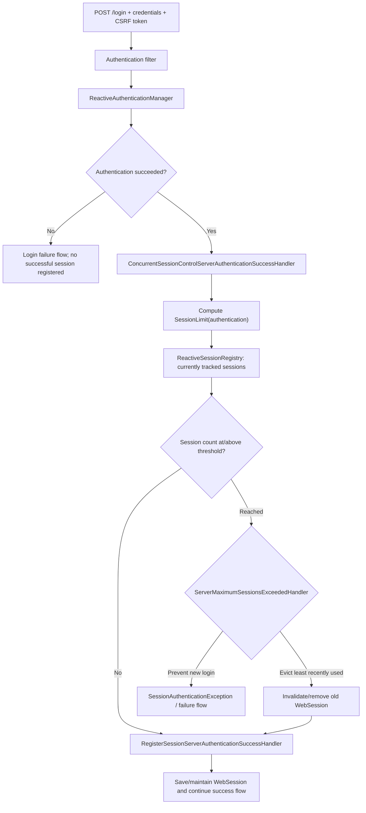

# Limiting Concurrent Sessions with `maximumSessions` and `ReactiveSessionRegistry` in Spring Security Reactive

A user can log in simultaneously from a laptop, a phone, and multiple browsers. When an application uses **Spring WebFlux + Spring Security Reactive** and persists login state in **`WebSession`**, you can decide how many concurrent sessions are permitted for the same identity. Starting in Spring Security **6.3**, reactive configuration provides **Concurrent Sessions Control**: configure `maximumSessions(...)`, track sessions with `ReactiveSessionRegistry`, and choose how to handle new logins that exceed the limit.

For example, `maximumSessions(SessionLimit.of(1))` means at most **one tracked session per principal** within the effective scope of the registry. When a second login succeeds and creates a new session, the default behavior is to **invalidate the least recently used session**; you can also replace that with a policy that **rejects the new login and preserves the old session**.

However, this is not an absolute "each user can only ever use one device" switch. Effectiveness depends on which login mechanisms are hooked, whether the session registry is shared or single-JVM, how principals are identified, the session store, race conditions across concurrent logins, and whether the app uses standalone tokens.

**After this lesson, you will be able to:**

1. Distinguish `WebSession`, `SecurityContext`, `ReactiveSessionInformation`, and `ReactiveSessionRegistry`.
2. Configure `SessionLimit.of(1)`, dynamic limits per `Authentication`, or `SessionLimit.UNLIMITED`.
3. Choose between *new login replaces old session* and *preserve old session, block new login*.
4. Write Java 17+ configuration for Spring Boot 3.x, **Spring Security 6.3+**, and WebFlux.
5. Test two independent sessions, inspect the registry, revoke sessions, and recognize distributed-deployment limits.
6. Avoid mixing **Servlet** Concurrent Session Control APIs with **Reactive** APIs.

> **Scope:** this lesson covers **login sessions tracked by Spring Security Reactive**. It does not automatically limit issued JWTs/access tokens, TCP connections, browser tabs, in-flight requests, or all sessions at an external Identity Provider (IdP).

## 1. What Is "One Session" and Why Limit It?

In WebFlux, `WebSession` is Spring WebFlux's session mechanism; browsers can carry a session cookie so the server recovers state across requests. When using form login or browser-based OAuth2 login, Spring Security can save `SecurityContext` containing `Authentication` into the session.

A user opening two **tabs in the same browser profile** normally **shares the same cookie and `WebSession`** — not two sessions. Conversely, two separate private windows, two browser profiles, or browsers on two devices can carry **two distinct cookies/session IDs**.

With `maximumSessions(SessionLimit.of(1))`, the goal is to cap the number of **recorded login sessions for an identity**:

| Scenario | Is it two sessions? | Notes |
| --- | --- | --- |
| Two Chrome tabs in same profile, same cookie | Usually no | Typically share one `WebSession` |
| Regular Chrome and separate profile, same user login | Usually yes | Two independent session IDs |
| Laptop and phone, same user login | Usually yes | If both devices have separate sessions |
| Two parallel requests from the same cookie | Not necessarily | Request count is not session count |
| Two API calls carrying the same Bearer JWT, no session | Not two `WebSession` logins | Tokens and sessions are different models |
| Two sessions at an external IdP | Not necessarily known | Spring Security only knows sessions tracked by the app/registry |

Common reasons for limiting sessions: reducing uncontrolled account sharing, supporting sensitive apps requiring a single active session, helping revoke sessions upon password change, and providing clear UX when logging in from a new device. This **is not** a complete defense against cookie theft: an attacker holding the same session cookie can reuse **one** session ID without exceeding the limit.

## 2. Architecture: Registry Tracks, Session Store Holds State

The following concepts must be kept distinct:

| Component | Responsibility | Notable data |
| --- | --- | --- |
| `Authentication` | Verified user and authorities | Principal, roles/scopes |
| `SecurityContext` | Context for authorization and downstream steps | `Authentication` |
| `WebSession` | Stores state by cookie/session ID | Session attributes, possibly including `SecurityContext` |
| `ReactiveSessionInformation` | Record of one session for concurrent session control | Principal, session ID, last access, expired state |
| `ReactiveSessionRegistry` | Registers, queries, updates, or removes **session records** | List of session information per principal |
| `WebSessionStore` | Stores, retrieves, and destroys actual WebFlux sessions | Session data, expiry |
| `SessionLimit` | Policy computing max sessions for an `Authentication` | `Mono<Integer>`, or empty meaning unlimited |
| `ServerMaximumSessionsExceededHandler` | Decides what happens when the limit is exceeded | Invalidate old session or block new session |

`ReactiveSessionRegistry` **is not identical** to `WebSessionStore`. The registry holds **metadata showing who holds which sessions**; the session store holds **actual `WebSession` state**. If you only remove a record from the registry without invalidating the corresponding `WebSession`, do not assume the browser was logged out. Conversely, if session data is deleted elsewhere without updating the registry, counts can drift; synchronize both lifecycles.

High-level diagram:



This is a **logical model** of how hooks attach to authentication success; exact ordering and components are configured by Spring Security. Do not reimplement this diagram yourself as synchronous callbacks or manual `subscribe()` calls inside filters.

## 3. How Does `maximumSessions(...)` Work?

In reactive configuration, the standard DSL is:

```java
// Snippet inside @Bean SecurityWebFilterChain.
http.sessionManagement(sessions -> sessions
    .concurrentSessions(concurrency -> concurrency
        .maximumSessions(SessionLimit.of(1))
    )
);
```

This is **not** Servlet's `.sessionManagement(s -> s.maximumSessions(1))` syntax. WebFlux uses `ServerHttpSecurity`, which has `concurrentSessions(...)`, and `maximumSessions` takes a `SessionLimit`.

Common configurations:

| Configuration | Meaning |
| --- | --- |
| `.maximumSessions(SessionLimit.of(1))` | Maximum one login session per principal |
| `.maximumSessions(SessionLimit.of(2))` | Maximum two sessions |
| `.maximumSessions(SessionLimit.UNLIMITED)` | No limit on session count |
| `.maximumSessions(authentication -> Mono.just(1))` | One-session limit via reactive function |
| `.maximumSessions(authentication -> Mono.empty())` | Unlimited for that authentication |
| `.maximumSessions(customSessionLimit())` | Customized per verified role, tenant, or policy |

`SessionLimit` resides in package:

```java
import org.springframework.security.web.server.authentication.SessionLimit;
```

It is a functional interface extending `Function<Authentication, Mono<Integer>>`. Thus you can compute limits from server-verified authorities and even query reactive config if needed. Never perform blocking I/O to compute the limit on the event loop.

**Default without Concurrent Sessions Control configured:** Spring Security does not automatically restrict users to one session. `maximumSessions(1)` only takes effect when placed on the **exact `SecurityWebFilterChain`** handling user authentication.

### Which mechanisms are hooked?

Spring Security reactive concurrent session control integrates with **form login, OAuth2 login, and HTTP Basic authentication** by adding:

- `ConcurrentSessionControlServerAuthenticationSuccessHandler`: evaluates the limit on successful authentication.
- `RegisterSessionServerAuthenticationSuccessHandler`: registers the new session in `ReactiveSessionRegistry`.

This happens only along authentication success paths properly wired by Spring Security. A **custom authentication filter** that omits these hooks may go untracked. A purely stateless **bearer JWT** resource server does not automatically turn every token into a registry session either. Do not claim every API with an `Authorization` header obeys `maximumSessions` identically.

**Specifically for HTTP Basic:** documentation lists Basic among hooked mechanisms. Yet a pure per-request Basic app may not use session persistence like form login. If the goal is limiting persisted **web sessions**, decide explicitly whether Basic falls under this policy, test the success handler's impact, and consider a separate chain for Basic APIs.

## 4. What Methods Does `ReactiveSessionRegistry` Have?

Spring Security provides the interface:

```java
package org.springframework.security.core.session;

public interface ReactiveSessionRegistry {
    Flux<ReactiveSessionInformation> getAllSessions(Object principal);
    Mono<ReactiveSessionInformation> getSessionInformation(String sessionId);
    Mono<Void> saveSessionInformation(ReactiveSessionInformation information);
    Mono<ReactiveSessionInformation> removeSessionInformation(String sessionId);
    Mono<ReactiveSessionInformation> updateLastAccessTime(String sessionId);
}
```

The snippet above describes the **API contract** for study; do not recreate the interface in project source; Reactor's `Flux`/`Mono` types must be imported if writing your own implementation.

Key points:

- `getAllSessions(principal)`: views sessions recorded by the registry for the matching principal.
- `getSessionInformation(sessionId)`: looks up a specific record.
- `saveSessionInformation(info)`: registers a new session record.
- `removeSessionInformation(sessionId)`: removes a record from the registry.
- `updateLastAccessTime(sessionId)`: updates the latest access timestamp; this feeds the **least recently used** strategy.

`ReactiveSessionInformation` provides `getPrincipal()`, `getSessionId()`, `getLastAccessTime()`, `isExpired()`, and `invalidate()`; `invalidate()` returns `Mono<Void>` marking the record expired. However, **marking expired** does not replace all steps to delete actual `WebSession` state. When revoking sessions yourself, handle `WebSessionStore` too as suited to your use case.

A built-in implementation:

```java
@Bean
ReactiveSessionRegistry reactiveSessionRegistry() {
    return new InMemoryReactiveSessionRegistry();
}
```

Imports:

```java
import org.springframework.security.core.session.InMemoryReactiveSessionRegistry;
import org.springframework.security.core.session.ReactiveSessionRegistry;
```

`InMemoryReactiveSessionRegistry` is an **in-process memory** registry. It fits learning, a single server, or trial scopes; it **does not automatically** enforce cluster-wide limits across multiple instances.

### Register as a bean or attach directly in the DSL?

You can let Spring Security pick up a `ReactiveSessionRegistry` bean from the application context, or specify it directly:

```java
.sessionManagement(sessions -> sessions
    .concurrentSessions(concurrency -> concurrency
        .maximumSessions(SessionLimit.of(1))
        .sessionRegistry(myReactiveSessionRegistry)
    )
)
```

In the snippet above, `myReactiveSessionRegistry` must be a valid implementation supplied by the application. **Do not** construct `new InMemoryReactiveSessionRegistry()` separately per request or per success handler, because records would fragment and fail to enforce limits properly.

For administrative actions, use the **same registry** used by the security chain. Avoid having two separate registry beans where one serves login and another serves logout-all.

## 5. Two Strategies When a User Logs In Beyond the Limit

Suppose `maximumSessions(SessionLimit.of(1))` is set; user `reader` already holds session A. They then log in successfully from a different browser profile B.

### 5.1. Default: admit B, invalidate least recently used session

Spring Security defaults to `InvalidateLeastUsedServerMaximumSessionsExceededHandler`.

```text
Before login:
  Registry("reader") => [Session A]

Browser B logs in as "reader":
  Password authentication succeeds
  Detects session count would exceed 1
  Invalidates/removes least recently used session (e.g., A)
  Registers Session B

After completion:
  Registry("reader") => [Session B]
  B accesses authenticated page: allowed
  A resends old cookie: no longer has a valid authenticated session
```

Understand **least recently used (LRU)**, which is not always "oldest created session". If the limit is two sessions and both A and B exist while B was accessed less recently, the session evicted when C logs in can be **B**, not necessarily A.

The default handler invalidates only the **excess sessions** required, not all sessions of the user. With a limit of 2 and 2 active sessions, one new login normally replaces one old session.

Pros: users can still log in from a new device if they forgot to log out on an old device. Cons: someone using the old device may be redirected to login unexpectedly; for sensitive systems, add notifications, auditing, and session-hijacking protections.

### 5.2. Option: keep session A, reject B's login attempt

Spring Security provides `PreventLoginServerMaximumSessionsExceededHandler`:

```java
// Reactive configuration snippet:
.sessionManagement(sessions -> sessions
    .concurrentSessions(concurrency -> concurrency
        .maximumSessions(SessionLimit.of(1))
        .maximumSessionsExceededHandler(
            new PreventLoginServerMaximumSessionsExceededHandler())
    )
)
```

Import:

```java
import org.springframework.security.web.server.authentication
    .PreventLoginServerMaximumSessionsExceededHandler;
```

Conceptually:

```text
Before login:
  Registry("reader") => [Session A]

Browser B attempts login:
  Username/password may already verify
  Session limit reports 1 session already active
  Handler refuses to register a new login session

Afterward:
  A stays active
  B does not obtain a new successful login session
```

The handler raises an authentication/session-limit error for the login flow to handle (e.g., `SessionAuthenticationException`). With form login, the client may see a redirect back to the login page with an error message; do not assert that every setup returns a fixed code like 429/403. HTTP status and message depend on the application's entry point/failure handler.

**Both approaches are design choices**, not "one is universally more secure". A keep-old-session policy may need a recovery flow for users who lost a device: viewing active sessions, closing old ones, changing passwords, and account recovery. A new-replaces-old policy may need alerts when logins occur from unrecognized devices.

## 6. Runnable Java 17+ Example: One Session per Account

This section builds a small WebFlux app using **default form login** and a one-session limit. Requirements:

- Java 17+;
- Spring Boot 3.x **using Spring Security 6.3 or newer**;
- `spring-boot-starter-webflux`, `spring-boot-starter-security`;
- Gradle or Maven configured with the corresponding Spring Boot dependency management.

Because `ReactiveSessionRegistry` and `SessionLimit` were introduced in Spring Security **6.3**, if your Boot 3.x project pulls Spring Security 6.0/6.1/6.2, these classes/APIs will not exist yet. Upgrade **via a compatible Spring Boot BOM** rather than mixing jars from different generations.

### 6.1. Dependencies

In a Spring Boot Gradle project with appropriate plugins and repositories:

```groovy
dependencies {
    implementation 'org.springframework.boot:spring-boot-starter-webflux'
    implementation 'org.springframework.boot:spring-boot-starter-security'

    testImplementation 'org.springframework.boot:spring-boot-starter-test'
    testImplementation 'io.projectreactor:reactor-test'
}
```

Do not use `spring-boot-starter-web` for this example; that is Web MVC/Servlet, a different security API from what we are studying.

### 6.2. `src/main/java/demo/concurrency/ConcurrentSessionsApplication.java`

```java
package demo.concurrency;

import org.springframework.boot.SpringApplication;
import org.springframework.boot.autoconfigure.SpringBootApplication;

@SpringBootApplication
public class ConcurrentSessionsApplication {
    public static void main(String[] args) {
        SpringApplication.run(ConcurrentSessionsApplication.class, args);
    }
}
```

### 6.3. `src/main/java/demo/concurrency/SecurityConfig.java`

```java
package demo.concurrency;

import org.springframework.context.annotation.Bean;
import org.springframework.context.annotation.Configuration;
import org.springframework.security.config.Customizer;
import org.springframework.security.config.annotation.web.reactive.EnableWebFluxSecurity;
import org.springframework.security.config.web.server.ServerHttpSecurity;
import org.springframework.security.core.session.InMemoryReactiveSessionRegistry;
import org.springframework.security.core.session.ReactiveSessionRegistry;
import org.springframework.security.core.userdetails.ReactiveUserDetailsService;
import org.springframework.security.core.userdetails.User;
import org.springframework.security.core.userdetails.UserDetails;
import org.springframework.security.crypto.factory.PasswordEncoderFactories;
import org.springframework.security.crypto.password.PasswordEncoder;
import org.springframework.security.provisioning.MapReactiveUserDetailsService;
import org.springframework.security.web.server.SecurityWebFilterChain;
import org.springframework.security.web.server.authentication.SessionLimit;

@Configuration
@EnableWebFluxSecurity
public class SecurityConfig {

    @Bean
    SecurityWebFilterChain webSecurity(ServerHttpSecurity http) {
        return http
            .authorizeExchange(exchanges -> exchanges
                .pathMatchers("/public/**", "/login").permitAll()
                .anyExchange().authenticated())
            .formLogin(Customizer.withDefaults())
            .httpBasic(basic -> basic.disable())
            .csrf(Customizer.withDefaults())
            .sessionManagement(sessions -> sessions
                .concurrentSessions(concurrency -> concurrency
                    .maximumSessions(SessionLimit.of(1))))
            .build();
    }

    @Bean
    ReactiveSessionRegistry reactiveSessionRegistry() {
        return new InMemoryReactiveSessionRegistry();
    }

    @Bean
    ReactiveUserDetailsService demoUsers() {
        PasswordEncoder encoder =
            PasswordEncoderFactories.createDelegatingPasswordEncoder();

        UserDetails reader = User.withUsername("reader")
            .password(encoder.encode("demo123"))
            .roles("READER")
            .build();

        return new MapReactiveUserDetailsService(reader);
    }
}
```

**This is the core configuration:**

- `formLogin(...)` enables interactive login and the default login page; no custom HTML is needed to learn session limits.
- `csrf(withDefaults())` keeps CSRF enabled for `POST /login` and `POST /logout`. The default login page supplies the matching token flow.
- `httpBasic(...disable())` avoids adding an HTTP Basic path so both browser sessions are created strictly via form login.
- `sessionManagement(...concurrentSessions(...maximumSessions(SessionLimit.of(1))))` enables the reactive one-session limit.
- The `InMemoryReactiveSessionRegistry` bean lets Spring Security write/query session information in the current process.
- We **do not** configure `PreventLoginServerMaximumSessionsExceededHandler` in this demo: we use the default behavior of admitting the new session and evicting the least recently used one.
- `reader/demo123` is strictly a local demo user with an encoded password; never use sample accounts in production.

**Distinction to keep in mind:** the demo's session registry is in-memory. Do not take a successful test on one JVM as proof that a multi-replica cluster enforces a single global limit.

### 6.4. `src/main/java/demo/concurrency/DemoController.java`

```java
package demo.concurrency;

import org.springframework.security.core.context.ReactiveSecurityContextHolder;
import org.springframework.web.bind.annotation.GetMapping;
import org.springframework.web.bind.annotation.RestController;
import reactor.core.publisher.Mono;

@RestController
public class DemoController {

    @GetMapping("/public/ping")
    public Mono<String> ping() {
        return Mono.just("pong");
    }

    @GetMapping("/private/me")
    public Mono<String> me() {
        return ReactiveSecurityContextHolder.getContext()
            .map(ctx -> "current-user:"
                + ctx.getAuthentication().getName());
    }
}
```

`/private/me` runs only when authorization permits it; `ReactiveSecurityContextHolder` reads context from the reactive subscription. The controller does not need to access `ReactiveSessionRegistry` to count sessions itself: that is the job of the authentication success handlers.

### 6.5. Running the demo

From the Spring Boot project directory with Gradle Wrapper:

```bash
# Linux/macOS
./gradlew bootRun

# Windows
gradlew.bat bootRun
```

Once started, your local machine serves `http://localhost:8080`. Real environments must use HTTPS, cookie flags, proper session stores, and login protections.

Requests to verify routes:

```bash
curl -i http://localhost:8080/public/ping
curl -i http://localhost:8080/private/me
```

While logged out:

- `/public/ping` → `200 OK`, body `pong`.
- `/private/me` → normally redirects to `/login` because the form-login entry point is enabled; exact status/location depends on request cache/success handler config.

After logging in via browser, `/private/me` returns:

```text
current-user:reader
```

This identity is only returned on subsequent requests while the cookie/session remains valid.

## 7. Hands-On Testing with Two Browser Profiles — The Clearer Way to Observe Policy

This is a critical integration test because the policy relies on **two distinct session IDs**. Do not merely open two tabs in the same browser profile.

**Scenario A — default evicts old session:**

1. Open **Browser A** (e.g., regular profile), visit `/private/me`, get redirected to `/login`.
2. Log in with `reader`/`demo123`, then open `/private/me`; verify body `current-user:reader`.
3. Open an **independent Browser B** (e.g., a separate profile not sharing cookies), visit `/login`, and log in as the same user `reader`/`demo123`.
4. On B, `/private/me` continues returning `current-user:reader`.
5. Return to A and **make a new request** to `/private/me`. Under the default strategy with a properly wired registry/session store, session A has been invalidated; A is normally redirected to login.
6. Repeat to see that whenever the user logs in anew, the least recently used session is replaced. If you see a different outcome, check that A and B genuinely carry two distinct cookies/session IDs and did not authenticate via another chain.

**Do not merely look at the previously loaded page on A** and conclude the session is still valid: the browser may display cached content. You must **send a new request** to a protected endpoint. A WebSocket or long-running request established before session invalidation may require separate handling; concurrent session control does not promise immediately severing all open connections.

**Scenario B — switching to block new logins:**

Change only the concurrency block in `SecurityConfig` to:

```java
.sessionManagement(sessions -> sessions
    .concurrentSessions(concurrency -> concurrency
        .maximumSessions(SessionLimit.of(1))
        .maximumSessionsExceededHandler(
            new PreventLoginServerMaximumSessionsExceededHandler())))
```

Add import:

```java
import org.springframework.security.web.server.authentication
    .PreventLoginServerMaximumSessionsExceededHandler;
```

Restart the app with a fresh registry and test:

1. A logs in successfully.
2. B logs in as the same user in an independent browser profile.
3. B is refused a new valid login session because the threshold is reached; form login's failure handler decides the error message/redirect.
4. A continues using its session normally.

For a fair test, **restart the demo app and log in again** after switching strategies; never reuse invalidated old cookies or a session registry from another run to infer results.

### Testing via curl with two cookie jars

`curl` can simulate two independent clients using **two cookie jars**. With default Spring Security form login and CSRF, you must extract the **actual token from the `GET /login` page** and send it with the matching cookie. Example steps (token is manually copied from HTML, not a usable placeholder):

```bash
# Client A fetches login page, saving CSRF session cookie.
curl -sS -c a.cookies \
  http://localhost:8080/login -o a-login.html

# Inspect a-login.html, extract value of input name="_csrf".
# Then use A's REAL token:
curl -i -b a.cookies -c a.cookies \
  --data-urlencode "username=reader" \
  --data-urlencode "password=demo123" \
  --data-urlencode "_csrf=TOKEN_FROM_A_LOGIN_PAGE" \
  http://localhost:8080/login

# Client B must have an independent cookie jar:
curl -sS -c b.cookies \
  http://localhost:8080/login -o b-login.html

# Use B's REAL token, never reuse A's token:
curl -i -b b.cookies -c b.cookies \
  --data-urlencode "username=reader" \
  --data-urlencode "password=demo123" \
  --data-urlencode "_csrf=TOKEN_FROM_B_LOGIN_PAGE" \
  http://localhost:8080/login

# Test new requests using each client's cookie.
curl -i -b a.cookies http://localhost:8080/private/me
curl -i -b b.cookies http://localhost:8080/private/me
```

`TOKEN_FROM_A_LOGIN_PAGE` and `TOKEN_FROM_B_LOGIN_PAGE` **are placeholders only**; replace them with the real rendered `_csrf` values. Never send tokens in query strings, and never log real passwords or tokens. `--data-urlencode` preserves special characters during form POSTs.

**Do not treat POST returning `302` as sole proof that login succeeded.** Both success and failure handlers can redirect. Test a subsequent `/private/me` request with the **corresponding cookie** and verify which session is accepted.

## 8. Dynamic Limits by User Role

You can vary the session count based on verified `Authentication`, for example:

- Regular user: maximum one session.
- Admin granted `ROLE_ADMIN`: maximum two sessions.
- Operations staff with `ROLE_UNLIMITED_SESSIONS`: unlimited per registry.

Snippet replacing `maximumSessions` in the demo:

```java
// Inside SecurityConfig; add the imports below.
private SessionLimit perRoleLimit() {
    return authentication -> {
        var authorities = authentication.getAuthorities();

        if (authorities.contains(
                new SimpleGrantedAuthority("ROLE_UNLIMITED_SESSIONS"))) {
            return Mono.empty(); // Unlimited sessions
        }
        if (authorities.contains(
                new SimpleGrantedAuthority("ROLE_ADMIN"))) {
            return Mono.just(2); // Maximum 2 sessions
        }
        return Mono.just(1); // Default maximum 1 session
    };
}
```

Additional imports:

```java
import org.springframework.security.core.authority.SimpleGrantedAuthority;
import reactor.core.publisher.Mono;
```

Update DSL to:

```java
.sessionManagement(sessions -> sessions
    .concurrentSessions(concurrency -> concurrency
        .maximumSessions(perRoleLimit())))
```

`SessionLimit.UNLIMITED` can also be used if all users are allowed unlimited sessions; however, if only certain users are exempt, `Mono.empty()` inside the `SessionLimit` function expresses that case precisely.

**Authorization design note:** trust only authorities produced by server-side authentication/authorization. Never let clients send headers like `X-Max-Sessions: 10`, query parameters like `role=ADMIN`, or unverified claims to set the limit. Role-based limits can be a valid policy choice, yet must account for role changes: existing sessions do not instantly vanish merely because a new rule is deployed unless proper re-evaluation/invalidation flows exist.

## 9. Changing Policy with a Custom Exceeded Handler

Built-in configurations cover the two basic strategies. Sometimes business requirements need:

- Marking the old session as expiring soon and showing a warning.
- Writing a safe audit event when a new session replaces an old one.
- Allowing logins from a trusted device to replace old devices while rejecting untrusted devices.
- Simultaneously revoking the app session and calling an IdP API to terminate an external SSO session.
- Requiring an extra verification step before replacing a session.

Spring Security provides the `ServerMaximumSessionsExceededHandler` interface. You can implement an appropriate handler and attach it via:

```java
.sessionManagement(sessions -> sessions
    .concurrentSessions(concurrency -> concurrency
        .maximumSessions(SessionLimit.of(1))
        .maximumSessionsExceededHandler(customExceededHandler)))
```

This is only an **integration snippet**: `customExceededHandler` must be supplied and implemented per the contract of your Spring Security 6.x version; do not treat this as a standalone class. Never run blocking JDBC/HTTP on the event loop or make detached `.subscribe()` calls. Audit/invalidation steps inside the handler must compose into the reactive pipeline with proper error/cancellation handling and clear timeouts.

**Often-overlooked point:** WebFlux's Concurrent Sessions Control knows about sessions **registered by the app** in `ReactiveSessionRegistry`, not sessions at Google/Microsoft/Keycloak or an external IdP. If you want "new login logs out SSO at the IdP", you must integrate the IdP's logout/revocation API and handle failures of that call. Invalidating `WebSession` alone does not guarantee tokens or IdP sessions are revoked.

## 10. Custom Authentication Success Handlers Can Drop Session Limits

This is an important trap noted in the Spring Security Reactive documentation.

When Concurrent Sessions Control is configured, Spring Security automatically adds the limit-checking and session-registration success handlers for **form login, OAuth2 login, and HTTP Basic** *if those mechanisms have not specified a replacement success handler*. For example:

```java
// Snippet illustrating the RISK:
.formLogin(form -> form
    .authenticationSuccessHandler(
        new RedirectServerAuthenticationSuccessHandler("/dashboard")))
.sessionManagement(sessions -> sessions
    .concurrentSessions(concurrency -> concurrency
        .maximumSessions(SessionLimit.of(1))))
```

Import:

```java
import org.springframework.security.web.server.authentication
    .RedirectServerAuthenticationSuccessHandler;
```

Using the **replacing** `authenticationSuccessHandler(...)` overload like above can prevent the session-limit/registration handlers from being added to that form-login path. Result: the app appears to have `maximumSessions(1)`, yet form login bypasses concurrency control in practice.

If you need to add a handler while preserving the framework-managed session-control handlers, Spring Security provides an overload accepting `Consumer<List<ServerAuthenticationSuccessHandler>>` to **append** a handler to the list rather than replacing everything:

```java
// Snippet from Spring Security Reactive docs (adapt to your use case).
.formLogin(form -> form
    .authenticationSuccessHandler(handlers ->
        handlers.add(
            new RedirectServerAuthenticationSuccessHandler("/dashboard"))))
```

In real applications, test **handler ordering and response completion** so one handler does not commit the response too early or cause session registration to be skipped. If login is handled entirely by a custom `AuthenticationWebFilter`, integrate concurrent session control into that success flow yourself; the form-login DSL does not automatically apply to custom filters you build.

**Mandatory QA question:** After customizing the login success handler, do two browser profiles logging into the same account still obey the single-session policy? If not, inspect the success-handler chain before blaming `ReactiveSessionRegistry`.

## 11. Revoking Sessions via `ReactiveSessionRegistry` and `WebSessionStore`

Beyond login-time checks, sometimes existing sessions must be invalidated when:

- A user changes their password;
- An account is locked;
- The system detects account-takeover risk;
- A user clicks "Log out of all devices";
- An administrator forces session termination.

You can retrieve tracked sessions via `getAllSessions(principal)` and process each record. You must both invalidate the session information **and** delete the actual session from `WebSessionStore`.

Example `src/main/java/demo/concurrency/SessionRevocationService.java`:

```java
package demo.concurrency;

import org.springframework.security.core.session.ReactiveSessionRegistry;
import org.springframework.stereotype.Service;
import org.springframework.web.server.session.WebSessionStore;
import reactor.core.publisher.Mono;

@Service
public class SessionRevocationService {

    private final ReactiveSessionRegistry registry;
    private final WebSessionStore sessionStore;

    public SessionRevocationService(
            ReactiveSessionRegistry registry, WebSessionStore sessionStore) {
        this.registry = registry;
        this.sessionStore = sessionStore;
    }

    public Mono<Void> invalidateAllFor(Object principal) {
        return registry.getAllSessions(principal)
            .flatMap(info ->
                info.invalidate()
                    .then(sessionStore.removeSession(info.getSessionId())))
            .then();
    }
}
```

The code above uses reactive APIs and **returns `Mono<Void>`** to the caller; never call `.subscribe()` or `.block()` in handlers. It is designed as an extension to a WebFlux app sharing the same registry and `WebSessionStore` as the security config.

**Limits / cautions:**

- The `principal` passed to `getAllSessions` must match the **identity key** recorded by the registry; never accept an arbitrary username from an unauthorized request to delete another person's sessions.
- In production, enforce strict authorization on invalidate-all operations, audit events, and avoid exposing session IDs.
- `invalidate()` and `removeSession()` are stateful operations. If one step fails, apply proper error handling/retries, monitoring, and testing per your repository/registry version; do not claim full distributed consistency without transactional guarantees.
- Never print raw session IDs into logs, metrics labels, or API responses.
- This snippet does not automatically revoke refresh tokens/JWTs or terminate sessions at an IdP.
- A request or WebSocket already authenticated before invalidation may continue until handled separately; session control primarily affects **subsequent** access and session lifecycles.

If the app has multiple principal types (especially OAuth2 `OAuth2User` or custom `UserDetails`), design stable identity keys. Avoid relying on inconsistent `equals()`/`hashCode()` that causes the registry to treat two logins by the same person as two distinct principals.

## 12. Unit Testing Registry Behavior with Reactor `StepVerifier`

The demo `SecurityConfig` registered an `InMemoryReactiveSessionRegistry` bean; we can test the reactive contract independently without launching a browser. This is a **registry test**, **not** an end-to-end test proving `maximumSessions(1)` invalidated a real `WebSession`. The two test types verify different boundaries.

File `src/test/java/demo/concurrency/ReactiveSessionRegistryTest.java`:

```java
package demo.concurrency;

import java.time.Instant;

import org.junit.jupiter.api.Test;
import org.springframework.security.core.session.InMemoryReactiveSessionRegistry;
import org.springframework.security.core.session.ReactiveSessionInformation;
import org.springframework.security.core.session.ReactiveSessionRegistry;
import reactor.test.StepVerifier;

import static org.junit.jupiter.api.Assertions.assertEquals;

class ReactiveSessionRegistryTest {

    @Test
    void savesFindsAndRemovesSessionInformation() {
        ReactiveSessionRegistry registry =
            new InMemoryReactiveSessionRegistry();

        var info = new ReactiveSessionInformation(
            "reader", "demo-session-a",
            Instant.parse("2026-01-01T00:00:00Z"));

        StepVerifier.create(registry.saveSessionInformation(info))
            .verifyComplete();

        StepVerifier.create(registry.getAllSessions("reader").collectList())
            .assertNext(sessions -> {
                assertEquals(1, sessions.size());
                assertEquals("demo-session-a",
                    sessions.get(0).getSessionId());
            })
            .verifyComplete();

        StepVerifier.create(
                registry.getSessionInformation("demo-session-a"))
            .assertNext(found ->
                assertEquals("reader", found.getPrincipal()))
            .verifyComplete();

        StepVerifier.create(
                registry.removeSessionInformation("demo-session-a"))
            .assertNext(removed ->
                assertEquals("demo-session-a", removed.getSessionId()))
            .verifyComplete();

        StepVerifier.create(registry.getAllSessions("reader"))
            .verifyComplete();
    }
}
```

Run:

```bash
# Linux/macOS
./gradlew test --tests 'demo.concurrency.ReactiveSessionRegistryTest'

# Windows
gradlew.bat test --tests "demo.concurrency.ReactiveSessionRegistryTest"
```

With the example's dependencies present, the test should pass: the record is saved, queried by principal/session ID, removed, and no longer present in the registry. `StepVerifier` comes from `reactor-test`, already added in dependencies.

**Do not mistake this test for testing the concurrent login policy.** The test above writes to the registry manually, so it never exercised `ReactiveAuthenticationManager`, the session limit handler, session cookies, or `WebSessionStore`. To verify full-chain behavior, add an integration test using two HTTP clients with separate cookie jars, logging in via form, and checking client A's protected request after client B logs in. When automating form login, supply valid CSRF tokens per client or use Spring Security's WebFlux test support.

## 13. Structured Experiment: LRU vs. "Block New Login"

| Step | Default LRU eviction policy | Block new login policy |
| --- | --- | --- |
| A logs in first with account `reader` | Succeeds | Succeeds |
| A GETs protected route | `200` | `200` |
| B on independent client logs in as `reader` | Succeeds, may replace session A | B's login rejected via failure flow |
| A GETs protected route after B | Typically prompted to log in again | A stays authenticated |
| B GETs protected route after attempt | B authenticated | B not authenticated |
| B logs out, A retries | Depends on invalidated session and new login policy | A keeps using old session if still valid |
| Password changed and all sessions revoked | Requires dedicated invalidation logic | Requires dedicated invalidation logic |

With `maximumSessions(2)`:

1. A logs in → one session.
2. B logs in → two sessions.
3. A is accessed most recently, while B is idle.
4. C logs in → under LRU, **B** can be invalidated to make room for C.

Do not confuse "least recently used" with "earliest created" and do not rely on login timestamp when selecting a session to evict. For testing, send real requests to update last-access time and let the framework manage sessions rather than tweaking frontend variables.

**Edge cases** worth testing too: parallel logins with close timestamps, natural session expiration, logging out A before B logs in, changing principal/username, multiple security chains, and two nodes receiving concurrent logins.

## 14. Session Limits and OAuth2/OIDC: Application Boundaries

An app using `oauth2Login()` can involve:

- A session at the **WebFlux app** tracking that the user logged in;
- A session at the **Identity Provider** for Single Sign-On;
- Access/refresh tokens used to call other resource servers.

`ReactiveSessionRegistry` sees only sessions registered by the security app into the registry, not all sessions at the IdP or other services. When a user logs in on browser B, invalidating app session A **does not automatically** log out the IdP session or revoke OAuth2 tokens.

Designing "single device across the whole ecosystem" requires coordinating multiple systems: IdP logout/revocation APIs, refresh-token rotation/revocation, resource-server validation, each app's session lifecycle, offline devices, and UX. `maximumSessions(1)` is only one layer at a **specific application**.

For a **stateless JWT bearer resource server** with no browser session, a user calling APIs with multiple access tokens does not necessarily create multiple `WebSession`s. To cap devices/tokens, enforce policy at the authorization server/token store or device management system; never rely on `ReactiveSessionRegistry` as a token inventory.

## 15. Multi-Instance Deployment: Why an In-Memory Registry Is Insufficient

Suppose the service runs two JVMs:

```text
Load balancer
  +-- Node A: separate InMemoryReactiveSessionRegistry
  +-- Node B: separate InMemoryReactiveSessionRegistry

User reader logs in on Node A: A sees 1 session.
User reader logs in on Node B: B also sees 1 session.
```

Even though each node configures `maximumSessions(1)`, **the cluster as a whole can still hold two sessions** because in-memory registries do not share state. Sticky sessions alone do not solve a user logging in from another device routed to a different node.

To enforce consistent limits across multiple replicas in production, you need:

1. **Distributed registry**: a `ReactiveSessionRegistry` implementation storing and querying shared metadata by principal/session ID, with appropriate TTLs and last-access updates.
2. **Shared `WebSessionStore`**: instances can read and invalidate actual sessions, usually via Spring Session Reactive with an appropriate backing store. Never assume a custom registry suffices if `WebSession` still lives in per-node RAM.
3. **Atomic concurrency control**: two nearly simultaneous logins may both see "one slot free" and both register; design locks/CAS/transactions or workflows that uphold the limit.
4. **Synchronized deletion/expiry**: logout, timeouts, node crashes, and evicted sessions must update both registry and session store; clean up orphaned records.
5. **Fault tolerance**: if the registry/Redis loses connectivity, define fail-open vs. fail-closed policy based on app sensitivity; never silently drop the limit on timeout while claiming a one-session guarantee.
6. **Data security**: keep session IDs and tokens out of logs/metrics; restrict backing-store access and enable transport encryption.
7. **Monitoring**: sessions per user (without PII in metric labels), exceeded counts, invalidation errors, registry/store drift, login latency, and recovery counts.

**Spring Session note:** documentation for `SessionRegistry` in the **Servlet** branch may describe cluster integration via `FindByIndexNameSessionRepository` and Servlet `SessionRegistry`. Never copy that class as if it were automatically an implementation of **`ReactiveSessionRegistry`**. For Spring Security Reactive, verify exact compatibility of the registry, `WebSessionStore`, and Spring Session version in use.

## 16. Common Mistakes

### Mistake 1 — Using Servlet's `maximumSessions` DSL in WebFlux

Wrong context:

```java
// Not a reactive configuration API:
http.sessionManagement(s -> s.maximumSessions(1));
```

WebFlux configuration uses:

```java
http.sessionManagement(s -> s
    .concurrentSessions(c -> c
        .maximumSessions(SessionLimit.of(1))));
```

`ServerHttpSecurity` / `SecurityWebFilterChain` are the reactive APIs; `HttpSecurity` / `SecurityFilterChain` belong to Servlet. `SessionLimit` also has **two classes in two different packages**; import the right one: `org.springframework.security.web.server.authentication.SessionLimit`.

### Mistake 2 — Enabling `maximumSessions(1)` without a consistent registry

Creating separate registries across configurations or per request prevents sessions from being counted together. Use a singleton/shared registry bean across coordinating chains and a distributed implementation across multiple nodes.

### Mistake 3 — Adding a custom login success handler and losing session handlers

The replacing `.authenticationSuccessHandler(new RedirectServerAuthenticationSuccessHandler(...))` overload can overwrite the handlers added by Concurrent Sessions Control. Use the overload that appends to the handler list or configure completely, then re-test two real logins.

### Mistake 4 — Testing two tabs and concluding `maximumSessions` is broken

Two tabs in the same profile share cookies. Use two independent browser profiles/devices or cookie jars, not just two tabs.

### Mistake 5 — Thinking least-recently-used is always the first login session

LRU is based on most recent access tracked by the registry, not creation order alone. With a limit of 2, a new login can evict a session created later that saw less activity.

### Mistake 6 — Using `maximumSessions` to limit JWTs

JWTs/access tokens have their own lifecycles. A stateless resource server does not auto-register every token as a `WebSession`; to limit tokens, enforce limits at the token issuer/device registry.

### Mistake 7 — Thinking invalidating the app session logs out the IdP

Spring Security does not automatically destroy sessions at the IdP. For SSO logout or token revocation, integrate with the Identity Provider.

### Mistake 8 — Only deleting registry records when clicking "Log out everywhere"

Removing registry metadata does not destroy state in `WebSessionStore`. Handle the actual sessions, authorization, and partial failures on invalidation.

### Mistake 9 — Ignoring principal equality

If the registry treats principal objects as unequal, sessions of the same user can split into separate buckets. With custom `UserDetails`/OAuth2 principals, design stable identity keys and test lookup/invalidation; avoid mutable keys whose `equals/hashCode` change over their lifecycle.

### Mistake 10 — Thinking a limit of 1 is an absolute anti-cookie-sharing defense

A stolen cookie/session can be sent from multiple devices while still sharing **one session ID**. Add TLS, `Secure`/`HttpOnly`/`SameSite` cookies, CSRF, session fixation protection, unfamiliar-device alerts, MFA, and risk-based controls.

### Mistake 11 — Opening `GET /logout` or disabling CSRF for easier testing

Cookie-based form login/logout needs CSRF on state-changing requests. When running `curl` POST logins, send the matching session's token; disabling CSRF because a test got 403 can mask vulnerabilities.

### Mistake 12 — Judging from a 302 redirect alone that B's login succeeded

Both form-login success and failure handlers can redirect. Check a follow-up protected request with B's cookie, and also check whether A still holds a session.

### Mistake 13 — Assuming the registry updates instantaneously on every node

That is an implementation detail. `InMemoryReactiveSessionRegistry` has no global consistency. Custom distributed registries need atomic counts, expiry cleanup, and network-partition handling.

### Mistake 14 — Blocking the Reactor event loop in a custom `SessionLimit`/handler

`SessionLimit` returns `Mono<Integer>`; never use `Thread.sleep`, direct blocking JDBC, or `.block()` in the pipeline. Use reactive clients and explicit timeouts when querying external policies.

### Mistake 15 — Lacking a recovery path for users who lost a device

With prevent-login enabled, a user who loses their phone can be locked out of logging in on a new device. Provide a secure way to revoke old sessions or a recovery workflow after identity verification.

## 17. Pre-Production QA Checklist

| Check | Required outcome |
| --- | --- |
| Framework version | WebFlux + Spring Security 6.3+ (reactive concurrent sessions API exists) |
| Correct DSL | `ServerHttpSecurity.sessionManagement(...concurrentSessions(...))` |
| Correct `SessionLimit` package | `org.springframework.security.web.server.authentication.SessionLimit` |
| Correct registry | Bean or DSL uses the same real `ReactiveSessionRegistry` |
| Single session | Two browser profiles, A logs in then B logs in; policy executes as intended |
| LRU | Limit of 2 with three sessions; least recently used session is evicted |
| Prevent login | B gets no new session; A keeps access |
| Form login and CSRF | POST login carries valid token; CSRF is not disabled due to 403 |
| Custom success handler | Concurrent session handlers still run and register new sessions |
| Logout | Registry and `WebSessionStore` are cleaned up per lifecycle |
| Expiry | Naturally expired sessions do not leave stale counts |
| Role-based limit | Verified authorities and policy changes are tested |
| Custom principal | Stable equality/identity; principal lookup works properly |
| OAuth2 login | App session is not confused with IdP sessions/tokens |
| Stateless JWT | Separate policy exists if token/device limits are needed |
| Multiple replicas | Shared registry and session store with atomicity/cleanup |
| Infrastructure failure | Handling defined when backend session/registry is unavailable |
| Observability | Passwords, CSRF tokens, session IDs, and bearer tokens are never logged |

## 18. Self-Check Questions

**Question 1.** Two tabs share the same browser and cookie. Should `maximumSessions(1)` treat that as two sessions?  
**No.** Two tabs normally share one `WebSession`; compare session IDs.

**Question 2.** How does `maximumSessions(SessionLimit.of(1))` handle a second login by default?  
**It admits the new login and invalidates the least recently used session**, assuming a properly working registry and session store.

**Question 3.** Which class keeps the old session and blocks the new login?  
**`PreventLoginServerMaximumSessionsExceededHandler`** via `.maximumSessionsExceededHandler(...)`.

**Question 4.** Are `ReactiveSessionRegistry` and `WebSessionStore` the same?  
**No.** The registry manages session information for limits; `WebSessionStore` holds actual session data. Proper invalidation requires handling both.

**Question 5.** Why can an app running two replicas each with `InMemoryReactiveSessionRegistry` still grant the same user two sessions?  
**Because** each replica keeps its own registry; the one-session limit is enforced only within each individual process.

**Question 6.** After assigning a custom `authenticationSuccessHandler` for form login, what must be re-tested?  
**Verify** that the session-control/registration handlers are still invoked. A replacing success-handler overload can disable concurrent session control for that login mechanism.

**Question 7.** What do `SessionLimit.UNLIMITED` and `Mono.empty()` in a `SessionLimit` function mean?  
**No session-count limit** under that authentication's policy.

**Question 8.** When an IdP maintains its own session, does invalidating an app's `WebSession` log out the IdP?  
**Not necessarily.** Integrate IdP logout/revocation if the business needs system-wide SSO revocation.

**Question 9.** Does removing a session from the registry guarantee the browser cannot reuse the old cookie?  
**No.** Destroy/control the actual session in `WebSessionStore` and check other authentication paths.

**Question 10.** Does `maximumSessions(1)` stop an attacker from using a victim's cookie on another machine?  
**Not completely.** Both may share **one session ID**; pair with session-hijacking defenses and anomaly detection.

## Key Takeaways

- **`maximumSessions(SessionLimit.of(n))`** is the **Reactive** session limit config via `ServerHttpSecurity.sessionManagement().concurrentSessions()`.
- **`ReactiveSessionRegistry`** tracks session records; **`WebSessionStore`** holds actual `WebSession` state. Both must stay consistent.
- **By default** when exceeding the limit, the **least recently used session is invalidated**. To preserve the old session, use `PreventLoginServerMaximumSessionsExceededHandler`.
- **`SessionLimit`** can inspect `Authentication` and return `Mono<Integer>`, or `Mono.empty()` for unlimited; `SessionLimit.UNLIMITED` applies to all users if selected.
- The mechanism hooks **form login, OAuth2 login, and HTTP Basic** automatically unless replaced by a custom success handler. Do not assume it applies to stateless JWTs or arbitrary custom filters.
- **Two tabs are not two sessions.** Test with two independent cookie jars/browser profiles and a fresh protected request after login.
- **An in-memory registry is not cluster-wide.** Multi-node production needs a shared registry/session store with atomicity, expiry, auditing, and fault tolerance.
- Invalidating an app's `WebSession` **does not equal** logging out the IdP or revoking all access tokens.

### Official documentation

- [Spring Security 6.5 — Concurrent Sessions Control (Reactive)](https://docs.spring.io/spring-security/reference/6.5/reactive/authentication/concurrent-sessions-control.html)
- [Spring Security 6.5 — `SessionLimit` Reactive Javadoc](https://docs.spring.io/spring-security/site/docs/6.5.x/api/org/springframework/security/web/server/authentication/SessionLimit.html)
- [Spring Security 6.5 — `ReactiveSessionRegistry` Javadoc](https://docs.spring.io/spring-security/reference/6.5/api/java/org/springframework/security/core/session/ReactiveSessionRegistry.html)
- [Spring Security 6.5 — `ReactiveSessionInformation` Javadoc](https://docs.spring.io/spring-security/reference/6.5/api/java/org/springframework/security/core/session/ReactiveSessionInformation.html)
- [Spring Security 6.5 — `ConcurrentSessionsSpec` Javadoc](https://docs.spring.io/spring-security/reference/6.5/api/java/org/springframework/security/config/web/server/ServerHttpSecurity.SessionManagementSpec.ConcurrentSessionsSpec.html)
- [Spring Security 6.5 — `InvalidateLeastUsedServerMaximumSessionsExceededHandler` Javadoc](https://docs.spring.io/spring-security/reference/6.5/api/java/org/springframework/security/web/server/authentication/InvalidateLeastUsedServerMaximumSessionsExceededHandler.html)
- [Spring Security 6.5 — `PreventLoginServerMaximumSessionsExceededHandler` Javadoc](https://docs.spring.io/spring-security/reference/6.5/api/java/org/springframework/security/web/server/authentication/PreventLoginServerMaximumSessionsExceededHandler.html)
