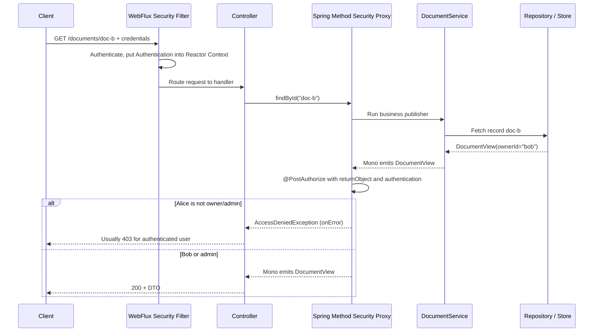

# `@PostAuthorize` and Checking Results Before Returning Data in Spring Security Reactive

## Objectives

`@PostAuthorize` is a security annotation evaluated **after a method returns a result**. With Spring Security Reactive and Spring WebFlux, it is especially useful when the authorization condition depends on the **actual retrieved object**: for example, which user owns a document, which account holder owns a record, or which tenant an order belongs to. You cannot always decide access solely from a client-supplied `id`; sometimes you must load the object first to know its real owner before checking permissions.

For instance: Alice calls `GET /documents/doc-a`, the service loads a document with `ownerId="alice"`, and the annotation permits emitting the result only when `returnObject.ownerId == authentication.name` or the caller has `ROLE_ADMIN`. If Bob accesses the same ID, the query layer may still load the record, yet the **value is not forwarded to the controller/client** when authorization denies access.

This lesson explains the evaluation lifecycle, how to use `returnObject` in SpEL, the differences between `@PreAuthorize` and `@PostAuthorize`, Java 17+ code using Spring Boot 3.x/Spring Security 6.x on **WebFlux**, HTTP and Reactor testing, `403/404` handling, and limitations: side effects, querying sensitive data, `Mono`/`Flux` relationships, Spring AOP proxies, Reactor Context, and performance.

> Scope: **reactive method security**, not Servlet's `@EnableMethodSecurity`. Use `@EnableReactiveMethodSecurity`, `Mono`/`Flux`, and `ReactiveSecurityContextHolder`. Examples do not use `HttpSecurity`, Servlet `SecurityFilterChain`, `ThreadLocal`-based `SecurityContextHolder`, `.block()`, or `.subscribe()` in request paths.

## 1. What is `@PostAuthorize`?

It is an annotation in the package:

```java
import org.springframework.security.access.prepost.PostAuthorize;
```

Familiar expression example:

```java
@PostAuthorize(
    "returnObject.ownerId == authentication.name or hasRole('ADMIN')")
public Mono<DocumentView> findById(String id) {
    return repository.findById(id);
}
```

Here:

- `returnObject` is the **result object that post-authorization checks**; in a typical `Mono<DocumentView>` case, evaluation attaches to the result emitted by the publisher in the reactive lifecycle.
- `ownerId` is a property of `DocumentView`, read via its corresponding getter (`getOwnerId()`) or a SpEL-supported accessor.
- `authentication.name` is the authenticated principal's name in `Authentication`, obtained from the current context.
- `hasRole('ADMIN')` checks authorities using the `ROLE_` prefix convention. In default configuration, `hasRole('ADMIN')` means the authority `ROLE_ADMIN`, **not** the raw string `ADMIN`.
- Only when the SpEL condition returns `true` does the value continue to the caller.

In real projects, `returnObject` must have a clear data contract: `getOwnerId()` must never return a client-supplied field; it must originate from a server-fetched, trusted record after validation.

### Why is it called "post" yet still prevents data leakage?

`@PostAuthorize` runs **after the result has been created/loaded**, yet **before the result is handed over to the caller to proceed** within the proxy-protected flow. In WebFlux, the result is represented as a publisher; Spring Security uses a reactive interceptor to evaluate authorization as the relevant data passes through the publisher. When denied, it turns into an access error signal instead of emitting the forbidden object to downstream steps.

This differs from a controller receiving `DocumentView`, serializing the response, and then running an `if` check: **checking after sending an HTTP response is too late**. `@PostAuthorize` guards the method-result boundary **before the controller uses the authorized value**, provided the application invokes the bean through a Spring proxy and leaves no bypass path.

However, data may still have been read from the database, decrypted, logged, or sent to another system **inside the method** before post-authorization runs. Therefore `@PostAuthorize` does not guarantee "the data was never processed": it only prevents **unauthorized results from crossing the protected boundary**.

## 2. Prerequisites for reactive method security to work

**Enable method security** with the annotation:

```java
@Configuration
@EnableReactiveMethodSecurity
public class ReactiveMethodSecurityConfig {
}
```

Imports:

```java
import org.springframework.context.annotation.Configuration;
import org.springframework.security.config.annotation.method.configuration.EnableReactiveMethodSecurity;
```

With Spring Security 6.x, `@EnableReactiveMethodSecurity` uses the `AuthorizationManager` mechanism by default. You may encounter older examples writing `useAuthorizationManager = true`; starting in Spring Security 6.0, this attribute is generally unnecessary.

**Remaining conditions:**

1. The class containing the method is created and managed as a **Spring bean**, such as `@Service`.
2. Callers invoke the method **through a Spring AOP proxy**, not a manually constructed `new DocumentService()` or an internal same-class `this.findById(...)` call.
3. The method has a supported reactive return type, `Mono<DocumentView>` in this lesson; do not convert `Mono` into a synchronous value using `.block()` inside a WebFlux handler.
4. The request/subscription carries a valid `Authentication` in **Reactor Context** (normally populated by Spring Security WebFlux filters).
5. The expression reads verified properties/authorities. Never use principal IDs or roles from arbitrary client headers.
6. Protected endpoints call the **exact annotated service method**, without bypassing it via a publicly exposed repository.

Merely adding `spring-boot-starter-security` **does not enable method-level security**. `ServerHttpSecurity.authorizeExchange(...)` protects at the HTTP path level but does not replace the policy of a service invoked from HTTP, message listeners, scheduled tasks, or other components.

## 3. Reactive flow: from request to post-result decision



Key walkthrough:

1. The HTTP filter extracts the caller's identity/authorities and populates the reactive context.
2. The controller calls the service bean **through its proxy**.
3. The query supplies the real object whose `ownerId` does not depend on client parameters.
4. `AuthorizationManagerAfterReactiveMethodInterceptor` / the post-check mechanism evaluates the `@PostAuthorize` expression.
5. If granted, downstream receives the object and serializes it into an HTTP response.
6. If denied, the publisher emits an access error; WebFlux/Spring Security handles it appropriately. For authenticated users, the usual result is `403 Forbidden`. Error mapping can be altered by application exception handlers.

**Key takeaway:** post-authorization blocks **returning the result outward**, yet may have already paid the query cost. Do not overuse it on lists of millions of records, data too sensitive even to read beforehand, or write/money-transfer operations.

## 4. `@PreAuthorize` and `@PostAuthorize` do not replace each other

| Criterion | `@PreAuthorize` | `@PostAuthorize` |
| --- | --- | --- |
| Evaluation timing | Before authorizing execution of method logic/publisher | After a result exists to inspect, before the result crosses the method boundary |
| Data convenient to check | Authentication, roles/scopes, method args, `#id`, `#tenant` | Authentication, method args, and `returnObject` |
| Can avoid queries when denied | Usually yes, if policy can decide upfront | No; data may already have been loaded |
| Best suited for | Checking roles, input policies, permission to run writes | Checking the retrieved object's owner, preventing IDOR |
| Risk | Relying only on `#id` may not reveal the true owner | Side effects may have already occurred before denial |
| With `Mono` | Reactive interceptor participates in publisher chain | Inspects reactive result before emitting to caller |

Combined example:

```java
@PreAuthorize("hasAnyRole('READER','ADMIN')")
@PostAuthorize(
    "hasRole('ADMIN') or returnObject.ownerId == authentication.name")
public Mono<DocumentView> getDocument(String id) {
    return repository.findById(id);
}
```

First Spring Security checks whether the caller holds a valid role. Only callers passing this step execute the required query; then `@PostAuthorize` verifies the object belongs to the right owner. Annotations execute through the Spring proxy and Reactor Context; do not expect them to work on internal non-proxied calls.

**Often a better strategy for sensitive data:** push ownership constraints down into the query, such as `SELECT ... WHERE id = :id AND owner_id = :currentUser`, while using method authorization as an **additional line of defense**, not a replacement for scoped queries.

## 5. `returnObject` in SpEL: how to write it?

Common forms:

```java
// Owner or admin may view the result.
@PostAuthorize(
    "returnObject.ownerId == authentication.name or hasRole('ADMIN')")

// Owner and allowed status.
@PostAuthorize(
    "returnObject.ownerId == authentication.name and returnObject.status == 'ACTIVE'")

// Policy via server-controlled security bean.
@PostAuthorize(
    "@documentPolicy.mayView(authentication, returnObject)")
```

The third form is an **illustrative integration snippet**: the application must provide a `documentPolicy` bean with a compatible `mayView(...)` method that is safe and does not block the event loop. It replaces long conditions with clear, easily testable Java that can be reused across layers.

### Simple owner expression

If the principal username is `"alice"` and `getOwnerId()` returns `"alice"`, the owner condition passes. If it returns `"bob"`, the condition fails unless the caller has admin rights.

If authentication's display name is an email while the database stores a user ID, comparing `authentication.name` against `ownerId` may always fail or compare mismatched identifiers. Design **stable IDs** (e.g., UUID or verified token subject) and use a component that resolves system identity from authentication.

### `hasRole` differs from `hasAuthority`

```java
@PostAuthorize(
    "hasAuthority('SCOPE_documents.read') and returnObject.ownerId == authentication.name")
```

`hasAuthority('SCOPE_documents.read')` matches the exact authority string; it does not prepend `ROLE_`. With a JWT resource server, scopes are typically mapped to `SCOPE_...` authorities per configuration. Verify your mapper, issuer, and audience rather than assuming a scope is valid merely because an unverified token contains a claim.

### Operator precedence and null

Prefer parentheses when expressions grow complex:

```java
@PostAuthorize(
    "hasRole('ADMIN') or (returnObject != null and returnObject.ownerId == authentication.name)")
```

For `Mono.empty()`, **there is no object to inspect for ownership**. Do not turn a "not found" case into permission to access other data. HTTP 404 policy and exception handling must be designed separately; never rely on the expression always receiving a non-null object when a publisher emits nothing.

In this demo, the service maps not-found to `ResponseStatusException(HttpStatus.NOT_FOUND)` **before post-authorization**, avoiding any ambiguity with `returnObject == null` on the success path.

## 6. Runnable Java 17+ example: documents viewable only by owner or admin

Let's build a small REST API:

- `GET /documents/doc-a`: Alice's document.
- `GET /documents/doc-b`: Bob's document.
- `GET /documents/missing`: does not exist.
- Users `alice` and `bob` have `ROLE_READER`; user `admin` has `ROLE_ADMIN`.
- HTTP Basic is solely for simple authentication demonstration. WebFlux method security performs the ownership check.

Expected outcomes: Alice can read doc-a, not doc-b; Bob the reverse; admin can read both; a non-existent document returns 404.

### 6.1. Build configuration

Requires a Spring Boot 3.x project, Java 17+, the Spring Boot Gradle plugin, and configured repositories. In `build.gradle`:

```groovy
dependencies {
    implementation 'org.springframework.boot:spring-boot-starter-webflux'
    implementation 'org.springframework.boot:spring-boot-starter-security'

    testImplementation 'org.springframework.boot:spring-boot-starter-test'
    testImplementation 'org.springframework.security:spring-security-test'
    testImplementation 'io.projectreactor:reactor-test'
}
```

If using Maven, pick the corresponding starters and manage versions via the Spring Boot BOM. Do not add `spring-boot-starter-web` for this demo as that can switch the app to the Servlet stack. Use a Spring Security 6.x release compatible with your Spring Boot version.

### 6.2. File `src/main/java/demo/postauth/PostAuthApplication.java`

```java
package demo.postauth;

import org.springframework.boot.SpringApplication;
import org.springframework.boot.autoconfigure.SpringBootApplication;

@SpringBootApplication
public class PostAuthApplication {
    public static void main(String[] args) {
        SpringApplication.run(PostAuthApplication.class, args);
    }
}
```

### 6.3. File `src/main/java/demo/postauth/SecurityConfig.java`

```java
package demo.postauth;

import org.springframework.context.annotation.Bean;
import org.springframework.context.annotation.Configuration;
import org.springframework.security.config.Customizer;
import org.springframework.security.config.annotation.method.configuration.EnableReactiveMethodSecurity;
import org.springframework.security.config.annotation.web.reactive.EnableWebFluxSecurity;
import org.springframework.security.config.web.server.ServerHttpSecurity;
import org.springframework.security.core.userdetails.ReactiveUserDetailsService;
import org.springframework.security.core.userdetails.User;
import org.springframework.security.crypto.factory.PasswordEncoderFactories;
import org.springframework.security.crypto.password.PasswordEncoder;
import org.springframework.security.provisioning.MapReactiveUserDetailsService;
import org.springframework.security.web.server.SecurityWebFilterChain;

@Configuration
@EnableWebFluxSecurity
@EnableReactiveMethodSecurity
public class SecurityConfig {

    @Bean
    SecurityWebFilterChain chain(ServerHttpSecurity http) {
        return http
            .authorizeExchange(exchanges -> exchanges
                .pathMatchers("/public/ping").permitAll()
                .anyExchange().authenticated())
            .httpBasic(Customizer.withDefaults())
            .formLogin(form -> form.disable())
            .build();
    }

    @Bean
    ReactiveUserDetailsService users() {
        PasswordEncoder encoder =
            PasswordEncoderFactories.createDelegatingPasswordEncoder();

        return new MapReactiveUserDetailsService(
            User.withUsername("alice")
                .password(encoder.encode("demo123"))
                .roles("READER").build(),
            User.withUsername("bob")
                .password(encoder.encode("demo123"))
                .roles("READER").build(),
            User.withUsername("admin")
                .password(encoder.encode("demo123"))
                .roles("ADMIN").build());
    }
}
```

**Two independent layers of protection:**

1. `authorizeExchange(...authenticated())`: protects every endpoint other than `/public/ping` at the HTTP layer.
2. `@EnableReactiveMethodSecurity`: activates interceptors for `@PostAuthorize` inside services.

`formLogin` is disabled so `curl` can easily test 401/403 with HTTP Basic. The example uses only GET so **CSRF does not need to be disabled**. Illustrative users/passwords are only for learning environments; production requires TLS, proper user stores/encoders, credential rotation, brute-force protection, and strict permission management.

### 6.4. File `src/main/java/demo/postauth/DocumentView.java`

```java
package demo.postauth;

public final class DocumentView {
    private final String id;
    private final String ownerId;
    private final String title;

    public DocumentView(String id, String ownerId, String title) {
        this.id = id;
        this.ownerId = ownerId;
        this.title = title;
    }

    public String getId() {
        return id;
    }

    public String getOwnerId() {
        return ownerId;
    }

    public String getTitle() {
        return title;
    }
}
```

`DocumentView` is a DTO containing only three fields permitted for exposure **after authorization succeeds**. In real applications, never arbitrarily return password hashes, access tokens, sensitive profile data, or raw Hibernate/JSON entities.

The `getOwnerId()` getter provides a clear JavaBeans property for the SpEL expression `returnObject.ownerId`. It helps the exercise avoid confusion between field names, method accessors, and SpEL syntax.

### 6.5. File `src/main/java/demo/postauth/DocumentService.java`

```java
package demo.postauth;

import java.util.Map;

import org.springframework.http.HttpStatus;
import org.springframework.security.access.prepost.PostAuthorize;
import org.springframework.stereotype.Service;
import org.springframework.web.server.ResponseStatusException;
import reactor.core.publisher.Mono;

@Service
public class DocumentService {
    // In-memory demo; production typically uses R2DBC/reactive repository.
    private final Map<String, DocumentView> documents = Map.of(
        "doc-a", new DocumentView("doc-a", "alice", "Alice's plan"),
        "doc-b", new DocumentView("doc-b", "bob", "Bob's report"));

    @PostAuthorize(
        "hasRole('ADMIN') or returnObject.ownerId == authentication.name")
    public Mono<DocumentView> findById(String id) {
        return Mono.defer(() -> {
            DocumentView document = documents.get(id);
            if (document == null) {
                return Mono.error(new ResponseStatusException(
                    HttpStatus.NOT_FOUND, "Document not found"));
            }
            return Mono.just(document);
        });
    }
}
```

**Point-by-point explanation:**

- The annotation sits on a **public method of a Spring `@Service`**, not on a helper called via `this`.
- `Mono.defer` defers data retrieval until subscription; in real applications, reactive repositories provide similarly lazy publishers.
- If the ID does not exist, the service returns `Mono.error` with status 404; missing resources are not conflated with denied ownership.
- If the ID exists, `DocumentView` has a server-determined `ownerId`.
- **After a result is obtained**, the `@PostAuthorize` interceptor reads `ownerId` and `authentication.name`/roles, allowing or denying before the downstream controller receives the object.
- On denial, **no `DocumentView` is emitted to the controller**; the exception is handled by the security error flow.
- Even with `Mono.defer`, post-result authorization still cannot undo side effects if a developer adds writes or email sending inside the method. This lesson chooses a **read** operation with minimal side effects.

The `Map` structure is solely for learning and immutable at the map level. It does not provide transactions, tenancy, auditing, or data consistency of a real database.

### 6.6. File `src/main/java/demo/postauth/DocumentController.java`

```java
package demo.postauth;

import org.springframework.web.bind.annotation.GetMapping;
import org.springframework.web.bind.annotation.PathVariable;
import org.springframework.web.bind.annotation.RestController;
import reactor.core.publisher.Mono;

@RestController
public class DocumentController {
    private final DocumentService documents;

    public DocumentController(DocumentService documents) {
        this.documents = documents;
    }

    @GetMapping("/documents/{id}")
    public Mono<DocumentView> one(@PathVariable String id) {
        // Call bean via proxy, do not access map/repository directly.
        return documents.findById(id);
    }

    @GetMapping("/public/ping")
    public Mono<String> ping() {
        return Mono.just("pong");
    }
}
```

The controller does not extract users from request parameters or write manual `if (isAdmin)` checks. It passes the service/proxy-protected publisher for WebFlux to serialize. The **service boundary** is where policy is enforced, even when another controller calls the same service.

### 6.7. Running the application

In the project directory:

```bash
# Linux/macOS
./gradlew bootRun

# Windows
gradlew.bat bootRun
```

Test with `curl`:

```bash
# Public endpoint.
curl -i http://localhost:8080/public/ping

# Unauthenticated.
curl -i http://localhost:8080/documents/doc-a

# Alice reads Alice's document.
curl -i -u alice:demo123 http://localhost:8080/documents/doc-a

# Alice tries to read Bob's document.
curl -i -u alice:demo123 http://localhost:8080/documents/doc-b

# Bob reads Bob's document.
curl -i -u bob:demo123 http://localhost:8080/documents/doc-b

# Admin reads Bob's document.
curl -i -u admin:demo123 http://localhost:8080/documents/doc-b

# Alice requests a non-existent ID.
curl -i -u alice:demo123 http://localhost:8080/documents/missing
```

Expected statuses with the demo configuration:

| Request | Status | Explanation |
| --- | --- | --- |
| `/public/ping`, no credentials | `200` | `permitAll` rule |
| `/documents/doc-a`, no credentials | `401` | HTTP Basic entry point requires authentication |
| Alice → `doc-a` | `200` | `ownerId=alice`, matches `authentication.name` |
| Alice → `doc-b` | `403` | Object exists, yet Alice is not owner/admin |
| Bob → `doc-b` | `200` | Bob owns the document |
| Admin → `doc-b` | `200` | `ROLE_ADMIN` overrides owner restriction |
| Alice → non-existent ID | `404` | `ResponseStatusException` from service |

JSON body of a successful request, e.g., Alice reading doc-a:

```json
{
  "id": "doc-a",
  "ownerId": "alice",
  "title": "Alice's plan"
}
```

Error bodies for 401/403/404 vary by Spring Boot version, error attributes, and exception handlers. Do not rely on a fixed JSON error body to conclude security works; what matters is the **status and that denied document contents do not leak**.

## 7. Integration testing with `WebTestClient`

Simple unit tests calling `new DocumentService()` or invoking methods within the same bean can bypass Spring AOP. Therefore, the **most important test** for `@PostAuthorize` goes through the Spring context/proxy or real HTTP requests.

File `src/test/java/demo/postauth/DocumentSecurityTest.java`:

```java
package demo.postauth;

import org.junit.jupiter.api.Test;
import org.springframework.beans.factory.annotation.Autowired;
import org.springframework.boot.test.context.SpringBootTest;
import org.springframework.boot.test.autoconfigure.web.reactive.AutoConfigureWebTestClient;
import org.springframework.test.web.reactive.server.WebTestClient;

@SpringBootTest(webEnvironment = SpringBootTest.WebEnvironment.RANDOM_PORT)
@AutoConfigureWebTestClient
class DocumentSecurityTest {
    @Autowired
    WebTestClient client;

    @Test
    void publicEndpointDoesNotRequireLogin() {
        client.get().uri("/public/ping")
            .exchange().expectStatus().isOk()
            .expectBody(String.class).isEqualTo("pong");
    }

    @Test
    void unauthenticatedRequestGets401() {
        client.get().uri("/documents/doc-a")
            .exchange().expectStatus().isUnauthorized();
    }

    @Test
    void aliceCanSeeHerOwnDocument() {
        client.get().uri("/documents/doc-a")
            .headers(h -> h.setBasicAuth("alice", "demo123"))
            .exchange().expectStatus().isOk()
            .expectBody()
            .jsonPath("$.ownerId").isEqualTo("alice")
            .jsonPath("$.title").isEqualTo("Alice's plan");
    }

    @Test
    void aliceCannotSeeBobsDocument() {
        client.get().uri("/documents/doc-b")
            .headers(h -> h.setBasicAuth("alice", "demo123"))
            .exchange().expectStatus().isForbidden();
    }

    @Test
    void bobCanSeeHisDocument() {
        client.get().uri("/documents/doc-b")
            .headers(h -> h.setBasicAuth("bob", "demo123"))
            .exchange().expectStatus().isOk()
            .expectBody()
            .jsonPath("$.ownerId").isEqualTo("bob");
    }

    @Test
    void adminCanSeeEitherDocument() {
        client.get().uri("/documents/doc-a")
            .headers(h -> h.setBasicAuth("admin", "demo123"))
            .exchange().expectStatus().isOk();

        client.get().uri("/documents/doc-b")
            .headers(h -> h.setBasicAuth("admin", "demo123"))
            .exchange().expectStatus().isOk();
    }

    @Test
    void missingDocumentGets404() {
        client.get().uri("/documents/missing")
            .headers(h -> h.setBasicAuth("alice", "demo123"))
            .exchange().expectStatus().isNotFound();
    }
}
```

Run:

```bash
# Linux/macOS
./gradlew test --tests 'demo.postauth.DocumentSecurityTest'

# Windows
gradlew.bat test --tests "demo.postauth.DocumentSecurityTest"
```

A complete suite should run these tests inside a Spring context **with `@EnableReactiveMethodSecurity`**. The fourth test is the core security test: with valid credentials but a document not belonging to the caller, it must return **403**, not 200 with the DTO, and must not leak content in the error body.

If the fourth test suddenly returns 200, check `@EnableReactiveMethodSecurity`, proxy call paths, mismatches between principal name and owner ID, whether the annotation is on a public bean method, and context propagation in HTTP requests. Do not "fix" it by hardcoding a block on `doc-b`; that only masks a policy bug.

## 8. Testing Reactor Context and proxy directly with `StepVerifier`

Not all service calls go through HTTP. In an integration test of a Spring-managed service, you can create a **test mock** `Authentication` and attach it to the publisher's Reactor Context:

```java
Authentication alice = new TestingAuthenticationToken(
    "alice", "unused", "ROLE_READER");

Mono<DocumentView> result = documentService
    .findById("doc-b")
    .contextWrite(
        ReactiveSecurityContextHolder.withAuthentication(alice));

StepVerifier.create(result)
    .expectError(AccessDeniedException.class)
    .verify();
```

Required imports:

```java
import org.springframework.security.core.Authentication;
import org.springframework.security.authentication.TestingAuthenticationToken;
import org.springframework.security.core.context.ReactiveSecurityContextHolder;
import org.springframework.security.access.AccessDeniedException;
import reactor.core.publisher.Mono;
import reactor.test.StepVerifier;
```

This is a **snippet inside a `@Test` method**; `documentService` must be a bean retrieved from the Spring context so the AOP proxy takes effect. `TestingAuthenticationToken` is for tests only; never use self-asserted authority tokens in production. Depending on the version and denial path, the exact exception class may be a subclass of `AccessDeniedException`; `expectError(AccessDeniedException.class)` matches the expected hierarchy and can be adjusted per actual behavior.

**Never** use `.block()` inside a WebFlux handler to "peek at" `returnObject`. Reactor Context belongs to subscription; `contextWrite` places authentication on the tested pipeline. Likewise, never call `.subscribe()` manually in a controller and return `Mono.empty()`; doing so breaks the method security boundary and pushes errors outside the HTTP lifecycle.

### When testing with `mockUser`

In WebFlux, `spring-security-test` provides `SecurityMockServerConfigurers.mockUser(...)` to craft requests with a mock user when testing **authorization**. However, mock users **do not verify passwords, token signatures, issuers, or databases**. To test authentication + post-authorization end-to-end, use real Basic requests like the `WebTestClient` example in section 7.

## 9. Protecting against IDOR/BOLA without leaking resource state

**IDOR (Insecure Direct Object Reference)** or **BOLA (Broken Object Level Authorization)** vulnerabilities occur when a user guesses/knows a resource ID and accesses another user's record due to missing object-level authorization checks.

`@PostAuthorize` mitigates this risk when:

1. The genuine object with its owner/tenant is fetched from a trusted source.
2. Owner/role/tenant is checked before returning the object to the caller.
3. No unproxied call path or alternate endpoint returns the data directly.
4. Unauthorized content is never written to logs, traces, emails, events, or public caches prior to post-authorization.

**The 403 vs. 404 question:** if an existing but unauthorized document returns 403 while a non-existent ID returns 404, clients can infer ID existence. This is an API security decision. Some systems prefer **hiding existence** by returning 404 in both cases; a common and easier-to-reason-about approach is querying **scoped by owner/tenant**, so records outside the caller's scope are never retrieved and are treated as not found.

Do not unconditionally convert every `AccessDeniedException` into `404`: that can break audit policies, mask real authorization bugs, distort other endpoints, and create timing differences. The 403/404 choice must align with your API contract and threat model.

### When to use an owner-filtered query from the start?

If the caller's identity is already in the Reactor Context, the service can resolve the verified owner/tenant and query the repository like this:

```java
// Illustrative snippet, requires reactive repository with matching method:
Mono<DocumentView> result =
    ReactiveSecurityContextHolder.getContext()
        .map(ctx -> ctx.getAuthentication().getName())
        .flatMap(name -> documentRepository
            .findByIdAndOwnerId(documentId, name));
```

The snippet above is **not a complete class**: `documentRepository` and `documentId` are application-provided, and repository return types depend on your model. User-scoped queries help **reduce data loaded into the application tier**. Still, you must test method permissions, role overrides (admin), tenant isolation, and guard against TOCTOU when mutating data after lookup.

## 10. `Mono`, `Flux`, lists, and streaming: choosing the right boundary

This lesson uses `Mono<DocumentView>` because fetching one object per request is the clearest case for ownership post-checks. Important points when an API returns multiple results:

- `@PostAuthorize` is a **post-check** on whether a result may be returned; it is not an optimal tool for filtering huge datasets.
- `@PostFilter` is meant to **filter elements** of a result by expression, yet you must verify its support and processing overhead for collections/Flux in the exact Spring Security version your project uses.
- Do not assume `@PostAuthorize("returnObject.ownerId == authentication.name")` on `Flux<DocumentView>` will automatically build a `WHERE owner_id = ...` query or produce proper per-owner pagination. A `Flux` can be a long-lived stream; some data could already be processed or pushed before the stream finishes in a poorly designed pipeline.
- Never turn an entire `Flux` into `collectList()` solely to check ownership after reading millions of records; that spikes RAM and risks DoS.
- For multi-owner lists or streaming events, enforce permissions **at the query layer** or within the reactive pipeline **before emitting data**. When `@PostFilter` is needed, write integration tests confirming exactly which elements are emitted in your running Spring Security version.
- Never place email sending, money transfers, sensitive audit logging, or WebSocket events **before** post-authorization hoping `@PostAuthorize` will "recall" side effects. Post-authorization never rolls back actions already executed.

If a nested object contains fields needing separate control (e.g., an account is viewable, yet the owner's email requires another permission), **`@PostAuthorize` on a method returning the object does not automatically redact fields inside it**. Build minimal DTOs or use properly designed field-level authorization. Never directly return entities holding passwords, access tokens, or unnecessary PII.

## 11. Common Spring AOP proxy pitfalls

### 11.1. Self-invocation bypasses annotations

**Dangerous example:**

```java
@Service
class BadDocumentService {

    public Mono<DocumentView> unsafe(String id) {
        return this.secured(id); // Same object, does not go through proxy.
    }

    @PostAuthorize("returnObject.ownerId == authentication.name")
    public Mono<DocumentView> secured(String id) {
        // ...
    }
}
```

This is a **non-standalone illustrative snippet**, with the body of `secured` intentionally omitted. `this.secured(...)` can bypass the interceptor because Spring AOP proxies operate on calls from outside the bean. Never rely on this structure for authorization.

**Fix:** have the controller or a separate bean invoke the service's public method via dependency injection so the Spring proxy runs. If you have private helpers, keep data logic there while placing annotations on the **public bean method boundary that callers actually invoke**.

### 11.2. Manual `new` on services or forgetting to enable method security

```java
DocumentService unproxied = new DocumentService();
// unproxied.findById(...) does not receive @PostAuthorize interceptor.
```

A manually instantiated service is not proxied by Spring, even if the method has annotations in source code. This is why proper tests must use `@Autowired` beans or go through HTTP endpoints, not merely unit-test the raw class.

### 11.3. Misplacing annotations on synchronous methods

Spring Security reactive method security requires Reactor Context and methods returning `Mono`/`Flux` publishers in this lesson. If a method returns `DocumentView` synchronously and calls `.block()` to load from a reactive repository, you break the non-blocking model and may not get the expected method interception behavior. Keep the pipeline reactive throughout.

### 11.4. Errors from `getOwnerId()` or wrong property names

If SpEL uses `returnObject.owner` while the DTO only has `getOwnerId()`, the expression may fail to resolve the property. Syntax errors or missing properties should **fail closed**: investigate the exception and fix the expression/DTO, never use `onErrorResume(e -> Mono.just(document))` to turn a denial into success.

### 11.5. Missing `Authentication` in Reactor Context

In normal WebFlux HTTP requests, Spring Security places authentication into Reactor Context. If a test or non-HTTP task invokes the service without context, the expression may lack valid authentication. Supply context from a trusted authentication mechanism or controlled test authentication. Do not rely on `ThreadLocal`-based `SecurityContextHolder.getContext()` and assume the proxy has a user.

## 12. Avoiding side effects before `@PostAuthorize`

This is a **very important** limitation of post-authorization.

```java
@PostAuthorize("returnObject.ownerId == authentication.name")
public Mono<DocumentView> expensiveRead(String id) {
    return documentRepository.findById(id)
        .doOnNext(doc -> auditLogger.logFullDocument(doc))
        .map(this::toView);
}
```

This is merely a **non-standalone illustrative snippet**. If `auditLogger.logFullDocument(doc)` already logged sensitive data, post-authorization afterward cannot erase it from the logging system. Database queries, external API calls, or side effects in `doOnNext` may also have already occurred.

Instead:

- Check roles/scopes with `@PreAuthorize` to avoid clearly unauthorized operations.
- For owner/tenant checks, ideally query scoped by verified identity (`findByIdAndOwnerId(...)`) or enforce policy before write operations.
- Restrict objects holding secrets; never log raw entities in full.
- Return only the necessary DTO after the post-check step.
- Do not use `@PostAuthorize` as the sole safeguard for **writes**, fund transfers, event publishing, or deleting/modifying resources.
- If a business flow must have side effects, place authorization before the side effects with appropriate transaction/concurrency control; post-authorization can serve as a **defense-in-depth layer**, not the final post-action approval.

The "read a document then check owner" example is a meaningful post-check use case because querying to inspect ownership is acceptable within the service's trust boundary. When data is overly sensitive (cross-tenant) or the query itself poses a risk, push the policy down to the data access layer.

## 13. Error handling: do not open permissions just to show friendly errors

`AccessDeniedException` in a reactive pipeline signals that the user **lacks sufficient permissions**. For authenticated requests with standard WebFlux security exception handling, it typically translates to `403 Forbidden`. If the request is unauthenticated, the entry point may demand authentication, such as `401` for HTTP Basic.

**What not to do:**

```java
// Dangerous example: swallows all exceptions and returns default object.
return documents.findById(id)
    .onErrorResume(error -> Mono.just(sensitiveFallback));
```

The snippet above is not standalone due to application-dependent variables; its purpose is illustrating a bug. If a handler catches `AccessDeniedException` too and returns a sensitive document, you have **disabled post-authorization via fallback**.

If business requirements call for `404` when a document is missing, use a dedicated exception for lookup failures as in the main example. Never log a denied `DocumentView` or overly detailed usernames/emails/tokens in error responses.

### Distinguishable error categories

| Case | Typical response | Meaning |
| --- | --- | --- |
| No Basic credentials | `401 Unauthorized` | Authentication required |
| Wrong credentials | `401 Unauthorized` | Authentication failure |
| Valid credentials, wrong owner/role | `403 Forbidden` | Post-authorization denied |
| Non-existent ID | `404 Not Found` | No object to return |
| Method bypassed AOP proxy | May wrongly return `200` | Policy not enforced — critical bug |
| Expression syntax/property resolution error | Security or server error depending on case | Must fix code, never "fail open" |
| Policy written in controller after serialization | May already leak data | Too late to block response |

In production, 403/404 is chosen based on resource-existence disclosure policy; a single status code cannot serve as complete proof of app security. Verify **no unauthorized body and no side effects**, even when requests are blocked.

## 14. Structured debugging

When `@PostAuthorize` does not work, check in order:

1. Is the app genuinely running **WebFlux** and has `@EnableReactiveMethodSecurity` been added?
2. Is `org.springframework.security.access.prepost.PostAuthorize` imported properly?
3. Is the method on a Spring `@Service`/`@Component` bean and called via proxy rather than `this` or `new`?
4. Does the method return a suitable `Mono<T>`/`Flux<T>`, without `.block()` or `.subscribe()` inside?
5. Is the client authenticated? Does `ReactiveSecurityContextHolder` have context in the subscription?
6. Does `authentication.name` represent the true user ID or merely a display name/email?
7. Does `returnObject.ownerId` have a valid accessor and come from trusted server data?
8. Do role/scope comparisons match exact prefixes and real `GrantedAuthority` values?
9. Is another `@PreAuthorize`, web authorization rule, or exception handler altering the outcome?
10. Was data already logged/serialized/emitted before post-authorization?
11. Are other entry points (GraphQL, message listeners, scheduled jobs) bypassing the protected service?
12. Do tests with another user and admin execute through the Spring proxy?

You can enable Spring Security logging on development machines:

```properties
logging.level.org.springframework.security=DEBUG
```

Log only request IDs, method/route, grant/deny status, and permitted audit metadata. **Never log passwords, bearer tokens, session IDs, raw `Authentication`, or denied documents**. Lower the log level after diagnosis.

## 15. Minimum pre-production testing checklist

| Test condition | Required outcome |
| --- | --- |
| Correct annotation on bean | Method undergoes post-check when called via proxy |
| Unauthenticated | Cannot read protected routes |
| User A reads A's object | Succeeds, accurate DTO |
| User A reads B's object | Denied, object not leaked in response |
| Admin reads any object per policy | Allowed if genuinely holding valid role |
| Non-existent object | Per API contract: 404, no fabricated data |
| Untrusted client owner/tenant ID | Never used directly to grant access |
| Empty result / repository exception | Handled explicitly, never opens access |
| Large queries / streaming | Data scoped at DB or before emission |
| Write/send side-effect methods | Authorization occurs before sensitive actions |
| Self-invocation | No annotation bypass path |
| Role/scope configuration changes | Tests prove expressions remain accurate |
| Reactor scheduler/context | Security context present during subscription |
| HTTP/proxy tests | `WebTestClient` verifies 200/401/403/404 outcomes |
| Logging/metrics | No unauthorized sensitive data |
| Field-level exposure | DTO contains no passwords, tokens, or unnecessary PII |

## 16. Self-check questions

**1. Why is `@PostAuthorize` suited to preventing IDOR?** Because it can inspect the actually retrieved object, such as `ownerId`, rather than relying solely on client-supplied ID parameters.

**2. Which annotation must be enabled in WebFlux?** `@EnableReactiveMethodSecurity` on a `@Configuration` class; `@EnableMethodSecurity` is a different mechanism for servlet-style method security.

**3. What is `returnObject`?** The result object examined in the after-authorization phase. In the `Mono<DocumentView>` example, the expression checks `ownerId` on the document object in the completed retrieval stream before passing it downstream.

**4. If a valid user does not own the document, what is the typical response?** Usually `403 Forbidden` when default WebFlux exception handling applies, even though the database loaded the document.

**5. Does `@PostAuthorize` roll back a bank transfer executed inside the method?** No. Post-authorization does not undo side effects. Authorization for write operations must be decided before the action and protected with proper transactions/policies.

**6. Why is a test calling `new DocumentService().findById(...)` insufficient?** Because it bypasses the Spring proxy, preventing the annotation from running.

**7. Is `authentication.name` always the user ID stored in the database?** No. It depends on the principal and mapping. Ownership comparisons must use a stable, trustworthy identity.

**8. Does `@PostAuthorize` automatically strip sensitive fields from an object?** No. It decides whether to **allow/deny the entire result** in this use case; separate DTOs or field-level policies are required.

**9. For a very long `Flux`, should you use `@PostAuthorize` to filter every record?** Not by default. Scope at the repository/query level, test `@PostFilter` or reactive filtering per policy where suitable, and prevent data leaks before serialization.

**10. Can `@PreAuthorize` and `@PostAuthorize` be used together?** Yes: first check role/scope, then check the real object's owner. This avoids many unnecessary queries and adds a layer of defense.

## Key Takeaways

- **`@PostAuthorize` inspects the result data before handing it to the caller**, suited for owner/tenant checks and preventing direct unauthorized object access.
- Enable **`@EnableReactiveMethodSecurity`**, invoke beans through the **Spring AOP proxy**, return **`Mono`/`Flux`**, and keep `Authentication` in Reactor Context.
- Typical SpEL: **`returnObject.ownerId == authentication.name or hasRole('ADMIN')`**. IDs and roles must come from verified sources.
- Running after a result exists does not mean no side effects occurred. **Do not** rely on post-authorization as the sole boundary for writes, transfers, or event emission.
- **`@PreAuthorize`** checks roles before work; **`@PostAuthorize`** checks the returned object; **owner/tenant-scoped queries** are usually more efficient and data-safe.
- Test with `WebTestClient` through proxies across **200/401/403/404**, block unauthorized bodies, and never swallow `AccessDeniedException`.
- Avoid self-invocation, `.block()`, `.subscribe()`, logging sensitive objects, and assuming post-authorization filters lists or fields automatically.

### Official documentation

- [Spring Security 6.5 — EnableReactiveMethodSecurity](https://docs.spring.io/spring-security/reference/6.5/reactive/authorization/method.html)
- [Spring Security 6.5 — PostAuthorizeReactiveAuthorizationManager API](https://www.springframework.org/spring-security/reference/6.5/api/java/org/springframework/security/authorization/method/PostAuthorizeReactiveAuthorizationManager.html)
- [Spring Security 6.5 — AuthorizationManagerAfterReactiveMethodInterceptor API](https://docs.spring.io/spring-security/reference/6.5/api/java/org/springframework/security/authorization/method/AuthorizationManagerAfterReactiveMethodInterceptor.html)
- [Spring Security 6.5 — Reactive HTTP authorization](https://docs.spring.io/spring-security/reference/6.5/reactive/authorization/authorize-http-requests.html)
- [Spring Security 6.5 — WebFlux security testing](https://docs.spring.io/spring-security/reference/6.5/reactive/test/index.html)
- [Spring Security 6.5 — Method Security (Servlet) for SpEL reference; do not apply servlet code directly to WebFlux](https://docs.spring.io/spring-security/reference/6.5/servlet/authorization/method-security.html)
