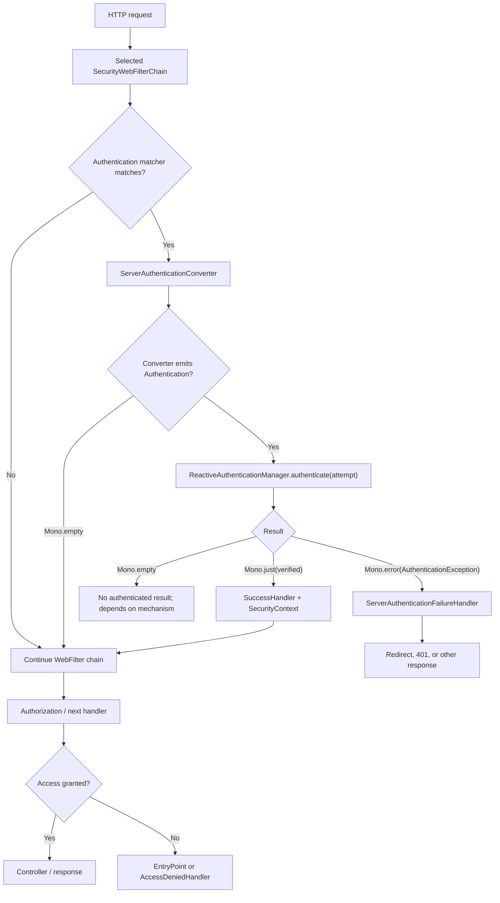
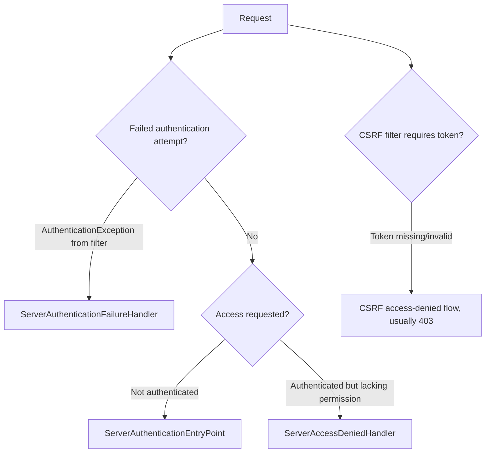

# `AuthenticationFailureHandler` and Errors During Login — Spring Security Reactive

In **Spring Security Reactive** (Spring WebFlux), when a user submits a login form with a wrong password, a locked account, or an unavailable authentication data source, the application needs to return an **intentional failure response**. In WebFlux, the component that directly handles a failed *authentication attempt* is **`ServerAuthenticationFailureHandler`**. It is not the Servlet interface named `AuthenticationFailureHandler`.

An HTML form usually needs to return to `/login?error` with a generic message. An API application might need status `401` and fixed JSON. An authentication infrastructure failure (such as a broken user store) should not be disguised as "wrong password" in monitoring; it may need `503 Service Unavailable` and operational alerts. Meanwhile, **CSRF failure** or **insufficient permissions after logging in** are separate error branches that do not automatically enter the login failure handler.

This lesson explains those boundaries, the Reactor flow of `AuthenticationWebFilter`, common `AuthenticationException` types, how to write safe handlers, a Java 17+ example running on Spring Boot 3.x / Spring Security 6.x / WebFlux, how to test with `curl` and `WebTestClient`, and rules for preventing account and secret disclosure.

## 1. First, Distinguish Five Situations

| Situation | Step handling it | Typical response | Is it `ServerAuthenticationFailureHandler`? |
| --- | --- | --- | --- |
| POST login with wrong username/password, valid CSRF | `ReactiveAuthenticationManager` authenticates | Form: redirect `/login?error` | **Yes**, via the form authentication filter |
| Calling a route requiring login without providing credentials | Authorization asks to start authentication | Form: redirect `/login`; Basic: `401` challenge | **Usually no**; uses `ServerAuthenticationEntryPoint` |
| Authenticated user lacking role/scope | Authorization denies | `403 Forbidden` | **No**; uses `ServerAccessDeniedHandler` |
| POST `/login` missing or invalid CSRF token | `CsrfWebFilter` blocks request | Usually `403 Forbidden` | **No**; do not equate with wrong password |
| Authentication database/Identity Provider fails | Manager or infrastructure emits error | `5xx`, or app's infrastructure error policy | **Depends on exception type and filter**; do not treat every `Throwable` as `AuthenticationException` |

Note: statuses and redirects may change when you customize entry points, failure handlers, exception handlers, or have multiple `SecurityWebFilterChain` beans. The table describes common behavior, not a rigid contract for every protocol.

### Why Does "Cannot Log In" Not Necessarily Mean Authentication Failure?

A user may fail to reach `/private/me` because they sent no credentials, because CSRF blocked the request, because the account lacks permission to read the resource, because the request body has a syntax error, or because the server had an outage. If the UI displays "Incorrect password" in every case, users cannot fix the issue and operations teams struggle to distinguish attacks from outages.

**Important boundary:** `ServerAuthenticationFailureHandler` resolves **a failed authentication attempt** of an authentication filter; it is not a global exception handler for all of WebFlux.

## 2. Reactive Authentication Flow and Failure Handler Position

`AuthenticationWebFilter` operates according to this model:



How to read the diagram:

1. `WebFilterChainProxy` selects a `SecurityWebFilterChain` by request matcher. An application can have multiple chains, e.g., `/api/**` and browser UI.
2. For **form login**, the default matcher is **POST `/login`**. For **HTTP Basic**, the filter inspects the Basic header on the request.
3. `ServerAuthenticationConverter` converts the request into an untrusted `Authentication`; it may return `Mono.empty()` if no matching credentials are present.
4. `ReactiveAuthenticationManager.authenticate(...)` checks the proof. **Success** returns a verified `Mono<Authentication>`; **authentication failure** emits `AuthenticationException`.
5. `AuthenticationWebFilter` delegates the authentication error to `ServerAuthenticationFailureHandler`. The handler **returns `Mono<Void>`**, completing the response/redirect reactively without calling `.block()`/`.subscribe()` internally.
6. If the converter produces no attempt, the flow may continue to authorization. When a protected route requires login, the entry point requests authentication; that is not necessarily a failed login attempt.
7. Unexpected system errors may not be converted into `AuthenticationException`, and errors occurring **before entering the authentication filter** do not necessarily pass through the failure handler.

`AuthenticationWebFilter` documentation states that when a request does not match the matcher or the converter returns empty, the filter lets the chain continue; after the manager returns an authentication error, the failure handler is invoked.

### Three Signals of the Manager

```java
// Illustrative Spring Security API signature:
Mono<Authentication> authenticate(Authentication authentication);
```

| Reactive signal | Meaning | What NOT to do |
| --- | --- | --- |
| `Mono.just(verifiedAuthentication)` | Authentication succeeded | Do not continue reporting "login failed" |
| `Mono.error(new BadCredentialsException(...))` | Authentication rejected | Do not return raw passwords, tokens, or internal messages to the client |
| `Mono.empty()` | Manager cannot decide for this token | Do not treat it as authenticated or successful |

`Mono.error(new RuntimeException(...))` is not always handled as `AuthenticationException`. When integrating a user store/IdP, classify errors at the right layer, protect secrets, and preserve semantics between **invalid credentials** and **service unavailable**.

## 3. Correct Interface for WebFlux: `ServerAuthenticationFailureHandler`

API path:

```java
import org.springframework.security.web.server.authentication
    .ServerAuthenticationFailureHandler;
```

Contract:

```java
// This is an illustrative signature of the Spring Security interface.
Mono<Void> onAuthenticationFailure(
    WebFilterExchange webFilterExchange,
    AuthenticationException exception);
```

- `WebFilterExchange` combines `ServerWebExchange` and `WebFilterChain`; use `webFilterExchange.getExchange()` to access reactive request/response if needed.
- `AuthenticationException` is the reason from the authentication step; use the exception type to **classify on the server** and display a generic message to the user.
- `Mono<Void>` is the publisher representing completion of error handling. Let the framework subscribe; do not call `.subscribe()` separately.
- The handler can redirect, set a status, return JSON, or delegate to `ServerAuthenticationEntryPoint`, depending on the application type.
- The handler is **not the place to re-verify passwords**, fabricate a `SecurityContext`, or call `chain.filter(...)` to ignore the error and let the request into a controller.

**Do not confuse with Servlet APIs:**

| WebFlux Reactive | Servlet MVC |
| --- | --- |
| `ServerAuthenticationFailureHandler` | `AuthenticationFailureHandler` |
| `WebFilterExchange`, `ServerWebExchange` | `HttpServletRequest`, `HttpServletResponse` |
| `Mono<Void>` | `void` method, may throw `IOException`/`ServletException` |
| `AuthenticationWebFilter` | `UsernamePasswordAuthenticationFilter` / `AbstractAuthenticationProcessingFilter` |
| `ServerHttpSecurity`, `SecurityWebFilterChain` | `HttpSecurity`, `SecurityFilterChain` |

Copying Servlet examples with `SimpleUrlAuthenticationFailureHandler` and overriding `onAuthenticationFailure(HttpServletRequest, ...)` **does not work directly** in WebFlux.

## 4. Two Built-in Implementations and Choosing a Response

Spring Security WebFlux provides:

**`RedirectServerAuthenticationFailureHandler`**

- Used when the **browser** needs to return to the form.
- Constructor takes a location URL, e.g., `new RedirectServerAuthenticationFailureHandler("/login?error")`.
- Performs a redirect response; the `GET /login?error` view renders a generic message without receiving raw passwords.
- FormLoginSpec defaults to redirecting to **`/login?error`** per Spring Security 6.5 documentation.

**`ServerAuthenticationEntryPointFailureHandler`**

- Delegates failure handling to a `ServerAuthenticationEntryPoint` (for instance, HTTP Basic challenge).
- Useful for protocols/APIs requiring exact challenges.
- In Spring Security 6.5, `setRethrowAuthenticationServiceException(boolean)` adjusts the policy for rethrowing service errors; **the default is true**. This signals that infrastructure errors should not automatically be treated as "wrong credentials".
- Standard protocol headers must be preserved. For example, HTTP Basic may require `WWW-Authenticate`; a custom JSON handler returning 401 without the header can alter client behavior.

Example choosing built-in redirect in configuration:

```java
.formLogin(form -> form
    .loginPage("/login")
    .authenticationFailureHandler(
        new RedirectServerAuthenticationFailureHandler("/login?error")))
```

This is an **integration DSL snippet**, not a standalone Java class. Import `RedirectServerAuthenticationFailureHandler` from `org.springframework.security.web.server.authentication`.

Do not mechanically turn all errors into redirects: scripts/APIs usually want JSON and valid status codes; browser forms usually want a retryable UI. Infrastructure errors may need status 503 or a maintenance page instead of pretending to be password errors.

## 5. Common `AuthenticationException` Types During Login

| Exception / situation | Meaning | Safe way to display |
| --- | --- | --- |
| `BadCredentialsException` | Username/password or secret does not match | Generic message "Unable to sign in with the provided credentials" |
| `UsernameNotFoundException` | User store could not find username | **Do not disclose** whether the account exists |
| `DisabledException` | Account has been disabled | Consider a generic external message; guide support through a safe channel |
| `LockedException` | Account is locked | Do not disclose account status to strangers; inform verified owner separately if needed |
| `AccountExpiredException` | Account validity has expired | Dedicated support policy; do not return user store details |
| `CredentialsExpiredException` | Password/credentials must be changed | May transition to password-change flow **after verifying identity per policy** |
| `AuthenticationServiceException` | Infrastructure/service failure backing authentication | Report system status/503, alert operations; do not label as wrong password |
| `SessionAuthenticationException` | Session policy rejected, e.g., concurrent login limit | Report session limit appropriately without leaking sensitive info |
| `InsufficientAuthenticationException` | Authentication level insufficient per specific policy | Require full authentication/MFA if the app has that flow |

The exception names in the table are common Spring Security types; **not all of them appear in every manager or protocol**. For example, JWT validation typically uses different exception types from password login. Some managers intentionally mask `UsernameNotFoundException` with `BadCredentialsException` to prevent **username enumeration**. Therefore, do not write business logic that depends on always learning from the client response that a username does not exist.

### Separating Client Errors from Infrastructure Errors

A system should have at least two categories at the observability layer:

- **Expected authentication rejections:** wrong password, ineligible account, session policy denial. Do not expose detailed reasons to unverified clients.
- **Infrastructure errors:** timeouts to DB/LDAP/IdP, exhausted database connection pool, network failures, misconfigured secrets/config, service outages. Must be observed via metrics/audits; do not turn them into user-caused failed login streaks.

Avoid applying `onErrorResume(Throwable.class, e -> Mono.error(new BadCredentialsException("wrong password")))` to every error. It masks outages, produces misleading messages, and causes accidental account lockouts if the system counts failures.

## 6. How Do `ServerAuthenticationEntryPoint`, `ServerAccessDeniedHandler`, and CSRF Differ?

Three extension points have distinct semantics:



**Entry point:** how to initiate authentication when accessing a protected resource without a valid identity. HTML form → redirect `/login`; HTTP Basic → usually 401 with challenge. Configured via:

```java
.exceptionHandling(errors -> errors
    .authenticationEntryPoint(entryPoint))
```

`entryPoint` must be a valid `ServerAuthenticationEntryPoint` bean/type. This example is an excerpt; never derive that value from an HTTP request.

**Access denied:** when a user is logged in but lacks a `GrantedAuthority`, Spring Security invokes the access-denied branch, usually returning 403. Configured via:

```java
.exceptionHandling(errors -> errors
    .accessDeniedHandler(accessDeniedHandler))
```

Here `accessDeniedHandler` must be a `ServerAccessDeniedHandler`. Do not invoke the login failure handler and ask the user to re-enter their password when the issue is a missing role/scope.

**CSRF:** form login uses sessions/cookies, and `POST /login` requests normally require a CSRF token. If the token is missing or invalid, `CsrfWebFilter` may return 403 **before the manager checks the password**. You cannot fix CSRF errors just by setting `.authenticationFailureHandler(...)`. Inspect the form, hidden `_csrf`, cookie/session, view rendering, XOR request handler, and how the client sends the token.

**HTTP 400:** malformed JSON, invalid content type, or input validation may be handled at the WebFlux layer before invoking the manager. Actual status depends on converters and handlers. Do not claim all form request errors pass through `ServerAuthenticationFailureHandler`.

## 7. Complete Hands-on: Spring Boot WebFlux Form Login with Custom Failure Handler

The example below has a server-rendered login UI using Thymeleaf. When username/password is wrong, the handler **logs minimal classification** and redirects to `/login?error`; when the user store/authentication service is genuinely unavailable and the exception is `AuthenticationServiceException`, the handler returns **503** rather than claiming wrong password. That is an intentional illustrative decision; you can change the response per your product's contract.

**Requirements:** Java 17+, Spring Boot 3.x with compatible Spring Security 6.x, Gradle wrapper and Spring Boot plugin configured. Code targets **Spring WebFlux**; do not add `spring-boot-starter-web` to the app.

### 7.1. Dependencies

In the Spring Boot project's `build.gradle`:

```groovy
dependencies {
    implementation 'org.springframework.boot:spring-boot-starter-webflux'
    implementation 'org.springframework.boot:spring-boot-starter-security'
    implementation 'org.springframework.boot:spring-boot-starter-thymeleaf'

    testImplementation 'org.springframework.boot:spring-boot-starter-test'
    testImplementation 'org.springframework.security:spring-security-test'
}
```

These starters belong to the same Spring Boot BOM. `spring-security-test` helps create valid CSRF requests in `WebTestClient`; those tests **do not replace** real browser testing of hidden fields/cookies.

### 7.2. File `src/main/java/demo/loginerrors/LoginErrorsApplication.java`

```java
package demo.loginerrors;

import org.springframework.boot.SpringApplication;
import org.springframework.boot.autoconfigure.SpringBootApplication;

@SpringBootApplication
public class LoginErrorsApplication {
    public static void main(String[] args) {
        SpringApplication.run(LoginErrorsApplication.class, args);
    }
}
```

### 7.3. File `src/main/java/demo/loginerrors/SafeFormFailureHandler.java`

```java
package demo.loginerrors;

import org.slf4j.Logger;
import org.slf4j.LoggerFactory;
import org.springframework.http.HttpStatus;
import org.springframework.security.authentication.AuthenticationServiceException;
import org.springframework.security.core.AuthenticationException;
import org.springframework.security.web.server.WebFilterExchange;
import org.springframework.security.web.server.authentication
    .RedirectServerAuthenticationFailureHandler;
import org.springframework.security.web.server.authentication
    .ServerAuthenticationFailureHandler;
import org.springframework.stereotype.Component;
import reactor.core.publisher.Mono;

@Component
public class SafeFormFailureHandler
        implements ServerAuthenticationFailureHandler {

    private static final Logger log =
        LoggerFactory.getLogger(SafeFormFailureHandler.class);

    private final RedirectServerAuthenticationFailureHandler redirect =
        new RedirectServerAuthenticationFailureHandler("/login?error");

    @Override
    public Mono<Void> onAuthenticationFailure(
            WebFilterExchange webFilterExchange,
            AuthenticationException exception) {

        // Service failures must not be reported as wrong password.
        if (exception instanceof AuthenticationServiceException) {
            log.error("Authentication service is unavailable");
            var response = webFilterExchange.getExchange().getResponse();
            response.setStatusCode(HttpStatus.SERVICE_UNAVAILABLE);
            response.getHeaders().setCacheControl("no-store");
            return response.setComplete();
        }

        // Log only the error category; DO NOT log exception.getMessage(),
        // request body, username, password, or raw tokens.
        log.info("Login rejected; category={}",
            exception.getClass().getSimpleName());

        // Keep the response generic to avoid user enumeration.
        return redirect.onAuthenticationFailure(
            webFilterExchange, exception);
    }
}
```

**Detailed explanation:**

- `@Component` registers the handler in the Spring context. `ServerAuthenticationFailureHandler` accepts `AuthenticationException` and `WebFilterExchange`, returning `Mono<Void>`.
- `RedirectServerAuthenticationFailureHandler` safely redirects to a **fixed URL**, without appending unvalidated usernames/query parameters to `Location`.
- For `AuthenticationServiceException`, the example returns 503 instead of redirecting to `/login?error`, logging the infrastructure error internally. Real applications may have a dedicated maintenance page/JSON 503, timeouts, and alerting.
- Avoid unconditional `log.error("login failed", exception)` if stack traces/exception messages might contain sensitive data from authentication libraries. When stack traces are needed for investigation, enforce redaction and restricted access.
- The handler **does not** call `chain.filter` after failure, does not fabricate an authenticated token, and does not use `.block()`/`.subscribe()`.
- **Do not assume this handler catches every timeout/unchecked exception.** Only errors passing through the authentication failure flow that are `AuthenticationException` reach this branch. General error handling belongs to WebFlux, the gateway, and operations.

The class above is valid within the project scope, but cannot handle HTTP alone: it must be **wired into form login** via the following configuration.

### 7.4. File `src/main/java/demo/loginerrors/SecurityConfig.java`

```java
package demo.loginerrors;

import org.springframework.context.annotation.Bean;
import org.springframework.context.annotation.Configuration;
import org.springframework.security.config.Customizer;
import org.springframework.security.config.annotation.web.reactive.EnableWebFluxSecurity;
import org.springframework.security.config.web.server.ServerHttpSecurity;
import org.springframework.security.core.userdetails.ReactiveUserDetailsService;
import org.springframework.security.core.userdetails.User;
import org.springframework.security.core.userdetails.UserDetails;
import org.springframework.security.crypto.factory.PasswordEncoderFactories;
import org.springframework.security.crypto.password.PasswordEncoder;
import org.springframework.security.provisioning.MapReactiveUserDetailsService;
import org.springframework.security.web.server.SecurityWebFilterChain;

@Configuration
@EnableWebFluxSecurity
public class SecurityConfig {

    @Bean
    SecurityWebFilterChain security(
            ServerHttpSecurity http,
            SafeFormFailureHandler failureHandler) {

        return http
            .authorizeExchange(exchanges -> exchanges
                .pathMatchers("/login", "/public/**").permitAll()
                .anyExchange().authenticated())
            .formLogin(form -> form
                .loginPage("/login")
                .authenticationFailureHandler(failureHandler))
            .httpBasic(basic -> basic.disable())
            .csrf(Customizer.withDefaults())
            .build();
    }

    @Bean
    PasswordEncoder passwordEncoder() {
        return PasswordEncoderFactories.createDelegatingPasswordEncoder();
    }

    @Bean
    ReactiveUserDetailsService users(PasswordEncoder encoder) {
        UserDetails reader = User.withUsername("reader")
            .password(encoder.encode("demo123"))
            .roles("READER")
            .build();
        return new MapReactiveUserDetailsService(reader);
    }
}
```

Significant decisions:

- `.formLogin(form -> form.loginPage("/login")...)` uses **POST `/login`** for authentication; the application must provide **GET `/login`** itself because a custom page was chosen.
- `.authenticationFailureHandler(failureHandler)` controls the response **when a login attempt fails** in the form flow; it does not replace entry point/CSRF/authorization.
- `.pathMatchers("/login").permitAll()` allows unauthenticated users to view the form; **it does not exempt POST from CSRF**.
- `.httpBasic(...disable())` keeps the example form-login only so browsers do not pop up a Basic prompt. For APIs with Basic, a separate handler can be configured via `.httpBasic(basic -> basic.authenticationFailureHandler(...))`; do not apply the form redirect pattern to HTTP Basic if clients expect a 401 challenge.
- `.csrf(Customizer.withDefaults())` keeps the CSRF token mandatory on login POST; the example does not disable CSRF.
- Password `demo123` is for **learning machines**; `PasswordEncoder` ensures storing a hash instead of plain text in the user store.

### 7.5. File `src/main/java/demo/loginerrors/LoginPageController.java`

```java
package demo.loginerrors;

import org.springframework.stereotype.Controller;
import org.springframework.web.bind.annotation.GetMapping;

@Controller
public class LoginPageController {

    @GetMapping("/login")
    public String loginPage() {
        return "login";
    }
}
```

Because this is a `@Controller` returning a view name, Thymeleaf will render `src/main/resources/templates/login.html`. If `@RestController` were used returning the string `"login"`, Spring would return plain text instead of rendering the HTML view and the form would not work as designed.

### 7.6. File `src/main/resources/templates/login.html`

```html
<!DOCTYPE html>
<html lang="en" xmlns:th="http://www.thymeleaf.org">
<head>
    <meta charset="UTF-8">
    <title>Sign in</title>
</head>
<body>
<h1>Sign in</h1>

<p th:if="${param.error}">
    Unable to sign in. Please check your credentials and try again.
</p>

<form th:action="@{/login}" method="post">
    <label for="username">Username</label>
    <input id="username" name="username"
           type="text" autocomplete="username" required>

    <label for="password">Password</label>
    <input id="password" name="password"
           type="password" autocomplete="current-password" required>

    <button type="submit">Sign in</button>
</form>
</body>
</html>
```

**Why is there no hidden `_csrf` in the source template?** With Spring Security + Thymeleaf integration and `th:action` on a POST form, view processing can automatically insert the hidden CSRF input. **Inspect the rendered HTML in the browser**: there must be an input named `_csrf` with an appropriate token value. That value is for the **current session/request**, never hardcoded in an HTML template or JavaScript bundle.

Do not "fix" 403 by calling `csrf.disable()`. If using static HTML or an SPA not rendered via Thymeleaf, you must supply and submit the CSRF token through the appropriate WebFlux mechanism.

The message on the login page is **intentionally generic**. When an account is locked or a username does not exist, an unverified caller should not learn the difference from the response alone.

### 7.7. File `src/main/java/demo/loginerrors/DemoController.java`

```java
package demo.loginerrors;

import org.springframework.security.core.context.ReactiveSecurityContextHolder;
import org.springframework.web.bind.annotation.GetMapping;
import org.springframework.web.bind.annotation.RestController;
import reactor.core.publisher.Mono;

@RestController
public class DemoController {

    @GetMapping("/public/ping")
    public Mono<String> ping() {
        return Mono.just("pong");
    }

    @GetMapping("/")
    public Mono<String> home() {
        return Mono.just("home");
    }

    @GetMapping("/private/me")
    public Mono<String> me() {
        return ReactiveSecurityContextHolder.getContext()
            .map(ctx -> ctx.getAuthentication().getName());
    }
}
```

`/private/me` reads the username from the `SecurityContext` in the Reactor Context, without trusting a client-sent username field. Unauthenticated users are redirected to login; logged-in users can receive `reader`. The `/` route is protected, ensuring the default form login success redirect has an existing target.

### 7.8. Running the Application

In the project directory with the Gradle wrapper:

```bash
# Linux/macOS
./gradlew bootRun

# Windows
gradlew.bat bootRun
```

Open `http://localhost:8080/login`, enter username `reader`.

- Password **`demo123`** → login succeeds and typically redirects to `/` or the saved URL per request cache/success handler. Afterward, `GET /private/me` in the same session returns body `reader`.
- Password **`wrong`** → manager rejects, handler redirects to `/login?error`, page displays the generic message.
- If the hidden CSRF token is removed from the POST (while CSRF is enabled), the request is usually blocked with **403** before password verification; that is a different error and does not trigger `SafeFormFailureHandler` in this example.
- If you intentionally emit an `AuthenticationServiceException` from a custom manager because the user store is unavailable, the handler returns **503**. Normal in-memory demos **do not automatically produce a 503 outage**; this scenario must be tested separately, without claiming that entering a wrong password causes 503.

Use HTTP localhost only for this lesson. In real environments, form login requires HTTPS, Secure/HttpOnly/SameSite cookie policies, CSRF, and brute-force password protection.

## 8. Integration Testing: Distinguishing Login Error Redirect, CSRF 403, and Successful Login

File `src/test/java/demo/loginerrors/LoginFailureFlowTest.java`:

```java
package demo.loginerrors;

import org.junit.jupiter.api.Test;
import org.springframework.beans.factory.annotation.Autowired;
import org.springframework.boot.test.context.SpringBootTest;
import org.springframework.boot.test.autoconfigure.web.reactive.AutoConfigureWebTestClient;
import org.springframework.http.MediaType;
import org.springframework.test.web.reactive.server.WebTestClient;
import org.springframework.web.reactive.function.BodyInserters;

import static org.junit.jupiter.api.Assertions.assertTrue;
import static org.springframework.security.test.web.reactive.server
    .SecurityMockServerConfigurers.csrf;

@SpringBootTest(webEnvironment = SpringBootTest.WebEnvironment.MOCK)
@AutoConfigureWebTestClient
class LoginFailureFlowTest {

    @Autowired
    WebTestClient client;

    @Test
    void loginPageIsPublicAndRendered() {
        client.get().uri("/login")
            .exchange()
            .expectStatus().isOk()
            .expectBody(String.class)
            .value(body -> assertTrue(body.contains("name=\"_csrf\"")));
    }

    @Test
    void missingCsrfIsNotWrongPassword() {
        client.post().uri("/login")
            .contentType(MediaType.APPLICATION_FORM_URLENCODED)
            .body(BodyInserters.fromFormData("username", "reader")
                .with("password", "wrong"))
            .exchange()
            .expectStatus().isForbidden();
    }

    @Test
    void invalidPasswordRedirectsToGenericErrorPage() {
        client.mutateWith(csrf())
            .post().uri("/login")
            .contentType(MediaType.APPLICATION_FORM_URLENCODED)
            .body(BodyInserters.fromFormData("username", "reader")
                .with("password", "wrong"))
            .exchange()
            .expectStatus().is3xxRedirection()
            .expectHeader().value("Location", location ->
                assertTrue(location.endsWith("/login?error")));
    }

    @Test
    void validPasswordReachesAuthenticationSuccessFlow() {
        client.mutateWith(csrf())
            .post().uri("/login")
            .contentType(MediaType.APPLICATION_FORM_URLENCODED)
            .body(BodyInserters.fromFormData("username", "reader")
                .with("password", "demo123"))
            .exchange()
            .expectStatus().is3xxRedirection();
    }

    @Test
    void unauthenticatedProtectedRequestOpensLoginPage() {
        client.get().uri("/private/me")
            .exchange()
            .expectStatus().is3xxRedirection()
            .expectHeader().value("Location", location ->
                assertTrue(location.endsWith("/login")));
    }
}
```

Run:

```bash
# Linux/macOS
./gradlew test --tests 'demo.loginerrors.LoginFailureFlowTest'

# Windows
gradlew.bat test --tests "demo.loginerrors.LoginFailureFlowTest"
```

What the tests check:

- GET login is public and rendered HTML contains hidden CSRF.
- POST **missing CSRF** leads to 403: not yet a password error from the authentication manager.
- POST **wrong password, valid CSRF** reaches the failure handler and fixed redirect.
- POST **valid password, valid CSRF** follows the success flow; a redirect status alone is not enough to prove the session was persisted.
- GET protected endpoint when unauthenticated leads to the entry point redirect, not the form failure handler.

`mutateWith(csrf())` from `spring-security-test` helps mock valid CSRF for tests. It **does not replace** end-to-end browser tests with real tokens and cookies, nor does it verify username/password if the test also mocks authentication.

### Testing Session Success Rather Than Only 3xx Status

A redirect after POST can be either success or failure, so you must test a subsequent request using **the same browser's cookie**. In a browser:

1. Open `/login`, verify hidden `_csrf` and session cookie.
2. Log in with `reader/demo123`.
3. Open `/private/me`; the body must be `reader`.
4. Log out and try again; a request without a valid session must prompt for login.
5. Log in with wrong credentials and visit `/private/me` in an independent unauthenticated browser/Chrome profile; no successful session may be granted.

With real API/tests, you can capture `Set-Cookie` from the successful POST response using `WebTestClient` or a `curl` cookie jar, then send that cookie to the protected endpoint. Never assert only `.is3xxRedirection()` and declare security thoroughly verified.

### Directly Testing the 503 Branch with Service Errors

The demo path with `MapReactiveUserDetailsService` does not actively emit outages. To test **the handler itself** without breaking a database, write a unit test using `MockServerWebExchange` and `StepVerifier` or invoke the handler with `AuthenticationServiceException` in a test environment. The goal is to verify:

- `getResponse().getStatusCode()` is `503 Service Unavailable`.
- Response contains no username, password, exception message, or stack trace.
- `Mono<Void>` completes without trying to continue the filter chain.
- Internal monitoring recognizes an infrastructure failure and does not count it as a password mismatch.

This differs from integration-testing an actual `ReactiveAuthenticationManager` emitting errors. To test the entire manager-to-handler path, swap the manager with a test bean only in a test profile or simulate a user store emitting controlled `AuthenticationServiceException`.

## 9. Handler Returning JSON for APIs: When Is It Appropriate?

A frontend calling an API may want JSON instead of an HTML redirect. From the `ServerAuthenticationFailureHandler` contract, you can create a class:

```java
package demo.loginerrors;

import java.nio.charset.StandardCharsets;

import org.springframework.http.HttpStatus;
import org.springframework.http.MediaType;
import org.springframework.security.core.AuthenticationException;
import org.springframework.security.web.server.WebFilterExchange;
import org.springframework.security.web.server.authentication
    .ServerAuthenticationFailureHandler;
import reactor.core.publisher.Mono;

public final class JsonLoginFailureHandler
        implements ServerAuthenticationFailureHandler {

    @Override
    public Mono<Void> onAuthenticationFailure(
            WebFilterExchange webFilterExchange,
            AuthenticationException exception) {

        var response = webFilterExchange.getExchange().getResponse();
        response.setStatusCode(HttpStatus.UNAUTHORIZED);
        response.getHeaders().setContentType(MediaType.APPLICATION_JSON);
        response.getHeaders().setCacheControl("no-store");

        byte[] payload = (
            "{\"code\":\"AUTHENTICATION_FAILED\","
            + "\"message\":\"Unable to authenticate\"}")
            .getBytes(StandardCharsets.UTF_8);

        return response.writeWith(Mono.just(
            response.bufferFactory().wrap(payload)));
    }
}
```

This is **an optional class**, not a bean used simultaneously with `SafeFormFailureHandler` in the main config. You can attach it to an API-dedicated authentication flow, for example:

```java
// Snippet replacing the form login failure handler configuration:
.formLogin(form -> form
    .authenticationFailureHandler(new JsonLoginFailureHandler()))
```

**Integration warning:** Changing the failure response to JSON **does not** make default form login automatically accept a JSON request body. The form login converter still expects form parameters such as `username` and `password` on the configured endpoint. If you want `POST /api/login` with a JSON request, you must configure a **separate converter/filter** for JSON and an appropriate CSRF policy; that is a different design from the main HTML example.

When using HTTP Basic, a 401 status normally requires protocol-compliant `WWW-Authenticate`. The simple JSON class above **does not automatically generate a Basic challenge**; do not wire it in place of a Basic failure handler if clients depend on the challenge header. Use `ServerAuthenticationEntryPointFailureHandler` with an appropriate entry point, or actively preserve headers per the API contract.

If the API uses OAuth2 bearer tokens, error statuses/headers (such as `WWW-Authenticate: Bearer ...`) follow their own protocol. Do not arbitrarily turn token errors into redirects to an HTML form or return JSON missing required headers.

## 10. CSRF 403 Error Differs from "Wrong Password"

A common pitfall when building a custom WebFlux login form:

```text
POST /login
username=reader
password=demo123
```

If a valid CSRF token is not sent while Spring Security has default CSRF enabled, the request can be blocked by `CsrfWebFilter` with **403** **before** `ReactiveAuthenticationManager` reads the password.

With server-rendered Thymeleaf, use:

```html
<form th:action="@{/login}" method="post">
    <input name="username" type="text">
    <input name="password" type="password">
    <button type="submit">Sign in</button>
</form>
```

When integration works, Thymeleaf automatically inserts the hidden CSRF input into rendered HTML; no need to invent a token. The user must also send the **cookie/session** matching that form.

If you build a pure JavaScript frontend, retrieve the token from the Spring Security WebFlux flow and send it in the **header or parameter** per the configured handler/repository. Since Spring Security 6.x, tokens may be encoded via an XOR handler to protect against BREACH; do not manually compare the raw token in WebSession with the masked token in HTML.

**Do NOT use**:

```java
// This is a dangerous choice if browser form login uses cookies.
.csrf(csrf -> csrf.disable())
```

just to "fix" POST errors. CSRF protection and authentication failure handlers are two separate mechanisms; dropping CSRF creates **login CSRF** and post-login request forgery risks.

## 11. Do Not Disclose Whether a Username Exists

**User enumeration** happens when an attacker distinguishes valid usernames from non-existent usernames via status codes, redirects, messages, timing, or other technical details.

Dangerous response practices:

- Username does not exist → "Account does not exist"; wrong password → "Wrong password".
- Locked account → returning JSON with username, email, and lock timestamp before verification.
- Returning `AuthenticationException.getMessage()` directly in HTML/JSON.
- Redirecting `/login?error=UsernameNotFoundException&user=alice` and logging/tracking public URLs.
- Returning very fast for one username while noticeably running slow password hashing for another.

Safer practices:

1. Return **the same generic message** for most credential errors from unverified clients.
2. Classify the reason in **minimal internal logs/metrics** if policy permits; do not log raw passwords/tokens/cookies or full request bodies.
3. Apply rate limiting and credential-stuffing defenses per IP/account/identity while considering privacy, reliability, and false positives. Do not count DB outages as wrong passwords by default.
4. For verified users with a support policy, provide specific flows to unlock accounts/reset passwords while avoiding opening a public username-checking oracle.
5. Watch for timing differences; use an appropriate password encoder, bound costs, and test for side-channel leaks if the system has strict requirements.

The main example handler logs only the **error class** without logging the username, exception message, or the entire `Authentication` object.

## 12. Authentication Infrastructure Errors Must Be Separated from User Errors

Suppose `ReactiveUserDetailsService` uses a database/reactive LDAP:

```java
Mono<UserDetails> user = userRepository.findByUsername(username)
    .switchIfEmpty(Mono.error(
        new UsernameNotFoundException("Account unavailable")));
```

This is an **integration illustration snippet**, not a complete class: `userRepository` is an application abstraction. When the query genuinely returns empty because no user exists, `UsernameNotFoundException` describes the business case; the manager may convert it into `BadCredentialsException` to reduce enumeration.

However, when the database **times out**, the application should not try to turn `TimeoutException` into `UsernameNotFoundException`. Infrastructure errors must be handled under an explicit policy:

- Ensure the authentication manager/client has timeouts and does not block the event loop.
- Assign an infrastructure error type (`AuthenticationServiceException`, or let underlying errors propagate to the appropriate error layer) per the implementation contract.
- Log operational errors safely and trigger alerts on spikes.
- Never grant "temporary" permissions with self-issued tokens when the identity provider is unavailable.
- Never open the login endpoint with `.permitAll()` as a fix for outages; `permitAll` is only web authorization, not a manager fix.
- Observe **fail closed**: when passwords cannot be verified, never treat the request as succeeding; a 503 response fits many products, though the API contract decides.

`SafeFormFailureHandler` illustrates returning 503 when the handler itself **receives** `AuthenticationServiceException`. If a library emits a different exception or an error occurs before the filter, the request may follow WebFlux error handling instead of this branch; test the real system itself.

## 13. Errors When Login Session or Permissions Are Unsuitable

A login attempt with valid credentials can still be rejected due to **session policies** or **authentication success processing**:

- Concurrent session limit: the system wants to keep the prior session and block new logins; it may emit `SessionAuthenticationException` along the authentication processing path.
- MFA policy: password is correct but additional verification is needed; this is not yet "login complete", and requires a clear multi-step authentication flow.
- Session store fails to save `SecurityContext` after success; that is an **infrastructure/session incident**, not a password mismatch.
- Redirect success handler or security context persistence fails; monitor the right error type instead of retrying passwords.
- CSRF or cookie policies cause the user to log in successfully yet lack a session on the next request, creating the impression of "login keeps failing".

**Point to distinguish:** errors inside/after the *success handler* are not guaranteed to return to the *failure handler*; it depends on where the error occurs in the reactive pipeline and how the authentication filter integrates. Do not promise all post-password-verification errors are caught by one shared handler.

A logged-in user lacking permission to call `/admin` encounters an **authorization denial**, not a login failure. Do not redirect them back to `/login?error` to mask missing permissions.

## 14. Principles for Returning Responses Properly Without Blocking Reactor

A good custom failure handler must:

- **Return a publisher**: `return response.setComplete()`, `return response.writeWith(...)`, or delegate to another `ServerAuthenticationFailureHandler`. The framework owns subscription.
- **Never call `.subscribe()` manually** inside the handler; doing so detaches the response from the HTTP lifecycle and loses error control.
- **Never call `.block()`** on the Netty event loop; never run synchronous JDBC/blocking network queries just to format a message.
- **Never write the response twice**: if already redirected, do not write JSON afterward; if the response is committed, do not set further status/headers/body.
- **Never invoke the remaining filter chain after login fails** to "allow public routes"; failure has been concluded and must complete properly.
- **Never construct an `Authentication` with `isAuthenticated=true`** inside an error handler.
- **Never store credentials in the Reactor Context or session** upon failure for "reuse next time".
- **Never return exception messages/stack traces** to clients; use stable error codes and generic messages.
- **Never keep plaintext passwords** in logs, request caches, telemetry spans, analytics URLs, or message queues.
- **Test concurrency and cancellation** if the handler calls an additional reactive audit service; compose those steps into the `Mono` rather than firing-and-forgetting arbitrarily.

For API protocols with a JSON body, use `Content-Type: application/json`, UTF-8 charset, and appropriate cache policy (`Cache-Control: no-store`). For OAuth2 Basic/Bearer, preserve standard challenge headers. For HTML forms, redirect cleanly for UX and never put sensitive data in query strings.

### Why Should Passwords Never Be Sent Back in Redirects?

URLs can be saved in browser history, sent in `Referer`, analytics, access logs, or copied links. Even if an app only wants to prefill the username, consider PII, XSS, and display policies; never prefill passwords in responses. On form errors, ask the user to re-enter the password.

## 15. Diagnosis: Same Wrong Password, Different Statuses

When a user says "login failed", follow this sequence:

1. **Check request method and URL:** is it a POST to the configured login processing URL? `loginPage("/login")` corresponds to POST `/login` by default.
2. **Check response type:** 302 to `/login?error`, 401 challenge, 403, 503, or 500? Each points to a different branch.
3. **Check CSRF first:** does the POST have hidden `_csrf`/valid header and matching session cookie? If missing, 403 happens before the manager.
4. **Identify the security chain:** do `securityMatcher`/`@Order` send the request into an API chain instead of the form chain?
5. **Check the converter:** does the form have proper `username`/`password` and Content-Type? JSON sent to the default form converter will not automatically parse as a JSON login endpoint.
6. **Check manager and user store:** does the password encoder match the hash format? Is the user enabled/locked/expired? Did the reactive data source time out/fail?
7. **Check the wired handler:** is `.formLogin(form -> form.authenticationFailureHandler(...))` running on the right chain? Is there an independent custom filter?
8. **Check the success flow:** if password is right yet cookie/session is missing on the next request, inspect persistence, session timeout, SameSite/Secure, load/save repository, redirects, and sticky/shared sessions.
9. **Check auth vs authorization:** 401/redirect because unauthenticated, 403 because missing role or CSRF; do not blame every 403 on password.
10. **Check safe observability:** are request ID, exception category, user store health, latency, and retries/timeouts logged? Do not log plaintext usernames if disallowed, and never log passwords/tokens.

### Troubleshooting Guide

| Symptom | Cause to check |
| --- | --- |
| POST login returns 403, handler log does not appear | CSRF, chain, or filter running before login |
| POST login redirects to `/login?error` | Manager or login success-policy rejected; handler ran |
| GET `/private/me` redirects to `/login` | No valid authentication yet; entry point invoked |
| Bad Basic request returns 401 | Basic auth failure/challenge; differs from HTML form redirect |
| Valid credentials yet `/admin` returns 403 | Authority/role or method security denied |
| During DB outage all logins return 503 | Handler/infrastructure classified service exception |
| Login redirect succeeds yet next request is unauthenticated | Cookie/session repository, persistence, browser policy |
| Custom JSON handler is never called | Not wired to the right authentication filter or error occurred earlier |
| Response prints raw exception message | Risk of internal info leak and user enumeration |
| Reactors stall during login | Blocking I/O/excessively heavy password hash on event loop or `block()` |

Do not fix errors by "disabling SecurityWebFilterChain", "dropping CSRF", or "using onErrorResume to grant a fake user". Those alter security policy rather than fixing the response branch.

## 16. Testing Security and Response Quality

Tests should cover:

| Test case | Expectation |
| --- | --- |
| GET login while unauthenticated | 200, login page has no internal info |
| POST form missing CSRF | 403, no wrong-password message |
| POST form valid token + wrong password | Generic error redirect/response, no password leak |
| POST form valid token + valid password | Success flow, subsequent protected request uses valid session |
| Non-existent username | Public response does not enable enumeration |
| Account locked/disabled | Consistent public policy, safe internal logs |
| User store timeout/outage | Grants no permissions; appropriate operational error result, monitored |
| Unauthorized protected GET | Entry point, not confused with form failure |
| Authenticated user missing role | Access denied, does not ask to re-enter password |
| POST logout missing CSRF | Blocked by CSRF if CSRF enabled |
| Invalid JSON/Content-Type | Handled clearly by input validation/converter, not assumed bad password |
| Multiple chains | UI chain and API chain have distinct failure responses |
| Basic / bearer challenge | 401 and required protocol headers |
| Async errors/cancellation | Does not commit response twice, does not lose mandatory tracing/audit |
| Logs and metrics | Contain no passwords, raw cookies, CSRF tokens, JWTs, or sensitive stack traces |

**Which test proves the handler actually ran?** In the example, wrong password + valid CSRF must lead to `/login?error` chosen by the handler. To be even more precise, write a unit test for `SafeFormFailureHandler` passing `BadCredentialsException` and `AuthenticationServiceException`, asserting redirect/503 and verifying the logger receives no credentials using a redacting test appender.

**Which test is insufficient?** A test asserting only `POST /login -> 302` does not distinguish success from failure; assert `Location`, cookie, security context, and a subsequent protected request.

## 17. Self-Check Questions

**1. In WebFlux, which interface should be implemented to handle a failed login attempt?**  
`ServerAuthenticationFailureHandler`, with `onAuthenticationFailure(WebFilterExchange, AuthenticationException): Mono<Void>`.

**2. Where does a wrong username/password on a form POST with valid CSRF usually go?**  
`ReactiveAuthenticationManager` emits `AuthenticationException`, `AuthenticationWebFilter` calls the failure handler, and default form login redirects to `/login?error`.

**3. Is calling a protected GET endpoint while not logged in handled by the form failure handler?**  
No. That is usually the **authentication entry point** requesting login.

**4. Is a logged-in user lacking `ROLE_ADMIN` getting 403 a wrong password?**  
No. That is an **authorization denial**, usually handled by the access-denied handler.

**5. What happens on a login POST missing CSRF even when the password is correct?**  
Usually `403 Forbidden` from the CSRF flow, and the manager does not even need to verify the password.

**6. Why shouldn't `exception.getMessage()` be returned to the UI?**  
It may leak username existence, account state, user store details, or technical secrets; use a generic message.

**7. How should `AuthenticationServiceException` be handled?**  
It signals an authentication error from a service/infrastructure: grant no permissions, log operationally, and return an error per contract (e.g., 503). Do not default it to wrong password.

**8. Can `.block()` be called inside `onAuthenticationFailure` to write a database audit record?**  
Do not do this in WebFlux. Use a reactive repository/client and compose the publisher into the chain; never block the event loop.

**9. Should `JsonLoginFailureHandler` be used for browser forms?**  
Only if the frontend genuinely needs JSON. HTML forms usually fit redirects; changing the failure handler response does not turn request input into a JSON converter.

**10. Why must Basic 401 pay attention to `WWW-Authenticate`?**  
The challenge header is part of the HTTP Basic contract, telling clients how to supply credentials. A custom handler returning 401 while omitting the header can break client behavior.

## Key Takeaways

- **`ServerAuthenticationFailureHandler`** is the reactive API for handling **failed authentication attempts**; do not confuse it with Servlet `AuthenticationFailureHandler`.
- **Default form login**: redirects to `/login?error`; customizable via `ServerHttpSecurity.formLogin(form -> form.authenticationFailureHandler(...))`.
- **Do not equate** the failure handler with the **entry point** (not logged in), **access-denied handler** (insufficient permissions), or **CSRF filter** (invalid token).
- **`AuthenticationException`** carries the authentication reason; backend errors may be `AuthenticationServiceException` or another type depending on implementation. Do not catch all `Throwable` and blame wrong passwords.
- **No information leakage:** generic messages to users, minimal internal logs, never echo username/password/tokens or stack traces.
- **Stay properly reactive:** `Mono<Void>` drives the response; never `.block()`/`.subscribe()`, never write the response twice, and never grant access.
- **Test by category:** wrong password + valid CSRF, missing CSRF, unauthenticated protected route, missing role, infrastructure error, and successful login followed by session access.
- **UI and API differ:** HTML redirects differ from 401 JSON; HTTP Basic/Bearer have challenge headers that must be preserved.

### Official Documentation

- [Spring Security 6.5 — `ServerAuthenticationFailureHandler`](https://docs.spring.io/spring-security/reference/6.5/api/java/org/springframework/security/web/server/authentication/ServerAuthenticationFailureHandler.html)
- [Spring Security 6.5 — `AuthenticationWebFilter`](https://docs.spring.io/spring-security/reference/6.5/api/java/org/springframework/security/web/server/authentication/AuthenticationWebFilter.html)
- [Spring Security 6.5 — `ServerHttpSecurity.FormLoginSpec`](https://docs.spring.io/spring-security/reference/6.5/api/java/org/springframework/security/config/web/server/ServerHttpSecurity.FormLoginSpec.html)
- [Spring Security 6.5 — `RedirectServerAuthenticationFailureHandler`](https://docs.spring.io/spring-security/reference/6.5/api/java/org/springframework/security/web/server/authentication/RedirectServerAuthenticationFailureHandler.html)
- [Spring Security 6.5 — `ServerAuthenticationEntryPointFailureHandler`](https://docs.spring.io/spring-security/reference/6.5/api/java/org/springframework/security/web/server/authentication/ServerAuthenticationEntryPointFailureHandler.html)
- [Spring Security 6.5 — `ServerHttpSecurity.HttpBasicSpec`](https://docs.spring.io/spring-security/reference/6.5/api/java/org/springframework/security/config/web/server/ServerHttpSecurity.HttpBasicSpec.html)
- [Spring Security 6.5 — `ServerHttpSecurity.ExceptionHandlingSpec`](https://docs.spring.io/spring-security/reference/6.5/api/java/org/springframework/security/config/web/server/ServerHttpSecurity.ExceptionHandlingSpec.html)
- [Spring Security 6.5 — WebFlux CSRF](https://docs.spring.io/spring-security/reference/6.5/reactive/exploits/csrf.html)
