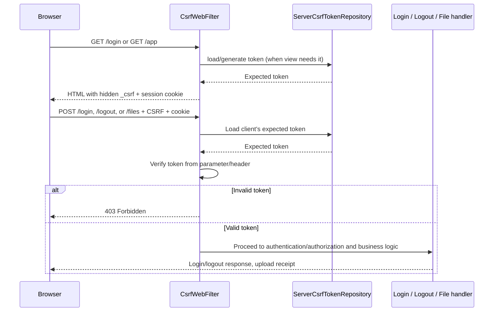

# CSRF for Login, Logout, and File Uploads/Downloads in Spring Security Reactive

In a **Spring WebFlux** application using session cookies to identify users, three flows frequently appear side by side: the **login** form, the **logout** form, and **file upload/download** operations. They look like ordinary HTTP requests, yet do not share the same CSRF protection rules:

- **`POST /login`** changes authentication state: **must validate a CSRF token**, even when no authenticated user exists yet.
- **`POST /logout`** changes session state: **must validate a CSRF token**; never turn logout into a GET operation just to use a link.
- **File upload (`POST multipart/form-data`)** mutates data: must enforce authentication, authorization, and CSRF; in WebFlux pay close attention to how tokens are read from **multipart bodies**.
- **File download (`GET /files/{id}`)** only reads a resource: **usually requires no CSRF token**, yet must enforce object-level authorization for that exact file and avoid turning GET into a state-mutating action.

This lesson clarifies the differences among **CSRF**, **authentication**, **authorization**, and file content security; explains `CsrfWebFilter`, repositories, hidden inputs, multipart uploads, cookies, XOR/BREACH, and session timeouts; then builds a **Java 17+ / Spring Boot 3.x / Spring Security 6.x / WebFlux** example with login, logout, upload, and download, complete with `WebTestClient` and browser/`curl` testing instructions.

> **Right stack:** this lesson uses the Reactive stack: `ServerHttpSecurity`, `SecurityWebFilterChain`, `ServerWebExchange`, `CsrfWebFilter`, `ServerCsrfTokenRepository`, and `FilePart`. Servlet's `HttpSecurity`, `CsrfTokenRepository`, `MultipartFile`, `HttpServletRequest`, and `HttpSession` are not the APIs of these WebFlux examples.

## 1. What does CSRF actually prevent?

**Cross-Site Request Forgery (CSRF)** occurs when a victim's browser is tricked into sending an unintended request to an application where the browser can auto-supply credentials. This can happen when the browser auto-sends a **session cookie** or cached HTTP credentials, even though the request originated from another website.

For example, a victim is logged into a document-management app. A malicious page submits a POST form to the app's endpoint. If the app relies solely on the cookie to identify the user and **does not verify the request's intent**, the state-changing operation can execute under the victim's identity.

A **CSRF token** is proof issued by the app under an explicit mechanism, sent back in a **form parameter or request header** — a location an external attack page cannot simply tell the browser to auto-attach the way cookies are auto-sent. Spring Security verifies that token before processing protected requests.

CSRF does not replace:

- **Authentication:** verifying user/password, session, or OAuth2 tokens.
- **Authorization:** deciding whether a user has permission to upload/download/read a specific file.
- **XSS protection:** if an attacker executes same-origin JavaScript, they can read/manipulate forms and bypass many CSRF controls.
- **File scanning:** defending against malware, zip bombs, and content-type spoofing.
- **Resource limits:** capping file sizes, multipart parts, upload rates, and resource consumption.
- **CORS and SameSite:** complementary/policy layers with distinct goals that do not replace CSRF tokens everywhere.

## 2. Decision table for login, logout, and files

| Request | Mutates state? | Default CSRF when enabled? | Other key controls |
| --- | --- | --- | --- |
| `GET /login` | No, displays form | No token required on GET request | Public view, safe token issuance, session/cookie |
| `POST /login` | Yes, creates/changes auth state | **Yes** | Username/password, rate limiting, anti-login-CSRF |
| `POST /logout` | Yes, clears login state | **Yes** | Session/context invalidation, cookie policy |
| `GET /logout` | Displays confirmation page only (if used) | No; **must not perform logout** | Avoid mutating state via GET |
| `GET /app` | Renders UI only | No | Authentication to enter UI and render tokens |
| `POST /files` with `multipart/form-data` | **Yes** | **Yes** | Ownership, file validation, quotas, parsing limits |
| `GET /files/{id}` | Read/download only | Usually no | **Object-level authorization**, safe response headers |
| `DELETE /files/{id}` | Deletes file | **Yes** | Authorization + CSRF + audit |
| `POST /files/{id}/share` | Shares/changes permissions | **Yes** | Authorization + CSRF + recipient policy |
| `GET /files/{id}?delete=true` | **Flawed design** if it deletes | GET is usually unchecked by CSRF | **Switch to POST/DELETE**; never mutate via GET |

Spring Security WebFlux protects **unsafe** methods by default (typically POST, PUT, PATCH, DELETE), while `GET`, `HEAD`, `OPTIONS`, and `TRACE` are considered safe under the default model. Applications must **honor that assumption**: if a GET URL deletes files, sends emails, charges fees, or changes roles, default CSRF cannot save that design.

### Distinguishing upload and download

When handling files, **upload** and **download** have completely different CSRF protection rules:

- **Upload:** the browser sends content to the server to write/store. Using POST and session cookies, this is one of the operations that **must pass CSRF**.
- **Download:** the server returns document bytes. If read-only via GET, **no CSRF token is needed**, though an attacker can still lure a browser into sending a GET request to a URL; that does not let the attacker read the response thanks to the Same-Origin Policy. Still enforce file read permissions, avoid exposing sensitive files, and avoid unexpected side effects.

Never create an endpoint like `GET /download?id=...&markPaid=true` thinking "we use HTTPS so it's fine". HTTPS protects transit, not request intent.

## 3. CSRF token lifecycle in WebFlux

Spring Security Reactive uses `CsrfWebFilter` and a `ServerCsrfTokenRepository` to generate, load, and save expected tokens.



**Crucial point:** CSRF is verified **before** a POST request reaches business logic. If a login POST lacks a token, **403** can happen **before** the password is checked. If an upload POST lacks a token, the `FilePart` controller is barred from saving the file to business storage; however, framework-level multipart parsing may already consume resources, especially when the token lives **in the body**.

Spring Security 6.x stores expected tokens by default via `WebSessionServerCsrfTokenRepository`. `CsrfWebFilter` exposes `Mono<CsrfToken>` as a `ServerWebExchange` attribute under key `CsrfToken.class.getName()`. The view engine can subscribe to the publisher to render the token.

### When is the token generated?

Never assume every GET request creates a token and cookie. Tokens can be **loaded/generated lazily** when a template/renderer demands them. On a login page with a POST form processed by Thymeleaf, the token is typically requested to insert the hidden input. On a download GET streaming bytes only, no token needs to be generated.

### Displayed token may differ from raw token in session

Since Spring Security 6.0, `XorServerCsrfTokenRequestAttributeHandler` is the default WebFlux handler. It encodes tokens using XOR/masking to mitigate BREACH risks (compression side channels). Thus the hidden `_csrf` value in HTML does not necessarily equal the raw token in `WebSession`/cookies. **Submit the exact value rendered by the framework**; never compare or re-encode it manually on POST.

## 4. Login: why does an unauthenticated form still need CSRF?

A **login CSRF** scenario differs from an attacker logging in using the victim's password.

1. The attacker owns an **attacker account** on the website.
2. The attacker tricks the victim's browser into POSTing **the attacker's credentials** to `/login`.
3. If the server accepts login without a CSRF token, the victim's browser session can switch to the **attacker's account**.
4. Thinking they are in their own account, the victim may save documents or sensitive data into the attacker-controlled account.

Therefore Spring Security Reactive protects `POST /login` **by default**, even before authentication.

The default login form typically uses `username`, `password`, and `_csrf` fields:

```html
<!-- Server-rendered HTML; value must be the real session token. -->
<form action="/login" method="post">
  <label>Username <input name="username" type="text"></label>
  <label>Password <input name="password" type="password"></label>
  <input type="hidden" name="_csrf" value="TOKEN_FROM_SERVER">
  <button type="submit">Sign in</button>
</form>
```

`TOKEN_FROM_SERVER` is purely a lesson placeholder, **not a static value to use in practice**.

### Thymeleaf can insert the hidden input automatically

If the form is rendered by Thymeleaf using:

```html
<form th:action="@{/login}" method="post">
    <input name="username" type="text">
    <input name="password" type="password">
    <button type="submit">Sign in</button>
</form>
```

then Spring Security's `RequestDataValueProcessor`/`CsrfRequestDataValueProcessor` integration can automatically append hidden `_csrf` into the **rendered** HTML. This requires the view to be processed by Spring + Thymeleaf; it does not apply to static HTML files served from a CDN or forms built by JavaScript outside the view engine.

Inspect **DOM/Network** in the browser: if hidden `_csrf` is missing, never disable CSRF. Check Thymeleaf, `th:action`, the security chain, session/cookies, and the CSRF repository. Never manually insert a second hidden token if Thymeleaf already added one, as POSTing duplicate `_csrf` parameters can cause unexpected behavior.

### Login outcomes are more than just 200/403

| Scenario | Typical outcome |
| --- | --- |
| `GET /login` | `200`, HTML containing token for POST |
| `POST /login` missing/wrong CSRF | `403 Forbidden` |
| Valid CSRF, wrong credentials | Follows authentication-failure flow, usually redirects to `/login?error` |
| Valid CSRF, valid credentials | Follows authentication-success flow, usually redirects to app page |
| Protected GET route while unauthenticated | Entry point redirects to login |
| Logged in but lacking role | `403`; this is an **authorization denial**, not a login failure |

Status/body/`Location` may differ when apps customize authentication handlers. CSRF failure, wrong password, and missing authority are three independent branches; never display all of them as "Wrong password".

## 5. Logout: allow only POST to perform the action

Logging out changes authentication and session state. A malicious page could force a victim's browser to log out if `GET /logout` executed immediately. That is **logout CSRF**.

Spring Security Reactive requires **POST** by default to perform logout when CSRF is enabled. `GET /logout` may render a logout confirmation page, but **must not clear the session on GET**.

Proper form:

```html
<form th:action="@{/logout}" method="post">
    <button type="submit">Sign out</button>
</form>
```

Thymeleaf/Spring Security can insert the hidden token into the POST form automatically. If rendering manually:

```html
<form action="/logout" method="post">
  <input type="hidden"
         th:name="${_csrf.parameterName}"
         th:value="${_csrf.token}">
  <button type="submit">Sign out</button>
</form>
```

The manual version only works when `_csrf` is added to the model from WebFlux's `Mono<CsrfToken>`. **Pick one token-insertion method** per form.

**Do NOT do this:**

```html
<a href="/logout">Click to log out immediately</a>
```

if a GET link triggers an actual logout. If you want link-like styling, use a button or JavaScript sending a POST with the token, plus a form fallback when JavaScript is disabled.

### Logout and invalidating WebSession are two separate steps

Per **Spring Security Reactive** docs, default logout clears `ServerCsrfTokenRepository`/`ServerSecurityContextRepository` and redirects to login. If business logic wants to **destroy the `WebSession` completely** (to clear other session attributes too), add `WebSessionServerLogoutHandler` rather than assuming every `WebSession` is always invalidated just like Servlet logout.

Reactive logout configuration example:

```java
var logoutHandler = new DelegatingServerLogoutHandler(
    new SecurityContextServerLogoutHandler(),
    new WebSessionServerLogoutHandler());

http.logout(logout -> logout.logoutHandler(logoutHandler));
```

These classes belong to `org.springframework.security.web.server.authentication.logout`; import them in a real project. The complete configuration appears in the example section.

**Note:** a browser with cached HTTP Basic credentials can re-authenticate on the very next request even after the previous session was destroyed; similarly, OAuth2/OIDC may still have an active session at the Identity Provider. Invalidating an app `WebSession` **does not automatically revoke** all access tokens, refresh tokens, or IdP sessions.

## 6. File uploads: why is `multipart/form-data` trickier than regular forms?

An upload form containing a file:

```html
<form method="post" enctype="multipart/form-data" action="/files">
  <input type="file" name="file">
  <input type="hidden" name="_csrf" value="TOKEN_FROM_SERVER">
  <button type="submit">Upload file</button>
</form>
```

In principle, hidden `_csrf` and the session cookie accompany the request. However, in **Spring Security WebFlux**, whether the CSRF filter reads tokens from **multipart bodies** is a **separate configuration option**. By default `CsrfSpec.tokenFromMultipartDataEnabled` is **false**.

When a file upload form **does not use JavaScript** and puts the token in the body:

```java
.csrf(csrf -> csrf
    .tokenFromMultipartDataEnabled(true))
```

This tells `CsrfWebFilter` to attempt reading the actual token from multipart data. If you **forget this setting**, a Thymeleaf form with a valid hidden `_csrf` can still return `403` on multipart submission, because WebFlux's CSRF filter does not read CSRF tokens from body parts by default.

### "Chicken and egg" in multipart uploads

To read `_csrf` inside a multipart body, the server **may have to parse/receive multipart data before deciding whether the request has valid CSRF**. Thus an attacker could force the system to consume resources—or even create temp files depending on the parser—before receiving 403.

This is a critical security point: **the controller may not have saved the file to business storage yet, but network, RAM, temp-disk, and parsing costs may already have occurred**.

Complementary safeguards:

1. Cap total request/part sizes, part counts, upload rates, read timeouts, disk quotas, and temp-file sizes at the **gateway and framework**.
2. Enforce authentication and rate limits before permitting large uploads; isolate per-user upload permissions.
3. Keep temp files in an isolated area, clean up on errors/cancellations, and disallow execution.
4. Validate true content types, filenames, formats, malware, and extensions; never trust `FilePart.filename()` as a filesystem path.
5. Monitor disk usage and concurrency; prevent multipart parsers from exhausting resources.
6. Whenever JavaScript is available, prefer **CSRF tokens in HTTP headers** to validate before parsing multipart bodies.

### Preferred approach with JavaScript: send the token in a header

If the page safely received the CSRF token from the server (e.g., meta tags rendered with the XOR handler), the frontend can send:

```javascript
const formData = new FormData();
formData.append("file", fileInput.files[0]);

const token = document.querySelector('meta[name="_csrf"]').content;
const headerName =
  document.querySelector('meta[name="_csrf_header"]').content;

const response = await fetch("/files", {
  method: "POST",
  headers: { [headerName]: token },
  credentials: "same-origin",
  body: formData
});
```

**The snippet above is illustrative integration code**, assuming `fileInput` and the two meta tags were rendered by a trusted page. Never set `Content-Type: multipart/form-data` manually: the browser must generate the boundary automatically. `credentials: "same-origin"` sends the session cookie for same-origin requests. Ensure the token header aligns with the configured `ServerCsrfTokenRequestHandler`; never hash or XOR the value manually.

With a valid header, the CSRF filter reads the header **without having to parse the file body just to locate the token**. That is why Spring Security recommends headers for multipart uploads whenever JavaScript is available.

### Avoid CSRF tokens in URLs when possible

Spring Security also documents placing the token in the form action's query string:

```html
<!-- Illustrative only; not recommended when safer header/body options exist. -->
<form method="post"
      th:action="@{/files(${_csrf.parameterName}=${_csrf.token})}"
      enctype="multipart/form-data">
</form>
```

Although this lets the filter read the token before the multipart body, **URLs easily leak into server access logs, browser history, Referer headers, proxy metrics, and shared links**. Therefore prefer **headers** when JS is available, or **hidden body + resource limits** for plain HTML forms; use query tokens only after evaluating the specific trade-offs and guarding against leakage.

## 7. File downloads: why does GET usually not require CSRF?

A typical download looks like:

```http
GET /files/8a8e... HTTP/1.1
Cookie: SESSION=...
```

If the request only reads a document and streams bytes:

- **GET must be read-only:** never delete files, process payments, alter permissions, approve contracts, or start irreversible actions.
- **No CSRF token required on GET** under the default policy, even for sensitive documents.
- **Authentication:** clients must hold a valid session or credentials when files are non-public.
- **Object-level authorization:** user Alice must not fetch Bob's file just by guessing its ID.
- **Response headers:** `Content-Disposition: attachment`, appropriate `Content-Type`, `X-Content-Type-Options: nosniff`, and cache policies to prevent unwanted caching of sensitive files.
- **URL/ID:** never embed raw access tokens, passwords, or session IDs in download links; never use client-supplied filenames as filesystem paths.
- **Cross-origin:** Same-Origin Policy normally stops another page's scripts from reading response contents absent CORS permission, yet does not stop browsers from *sending* all cross-origin GETs. Therefore GET must remain harmless to server state, alongside tight CORS/cookie policies.

**Do not confuse "GET download needs no CSRF" with "anyone can download".** A download endpoint may omit CSRF while still returning **401/redirect** to unauthenticated callers and **403/404** when the caller is not the owner.

### What if a download has side effects?

Some "downloads" actually generate reports, charge accounts, send emails, or mark documents signed/acknowledged. If business logic causes real mutations:

- Split into `POST /reports` or `POST /files/{id}/acknowledge` **with CSRF**, proper authorization, and idempotency.
- Return an ID/ticket or read-only URL after the task finishes.
- Use `GET /reports/{id}/download` **strictly to fetch the existing artifact**.

Harmless technical access logging of GETs does not turn GET into a dangerous business action, but never use GET to record security decisions like "terms accepted" or "ownership transferred".

## 8. Runnable Java 17+ sample app: login, logout, upload, and download

The demo uses Spring Boot 3.x, Spring Security 6.x, Spring WebFlux, and Thymeleaf, featuring:

- `GET /login`: public login page with automatic hidden CSRF input.
- `POST /login`: handled by Spring Security form login.
- `GET /app`: authenticated page with logout and upload forms.
- `POST /logout`: performs logout with a valid token; invalidates session via custom logout handler.
- `POST /files`: uploads a file via `FilePart`, requiring CSRF and an authenticated user.
- `GET /files/{id}`: streams the file reactively, verifying ownership, requiring no CSRF.
- `GET /public/ping`: demo health check.

**Note:** the demo stores metadata in a `ConcurrentHashMap` and bytes in the JVM temp directory; it lacks production antivirus scanning, object storage, quotas, or cleanup. Production must supply those; a working demo **is not** a complete Internet-facing file-storage system.

### 8.1. Dependencies in `build.gradle`

Create a Spring Boot project with plugins, repositories, and Java 17+ configured. Add:

```groovy
dependencies {
    implementation 'org.springframework.boot:spring-boot-starter-webflux'
    implementation 'org.springframework.boot:spring-boot-starter-security'
    implementation 'org.springframework.boot:spring-boot-starter-thymeleaf'

    testImplementation 'org.springframework.boot:spring-boot-starter-test'
    testImplementation 'org.springframework.security:spring-security-test'
}
```

Never add `spring-boot-starter-web` to this demo: `spring-boot-starter-web` serves MVC/Servlet, whereas here we demonstrate `ServerHttpSecurity` and reactive `FilePart`.

### 8.2. `src/main/java/demo/filecsrf/FileCsrfApplication.java`

```java
package demo.filecsrf;

import org.springframework.boot.SpringApplication;
import org.springframework.boot.autoconfigure.SpringBootApplication;

@SpringBootApplication
public class FileCsrfApplication {
    public static void main(String[] args) {
        SpringApplication.run(FileCsrfApplication.class, args);
    }
}
```

### 8.3. `src/main/java/demo/filecsrf/SecurityConfig.java`

```java
package demo.filecsrf;

import org.springframework.context.annotation.Bean;
import org.springframework.context.annotation.Configuration;
import org.springframework.security.config.Customizer;
import org.springframework.security.config.annotation.web.reactive.EnableWebFluxSecurity;
import org.springframework.security.config.web.server.ServerHttpSecurity;
import org.springframework.security.core.userdetails.ReactiveUserDetailsService;
import org.springframework.security.core.userdetails.User;
import org.springframework.security.crypto.factory.PasswordEncoderFactories;
import org.springframework.security.crypto.password.PasswordEncoder;
import org.springframework.security.provisioning.MapReactiveUserDetailsService;
import org.springframework.security.web.server.SecurityWebFilterChain;
import org.springframework.security.web.server.authentication.logout
    .DelegatingServerLogoutHandler;
import org.springframework.security.web.server.authentication.logout
    .SecurityContextServerLogoutHandler;
import org.springframework.security.web.server.authentication.logout
    .WebSessionServerLogoutHandler;

@Configuration
@EnableWebFluxSecurity
public class SecurityConfig {

    @Bean
    SecurityWebFilterChain chain(ServerHttpSecurity http) {
        var logoutHandlers = new DelegatingServerLogoutHandler(
            new SecurityContextServerLogoutHandler(),
            new WebSessionServerLogoutHandler());

        return http
            .authorizeExchange(exchanges -> exchanges
                .pathMatchers("/login", "/public/**").permitAll()
                .anyExchange().authenticated())
            .formLogin(form -> form.loginPage("/login"))
            .httpBasic(basic -> basic.disable())
            .csrf(csrf -> csrf
                .tokenFromMultipartDataEnabled(true))
            .logout(logout -> logout
                .logoutHandler(logoutHandlers))
            .build();
    }

    @Bean
    ReactiveUserDetailsService users() {
        PasswordEncoder encoder =
            PasswordEncoderFactories.createDelegatingPasswordEncoder();

        return new MapReactiveUserDetailsService(
            User.withUsername("alice")
                .password(encoder.encode("demo123"))
                .roles("USER").build(),
            User.withUsername("bob")
                .password(encoder.encode("demo123"))
                .roles("USER").build());
    }
}
```

**Configuration walkthrough:**

- `.formLogin(form -> form.loginPage("/login"))` uses a custom GET login page while Spring Security still handles login POST; `PageController` provides the GET view.
- `.httpBasic(...disable())` keeps browser flows focused on cookies/form login without Basic prompts interfering.
- `.csrf(csrf -> csrf.tokenFromMultipartDataEnabled(true))` keeps CSRF **enabled** and permits reading tokens from multipart bodies. This is **the crucial line** when HTML forms upload files with a hidden field.
- `.logout(...logoutHandler(...))` combines clearing `SecurityContext` with **invalidating `WebSession`**. This is an explicit demo choice rather than relying on Servlet logout assumptions.
- `anyExchange().authenticated()` protects upload/download and UI; however, **file-level owner checks** are still needed in the controller.
- Users `alice/demo123` and `bob/demo123` are strictly for local demos; never use these credentials in production.

If uploads are sent via JavaScript with a CSRF header, enabling multipart-body token parsing just for header tokens is unnecessary. For a **non-JS Thymeleaf form** demo, `tokenFromMultipartDataEnabled(true)` is essential.

### 8.4. `src/main/java/demo/filecsrf/PageController.java`

```java
package demo.filecsrf;

import org.springframework.stereotype.Controller;
import org.springframework.web.bind.annotation.GetMapping;

@Controller
public class PageController {

    @GetMapping("/")
    public String index() {
        return "redirect:/app";
    }

    @GetMapping("/login")
    public String login() {
        return "login";
    }

    @GetMapping("/app")
    public String app() {
        return "app";
    }
}
```

`@Controller` returns view names instead of `@RestController` returning text. Templates reside under `src/main/resources/templates/`.

### 8.5. `src/main/resources/templates/login.html`

```html
<!DOCTYPE html>
<html lang="en" xmlns:th="http://www.thymeleaf.org">
<head>
    <meta charset="UTF-8">
    <title>Sign In</title>
</head>
<body>
<h1>Sign In</h1>

<p th:if="${param.error}">Unable to sign in.</p>
<p th:if="${param.logout}">Session ended.</p>

<form th:action="@{/login}" method="post">
    <label>Username
        <input name="username" type="text"
               autocomplete="username" required>
    </label>
    <label>Password
        <input name="password" type="password"
               autocomplete="current-password" required>
    </label>
    <button type="submit">Sign In</button>
</form>
</body>
</html>
```

Thanks to Thymeleaf/Spring Security integration, forms with `th:action` and method POST can have hidden `_csrf` appended upon rendering. Inspect the DOM in the browser rather than just viewing template source. If you hit 403 before authentication, inspect the hidden token and cookies rather than **fixing** it with `csrf.disable()`.

### 8.6. `src/main/resources/templates/app.html`

```html
<!DOCTYPE html>
<html lang="en" xmlns:th="http://www.thymeleaf.org">
<head>
    <meta charset="UTF-8">
    <title>File Manager</title>
</head>
<body>
<h1>Secure File Transfer</h1>

<h2>Upload File</h2>
<form th:action="@{/files}" method="post"
      enctype="multipart/form-data">
    <label>Choose file
        <input type="file" name="file" required>
    </label>
    <button type="submit">Upload</button>
</form>

<h2>Sign Out</h2>
<form th:action="@{/logout}" method="post">
    <button type="submit">Sign Out</button>
</form>
</body>
</html>
```

Both POST forms require hidden CSRF tokens. Thymeleaf injects them automatically via `th:action`; when submitting the `multipart/form-data` upload form, `SecurityConfig` has **enabled reading tokens from the multipart body**.

The minimal `app.html` omits JavaScript handling of the upload response. On upload success, the controller returns JSON with the file ID and the download URL in the `Location` header. You can visit that URL in the same browser profile to download; the download endpoint still enforces ownership.

### 8.7. `src/main/java/demo/filecsrf/FileController.java`

```java
package demo.filecsrf;

import java.io.IOException;
import java.net.URI;
import java.nio.file.Files;
import java.nio.file.Path;
import java.security.Principal;
import java.util.UUID;
import java.util.concurrent.ConcurrentHashMap;
import java.util.concurrent.ConcurrentMap;

import org.springframework.core.io.buffer.DataBuffer;
import org.springframework.core.io.buffer.DataBufferUtils;
import org.springframework.core.io.buffer.DefaultDataBufferFactory;
import org.springframework.http.HttpHeaders;
import org.springframework.http.HttpStatus;
import org.springframework.http.MediaType;
import org.springframework.http.ResponseEntity;
import org.springframework.http.codec.multipart.FilePart;
import org.springframework.web.bind.annotation.GetMapping;
import org.springframework.web.bind.annotation.PathVariable;
import org.springframework.web.bind.annotation.PostMapping;
import org.springframework.web.bind.annotation.RequestPart;
import org.springframework.web.bind.annotation.RestController;
import org.springframework.web.server.ResponseStatusException;

import reactor.core.publisher.Flux;
import reactor.core.publisher.Mono;

@RestController
public class FileController {

    private record StoredFile(String owner, Path path) {}
    public record UploadReceipt(String id) {}

    private final ConcurrentMap<String, StoredFile> stored =
        new ConcurrentHashMap<>();

    // Demo only: random directory under temp space.
    private final Path root;

    public FileController() throws IOException {
        this.root = Files.createTempDirectory("file-csrf-demo-");
    }

    @PostMapping(
        value = "/files",
        consumes = MediaType.MULTIPART_FORM_DATA_VALUE)
    public Mono<ResponseEntity<UploadReceipt>> upload(
            @RequestPart("file") FilePart file,
            Principal principal) {

        // Never use file.filename() to construct paths:
        // attackers can send "../secret" or dangerous names.
        String id = UUID.randomUUID().toString();
        Path destination = root.resolve(id + ".bin");

        // Record metadata only after transferTo completes.
        return file.transferTo(destination)
            .then(Mono.fromSupplier(() -> {
                stored.put(id, new StoredFile(
                    principal.getName(), destination));

                return ResponseEntity
                    .created(URI.create("/files/" + id))
                    .body(new UploadReceipt(id));
            }));
    }

    @GetMapping("/files/{id}")
    public Mono<ResponseEntity<Flux<DataBuffer>>> download(
            @PathVariable String id,
            Principal principal) {

        StoredFile found = stored.get(id);

        // Intentionally return 404 for nonexistent OR non-owner files
        // to minimize disclosing file existence.
        if (found == null
                || !found.owner().equals(principal.getName())) {
            return Mono.error(new ResponseStatusException(
                HttpStatus.NOT_FOUND, "File not found"));
        }

        Flux<DataBuffer> data = DataBufferUtils.read(
            found.path(), new DefaultDataBufferFactory(), 8192);

        return Mono.just(ResponseEntity.ok()
            .header(HttpHeaders.CONTENT_DISPOSITION,
                "attachment; filename=\"download.bin\"")
            .header(HttpHeaders.CACHE_CONTROL, "private, no-store")
            .header("X-Content-Type-Options", "nosniff")
            .contentType(MediaType.APPLICATION_OCTET_STREAM)
            .body(data));
    }
}
```

**Security walkthrough:**

1. `@RequestPart("file") FilePart` is WebFlux's multipart part API, **not** Servlet's `MultipartFile`.
2. Upload POSTs do not manually read `_csrf` in the controller: `CsrfWebFilter` already validated it per configuration before the handler ran.
3. `Principal principal` is supplied by authentication after passing the security chain. Never trust a client-supplied `owner` form parameter for authorization.
4. `file.transferTo(destination)` returns `Mono<Void>`; metadata `StoredFile` is added to the map only upon completion. Never call `.block()` or `.subscribe()` inside handlers.
5. Client-supplied filenames are never joined into a `Path`; the server generates a UUID, preventing classic traversals like `../../secret`.
6. Download GET looks up metadata and compares `owner` with `principal`; if different, **returns 404** without streaming bytes. That is separate object-level authorization, **unrelated to CSRF tokens**.
7. `DataBufferUtils.read(...)` emits a `Flux<DataBuffer>` so WebFlux streams the file instead of loading entire large files onto the heap with `Files.readAllBytes(...)`.
8. `Content-Disposition: attachment` and `nosniff` reduce risks of browsers interpreting uploaded files as HTML/scripts; `Cache-Control: private, no-store` prevents unwanted caching of sensitive files.
9. The demo omits **file-size quotas, scanning, cleanup, storage lifecycles, retries, and concurrency policies**; production must include them.

**Filesystem note:** `Files.createTempDirectory` is for learning; real systems should use object storage/isolated zones with tight permissions and content scanning. File uploads may be parsed by the framework before the body CSRF token is checked, so body/temp-disk limits at gateway/runtime remain mandatory.

### 8.8. Running and observing

In the project directory containing the Gradle wrapper:

```bash
# Linux/macOS
./gradlew bootRun

# Windows
gradlew.bat bootRun
```

Open `http://localhost:8080/login` and sign in:

```text
User: alice
Password: demo123
```

After logging in, open `/app`. In Developer Tools -> Elements, confirm:

- The `/login` form contained hidden `_csrf`.
- The `/files` upload form has hidden `_csrf` and `enctype="multipart/form-data"`.
- The `/logout` form has hidden `_csrf`.

Select a small file and submit. The controller returns `201 Created` with a body similar to:

```json
{"id":"c0a801d4-10f0-42cf-aa0b-1df9100469c2"}
```

This ID is **illustrative**; real UUIDs generated at runtime will differ. The `Location` header carries `/files/{id}`. Visit that URL in the same browser session to download. If you log out and try downloading unauthenticated, the security chain usually redirects to `/login`; if logged in as `bob` using Alice's ID, the controller returns `404` because Bob is not the owner.

**Difference between logout and download:** logout is a POST with CSRF; download is a read-only GET and **sends no `_csrf`**. When triggered via a GET link, authentication and ownership are still enforced to prevent leaking files.

## 9. Testing with `curl`: right session, right token, right method

To POST login, upload, or logout with `curl`, extract the **actual** token from server-rendered HTML and keep the matching cookie jar. Placeholder variables in examples are illustrative; hardcoded tokens from docs cannot log you in.

### 9.1. Login with CSRF

```bash
# 1. Fetch login page and cookie jar.
curl -sS -c alice.cookies \
  http://localhost:8080/login -o alice-login.html

# 2. Open alice-login.html and locate hidden input name="_csrf".
#    Copy the real value from this page, not an example token.

# 3. POST login with cookie and actual token.
curl -i -b alice.cookies -c alice.cookies \
  --data-urlencode "username=alice" \
  --data-urlencode "password=demo123" \
  --data-urlencode "_csrf=ACTUAL_LOGIN_CSRF_TOKEN" \
  http://localhost:8080/login
```

If the token is wrong/missing, expect `403`. If the password is wrong with a valid token, expect **form authentication failure** redirecting to `/login?error`. After successful login, reuse the cookie jar for `GET /app` and subsequent steps.

### 9.2. Upload with multipart token in body

```bash
# 4. Fetch /app after login to get the upload form's token.
curl -sS -b alice.cookies -c alice.cookies \
  http://localhost:8080/app -o alice-app.html

# 5. Copy the latest _csrf value inside alice-app.html.
# 6. Upload with the same cookie jar. -F creates multipart/form-data.
curl -i -b alice.cookies -c alice.cookies \
  -F "file=@./note.txt" \
  -F "_csrf=ACTUAL_UPLOAD_CSRF_TOKEN" \
  http://localhost:8080/files
```

`ACTUAL_UPLOAD_CSRF_TOKEN` is a placeholder to replace with the real HTML value. With Spring Security 6.x, tokens can be XOR-masked, so never pull a raw token from cookies/sessions and submit it unless the handler expects that format.

If the token is missing:

```bash
curl -i -b alice.cookies \
  -F "file=@./note.txt" \
  http://localhost:8080/files
```

Expect `403` when CSRF is enabled. Even so, **the multipart body may still consume resources during parsing**, so never treat a 403 status as proof the system avoided all upload overhead.

### 9.3. Download needs no token, yet requires authorization

After a successful upload, read the real ID from JSON or the `Location` header:

```bash
# Replace REAL_ID with the actual ID from the upload response.
curl -i -b alice.cookies \
  http://localhost:8080/files/REAL_ID \
  -o downloaded.bin
```

Because `-o` is used with `-i`, both HTTP headers and body may be written into the output depending on options; to separate headers and binary data cleanly, use:

```bash
curl -sS -b alice.cookies \
  -D download-headers.txt \
  -o downloaded.bin \
  http://localhost:8080/files/REAL_ID
```

There is no `_csrf` on GET downloads. If Bob's cookie jar requests Alice's ID, the demo returns 404. Without an authenticated session, the form-login entry point usually redirects to `/login`.

### 9.4. Logout via POST

```bash
# GET /app to grab the active token before logout.
curl -sS -b alice.cookies -c alice.cookies \
  http://localhost:8080/app -o alice-app.html

# POST logout with cookie and fetched token.
curl -i -b alice.cookies -c alice.cookies \
  --data-urlencode "_csrf=ACTUAL_LOGOUT_CSRF_TOKEN" \
  http://localhost:8080/logout

# Retry GET /app with the old cookie:
curl -i -b alice.cookies http://localhost:8080/app
```

Once logout succeeds and `WebSession` is invalidated, subsequent requests lack a valid login session and typically redirect to `/login`. Omitting CSRF on POST logout usually yields `403`; never treat expired tokens or changed cookies as an excuse to allow GET logout.

## 10. Automated testing with `WebTestClient` and `spring-security-test`

Test **each request category** because CSRF applies differently:

1. Public login GET and form containing rendered token.
2. Login POST without token: 403; valid token + right/wrong credentials: enters the matching success/failure flow.
3. Logout POST from an authenticated user without token: 403; with token: logout flow succeeds.
4. Multipart upload POST without token: 403.
5. Multipart upload POST with token + authenticated user: 201, file written.
6. Owner GET download: 200 with attachment; another user cannot view it.
7. Download GET without token still succeeds when authenticated; **do not add misplaced CSRF requirements**.

Illustrative test file: `src/test/java/demo/filecsrf/FileCsrfTest.java`.

```java
package demo.filecsrf;

import java.nio.charset.StandardCharsets;

import org.junit.jupiter.api.Test;
import org.springframework.beans.factory.annotation.Autowired;
import org.springframework.boot.test.context.SpringBootTest;
import org.springframework.boot.test.autoconfigure.web.reactive
    .AutoConfigureWebTestClient;
import org.springframework.core.io.ByteArrayResource;
import org.springframework.http.MediaType;
import org.springframework.test.web.reactive.server.WebTestClient;
import org.springframework.web.reactive.function.BodyInserters;

import static org.junit.jupiter.api.Assertions.assertTrue;
import static org.springframework.security.test.web.reactive.server
    .SecurityMockServerConfigurers.csrf;
import static org.springframework.security.test.web.reactive.server
    .SecurityMockServerConfigurers.mockUser;

@SpringBootTest(webEnvironment = SpringBootTest.WebEnvironment.MOCK)
@AutoConfigureWebTestClient
class FileCsrfTest {

    @Autowired
    WebTestClient client;

    private ByteArrayResource file() {
        return new ByteArrayResource(
                "sample".getBytes(StandardCharsets.UTF_8)) {
            @Override
            public String getFilename() {
                return "note.txt";
            }
        };
    }

    @Test
    void loginPageIsPublic() {
        client.get().uri("/login").exchange()
            .expectStatus().isOk()
            .expectBody(String.class)
            .value(html -> assertTrue(html.contains("name=\"_csrf\"")));
    }

    @Test
    void loginPostWithoutCsrfIsForbidden() {
        client.post().uri("/login")
            .contentType(MediaType.APPLICATION_FORM_URLENCODED)
            .body(BodyInserters.fromFormData(
                "username", "alice").with("password", "demo123"))
            .exchange()
            .expectStatus().isForbidden();
    }

    @Test
    void loginWithCsrfReachesSuccessFlow() {
        client.mutateWith(csrf())
            .post().uri("/login")
            .contentType(MediaType.APPLICATION_FORM_URLENCODED)
            .body(BodyInserters.fromFormData(
                "username", "alice").with("password", "demo123"))
            .exchange()
            .expectStatus().is3xxRedirection();
    }

    @Test
    void logoutWithoutCsrfIsForbidden() {
        client.mutateWith(mockUser("alice"))
            .post().uri("/logout")
            .exchange()
            .expectStatus().isForbidden();
    }

    @Test
    void logoutWithCsrfReachesLogoutFlow() {
        client.mutateWith(mockUser("alice"))
            .mutateWith(csrf())
            .post().uri("/logout")
            .exchange()
            .expectStatus().is3xxRedirection();
    }

    @Test
    void multipartUploadWithoutCsrfIsForbidden() {
        client.mutateWith(mockUser("alice"))
            .post().uri("/files")
            .body(BodyInserters.fromMultipartData("file", file()))
            .exchange()
            .expectStatus().isForbidden();
    }

    @Test
    void uploadWithCsrfThenDownloadOwnerOnly() {
        FileController.UploadReceipt receipt =
            client.mutateWith(mockUser("alice"))
                .mutateWith(csrf())
                .post().uri("/files")
                .body(BodyInserters.fromMultipartData("file", file()))
                .exchange()
                .expectStatus().isCreated()
                .expectBody(FileController.UploadReceipt.class)
                .returnResult()
                .getResponseBody();

        assertTrue(receipt != null && receipt.id() != null);

        // GET download needs no CSRF; owner is authenticated.
        client.mutateWith(mockUser("alice"))
            .get().uri("/files/{id}", receipt.id())
            .exchange()
            .expectStatus().isOk()
            .expectHeader()
                .valueEquals("X-Content-Type-Options", "nosniff")
            .expectBody(byte[].class)
                .isEqualTo("sample".getBytes(StandardCharsets.UTF_8));

        // User Bob is authenticated but does not own the file.
        client.mutateWith(mockUser("bob"))
            .get().uri("/files/{id}", receipt.id())
            .exchange()
            .expectStatus().isNotFound();
    }
}
```

Run:

```bash
# Linux/macOS
./gradlew test --tests 'demo.filecsrf.FileCsrfTest'

# Windows
gradlew.bat test --tests "demo.filecsrf.FileCsrfTest"
```

**Test-support limitations:** `mutateWith(mockUser("alice"))` mocks an authenticated user for authorization testing without exercising passwords, databases, or real browser sessions. `mutateWith(csrf())` supplies a valid mocked CSRF request for security integration testing without proving Thymeleaf rendered the hidden input into the multipart form or that browsers resend the right cookies. The login GET test checks rendered HTML; to verify end-to-end sessions/cookies, run browser tests or `curl` with a cookie jar per Section 9.

**Demo concurrency caveat:** file metadata lives in a single-JVM map; tests sharing a context share that map. Multi-replica deployments require shared storage/metadata and ownership policies enforced at the data layer.

## 11. Token in multipart body, cookie, or header: comparison table

| Where client submits token | Integration | Pros | Warnings |
| --- | --- | --- | --- |
| Hidden `_csrf` in URL-encoded form | HTML login/logout | Auto-inserted by Thymeleaf; simple | Requires valid cookie/session; avoid duplicate tokens |
| Hidden `_csrf` in multipart body | Non-JS upload form | User needs only an HTML form | **Must enable `tokenFromMultipartDataEnabled(true)`**; body may parse before CSRF check |
| `X-CSRF-TOKEN` header added by JS | AJAX/JS upload | Token checked before parsing multipart | Must render/issue token safely; avoid CORS/XSS leaks |
| `XSRF-TOKEN` cookie + `X-XSRF-TOKEN` header | SPA/cookie CSRF repository | Supported by JS frameworks | If JS reads cookie, weigh `HttpOnly=false`, XOR handler, XSS |
| Token in URL/query string | Last resort without JS | Filter can inspect before body | Easily leaks via logs, history, Referer, tracing — **not preferred** |
| No token on GET download | Pure read-only GET | Fits HTTP safe methods | Still requires authentication/authorization; GET must not mutate |

### Is `CookieServerCsrfTokenRepository` always better?

No. By default WebFlux stores expected CSRF tokens with `WebSessionServerCsrfTokenRepository`, which fits form login/server-rendered UIs cleanly. The cookie repository is useful for SPAs, for example:

```java
.csrf(csrf -> csrf.csrfTokenRepository(
    CookieServerCsrfTokenRepository.withHttpOnlyFalse()))
```

This is an **illustrative snippet** differing from the main demo config. `withHttpOnlyFalse()` lets JavaScript read the token cookie; use it only when genuinely necessary. When JS does not need to read the token, keeping default `HttpOnly` reduces exposure. Cookie tokens must still be submitted by the client in a **valid header/parameter**, rather than relying solely on the browser auto-attaching cookies.

With Spring Security 6.x, **XOR/BREACH** can make the raw cookie token differ from what the default handler expects in headers. When building an SPA, verify how `ServerCsrfTokenRequestHandler` resolves tokens from headers and parameters in your **exact framework version**; never assume "read cookie and copy verbatim into header" works across every configuration.

## 12. Session timeouts, token rotation, and multiple tabs

With the `WebSession` token repository, CSRF tokens are tied to stored session state. If a user leaves a form open for a long time:

1. The session may expire.
2. The token in the stale HTML no longer matches a new expected token.
3. POST login/logout/upload returns 403, even with valid credentials or file contents.

Good UX approach: show a message such as "Your form session has expired; please reload the page", refresh the form and token, and preserve **non-sensitive** form inputs where appropriate. Never accept stale tokens indefinitely and never disable CSRF to work around expired sessions.

### Login/logout can change the session

After successful login, session IDs or contexts may rotate to prevent session fixation. After logout, `SecurityContext`/CSRF state is cleared, and this demo also invalidates `WebSession`. A hidden token fetched **before** those changes may no longer be valid; always obtain tokens from the fresh page rather than caching one token for the entire frontend lifetime.

### Two tabs in the same browser

Two tabs normally share the session cookie yet may hold **different** masked token values in HTML due to the XOR handler. That is **not an error**; the framework decodes masked tokens and validates against the matching expected token. If one tab logs out or invalidates the session, forms in the remaining tab become stale and return 403.

### Distributed sessions

If `WebSession` spans multiple server nodes, ensure session stores and CSRF repositories are consistent and cookies use proper domain/path, avoiding nodes having unsynchronized secrets/caches. A `SESSION` cookie in the browser does not prove every node can load the same CSRF token; multi-instance integration tests are required.

## 13. How do CORS, SameSite, HTTPS, and CSRF coexist?

These mechanisms complement rather than replace one another:

**HTTPS/TLS:** protects cookies, passwords, CSRF tokens, and file bytes from eavesdropping in transit. In production, enable HSTS appropriately and never send credentials over plain HTTP.

**Cookie `Secure`, `HttpOnly`, `SameSite`:** restrict when browsers send cookies and whether JavaScript can read them. SameSite curbs some CSRF vectors yet has exceptions and must not be the sole substitute for CSRF tokens when apps rely on cookies.

**CORS:** browser policy controlling cross-origin script response access and non-simple request headers/methods. CORS does not block all cross-site form POSTs, so **it does not replace CSRF**. Avoid `Access-Control-Allow-Origin: *` with credentials and never trust arbitrary `Origin` headers simply because they contain a matching domain substring.

**Content Security Policy / XSS defenses:** restrict malicious code execution inside trusted pages. If XSS occurs, same-origin attacker scripts can usually grab tokens from the DOM and send requests as the user; thus CSRF is not an XSS defense.

**Per-file authorization:** on downloads, object IDs must be checked against owner/tenant/scope rather than relying merely on the user being logged in. URLs should not act as permanent bearer tokens; for signed download URLs, manage expiry, audience, permissions, and revocation appropriately.

## 14. File uploads need multiple layers beyond CSRF

CSRF only validates request legitimacy in the browser model; it never inspects whether a file is malicious.

A production upload system needs:

- **Content limits:** max request size, max part size, max part count, disk quotas, and concurrency/rate limits configured at both the gateway and WebFlux multipart stack.
- **File type validation:** never trust client-supplied `Content-Type`, `filename`, or extensions; verify magic bytes/formats and use cases.
- **Malware scanning/quarantine:** scan files prior to publishing/downloading per risk level.
- **Filename/path isolation:** generate server-side IDs, preventing path traversal, race conditions, and symlink attacks; store in non-executable locations.
- **Storage ACLs and ownership:** users view/write/delete only permitted files; never trust client-declared owners.
- **Timeout/error/cancel cleanup:** delete temp files or aborted partial uploads; avoid leaks on cancelled requests.
- **Audit:** record event IDs and outcomes for investigation without logging passwords, CSRF tokens, cookies, raw file bodies, or access tokens.
- **Quotas and billing:** if uploads consume credits/quotas, enforce policies accurately and isolate state mutations into CSRF-protected POSTs.
- **Download protections:** attachment/nosniff, cache policies, authorization, and proper Range/streaming/ETag handling per file type; never serve user uploads as executable HTML by default.
- **Lifecycle:** retention, deletion, GDPR/PII policies, encryption at rest, backups, and disaster recovery.

The Section 8 demo intentionally uses temp files and an in-memory map to illustrate **CSRF integration**, not a production storage architecture.

## 15. Common testing pitfalls

### Pitfall A: Login form with valid password still returns 403

Common causes: missing/wrong `_csrf` token or mismatched session cookie. Inspect the rendered DOM, POST body, `WebSession` cookie, `CsrfWebFilter`, and XOR handler. Do not blame the password; never call `csrf.disable()`.

### Pitfall B: Logout is an `<a href="/logout">` link

GET should never destroy a session. Spring Security Reactive provides a GET confirmation page or requires a POST with a token to log out. Use a POST form or JS sending POST; never configure a logout matcher accepting every HTTP method just to make a link "work".

### Pitfall C: Upload form has hidden `_csrf`, yet still returns 403

For **`multipart/form-data`** in WebFlux, if the token resides in the body you need:

```java
.csrf(csrf -> csrf.tokenFromMultipartDataEnabled(true))
```

Do not confuse with standard URL-encoded forms. Alternatively, send the CSRF header when JS is available, avoiding body parsing just to locate the token.

### Pitfall D: Enabling multipart body token reading and thinking 403 prevents all upload work

Incorrect. Bodies may be parsed/streamed to temp storage **before** the filter finishes validating the token. Enforce size/time/disk limits and abuse controls across layers.

### Pitfall E: Download GET without `_csrf` returns 200 and gets flagged as a vulnerability

Not automatically. Read-only GETs **do not need CSRF** by default. Inspect ownership checks instead: if Bob can download Alice's file, that is **IDOR/BOLA**, not a missing CSRF token.

### Pitfall F: Putting the token in the upload URL's query string

Works in some setups, yet easily leaks via access logs/Referer/history; prefer headers/body with resource limits and log redaction. Do not mistake this workaround for a good default.

### Pitfall G: Disabling `HttpOnly` on the session cookie so JS can read CSRF

**Never** turn off `HttpOnly` on the session cookie just for CSRF. If using the cookie repository where JS must read a separate token cookie, consider `HttpOnly=false` solely for that token cookie, never the login session cookie.

### Pitfall H: Serving someone else's file given a valid ID

`anyExchange().authenticated()` only proves the user logged in. Check `ownerId`/tenant/scope in file metadata or scoped DB queries. Test with two independent users.

### Pitfall I: Using `GET /files/{id}/delete` for a convenient link

If an endpoint deletes files, use POST/DELETE and enforce CSRF. Preview bots, browser prefetchers, or embedded images can trigger GETs unexpectedly.

### Pitfall J: After logout, browser still enters with Basic credentials

If the browser auto-resends a valid HTTP Basic header, Spring Security can re-authenticate. Invalidating `WebSession` does not revoke browser-cached Basic passwords or external tokens. The demo disables Basic to make session logout easy to observe.

### Pitfall K: `mutateWith(csrf())` test passes while browser still gets 403

`spring-security-test` creates valid mocked CSRF requests; it **does not** prove real HTML renders the token, multipart body tokens are submitted right, or browser cookie policies work. Test end-to-end.

### Pitfall L: Frontend code manually sets `Content-Type: multipart/form-data`

The browser must generate the multipart boundary; manually setting `Content-Type` without a boundary prevents multipart parsers from reading files/fields. With `FormData`, omit `Content-Type` so the browser sets it automatically, and add only the CSRF header.

## 16. Diagnostic workflow by HTTP status

| Response | First things to check |
| --- | --- |
| `200` GET login | View engine rendered token; does not yet prove POST login works |
| `302` POST login | Redirect can indicate success **or** failure; inspect `Location` and resulting session |
| `403` POST login | CSRF token/cookie/handler if it never reached the auth manager |
| Redirect `/login?error` | CSRF likely passed, yet credentials or account policy were rejected |
| `403` POST logout | Missing/wrong CSRF token or request outside expected session |
| `403` POST multipart upload | Missing/wrong CSRF token, body token not enabled, or session mismatch |
| `400`/`415` upload | Wrong content type/form parts/parser/validation; not necessarily CSRF |
| `413` upload | Request size exceeded gateway/server limits if configured |
| `201` upload | File saved (in demo); proceed to test owner checks and downloads |
| `200` GET download | Allowed by authentication and object authorization |
| `404` GET download | Nonexistent or not owned by caller in demo |
| Redirect `/login` from download | Missing valid login session |
| `500`/`503` | Server/storage/DB or logic error; do not assume wrong token |

**When debugging**, log only request ID, route, method, status, category, and minimal metrics. Never log `Cookie`, `Authorization`, raw CSRF tokens, session IDs, multipart bodies, or passwords. Never return stack traces or physical file paths in responses.

## 17. Implementation checklist

| Item | Pass criteria |
| --- | --- |
| Correct WebFlux APIs | `ServerHttpSecurity`, `SecurityWebFilterChain`, `ServerCsrfTokenRepository`, `FilePart` |
| CSRF enabled | Not disabled globally to "fix" login/upload |
| GET login | Public view; rendered HTML form contains hidden token |
| POST login | Valid token + credentials succeed; missing token returns 403 |
| POST logout | POST form with token; no real logout over GET |
| Session invalidation | Context clearing and `WebSession` invalidation policy clearly defined |
| Multipart body token | `tokenFromMultipartDataEnabled(true)` if hidden input is in multipart body |
| JS upload header | Token in header; multipart `Content-Type` not set manually |
| Multipart limits | Size, part count, temp disk, timeout, and rate limits verifiable |
| Server-side filenames | Never trust client `filename`; path traversal prevented |
| File authorization | Owner/tenant/scope verified before streaming downloads |
| GET download | Read-only; no misplaced CSRF checks |
| Download headers | Appropriate cache/attachment/nosniff headers |
| No token leaks | CSRF tokens kept out of URLs/logs/analytics wherever alternatives exist |
| XOR/BREACH | Default handler retained unless justified and tested |
| Session timeout | UI refreshes stale tokens/forms |
| Cookies and TLS | HTTPS and HttpOnly/Secure/SameSite designed |
| CORS/XSS | CORS/SameSite never treated as CSRF replacements |
| Real HTTP tests | Both browser/curl cookie jar and `WebTestClient` verified |
| Multi-node | Session/CSRF repository and storage metadata consistent |
| Operations | File scanning, retention, cleanup, audit, quotas, and alerting |

## 18. Self-check questions

**1. Why does `POST /login` need CSRF when the user is not logged in yet?**  
To prevent **login CSRF**: forcing a victim's browser to sign into an attacker-controlled account.

**2. Why should logout not be a GET?**  
Because GET can be triggered automatically by browsers/prefetchers/external pages, whereas logout mutates session state and must require a CSRF token.

**3. A multipart upload form has hidden `_csrf`, yet WebFlux returns 403. What is missing?**  
If the token is **inside the multipart body**, you need `.csrf(csrf -> csrf.tokenFromMultipartDataEnabled(true))`, or switch to sending a CSRF header when using JavaScript.

**4. Why is sending the CSRF token in a header recommended for AJAX uploads?**  
So the filter can check the token without parsing the file body just to locate the token, reducing resource consumption on unverified uploads.

**5. Does a GET download need `_csrf`?**  
Usually **no**, as long as GET is read-only. However, authentication and authorization for **that specific file** remain mandatory.

**6. A user holds a valid session yet requests another user's file. What error should occur?**  
Object-level authorization must deny it, such as returning 404 in the example—not "add CSRF to GET".

**7. Should you put the CSRF token in the upload action URL's query string?**  
It works in some configurations, yet is discouraged because tokens leak easily via logs/Referer/history. Prefer headers or body with parsing limits evaluated.

**8. Are `WebSessionServerCsrfTokenRepository` and `CookieServerCsrfTokenRepository` the same?**  
No. The default repository stores expected tokens in `WebSession`; the cookie repository assists certain SPAs while requiring careful trade-offs around `HttpOnly`, JS header submission, XOR handlers, and XSS.

**9. Why can the token rendered in HTML differ from the raw token stored on the server?**  
Spring Security 6.x uses the XOR handler by default to mitigate BREACH risk. The framework understands masked values; do not transform them manually.

**10. After logout, are all files and OAuth tokens automatically deleted?**  
No. Logout clears security/session state as configured; file storage and IdP/OAuth tokens have independent lifecycles/revocation.

**11. Does CSRF guarantee uploaded files are safe?**  
No. File type validation, malware scanning, size/disk limits, path isolation, authorization, retention, and cleanup are still required.

**12. Why is a `mutateWith(csrf())` test insufficient to prove a full upload form works?**  
It simulates valid CSRF at the test layer without exercising HTML hidden fields, cookie jars, or real browser multipart encoding.

## Takeaways

- **Login:** `POST /login` always requires CSRF in browser forms even before authentication; CSRF and password verification are two distinct steps.
- **Logout:** use `POST /logout` with a CSRF token, never real logout via GET; if you need full `WebSession` destruction, configure `WebSessionServerLogoutHandler` explicitly.
- **Upload:** `POST multipart/form-data` requires CSRF. Body tokens require `tokenFromMultipartDataEnabled(true)` in WebFlux; when JS is available, prefer **headers** to avoid parsing files before CSRF validation.
- **Download:** `GET /files/{id}` needs no CSRF if read-only, yet always enforce authentication, owner/tenant/scope checks, and response headers.
- **XOR/BREACH:** submit the exact token rendered by the framework; never compare raw tokens in `WebSession` with masked HTML tokens.
- **Never disable CSRF to fix 403.** Diagnose method, cookies/sessions, repository, handler, token, and multipart parsing.
- **CSRF is not complete file security:** file scanning, size limits, storage ACLs, CSRF-safe mutations, no URL tokens, and XSS defense remain essential.
- Test **all 4 flows**—login, logout, upload, download—using real requests with cookie jars plus unit/integration tests.

### Official References

- [Spring Security 6.5 — CSRF for WebFlux, including login/logout and multipart](https://docs.spring.io/spring-security/reference/6.5/reactive/exploits/csrf.html)
- [Spring Security 6.5 — Reactive logout and `WebSessionServerLogoutHandler`](https://docs.spring.io/spring-security/reference/6.5/reactive/authentication/logout.html)
- [Spring Security 6.5 — `ServerHttpSecurity.CsrfSpec` API](https://docs.spring.io/spring-security/reference/6.5/api/java/org/springframework/security/config/web/server/ServerHttpSecurity.CsrfSpec.html)
- [Spring Security 6.5 — `CsrfWebFilter` API](https://docs.spring.io/spring-security/reference/6.5/api/java/org/springframework/security/web/server/csrf/CsrfWebFilter.html)
- [Spring Security 6.5 — `WebSessionServerCsrfTokenRepository` API](https://docs.spring.io/spring-security/reference/6.5/api/java/org/springframework/security/web/server/csrf/WebSessionServerCsrfTokenRepository.html)
- [Spring Security 6.5 — `CookieServerCsrfTokenRepository` API](https://docs.spring.io/spring-security/reference/6.5/api/java/org/springframework/security/web/server/csrf/CookieServerCsrfTokenRepository.html)
- [Spring Framework — Multipart Content with WebFlux](https://docs.spring.io/spring-framework/reference/web/webflux/controller/ann-methods/multipart-forms.html)
- [Spring Security — CSRF multipart threat model](https://docs.spring.io/spring-security/reference/features/exploits/csrf.html)
