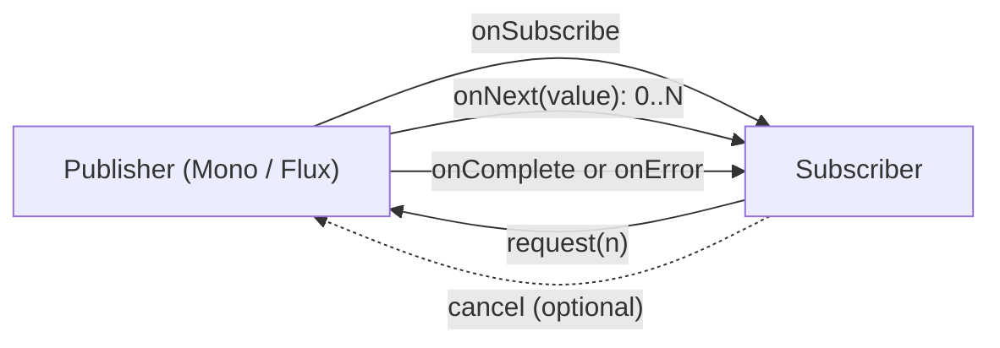

# Event Streams, Schedulers, and Blocking Code Limits in Project Reactor

In a **Spring Security Reactive** application running on Spring WebFlux, authentication, authorization, and data access are typically expressed with `Mono` or `Flux`. To write correct reactive code, you must distinguish **data/event streams**, **execution threads** (`Thread`), the HTTP server's **event loop**, and Reactor **Schedulers**. A pipeline returning `Mono` is not guaranteed to be non-blocking: a single misplaced JDBC call, `Thread.sleep()`, or `.block()` can tie up the event loop and increase latency across many requests.

## 1. Publisher, Subscriber, and Signals in Reactor

Under Reactive Streams, a `Publisher` emits signals to a `Subscriber` through a `Subscription`. Reactor provides two primary types:

- `Mono<T>`: completes with **0 or 1** value, or an error; suited for one user, one authentication result, or one HTTP response.
- `Flux<T>`: emits **0 to N** values, or an error; suited for a stream of events, a list of records, or multiple messages.

A typical lifecycle:

1. The Subscriber subscribes and receives `onSubscribe(subscription)`.
2. The Subscriber requests a number of elements via `subscription.request(n)`; that is the **backpressure** mechanism.
3. The Publisher can emit `onNext(value)` according to the requested demand.
4. The Publisher terminates with **either** `onComplete()` or `onError(error)`. No `onNext` occurs after a terminal signal.
5. The Subscriber can `cancel()` to stop receiving from the source; cancellation does not guarantee that an in-flight synchronous I/O call stops immediately.

`onNext`, `onError`, and `onComplete` are **stream signals**, not separate `Thread`s. Backpressure controls the number of elements requested within a pipeline that supports it; it neither turns a synchronous API into an asynchronous one nor guarantees that every external system can throttle its emission rate.



### Assembly vs. Subscription

Declaring an operator chain is called **assembly**; most Reactor pipelines begin doing work only upon **subscription**. For example, `Mono.fromCallable(() -> load())` defers calling `load()` until a subscriber arrives. Conversely, `Mono.just(load())` must evaluate `load()` **immediately at assembly** to pass it to `just`, so if `load()` is blocking code, blocking occurs before Reactor has a chance to schedule anything.

With Spring WebFlux, the framework normally subscribes to the `Mono`/`Flux` returned by controllers, filters, or services. Do not call `.subscribe()` manually inside a handler just to trigger execution: doing so detaches the work from the request lifecycle, complicating error propagation, cancellation, security, and resource management.

## 2. How Does the Event Loop Handle Requests?

In a Spring WebFlux setup using Reactor Netty, a small number of **event-loop threads** serve many connections via non-blocking I/O. When a connection has no data ready to read or write, the event loop can switch to other work and resume when an I/O event arrives. This is not the "one dedicated thread per request" model.

A Reactor pipeline **does not automatically switch threads** merely because it has `map()`, `flatMap()`, or returns `Mono`. Ordinary operators run on whichever thread emits the signal, unless an asynchronous source or scheduling boundary changes the execution thread. Thus:

- `map(x -> cpuWork(x))` runs directly on the thread receiving `onNext`; overly heavy CPU work can still hold the thread for too long.
- `map(x -> jdbcCall(x))` still executes synchronous JDBC on that thread; the outer `Mono` type does not fix the issue.
- `flatMap(x -> reactiveClient.get(x))` can coordinate non-blocking I/O **when** the inner client is genuinely reactive.
- `Mono.delay(Duration.ofMillis(100))` expresses a wait via a timer signal without occupying a thread with `Thread.sleep(100)` during the wait.

When the event loop is blocked, other requests sharing that event loop can be delayed even when overall CPU is not saturated. Typical effects include higher latency, timeouts, lower throughput, and difficulty cancelling requests.

## 3. What Is a Scheduler? How Do `subscribeOn` and `publishOn` Differ?

A `Scheduler` is Reactor's mechanism for scheduling tasks on an appropriate execution environment. It is **not synonymous** with a stream, event loop, or fixed single thread: a Scheduler can manage multiple workers/threads according to its own policy.

| Scheduler | Typical purpose | Notes |
| --- | --- | --- |
| `Schedulers.immediate()` | Run work on the current thread | Introduces no asynchronous boundary |
| `Schedulers.single()` | Short tasks needing one shared execution thread | One slow task can delay subsequent tasks |
| `Schedulers.parallel()` | Short, independent CPU work | Workers bounded by CPU count; **not** suited for blocking I/O waits |
| `Schedulers.boundedElastic()` | Temporary isolation for **blocking** APIs not yet replaced | Worker and queued-task counts are bounded; can saturate |
| Scheduler from `ExecutorService` | Need specialized pool/lifecycle control | The creator of the executor must manage and close resources properly |

**`subscribeOn(scheduler)`** affects where subscription and processing from the **upstream/source** are scheduled. Where it is placed in the chain usually does not change its primary meaning; place it near the source to be isolated so readers see the intent clearly. Do not stack multiple `subscribeOn` calls expecting each operator to hop to a new scheduler.

**`publishOn(scheduler)`** moves signal processing **downstream**, from after that operator up to another `publishOn`, onto the specified scheduler. Operators **before** it are not retroactively moved.

```java
// The following snippets are illustrative inside a method with Reactor imports.
Flux<Integer> values = Flux.range(1, 3)
    .map(n -> n + 1)                       // upstream
    .publishOn(Schedulers.parallel())      // execution-switching boundary
    .map(n -> n * n);                      // downstream on parallel

Mono<String> legacyResult = Mono.fromCallable(() -> legacyBlockingCall())
    .subscribeOn(Schedulers.boundedElastic())
    .map(String::trim);
```

`legacyBlockingCall()` is an illustrative function name, not a built-in API. The first example **does not mean** the three elements run in parallel automatically: `publishOn` switches where downstream executes, while ordering and parallelism must be considered separately. The second example uses `fromCallable` to defer the blocking call and `subscribeOn(boundedElastic)` to isolate it from the event loop.

Note that `publishOn` also introduces queues/prefetching between stages; adding too many scheduler boundaries causes context switching, consumes memory, and can slow down the pipeline. Choose schedulers based on workload characteristics rather than sprinkling `publishOn` on every operator.

## 4. Runnable Example: Signals, Isolated Blocking, and Reactor Context

Save `ReactorFlowDemo.java` in a Java 17+ project that has the `io.projectreactor:reactor-core` dependency (for instance, a Spring Boot WebFlux app already using Reactor). You can run `main` from your IDE or via the project's Java run configuration.

```java
import reactor.core.publisher.Flux;
import reactor.core.publisher.Mono;
import reactor.core.scheduler.Schedulers;
import reactor.util.context.Context;

public class ReactorFlowDemo {
    public static void main(String[] args) {
        Flux.just("A", "B")
            .doOnSubscribe(s -> System.out.println("subscribed"))
            .doOnNext(v -> System.out.println("onNext " + v))
            .doOnComplete(() -> System.out.println("complete"))
            .subscribe(v -> System.out.println("consume " + v));

        // Only to simulate a legacy blocking library.
        String value = Mono.fromCallable(() -> {
                Thread.sleep(20);
                return "legacy";
            })
            .subscribeOn(Schedulers.boundedElastic())
            .map(String::toUpperCase)
            .block(); // Only for main/demo; DO NOT do this in a WebFlux handler.
        System.out.println("result " + value);

        String traceId = Mono.deferContextual(ctx ->
                Mono.just(ctx.get("traceId").toString()))
            .publishOn(Schedulers.parallel())
            .contextWrite(Context.of("traceId", "req-42"))
            .block(); // Only for observing the result in main.
        System.out.println("context " + traceId);
    }
}
```

With the program above, stdout is:

```text
subscribed
onNext A
consume A
onNext B
consume B
complete
result LEGACY
context req-42
```

The first part emits synchronously on the thread calling `subscribe()`, following the order subscribe → emit values → complete. The second part shows wrapping an old synchronous call in `fromCallable` and offloading it to `boundedElastic`. The final part illustrates that `Reactor Context` still supplies `traceId` along the subscription despite a `publishOn` boundary; Context is **not** `ThreadLocal`.

In this example, `.block()` is an **intentional operation in `main`** so a command-line program awaits the result and prints deterministic stdout. In a WebFlux request, you must **return** `Mono` or `Flux` so the runtime manages completion instead of calling `.block()`.

## 5. Blocking Patterns That Commonly Break Pipelines

The following calls can occupy the current thread while waiting: synchronous JDBC/JPA, synchronous HTTP clients, synchronous file reads, `Thread.sleep`, `Future.get`, `CompletableFuture.join`, locks/`wait`, and `.block()` on another publisher. The longer the blocking duration or the higher the concurrency, the worse the impact.

### Wrong: calling blocking code when assembling `Mono`

```java
// WRONG if loadUserSynchronously() blocks the thread:
Mono<User> user = Mono.just(loadUserSynchronously());
```

`loadUserSynchronously()` executes **before** `Mono.just` is even constructed. Placing `.subscribeOn(...)` after `just` cannot move an already-executed call onto another scheduler.

### Acceptable interim: isolate right at the legacy boundary

```java
Mono<User> user = Mono.fromCallable(() -> loadUserSynchronously())
    .subscribeOn(Schedulers.boundedElastic());
```

`User` and `loadUserSynchronously()` here are application types/methods, not standalone compilable code. `fromCallable` invokes the method only when subscribed; `boundedElastic` keeps I/O waits off the event loop. If the `Callable` returns `null`, `Mono.fromCallable` completes empty, so design the meaning of "not found" explicitly.

This is a **transitional** measure for blocking libraries; it does not turn synchronous JDBC/HTTP into non-blocking I/O. `boundedElastic` has resource and queue limits; if many long-running blocking requests arrive, it can still saturate. Prefer truly reactive solutions, such as `WebClient` for HTTP and reactive drivers/repositories for databases when supported.

### Wrong: `map` or `doOnNext` hiding a blocking operation

```java
// WRONG when lookupLegacy(...) is a blocking call:
return reactiveRepository.findById(id)
    .map(entity -> lookupLegacy(entity));
```

If you cannot remove the synchronous API, isolate **each call** and compose with `flatMap`:

```java
return reactiveRepository.findById(id)
    .flatMap(entity ->
        Mono.fromCallable(() -> lookupLegacy(entity))
            .subscribeOn(Schedulers.boundedElastic()));
```

This is an illustrative snippet inside a service that already has `id`, `reactiveRepository`, and `lookupLegacy`. If the source is a `Flux`, apply an appropriate concurrency limit such as `flatMap(mapper, concurrency)` to avoid spawning too many simultaneous blocking operations. Moving a heavy `map` onto `publishOn(boundedElastic)` can also isolate it, but for APIs returning a single result, wrapping the source with `fromCallable` is usually clearer and less error-prone.

### Wrong: blocking to extract a value inside a controller/filter

```java
// WRONG in a WebFlux handler:
User user = userService.findReactive(id).block();
return Mono.just(user);
```

Instead, chain asynchronous steps to preserve signal flow, error propagation, and cancellation:

```java
// CORRECT, assuming findReactive returns Mono<User>:
return userService.findReactive(id)
    .flatMap(user -> reactiveAuditService.recordAccess(user).thenReturn(user));
```

Snippets using `User`, repositories, and services here are **illustrative integration code**; only the `ReactorFlowDemo` program in Section 4 is a standalone Java file.

### Timeouts do not release all blocking work

`timeout(Duration)` signals an error or cancels the subscription when expired, but does not guarantee immediately terminating a synchronous call holding a socket/thread. Configure timeouts on the **actual driver/client**, limit connections/concurrency, measure wait times, and close resources properly. With reactive publishers, always consider `onError`, `cancel`, and cleanup flows.

## 6. Direct Impact on Spring Security Reactive

The WebFlux security chain typically processes requests through `WebFilter`s and components returning `Mono`—for instance, `ReactiveAuthenticationManager` can return `Mono<Authentication>`. Authentication, authorization, and reading user info must continue to be expressed within the **same reactive chain**. Inserting `.block()` in a filter, authentication manager, or controller can stall the event loop right on the critical path of every request.

Spring Security Reactive attaches security information to the **Reactor Context** per subscription. Do not assume reading `ThreadLocal`-style `SecurityContextHolder` as in Spring MVC: switching schedulers is not a user-identity storage mechanism. To obtain the current authentication in a reactive pipeline, use `ReactiveSecurityContextHolder`:

```java
import org.springframework.security.core.Authentication;
import org.springframework.security.core.context.ReactiveSecurityContextHolder;
import org.springframework.web.bind.annotation.GetMapping;
import org.springframework.web.bind.annotation.RestController;
import reactor.core.publisher.Mono;

@RestController
public class WhoamiController {
    @GetMapping("/whoami")
    public Mono<String> whoami() {
        return ReactiveSecurityContextHolder.getContext()
            .flatMap(ctx -> Mono.justOrEmpty(ctx.getAuthentication()))
            .map(Authentication::getName)
            .defaultIfEmpty("anonymous");
    }
}
```

This snippet is a complete controller class (saved in `WhoamiController.java`) when Spring WebFlux and Spring Security are on the classpath. If the security filter denies access before the controller, the request receives the security layer's response instead of entering `whoami()`. When authentication is present, the result is the name provided by the authentication object; the default applies only if the chain emits no authentication.

Key point: `Reactor Context` travels **with the subscription** and can cross `publishOn`/`subscribeOn`; a synchronous library's `ThreadLocal` does not automatically share the same semantics. When integrating MDC, tracing, or legacy libraries relying on `ThreadLocal`, use a compatible context-propagation mechanism and test in practice rather than inferring from thread names.

For custom `ReactiveUserDetailsService` or `ReactiveAuthenticationManager`, if user data still lives in a synchronous store, wrap blocking calls at the legacy boundary as in Section 5; prefer switching to non-blocking repositories/drivers when possible. Avoid calling `subscribe()` manually in an authenticator because it decouples the result/error from the access-decision process.

## 7. Backpressure, Concurrency, CPU, and Resources

Backpressure does not mean the system has infinite capacity. When designing pipelines, distinguish four situations:

- **Non-blocking I/O**: use reactive APIs composed with `flatMap`, `zip`, `then`; no need to move every step onto `boundedElastic`.
- **Synchronous I/O still required**: `fromCallable`/`fromRunnable` with `subscribeOn(boundedElastic)` and bounded concurrency; measure queue depth, timeouts, and connection pools.
- **CPU-heavy work**: split tasks and control concurrency; `Schedulers.parallel()` is for CPU, yet `publishOn(parallel())` alone **does not automatically split** one heavy loop into multiple parallel tasks.
- **Large data streams**: choose appropriate request/prefetch/buffer strategies and bound `flatMap`. `buffer()`, `collectList()`, or unbounded queues can exhaust memory even when backpressure exists elsewhere.

Example replacing `Thread.sleep()` with a reactive timer when business logic only needs a delay:

```java
// Wait using a timer signal without holding a thread during the wait:
Mono<String> delayed = Mono.delay(java.time.Duration.ofMillis(100))
    .thenReturn("ready");
```

Never move code with mutable state contention onto a multi-threaded scheduler without checking thread safety. Within a single subscription, signals follow the Reactive Streams contract; however, different subscriptions can run concurrently and share application resources.

## 8. How to Diagnose and Self-Check

When WebFlux requests are slow or timing out, inspect in order:

1. **I/O sources**: are JDBC/JPA, sync HTTP, sync file I/O, `sleep`, `get/join`, or `.block()` on the request path? Check transitive libraries and operators like `map` and `doOnNext`.
2. **Execution location**: is blocking work running on the event loop, `parallel`, `single`, or `boundedElastic`? Log thread names in development to verify, but never use thread names for business logic.
3. **Signal lifecycle**: who subscribes, where do errors go, is cancellation handled, and are real client timeouts and resource cleanups configured?
4. **Demand/concurrency**: does `Flux` bound concurrent `flatMap` tasks; are pools, queues, or connection pools saturating?
5. **Security Context**: is authentication obtained from `ReactiveSecurityContextHolder` within the subscription; does anything self-subscribe or jump to callbacks outside the pipeline and lose context?
6. **Measure outcomes**: compare throughput, p95/p99 latency, event-loop responsiveness, thread/queue saturation, and timeout counts before and after changes. An example working for 1 request does not prove safety under load.

In tests, `StepVerifier` (artifact `reactor-test`) helps verify `onNext`, `onComplete`, `onError`, request/cancel, and virtual time when appropriate. A blocking-detection tool such as BlockHound can be helpful in compatible test environments, though it does not replace identifying synchronous APIs and load testing.

## Takeaways

- **Stream/event** is the flow of signals; **Thread** is the execution resource; **Scheduler** decides where tasks run; the **event loop** must stay short and unblocked.
- `subscribeOn` suits isolating a blocking **source** deferred via `fromCallable`; `publishOn` switches **downstream stages**. No operator turns synchronous I/O into non-blocking I/O.
- `boundedElastic` is a bounded "bridge" for legacy blocking code; prefer true reactive APIs and load control.
- In Spring Security WebFlux, return `Mono`/`Flux` throughout the request and read authentication via **Reactor Context**; only use `.block()` at genuinely synchronous boundaries such as a `main` program or an intentional test.
