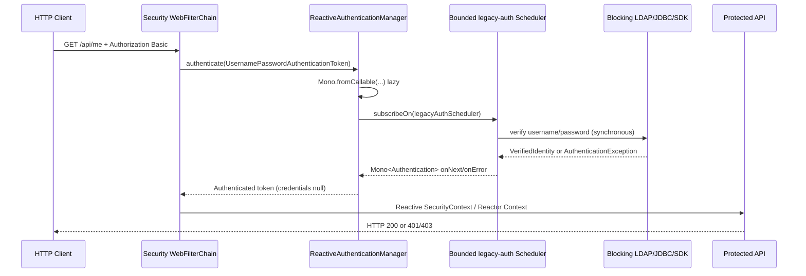

# Integrating Synchronous Authentication Systems Through a Controlled Blocking Boundary

## 1. Why Does This Problem Arise in Spring Security Reactive?

**Spring WebFlux** applications process HTTP on Netty event loops, where a small number of threads serve large numbers of connections via non-blocking I/O. However, many enterprise environments still rely on **synchronous** authentication services:

- Legacy LDAP/JNDI SDKs performing synchronous bind/search calls.
- Legacy JDBC drivers reading users, password hashes, account lock states, and permission groups.
- SOAP clients or internal Java SDKs calling SSO, core banking servers, mainframes, or HSMs.
- A `UserDetailsService` or `AuthenticationManager` originally built for Servlet Spring Security applications.
- A CPU-intensive credential library (BCrypt/Argon2/PBKDF2) that is not async I/O and can still stall an event loop if heavy computation runs directly on it.

If Spring Security Reactive calls `legacyDirectory.verify(username, password)` directly on a `reactor-http-nio-*` thread, that thread is held for the entire I/O wait. A backend taking a few hundred milliseconds can degrade latency for many **other** connections sharing the same event loop.

The goal of this lesson is to build a **controlled blocking boundary**: wrap synchronous operations in a lazy `Mono`, offload **only the synchronous work** onto a bounded `Scheduler`, wire it into `ReactiveAuthenticationManager`, bound timeouts/capacity, and preserve security semantics.

After this lesson, you will:

1. Understand why `Mono.just(blockingCall())` still blocks the thread and how `subscribeOn` differs from `publishOn`.
2. Use `Mono.fromCallable(...).subscribeOn(Schedulers.boundedElastic())` in the right place.
3. Write a `ReactiveAuthenticationManager` using a synchronous auth SDK without calling `.block()` on the HTTP path.
4. Map results into an authenticated `UsernamePasswordAuthenticationToken` and trusted `GrantedAuthority` instances.
5. Distinguish wrong passwords, locked accounts, and unavailable authentication backends.
6. Bound threads/queues/connections, timeouts, cancellation, rate limiting, and load testing.
7. Test with **Java 17+, Spring Boot 3.x, Spring Security 6.x**, `StepVerifier`, and `WebTestClient`.
8. Know when to replace the bridge with async LDAP, R2DBC, `WebClient`, or a separate authentication service.

> **Scope:** `ServerHttpSecurity`, `SecurityWebFilterChain`, and `ReactiveAuthenticationManager` from Spring Security **WebFlux**, not Servlet `HttpSecurity`. Offloading is a legacy-integration technique; it **does not turn a synchronous JDBC/LDAP driver into a non-blocking driver**.

## 2. Distinguishing "Blocking", "Reactive", and "Async"

**Blocking:** a call holds the caller's thread until a result or timeout arrives:

```java
// Hypothetical API of a synchronous SDK, illustrative only.
VerifiedIdentity user =
    legacyVerifier.verify(username, rawPassword);
```

If LDAP waits 400 ms, the thread calling `verify` waits 400 ms. On a Netty event loop, that is severe because the event loop needs to keep serving other connections.

**Reactive:** an operation returns a `Publisher` (`Mono`/`Flux`) so the framework manages subscription, result/error signals, and cancellation. **A method returning `Mono` does not automatically become non-blocking.** If synchronous I/O runs inside it on the event loop, the application is still blocked.

**Offload:** you can shift a blocking call onto a dedicated scheduler so the caller event loop does not wait synchronously. A thread on that scheduler is still blocked while the SDK executes; we merely **bound and isolate** the impact.

**Native non-blocking:** when an LDAP/HTTP/database client genuinely provides asynchronous I/O, no worker thread is held per request waiting on the network. This is usually the better architectural destination when the system, drivers, and team allow it.

### Operations to Watch

| Task | Nature | Decision |
| --- | --- | --- |
| Synchronous JDBC `.executeQuery()` | Blocking I/O | Offload or switch to R2DBC when feasible |
| Sync LDAP bind/search | Blocking I/O | Offload, driver timeouts, connection pool |
| Sync SOAP SDK | Blocking I/O | Offload or use an async HTTP adapter |
| BCrypt/Argon2 | CPU-intensive | Measure cost; avoid holding event loops too long |
| Tiny map/validation | Short CPU, non-blocking | Usually no scheduler switch needed |
| `Thread.sleep()` | Thread-blocking | Simulation/tests only; never use to implement auth |
| `WebClient` network I/O | Reactive non-blocking | Keep in Reactor pipeline; never `.block()` |

## 3. Project Reactor's Standard Pattern: `Mono.fromCallable` and `subscribeOn`

```java
Mono<VerifiedIdentity> verified =
    Mono.fromCallable(() ->
            legacyVerifier.verify(username, rawPassword))
        .subscribeOn(Schedulers.boundedElastic());
```

**Component-by-component explanation:**

1. `Mono.fromCallable` creates a **lazy source**: the callable runs when a subscriber subscribes, not when assembling the pipeline.
2. `subscribeOn(scheduler)` decides which thread executes subscription/source work. Place it immediately after `fromCallable` so the blocking work runs on an appropriate worker.
3. `Schedulers.boundedElastic()` is built for synchronous work that may wait on I/O and caps both backing threads and queued tasks.
4. `Mono` turns results into `onNext + onComplete` and bad credentials into `onError`; Spring Security subscribes within the request pipeline.
5. Do not spawn raw threads with `new Thread(...)` and do not call fire-and-forget `.subscribe()` inside filters.

### Anti-Patterns That Cause Bugs

**Wrong: `Mono.just` does not make the call before it lazy.**

```java
return Mono.just(
    legacyVerifier.verify(username, rawPassword));
```

Java evaluates `verify(...)` **before** calling `Mono.just`. If this runs on Netty, the event loop is already blocked.

**Wrong: `map` containing a blocking call on an unscheduled source.**

```java
return Mono.just(username)
    .map(u -> legacyVerifier.verify(u, rawPassword));
```

`map` runs on the thread where upstream emits signals. If that is the event loop, this blocks the event loop.

**Wrong: `publishOn` after a blocking source.**

```java
return Mono.fromCallable(() ->
        legacyVerifier.verify(username, rawPassword))
    .publishOn(Schedulers.boundedElastic());
```

`publishOn` switches context for **downstream operators** after its placement. It does not move the upstream callable off the event loop. For a blocking source, put `subscribeOn` right after `fromCallable`.

**Wrong: `.block()` inside `ReactiveAuthenticationManager`.**

```java
VerifiedIdentity user = mono.block();
```

`block()` ties up the caller thread; on a Reactor non-blocking thread, it may throw `IllegalStateException`. In Spring WebFlux you must **return a `Mono`**, never block to unwrap values eagerly.

**Wrong: `.subscribe()` then returning empty.**

```java
mono.subscribe(value -> updateLoginState(value));
return Mono.empty();
```

Spring Security does not wait for that detached work; errors, cancellation, and request authentication become decoupled. Never subscribe manually here.

### `Mono.empty()` Has Security Semantics

Contract of `ReactiveAuthenticationManager.authenticate(...)`:

- `Mono.just(Authentication)` — authentication succeeded.
- `Mono.error(AuthenticationException)` — authentication was attempted and **failed**.
- `Mono.empty()` — the manager **cannot identify/handle** this authentication type.

If a username/password manager receives a JWT token outside its scope, returning empty is right. Yet when it receives username/password and the password is wrong, it must emit `BadCredentialsException`, never empty where another provider might accidentally "let it pass".

With `Mono.fromCallable`, returning `null` turns the publisher empty. **Never use `null` as a "wrong password" convention** in an authentication backend.

## 4. Spring Security WebFlux Architecture with Legacy Authentication



Spring Security HTTP Basic includes a converter extracting username/password from `Authorization: Basic ...` into an **unauthenticated** `UsernamePasswordAuthenticationToken`. The `ReactiveAuthenticationManager` adapter verifies it against the synchronous source. Controllers **do not** parse Base64 or inspect raw passwords themselves.

Upon success, Spring Security stores `Authentication` in the **Reactive SecurityContext**, propagated through **Reactor Context**. Never assume ThreadLocal-based `SecurityContextHolder.getContext()` on any `boundedElastic` thread automatically holds identity.

### An Authentication Bridge Never Grants Authority Before Verification

Never create `UsernamePasswordAuthenticationToken.authenticated(...)` from a request-supplied username without calling the backend. Success requires checking credentials, account status, trusted authorities, and any MFA factors required by the backend.

**Authorization** happens after authentication: holding `ROLE_READER` does not grant access to `/api/admin` if the endpoint requires `ROLE_ADMIN`.

## 5. Choosing a Scheduler and Thread Limits

| Scheduler | Intended Use | Blocking LDAP/JDBC? |
| --- | --- | --- |
| Netty event loop | Non-blocking HTTP I/O | **No** |
| `Schedulers.parallel()` | Short CPU computations | Never for thread-blocking I/O |
| `Schedulers.single()` | Single sequential worker | Usually lacks capacity for logins |
| `Schedulers.boundedElastic()` | Blocking sources with capped threads/queues | Yes |
| `Schedulers.newBoundedElastic(...)` | Dedicated pool with configurable caps | Yes, when isolation is needed |
| Custom executor | Systems with dedicated thread pools | Yes if lifecycle/rejection/cancellation are handled |

Example pool **dedicated to legacy auth**:

```java
Scheduler legacyAuthScheduler =
    Schedulers.newBoundedElastic(
        8,              // max 8 backing threads
        64,             // max queue cap per backing thread
        "legacy-auth");
```

`newBoundedElastic(threadCap, queuedTaskCap, name)` is a documented Reactor API. Note that **`queuedTaskCap` applies per backing thread**, not as a single app-wide limit or an LDAP connection limit.

Isolate pools if your app also runs other blocking jobs (PDF generation, ERP, financial reports) so logins are never starved by unrelated work.

### Scheduler Caps Do Not Replace Backend Limits

A JDBC pool with `maximumPoolSize=10` still provides only 10 connections regardless of having 100 scheduler threads. If many threads wait on connections, queuing simply shifts from the scheduler to the connection pool. Coordinate:

- Thread cap and queued task cap.
- SDK connection pool max/pending queue/lease timeouts.
- Connect, read, and query timeouts.
- Rate limiting on login endpoints.
- Bulkheads to protect concurrent calls if the backend handles limited traffic.
- Circuit breakers when the backend is unstable.
- Metrics for queue wait, active threads, p95/p99 latency, rejected tasks, and backend errors.

At 100 requests/second with 200 ms per sync call, average concurrency is roughly `100 * 0.2 = 20` in steady state. That is a **rough capacity estimate** via Little's Law; bursts, variance, and lock contention drive peaks much higher. A pool of 8 risks queuing even while event loops remain healthy.

**Saturation is a failure mode you must design for.** When unable to accept more tasks, the scheduler can throw `RejectedExecutionException`. Never catch it and return a successful authentication to "preserve uptime".

## 6. Timeouts and Cancellation: Timing Out Does Not Mean the Blocked Thread Stopped

A `Mono` can enforce a deadline:

```java
return Mono.fromCallable(() -> legacyVerifier.verify(user, password))
    .subscribeOn(legacyAuthScheduler)
    .timeout(Duration.ofSeconds(2));
```

When time expires, Reactor emits `TimeoutException` and cancels upstream. Yet a synchronous JDBC/socket call waiting on I/O may not react immediately to interruption/cancellation. **Never assume timeout freed the thread or connection.**

Configure timeouts **where blocking actually occurs**: JDBC query timeouts, LDAP connect/read timeouts, and HTTP SDK socket timeouts. `Mono.timeout` protects the HTTP request wait time; driver timeouts protect backend resources and threads.

### Distinguishing Failure Types

| Failure | Appropriate Exception / Policy | Typical HTTP Response |
| --- | --- | --- |
| Wrong password or missing user | `BadCredentialsException` | 401 Basic challenge |
| Account locked | `LockedException` | 401 or custom mapping per security policy |
| Account disabled | `DisabledException` | 401 or custom mapping |
| LDAP/JDBC backend down | `AuthenticationServiceException` | Must classify service outage; HTTP depends on failure handler |
| Scheduler overloaded | Map `RejectedExecutionException` to service error | Fail closed; can design explicit 503 |
| Blocking call timed out | Map `TimeoutException` to service error | Fail closed; can design explicit 503 |
| Valid password, missing role | Spring authorization denied | 403 Forbidden |

**Do not assume `AuthenticationServiceException` automatically produces 503.** The default HTTP Basic authentication failure handler may map exceptions to 401; if your API wants clients to distinguish outages from bad passwords via 503, implement a custom `ServerAuthenticationFailureHandler`/entry point and write integration tests for that chain.

**Never `.retry(3)` all authentication errors.** A wrong password is not a transient fault. During a backend outage, hundreds of concurrent retries create a retry storm, making the outage worse. If retrying brief network glitches, bound attempts, use backoff/jitter, set a total deadline, classify errors, and watch for account-lockout side effects.

## 7. Complete Java 17+, Spring Boot 3.x Example: HTTP Basic to a Synchronous SDK

The demo includes:

- `GET /public/ping`: no login required.
- `GET /api/me`: requires Basic username/password.
- `GET /api/admin`: requires `ROLE_ADMIN`; the demo user holds only `ROLE_READER`.
- Legacy verifier simulates **120 ms of blocking** via `Thread.sleep(120)` and checks a BCrypt hash.
- Bridge builds `Mono.fromCallable(...).subscribeOn(legacyAuthScheduler)` with a 2-second timeout.
- `NoOpServerSecurityContextRepository`: does not persist login sessions across requests.
- Default CSRF stays enabled; the demo exposes GETs only. Before adding state-changing methods with browser Basic auth, evaluate CSRF explicitly.

**Never treat simulated sleep as real authentication.** In production, replace the verifier with your synchronous SDK/JDBC/LDAP, TLS, per-operation timeouts, rate limits, account lockouts, and connection pools. Use HTTP Basic only over **HTTPS** with real credentials.

### 7.1. Project Structure

```text
legacy-auth-bridge/
  settings.gradle
  build.gradle
  src/main/java/demo/legacy/
    LegacyAuthApplication.java
    LegacyCredentialVerifier.java
    VerifiedIdentity.java
    SimulatedLegacyCredentialVerifier.java
    LegacyBridgeAuthenticationManager.java
    SecurityConfig.java
    ApiController.java
  src/test/java/demo/legacy/
    LegacyBridgeAuthenticationManagerTest.java
    BasicAuthIntegrationTest.java
```

### 7.2. `settings.gradle`

```groovy
rootProject.name = 'legacy-auth-bridge'
```

### 7.3. `build.gradle`

```groovy
plugins {
    id 'java'
    id 'org.springframework.boot' version '3.5.0'
    id 'io.spring.dependency-management' version '1.1.7'
}

group = 'demo'
version = '0.0.1-SNAPSHOT'

java {
    toolchain {
        languageVersion = JavaLanguageVersion.of(17)
    }
}

repositories {
    mavenCentral()
}

dependencies {
    implementation 'org.springframework.boot:spring-boot-starter-webflux'
    implementation 'org.springframework.boot:spring-boot-starter-security'

    testImplementation 'org.springframework.boot:spring-boot-starter-test'
    testImplementation 'io.projectreactor:reactor-test'
}

tasks.named('test') {
    useJUnitPlatform()
}
```

This is a Java 17+ Gradle project using the Spring Boot BOM to manage Spring Security/Reactor dependencies. Use a Gradle wrapper compatible with the Spring Boot plugin. Do not add `spring-boot-starter-web` so Servlet/MVC auto-configuration does not override Reactive.

### 7.4. `src/main/java/demo/legacy/LegacyAuthApplication.java`

```java
package demo.legacy;

import org.springframework.boot.SpringApplication;
import org.springframework.boot.autoconfigure.SpringBootApplication;

@SpringBootApplication
public class LegacyAuthApplication {
    public static void main(String[] args) {
        SpringApplication.run(LegacyAuthApplication.class, args);
    }
}
```

### 7.5. `src/main/java/demo/legacy/VerifiedIdentity.java`

```java
package demo.legacy;

import java.util.List;
import org.springframework.security.core.GrantedAuthority;

public record VerifiedIdentity(
        String username,
        List<GrantedAuthority> authorities) {
}
```

The result holds only the backend-**verified** identity and authorities. Never pass passwords, hashes, OTP secrets, security questions, or full LDAP records into `Authentication`.

### 7.6. `src/main/java/demo/legacy/LegacyCredentialVerifier.java`

```java
package demo.legacy;

// Purely synchronous API of the legacy system.
public interface LegacyCredentialVerifier {
    VerifiedIdentity verify(String username, String rawPassword);
}
```

The `verify` method name implies the backend checks the password itself and returns an identity. If the legacy system provides only `UserDetailsService.loadUserByUsername` and a hash, see the `ReactiveUserDetailsService` option later; do not verify the password twice.

### 7.7. `src/main/java/demo/legacy/SimulatedLegacyCredentialVerifier.java`

```java
package demo.legacy;

import java.util.List;
import java.util.Map;

import org.springframework.security.authentication.AuthenticationServiceException;
import org.springframework.security.authentication.BadCredentialsException;
import org.springframework.security.core.authority.SimpleGrantedAuthority;
import org.springframework.security.crypto.password.PasswordEncoder;

public final class SimulatedLegacyCredentialVerifier
        implements LegacyCredentialVerifier {

    private final PasswordEncoder encoder;
    private final Map<String, String> passwordHashes;
    private final String dummyHash;

    public SimulatedLegacyCredentialVerifier(PasswordEncoder encoder) {
        this.encoder = encoder;
        this.passwordHashes = Map.of(
            "reader", encoder.encode("demo123"));
        this.dummyHash = encoder.encode("no-such-account");
    }

    @Override
    public VerifiedIdentity verify(
            String username, String rawPassword) {

        // Simulates only a JDBC/LDAP call waiting on I/O.
        try {
            Thread.sleep(120);
        } catch (InterruptedException ex) {
            Thread.currentThread().interrupt();
            throw new AuthenticationServiceException(
                "Legacy authentication interrupted", ex);
        }

        String realHash = passwordHashes.get(username);
        String hashToCheck =
            realHash != null ? realHash : dummyHash;

        // Still runs hash matching for nonexistent users to
        // reduce coarse timing differences; does not guarantee constant-time.
        boolean valid = encoder.matches(rawPassword, hashToCheck);

        if (realHash == null || !valid) {
            throw new BadCredentialsException(
                "Invalid username or password");
        }

        return new VerifiedIdentity(
            username,
            List.of(new SimpleGrantedAuthority("ROLE_READER")));
    }
}
```

**Security review:**

- Never store plaintext passwords in the map; password hashes use BCrypt from the `PasswordEncoder` bean.
- A uniform invalid username/password message reduces account enumeration; the dummy hash reduces coarse timing differences without replacing a full anti-enumeration strategy.
- Never log raw passwords, Basic `Authorization` headers, hashes, or full user records.
- Return roles from the backend after verification; never accept roles from caller query/body parameters.
- Never deploy this demo code to production without per-user lockouts, rate limits, MFA/account-status logic, and monitoring.

### 7.8. `src/main/java/demo/legacy/LegacyBridgeAuthenticationManager.java`

```java
package demo.legacy;

import java.time.Duration;
import java.util.concurrent.RejectedExecutionException;
import java.util.concurrent.TimeoutException;

import org.springframework.security.authentication.AuthenticationServiceException;
import org.springframework.security.authentication.ReactiveAuthenticationManager;
import org.springframework.security.authentication.UsernamePasswordAuthenticationToken;
import org.springframework.security.core.Authentication;
import reactor.core.publisher.Mono;
import reactor.core.scheduler.Scheduler;

public final class LegacyBridgeAuthenticationManager
        implements ReactiveAuthenticationManager {

    private final LegacyCredentialVerifier verifier;
    private final Scheduler scheduler;
    private final Duration timeout;

    public LegacyBridgeAuthenticationManager(
            LegacyCredentialVerifier verifier,
            Scheduler scheduler,
            Duration timeout) {
        this.verifier = verifier;
        this.scheduler = scheduler;
        this.timeout = timeout;
    }

    @Override
    public Mono<Authentication> authenticate(
            Authentication authentication) {

        // Supports only UsernamePasswordAuthenticationToken.
        if (!(authentication instanceof UsernamePasswordAuthenticationToken)
                || !(authentication.getCredentials()
                    instanceof String rawPassword)) {
            return Mono.empty();
        }

        String username = authentication.getName();

        return Mono.fromCallable(() -> {
                // Sync source + password checking both stay inside the Callable.
                VerifiedIdentity verified =
                    verifier.verify(username, rawPassword);

                // Create the authenticated token ONLY AFTER verification succeeds.
                return (Authentication)
                    UsernamePasswordAuthenticationToken.authenticated(
                        verified.username(),
                        null,
                        verified.authorities());
            })
            .subscribeOn(scheduler)
            .timeout(timeout)
            .onErrorMap(TimeoutException.class, error ->
                new AuthenticationServiceException(
                    "Legacy authentication timed out", error))
            .onErrorMap(RejectedExecutionException.class, error ->
                new AuthenticationServiceException(
                    "Legacy authentication queue exhausted", error));
    }
}
```

**Logic verification:**

1. Rejects unsupported authentication types cleanly by returning `Mono.empty()` per contract.
2. Lazy `Mono.fromCallable` ensures the SDK is not called when the filter assembles the publisher.
3. `subscribeOn(scheduler)` runs the blocking callable on the bounded scheduler rather than the event loop.
4. `timeout` caps how long the caller waits; it does not replace SDK timeouts.
5. `onErrorMap` classifies timeouts and scheduler saturation without **swallowing** `BadCredentialsException`.
6. Authenticated token has `credentials=null`, reducing the risk of credentials lingering in the security context or controllers.
7. `Mono<Authentication>` integrates cleanly into the HTTP Basic authentication pipeline.
8. No `.block()`, no manual `.subscribe()`, and no retrying wrong credentials.

**Caution:** the raw password still lives briefly inside the incoming `Authentication` and Java `String` until the request completes and GC collects it; setting credentials to null on a new token cannot immediately zero every byte in memory. Never put it in caches, static fields, or logs, and minimize sensitive data retention.

### 7.9. `src/main/java/demo/legacy/SecurityConfig.java`

```java
package demo.legacy;

import java.time.Duration;

import org.springframework.beans.factory.annotation.Qualifier;
import org.springframework.context.annotation.Bean;
import org.springframework.context.annotation.Configuration;
import org.springframework.security.authentication.ReactiveAuthenticationManager;
import org.springframework.security.config.annotation.web.reactive.EnableWebFluxSecurity;
import org.springframework.security.config.web.server.ServerHttpSecurity;
import org.springframework.security.crypto.bcrypt.BCryptPasswordEncoder;
import org.springframework.security.crypto.password.PasswordEncoder;
import org.springframework.security.web.server.SecurityWebFilterChain;
import org.springframework.security.web.server.context
    .NoOpServerSecurityContextRepository;
import reactor.core.scheduler.Scheduler;
import reactor.core.scheduler.Schedulers;

@Configuration
@EnableWebFluxSecurity
public class SecurityConfig {

    @Bean
    PasswordEncoder passwordEncoder() {
        return new BCryptPasswordEncoder(10);
    }

    @Bean
    LegacyCredentialVerifier legacyVerifier(
            PasswordEncoder encoder) {
        return new SimulatedLegacyCredentialVerifier(encoder);
    }

    @Bean(value = "legacyAuthScheduler", destroyMethod = "dispose")
    Scheduler legacyAuthScheduler() {
        // 8/64 parameters are examples; measure under real load.
        return Schedulers.newBoundedElastic(8, 64, "legacy-auth");
    }

    @Bean("legacyAuthenticationManager")
    ReactiveAuthenticationManager legacyAuthenticationManager(
            LegacyCredentialVerifier verifier,
            @Qualifier("legacyAuthScheduler") Scheduler scheduler) {

        return new LegacyBridgeAuthenticationManager(
            verifier, scheduler, Duration.ofSeconds(2));
    }

    @Bean
    SecurityWebFilterChain securityChain(
            ServerHttpSecurity http,
            @Qualifier("legacyAuthenticationManager")
            ReactiveAuthenticationManager manager) {

        return http
            .securityContextRepository(
                NoOpServerSecurityContextRepository.getInstance())
            .authorizeExchange(exchanges -> exchanges
                .pathMatchers("/public/**").permitAll()
                .pathMatchers("/api/admin").hasRole("ADMIN")
                .pathMatchers("/api/**").authenticated()
                .anyExchange().denyAll())
            .httpBasic(basic -> basic.authenticationManager(manager))
            .formLogin(form -> form.disable())
            .build();
    }
}
```

**Explanation:**

- `legacyAuthScheduler` is a **dedicated scheduler** with up to 8 backing threads and a queued task cap of 64 per backing thread. Spring invokes `destroyMethod="dispose"` when the context closes.
- `httpBasic` uses the proper `ReactiveAuthenticationManager`, never calling a synchronous `AuthenticationManager` directly in a Netty filter.
- `NoOpServerSecurityContextRepository` avoids saving authentication in a session: clients send Basic credentials on each protected request. **Not** a mechanism for remembered login sessions.
- `hasRole("ADMIN")` requires `ROLE_ADMIN`; the demo returns `ROLE_READER`, clearly demonstrating 403 vs 401.
- Default CSRF stays enabled, though the demo uses GETs only. When using HTTP Basic in browsers for state-changing POST/DELETE requests, evaluate CSRF against the threat model; never disable it globally thinking "there is no form login".
- `formLogin` is disabled so the API issues Basic challenges instead of HTML login pages; if tokens/sessions/MFA are needed, design dedicated security chains.

### 7.10. `src/main/java/demo/legacy/ApiController.java`

```java
package demo.legacy;

import java.util.Map;

import org.springframework.security.core.GrantedAuthority;
import org.springframework.security.core.context.ReactiveSecurityContextHolder;
import org.springframework.web.bind.annotation.GetMapping;
import org.springframework.web.bind.annotation.RestController;
import reactor.core.publisher.Mono;

@RestController
public class ApiController {

    @GetMapping("/public/ping")
    public Mono<Map<String, String>> ping() {
        return Mono.just(Map.of("status", "ok"));
    }

    @GetMapping("/api/me")
    public Mono<Map<String, Object>> me() {
        return ReactiveSecurityContextHolder.getContext()
            .map(ctx -> Map.<String, Object>of(
                "username", ctx.getAuthentication().getName(),
                "authorities",
                ctx.getAuthentication().getAuthorities().stream()
                    .map(GrantedAuthority::getAuthority)
                    .toList()));
    }

    @GetMapping("/api/admin")
    public Mono<String> admin() {
        return Mono.just("only-admin");
    }
}
```

Never grab a username from a header and treat it as principal; retrieve `Authentication` after Spring Security succeeds via **`ReactiveSecurityContextHolder`**. Never use ThreadLocal `SecurityContextHolder.getContext()` as the source of truth in a WebFlux controller.

Logical output with the demo password:

```json
{
  "username": "reader",
  "authorities": ["ROLE_READER"]
}
```

JSON field order is insignificant; assert with JSONPath in tests.

### 7.11. Running and Testing with curl

From the project directory with Gradle wrapper:

```bash
# Linux/macOS
./gradlew bootRun

# Windows
gradlew.bat bootRun
```

Requests:

```bash
# Public endpoint: 200
curl -i http://localhost:8080/public/ping

# No credentials: 401 and Basic challenge
curl -i http://localhost:8080/api/me

# Wrong password: 401
curl -i -u reader:wrong http://localhost:8080/api/me

# Valid password: 200 with JSON identity
curl -i -u reader:demo123 http://localhost:8080/api/me

# Valid password but lacking ROLE_ADMIN: 403
curl -i -u reader:demo123 http://localhost:8080/api/admin
```

Expected table:

| Request | Status | Reason |
| --- | --- | --- |
| `GET /public/ping` | 200 | Public |
| `GET /api/me` missing Basic | 401 | Unauthenticated |
| `GET /api/me` with wrong password | 401 | `BadCredentialsException` |
| `GET /api/me` with valid demo credentials | 200 | Verified by backend |
| `GET /api/admin` with valid demo credentials | 403 | Has `ROLE_READER`, lacks `ROLE_ADMIN` |

HTTP Basic only Base64-encodes username/password and **does not protect data from eavesdroppers**. Use only over real HTTPS and never embed demo credentials in a production frontend.

## 8. Unit Test: Synchronous Work Must Run on the Dedicated Scheduler

File `src/test/java/demo/legacy/LegacyBridgeAuthenticationManagerTest.java`:

```java
package demo.legacy;

import java.time.Duration;
import java.util.List;
import java.util.concurrent.atomic.AtomicReference;

import org.junit.jupiter.api.Test;
import org.springframework.security.authentication.BadCredentialsException;
import org.springframework.security.authentication.UsernamePasswordAuthenticationToken;
import org.springframework.security.core.authority.SimpleGrantedAuthority;
import reactor.core.scheduler.Scheduler;
import reactor.core.scheduler.Schedulers;
import reactor.test.StepVerifier;

import static org.junit.jupiter.api.Assertions.assertEquals;
import static org.junit.jupiter.api.Assertions.assertNull;
import static org.junit.jupiter.api.Assertions.assertTrue;

class LegacyBridgeAuthenticationManagerTest {

    @Test
    void blockingVerifierRunsOnDedicatedScheduler() {
        AtomicReference<String> actualThread = new AtomicReference<>();

        LegacyCredentialVerifier fake = (user, password) -> {
            actualThread.set(Thread.currentThread().getName());
            return new VerifiedIdentity(
                user,
                List.of(new SimpleGrantedAuthority("ROLE_READER")));
        };

        Scheduler scheduler =
            Schedulers.newBoundedElastic(2, 10, "test-legacy");

        try {
            var manager = new LegacyBridgeAuthenticationManager(
                fake, scheduler, Duration.ofSeconds(2));

            var request =
                UsernamePasswordAuthenticationToken.unauthenticated(
                    "reader", "demo123");

            // Not subscribed yet: verifier has not been called.
            var result = manager.authenticate(request);
            assertNull(actualThread.get());

            StepVerifier.create(result)
                .assertNext(auth -> {
                    assertTrue(auth.isAuthenticated());
                    assertEquals("reader", auth.getName());
                    assertNull(auth.getCredentials());
                    assertTrue(
                        actualThread.get().startsWith("test-legacy"));
                })
                .verifyComplete();
        } finally {
            scheduler.dispose();
        }
    }

    @Test
    void badCredentialsAreNotSwallowed() {
        LegacyCredentialVerifier fake = (user, password) -> {
            throw new BadCredentialsException(
                "Invalid username or password");
        };

        Scheduler scheduler =
            Schedulers.newBoundedElastic(1, 10, "test-legacy");

        try {
            var manager = new LegacyBridgeAuthenticationManager(
                fake, scheduler, Duration.ofSeconds(2));

            StepVerifier.create(manager.authenticate(
                    UsernamePasswordAuthenticationToken.unauthenticated(
                        "reader", "wrong")))
                .expectError(BadCredentialsException.class)
                .verify();
        } finally {
            scheduler.dispose();
        }
    }
}
```

The test proves **lazy behavior** (the backend does not run before subscription) and **offloading** (the thread carries the dedicated scheduler prefix), while wrong passwords emit `BadCredentialsException` rather than turning empty. No real LDAP needed.

The thread prefix is set on the demo scheduler, not a universal Reactor worker name. The test proves "this work runs on the configured scheduler", not production load capacity.

## 9. WebTestClient Integration: Authentication and Authorization Separated

File `src/test/java/demo/legacy/BasicAuthIntegrationTest.java`:

```java
package demo.legacy;

import org.junit.jupiter.api.Test;
import org.springframework.beans.factory.annotation.Autowired;
import org.springframework.boot.test.context.SpringBootTest;
import org.springframework.boot.test.autoconfigure.web.reactive
    .AutoConfigureWebTestClient;
import org.springframework.http.HttpHeaders;
import org.springframework.test.web.reactive.server.WebTestClient;

@SpringBootTest(webEnvironment = SpringBootTest.WebEnvironment.MOCK)
@AutoConfigureWebTestClient
class BasicAuthIntegrationTest {

    @Autowired
    WebTestClient client;

    @Test
    void publicEndpointWorksWithoutLogin() {
        client.get().uri("/public/ping").exchange()
            .expectStatus().isOk()
            .expectBody()
            .jsonPath("$.status").isEqualTo("ok");
    }

    @Test
    void protectedEndpointRequiresCredentials() {
        client.get().uri("/api/me").exchange()
            .expectStatus().isUnauthorized()
            .expectHeader().exists(HttpHeaders.WWW_AUTHENTICATE);
    }

    @Test
    void incorrectPasswordIs401() {
        client.get().uri("/api/me")
            .headers(h -> h.setBasicAuth("reader", "wrong"))
            .exchange()
            .expectStatus().isUnauthorized();
    }

    @Test
    void validPasswordCreatesReactiveIdentity() {
        client.get().uri("/api/me")
            .headers(h -> h.setBasicAuth("reader", "demo123"))
            .exchange()
            .expectStatus().isOk()
            .expectBody()
            .jsonPath("$.username").isEqualTo("reader")
            .jsonPath("$.authorities[0]").isEqualTo("ROLE_READER");
    }

    @Test
    void authenticatedButNotAuthorizedIs403() {
        client.get().uri("/api/admin")
            .headers(h -> h.setBasicAuth("reader", "demo123"))
            .exchange()
            .expectStatus().isForbidden();
    }
}
```

Run:

```bash
# Linux/macOS
./gradlew test
./gradlew test --tests 'demo.legacy.LegacyBridgeAuthenticationManagerTest'
./gradlew test --tests 'demo.legacy.BasicAuthIntegrationTest'

# Windows
gradlew.bat test
```

Tests verify the full Spring Security authentication filter, manager, role authorization, and controller context path. They **do not replace** load testing, real LDAP/JDBC testing, TLS, driver timeouts, or multi-replica consistency checks.

If additional security filters are enabled in your environment, verify your app's own 401/403 response contract. Never force 200 when the backend errors.

## 10. Option A: Integrating an Existing Synchronous `AuthenticationManager`

Spring Security offers an official adapter:

```java
ReactiveAuthenticationManagerAdapter
```

This class wraps a synchronous `AuthenticationManager` and lets you configure the scheduler for it. As an **integration snippet**, suppose the app already has an `AuthenticationManager syncManager`:

```java
ReactiveAuthenticationManagerAdapter adapter =
    new ReactiveAuthenticationManagerAdapter(syncManager);
adapter.setScheduler(legacyAuthScheduler);
```

Required imports:

```java
import org.springframework.security.authentication.AuthenticationManager;
import org.springframework.security.authentication.ReactiveAuthenticationManagerAdapter;
```

This fits when legacy code already contains full `authenticate(Authentication)` logic in Java without depending on Servlet requests.

**Evaluate before reusing:**

- Does the sync manager read `HttpServletRequest`, `HttpSession`, or ThreadLocal `SecurityContextHolder`? Those do not automatically exist in WebFlux.
- Is the manager thread-safe when multiple logins are offloaded concurrently?
- Are timeouts and connection pools configured for LDAP/JDBC/SDK?
- Do wrong passwords, locked accounts, and backend outages produce accurate exception semantics?
- Does it keep passwords inside authenticated tokens or log credentials?
- Does it touch sessions or commit HTTP responses directly? That is incompatible with a pure authentication adapter.

`ReactiveAuthenticationManagerAdapter` wraps the API, yet **does not automatically port Servlet sessions/filters to WebFlux**. If the legacy manager depends on Servlet, extract the credential-verification business layer separately.

## 11. Option B: Adapting `ReactiveUserDetailsService` for a Synchronous User Store

In many apps, the legacy SDK provides only `UserDetailsService.loadUserByUsername(...)` returning password hashes and authorities; let standard Spring Security handle **password verification** via `UserDetailsRepositoryReactiveAuthenticationManager`.

**Alternative config example** (do not register alongside the demo custom manager without picking one owner):

```java
@Bean
ReactiveUserDetailsService reactiveUsers(
        UserDetailsService oldService,
        @Qualifier("legacyAuthScheduler") Scheduler scheduler) {

    return username -> Mono.fromCallable(() ->
            oldService.loadUserByUsername(username))
        .subscribeOn(scheduler);
}

@Bean
ReactiveAuthenticationManager userDetailsManager(
        ReactiveUserDetailsService reactiveUsers,
        PasswordEncoder encoder) {

    var manager =
        new UserDetailsRepositoryReactiveAuthenticationManager(
            reactiveUsers);
    manager.setPasswordEncoder(encoder);
    return manager;
}
```

Additional imports needed:

```java
import org.springframework.security.core.userdetails.UserDetailsService;
import org.springframework.security.core.userdetails.ReactiveUserDetailsService;
import org.springframework.security.authentication.UserDetailsRepositoryReactiveAuthenticationManager;
import org.springframework.security.authentication.ReactiveAuthenticationManager;
```

Benefit: Spring Security manages password checking and account-status semantics. Watch out for:

- `loadUserByUsername` must actually sit inside `Mono.fromCallable` if JDBC/LDAP blocks.
- BCrypt is CPU-intensive; measure real threads and capacity when the manager hashes.
- `UsernameNotFoundException` differs from a backend availability error; never return a default user if the data store is temporarily unreachable.
- If the legacy backend **already verifies the password**, do not wrap it in a standard manager that checks the password twice without an explicit contract.
- Never register two `ReactiveAuthenticationManager` beans and let auto-config pick arbitrarily; wire the exact manager into `httpBasic` or the corresponding filter.

## 12. Reactor Context vs ThreadLocal: The Most Common Pitfall

In WebFlux, the authenticated principal lives in the **Reactive SecurityContext**, read via:

```java
ReactiveSecurityContextHolder.getContext()
```

Servlet/legacy libraries, meanwhile, commonly rely on `ThreadLocal`, `SecurityContextHolder.getContext()`, or MDC. **`subscribeOn` does not automatically propagate every ThreadLocal** onto scheduler workers. Before credentials are verified, a request **has no trusted authenticated principal yet**, so never put an unverified header username into `SecurityContextHolder` as an authenticated user.

If the legacy SDK needs context values:

1. Pass explicit parameters (client ID, **verified** tenant routing, request correlation ID).
2. If forced to use `ThreadLocal`, set it inside the blocking callable running on the worker and **clear it in `finally`**.
3. Never log or copy passwords, Basic headers, Bearer tokens, or OTPs into MDC.
4. Never assume a `ThreadLocal` survives across `flatMap`, `publishOn`, or another `subscribeOn`.
5. You may use Micrometer context propagation depending on versions/framework, with dedicated configuration and testing.
6. For audits, record only category/result/request ID/permitted metadata; avoid secret or user enumeration.

Example reading a **non-sensitive** correlation ID, assuming a `WebFilter` placed `requestId` into Reactor Context:

```java
Mono<VerifiedIdentity> result =
    Mono.deferContextual(ctx -> {
        String requestId =
            ctx.getOrDefault("requestId", "unknown");

        return Mono.fromCallable(() -> {
                // requestId is strictly for safe telemetry.
                return verifier.verify(username, rawPassword);
            })
            .subscribeOn(legacyAuthScheduler);
    });
```

This is an illustrative snippet, not a standalone Java class. Do not assume `requestId` is auto-generated by Reactor; your app needs tracing/filters providing it if used.

### Never Fabricate Security Context During Offloading

Never call `SecurityContextHolder.getContext().setAuthentication(...)` from a worker thread before backend verification. Also never keep a previous request's `Authentication` in a static variable; worker threads are reused and will mix security contexts across requests if cleanup fails.

## 13. Concurrency Limits and Admission Policy

`Schedulers.newBoundedElastic` bounds threads and queues, yet a legacy system may support far fewer **concurrent sessions/connections**. Enforce policies across the scheduler, network driver, and backend.

### Scenarios to Measure

- 100–1,000 concurrent login requests.
- Normal password verification takes 100 ms, while degraded LDAP binds stall for 5 seconds.
- JDBC pool runs out of connections when backend queries lock.
- Rate limiter detects brute-force traffic.
- Scheduler queue hits its cap and throws `RejectedExecutionException`.
- HTTP client cancels a request while the SDK job is in flight.
- Backend recovers from an outage and queued retries flood the service simultaneously.

### Warning on Semaphores and Cancellation

Some hand-rolled snippets write:

```java
if (!semaphore.tryAcquire()) {
    return Mono.error(new IllegalStateException("busy"));
}
// Start offloading then release in doFinally.
```

**Do not take this naive pattern to production.** If a subscriber cancels and `doFinally` releases the permit while the sync JDBC/LDAP call **is still running**, permit accounting drifts. Conversely, releasing only in `Callable.finally` leaks permits if a queued task is cancelled before ever starting.

When you need a bulkhead, pick and test an implementation accounting for **cancellation, queue admission, scheduling rejection, and resource release**. Never conflate Reactor timeouts with connection timeouts.

### Techniques to Protect the Backend

| Layer | Control |
| --- | --- |
| HTTP ingress | Login rate limiting, WAF/bot protection where appropriate |
| Reactor | Dedicated bounded scheduler, task queue cap, timeouts |
| Adapter | Failure classification, fail closed, bounded retries |
| Driver/SDK | Connect/read/query timeouts, close/cancel semantics |
| Connection pool | Maximum connections, acquisition timeout |
| Legacy server | Account lockout policy, operational SLO, capacity |
| Monitoring | Active/queued tasks, p95/p99, timeouts/rejections |
| Security | TLS, hash policy, MFA, secret redaction |

Do not dump every blocking SDK onto shared `Schedulers.boundedElastic()` where multi-minute batch jobs can starve authentication queues. Isolation pays off whenever two workloads have different priorities or SLOs.

## 14. Distinguishing Login Failures from System Outages

A production system normally separates:

**Bad credentials:** nonexistent user or wrong password. Return a generic message and 401 Basic challenge without revealing whether the account exists. Apply rate limiting and account lockout.

**Backend unavailable:** LDAP timeout, JDBC pool down, scheduler rejected task. Never log the user as "invalid" in audits or grant access while offline. `AuthenticationServiceException` identifies an infrastructure error; default HTTP responses still depend on the failure handler.

**Authorized but insufficient role:** the manager builds a valid `Authentication`, yet `GrantedAuthority` lacks `ROLE_ADMIN`. Security authorization returns 403. Never "fix" it by granting `ROLE_ADMIN` to all authenticated users.

**Second factor required:** a legacy identity provider may require OTP/MFA or another challenge state. Never treat password-only success as enough when policy mandates MFA; use an appropriate multi-step authentication flow rather than marking `isAuthenticated=true` prematurely.

### Do Not Assume All Failures Map to HTTP 401 by Default

When an API needs explicit 503 for outages, build a custom `ServerAuthenticationFailureHandler` or entry point **distinguishing** `BadCredentialsException` from `AuthenticationServiceException`, and test the actual HTTP Basic filter path. Do not merely write `onErrorMap(TimeoutException.class, ...)` and assume the framework automatically returns 503.

Never expose stack traces, usernames/passwords, connection strings, LDAP bind DNs/secrets, or internal IPs in JSON responses. Internal telemetry may safely record error types and request IDs.

## 15. Observing Load and Detecting Event-Loop Blocking

Passing a single 200/401 integration test does not prove the system won't stall under concurrent logins.

**Metrics to collect:**

- Incoming auth requests/s, successes, bad credentials, locked/disabled, unavailable.
- Scheduler queue wait time, blocking call duration, total login p95/p99 latency.
- Scheduler thread count, active workers, pending tasks, rejected submissions.
- Connection pool active/idle/pending counts, SDK connect/read timeouts.
- Rate of client cancellations while the backend is still executing.
- Requests rejected by rate limiters/bulkheads.
- Reactor Netty event-loop latency and blocked-thread findings.
- Trace/span correlation IDs without raw credentials.

**BlockHound** can help catch certain blocking APIs running on the wrong thread in tests (such as `Thread.sleep`), though it requires configuration matching your JDK/Reactor version and sensible exclusions; never assume any call missed by BlockHound is non-blocking. Thread dumps, JFR, load tests, and scheduler instrumentation remain essential.

**Test failure scenarios:** backend network loss, 10-second timeouts, exhausted connection pools, single misconfigured node, cancellation before worker start, and scheduler shutdown during app stop. Confirm CPUs/event loops stay responsive and tasks do not pile up unboundedly against the backend.

## 16. When Should You Replace a Blocking Bridge?

A blocking bridge makes sense when:

- A legacy SDK is a mandatory dependency with no reactive/async API yet.
- Authentication volume is manageable and backend timeouts/connection caps are in place.
- You need gradual migration rather than replacing the entire auth provider at once.
- You already have a long-standing sync `AuthenticationManager` or `UserDetailsService` decoupled from Servlet.

Consider redesigning when:

- Throughput is high enough that holding one blocking worker per request makes CPU/threads/capacity expensive.
- The SDK lacks timeouts/cancellation or frequently hangs connections.
- The legacy backend is too unstable to protect cleanly from inside an API-facing JVM.
- **R2DBC**, **`WebClient`**, or a reliable async LDAP/HTTP SDK is available.
- Authentication can move to an IAM/OIDC provider or a dedicated auth adapter service with its own SLOs and rate limits.

Isolating a blocking SDK into its own service does not make the downstream non-blocking; it shifts the failure domain, clarifies ownership/monitoring, and lets WebFlux's HTTP client use async I/O. Rate limits, credential hygiene, and network security remain mandatory.

## 17. Pre-Deployment Checklist

| Item | Criteria |
| --- | --- |
| Blocking boundary | Only sync SDK/JDBC/LDAP runs inside the callable |
| Lazy execution | Legacy backend is never called while assembling the publisher |
| Correct offload | `Mono.fromCallable(...).subscribeOn(legacyScheduler)` |
| Event-loop safety | Zero `.block()`/`.subscribe()` in the HTTP auth path |
| Scheduler capacity | Bounded threads/queue, isolation, and lifecycle management |
| Backend timeouts | Real driver connect/read/query timeouts |
| Cancellation | Tested whether the driver stops/frees threads after timeout |
| Backpressure | Clear queue cap/rejection/admission policy |
| Error semantics | Bad credentials separated from backend outages, fail closed |
| Authentication | Success returns trusted authorities and null credentials |
| Authorization | Role/tenant/object permissions enforced separately |
| CSRF | Never unconditionally disabled for browser Basic/session |
| Secret handling | Zero logging of Basic headers, passwords, hashes, or OTPs |
| Rate limiting | Anti-brute-force and credential-stuffing protection |
| Context | Reactor Context vs ThreadLocal/MDC handled explicitly |
| Tests | Scheduler/laziness unit tests, HTTP 401/403, load/outage |
| Metrics | p95/p99, active/queued tasks, timeouts/rejections |
| Migration | Evaluated non-blocking drivers or a separate service |

## 18. Self-Check Questions

**1. Why not call synchronous LDAP on the Netty event loop?**  
Because a thread waiting on I/O cannot serve other connections; slow logins stall the event loop and inflate latency.

**2. Is `Mono.just(legacy.verify(...))` non-blocking?**  
No. `verify` already ran before `Mono.just` received its argument.

**3. What is the standard pattern for a blocking call returning one result?**  
`Mono.fromCallable(() -> legacy.verify(...)).subscribeOn(Schedulers.boundedElastic())`, with controlled scheduler bounds and timeouts.

**4. Does placing `publishOn` after a blocking callable fix the blocking source?**  
Not guaranteed. It controls downstream signals; use `subscribeOn` at the blocking source.

**5. When username/password is wrong, is `Mono.empty()` appropriate?**  
No. The manager handled this type and failed, so emit `BadCredentialsException`. Empty means the manager does not recognize/handle that type.

**6. Does a Reactor timeout always stop a JDBC call?**  
No. The driver may keep blocking the thread; set SDK/connection/query timeouts and test cancellation.

**7. Is a scheduler cap equivalent to an LDAP connection cap?**  
No. Thread pools, scheduler queues, and connection pools are separate resources.

**8. Why not keep the raw password inside `Authentication` after success?**  
Downstream controllers/filters do not need the password; clearing it reduces retention and credential leak risk.

**9. Is Reactor Context the same as `ThreadLocal SecurityContextHolder`?**  
No. Reactive context flows with the subscription and does not automatically copy every ThreadLocal to `boundedElastic` workers.

**10. Should a temporarily unreachable backend be treated as a wrong password?**  
No. It is a service failure—fail closed, classify in monitoring/error policy, and never grant access.

**11. What does a `ROLE_READER` user calling an endpoint requiring `ROLE_ADMIN` receive?**  
Normally HTTP 403, because authentication succeeded while authorization denied access.

**12. When should a blocking bridge be replaced?**  
When a suitable async driver/SDK exists, high throughput is needed, or failure-domain isolation is required, while keeping security policies intact.

## Key Takeaways

- **Never block the Netty event loop** with a synchronous SDK/JDBC/LDAP call.
- **`Mono.fromCallable(...).subscribeOn(boundedElastic)`** is the standard way to build a blocking boundary; a dedicated scheduler isolates auth workloads.
- **Thread/queue caps do not replace connection/read timeouts**; Reactor cancellation does not always stop blocking I/O.
- `ReactiveAuthenticationManager` returns an **authenticated token** only after backend verification, **`Mono.error`** on bad credentials, and **`Mono.empty`** when it does not handle that authentication type.
- **Never `.block()` or `.subscribe()`** inside the Security WebFlux authentication pipeline.
- Keep raw credentials out of the authenticated context, never log secrets, use trusted authorities, and enforce authorization separately.
- **Backend outages differ from wrong passwords**; classify failures and fail closed.
- A blocking bridge is a **transitional pattern**: prefer true async I/O when conditions allow.

### Official References

- [Project Reactor — FAQ: How Do I Wrap a Synchronous, Blocking Call?](https://projectreactor.io/docs/core/release/reference/faq.html#faq.wrap-blocking)
- [Project Reactor — Schedulers and Threading](https://projectreactor.io/docs/core/release/reference/coreFeatures/schedulers.html)
- [Reactor — `Schedulers.newBoundedElastic` Javadoc](https://projectreactor.io/docs/core/release/api/reactor/core/scheduler/Schedulers.html)
- [Spring Security 6.5 — `ReactiveAuthenticationManager` API](https://docs.spring.io/spring-security/reference/6.5/api/java/org/springframework/security/authentication/ReactiveAuthenticationManager.html)
- [Spring Security 6.5 — `ReactiveAuthenticationManagerAdapter` API](https://docs.spring.io/spring-security/reference/6.5/api/java/org/springframework/security/authentication/ReactiveAuthenticationManagerAdapter.html)
- [Spring Security 6.5 — `ServerHttpSecurity` API](https://docs.spring.io/spring-security/reference/6.5/api/java/org/springframework/security/config/web/server/ServerHttpSecurity.html)
- [Spring Security 6.5 — `UserDetailsRepositoryReactiveAuthenticationManager` API](https://docs.spring.io/spring-security/reference/6.5/api/java/org/springframework/security/authentication/UserDetailsRepositoryReactiveAuthenticationManager.html)
- [Spring Security 6.5 — Reactive Authentication](https://docs.spring.io/spring-security/reference/6.5/reactive/authentication/index.html)
