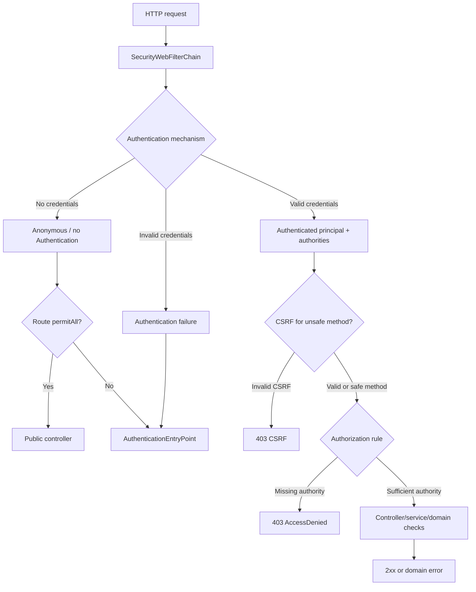

# Test Matrix for Public, Unauthenticated, Insufficient-Privilege, and Authorized Endpoints in Spring Security Reactive

## 1. Lesson Objectives

When deploying **Spring WebFlux + Spring Security**, a single test checking "admin user can open the admin page" is not enough. An application may still expose data through a misconfigured public route, accept an **unauthenticated** request, or treat "logged in" as "has every permission".

To test systematically, build an **HTTP security test matrix** across two dimensions:

1. **Caller state**: guest/anonymous (no credentials sent), invalid credentials, authenticated but lacking authority, authenticated with sufficient authority.
2. **Endpoint requirement**: public (`permitAll`), login-only, specific role/scope required, state-changing requiring CSRF, or route not in the allowlist.

Core outcomes to prove:

- **Public endpoint**: accessible to guests, e.g. HTTP 200.
- **Protected endpoint + unauthenticated**: typically **401 Unauthorized** if the API uses Basic/Bearer, or **302 login redirect** if using form login; assert according to the actual authentication mechanism.
- **Authenticated + insufficient privilege**: **403 Forbidden** in a properly configured API flow.
- **Authenticated + sufficient privilege**: **2xx**, with **accurate body and business effects**, not merely "no error".
- **HTTP method and CSRF**: POST requests can receive **403 from CSRF** before authorization checks; supply a valid CSRF token when isolating role checks.
- **Unknown route, method, tenant, or resource**: must follow an explicit deny/404 policy, never accidentally public.

This lesson uses a **Java 17+ application running Spring Boot 3.x, Spring Security 6.x, WebFlux**, a `SecurityWebFilterChain` declaring routes, an in-memory user store with hashed passwords, and **`WebTestClient`** integrated with `spring-security-test`. It covers real HTTP Basic tests and authorization tests with `mockUser()`, how to test CSRF, extensions for JWT and method security, false-positive/false-negative traps, plus a CI checklist.

> **Scope:** Testing **HTTP endpoints** in **Spring Security Reactive**, not `MockMvc`, Servlet `HttpSecurity`, or `MockHttpServletRequest`. For WebFlux, use `ServerHttpSecurity`, `SecurityWebFilterChain`, `WebTestClient`, `SecurityMockServerConfigurers`, and Reactor Context. Compilable Java examples in a Spring Boot 3.x project are shown; extension snippets are explicitly marked when they are not standalone programs.

## 2. Four states that cannot be conflated

| Caller state | Has credentials? | Has trusted `Authentication`? | Outcome on protected route |
| --- | --- | --- | --- |
| **Anonymous/guest** | No | No | Typically 401 / login redirect |
| **Invalid credentials** | Present but wrong, expired, or untrusted | No | Typically 401; must never "fall back" to a valid user |
| **Authenticated, lacking privilege** | Present and verified | Yes, but insufficient authority | Typically 403 |
| **Authenticated, sufficient privilege** | Present and verified | Yes, sufficient authority and business conditions | 2xx per endpoint contract |

**Authentication** answers *who is calling?*; **authorization** answers *is this caller allowed to perform this action on this resource?*

For example: a user with `ROLE_VIEWER` can read reports, but cannot create reports if the route requires `ROLE_EDITOR`. A user with `ROLE_ADMIN` is not automatically allowed to read another tenant's reports; route-level authorization does not replace **object-level authorization**.

**Common trap:** an anonymous test getting 401 on `/api/admin` **does not prove** there is a `hasRole("ADMIN")` rule. A route configured only with `.authenticated()` also returns 401 to anonymous callers. You must add tests where an **authenticated user lacking the role** gets 403 and an admin user gets 200.

## 3. Sample matrix: routes, HTTP methods, and callers

We will protect the API as follows:

| Endpoint/method | Policy | Guest | Viewer | Editor | Admin |
| --- | --- | --- | --- | --- | --- |
| `GET /public/ping` | `permitAll` | **200** | 200 | 200 | 200 |
| `GET /api/me` | `authenticated` | **401** | **200** | 200 | 200 |
| `GET /api/reports` | `hasRole("VIEWER")` | **401** | **200** | 200 | 200 |
| `POST /api/reports` (valid CSRF) | `hasRole("EDITOR")` | **401** | **403** | **201** | 201 |
| `POST /api/reports` (missing CSRF) | CSRF filter blocks | **403** possibly before authentication | **403** | **403** | **403** |
| `GET /api/admin` | `hasRole("ADMIN")` | **401** | **403** | **403** | **200** |
| `GET /not-allowed` | `denyAll` | 401 or handler/entry point per chain | **403** | **403** | **403** |

Role assumptions:

- `viewer` → `ROLE_VIEWER`.
- `editor` → `ROLE_VIEWER`, `ROLE_EDITOR`.
- `admin` → `ROLE_VIEWER`, `ROLE_EDITOR`, `ROLE_ADMIN`.

This incremental grouping is just for the demo matrix; **do not assume every organization must have "admin includes all roles"**. In production, assign authorities according to the principle of least privilege.

### Matrix by dimension, not just by URL

Consider at least seven dimensions:

1. HTTP **method**: GET/POST/PUT/PATCH/DELETE, sometimes HEAD/OPTIONS.
2. **Path and pattern**: public, private, admin, unknown, trailing slash, path variables.
3. **Principal**: anonymous, wrong credentials, authenticated viewer/editor/admin.
4. **Authorities**: valid role, missing role, different scope, role prefix collisions.
5. **CSRF and browser credentials**: unsafe method with or without CSRF token, session/cookie.
6. **Object ownership/tenant**: same role but resource belongs to another user/tenant.
7. **Authentication mechanism**: HTTP Basic, form login, OAuth2 JWT; 401, redirects, and headers differ.

You do not need the full Cartesian product of all dimensions if it grows too large; cover **each security rule** with at least one positive and one negative case, plus **boundary cases** and high-risk branches.

## 4. HTTP 401, 403, 302, and 404: do not guess mechanically

### 4.1. 401 Unauthorized

When a request hits a route requiring authentication without credentials or with unverifiable credentials, an HTTP Basic/Bearer API typically returns:

```http
HTTP/1.1 401 Unauthorized
WWW-Authenticate: Basic realm="Realm"
```

or:

```http
HTTP/1.1 401 Unauthorized
WWW-Authenticate: Bearer
```

`WWW-Authenticate` is the challenge; **do not assert only status while ignoring headers** if the API has a contract with clients/SDKs. For an invalid JWT, the Bearer challenge may include `error="invalid_token"`; for a missing token, it is typically just `Bearer`.

In **form login**, an anonymous caller hitting a protected page may receive **302** to the login page rather than 401. Hardcoding `401` for both Basic and form login causes false failures.

### 4.2. 403 Forbidden

An **authenticated** user lacking the required role/authority usually receives 403. In the HTTP Basic demo, `viewer` gets 200 on `/api/me` and 403 on `/api/admin`. Combining those two assertions proves `viewer` has valid authentication and authorization denied the request.

`403` can also occur **before** authorization if the CSRF filter rejects a POST missing a token. Thus, when testing **missing `ROLE_EDITOR`**, you must include a **valid CSRF token** in the POST request to isolate the denial reason. Conversely, when testing CSRF, use a user with sufficient privileges to ensure missing CSRF is the sole cause.

### 4.3. 404 Not Found

If a route does not exist, MVC/WebFlux can return 404 **after** security allows the request into the routing layer. However, `.anyExchange().denyAll()` can return 403 before route lookup. Therefore, **never use 404 alone to conclude a route is protected**. In this lesson, unknown routes are blocked by the `denyAll` policy; even an admin user cannot enter unlisted URLs.

For object-level authorization, an API sometimes chooses 404 over 403 to avoid leaking the existence of a resource. This is a **product contract** that should be tested consistently while preventing leaks via body/timing.

### 4.4. 2xx is insufficient if the body is wrong

Status 200 with another tenant's data is a severe security bug. Positive tests should assert **identity, acting authorities, resource ID, business data**, and expected side effects on writes. Never stop at `.expectStatus().isOk()`.

## 5. Processing flow of WebFlux Security



This diagram is a conceptual model, **not a guarantee that every WebFilter order is identical in every configuration**; CSRF handling may occur before authentication/authorization for a particular request. Take a POST missing CSRF as an example: to measure missing credentials/role, supply a CSRF token first; to measure CSRF, keep valid credentials/role to remove confounding variables.

Components:

- `ServerHttpSecurity.authorizeExchange(...)`: declares route/path/method rules.
- `SecurityWebFilterChain`: executes within the WebFlux filter chain.
- `ReactiveAuthenticationManager` / `ReactiveUserDetailsService`: verifies HTTP Basic credentials and creates `Authentication`.
- `ReactiveSecurityContextHolder`: reads the identity inside reactive controllers/services.
- `SecurityMockServerConfigurers.springSecurity()`: integrates security filters with `WebTestClient` bound to `ApplicationContext`.
- `SecurityMockServerConfigurers.mockUser()`: mocks a user for authorization testing; does not check passwords.
- `SecurityMockServerConfigurers.csrf()`: supplies a CSRF token in `WebTestClient` when testing unsafe methods.
- `SecurityMockServerConfigurers.mockJwt()`: mocks a JWT-authenticated request when testing an OAuth2 Resource Server.
- `@WithMockUser`: another way to provide a principal for tests, though for per-request `WebTestClient` tests, `mutateWith(mockUser())` makes the matrix clearer.

## 6. Runnable Java 17+ project

We build a **Spring Boot 3.5 / Spring Security 6.x / WebFlux** application using **HTTP Basic** to cleanly distinguish 401, 403, 200, and 201; for form login/OIDC/JWT, expectations will need adjustment. Accounts are stored in `MapReactiveUserDetailsService` with **hashed** passwords. Routes are for demonstration, with no database or production secrets.

Structure:

```text
http-security-matrix/
  settings.gradle
  build.gradle
  src/main/java/demo/httpmatrix/
    HttpMatrixApplication.java
    SecurityConfig.java
    MatrixController.java
  src/test/java/demo/httpmatrix/
    RealBasicHttpMatrixTest.java
    MockUserAuthorizationMatrixTest.java
```

### 6.1. `settings.gradle`

```groovy
rootProject.name = 'http-security-matrix'
```

### 6.2. `build.gradle`

```groovy
plugins {
    id 'java'
    id 'org.springframework.boot' version '3.5.0'
    id 'io.spring.dependency-management' version '1.1.7'
}

group = 'demo'
version = '0.0.1-SNAPSHOT'

java {
    toolchain {
        languageVersion = JavaLanguageVersion.of(17)
    }
}

repositories {
    mavenCentral()
}

dependencies {
    implementation 'org.springframework.boot:spring-boot-starter-webflux'
    implementation 'org.springframework.boot:spring-boot-starter-security'

    testImplementation 'org.springframework.boot:spring-boot-starter-test'
    testImplementation 'org.springframework.security:spring-security-test'
    testImplementation 'io.projectreactor:reactor-test'
}

tasks.named('test') {
    useJUnitPlatform()
}
```

The Spring Boot BOM manages Spring Framework, Spring Security, and Reactor versions. Do not add `spring-boot-starter-web` (Servlet/MVC) to this example. `WebTestClient` comes from Spring WebFlux test support; `mockUser()` and `csrf()` come from `spring-security-test`. `StepVerifier` comes from `reactor-test` for testing reactive services outside HTTP.

### 6.3. `src/main/java/demo/httpmatrix/HttpMatrixApplication.java`

```java
package demo.httpmatrix;

import org.springframework.boot.SpringApplication;
import org.springframework.boot.autoconfigure.SpringBootApplication;

@SpringBootApplication
public class HttpMatrixApplication {
    public static void main(String[] args) {
        SpringApplication.run(HttpMatrixApplication.class, args);
    }
}
```

### 6.4. `src/main/java/demo/httpmatrix/SecurityConfig.java`

```java
package demo.httpmatrix;

import org.springframework.context.annotation.Bean;
import org.springframework.context.annotation.Configuration;
import org.springframework.http.HttpMethod;
import org.springframework.security.config.Customizer;
import org.springframework.security.config.annotation.web.reactive.EnableWebFluxSecurity;
import org.springframework.security.config.web.server.ServerHttpSecurity;
import org.springframework.security.core.userdetails.MapReactiveUserDetailsService;
import org.springframework.security.core.userdetails.User;
import org.springframework.security.core.userdetails.UserDetails;
import org.springframework.security.crypto.factory.PasswordEncoderFactories;
import org.springframework.security.crypto.password.PasswordEncoder;
import org.springframework.security.web.server.SecurityWebFilterChain;
import org.springframework.security.web.server.context
    .NoOpServerSecurityContextRepository;

@Configuration
@EnableWebFluxSecurity
public class SecurityConfig {

    @Bean
    PasswordEncoder passwordEncoder() {
        return PasswordEncoderFactories.createDelegatingPasswordEncoder();
    }

    @Bean
    MapReactiveUserDetailsService users(PasswordEncoder encoder) {
        UserDetails viewer = User.withUsername("viewer")
            .password(encoder.encode("viewer-pass"))
            .roles("VIEWER")
            .build();

        UserDetails editor = User.withUsername("editor")
            .password(encoder.encode("editor-pass"))
            .roles("VIEWER", "EDITOR")
            .build();

        UserDetails admin = User.withUsername("admin")
            .password(encoder.encode("admin-pass"))
            .roles("VIEWER", "EDITOR", "ADMIN")
            .build();

        return new MapReactiveUserDetailsService(viewer, editor, admin);
    }

    @Bean
    SecurityWebFilterChain springSecurityFilterChain(ServerHttpSecurity http) {
        return http
            .securityContextRepository(
                NoOpServerSecurityContextRepository.getInstance())
            .authorizeExchange(ex -> ex
                // Specific rules first, catch-all last.
                .pathMatchers(HttpMethod.GET, "/public/ping").permitAll()
                .pathMatchers(HttpMethod.GET, "/api/me")
                    .authenticated()
                .pathMatchers(HttpMethod.GET, "/api/reports")
                    .hasRole("VIEWER")
                .pathMatchers(HttpMethod.POST, "/api/reports")
                    .hasRole("EDITOR")
                .pathMatchers(HttpMethod.GET, "/api/admin")
                    .hasRole("ADMIN")
                .anyExchange().denyAll())
            .httpBasic(Customizer.withDefaults())
            .formLogin(form -> form.disable())
            // Do not disable CSRF: explicitly test POST with/without CSRF.
            .build();
    }
}
```

**Why does this configuration serve matrix testing?**

- `GET /public/ping` `permitAll()` comes first, yet **only** GET is public; POST on the same path is not automatically allowed.
- `GET /api/me` requires only `authenticated()`, no specific role.
- `GET /api/reports` requires `ROLE_VIEWER` (since `hasRole("VIEWER")` adds the `ROLE_` prefix).
- `POST /api/reports` requires `ROLE_EDITOR` **and** a valid CSRF token because CSRF is enabled by default.
- `GET /api/admin` requires `ROLE_ADMIN`.
- `.anyExchange().denyAll()` blocks routes/methods not on the allowlist, even for admin unless explicitly overridden.
- `NoOpServerSecurityContextRepository` avoids saving session authentication; HTTP Basic is sent on each protected request, and the controller still reads the principal from Reactor Context for the current request.
- `.formLogin(...disable())` prevents browser redirects to an HTML login page when the API expects an HTTP Basic challenge.
- Demo passwords use `DelegatingPasswordEncoder` with `{bcrypt}` prefix; plaintext passwords are not stored in `MapReactiveUserDetailsService`.
- **Keep CSRF enabled** because browsers can automatically send HTTP Basic credentials in certain contexts; if the app also has cookie credentials, a CSRF threat model is needed. Do not disable CSRF just to make POST tests easier.

**Note:** HTTP Basic Base64 **is not secure encryption**. Never use Basic over public HTTP networks, and never hardcode demo credentials in real products. Here localhost/test client is used to provide a clear password verification mechanism without an IdP.

### 6.5. `src/main/java/demo/httpmatrix/MatrixController.java`

```java
package demo.httpmatrix;

import java.util.List;
import java.util.Map;

import org.springframework.http.HttpStatus;
import org.springframework.http.ResponseEntity;
import org.springframework.security.core.GrantedAuthority;
import org.springframework.security.core.context.ReactiveSecurityContextHolder;
import org.springframework.web.bind.annotation.GetMapping;
import org.springframework.web.bind.annotation.PostMapping;
import org.springframework.web.bind.annotation.RequestBody;
import org.springframework.web.bind.annotation.RestController;
import reactor.core.publisher.Mono;

@RestController
public class MatrixController {

    public record NewReport(String title) {}

    @GetMapping("/public/ping")
    public Mono<Map<String, String>> ping() {
        return Mono.just(Map.of("status", "PONG"));
    }

    @GetMapping("/api/me")
    public Mono<Map<String, Object>> me() {
        return ReactiveSecurityContextHolder.getContext()
            .map(ctx -> Map.<String, Object>of(
                "username", ctx.getAuthentication().getName(),
                "authorities",
                ctx.getAuthentication().getAuthorities().stream()
                    .map(GrantedAuthority::getAuthority)
                    .sorted()
                    .toList()));
    }

    @GetMapping("/api/reports")
    public Mono<List<Map<String, String>>> reports() {
        return Mono.just(List.of(
            Map.of("id", "r-101", "title", "Quarterly")));
    }

    @PostMapping("/api/reports")
    public Mono<ResponseEntity<Map<String, String>>> createReport(
            @RequestBody Mono<NewReport> request) {

        // Demo does not write to DB; real tests should verify side effects.
        return request.map(value ->
            ResponseEntity.status(HttpStatus.CREATED)
                .body(Map.of(
                    "id", "r-new",
                    "title", value.title())));
    }

    @GetMapping("/api/admin")
    public Mono<Map<String, String>> admin() {
        return Mono.just(Map.of("status", "ADMIN_OK"));
    }
}
```

`ReactiveSecurityContextHolder` uses Reactor Context rather than assuming Servlet's ThreadLocal `SecurityContextHolder`. Positive tests on `/api/me` verify the real identity and authorities, not just the HTTP status.

Methods return `Mono` to preserve the WebFlux flow. The controller **does not check roles by reading user-supplied query/header values**; `SecurityWebFilterChain` handles route-level authorization first. In real applications, services must still enforce object/tenant-level authorization.

### 6.6. Manual run

From a project with a Gradle wrapper compatible with Spring Boot 3.x:

```bash
# Linux/macOS
./gradlew bootRun

# Windows
gradlew.bat bootRun
```

Try these requests:

```bash
# Public: 200.
curl -i http://localhost:8080/public/ping

# Anonymous protected: 401 + Basic challenge.
curl -i http://localhost:8080/api/me

# Wrong credentials: 401.
curl -i -u viewer:wrong http://localhost:8080/api/reports

# Viewer authorized for GET reports: 200.
curl -i -u viewer:viewer-pass http://localhost:8080/api/reports

# Viewer lacks admin privilege: 403.
curl -i -u viewer:viewer-pass http://localhost:8080/api/admin

# Admin authorized for admin: 200.
curl -i -u admin:admin-pass http://localhost:8080/api/admin

# POST without CSRF: 403 even with valid editor credentials.
curl -i -u editor:editor-pass \
  -H 'Content-Type: application/json' \
  -d '{"title":"Monthly"}' \
  http://localhost:8080/api/reports
```

**You cannot send a plain curl POST without creating a valid CSRF token and expect 201** when the server enforces CSRF. The `WebTestClient` test suite below supplies a CSRF token via `mutateWith(csrf())`. For real browser testing, proper CSRF token repository/cookie/form integration is needed rather than disabling the filter just to watch POST succeed.

## 7. Integrating Spring Security with `WebTestClient`

When testing a WebFlux `ApplicationContext` without opening a real network port, Spring Security recommends:

```java
WebTestClient.bindToApplicationContext(context)
    .apply(springSecurity())
    .configureClient()
    .build();
```

This tests the **WebFlux request pipeline** with real Security WebFilters, without requiring Netty to bind a port. It is fast, repeatable, and well suited for checking route policies, the authentication manager, and CSRF.

From Spring Security Test:

```java
import static org.springframework.security.test.web.reactive.server
    .SecurityMockServerConfigurers.springSecurity;

import static org.springframework.security.test.web.reactive.server
    .SecurityMockServerConfigurers.mockUser;

import static org.springframework.security.test.web.reactive.server
    .SecurityMockServerConfigurers.csrf;
```

Distinctions:

- `springSecurity()` — attaches Spring Security filter support to `WebTestClient`.
- `mockUser()` — injects a mock `Authentication` into **one request**; does not verify HTTP Basic passwords.
- `csrf()` — simulates a valid CSRF token for **one request**.
- `@SpringBootTest` — creates the full context; tests can build `WebTestClient` manually with `bindToApplicationContext`.
- `@AutoConfigureWebTestClient` — another option to inject the client in Boot tests; **not required** when constructing it manually as in this lesson.

**Do not use `MockMvc` with WebFlux.** Browser automation tools like Selenium/Playwright are unsuitable for fast security filter unit/integration checks alone; browser end-to-end tests complement after the security contract has tests.

## 8. Integration test 1: matrix with real HTTP Basic credentials

File `src/test/java/demo/httpmatrix/RealBasicHttpMatrixTest.java`:

```java
package demo.httpmatrix;

import org.junit.jupiter.api.BeforeEach;
import org.junit.jupiter.api.Test;
import org.springframework.beans.factory.annotation.Autowired;
import org.springframework.boot.test.context.SpringBootTest;
import org.springframework.context.ApplicationContext;
import org.springframework.http.HttpHeaders;
import org.springframework.http.MediaType;
import org.springframework.test.web.reactive.server.WebTestClient;

import static org.junit.jupiter.api.Assertions.assertTrue;
import static org.springframework.security.test.web.reactive.server
    .SecurityMockServerConfigurers.springSecurity;
import static org.springframework.security.test.web.reactive.server
    .SecurityMockServerConfigurers.csrf;

@SpringBootTest
class RealBasicHttpMatrixTest {

    @Autowired
    ApplicationContext context;

    WebTestClient client;

    @BeforeEach
    void setUp() {
        client = WebTestClient.bindToApplicationContext(context)
            .apply(springSecurity())
            .configureClient()
            .build();
    }

    @Test
    void publicEndpointAllowsAnonymous() {
        client.get().uri("/public/ping")
            .exchange()
            .expectStatus().isOk()
            .expectBody()
            .jsonPath("$.status").isEqualTo("PONG");
    }

    @Test
    void anonymousCannotReadProfile() {
        client.get().uri("/api/me")
            .exchange()
            .expectStatus().isUnauthorized()
            .expectHeader().value(HttpHeaders.WWW_AUTHENTICATE,
                header -> assertTrue(header.startsWith("Basic")));
    }

    @Test
    void anonymousCannotReadReports() {
        client.get().uri("/api/reports")
            .exchange()
            .expectStatus().isUnauthorized();
    }

    @Test
    void invalidPasswordCannotReadReports() {
        client.get().uri("/api/reports")
            .headers(h -> h.setBasicAuth("viewer", "wrong"))
            .exchange()
            .expectStatus().isUnauthorized();
    }

    @Test
    void viewerCanReadOwnAuthentication() {
        client.get().uri("/api/me")
            .headers(h -> h.setBasicAuth("viewer", "viewer-pass"))
            .exchange()
            .expectStatus().isOk()
            .expectBody()
            .jsonPath("$.username").isEqualTo("viewer")
            .jsonPath("$.authorities[0]")
                .isEqualTo("ROLE_VIEWER");
    }

    @Test
    void viewerCanReadReports() {
        client.get().uri("/api/reports")
            .headers(h -> h.setBasicAuth("viewer", "viewer-pass"))
            .exchange()
            .expectStatus().isOk()
            .expectBody()
            .jsonPath("$[0].id").isEqualTo("r-101")
            .jsonPath("$[0].title").isEqualTo("Quarterly");
    }

    @Test
    void viewerCannotReadAdmin() {
        client.get().uri("/api/admin")
            .headers(h -> h.setBasicAuth("viewer", "viewer-pass"))
            .exchange()
            .expectStatus().isForbidden();
    }

    @Test
    void editorCannotReadAdmin() {
        client.get().uri("/api/admin")
            .headers(h -> h.setBasicAuth("editor", "editor-pass"))
            .exchange()
            .expectStatus().isForbidden();
    }

    @Test
    void adminCanReadAdmin() {
        client.get().uri("/api/admin")
            .headers(h -> h.setBasicAuth("admin", "admin-pass"))
            .exchange()
            .expectStatus().isOk()
            .expectBody()
            .jsonPath("$.status").isEqualTo("ADMIN_OK");
    }

    @Test
    void viewerCannotCreateReportEvenWithValidCsrf() {
        client.mutateWith(csrf())
            .post().uri("/api/reports")
            .headers(h -> h.setBasicAuth("viewer", "viewer-pass"))
            .contentType(MediaType.APPLICATION_JSON)
            .bodyValue("{\"title\":\"Monthly\"}")
            .exchange()
            .expectStatus().isForbidden();
    }

    @Test
    void anonymousCannotCreateReportEvenWithValidCsrf() {
        client.mutateWith(csrf())
            .post().uri("/api/reports")
            .contentType(MediaType.APPLICATION_JSON)
            .bodyValue("{\"title\":\"Monthly\"}")
            .exchange()
            .expectStatus().isUnauthorized();
    }

    @Test
    void editorCannotCreateReportWithoutCsrf() {
        client.post().uri("/api/reports")
            .headers(h -> h.setBasicAuth("editor", "editor-pass"))
            .contentType(MediaType.APPLICATION_JSON)
            .bodyValue("{\"title\":\"Monthly\"}")
            .exchange()
            .expectStatus().isForbidden();
    }

    @Test
    void editorCanCreateReportWithValidCsrf() {
        client.mutateWith(csrf())
            .post().uri("/api/reports")
            .headers(h -> h.setBasicAuth("editor", "editor-pass"))
            .contentType(MediaType.APPLICATION_JSON)
            .bodyValue("{\"title\":\"Monthly\"}")
            .exchange()
            .expectStatus().isCreated()
            .expectBody()
            .jsonPath("$.id").isEqualTo("r-new")
            .jsonPath("$.title").isEqualTo("Monthly");
    }

    @Test
    void adminCanCreateReportWithValidCsrf() {
        client.mutateWith(csrf())
            .post().uri("/api/reports")
            .headers(h -> h.setBasicAuth("admin", "admin-pass"))
            .contentType(MediaType.APPLICATION_JSON)
            .bodyValue("{\"title\":\"Admin Report\"}")
            .exchange()
            .expectStatus().isCreated()
            .expectBody()
            .jsonPath("$.title").isEqualTo("Admin Report");
    }

    @Test
    void authenticatedAdminCannotOpenUnknownRoute() {
        client.get().uri("/not-allowed")
            .headers(h -> h.setBasicAuth("admin", "admin-pass"))
            .exchange()
            .expectStatus().isForbidden();
    }

    @Test
    void unlistedMethodOnPublicPathIsNotPublic() {
        // This POST is not permitted by permitAll, and the test supplies CSRF to isolate
        // authorization. Guest must still be rejected.
        client.mutateWith(csrf())
            .post().uri("/public/ping")
            .exchange()
            .expectStatus().isUnauthorized();
    }
}
```

### 8.1. Why use two kinds of negative tests?

- `invalidPasswordCannotReadReports()` sends real but wrong Basic credentials, verifying that the **authentication manager** actually rejects them rather than only attaching a mock user.
- `viewerCannotReadAdmin()` uses **valid** real Basic credentials. Viewer is allowed to read `/api/reports` but lacks `ROLE_ADMIN`, so 403 proves the authorization rule.
- `viewerCannotCreateReportEvenWithValidCsrf()` supplies valid CSRF so 403 proves **missing role**, not missing CSRF.
- `editorCannotCreateReportWithoutCsrf()` uses a user with the right role while omitting CSRF to prove **CSRF** operates independently of roles.
- `authenticatedAdminCannotOpenUnknownRoute()` verifies `.anyExchange().denyAll()` is effective.
- `unlistedMethodOnPublicPathIsNotPublic()` ensures only **GET** is permitted, without accidentally exposing all methods on that URL.

### 8.2. Expected test results

When run on a properly configured project, the tests are expected to produce these HTTP statuses:

```text
GET  /public/ping, guest                  -> 200
GET  /api/me, guest                      -> 401 Basic challenge
GET  /api/reports, guest                 -> 401
GET  /api/reports, wrong password        -> 401
GET  /api/reports, viewer                -> 200
GET  /api/admin, viewer                 -> 403
GET  /api/admin, admin                  -> 200
POST /api/reports, viewer + valid CSRF   -> 403
POST /api/reports, editor no CSRF        -> 403
POST /api/reports, editor + valid CSRF   -> 201
GET  /not-allowed, admin                -> 403
```

These are **expectations based on the demo configuration**, not an executed Gradle log. Production security contracts may differ (e.g., JWT Bearer 401/403, form login 302, fallback 404 per routing policy). Always test the real setup rather than copying mismatched statuses.

## 9. Integration test 2: isolating authorization with `mockUser()`

The Basic tests above verified both passwords and roles. When policies grow complex, **performing real login in every test** can make tests slow and harder to diagnose. Spring Security Test provides `mockUser()` to inject an authenticated user into a WebFlux request and focus on testing authorization.

File `src/test/java/demo/httpmatrix/MockUserAuthorizationMatrixTest.java`:

```java
package demo.httpmatrix;

import org.junit.jupiter.api.BeforeEach;
import org.junit.jupiter.api.Test;
import org.springframework.beans.factory.annotation.Autowired;
import org.springframework.boot.test.context.SpringBootTest;
import org.springframework.context.ApplicationContext;
import org.springframework.http.MediaType;
import org.springframework.test.web.reactive.server.WebTestClient;

import static org.springframework.security.test.web.reactive.server
    .SecurityMockServerConfigurers.springSecurity;
import static org.springframework.security.test.web.reactive.server
    .SecurityMockServerConfigurers.mockUser;
import static org.springframework.security.test.web.reactive.server
    .SecurityMockServerConfigurers.csrf;

@SpringBootTest
class MockUserAuthorizationMatrixTest {

    @Autowired
    ApplicationContext context;

    WebTestClient client;

    @BeforeEach
    void setUp() {
        client = WebTestClient.bindToApplicationContext(context)
            .apply(springSecurity())
            .configureClient()
            .build();
    }

    @Test
    void guestCanReadPublicEndpoint() {
        client.get().uri("/public/ping")
            .exchange()
            .expectStatus().isOk();
    }

    @Test
    void guestCannotReadProtectedEndpoint() {
        client.get().uri("/api/reports")
            .exchange()
            .expectStatus().isUnauthorized();
    }

    @Test
    void mockViewerHasViewerRoleOnly() {
        client.mutateWith(
                mockUser("alice").roles("VIEWER"))
            .get().uri("/api/me")
            .exchange()
            .expectStatus().isOk()
            .expectBody()
            .jsonPath("$.username").isEqualTo("alice")
            .jsonPath("$.authorities[0]")
                .isEqualTo("ROLE_VIEWER");
    }

    @Test
    void mockViewerCanReadReportsButNotAdmin() {
        client.mutateWith(
                mockUser("alice").roles("VIEWER"))
            .get().uri("/api/reports")
            .exchange()
            .expectStatus().isOk();

        client.mutateWith(
                mockUser("alice").roles("VIEWER"))
            .get().uri("/api/admin")
            .exchange()
            .expectStatus().isForbidden();
    }

    @Test
    void mockAdminCanReadAdmin() {
        client.mutateWith(
                mockUser("carol").roles("ADMIN"))
            .get().uri("/api/admin")
            .exchange()
            .expectStatus().isOk()
            .expectBody()
            .jsonPath("$.status").isEqualTo("ADMIN_OK");
    }

    @Test
    void mockEditorCannotPostWithoutCsrf() {
        client.mutateWith(
                mockUser("bob").roles("EDITOR"))
            .post().uri("/api/reports")
            .contentType(MediaType.APPLICATION_JSON)
            .bodyValue("{\"title\":\"Q4\"}")
            .exchange()
            .expectStatus().isForbidden();
    }

    @Test
    void mockEditorCanPostWithCsrf() {
        client.mutateWith(
                mockUser("bob").roles("EDITOR"))
            .mutateWith(csrf())
            .post().uri("/api/reports")
            .contentType(MediaType.APPLICATION_JSON)
            .bodyValue("{\"title\":\"Q4\"}")
            .exchange()
            .expectStatus().isCreated()
            .expectBody()
            .jsonPath("$.title").isEqualTo("Q4");
    }

    @Test
    void mockViewerCannotPostEvenWithCsrf() {
        client.mutateWith(
                mockUser("alice").roles("VIEWER"))
            .mutateWith(csrf())
            .post().uri("/api/reports")
            .contentType(MediaType.APPLICATION_JSON)
            .bodyValue("{\"title\":\"Q4\"}")
            .exchange()
            .expectStatus().isForbidden();
    }

    @Test
    void mockAdminStillCannotAccessUnknownRoute() {
        client.mutateWith(
                mockUser("carol").roles("ADMIN"))
            .get().uri("/not-allowed")
            .exchange()
            .expectStatus().isForbidden();
    }
}
```

### 9.1. What can and cannot `mockUser()` verify?

**Can verify:**

- Whether `authorizeExchange` enforces the right role/authority policy?
- Whether public routes allow guests?
- Whether an authenticated user reaches the controller with the expected name/authorities?
- Whether `ROLE_VIEWER` is rejected on admin routes?
- Whether POST still requires CSRF when the role is valid?

**Does NOT verify:**

- Whether password hashing/`PasswordEncoder.matches` works.
- Whether the user store/JDBC/LDAP returns real roles and valid account status.
- Whether HTTP Basic headers are parsed and verified properly.
- Whether JWT signature, issuer, audience, token expiry, or scope mapping from a real decoder works.
- Whether session persistence, login redirects, or refresh token flows work.

Therefore, **both test layers should exist**: a few **real** Basic or token authentication tests to validate the authentication mechanism, and broad `mockUser()`/`mockJwt()` tests to cover security rules.

### 9.2. Avoid a "mock admin" hiding authorization bugs

If every test uses `mockUser().roles("ADMIN", "EDITOR", "VIEWER")`, many routes appear to work while lacking negative role cases. Do not use a single super-admin user for the entire matrix. For each rule, include at least:

- Guest → rejected if protected.
- Authenticated lacking the required role → rejected.
- Authenticated with the required role → allowed.
- For role hierarchies/tenants: test cases proving privileges **do not** leak outside policy.

## 10. CSRF: separating missing-token errors from missing-permission errors

CSRF protection is enabled by default in Spring Security WebFlux. Browsers can automatically send cookies/sessions or HTTP Basic credentials, so another site could attempt to make a browser submit a state-changing request. A CSRF token helps mitigate that risk when authentication relies on browser-managed credentials.

With `WebTestClient`:

```java
// Right role, missing CSRF: verify CSRF protects POST.
client.mutateWith(mockUser().roles("EDITOR"))
    .post().uri("/api/reports")
    .bodyValue("{\"title\":\"Q4\"}")
    .exchange()
    .expectStatus().isForbidden();
```

```java
// Right role and CSRF: verify positive case.
client.mutateWith(mockUser().roles("EDITOR"))
    .mutateWith(csrf())
    .post().uri("/api/reports")
    .bodyValue("{\"title\":\"Q4\"}")
    .exchange()
    .expectStatus().isCreated();
```

```java
// Missing role with valid CSRF: verify role policy.
client.mutateWith(mockUser().roles("VIEWER"))
    .mutateWith(csrf())
    .post().uri("/api/reports")
    .bodyValue("{\"title\":\"Q4\"}")
    .exchange()
    .expectStatus().isForbidden();
```

**Do not confuse these three cases.** If you only write a viewer POST test without CSRF and see 403, you have not proven VIEWER was rejected by `hasRole("EDITOR")`: the CSRF filter may have stopped the request earlier.

**An anonymous POST without CSRF can also return 403**, instead of 401, depending on filter order. When proving anonymous authentication is blocked, supply a valid CSRF token or use a protected GET. When proving CSRF is enabled, use an authorized user and omit CSRF.

### When the app is a stateless Bearer API

A Resource Server accepting only `Authorization: Bearer ...` where browsers do not auto-send credentials may choose to disable CSRF **after a threat-model review**, rather than copying the Basic demo's CSRF matrix and treating 403 as a bug. If session cookies/OAuth2 login coexist with Bearer APIs in the same app, CSRF must be evaluated **per authentication flow**, typically using separate `SecurityWebFilterChain`s or matchers.

### Real CSRF tokens vs the test mutator

`mutateWith(csrf())` is a test utility simulating a valid token. It **does not prove a real SPA/template sends the right cookie/header/hidden field**, nor does it test BREACH mitigation or SameSite cookie strategy end-to-end. Add appropriate browser/HTTP integration tests if the product has login forms.

## 11. Adding contract tests by HTTP method and fallback rules

Security vulnerabilities often hide in paths **outside the main happy-path tests**:

- GET `/public/ping` is public, while POST on the same URL is left open.
- GET `/api/reports` requires viewer, while DELETE `/api/reports` has no security rule.
- `/api/admin` is protected, while `/api/admin/` or `/api/admin/export` hits a different matcher.
- URL-encoded/normalized paths match differently in a proxy vs Spring gateway.
- `OPTIONS` preflight is blocked causing CORS failures; fixed wrongly by permitting all methods on the API.
- API has multiple security chains: a route matches a looser chain due to `@Order`/`securityMatcher`.
- Unknown routes leak object metadata/stack traces even when returning 404.
- Method-level guards are bypassed accidentally via self-invocation.

In the demo, `.anyExchange().denyAll()` denies all undeclared requests by default. Do not assert "every unknown route must return 403" across all apps; a security chain may return 404 if the request passes authorization. What matters is **never unexpectedly returning 2xx with sensitive data** and ensuring the policy is explicitly written and tested.

### A matrix for GET/POST/DELETE

| Route/method | Guest | Viewer | Editor | Admin | Notes |
| --- | --- | --- | --- | --- | --- |
| GET `/public/ping` | 200 | 200 | 200 | 200 | Public |
| POST `/public/ping` | 401 if CSRF valid | 403 | 403 | 403 | No handler/allowlist |
| GET `/api/reports` | 401 | 200 | 200 | 200 | VIEWER |
| POST `/api/reports` | 401 if CSRF valid | 403 | 201 | 201 | EDITOR + CSRF |
| DELETE `/api/reports` | Policy-dependent deny | 403 | 403 | 403 | Deny by default |
| GET `/api/admin` | 401 | 403 | 403 | 200 | ADMIN |

For DELETE, if CSRF is not supplied, it may be blocked before authorization; to test the `denyAll` fallback in isolation, **supply a valid CSRF token**. Do not mistake a CSRF 403 for proof that the route was denied.

## 12. Extending the matrix to OAuth2 Resource Server JWT

Real-world applications may use **JWT Bearer** instead of Basic. In that case, add authentication states:

- Missing Bearer header → typically **401** and `WWW-Authenticate: Bearer`.
- Malformed `Bearer` syntax → may be **400 invalid_request** or 401 depending on error/handler.
- JWT with wrong signature/issuer/audience, or expired → typically **401 invalid_token**.
- Valid JWT missing `SCOPE_reports.read` → typically **403 insufficient_scope**.
- Valid JWT with `SCOPE_reports.read` → 200 when matching the right resource/tenant.
- JWT has scope but subject does not own the resource → 403/404 per domain policy.

If the security config uses:

```java
.oauth2ResourceServer(oauth2 -> oauth2
    .jwt(Customizer.withDefaults()))
```

and:

```java
.pathMatchers(HttpMethod.GET, "/api/reports")
    .hasAuthority("SCOPE_reports.read")
```

then `hasAuthority("SCOPE_reports.read")` **differs from** `hasRole("VIEWER")`. By default, `JwtGrantedAuthoritiesConverter` maps scopes from `scope`/`scp` into authorities prefixed with `SCOPE_`.

### JWT authorization testing with `mockJwt()`

Spring Security Reactive provides the test mutator:

```java
import static org.springframework.security.test.web.reactive.server
    .SecurityMockServerConfigurers.mockJwt;
```

A **snippet specific to Resource Server applications**, not runnable verbatim in the Basic demo unless you change the security chain:

```java
// Valid authentication, missing scope:
client.mutateWith(mockJwt().jwt(
        jwt -> jwt.claim("scope", "profile")))
    .get().uri("/api/reports")
    .exchange()
    .expectStatus().isForbidden();
```

```java
// Sufficient scope for reports route:
client.mutateWith(mockJwt().jwt(
        jwt -> jwt.claim("scope", "reports.read")))
    .get().uri("/api/reports")
    .exchange()
    .expectStatus().isOk();
```

**Important:** `mockJwt()` bypasses real JWT decoding/verification. It verifies authorization rules and authority mapping in tests; it does not prove signature, `iss`, `aud`, `exp`, JWKS, or real token transport. You need a dedicated test suite with signed JWTs and a test JWK server/IdP to verify cryptographic validation and 401 `invalid_token`.

Do not use an OIDC ID token in place of an access token for APIs. Never authorize solely by Base64-decoding a JWT payload without signature/claim validation.

## 13. Extending to OAuth2 login, form login, and sessions

An API with **`oauth2Login()`** or **`formLogin()`** may rely on session cookies. When a guest visits a protected route, the result may be a 302/303 redirect to login instead of 401. Therefore, **write the matrix according to the application's authentication entry point**:

| Mechanism | Guest protected route | Authenticated missing role | Sufficient role |
| --- | --- | --- | --- |
| HTTP Basic API | 401 + `WWW-Authenticate: Basic` | Typically 403 | 2xx |
| JWT Bearer API | 401 + Bearer challenge | Typically 403 | 2xx |
| Browser form login | Typically 302 to login | Typically 403 or access-denied page | 2xx |
| OAuth2/OIDC login | Typically redirect to IdP/login selection | 403/policy denial | 2xx |
| Mixed chains | Depends on matcher/entry point | Depends on matched chain | Depends on matched chain |

Session tests should check:

- Is the session cookie saved/restored properly?
- Does logout clear session authentication?
- Do remember-me or session fixation policies change the identity?
- Are redirect URI/`state`/CSRF validated during OAuth2 login?
- Can user A's session be reused for user B in concurrent WebTestClient tests?
- Are role changes after login refreshed deterministically?

**Do not overuse `mockUser()`** to "test that OIDC login works". `mockUser` creates a fake principal and skips redirects, ID token validation, and cookie/session persistence; those steps need integration tests with a mock/test-tenant IdP.

## 14. Checking Spring Security matchers and rule ordering

Rules are evaluated in order. A common misconfiguration:

```java
.authorizeExchange(ex -> ex
    .pathMatchers("/api/**").authenticated()
    .pathMatchers("/api/admin").hasRole("ADMIN")
    .anyExchange().denyAll())
```

The `/api/**` rule matches before `/api/admin`; hence `hasRole("ADMIN")` may **never be applied** to the admin path. An anonymous `/api/admin` test still sees 401, fooling you into thinking it is protected, while an authenticated viewer can receive 200.

Correct ordering:

```java
.authorizeExchange(ex -> ex
    .pathMatchers("/public/**").permitAll()
    .pathMatchers("/api/admin").hasRole("ADMIN")
    .pathMatchers("/api/**").authenticated()
    .anyExchange().denyAll())
```

**However**, this pattern must still account for HTTP methods/CSRF; for example, `GET /api/admin` and `POST /api/admin` may need different rules. The main demo config uses `pathMatchers(HttpMethod.X, ...)` to avoid opening every method on a route.

### `hasRole` and `hasAuthority`

`hasRole("ADMIN")` normally requires a `GrantedAuthority` named **`ROLE_ADMIN`**. `hasAuthority("ADMIN")` requires the exact string `"ADMIN"` without adding a prefix; `hasAuthority("SCOPE_reports.read")` is typically used for OAuth2 scopes.

Tests must use the matching namespace:

```java
mockUser("alice").roles("VIEWER")
```

creates authority `ROLE_VIEWER`, whereas:

```java
mockUser("alice").authorities(
    new SimpleGrantedAuthority("SCOPE_reports.read"))
```

creates authority `SCOPE_reports.read`. Do not call `roles("ROLE_VIEWER")` because `.roles(...)` normally prepends the prefix or rejects strings that already include it.

## 15. Testing object ownership and multi-tenancy after the route matrix

A route matrix is necessary but not sufficient for **IDOR/BOLA** authorization. For example:

```text
GET /api/reports/r-101  → owner Alice/tenant A
GET /api/reports/r-202  → owner Bob/tenant B
```

Even when both Alice and Bob have `ROLE_VIEWER`, the API must enforce that each reads only permitted resources.

Tests should cover:

| Actor | Resource | Expected |
| --- | --- | --- |
| Guest | `r-101` | 401/redirect |
| Alice with viewer | `r-101` owned by Alice | 200 |
| Alice with viewer | `r-202` owned by Bob | 403/404 per policy |
| Bob with viewer | `r-202` owned by Bob | 200 |
| Editor tenant A | Report tenant B | 403/404 if not allowed |
| Admin tenant A | Report tenant B | Allowed only if policy defines cross-tenant access |
| Invalid JWT/credential | Any protected report | 401 |

**Do not add such endpoints to the main demo without a data store/ownership enforcement**, because a controller returning fake data without owner checks sets a bad example. In production, implement owner/tenant checks in services, method security, or filtered queries, then test with dedicated data fixtures checking both **status and absence of data leaks**.

### Relationship between status codes and information leakage

An API may return 404 instead of 403 to avoid revealing whether a private report exists. Still check **messages, body, timing, search lists, and client-facing error logs** so a 404 body never leaks sensitive owners, titles, or IDs.

## 16. Making the matrix maintainable in CI

If every endpoint is repeated across many roles, the test suite grows huge. Organize the matrix into an **intentional set of cases**:

1. Each public route: guest success without redirects.
2. Each authenticated-only route: guest denial, one valid user success.
3. Each role/scope route: guest denial, authenticated-lacking-privilege denial, authorized success.
4. Each unsafe method: authorized + CSRF success, authorized - CSRF denial, unauthorized + CSRF denial.
5. Each fallback/unknown path: guest or authenticated actor denied per policy.
6. Each sensitive domain resource: owner success, same-role non-owner denial, cross-tenant denial.
7. Each authentication mechanism: bad credential/token failure and proper challenge/redirect.
8. Each special case: logout, CORS preflight, 429/rate limit, or public asset routes if present.

### Avoid overly brittle assertions on implementation text

Do assert:

- HTTP status, `WWW-Authenticate` when applicable, and redirect location if part of the contract.
- Non-sensitive business response JSON keys/values.
- That collections do not contain records from other tenants.
- Absence of side effects on denied POST/DELETE requests.
- That tokens/secrets never appear in error bodies or test-environment logs.

Avoid asserting:

- Full stack traces or framework-internal error messages.
- Uncontracted JSON field ordering.
- Errors caused by a missing handler mistaken for a security denial.
- Millisecond-exact authentication/filter timing.
- A single super-admin role for all cases.
- `mockUser` for every test while assuming password/JWT validation was tested.

### Deterministic test data

Use fixture users with clear roles, isolated test data, and avoid global mutable state. If the suite runs in parallel, do not use a shared singleton counter comparing before/after without isolation. If tests perform DB writes, reset via explicit test transactions/datasets and verify rollback or cleanup.

When adding a new route, update the policy table and negative tests; never let routes silently fall into `.anyExchange().authenticated()` if business logic requires a specific role.

## 17. CORS and preflight: a test axis not to overlook

Browsers send an `OPTIONS` preflight when a cross-origin request uses non-simple headers or methods, such as `Authorization` or JSON POST. If the server/gateway lacks CORS configuration, browsers show a "CORS error" even when the backend returns 401/403 with correct security semantics. **Do not fix this by disabling Security or allowing all origins/credentials.**

Test:

- Allowed origins receive the proper `Access-Control-Allow-Origin`.
- Allowed methods/headers include permitted items (`Authorization`, `Content-Type`) per contract.
- Credentialed browser requests are not paired with wildcard origins if disallowed by CORS policy.
- Preflight is processed **before** requiring authentication, not wrongly blocked for missing a Bearer token.
- Disallowed origins do not receive cross-origin access.
- HTTP 401/403 responses also carry appropriate CORS headers so clients can read errors properly.

In Spring WebFlux, configure CORS via `CorsWebFilter`, `CorsConfigurationSource`, or the version-appropriate integration DSL. Do not copy Servlet `CorsFilter` code expecting WebFlux to use it properly.

**CORS is not authorization.** CORS restricts browser JavaScript from reading cross-origin responses; curl/native clients are not bound by it. Never use CORS as a resource protection mechanism in place of authentication/authorization.

## 18. Testing with `StepVerifier` and method security

The HTTP matrix uses `WebTestClient`, while service logic may return `Mono`/`Flux` protected by `@PreAuthorize`/`@PostAuthorize` when enabled:

```java
@EnableReactiveMethodSecurity
```

In service unit tests, you can write:

```java
StepVerifier.create(reportService.readPrivateReport("r-101"))
    .expectError(AccessDeniedException.class)
    .verify();
```

**This is an illustrative snippet**, assuming `reportService`, method security proxies, and Reactor Context are properly configured. It will not run standalone without an implementation. If the service checks owner/tenant, tests must supply user identity/claims via `ReactiveSecurityContextHolder.withAuthentication(...)` or suitable Spring Security Test support.

**Testing layers:**

- HTTP route tests prove WebFilter policies.
- Method-security tests prove proxies/annotations apply in real calls without being bypassed by `this.method()` self-invocation.
- Domain service/data query tests prove ownership, tenant filtering, and side effects.
- Full integration tests prove identities from real credentials/tokens map to proper authorities.
- End-to-end browser tests prove real CSRF/session/redirect behavior in the UI.

Do not replace all layers with a single test type, because each layer has distinct failure modes.

## 19. Why are many green security tests worthless?

### Mistake 1: Testing only the positive case

An admin getting 200 on `/api/admin` does not prove viewers are blocked. Add a negative test: authenticated viewer → 403.

### Mistake 2: Testing only anonymous access on admin

Anonymous 401 also happens if the route only has `.authenticated()`. That test does not prove `hasRole("ADMIN")`.

### Mistake 3: Testing insufficient privilege with a POST **missing CSRF**

Viewer gets 403 due to CSRF, which does not prove viewer lacks `ROLE_EDITOR`. Add `.mutateWith(csrf())`.

### Mistake 4: Testing authorized access with `mockUser()` and concluding Basic/JWT login works

`mockUser()` bypasses password/token decoding. Add an integration test with real credentials/tokens.

### Mistake 5: Using `MockMvc` or Servlet `HttpSecurity` for WebFlux

Security WebFilters/reactive contexts differ from Servlet filters. Use `WebTestClient`, `springSecurity()`, and `ServerHttpSecurity`.

### Mistake 6: Asserting only `expectError`/status 403 on a non-existent route

A 404 may be due to a missing handler. Include a positive control on the same route with an authorized user.

### Mistake 7: Forgetting HTTP methods

Public GET does not mean public POST. Test method matchers and `denyAll` fallbacks.

### Mistake 8: Confusing `ROLE_` with `SCOPE_`

JWT scope `reports.read` normally becomes `SCOPE_reports.read`; `hasRole("VIEWER")` requires `ROLE_VIEWER`. Do not treat them as identical.

### Mistake 9: Placing `anyExchange().authenticated()` too early

A broad matcher before a role-specific matcher can grant overly broad access. Test viewer hitting admin to catch it.

### Mistake 10: Not testing for data leakage

Status 200 returning another tenant's data is a bug. Test ownership and verify the body contains only authorized data.

### Mistake 11: Disabling CSRF in production to make POST tests pass

The Basic demo keeps CSRF enabled intentionally. If you want a stateless bearer-only API, perform a separate threat-model assessment; never use failing tests as an excuse to turn off protection.

### Mistake 12: Assuming every 401 means "token expired"

401 can stem from missing tokens, wrong Basic passwords, issuer/audience/JWT signature errors, or entry-point configuration. Classify by scheme/challenge.

### Mistake 13: Forgetting fallback route tests

New routes not on the allowlist can be exposed if a `permitAll` rule is too broad. Include a negative fallback case.

### Mistake 14: Overpowered mock users

If a mock admin holds all roles across the entire suite, missing authorization rules go undetected. Use least-privilege fixtures.

### Mistake 15: Status-only test suites

Tests must inspect JSON bodies, side effects, object/tenant permissions, headers, sessions/cookies, and log secrets per contract.

## 20. Analysis workflow when a case fails

| Symptom | What to check |
| --- | --- |
| Guest GET private returns 200 | Route policy missing `authenticated`, overly broad public matcher |
| Viewer GET admin returns 200 | Role matcher bypassed by an earlier broad rule |
| Admin GET admin returns 403 | User lacks `ROLE_ADMIN`, different security chain, wrong role hierarchy/mapping |
| Guest GET private returns 302 instead of 401 | Form/OIDC login entry point is active |
| Guest POST protected returns 403 instead of 401 | CSRF filter blocks before authentication |
| Editor POST gets 403 despite right role | Missing/invalid CSRF token or wrong route rule |
| Viewer POST gets 403 without CSRF | Test does not prove missing role; supply CSRF and retest |
| `mockUser` test passes but real Basic fails | Password encoder, user store, Basic filter, or credential mismatch |
| Mock JWT passes but real JWT returns 401 | Signature/JWKS, `iss`, `aud`, `exp`, token type |
| GET `/api/reports` returns 404 in test | Wrong route/controller path/method, not a security denial |
| Unknown path returns 403 for admin | `.anyExchange().denyAll()` blocks before handler; expected in demo |
| HTTP status right but response leaks token | Error serialization/logging/handler not sanitized |
| Browser reports CORS instead of 401 | CORS preflight/header path; do not disable auth |
| Flaky tests in parallel runs | Shared state/session/DB fixture/counter |
| Test returns 200 with wrong data | Service/query authorization or wrong tenant |
| Form login test expects 401 | Assert redirect/Location per entry point |
| App has multiple chains, test hits wrong chain | `securityMatcher`, `@Order`, HTTP method/path |

### Quick debug checklist

1. Verify the actual **route/method** of the request.
2. Verify which **`SecurityWebFilterChain`** was matched.
3. Distinguish guest, wrong credentials, authenticated viewer, authorized admin.
4. Check CSRF/CORS before concluding a 403 is due to a role.
5. Check `ROLE_`/`SCOPE_` and where authorities originate.
6. For 401, inspect `WWW-Authenticate`/login redirect and auth mechanism.
7. For 2xx, inspect response body + ownership/tenant/side effects.
8. For unknown paths, check whether policy is `denyAll` or route-level 404.
9. Add a positive control on the same route and a least-privileged negative case.
10. Never "fix" a test by disabling security, CSRF, or opening all paths.

## 21. Checklist before adding the security matrix to CI

| Item | Condition |
| --- | --- |
| Public | Guest receives expected 2xx and valid body |
| Private | Guest is rejected per entry point |
| Wrong credentials | Not authenticated, right status/challenge |
| Insufficient authority | Authenticated low-privilege role gets 403 |
| Sufficient authority | Authorized user gets expected 2xx/body |
| Specific rules first | Admin rule not bypassed by catch-all |
| Method specificity | Public GET does not open POST/DELETE |
| CSRF | Unsafe methods have separate CSRF positive/negative tests |
| JWT if used | Separate real missing/invalid token tests and mocked scope tests |
| Session/form if used | Appropriate redirect/login/logout/cookie/CSRF checks |
| Unknown path | Denied or 404 per policy, no data leak |
| Object ownership | Same-role non-owner is denied |
| Tenant isolation | Cross-tenant access is denied |
| Headers | `WWW-Authenticate`, `Location`, CORS if contracted |
| Error responses | No raw tokens, passwords, or stack traces leaked |
| Test layers | Appropriate WebTestClient + service/DB + E2E |
| Fixtures | Least-privilege roles and deterministic data |
| CI | No dependency on fixed ports or test ordering |
| Regression | Every new route/rule has positive and negative cases |
| Production | No demo credentials copied; TLS/secret management in place |

## 22. Self-check questions

**1. What is the minimum matrix for a route requiring ADMIN?**  
Guest → denial, authenticated user without `ROLE_ADMIN` → 403, user with `ROLE_ADMIN` → success. Add wrong-credential tests if verifying real authentication.

**2. Why doesn't an anonymous 401 on `/api/admin` prove the ADMIN role is enforced?**  
Because `.authenticated()` also rejects anonymous callers. You need an authenticated viewer lacking the role and an admin positive control.

**3. What confusion can CSRF cause when testing POST?**  
A POST missing CSRF can return 403 **before** the role check. When testing missing permissions, always supply a valid CSRF token to isolate authorization.

**4. Does `mockUser()` verify BCrypt passwords?**  
No. It creates a mock authentication for testing; real Basic/form/JWT integration tests are needed.

**5. What does `WebTestClient.bindToApplicationContext` need to apply Spring Security filters?**  
Call `.apply(springSecurity())` before `.configureClient().build()` from Spring Security Test.

**6. What authority does `hasRole("VIEWER")` correspond to?**  
By default `ROLE_VIEWER`, not `VIEWER` or `SCOPE_VIEWER`.

**7. Why does HTTP Basic without credentials usually return 401, while form login may return 302?**  
The two mechanisms have different entry points: Basic sends a challenge for client credentials, whereas form login redirects the browser to a login page.

**8. What does `anyExchange().denyAll()` help prevent?**  
Accidentally exposing new routes/methods not yet on the allowlist; however, the status may be 403 instead of 404.

**9. Does status 200 prove there is no IDOR?**  
No. You must check the content and ownership/tenant of the returned resource.

**10. With JWT Bearer, why isn't a mocked scope test enough?**  
`mockJwt()` does not verify signature/JWKS/issuer/audience/expiry validation. Dedicated signed-JWT tests are needed.

**11. When WebFlux tests report 403 on a POST despite the right role, where should you look first?**  
CSRF tokens and method/path security matchers, before changing roles.

**12. Why not disable CSRF to make all tests pass green?**  
Because that alters the security policy and can open vulnerabilities for browser-managed credentials. Tests must satisfy the security contract rather than weakening the contract to fit tests.

## Key Takeaways

- An **HTTP security matrix** needs all four states: public, unauthenticated, authenticated lacking privilege, and authorized.
- **401 differs from 403**: failed/missing authentication vs authorization denial; form login may return a redirect instead of 401.
- **Insufficient privilege is only proven when the user is authenticated**; include a positive control on the same route with an authorized user.
- **CSRF is a separate axis for unsafe methods**: to test missing role on POST, send a valid CSRF token.
- Use **`WebTestClient` + `springSecurity()`** for WebFlux, combining real Basic/JWT integration with `mockUser()`/`mockJwt()` policy tests.
- Test **HTTP methods, route ordering, `denyAll` fallback**, body content, resource ownership, and tenant isolation—not just a single status code.
- **`ROLE_` differs from `SCOPE_`**, real credentials differ from mock authentication, and route authorization differs from domain authorization.
- CI requires least-privilege fixtures, positive/negative tests, error/header checks, and never weakening security config just to pass tests.

### Official references

- [Spring Security 6.5 — WebTestClient Security Setup](https://docs.spring.io/spring-security/reference/6.5/reactive/test/web/setup.html)
- [Spring Security 6.5 — Testing Authentication](https://docs.spring.io/spring-security/reference/6.5/reactive/test/web/authentication.html)
- [Spring Security 6.5 — Testing CSRF with WebTestClient](https://docs.spring.io/spring-security/reference/6.5/reactive/test/web/csrf.html)
- [Spring Security 6.5 — Testing OAuth2 with WebTestClient](https://docs.spring.io/spring-security/reference/6.5/reactive/test/web/oauth2.html)
- [Spring Security 6.5 — Reactive Authorize HTTP Requests](https://docs.spring.io/spring-security/reference/6.5/reactive/authorization/authorize-http-requests.html)
- [Spring Security 6.5 — CSRF Protection for WebFlux](https://docs.spring.io/spring-security/reference/6.5/reactive/exploits/csrf.html)
- [Spring Security 6.5 — Reactive Method Security](https://docs.spring.io/spring-security/reference/6.5/reactive/authorization/method.html)
- [Spring Framework 6.2 — WebTestClient](https://docs.spring.io/spring-framework/reference/testing/webtestclient.html)
- [Spring Boot 3.5 — Testing Spring Boot Applications](https://docs.spring.io/spring-boot/3.5/reference/testing/spring-boot-applications.html)
