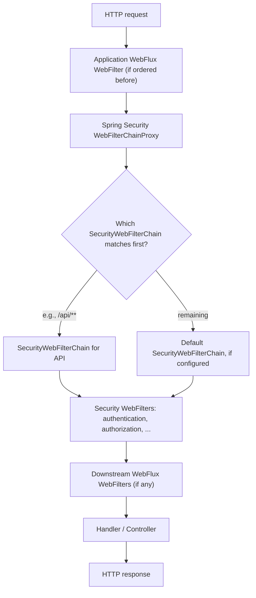

# Distinguishing Application WebFilters from Filters Inside a Security Chain (Spring Security Reactive)

In **Spring WebFlux**, `WebFilter` is an interface for handling HTTP requests reactively. Spring Security also uses `WebFilter` implementations for authentication, authorization, and request protection, but not every `WebFilter` is registered in the same place. You must distinguish **application-level filters** (which participate in WebFlux's general processing chain) from **internal filters of a `SecurityWebFilterChain`** (which run only when Spring Security selects the matching security chain).

This distinction answers common questions: Why does a filter run even for public paths? Why does a security filter not run for a certain API? Why does adding `@Component` cause a filter to be invoked twice? Why does `@Order` not substitute for `SecurityWebFiltersOrder`?

## 1. Components and Boundaries to Understand

| Component | Reactive Type / API | Role |
| --- | --- | --- |
| WebFlux `WebFilter` | `org.springframework.web.server.WebFilter` | A link in the HTTP processing flow, with method `Mono<Void> filter(ServerWebExchange, WebFilterChain)` |
| `WebFilterChain` | `org.springframework.web.server.WebFilterChain` | Calls `chain.filter(exchange)` to hand control to the next WebFlux link |
| `WebFilterChainProxy` | `org.springframework.security.web.server.WebFilterChainProxy` | A Spring Security **`WebFilter`** sitting at the boundary between WebFlux and security chains |
| `SecurityWebFilterChain` | `org.springframework.security.web.server.SecurityWebFilterChain` | Defines the request-matching condition and the security WebFilters to execute |
| `ServerHttpSecurity` | `org.springframework.security.config.web.server.ServerHttpSecurity` | DSL for creating/configuring `SecurityWebFilterChain` |
| `SecurityWebFiltersOrder` | `org.springframework.security.config.web.server.SecurityWebFiltersOrder` | Ordering positions **inside** a security chain |
| `ReactiveSecurityContextHolder` | `org.springframework.security.core.context.ReactiveSecurityContextHolder` | Accesses `SecurityContext` via Reactor Context in a reactive flow |

`SecurityWebFilterChain` **is not synonymous** with `WebFilterChain`. The former describes a conditional set of security filters; the latter is WebFlux's mechanism for continuing request processing. Filters located *inside* a `SecurityWebFilterChain` still typically implement the same `WebFilter` interface, but they are orchestrated by Spring Security in a nested layer.

### Visualizing the Nested Chain



This is a conceptual model, not a fixed list of every filter: the number, order, and behavior of security filters depend on configuration. A filter can **halt** the flow by not calling `chain.filter(exchange)`; in that case, downstream links (including the controller) may not run. Application `WebFilter` instances can also be ordered **after** the proxy, so do not assume all of them always run before Spring Security.

## 2. What Is an Application WebFilter?

An application-level filter is usually discovered by Spring as a `WebFilter` bean, such as a `@Component` class or a `@Bean` returning `WebFilter`. It joins the **general WebFlux chain** and can apply to many requests, depending on conditions the filter sets itself and its position in the chain.

Typical uses:

- Attaching a request ID, measuring processing time, counting requests, or writing technical logs.
- Normalizing metadata unrelated to access-control decisions.
- Short-circuiting requests early based on general infrastructure rules if genuinely needed, with an explicit policy and without replacing security mechanisms.

Example of a filter recording start/end timing:

```java
package demo.filters;

import org.springframework.core.Ordered;
import org.springframework.core.annotation.Order;
import org.springframework.stereotype.Component;
import org.springframework.web.server.ServerWebExchange;
import org.springframework.web.server.WebFilter;
import org.springframework.web.server.WebFilterChain;
import reactor.core.publisher.Mono;

@Component
@Order(Ordered.HIGHEST_PRECEDENCE)
public class RequestTraceWebFilter implements WebFilter {
    @Override
    public Mono<Void> filter(ServerWebExchange exchange, WebFilterChain chain) {
        String path = exchange.getRequest().getPath().value();

        return Mono.defer(() -> {
            System.out.println("APP enter " + path);
            return chain.filter(exchange)
                .doFinally(signal -> System.out.println(
                    "APP exit " + path + " (" + signal + ")"));
        });
    }
}
```

This class can be saved as `RequestTraceWebFilter.java` in a Spring Boot WebFlux project that has package `demo.filters`. `@Component` puts it in WebFlux's bean list; `@Order` sets its priority **within the order of application-level WebFilters**. `Mono.defer` defers side effects until subscription, while `doFinally` helps record completion, error, or cancellation.

Do not rely on `doFinally` to modify the HTTP response because the response may already be committed. This filter also **does not authenticate** who is calling the API, even though it can observe a request that Spring Security will subsequently deny.

## 3. What Is a Filter Inside a SecurityWebFilterChain?

Spring Security Reactive registers a `WebFilterChainProxy` in the WebFlux infrastructure. The proxy receives a request, finds a `SecurityWebFilterChain` matching the request, and coordinates the security `WebFilter` instances of the selected chain.

A `SecurityWebFilterChain` produced by `ServerHttpSecurity.build()` can contain steps for:

- HTTP protection: security headers, CSRF, CORS, or HTTPS redirection, depending on configuration.
- Restoring/saving the security context and supporting authentication.
- HTTP Basic, form login, OAuth2 Resource Server, or other mechanisms if enabled.
- Security exception handling, 401/403 decisions, and permission checks (`authorizeExchange`).

**Not every filter in the list above is always present**: they are enabled/disabled and positioned according to the specific configuration. Using `pathMatchers("/public/**").permitAll()` **does not skip the entire security chain**; it only allows the request at the authorization step, while other security filters can still run.

To add logic **belonging solely to the security chain**, use `ServerHttpSecurity` APIs:

```java
// Illustrative snippet inside the @Bean method that creates SecurityWebFilterChain.
WebFilter securityOnly = (exchange, chain) -> {
    System.out.println("SECURITY path="
        + exchange.getRequest().getPath().value());
    return chain.filter(exchange);
};

return http
    .authorizeExchange(exchanges -> exchanges
        .pathMatchers("/public/**").permitAll()
        .anyExchange().authenticated())
    .httpBasic(org.springframework.security.config.Customizer.withDefaults())
    .addFilterBefore(securityOnly, SecurityWebFiltersOrder.AUTHORIZATION)
    .build();
```

`SecurityWebFiltersOrder.AUTHORIZATION` marks the **position** to insert the filter relative to the authorization stage inside the security chain, not a global `@Order`. The code snippet above assumes the method already has `ServerHttpSecurity http` and imports `WebFilter`, `SecurityWebFiltersOrder`, and `SecurityWebFilterChain`. Note that the illustrative filter **does not perform authorization**; it merely indicates that a request reached that position.

`addFilterBefore`, `addFilterAfter`, and `addFilterAt` are all operations on the **SecurityWebFilterChain** being configured. If a mechanism already has a dedicated DSL (Basic, OAuth2, CORS, CSRF, authorization, etc.), prefer configuring it via the DSL rather than reimplementing full security behavior in a custom filter.

## 4. Quick Comparison of Three Ordering Types

| Mechanism | What does it order? | Practical Effect |
| --- | --- | --- |
| `@Order` / `Ordered` on an **application WebFilter** | WebFilters participating in the general WebFlux chain | Affects relative position between application filters and the security proxy |
| `@Order` on a **SecurityWebFilterChain** bean | Candidate security chains | The higher-priority chain is **checked for a match first** |
| `SecurityWebFiltersOrder` in `ServerHttpSecurity.addFilterBefore/After/At` | Filters **inside the selected security chain** | Determines relative position to security steps such as authentication/authorization |

Spring's ordering convention is **lower numbers have higher priority**. However, the three mechanisms operate over **three different scopes**. Putting `@Order(-100)` on an application WebFilter does not automatically place it before `AUTHORIZATION` inside every SecurityWebFilterChain. Using `SecurityWebFiltersOrder.AUTHORIZATION` likewise does not place that filter between two arbitrary global WebFilters.

If a filter needs **authenticated** user information, do not choose its position merely by guessing an order number to assume the context is ready. Place the logic inside the security chain or an appropriate security extension point, and verify with tests for each authentication mechanism.

## 5. Complete Example in a Spring Boot WebFlux Application

The example below uses **Java 17+**, Spring Boot 3.x / Spring Security 6.x, and has four classes. Add these two starters to the Gradle configuration of an **existing Spring Boot project**:

```groovy
dependencies {
    implementation 'org.springframework.boot:spring-boot-starter-webflux'
    implementation 'org.springframework.boot:spring-boot-starter-security'
}
```

Do not add `spring-boot-starter-web` for this example: this sample demonstrates reactive WebFlux mechanics, not servlet MVC. Gradle plugins, repositories, Spring Boot version, and toolchain use your project's existing setup. Place the files under `src/main/java/demo/filters/`.

**File 1 — `FilterDemoApplication.java`:**

```java
package demo.filters;

import org.springframework.boot.SpringApplication;
import org.springframework.boot.autoconfigure.SpringBootApplication;

@SpringBootApplication
public class FilterDemoApplication {
    public static void main(String[] args) {
        SpringApplication.run(FilterDemoApplication.class, args);
    }
}
```

**File 2 — `RequestTraceWebFilter.java`:** use the complete class from section 2 verbatim. Because it has `@Component`, it is registered at the general WebFlux layer; do not also register it via `ServerHttpSecurity`.

**File 3 — `SecurityConfig.java`:**

```java
package demo.filters;

import org.springframework.context.annotation.Bean;
import org.springframework.context.annotation.Configuration;
import org.springframework.security.config.Customizer;
import org.springframework.security.config.annotation.web.reactive.EnableWebFluxSecurity;
import org.springframework.security.config.web.server.SecurityWebFiltersOrder;
import org.springframework.security.config.web.server.ServerHttpSecurity;
import org.springframework.security.core.userdetails.User;
import org.springframework.security.core.userdetails.UserDetails;
import org.springframework.security.provisioning.MapReactiveUserDetailsService;
import org.springframework.security.web.server.SecurityWebFilterChain;
import org.springframework.web.server.WebFilter;

@Configuration
@EnableWebFluxSecurity
public class SecurityConfig {

    @Bean
    SecurityWebFilterChain securityWebFilterChain(ServerHttpSecurity http) {
        // No @Component/@Bean for securityOnly:
        // only register this instance inside the security chain.
        WebFilter securityOnly = (exchange, chain) -> {
            System.out.println("SECURITY filter "
                + exchange.getRequest().getPath().value());
            return chain.filter(exchange);
        };

        return http
            .authorizeExchange(exchanges -> exchanges
                .pathMatchers("/public/**").permitAll()
                .anyExchange().authenticated())
            .httpBasic(Customizer.withDefaults())
            .addFilterBefore(
                securityOnly, SecurityWebFiltersOrder.AUTHORIZATION)
            .build();
    }

    @Bean
    MapReactiveUserDetailsService reactiveUserDetailsService() {
        UserDetails user = User.withUsername("reader")
            .password("{noop}demo123")
            .roles("READER")
            .build();
        return new MapReactiveUserDetailsService(user);
    }
}
```

`{noop}` is a way to use **plaintext passwords only for demo lessons**. In real applications, store hashed passwords using an appropriate encoder or integrate a standard identity provider; never use these demo credentials in deployed environments.

**File 4 — `DemoController.java`:**

```java
package demo.filters;

import org.springframework.web.bind.annotation.GetMapping;
import org.springframework.web.bind.annotation.RestController;
import reactor.core.publisher.Mono;

@RestController
public class DemoController {
    @GetMapping("/public/ping")
    public Mono<String> ping() {
        return Mono.just("pong");
    }

    @GetMapping("/private/data")
    public Mono<String> privateData() {
        return Mono.just("private");
    }
}
```

Run with `./gradlew bootRun` (Linux/macOS) or `gradlew.bat bootRun` (Windows) from the project directory configured with the Spring Boot plugin. Test with commands:

```bash
curl -i http://localhost:8080/public/ping
curl -i http://localhost:8080/private/data
curl -i -u reader:demo123 http://localhost:8080/private/data
```

HTTP results to observe:

| Call | Expected Status | Body / Meaning |
| --- | --- | --- |
| `GET /public/ping`, no credentials | `200 OK` | `pong`, due to the `permitAll` rule |
| `GET /private/data`, no credentials | `401 Unauthorized` | Blocked before controller due to authentication requirement |
| `GET /private/data`, valid Basic credentials | `200 OK` | `private`, passed both authentication and authorization |

The `APP enter ...`/`APP exit ...` messages show the application filter running across the request lifecycle. The `SECURITY filter ...` message shows the **filter added to the security chain** running near `AUTHORIZATION`. Do not compare log line ordering across **concurrent** requests to infer ordering rules; they can interleave. Because the example uses a default security chain matching all requests, `/public/ping` still passes through the security filter.

This example intentionally uses a simple Basic mechanism to show execution flow. In real systems, 401/403 responses, session behavior, CSRF, CORS, matchers, and other filters also depend on the specific security configuration.

## 6. Multiple SecurityWebFilterChains: Scope Is Unlike Application WebFilters

An application can separate API and web security rules. Spring Security selects **the single first matching chain** by priority order, rather than merging all matching `SecurityWebFilterChain` instances. Use `securityMatcher` to restrict each chain's scope.

```java
// The following @Bean methods REPLACE the
// securityWebFilterChain method in the previous example; do not declare both simultaneously.

@Bean
@Order(0)
SecurityWebFilterChain apiChain(ServerHttpSecurity http) {
    return http
        .securityMatcher(
            new PathPatternParserServerWebExchangeMatcher("/api/**"))
        .authorizeExchange(ex -> ex
            .anyExchange().authenticated())
        .httpBasic(Customizer.withDefaults())
        .build();
}

@Bean
@Order(1)
SecurityWebFilterChain fallbackChain(ServerHttpSecurity http) {
    return http
        .authorizeExchange(ex -> ex
            .pathMatchers("/public/**").permitAll()
            .anyExchange().authenticated())
        .httpBasic(Customizer.withDefaults())
        .build();
}
```

This is an **illustrative configuration snippet**, placed in a `@Configuration` class with imports for `@Bean`, `@Order`, `SecurityWebFilterChain`, `ServerHttpSecurity`, `PathPatternParserServerWebExchangeMatcher`, and `Customizer`. Keep `ReactiveUserDetailsService` or another authentication mechanism when running.

For `GET /api/orders`, `apiChain` matches and `fallbackChain`'s filters are **not** combined in. For `GET /public/ping`, `apiChain` does not match, so `fallbackChain` handles it. `RequestTraceWebFilter` as a `@Component` remains in the general WebFlux chain and can observe **both paths**.

Each chain can have different filters, authentication mechanisms, and authorization rules. Place specific chains before broad ones; if a catch-all chain comes first, narrower chains behind it may never be selected. Configure a fallback proactively so paths do not accidentally fall outside intended chains.

**Three easily confused concepts:**

1. `securityMatcher("/api/**")`: decides **whether to select this chain** for the request.
2. `authorizeExchange().pathMatchers("/public/**").permitAll()`: decides **whether to allow the request** at the authorization step inside the selected chain.
3. `@Order` on `SecurityWebFilterChain`: decides **which matcher is tested first** when multiple chains exist.

`permitAll` does not mean disabling optional authentication or bypassing security filters; nor does it guarantee an application filter runs before Spring Security evaluates the request.

## 7. Security Context and Reactive Boundaries

Spring Security Reactive stores/propagates security info via the subscription's **Reactor Context**. This differs from calling `ThreadLocal`-based `SecurityContextHolder.getContext()` as familiar in Spring Security Servlet.

To read the username in code **currently inside a reactive flow**, you can do:

```java
// Illustrative snippet inside an integrated reactive component.
Mono<String> currentUserName =
    ReactiveSecurityContextHolder.getContext()
        .flatMap(ctx ->
            Mono.justOrEmpty(ctx.getAuthentication()))
        .map(Authentication::getName)
        .defaultIfEmpty("anonymous");
```

You need to import `org.springframework.security.core.context.ReactiveSecurityContextHolder`, `org.springframework.security.core.Authentication`, and `reactor.core.publisher.Mono`. The `anonymous` value is the example's fallback and does not assert that Spring Security always creates an authentication with that name.

An application WebFilter running **before** `WebFilterChainProxy` should not assume the context has already been populated, because the security chain steps may not have occurred yet. Even when an application WebFilter runs after the proxy, you still need to consider the authentication mechanism, request state, and actual execution path. If functionality **makes access decisions by user**, use proper reactive extension points (e.g., `ReactiveAuthorizationManager`, `ReactiveAuthenticationManager`, `ServerAuthenticationConverter`) or a filter deliberately placed inside the security chain.

Important rules:

- Return `Mono`/`Flux` so Spring WebFlux and Spring Security manage subscription, errors, and cancellation.
- Never call `.block()` or `Thread.sleep()` on the event loop, especially in a filter handling every request.
- Do not call `.subscribe()` yourself inside a filter to "run an extra check"; the result may be detached from the returned flow and fail to block the request.
- When propagating request data like trace IDs, prefer Reactor Context or compatible context propagation mechanisms. Do not treat `ThreadLocal` as a reliable security context across all schedulers.

## 8. Common Registration Mistakes and Fixes

### 8.1. A Filter Running Twice

Confusing example:

```java
@Component
public class MyAuditFilter implements WebFilter {
    // ...
}

// In security configuration:
http.addFilterBefore(myAuditFilter, SecurityWebFiltersOrder.AUTHORIZATION);
```

This is **buggy illustrative code**: `MyAuditFilter` is both a WebFilter bean discovered by WebFlux and added again to the security chain. Depending on matching conditions and order, the same request can pass through that logic twice. Typical fix: if filtering is needed only inside the security chain, instantiate an object that is **not** auto-registered as a global `WebFilter`, such as `new MyAuditFilter(dependency)` with `dependency` injected into the security configuration. If an application filter is needed, register it only via WebFlux and do not add it via `ServerHttpSecurity`.

Be careful: **Servlet `FilterRegistrationBean`** rules are not the direct mechanism to apply to WebFlux `WebFilter` instances. These are two different registration systems.

### 8.2. Setting `@Order` Yet the Filter Still Runs at the Wrong Security Step

`@Order` on an application `WebFilter` takes effect in the general chain; it does not substitute for `addFilterBefore/After(..., SecurityWebFiltersOrder...)`. To run filter logic only after authentication or before authorization, configure its position **inside the security chain** and verify the actual behavior. Conversely, `SecurityWebFiltersOrder` does not control all application filters.

### 8.3. Using the Wrong Servlet APIs for WebFlux

`jakarta.servlet.Filter`, `OncePerRequestFilter`, `HttpSecurity`, `SecurityFilterChain`, and `FilterChainProxy` belong to the **Servlet** stack. This lesson uses `org.springframework.web.server.WebFilter`, `ServerHttpSecurity`, `SecurityWebFilterChain`, and `WebFilterChainProxy` from the **Reactive** stack. Similar class names do not mean identical mechanics.

### 8.4. Logging/Metrics Filter Accidentally Blocking Requests

Putting synchronous JDBC, synchronous HTTP client calls, large file reads, `.block()`, or heavy CPU work directly into `WebFilter.filter()` can block the event loop. If blocking APIs cannot yet be replaced, isolate synchronous sources with `Mono.fromCallable(...).subscribeOn(Schedulers.boundedElastic())` and control load; do not turn a logging filter into a place doing heavy work on every request.

### 8.5. Thinking `permitAll()` Prevents Security Filters from Running

`permitAll` is an **authorization decision**. To check which chain was actually selected and which filters were invoked, inspect `securityMatcher`, chain ordering, and Spring Security logs. A request to a public endpoint may still pass through CSRF/CORS, context, Basic authentication filters, or other filters depending on configuration.

### 8.6. Handling 401/403 Directly in an Application Filter

A global WebFilter that returns a response without calling `chain.filter(exchange)` can bypass all downstream steps, including Spring Security if positioned before the proxy. For authentication/authorization errors, prefer handlers/entry points/authorization mechanisms provided by Spring Security. Do not use a general infrastructure filter to replace the entire security policy.

## 9. Diagnosing Along a Request's Path

When a filter "does not run" or "runs too many times", verify step by step:

1. **Filter kind:** WebFlux-level `WebFilter` bean, filter attached to `ServerHttpSecurity`, or both?
2. **Scope:** are you using `securityMatcher` to select the chain or `pathMatchers` to decide authorization inside a chain?
3. **Ordering:** WebFlux order, `SecurityWebFilterChain` order, or `SecurityWebFiltersOrder` position?
4. **Stop points:** did an earlier filter call `chain.filter(exchange)`? Was it stopped by CSRF, authentication, authorization, or an already completed response?
5. **Context:** are you inside a subscription carrying the security context? Was there a manual `subscribe()` or callback switch that lost context?
6. **Latency:** is there a blocking call on the event loop or excessive synchronous logging in a filter applied to every request?

You can enable logging in development:

```properties
logging.level.org.springframework.security=DEBUG
```

Depending on the version, you can increase to `TRACE` for deeper investigation. Enable only the necessary detail level, take care to protect sensitive data in logs, and turn off verbose logging when no longer needed. Placing a single clearly named log entry in the application WebFilter and custom security filter gives a more accurate view of the path than guessing from HTTP status codes.

Use `WebTestClient` to test public requests, unauthenticated requests, authenticated requests, and routes hitting specific chains. With multiple chains, test at least one request per matcher and one request matching only the fallback; with a counting filter, verify invocation counts to catch duplicate registration.

## 10. Self-Check Scenarios

**Scenario A.** An application has `RequestTraceWebFilter` as a `@Component`, while `/api/**` is protected by `apiChain`. Can a `GET /public/ping` request pass through `RequestTraceWebFilter`?

Yes. An application filter belongs to the general WebFlux chain and does not depend on `apiChain`'s `/api/**` matcher. It can still run if the request flow reaches its position, even if another security chain handles `/public/ping`.

**Scenario B.** A `WebFilter` is added via `http.addFilterBefore(custom, SecurityWebFiltersOrder.AUTHORIZATION)` and `/api/orders` is called. If the chain containing that filter does not match, does the filter run?

Not through **that security chain**. Spring Security only uses filters from the selected chain. If the same object was also accidentally registered as a `@Component WebFilter`, it can still run via the general WebFlux path; that is the root cause of unintended executions.

**Scenario C.** Why do `@Order(0)` on `apiChain` and `@Order(0)` on an application WebFilter not share the same meaning?

Because the first determines **security chain selection priority**, whereas the second determines **WebFilter position in WebFlux**. Having the same number does not put two elements into the same sorted list.

**Scenario D.** A `permitAll` endpoint still logs `SECURITY filter`. Is there a security bug?

Not necessarily. `permitAll` permits access at the authorization step; security filters can still execute. Check your security matchers and filter positions instead of treating `permitAll` as "skip Spring Security".

## Key Takeaways

- **Application WebFilters** are managed by WebFlux in the general processing chain; suited for infrastructure tasks independent of access control.
- **Security WebFilters** are managed by Spring Security inside `SecurityWebFilterChain`; their scope depends on the selected chain and security configuration.
- `WebFilterChainProxy` is the **bridge** between the two layers; `SecurityWebFilterChain` describes a condition and a list of filters, not WebFlux's `WebFilterChain`.
- Distinguish the three orders: application WebFilter `@Order`, security chain `@Order`, and `SecurityWebFiltersOrder` inside a chain.
- Avoid registering a single `WebFilter` both as a global `@Component` and through `ServerHttpSecurity`; ensure filters return `chain.filter(...)` when downstream steps should continue.
- Test with real requests: public routes, authenticated routes, multiple chains, and denied scenarios.

### Official References

- [Spring Security — WebFlux Security and Multiple Chains](https://docs.spring.io/spring-security/reference/6.5/reactive/configuration/webflux.html)
- [Spring Security — WebFilterChainProxy (Reactive API)](https://docs.spring.io/spring-security/reference/6.5/api/java/org/springframework/security/web/server/WebFilterChainProxy.html)
- [Spring Security — ServerHttpSecurity (Reactive API)](https://docs.spring.io/spring-security/reference/6.5/api/java/org/springframework/security/config/web/server/ServerHttpSecurity.html)
