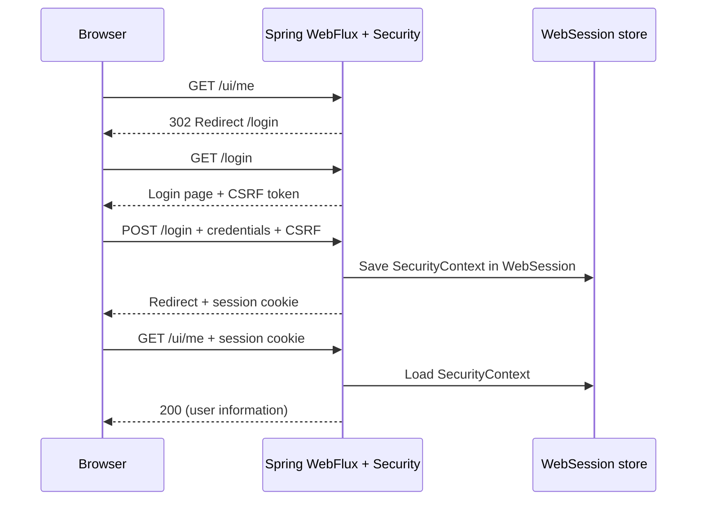
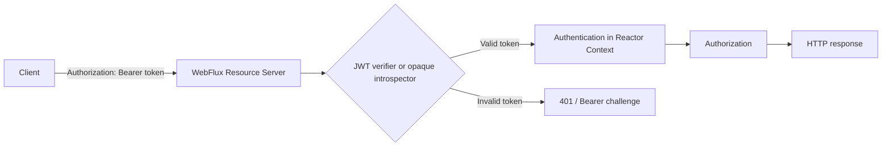

# Enabling or Disabling Each Mechanism for Session and Token Models in Spring Security Reactive

A **Spring WebFlux** application can serve browsers logging in with a **session**, APIs called with a **bearer token**, or both. Spring Security Reactive lets you enable/disable authentication and HTTP protection mechanisms using `ServerHttpSecurity` per `SecurityWebFilterChain`. Configuring this properly is not just picking `formLogin()` or `oauth2ResourceServer()`: you must also understand where `SecurityContext` is stored, logout mechanics, CSRF, request cache, how security chains are selected, and how browsers send credentials.

Lesson goals:

1. Distinguish session cookies from access tokens sent via the `Authorization` header.
2. Choose **enable/disable mechanisms** based on how clients send credentials and business requirements.
3. Write Spring Security **WebFlux/Reactive** configurations in Java 17+.
4. Understand why `csrf().disable()` or `NoOpServerSecurityContextRepository` does not automatically mean "the API is secure and stateless".
5. Verify 200, 302, 401, 403 scenarios and common configuration mistakes.

> Scope: Spring Boot 3.x / Spring Security 6.x with **Spring WebFlux**, using `ServerHttpSecurity`, `SecurityWebFilterChain`, `WebSession`, and Reactor Context. `HttpSecurity`, `SecurityFilterChain`, `HttpSession`, and `SessionCreationPolicy.STATELESS` belong to the **Servlet** model and must not be copied directly into WebFlux examples.

## 1. Two authentication models that operate differently

### Model A — Server-side login session

A browser submits login credentials via a form or interactive login flow. After successful authentication, the system can store `SecurityContext` in `WebSession`. The browser holds a **session identifier cookie**; subsequent requests automatically send the matching cookie and the server loads the saved context.



This is the common interactive model for websites with login pages, logout, post-login redirects to the previous page, or server-side apps. Authentication cookies are automatically attached by browsers according to domain/path/SameSite rules, so **CSRF** must be analyzed. `WebSession` here belongs to WebFlux; it is not the same as Servlet's `HttpSession`. A session store may need to be shared across instances in multi-node deployments.

### Model B — API receiving a bearer access token

The client obtains an access token from a trusted token-issuing system, then sends it on **every request**:

```http
GET /api/me HTTP/1.1
Host: api.example.test
Authorization: Bearer <access-token>
```

The resource server validates the token, builds an `Authentication` for the current request, and decides access permissions. With JWT, the system typically checks signature, expiration (`exp`, `nbf`), issuer (`iss`), and extra constraints such as audience (`aud`) when required. With an **opaque token**, the server may need to query an introspection endpoint to evaluate the token.



In a pure bearer model, there is no need to save the authenticated identity in a session for the next request, since the next request carries a fresh/valid token. However, **token does not necessarily mean JWT**, **JWT does not mean every part of the app is stateless**, and access still depends on scopes/roles/authorization policies.

### Initial decision table

| Question | Session-based Web UI | Pure bearer-token API |
| --- | --- | --- |
| Client sends credentials | Session cookie automatically travels with requests | `Authorization: Bearer ...` header explicitly sent by client |
| Where login state lives | `WebSession` and session store | Token validated per request; no auth session needed |
| Interactive login | `formLogin` or `oauth2Login` | At the authorization server/identity provider, not a resource-server login form |
| API authentication | Usually reuses existing session | `oauth2ResourceServer().jwt(...)` or `.opaqueToken(...)` |
| CSRF | Usually must **stay enabled** | Can be disabled **if** not relying on auto-sent cookie/browser credentials |
| Logout | Invalidate/close session and context properly | Client discards token; issued tokens may remain valid until expiry or revocation |
| Request cache/post-login redirect | Can be useful | Usually unnecessary and should be disabled for clear API errors |
| Security headers, TLS, authorization | Still required | Still required |

## 2. What does each `ServerHttpSecurity` mechanism protect?

Do not toggle mechanisms by the trick "turn everything off to make the API work". Identify which risk or flow each solves:

| Mechanism | Session-based Web UI | Bearer-header-only API | Common Spring Security 6.x config |
| --- | --- | --- | --- |
| `authorizeExchange` | **Enabled**: restrict routes and roles | **Enabled**: restrict routes and scopes | `.authorizeExchange(ex -> ex.anyExchange().authenticated())` |
| `formLogin` | **Enabled** for form-based login | **Disabled** | `.formLogin(withDefaults())` / `.formLogin(form -> form.disable())` |
| `httpBasic` | Enable only if HTTP Basic is genuinely desired | **Disabled** for bearer-only APIs | `.httpBasic(basic -> basic.disable())` |
| `oauth2Login` | Enable for user login via OAuth2/OIDC | Not resource-server validation | `.oauth2Login(withDefaults())` or `login -> login.disable()` |
| `oauth2ResourceServer` | Enable only if web chain also accepts bearer | **Enabled** JWT or opaque | `.oauth2ResourceServer(o -> o.jwt(withDefaults()))` |
| `securityContextRepository` | WebSession when persisting context | NoOp for API context | `WebSessionServerSecurityContextRepository` / `NoOpServerSecurityContextRepository` |
| `csrf` | **Keep enabled** for form/cookie credentials | Disable only after proving no auto-sent auth | `.csrf(withDefaults())` / `.csrf(csrf -> csrf.disable())` |
| `logout` | **Enabled** and keep CSRF on POST logout | Disable if endpoint has no session login | `.logout(withDefaults())` / `.logout(logout -> logout.disable())` |
| `requestCache` | Useful for redirecting back to requested URL | Usually disabled | `.requestCache(cache -> cache.disable())` |
| `headers` | Keep appropriate security headers | Keep appropriate security headers | Configured by default; adjust purposefully |
| `cors` | Depends on cross-origin access | Often needed when browsers call cross-origin APIs | Configure valid origins; CORS does not replace auth/CSRF |

`withDefaults()` in the table is `org.springframework.security.config.Customizer.withDefaults()`. Lambda `disable()` calls are the modern style for Spring Security 6.x; avoid chaining `.formLogin().disable().and()` which is deprecated in 6.x.

**Three things never to equate:**

- `permitAll()` permits an endpoint at the authorization step; it **does not turn off** the whole security chain and does not exempt the request from CSRF.
- `securityContextRepository(NoOpServerSecurityContextRepository.getInstance())` defines how `ReactorContextWebFilter` loads context; **saving** context can also be configured per authentication filter (such as `formLogin`). Calling this line alone **is not enough** to prove the whole system uses no sessions.
- `csrf.disable()` only removes one CSRF defense layer; it **does not** create bearer handling, token validation, or scope checks.

## 3. CSRF: base it on how browsers send credentials, not on "REST" or "JWT" labels

CSRF happens when a victim's browser **automatically sends** credentials that another website can exploit to trigger a state-changing request. Session cookies are the classic case. Browser-cached HTTP Basic or **access tokens stored in cookies** can also carry CSRF risk. Using JSON or REST does not eliminate that risk.

For web forms/sessions, keep CSRF protection on state-changing HTTP methods (POST/PUT/PATCH/DELETE per policy). Spring Security Reactive enables CSRF by default; tokens are expected to be stored in `WebSession` via `WebSessionServerCsrfTokenRepository` under default configuration. For login and logout forms, the CSRF token must be submitted properly. Spring Security's default generated login page provides the required flow; custom forms must integrate the CSRF token with the right field/header name.

The form request example is **illustrative**; the token must come from the current session rather than being hardcoded:

```http
POST /login HTTP/1.1
Content-Type: application/x-www-form-urlencoded
Cookie: SESSION=<session-id>

username=reader&password=demo123&_csrf=<token-from-current-session>
```

For an API using an `Authorization: Bearer` header **explicitly set by the client** without cookies/sessions for authentication, disabling CSRF on **that API's dedicated security chain** is usually reasonable because a foreign website cannot arbitrarily attach a user's bearer token header. Still, you must control CORS, XSS, token storage, and credential transport.

If an SPA stores a JWT in a cookie and the browser attaches that cookie automatically, **do not** cite "using JWT" as a reason to disable CSRF. Whenever cookie authentication is involved, re-evaluate CSRF, SameSite, Secure, HttpOnly, and origin policies.

## 4. Session configuration: enabling form login, CSRF, and context storage

The complete example below uses Spring Boot 3.x, Java 17+, and Spring Security 6.x. This is a **standalone configuration** for a session-based website; the token examples later are an alternative approach—do not place multiple global configurations side by side without explicit matchers.

File `SessionSecurityConfig.java`:

```java
package demo.security;

import org.springframework.context.annotation.Bean;
import org.springframework.context.annotation.Configuration;
import org.springframework.security.config.Customizer;
import org.springframework.security.config.annotation.web.reactive.EnableWebFluxSecurity;
import org.springframework.security.config.web.server.ServerHttpSecurity;
import org.springframework.security.core.userdetails.ReactiveUserDetailsService;
import org.springframework.security.core.userdetails.User;
import org.springframework.security.core.userdetails.UserDetails;
import org.springframework.security.crypto.factory.PasswordEncoderFactories;
import org.springframework.security.crypto.password.PasswordEncoder;
import org.springframework.security.provisioning.MapReactiveUserDetailsService;
import org.springframework.security.web.server.SecurityWebFilterChain;
import org.springframework.security.web.server.context.WebSessionServerSecurityContextRepository;

@Configuration
@EnableWebFluxSecurity
public class SessionSecurityConfig {
    @Bean
    SecurityWebFilterChain browserChain(ServerHttpSecurity http) {
        var contextRepository =
            new WebSessionServerSecurityContextRepository();

        return http
            .authorizeExchange(exchanges -> exchanges
                .pathMatchers("/public/**", "/login").permitAll()
                .anyExchange().authenticated())
            .securityContextRepository(contextRepository)
            .formLogin(form ->
                form.securityContextRepository(contextRepository))
            .httpBasic(basic -> basic.disable())
            .csrf(Customizer.withDefaults())
            .logout(Customizer.withDefaults())
            .build();
    }

    @Bean
    ReactiveUserDetailsService demoUsers() {
        PasswordEncoder encoder =
            PasswordEncoderFactories.createDelegatingPasswordEncoder();
        UserDetails reader = User.withUsername("reader")
            .password(encoder.encode("demo123"))
            .roles("READER")
            .build();
        return new MapReactiveUserDetailsService(reader);
    }
}
```

Explanation following actual runtime flow:

1. `authorizeExchange` opens `/public/**` and `/login`, requiring authentication for other paths. The `permitAll` rule does not bypass CSRF for state-changing methods.
2. `formLogin` enables interactive login handling, typically paired with Spring Security's generated login page if no custom page exists.
3. `WebSessionServerSecurityContextRepository` loads context via `ReactorContextWebFilter`; setting the **same repository** on `FormLoginSpec` ensures form login saves the authentication result where later requests can load it.
4. `httpBasic(...disable())` makes clear this app prioritizes form/session and does not want HTTP Basic prompts.
5. `csrf(withDefaults())` protects CSRF-vulnerable operations; `logout(withDefaults())` provides secure logout handling rather than merely clearing a client cookie.
6. `MapReactiveUserDetailsService` and the `reader` account are **local demo** setup; in production, use a trusted account store, password policy, and appropriate MFA/SSO. Even encoded, demo passwords must not be used in production.

For browser login with OAuth2/OIDC instead of traditional forms, configure `oauth2Login(Customizer.withDefaults())` with a `ReactiveClientRegistrationRepository`/client registration; then design sessions, OAuth2 authorization requests, and redirect callbacks appropriately. `oauth2Login` handles **user login**, unlike `oauth2ResourceServer` which **validates access tokens on incoming API requests**. Do not enable both indiscriminately just because the API uses OAuth2.

### HTTP experience of the session model

- `GET /public/status` → handled publicly if the controller defines the route.
- `GET /ui/me` unauthenticated → usually `302` to `/login` when form login is the entry point.
- Browser visits `/login`, logs in validly → redirected back appropriately; subsequent requests carry the session cookie.
- `POST /logout` must follow the enabled logout and CSRF flow.
- Session cookie expires/is revoked → next request requires re-authentication.

Exact redirect behavior also depends on `ServerAuthenticationEntryPoint`, request cache, and app configuration. Do not try to force browser login to return `401` for every HTML request or treat `302` as a bug when you see it.

## 5. Token-only configuration: enable resource server, disable unneeded login/session features

A WebFlux resource server accepting **JWT bearer** tokens differs completely from the form-login flow. Below is a configuration **independent** of `SessionSecurityConfig`; in an API-only app, replace the session configuration with this one.

File `TokenSecurityConfig.java`:

```java
package demo.security;

import org.springframework.context.annotation.Bean;
import org.springframework.context.annotation.Configuration;
import org.springframework.security.config.Customizer;
import org.springframework.security.config.annotation.web.reactive.EnableWebFluxSecurity;
import org.springframework.security.config.web.server.ServerHttpSecurity;
import org.springframework.security.web.server.SecurityWebFilterChain;
import org.springframework.security.web.server.context.NoOpServerSecurityContextRepository;

@Configuration
@EnableWebFluxSecurity
public class TokenSecurityConfig {
    @Bean
    SecurityWebFilterChain apiChain(ServerHttpSecurity http) {
        return http
            .authorizeExchange(exchanges -> exchanges
                .pathMatchers("/api/public").permitAll()
                .anyExchange().authenticated())
            .securityContextRepository(
                NoOpServerSecurityContextRepository.getInstance())
            .formLogin(form -> form.disable())
            .httpBasic(basic -> basic.disable())
            .logout(logout -> logout.disable())
            .requestCache(cache -> cache.disable())
            .csrf(csrf -> csrf.disable())
            .oauth2ResourceServer(oauth2 ->
                oauth2.jwt(Customizer.withDefaults()))
            .build();
    }
}
```

With Spring Boot, add the **resource server** dependency and configure your organization's real issuer:

```groovy
dependencies {
    implementation 'org.springframework.boot:spring-boot-starter-webflux'
    implementation 'org.springframework.boot:spring-boot-starter-security'
    implementation 'org.springframework.boot:spring-boot-starter-oauth2-resource-server'
}
```

```yaml
# application.yml — replace the sample URI with a real issuer having valid metadata/JWK
spring:
  security:
    oauth2:
      resourceserver:
        jwt:
          issuer-uri: https://idp.example.test/real-issuer
```

**The URI above is only an illustrative placeholder**, providing no authentication service. To validate tokens properly, the resource server must reach a real issuer/JWK and receive access tokens with valid signatures, lifetimes, and issuers. Depending on security requirements, also configure **audience**, trusted issuers, signature algorithms, scope/role mapping, and key rotation handling. Spring Security does not automatically enforce every business rule just because `issuer-uri` is declared.

Why the choices in `TokenSecurityConfig` fit a bearer-only API:

- **Enable `oauth2ResourceServer().jwt()`** to extract and validate JWT bearer tokens from requests.
- **Disable `formLogin` and HTTP Basic** so password auth or browser-style redirects are not accidentally accepted.
- **Do not load context from session** via `NoOpServerSecurityContextRepository`. Authentication filters must also store context appropriately; bearer resource servers by default do not persist authentication into sessions for later requests.
- **Disable `logout`** because a session logout endpoint makes no sense for already-issued access tokens. Token revocation (if supported) is a separate workflow.
- **Disable `requestCache`** so the API does not save requests prior to login redirects.
- **Disable CSRF only under an explicit assumption**: the API accepts bearer headers, not auto-sent cookies as credentials. If cookie auth is ever added later, re-evaluate this decision.
- **Keep authorization**: a valid token must still have permission to access the resource; add scope/role policies rather than leaving every route at `.authenticated()`.

Example JWT scope check commonly placed in authorization:

```java
// Illustrative snippet replacing the authorizeExchange section above.
.authorizeExchange(exchanges -> exchanges
    .pathMatchers("/api/public").permitAll()
    .pathMatchers("/api/admin/**").hasAuthority("SCOPE_admin")
    .anyExchange().authenticated())
```

The default resource server maps `scope`/`scp` claims in a JWT to authorities prefixed with `SCOPE_`. To pass `SCOPE_admin`, the token must carry that scope and be accepted by the decoder; this rule does not invent scopes.

**Opaque access tokens** require `oauth2.opaqueToken(...)` with introspection details; `jwt()` cannot interpret arbitrary string tokens. Do not enable both JWT and opaque token assuming Spring Security will guess the format without a clear design.

## 6. Same application: splitting `/api/**` (token) and web routes (session)

When one service serves both a browser UI and an API, separate them using **two `SecurityWebFilterChain` beans**. Spring Security evaluates security matchers by `@Order` and picks the first matching chain. Settings inside the API chain do not bleed into the web chain, and vice versa.

The code below is the primary **combined** example; use it **instead of** the two standalone configurations in sections 4 and 5. Do not keep all three `@Configuration` classes together, or you will create overlapping chains.

### 6.1. Dependencies, configuration, and files

In a Java 17+ Spring Boot project with the Gradle plugin and repositories already configured:

```groovy
dependencies {
    implementation 'org.springframework.boot:spring-boot-starter-webflux'
    implementation 'org.springframework.boot:spring-boot-starter-security'
    implementation 'org.springframework.boot:spring-boot-starter-oauth2-resource-server'
}
```

File `src/main/resources/application.yml`:

```yaml
server:
  port: 8080
spring:
  security:
    oauth2:
      resourceserver:
        jwt:
          # Must be replaced with a real issuer before testing valid Bearer JWTs
          issuer-uri: https://idp.example.test/real-issuer
```

File `src/main/java/demo/security/SecurityModeApplication.java`:

```java
package demo.security;

import org.springframework.boot.SpringApplication;
import org.springframework.boot.autoconfigure.SpringBootApplication;

@SpringBootApplication
public class SecurityModeApplication {
    public static void main(String[] args) {
        SpringApplication.run(SecurityModeApplication.class, args);
    }
}
```

File `src/main/java/demo/security/HybridSecurityConfig.java`:

```java
package demo.security;

import org.springframework.context.annotation.Bean;
import org.springframework.context.annotation.Configuration;
import org.springframework.core.annotation.Order;
import org.springframework.security.config.Customizer;
import org.springframework.security.config.annotation.web.reactive.EnableWebFluxSecurity;
import org.springframework.security.config.web.server.ServerHttpSecurity;
import org.springframework.security.core.userdetails.ReactiveUserDetailsService;
import org.springframework.security.core.userdetails.User;
import org.springframework.security.core.userdetails.UserDetails;
import org.springframework.security.crypto.factory.PasswordEncoderFactories;
import org.springframework.security.crypto.password.PasswordEncoder;
import org.springframework.security.provisioning.MapReactiveUserDetailsService;
import org.springframework.security.web.server.SecurityWebFilterChain;
import org.springframework.security.web.server.context.NoOpServerSecurityContextRepository;
import org.springframework.security.web.server.context.WebSessionServerSecurityContextRepository;
import org.springframework.security.web.server.util.matcher.PathPatternParserServerWebExchangeMatcher;

@Configuration
@EnableWebFluxSecurity
public class HybridSecurityConfig {

    @Bean
    @Order(0)
    SecurityWebFilterChain tokenApi(ServerHttpSecurity http) {
        return http
            .securityMatcher(
                new PathPatternParserServerWebExchangeMatcher("/api/**"))
            .authorizeExchange(exchanges -> exchanges
                .pathMatchers("/api/public").permitAll()
                .pathMatchers("/api/admin/**").hasAuthority("SCOPE_admin")
                .anyExchange().authenticated())
            .securityContextRepository(
                NoOpServerSecurityContextRepository.getInstance())
            .formLogin(form -> form.disable())
            .httpBasic(basic -> basic.disable())
            .logout(logout -> logout.disable())
            .requestCache(cache -> cache.disable())
            .csrf(csrf -> csrf.disable())
            .oauth2ResourceServer(oauth2 ->
                oauth2.jwt(Customizer.withDefaults()))
            .build();
    }

    @Bean
    @Order(1)
    SecurityWebFilterChain browser(ServerHttpSecurity http) {
        var contextRepository =
            new WebSessionServerSecurityContextRepository();

        return http
            .authorizeExchange(exchanges -> exchanges
                .pathMatchers("/public/**", "/login").permitAll()
                .anyExchange().authenticated())
            .securityContextRepository(contextRepository)
            .formLogin(form ->
                form.securityContextRepository(contextRepository))
            .httpBasic(basic -> basic.disable())
            .csrf(Customizer.withDefaults())
            .logout(Customizer.withDefaults())
            .build();
    }

    @Bean
    ReactiveUserDetailsService demoUsers() {
        PasswordEncoder encoder =
            PasswordEncoderFactories.createDelegatingPasswordEncoder();
        UserDetails reader = User.withUsername("reader")
            .password(encoder.encode("demo123"))
            .roles("READER")
            .build();
        return new MapReactiveUserDetailsService(reader);
    }
}
```

File `src/main/java/demo/security/DemoController.java`:

```java
package demo.security;

import org.springframework.security.core.context.ReactiveSecurityContextHolder;
import org.springframework.web.bind.annotation.GetMapping;
import org.springframework.web.bind.annotation.RestController;
import reactor.core.publisher.Mono;

@RestController
public class DemoController {

    @GetMapping("/public/status")
    public Mono<String> status() {
        return Mono.just("up");
    }

    @GetMapping("/api/public")
    public Mono<String> apiPublic() {
        return Mono.just("api-public");
    }

    @GetMapping("/ui/me")
    public Mono<String> uiIdentity() {
        return ReactiveSecurityContextHolder.getContext()
            .map(ctx -> "session:" + ctx.getAuthentication().getName());
    }

    @GetMapping("/api/me")
    public Mono<String> apiIdentity() {
        return ReactiveSecurityContextHolder.getContext()
            .map(ctx -> "token:" + ctx.getAuthentication().getName());
    }

    @GetMapping("/api/admin/report")
    public Mono<String> adminReport() {
        return Mono.just("admin-report");
    }
}
```

**Runnability:** The Java files above are standalone classes with full packages/imports for Spring Boot 3.x + Spring Security 6.x and Java 17+. They belong inside a **Spring Boot project properly configured with Gradle** and the starters listed above. **Successful** JWT validation depends on a real issuer and token; the `idp.example.test` URI must be replaced. Account `reader/demo123` is solely for experiencing local sessions, never for use outside learning environments.

### 6.2. Running and observing the right flows

Run from the Spring Boot project directory:

```bash
# Linux/macOS
./gradlew bootRun

# Windows
gradlew.bat bootRun
```

In the token-enabled example, configure a reachable issuer before testing tokens. If you do not have an IdP yet, the session/form part can be studied separately using `SessionSecurityConfig` from section 4 while omitting the resource-server starter and issuer config. Never treat a sample URI or fabricated token as valid authentication data.

Commands to test endpoints that do not need a token:

```bash
curl -i http://localhost:8080/public/status
curl -i http://localhost:8080/api/public
curl -i http://localhost:8080/ui/me
curl -i http://localhost:8080/api/me
curl -i -u reader:demo123 http://localhost:8080/api/me
```

On a properly configured system, expected **HTTP-semantic** results are:

| Test | Expected result | Explanation |
| --- | --- | --- |
| `GET /public/status` | `200`, body `up` | Web chain allows public route |
| `GET /api/public` | `200`, body `api-public` | API chain allows public route |
| `GET /ui/me` unauthenticated | Usually `302` to login | Web chain enables form login |
| `GET /api/me` without bearer | `401` | API chain requires bearer authentication |
| `GET /api/me` sending only HTTP Basic | `401` | API chain disabled HTTP Basic, does not accept passwords this way |
| Browser login `reader/demo123`, then `GET /ui/me` | `200`, body `session:reader` | Session persisted `SecurityContext` across requests |
| `GET /api/me` with valid JWT, right issuer | `200`, body starts with `token:` | Request authenticated from bearer token |
| `GET /api/admin/report` with valid JWT missing `admin` scope | `403` | Authenticated, yet lacks `SCOPE_admin` permission |

To test the UI session: open `http://localhost:8080/ui/me` in a browser, follow the redirect to the login page, enter the demo account, and visit `/ui/me` again. For JWT, obtain a **real access token** from your issuer and test:

```bash
curl -i \
  -H "Authorization: Bearer $ACCESS_TOKEN" \
  http://localhost:8080/api/me
```

`$ACCESS_TOKEN` is a shell variable used in Linux/macOS examples; in PowerShell use the corresponding variable syntax. Never print real tokens into logs, READMEs, or commits.

A token with a valid signature but wrong issuer or expired timestamp will be rejected. A valid token can still receive `403` if it lacks the matching scope/authority. Even a `permitAll` endpoint can reject a request carrying an **invalid** bearer token because the authentication filter validates submitted tokens before authorization runs.

### 6.3. Why doesn't the same session cookie automatically open `/api/me`?

`GET /api/me` matches `/api/**`, so Spring Security selects **`tokenApi` with `@Order(0)`** first. That chain uses bearer JWT, disabled form login, and does not load `SecurityContext` from `WebSession`. A browser session cookie obtained from `/ui/me` does not automatically authenticate the user on the API chain. Conversely, a bearer JWT on `/api/me` is not a browser login session for `/ui/me`.

This separates **authentication paths**, not merely controllers. Still, application `WebFilter`s outside the security chain can run on both paths, and other components can create `WebSession` independently, so never conclude "zero sessions anywhere in the JVM" from security config alone.

## 7. When choosing a model, remember client behavior too

### Browser with session

- Use `Secure`, `HttpOnly`, and `SameSite` cookies per deployment model, over HTTPS.
- Keep CSRF for state-changing actions; custom pages/forms must send real CSRF tokens.
- Choose an appropriate session store and timeout policy. Across multiple instances, consider a shared session store.
- Logout must terminate the session/`SecurityContext` properly, not merely delete a UI variable.
- Handle web redirects/logins intentionally; JS `fetch` callers may need to distinguish `302` from expected JSON API responses.

### Client using bearer access tokens

- Clients attach `Authorization: Bearer ...` on every request; do not embed fixed tokens in frontend code or URLs.
- Accept only trusted issuers/JWKs; verify signature, `exp`, `nbf`, issuer, audience, and scopes per policy.
- Use appropriately short-lived access tokens; refresh/revocation belongs to client/authorization-server flows.
- If browsers store tokens, avoid designs where XSS can easily steal them; if placed in cookies, re-evaluate CSRF.
- CORS must restrict allowed origins/methods/headers when browsers make cross-origin calls. CORS is not an authorization layer.
- Ensure every critical endpoint is protected by a matching chain and clear authorization policy.

### HTTP Basic is not bearer

`httpBasic` sends username/password in `Authorization: Basic ...`, whereas a resource server usually expects `Authorization: Bearer ...`. Those are **two different mechanisms**. A bearer-only API usually disables Basic to avoid accepting an unintended authentication path. Browsers can automatically resend cached Basic credentials, so do not disable CSRF by default just because there is no session cookie.

### OAuth2 Login is not OAuth2 Resource Server

`oauth2Login` takes **users** through OAuth2/OIDC login/redirect/callback, typically for session-based web apps. `oauth2ResourceServer` verifies **access tokens sent to an API**. `oauth2Client` helps an application **call external APIs** using client/delegated user access tokens. Enable only the features that serve your application's actual role.

## 8. Common configuration mistakes and how to spot them

**Mistake 1: Disabling CSRF globally so form POSTs stop returning 403.** This hides the symptom of a missing CSRF token. The right fix for web sessions is integrating the token into forms/headers and keeping CSRF; only consider disabling it on chains verified not to use browser auto-sent authentication.

**Mistake 2: Setting `NoOpServerSecurityContextRepository` alone and claiming statelessness.** The `ServerHttpSecurity`-level repository primarily governs loading `SecurityContext`; each authentication mechanism may have its own context-saving behavior. Review form login, OAuth2 login, HTTP Basic, custom authentication filters, and any other session-creating components. Never use `SessionCreationPolicy.STATELESS` in WebFlux configs because it belongs to Servlet.

**Mistake 3: Accidentally enabling form login on an API.** Unauthenticated API requests may receive HTML redirects instead of 401 Bearer challenges; the system could also accept an unintended login flow. Use dedicated security matchers and disable `formLogin` inside the API chain.

**Mistake 4: Disabling all security chains or using `anyExchange().permitAll()` upon seeing 401/403.** This can expose sensitive endpoints. Determine whether the error stems from a missing bearer token, invalid JWT, CSRF, matcher order, or missing authority; fix only the root cause.

**Mistake 5: Thinking `permitAll` skips token authentication.** A request to a public endpoint that actively sends a broken bearer token can still be rejected by the authentication filter. Distinguish "no token needed" from "bypass all filtering".

**Mistake 6: Using `@Order` wrongly or placing the general chain first.** If a catch-all fallback chain is evaluated first, a narrow API chain after it may never run. Give `/api/**` higher priority and test both matching and non-matching routes.

**Mistake 7: Using JWT without checking audience or scope.** A valid signature does not guarantee the token was issued for this resource server or that the user has permission for the endpoint. Configure proper validation, authority mapping, and granular rules.

**Mistake 8: Assuming the session logout endpoint revokes JWTs.** Invalidating a web session does not invalidate issued access tokens; account for token lifetimes, refresh tokens, revocation/introspection, or custom business controls.

**Mistake 9: Mixing HTTP Basic, form login, OAuth2 login, and bearer just because dependencies exist.** Each authentication path creates different behaviors, entry points, and risks. Define one expected model per request group and configure each chain explicitly.

**Mistake 10: Blocking the event loop during authentication.** Whether using sessions or tokens, `WebFilter`s, `ReactiveAuthenticationManager`s, and data access must follow non-blocking rules. JDBC, synchronous HTTP clients, `.block()`, or `Thread.sleep()` on the event loop can stall many requests. Use reactive APIs or isolate blocking calls in a controlled manner.

## 9. Minimum testing checklist

| Test | Session web chain | Token API chain |
| --- | --- | --- |
| Public page without credentials | 200 | 200 if route is truly `permitAll` |
| Protected page/endpoint without credentials | Redirect to login or configured entry point | 401 with appropriate Bearer challenge |
| Valid credentials | Login creates/uses session; next request uses cookie | JWT/opaque token validated on every request |
| Wrong/expired credentials | Login fails or session expires | 401 |
| Valid authentication, missing permission | 403 | 403 |
| POST missing CSRF token | Blocked if action is within CSRF scope | Policy-dependent; token-only headers typically skip CSRF |
| Logout | Session can no longer authenticate | No session logout; test token lifecycle separately |
| Session cookie sent to bearer API | Does not auto-authenticate API | API still requires bearer |
| Bearer sent to web session chain | Does not become form login/session | Effective only if web chain is configured for bearer |
| Request to route in another chain | Must not accidentally use wrong policy | Must not accidentally use wrong policy |

Use `WebTestClient` with reactive Spring Security test support to automate method, status, authentication, and CSRF tests. For JWT, mock JWTs/authorities in authorization tests, and keep dedicated integration tests for the real decoder/issuer/JWK. Enable `org.springframework.security=DEBUG` in test environments when verifying which chain was chosen; avoid logging tokens/credentials and avoid leaving DEBUG on in production.

## 10. Self-assessment questions

1. An SPA stores a JWT **in an HttpOnly cookie**. Can CSRF be disabled simply because the mechanism is called JWT?  
   **No.** Browsers can automatically send cookies, so CSRF risk remains; evaluate credential transport and CSRF defenses properly.

2. Can `.securityContextRepository(NoOpServerSecurityContextRepository.getInstance())` block every session creation in the application?  
   **No.** That setting controls the context-loading repository and does not stop all other filters or components from creating/storing sessions.

3. How do `formLogin` and `oauth2ResourceServer` differ?  
   `formLogin` authenticates users via the app's interactive login flow; `oauth2ResourceServer` validates access tokens sent by clients to the API.

4. An API call has a valid JWT but lacks `SCOPE_admin`, so it returns 403. Should `permitAll()` be used to fix it?  
   **No.** Inspect granted permissions, scope mapping, and policy; do not remove protective barriers.

5. An application has `/ui/**` using sessions and `/api/**` using JWT. How should it be configured?  
   Use `SecurityWebFilterChain` beans with explicit `securityMatcher` and `@Order`; each chain deliberately enables/disables the appropriate mechanisms.

## Takeaways

- **Session** is a server-side login-state model, typically using cookies and form/OAuth2 login; **bearer token** is a per-request credential, usually without saving authentication in a session.
- `ServerHttpSecurity` lets you choose mechanisms **per chain**: form login, HTTP Basic, OAuth2 login/resource server, CSRF, logout, request cache, security context repository, and authorization.
- **Keep CSRF** when browsers auto-send credentials (especially session cookies, tokens in cookies, or cached Basic). Disable only within an analyzed, safe scope.
- `NoOpServerSecurityContextRepository` **is not** a global switch guaranteeing everything is stateless; check how authentication filters save context as well.
- Bearer APIs typically return 401/403; web forms typically issue login redirects. Test public requests, wrong credentials, missing permissions, logout, and cross-chain routes.

### Official references

- [Spring Security 6.5 — WebFlux Security & Multiple Chains](https://docs.spring.io/spring-security/reference/6.5/reactive/configuration/webflux.html)
- [Spring Security 6.5 — `ServerHttpSecurity` API](https://docs.spring.io/spring-security/reference/6.5/api/java/org/springframework/security/config/web/server/ServerHttpSecurity.html)
- [Spring Security — CSRF for WebFlux](https://docs.spring.io/spring-security/reference/6.5/reactive/exploits/csrf.html)
- [Spring Security — Reactive Resource Server JWT](https://docs.spring.io/spring-security/reference/6.5/reactive/oauth2/resource-server/jwt.html)
- [Spring Security — OAuth2/OIDC Login for WebFlux](https://docs.spring.io/spring-security/reference/6.5/reactive/oauth2/login/core.html)
- [Spring Security — `WebSessionServerSecurityContextRepository` API](https://docs.spring.io/spring-security/reference/6.5/api/java/org/springframework/security/web/server/context/WebSessionServerSecurityContextRepository.html)
