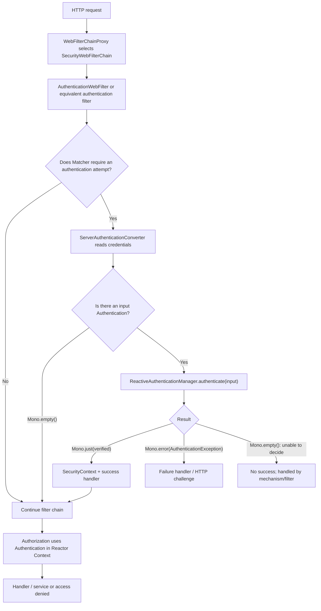
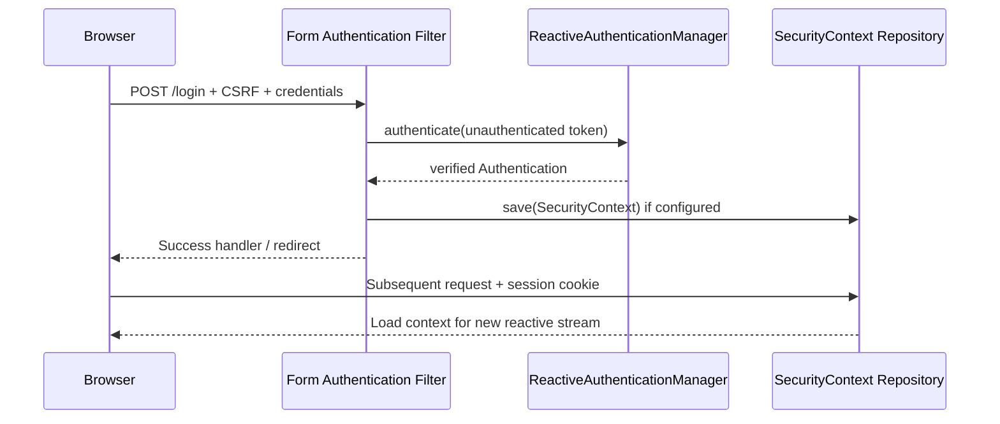

# `Authentication` Lifecycle Before and After Successful Authentication in Spring Security Reactive

When a request enters a **Spring WebFlux** application protected by **Spring Security Reactive**, the `Authentication` object can appear at multiple stages with different meanings. Before the system verifies it, it may simply be an **authentication request** carrying a username/password or bearer token sent by the client; after `ReactiveAuthenticationManager` verifies it successfully, it becomes a **trusted authentication result** containing identity and authorities. Spring Security then places the result into a `SecurityContext` attached to the **Reactor Context** so downstream processing steps know who the current user is.

This is a critical security boundary: **the client provides evidence; the authentication manager verifies the evidence; only then may the system trust the result**. Constructing an `Authentication` with `isAuthenticated=true` yourself from request data is a security vulnerability, even though the API allows creating such an object.

This lesson focuses on the **lifecycle of a single authentication** and how the result can be used within the current request, and then explains what changes for subsequent requests. Examples use Java 17+, Spring Boot 3.x/Spring Security 6.x on **WebFlux**; blocking `AuthenticationManager` APIs, `ThreadLocal`-based `SecurityContextHolder`, and servlet `Filter`s are not used as the primary mechanism of a reactive application.

## 1. Four Objects to Distinguish

| Object | Where it appears | What does it contain? | Trust level |
| --- | --- | --- | --- |
| Credentials from HTTP | `Authorization` header, form login, cookie, or another authentication protocol | Username/password, bearer token, certificate... | **Not yet trusted**; sent by the caller |
| Input `Authentication` | Result of `ServerAuthenticationConverter` or a mechanism creating an authentication request | Intended principal, credentials, and metadata; many implementations have `isAuthenticated() == false` | **Only a verification request** |
| Output `Authentication` | Emitted by `ReactiveAuthenticationManager.authenticate(...)` via `Mono<Authentication>` | Verified principal, resolved authorities; usually `isAuthenticated() == true` | **Trusted if it comes from a trusted authentication component** |
| `SecurityContext` | Security context for the current subscription/request; may be saved for subsequent requests | One current `Authentication` | Used by authorization, controllers, and reactive services |

`Authentication` is the interface `org.springframework.security.core.Authentication`, not a "global state". It represents both the **authentication request** and the **authentication result**, depending on the stage and implementation.

Key APIs on `Authentication`:

- `getPrincipal()`: the identity/subject. It can be a username string, `UserDetails`, `Jwt`, `OAuth2User`, or a principal type of a custom mechanism.
- `getCredentials()`: authentication evidence (for example a password or token), **must not be logged**. Some implementations erase credentials after success.
- `getAuthorities()`: the `GrantedAuthority` instances that the system uses to make authorization decisions (for example `ROLE_READER`, `SCOPE_orders.read`).
- `isAuthenticated()`: a status flag; **not sufficient** on its own to decide that this is a validly logged-in user without understanding the token's origin/type.
- `getName()`: logical display name of the principal according to the implementation.
- `getDetails()`: additional metadata, not a place to implicitly trust client-supplied authority information.

`SecurityContext` has a `getAuthentication()` method; in reactive flows, access it via `ReactiveSecurityContextHolder` rather than assuming the object can be reliably retrieved from a `ThreadLocal`.

## 2. Overall Flow: From HTTP Request to Verified Authentication

A typical path when a request requires authentication:



The diagram describes the `AuthenticationWebFilter` flow and adjacent steps; it **does not claim that every authentication mechanism uses the exact same filter/class**. Spring Security has different filters and converters for HTTP Basic, form login, OAuth2 login, JWT/opaque bearer, certificates, and custom configurations. `SecurityWebFilterChain` is selected based on a matcher; each chain can have its own authentication mechanisms.

Steps to understand:

1. **The request enters SecurityWebFilterChain.** Spring Security selects the chain matching the request and runs the WebFilters in security order.
2. **The filter checks whether the request requires an authentication attempt.** `setRequiresAuthenticationMatcher(...)` on `AuthenticationWebFilter` determines the scope of attempts; if it does not match, the chain continues.
3. **The converter reads credentials.** `ServerAuthenticationConverter.convert(exchange)` returns a `Mono<Authentication>` requesting verification, or `Mono.empty()` if there is no suitable data to process. Being able to read a header does not mean authentication succeeded.
4. **The manager verifies.** `ReactiveAuthenticationManager.authenticate(input)` uses trusted data (user store, password encoder, JWT signature/issuer, opaque introspection...) to return a result or an error.
5. **On success**, Spring Security creates/updates the `SecurityContext` in the **Reactor Context** for downstream processing; `ServerAuthenticationSuccessHandler` may continue the chain, redirect, or return a response according to the authentication type. **Saving** the context for subsequent requests is a separate decision.
6. **On failure**, `ServerAuthenticationFailureHandler`/exception handling processes it according to configuration. There is no successful authentication to grant access.
7. **Authorization** evaluates the identity and authorities of the current request, then either lets the handler run or denies access.

Note the two kinds of "no result": a converter returning `Mono.empty()` means no authentication request could be built from the request, whereas a manager returning `Mono.empty()` means the manager **could not decide** for that token type. Neither is "successful authentication".

## 3. Before Authentication: `Authentication` Is an Untrusted Request

For username/password, Spring Security typically creates a `UsernamePasswordAuthenticationToken` in an unauthenticated state:

```java
Authentication attempt =
    UsernamePasswordAuthenticationToken.unauthenticated(
        "reader", "demo123");

System.out.println(attempt.isAuthenticated()); // false
System.out.println(attempt.getName());          // reader
```

This is an **illustrative snippet** inside Java code that has imported `Authentication` and `UsernamePasswordAuthenticationToken`. `"reader"` is the name declared by the request sender, not yet a verified identity. The password exists only for the manager to match and must not be logged.

In Spring Security versions that support the factory method, `UsernamePasswordAuthenticationToken.unauthenticated(...)` creates a token with `isAuthenticated() == false`, without granting authorities on its own. The corresponding two-argument constructor also represents an unauthenticated request. Do not use the three-argument constructor or the `.authenticated(principal, credentials, authorities)` factory to **self-declare** a trusted result from HTTP data.

With bearer JWT, the converter can create a `BearerTokenAuthenticationToken` containing the unverified bearer string; after the decoder/manager verifies it, the result is usually a `JwtAuthenticationToken`. With HTTP Basic/form login, the input is usually a `UsernamePasswordAuthenticationToken`; the result may contain a `UserDetails` instead of the original username string. **Sharing the same `Authentication` interface does not mean having the same class before and after authentication.**

Three concepts must be separated:

- **Identification**: a username or token claiming a certain identity.
- **Authentication**: the system verifying the evidence using an appropriate mechanism.
- **Authorization**: the system determining whether the verified identity is allowed to perform this action.

Do not infer an admin role from a request parameter, an unverified-signature JWT, or client-supplied attributes.

## 4. What Signals Does `ReactiveAuthenticationManager` Return?

The key contract:

```java
public interface ReactiveAuthenticationManager {
    Mono<Authentication> authenticate(Authentication authentication);
}
```

| Return signal | Interpretation | Example |
| --- | --- | --- |
| `Mono<Authentication>` emitting 1 result | Manager **authenticated successfully** and returns a system-trusted object | Valid password; valid token signature/issuer |
| `Mono.error(AuthenticationException)` | Manager authentication **failed** | Wrong password, locked account, expired/invalid-signature token |
| `Mono.empty()` | Manager **cannot decide** or cannot handle that authentication type | Manager only supports a different token type |

In practice, there may be a composite manager or a resolver selecting a manager per request; not every mechanism handles the same `Authentication` class. On failure, you should not call `onErrorResume(e -> Mono.just(anonymousOrAdmin))` and treat it as valid authentication; it is especially dangerous if the fallback self-grants authorities.

A successful result usually differs from the input:

| Characteristic | Before verification | After success |
| --- | --- | --- |
| `principal` | Intended name or raw token | Verified UserDetails/JWT/OAuth2 principal |
| `credentials` | May contain password/token | May be erased/retained depending on implementation; always treat as sensitive |
| `authorities` | Not yet trusted for granting access | Set by the trusted authentication system/mapper |
| `isAuthenticated` | Usually `false` | Usually `true` |
| Present in `ReactiveSecurityContextHolder`? | **Not automatically**, just because an object was created | **Present in the downstream context** when filter/handler is configured properly |
| Persists to the next request? | No | Only if the next request re-authenticates or there is appropriate context persistence |

`isAuthenticated() == true` is **not** a universal check for authorization: an `AnonymousAuthenticationToken` can report `true` at the interface level yet still be distinguished by Spring Security as anonymous, not equivalent to a logged-in user. Access checks must use the authorization framework/trust resolver and trusted authorities. Do not write manual security rules based solely on this boolean.

## 5. After Success: Placing the Result into `SecurityContext` and Reactor Context

The `Authentication` returned from the manager is only result data. So that downstream controllers/services can read the current user, Spring Security creates a `SecurityContext` holding the verified authentication and attaches it to the **Reactor Context** along the subscription lifecycle.

In WebFlux, Spring Security provides `ReactiveSecurityContextHolder`; context contents are not permanently bound to `Thread.currentThread()` by default. Reactor operators can continue executing on different threads while still accessing the Reactor Context within the appropriate subscription.

Reading authentication at a point after the security filter has processed the request:

```java
// Code snippet inside a protected reactive method.
Mono<String> currentUsername =
    ReactiveSecurityContextHolder.getContext()
        .flatMap(context ->
            Mono.justOrEmpty(context.getAuthentication()))
        .map(Authentication::getName);
```

Required imports:

```java
import org.springframework.security.core.Authentication;
import org.springframework.security.core.context.ReactiveSecurityContextHolder;
import reactor.core.publisher.Mono;
```

`getContext()` returns `Mono<SecurityContext>` for the current subscriber; for a request without a context, it may be empty. You should not treat `Mono.empty()` as an automatic `"anonymous"` username; whether the anonymous filter creates its own authentication depends on configuration and where the code runs.

In **self-study** code, you can illustrate the boundary with:

```java
Mono<String> visibleName =
    ReactiveSecurityContextHolder.getContext()
        .map(ctx -> ctx.getAuthentication().getName())
        .contextWrite(
            ReactiveSecurityContextHolder.withAuthentication(
                verifiedAuthentication));
```

Here `verifiedAuthentication` **must be a result already authenticated by a manager**, not a client-asserted token. `contextWrite` only changes the context for **that publisher's subscription**. This snippet is an illustration of Reactor Context scope; it **does not create an HTTP login session**, does not save `SecurityContext` for subsequent requests, and does not replace `AuthenticationWebFilter`/success handlers.

In particular: if a service calls a manager and then manually calls `.subscribe()` on a detached pipeline, or calls `.block()` to "fetch the user" inside a WebFlux handler, it can break the link to the Reactor Context and disrupt non-blocking execution. Always **return** `Mono`/`Flux` for the framework to manage the subscription.

## 6. Runnable Example: Observing BEFORE, AFTER, and CONTEXT

The Spring Boot example below demonstrates two separate facts:

- `ReactiveAuthenticationManager` verifies a request and returns **a new/verified authentication**.
- `ReactiveSecurityContextHolder` can only read the user inside a **properly attached Reactor context**. In real HTTP requests, Spring Security filters handle that.

Requirements: Java 17+, a Spring Boot 3.x project using Spring Security 6.x, with Gradle wrapper and the Spring Boot plugin configured. Add dependencies:

```groovy
dependencies {
    implementation 'org.springframework.boot:spring-boot-starter-webflux'
    implementation 'org.springframework.boot:spring-boot-starter-security'
    testImplementation 'org.springframework.boot:spring-boot-starter-test'
}
```

Do not use `spring-boot-starter-web` for this example because this is a reactive WebFlux application. The Java snippets below are **complete files**, placed under `src/main/java/demo/authlife/`.

### File 1 — `AuthLifeApplication.java`

```java
package demo.authlife;

import org.springframework.boot.SpringApplication;
import org.springframework.boot.autoconfigure.SpringBootApplication;

@SpringBootApplication
public class AuthLifeApplication {
    public static void main(String[] args) {
        SpringApplication.run(AuthLifeApplication.class, args);
    }
}
```

### File 2 — `SecurityConfig.java`

```java
package demo.authlife;

import org.springframework.context.annotation.Bean;
import org.springframework.context.annotation.Configuration;
import org.springframework.security.authentication.ReactiveAuthenticationManager;
import org.springframework.security.authentication.UserDetailsRepositoryReactiveAuthenticationManager;
import org.springframework.security.config.Customizer;
import org.springframework.security.config.annotation.web.reactive.EnableWebFluxSecurity;
import org.springframework.security.config.web.server.ServerHttpSecurity;
import org.springframework.security.core.userdetails.ReactiveUserDetailsService;
import org.springframework.security.core.userdetails.User;
import org.springframework.security.core.userdetails.UserDetails;
import org.springframework.security.crypto.factory.PasswordEncoderFactories;
import org.springframework.security.crypto.password.PasswordEncoder;
import org.springframework.security.provisioning.MapReactiveUserDetailsService;
import org.springframework.security.web.server.SecurityWebFilterChain;

@Configuration
@EnableWebFluxSecurity
public class SecurityConfig {
    @Bean
    PasswordEncoder passwordEncoder() {
        return PasswordEncoderFactories.createDelegatingPasswordEncoder();
    }

    @Bean
    ReactiveUserDetailsService users(PasswordEncoder encoder) {
        UserDetails reader = User.withUsername("reader")
            .password(encoder.encode("demo123"))
            .roles("READER")
            .build();
        return new MapReactiveUserDetailsService(reader);
    }

    @Bean
    ReactiveAuthenticationManager authenticationManager(
            ReactiveUserDetailsService users, PasswordEncoder encoder) {
        var manager =
            new UserDetailsRepositoryReactiveAuthenticationManager(users);
        manager.setPasswordEncoder(encoder);
        return manager;
    }

    @Bean
    SecurityWebFilterChain security(
            ServerHttpSecurity http,
            ReactiveAuthenticationManager authenticationManager) {
        return http
            .authenticationManager(authenticationManager)
            .authorizeExchange(exchanges -> exchanges
                .pathMatchers("/public/ping").permitAll()
                .pathMatchers("/private/admin").hasRole("ADMIN")
                .anyExchange().authenticated())
            .httpBasic(Customizer.withDefaults())
            .formLogin(form -> form.disable())
            .build();
    }
}
```

`MapReactiveUserDetailsService` and the password `demo123` are only for **local** demos, not for production use. `PasswordEncoderFactories.createDelegatingPasswordEncoder()` provides a safer encoding mechanism compared to storing `{noop}` passwords. Configuring HTTP Basic authentication lets us observe a single authentication **per request**. CSRF remains enabled by default; all demo endpoints use `GET`, so there is no need to disable CSRF to run the example.

`UserDetailsRepositoryReactiveAuthenticationManager` checks the password using the encoder and the `ReactiveUserDetailsService` source. It is a concrete implementation of `ReactiveAuthenticationManager`. Creating the manager bean and configuring it in `ServerHttpSecurity` ensures both the HTTP Basic flow and the command-line demo use the same authentication rules.

### File 3 — `LifecycleProbe.java`

```java
package demo.authlife;

import org.springframework.boot.CommandLineRunner;
import org.springframework.security.authentication.ReactiveAuthenticationManager;
import org.springframework.security.authentication.UsernamePasswordAuthenticationToken;
import org.springframework.security.core.Authentication;
import org.springframework.security.core.GrantedAuthority;
import org.springframework.security.core.context.ReactiveSecurityContextHolder;
import org.springframework.stereotype.Component;

@Component
public class LifecycleProbe implements CommandLineRunner {
    private final ReactiveAuthenticationManager manager;

    public LifecycleProbe(ReactiveAuthenticationManager manager) {
        this.manager = manager;
    }

    @Override
    public void run(String... args) {
        Authentication attempt =
            UsernamePasswordAuthenticationToken.unauthenticated(
                "reader", "demo123");

        System.out.println("BEFORE authenticated="
            + attempt.isAuthenticated());
        System.out.println("BEFORE name=" + attempt.getName());

        Authentication verified =
            manager.authenticate(attempt).block();

        System.out.println("AFTER authenticated="
            + verified.isAuthenticated());
        System.out.println("AFTER name=" + verified.getName());
        System.out.println("AFTER authorities="
            + verified.getAuthorities().stream()
                .map(GrantedAuthority::getAuthority)
                .sorted()
                .toList());

        String nameInContext =
            ReactiveSecurityContextHolder.getContext()
                .map(ctx -> ctx.getAuthentication().getName())
                .contextWrite(
                    ReactiveSecurityContextHolder.withAuthentication(
                        verified))
                .block();

        System.out.println("CONTEXT name=" + nameInContext);
    }
}
```

**Important:** `.block()` inside `CommandLineRunner` is intentional because it runs at the **synchronous startup boundary**, solely to print output for learning, not inside a WebFlux request/event loop. Do not copy `.block()` into a controller, WebFilter, or reactive authentication service.

When the application starts successfully, the lines from the example are:

```text
BEFORE authenticated=false
BEFORE name=reader
AFTER authenticated=true
AFTER name=reader
AFTER authorities=[ROLE_READER]
CONTEXT name=reader
```

Other Spring Boot startup logs will still appear. The password is encoded with a random salt, but the output lines above do not depend on the hash value. `verified` is obtained from the manager, then placed into **a specific Reactor subscription** via `contextWrite`. Note that the code never prints the password or raw credentials.

### File 4 — `DemoController.java`

```java
package demo.authlife;

import org.springframework.security.core.Authentication;
import org.springframework.security.core.GrantedAuthority;
import org.springframework.security.core.context.ReactiveSecurityContextHolder;
import org.springframework.web.bind.annotation.GetMapping;
import org.springframework.web.bind.annotation.RestController;
import reactor.core.publisher.Mono;

@RestController
public class DemoController {
    @GetMapping("/public/ping")
    public Mono<String> ping() {
        return Mono.just("pong");
    }

    @GetMapping("/private/me")
    public Mono<String> me() {
        return ReactiveSecurityContextHolder.getContext()
            .flatMap(ctx ->
                Mono.justOrEmpty(ctx.getAuthentication()))
            .map(this::describe);
    }

    @GetMapping("/private/admin")
    public Mono<String> admin() {
        return Mono.just("admin-only");
    }

    private String describe(Authentication authentication) {
        var authorities = authentication.getAuthorities().stream()
            .map(GrantedAuthority::getAuthority)
            .sorted()
            .toList();

        return "name=" + authentication.getName()
            + "; authenticated=" + authentication.isAuthenticated()
            + "; authorities=" + authorities;
    }
}
```

In `/private/me`, the controller runs only after the security filter has allowed the request through. The `describe` method uses the **authentication retrieved from the Reactor Context**, without creating a new token or reading the username from a query parameter. The `/private/admin` route requires `ROLE_ADMIN`; the demo user only has `ROLE_READER`, so access is denied even though the user is authenticated.

### Running and Testing with HTTP

From the Spring Boot project directory:

```bash
# Linux/macOS
./gradlew bootRun

# Windows
gradlew.bat bootRun
```

Use `curl` to observe independent requests:

```bash
curl -i http://localhost:8080/public/ping
curl -i http://localhost:8080/private/me
curl -i -u reader:demo123 http://localhost:8080/private/me
curl -i -u reader:wrong http://localhost:8080/private/me
curl -i -u reader:demo123 http://localhost:8080/private/admin
```

With the right configuration and demo user:

| Request | Expected status | Body / meaning |
| --- | --- | --- |
| `GET /public/ping`, no credentials | `200 OK` | `pong` |
| `GET /private/me`, no credentials | `401 Unauthorized` | Security challenges with HTTP Basic |
| `GET /private/me`, Basic `reader:demo123` | `200 OK` | `name=reader; authenticated=true; authorities=[ROLE_READER]` |
| `GET /private/me`, Basic `reader:wrong` | `401 Unauthorized` | Password mismatch; controller does not run |
| `GET /private/admin`, valid Basic | `403 Forbidden` | Authenticated but missing `ROLE_ADMIN` |

Do not expect 401/403 statuses to distinguish whether a username/password exists: public responses must avoid leaking sensitive account details. Header/body behavior depends on exception handling configuration; the statuses and content above are the observation targets of this example.

## 7. Real HTTP Requests: Where Does the Authentication Result Go?

In `LifecycleProbe`, `manager.authenticate(...)` produces a result but **does not automatically attach** it to an active request. HTTP requests go through Spring Security filters to do that part.

With HTTP Basic enabled:

1. The client sends `Authorization: Basic ...` to `/private/me`.
2. The Basic converter extracts username/password and creates an unauthenticated `Authentication` request.
3. `ReactiveAuthenticationManager` checks the username/password against the user source and `PasswordEncoder`.
4. When valid, `AuthenticationWebFilter` puts the verified result into `SecurityContext` in the downstream Reactor Context.
5. Authorization checks `.authenticated()`; the controller reads `ReactiveSecurityContextHolder.getContext()` and returns `name=reader`.
6. On the next Basic request, the client typically **sends credentials again**. Authentication is performed per request if there is no separate persistence mechanism; do not assume Basic creates a persistent login session.

For a request missing the Basic header: the converter may return `Mono.empty()`, meaning **no matching authentication request was found**. The filter continues, and the authorization step requiring login leads to a `401` challenge. With a wrong password, the converter builds the request, but the manager emits an authentication error; the failure handler handles the error without placing a fake result into the context.

### How Form Login Differs

A web page using form login typically follows this sequence:



A session-based configuration can use `WebSessionServerSecurityContextRepository`. To ensure the login result is **saved**, the filter/form login must be configured with an appropriate repository; setting a shared repository on `ServerHttpSecurity` mainly relates to **loading** the context via `ReactorContextWebFilter`, while **saving** is configured on the authentication filter. `NoOpServerSecurityContextRepository` does not save across requests. Disabling or swapping the repository must be based on the session or token model, not done arbitrarily to "fix" a login bug.

Form login needs an appropriate CSRF policy and typically performs redirects; the earlier HTTP Basic example does not represent all form login behavior.

### How Bearer JWT / Opaque Token Differs

For a resource server API, the client sends `Authorization: Bearer <access-token>`:

1. The converter creates a request carrying the unverified bearer token.
2. The JWT manager/decoder verifies the signature, expiration, and configured issuer/audience conditions; an opaque-token manager uses introspection.
3. If valid, the manager creates an `Authentication` with principal/authorities mapped from the token.
4. Spring Security places the authentication into the request's Reactor Context.
5. Authorization checks scope/role; the next request sends the token again and is authenticated by the resource server mechanism.

With JWT, `JwtAuthenticationToken` may hold a `Jwt` as its principal; do not assume `getPrincipal()` is always `UserDetails`. Avoid logging the full token. With a token-only API, there is no need to create a login session just to retain the result for other requests; however, inspect the specific configuration before concluding the entire application is stateless.

## 8. Success Handler, Failure Handler, and Where Authorization Happens

`AuthenticationWebFilter` provides these extension points:

| Hook/API | What it receives/controls | When to use |
| --- | --- | --- |
| `setRequiresAuthenticationMatcher(...)` | Selects requests to attempt authentication on | Custom filter protecting only a subset of paths |
| `setServerAuthenticationConverter(...)` | Builds an authentication request from `ServerWebExchange` | Credentials in a custom header/cookie/format |
| `ReactiveAuthenticationManager` | Performs non-blocking verification | User store, token validator, identity service |
| `setSecurityContextRepository(...)` | Decides how the filter saves the context | Session login or NoOp by design |
| `setAuthenticationSuccessHandler(...)` | Handles post-success behavior | Continue chain, redirect, return an appropriate response |
| `setAuthenticationFailureHandler(...)` | Handles authentication errors | 401 challenge or login page error display |

`ServerAuthenticationSuccessHandler` is **not** an authorization manager. Succeeding at authentication **does not guarantee** permission for `/admin`. Authorization is evaluated afterwards by `authorizeExchange` rules, method security such as `@PreAuthorize`, or `ReactiveAuthorizationManager`.

Do not put sensitive access-granting decisions into loggers, client-sent headers, or a custom success handler lacking checks. Do not unconditionally log `Authentication.toString()` if the implementation contains sensitive metadata; it is better to log only minimal information such as request id, mechanism used, and outcome.

## 9. `401`, `403`, and the Anonymous Case

Three distinct situations:

| Situation | Verified authentication? | Typical outcome |
| --- | --- | --- |
| Missing or wrong credentials for an endpoint requiring login | No | `401` (API/Basic/Bearer) or redirect to login (form) |
| Valid credentials, but missing the required authority | Yes | `403 Forbidden` |
| Endpoint is `permitAll` | Not necessarily | Request is still processed; security filters may still run |

Do not use `isAuthenticated()==true` alone to declare a request as a logged-in user: anonymous support can provide an `AnonymousAuthenticationToken` whose `isAuthenticated()` is still `true`. Spring Security distinguishes anonymous users from authenticated users through appropriate trust/authorization mechanisms. Use `.authenticated()` or `hasRole(...)` in the DSL instead of checking the boolean manually in a custom `WebFilter`.

A request to a `permitAll` route can still be rejected if it actively carries an **invalid** token that an authentication filter attempts to process; "does not require credentials" is different from "bypasses all authentication filters".

When is printing `isAuthenticated` status acceptable? In demos aimed at understanding the lifecycle it is fine, but **never use that information in place of business authorization checks**.

## 10. Testing the Lifecycle and Security Boundaries

Besides testing with `curl`, HTTP behavior can be tested with `WebTestClient`. Place the following file at `src/test/java/demo/authlife/AuthenticationFlowTest.java`. This is an integration test for the example consisting of `SecurityConfig` and `DemoController` above.

```java
package demo.authlife;

import org.junit.jupiter.api.Test;
import org.springframework.beans.factory.annotation.Autowired;
import org.springframework.boot.test.context.SpringBootTest;
import org.springframework.boot.test.autoconfigure.web.reactive.AutoConfigureWebTestClient;
import org.springframework.test.web.reactive.server.WebTestClient;

@SpringBootTest(webEnvironment = SpringBootTest.WebEnvironment.RANDOM_PORT)
@AutoConfigureWebTestClient
class AuthenticationFlowTest {
    @Autowired
    WebTestClient client;

    @Test
    void publicRouteIsAccessible() {
        client.get().uri("/public/ping")
            .exchange()
            .expectStatus().isOk()
            .expectBody(String.class).isEqualTo("pong");
    }

    @Test
    void missingCredentialsAreRejected() {
        client.get().uri("/private/me")
            .exchange()
            .expectStatus().isUnauthorized();
    }

    @Test
    void validCredentialsCreateAuthenticatedContext() {
        client.get().uri("/private/me")
            .headers(h -> h.setBasicAuth("reader", "demo123"))
            .exchange()
            .expectStatus().isOk()
            .expectBody(String.class)
            .isEqualTo("name=reader; authenticated=true; "
                + "authorities=[ROLE_READER]");
    }

    @Test
    void invalidCredentialsAreRejected() {
        client.get().uri("/private/me")
            .headers(h -> h.setBasicAuth("reader", "wrong"))
            .exchange()
            .expectStatus().isUnauthorized();
    }

    @Test
    void authenticatedDoesNotMeanAuthorizedAsAdmin() {
        client.get().uri("/private/admin")
            .headers(h -> h.setBasicAuth("reader", "demo123"))
            .exchange()
            .expectStatus().isForbidden();
    }
}
```

Run:

```bash
# Linux/macOS
./gradlew test --tests 'demo.authlife.AuthenticationFlowTest'

# Windows
gradlew.bat test --tests "demo.authlife.AuthenticationFlowTest"
```

With the right Boot project and dependencies, the five cases above produce the expected results. Real-world application tests should also cover expired token/wrong issuer, locked account, session logout, authority mapping, and no credential leakage, if those mechanisms are enabled.

`WebTestClient` can use `spring-security-test` to mock authentication in unit tests, but **a mock user does not verify a real password or token**. Distinguish clearly:

- **Testing authorization**: mock a user who already has a role/scope and verify the policy.
- **Testing authentication**: send real credentials into the mechanism under test, confirming that the manager/decoder succeeds or fails.
- **Testing context propagation**: verify that a downstream step can read `ReactiveSecurityContextHolder` within the same subscription, including across an appropriate `publishOn`.

## 11. Common Pitfalls in Reactive Applications

### Pitfall 1 — Marking a client-supplied token as authenticated yourself

**Security mistake:**

```java
Authentication unsafe =
    UsernamePasswordAuthenticationToken.authenticated(
        requestUsername, null,
        java.util.List.of(
            new SimpleGrantedAuthority("ROLE_ADMIN")));
```

`requestUsername` here is unverified client data; `SimpleGrantedAuthority` needs to be imported from `org.springframework.security.core.authority.SimpleGrantedAuthority`. **Do not use this error-demonstration snippet** as an authentication mechanism. You must call a trusted manager/validator and use the `Authentication` it emits.

### Pitfall 2 — Confusing "converter returned an object" with "logged in"

`ServerAuthenticationConverter` only parses the request. It does not verify the password, JWT signature, or access rights. `Mono.just(UsernamePasswordAuthenticationToken.unauthenticated(...))` is a verification request, not proof of success.

### Pitfall 3 — Manager returns a result, but downstream sees no context

Calling `manager.authenticate(...)` **outside** the security flow does not automatically make Spring Security treat it as the HTTP request's user. You must use the appropriate filter/success flow to attach `SecurityContext` to the Reactor Context, and configure context saving when login needs to persist across requests.

### Pitfall 4 — Assuming Servlet ThreadLocal `SecurityContextHolder` still works

With WebFlux, work can switch threads across schedulers. Do not rely on `ThreadLocal` to determine a request's authentication. Use `ReactiveSecurityContextHolder` and return publishers for the framework to manage.

### Pitfall 5 — Calling `block()` or manual `subscribe()` inside a WebFilter/controller

`.block()` can block the event loop and break context semantics. Manual `.subscribe()` creates a separate subscription, detaching processing from the HTTP lifecycle, making error/cancellation propagation difficult, and causing loss of the security context. Use `flatMap`, `then`, `switchIfEmpty`, or return the `Mono` directly.

### Pitfall 6 — Confusing authentication errors with authorization errors

`401`/redirect usually corresponds to needing authentication; `403` usually means already authenticated but lacking permission. Do not delete the policy with `permitAll` or self-grant `ROLE_ADMIN` when seeing `403`. Re-verify credentials, principal, authorities, and the applied rule.

### Pitfall 7 — Logging passwords, bearer tokens, session ids, or the entire Authentication

Credentials may still be inside the object, especially before authentication. When investigation is needed, log at most the request id, mechanism type, success/failure status, and timing; do not log secret data. Even after success, do not assume `getCredentials()` is always `null`.

### Pitfall 8 — Saving context in a way that mismatches the model

Form login usually requires a repository capable of saving sessions. Basic/bearer tokens can re-authenticate per request without maintaining a session. `NoOpServerSecurityContextRepository` does not save across requests; `WebSessionServerSecurityContextRepository` saves into WebSession. You must distinguish where each authentication filter **loads** and **saves** when configuring.

### Pitfall 9 — Running a blocking manager directly on the event loop

Do not call synchronous JDBC/HTTP or overly heavy password hashing in an uncontrolled way inside `map`/filters just because the API returns `Mono`. Prefer reactive stores/drivers; if a synchronous library must be used, isolate it with bounded concurrency and observe latency. `Mono.just(blockingCall())` still executes the call immediately.

### Pitfall 10 — Placing custom authentication in a general filter and bypassing SecurityWebFilterChain

An application-level `@Component WebFilter` running outside the security chain can cause the context not to exist yet, or accidentally bypass authentication if it forgets to call `chain.filter(exchange)`. When an authentication extension is needed, use `ServerHttpSecurity`/`AuthenticationWebFilter` in the appropriate chain. Avoid registering the same filter both globally in WebFlux and inside the security chain, which leads to duplicate execution.

## 12. Self-Check Questions

**Question 1.** Does `UsernamePasswordAuthenticationToken.unauthenticated("reader", "demo123")` mean the user is logged in?  
**No.** It only describes credentials needing verification. A manager must verify them and produce a trusted result.

**Question 2.** If a manager returns `Mono.empty()`, can that be considered successful authentication?  
**No.** It means the manager could not reach a decision; success must emit a verified `Authentication`.

**Question 3.** Why doesn't a verified `Authentication` inside one function automatically appear in every other request?  
**Because** the Reactor Context is attached per subscription. To have an identity on a later request, the client must resend credentials/token or a suitable repository must save and load the context.

**Question 4.** The password is correct, yet the endpoint returns `403`. Could authentication have succeeded?  
**Yes.** Authentication and authorization are two separate steps; a valid user can still lack an authority.

**Question 5.** When `AnonymousAuthenticationWebFilter` is enabled, does `isAuthenticated() == true` guarantee the user is logged in?  
**No.** Anonymous authentication must be distinguished by Spring Security using authorization/trust resolution mechanisms.

**Question 6.** Can an API be made stateless by calling `.contextWrite(...)` in a controller?  
**No.** `contextWrite` changes the context of that publisher/subscription; it is not an HTTP authentication solution or cross-request persistence mechanism.

## Takeaways

- **Before authentication**: `Authentication` is typically an untrusted request token, carrying only client-supplied information.
- **During authentication**: `ReactiveAuthenticationManager` emits a valid result, signals an error, or cannot decide; only results from a trusted manager/validator are recognized.
- **After successful authentication**: Spring Security attaches the result to `SecurityContext` in the Reactor Context for downstream processing. Authorization can still deny access if authorities are missing.
- **Across requests**: the result can be restored from `WebSession` if saved, or re-authenticated from HTTP Basic/bearer tokens. This is a separate configuration decision.
- **When programming WebFlux**: use `ReactiveSecurityContextHolder`, never self-grant authorities, avoid `block()`/`subscribe()` inside requests, protect credentials, and write tests for 401/403.

### Official References

- [Spring Security 6.5 — AuthenticationWebFilter API](https://docs.spring.io/spring-security/reference/6.5/api/java/org/springframework/security/web/server/authentication/AuthenticationWebFilter.html)
- [Spring Security 6.5 — ReactiveAuthenticationManager API](https://docs.spring.io/spring-security/site/docs/6.5.0-M1/api/org/springframework/security/authentication/ReactiveAuthenticationManager.html)
- [Spring Security 6.5 — ServerHttpSecurity API](https://docs.spring.io/spring-security/reference/6.5/api/java/org/springframework/security/config/web/server/ServerHttpSecurity.html)
- [Spring Security 6.5 — WebFlux Testing Authentication](https://docs.spring.io/spring-security/reference/6.5/reactive/test/web/authentication.html)
- [Spring Security 6.5 — Reactive Method Security and Reactor Context](https://docs.spring.io/spring-security/reference/6.5/reactive/authorization/method.html)
- [Spring Security 6.5 — ReactorContextWebFilter and context repositories](https://docs.spring.io/spring-security/reference/6.5/api/java/org/springframework/security/web/server/context/ReactorContextWebFilter.html)
