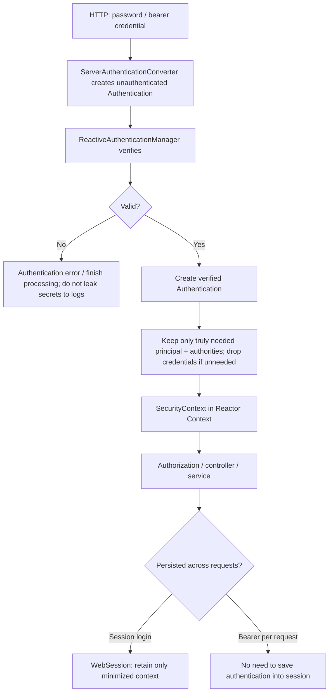

# Erasing Credentials and Limiting Data Retained in `Authentication` (Spring Security Reactive)

In Spring Security Reactive, `Authentication` is the object that authentication and authorization steps use to represent the current identity. Before authentication, it can carry a client-sent password or bearer token; after authentication, it typically holds `principal`, `GrantedAuthority` instances, and information needed by downstream processing. **Crucially, input secrets must not continue living in `SecurityContext`, WebSession, caches, or logs longer than necessary.**

This lesson explains two related yet distinct practices:

1. **Erasing or stopping retention of credentials** once they have been verified: using `CredentialsContainer`, `eraseCredentials()`, and building authentication results that no longer carry secrets.
2. **Minimizing data retained in `Authentication`**: keeping only the truly needed identifier and authorities, avoiding keeping password hashes, raw access tokens, full user profiles, or oversized HTTP objects.

This applies to Spring Boot 3.x, Spring Security 6.x, and **Spring WebFlux** on Java 17+. You must distinguish behaviors belonging to general Spring Security APIs from default policies of the **Servlet** branch; never take a synchronous `ProviderManager` configuration and assume a `ReactiveAuthenticationManager` does the exact same thing.

## 1. What Data Lives Inside `Authentication`?

The `org.springframework.security.core.Authentication` interface has these primary parts:

| Component | Example data | Should it be kept long? |
| --- | --- | --- |
| `getPrincipal()` | Username, `UserDetails`, user object, `Jwt` | Keep **minimal identifier**; avoid full profiles, password hashes, or unneeded claims |
| `getCredentials()` | Submitted password, bearer access token, authentication proof | Keep only until verification finishes, if the mechanism permits erasure |
| `getAuthorities()` | `ROLE_READER`, `SCOPE_orders.read` | Keep permissions needed for authorization; consider lifetime/freshness of permissions |
| `getDetails()` | Request metadata, IP, client info, session id per implementation | Keep only truly needed values; never store raw HTTP headers/cookies or whole `ServerWebExchange` |
| `isAuthenticated()` | Flag indicating passage through authentication step | Contains no secrets, yet **does not replace** permission checks or trust resolvers |
| `getName()` | Identity name/ID | Useful for identification, yet can still be personal data |

**Sensitive secrets** are not just plaintext passwords. Password hashes, access tokens/JWTs, refresh tokens, API keys, session IDs, OTPs, private keys, and sensitive identifying data must all be protected. A password hash is not the original password, yet still requires protection to limit exposure and offline attacks.

An "authenticated" `Authentication` may still carry data that must not go into logs or responses. Seeing `getCredentials() == null` also **does not prove** the entire object is safe: `getPrincipal()` may hold `UserDetails.password`, `Jwt.getTokenValue()`, or sensitive claims; `getDetails()` may carry request data.

## 2. Secret Lifecycle: When Is It Erased?



**Important boundaries**:

1. Credentials from HTTP are **untrusted data**. They may need to exist in memory while matching password hashes, validating JWTs, running introspection, or checking OTPs.
2. After the manager finishes verification, the application should **return an authentication result without raw credentials**, unless a legitimate business operation still requires them.
3. If a mechanism saves `SecurityContext` into WebSession or elsewhere, ensure the stored object has been minimized before persisting.
4. Copies inside HTTP headers, buffers, logs, tracing, local variables, or another `String` **do not automatically disappear** when calling `eraseCredentials()` on an `Authentication` object.

Never erase credentials **before** the authentication component finishes verifying them, as that can cause password checks or token validation to fail. Conversely, letting raw passwords reach controllers or caches after authentication is unnecessary and enlarges the leak surface.

## 3. What Do `CredentialsContainer` and `eraseCredentials()` Do?

Spring Security defines:

```java
package org.springframework.security.core;

public interface CredentialsContainer {
    void eraseCredentials();
}
```

This is an **illustrative API signature**; do not recreate this interface in your project. Many Spring Security classes implement `CredentialsContainer`, including `AbstractAuthenticationToken`, `UsernamePasswordAuthenticationToken`, and `org.springframework.security.core.userdetails.User`.

`AbstractAuthenticationToken.eraseCredentials()` calls `eraseCredentials()` on the objects in `credentials`, `principal`, and `details` **if they also implement `CredentialsContainer`**. `UsernamePasswordAuthenticationToken` also clears the token's own credentials field. On Spring Security's `User`, `eraseCredentials()` sets the `password` field to `null`.

That leads to two distinct situations:

- If the token holds a `String` password, clearing usually **drops the reference** to the string in the `credentials` field. It **does not overwrite each byte/character** of the already-created `String`; the JVM decides when the memory becomes unreachable and is garbage-collected.
- If the token holds a principal that is a `User` object implementing `CredentialsContainer`, erasing credentials can **mutate the principal object** and wipe its password hash. This is the root cause of bugs involving shared `UserDetails` from a cache.

Therefore, distinguish **clearing references inside a token** from **wiping secret copies everywhere**. `eraseCredentials()` is a retention-time reduction mechanism, not a guarantee of immediate physical erasure from RAM, snapshots, heap dumps, or logs.

### Very Short Example

```java
var attempt =
    UsernamePasswordAuthenticationToken.unauthenticated(
        "reader", "demo-only-password");

System.out.println(attempt.getCredentials() != null); // true
attempt.eraseCredentials();
System.out.println(attempt.getCredentials() == null);  // true
```

This snippet requires importing `org.springframework.security.authentication.UsernamePasswordAuthenticationToken`; it can go inside a `main` method in a project with Spring Security. It erases credentials on the **attempt object**; it does not authenticate successfully and does not create a `SecurityContext`.

## 4. Do Not Confuse Servlet `ProviderManager` Behavior with Reactive Managers

Spring Security's **Servlet** documentation states that `ProviderManager` typically calls `eraseCredentials()` on the returned `Authentication` after successful authentication; `ProviderManager` has an `eraseCredentialsAfterAuthentication` option. That is a mechanism of the **synchronous** `AuthenticationManager` in the Servlet model.

With **WebFlux**:

- `ReactiveAuthenticationManager.authenticate(Authentication)` returns `Mono<Authentication>`.
- `UserDetailsRepositoryReactiveAuthenticationManager` is an implementation using `ReactiveUserDetailsService` and `PasswordEncoder`.
- HTTP Basic, form login, or bearer mechanisms may have different input/output tokens, and some implementations already produce minimized results in their own way.
- **Do not infer** that every reactive manager, authentication filter, or token class automatically erases all credentials after success. You must inspect **your exact implementation and version**, actual data in the result, how context is saved, and write dedicated tests for your app's authentication mechanism.

Specifically, **never** use configurations like `AuthenticationManagerBuilder.eraseCredentials(false)` or `ProviderManager.setEraseCredentialsAfterAuthentication(false)` to "fix" WebFlux code if the app uses `ReactiveAuthenticationManager`; those APIs are not global switches for all reactive authentication mechanisms.

The safe and verifiable approach in **custom reactive authentication** is: after a trusted manager verifies credentials, **return an `Authentication` object carrying only verified and necessary data**, instead of relying on bulk erasure at a later stage.

## 5. Runnable Java 17+ Example: Authenticating Real Credentials Then Creating a Minimized Result

The example has one user `reader` with role `READER`, checked via `UserDetailsRepositoryReactiveAuthenticationManager`. After the manager succeeds, the program creates a new `UsernamePasswordAuthenticationToken` with:

- `principal`: the **manager-verified** username string;
- `credentials`: `null`;
- `authorities`: the **manager-verified** authority list, not taken directly from HTTP.

This fits a username/password demo. **Do not arbitrarily convert every `JwtAuthenticationToken` or `OAuth2AuthenticationToken` into a username/password token**: those mechanisms may require claims, attributes, and different behavior. Minimization must preserve the contract of the authentication type and active features.

### 5.1. Run Configuration

Create/use a Spring Boot 3.x project configured with Gradle and Java 17+. In `build.gradle`, add dependencies:

```groovy
dependencies {
    implementation 'org.springframework.boot:spring-boot-starter-webflux'
    implementation 'org.springframework.boot:spring-boot-starter-security'
}
```

To run the **standalone demo class with `main`** from Gradle, add this task to the project's `build.gradle`:

```groovy
tasks.register('runCredentialDemo', JavaExec) {
    group = 'application'
    description = 'Observe Authentication credential minimization'
    classpath = sourceSets.main.runtimeClasspath
    mainClass = 'demo.credentials.CredentialErasureDemo'
}
```

The task only runs the lesson's Java class; it **does not start an HTTP server** and does not require `@SpringBootApplication`.

### 5.2. File `src/main/java/demo/credentials/CredentialErasureDemo.java`

```java
package demo.credentials;

import java.util.List;

import org.springframework.security.authentication.UserDetailsRepositoryReactiveAuthenticationManager;
import org.springframework.security.authentication.UsernamePasswordAuthenticationToken;
import org.springframework.security.core.Authentication;
import org.springframework.security.core.GrantedAuthority;
import org.springframework.security.core.context.ReactiveSecurityContextHolder;
import org.springframework.security.core.userdetails.User;
import org.springframework.security.core.userdetails.UserDetails;
import org.springframework.security.crypto.factory.PasswordEncoderFactories;
import org.springframework.security.crypto.password.PasswordEncoder;
import org.springframework.security.provisioning.MapReactiveUserDetailsService;

public class CredentialErasureDemo {
    public static void main(String[] args) {
        // Account is strictly for this lesson; do not use as real credentials.
        PasswordEncoder encoder =
            PasswordEncoderFactories.createDelegatingPasswordEncoder();

        UserDetails storedUser = User.withUsername("reader")
            .password(encoder.encode("demo-only-123"))
            .roles("READER")
            .build();

        var users = new MapReactiveUserDetailsService(storedUser);
        var manager =
            new UserDetailsRepositoryReactiveAuthenticationManager(users);
        manager.setPasswordEncoder(encoder);

        var attempt =
            UsernamePasswordAuthenticationToken.unauthenticated(
                "reader", "demo-only-123");

        System.out.println("INPUT authenticated="
            + attempt.isAuthenticated());
        System.out.println("INPUT credentialsPresent="
            + (attempt.getCredentials() != null));

        Authentication verifiedMinimal;
        try {
            verifiedMinimal = manager.authenticate(attempt)
                .map(verified -> (Authentication)
                    UsernamePasswordAuthenticationToken.authenticated(
                        verified.getName(),
                        null,
                        List.copyOf(verified.getAuthorities())))
                .block();  // Only at main/demo boundary, not in WebFlux handlers.
        }
        finally {
            // Reduce reference retention on attempt even when authentication fails.
            attempt.eraseCredentials();
        }

        if (verifiedMinimal == null) {
            throw new IllegalStateException("Authentication was empty");
        }

        System.out.println("INPUT credentialsAfterErase="
            + (attempt.getCredentials() == null));
        System.out.println("RESULT authenticated="
            + verifiedMinimal.isAuthenticated());
        System.out.println("RESULT name=" + verifiedMinimal.getName());
        System.out.println("RESULT credentialsPresent="
            + (verifiedMinimal.getCredentials() != null));
        System.out.println("RESULT authorities="
            + verifiedMinimal.getAuthorities().stream()
                .map(GrantedAuthority::getAuthority)
                .sorted()
                .toList());

        String usernameInContext =
            ReactiveSecurityContextHolder.getContext()
                .map(ctx -> ctx.getAuthentication().getName())
                .contextWrite(
                    ReactiveSecurityContextHolder.withAuthentication(
                        verifiedMinimal))
                .block();  // Demo main, not an HTTP filter/controller.

        System.out.println("CONTEXT name=" + usernameInContext);
    }
}
```

Run from the Spring Boot project directory:

```bash
# Linux/macOS
./gradlew runCredentialDemo

# Windows
gradlew.bat runCredentialDemo
```

Lines **printed by the demo program** in exact order:

```text
INPUT authenticated=false
INPUT credentialsPresent=true
INPUT credentialsAfterErase=true
RESULT authenticated=true
RESULT name=reader
RESULT credentialsPresent=false
RESULT authorities=[ROLE_READER]
CONTEXT name=reader
```

Gradle may print additional task/build messages outside these eight lines. Hashes generated by `PasswordEncoder` can vary across runs; the program does not print the hash, so the output above does not depend on the salt value.

Explanation:

1. `attempt` is an **unauthenticated** token carrying the demo password solely for the manager to match.
2. `manager.authenticate(attempt)` actually verifies the user/password. Only when the manager emits a valid result does `.map(...)` construct an **authenticated** token retaining `getName()` and `getAuthorities()` from the trusted result.
3. In the new result, `credentials == null` **from creation**, avoiding holding secrets until the end of the request.
4. `finally` clears the credentials field of `attempt` once the verification step finishes; this is a synchronous CLI program, so `.block()` is used **only in `main`**.
5. `ReactiveSecurityContextHolder.withAuthentication(verifiedMinimal)` only provides authentication for the illustrative **subscription**. It does not persist a login session, nor does it integrate into real HTTP filters on its own.

Notice that the program does not call `eraseCredentials()` on the manager's `storedUser`/principal. **Not casually erasing shared objects** is intentional; the next section explains why.

### 5.3. Good Simulation Pattern, Yet Not a Full HTTP Authentication Flow

In real WebFlux requests, `AuthenticationWebFilter`/equivalent mechanisms combine converter, manager, success/failure handlers, and `SecurityContext`. The `main` snippet above lets you observe verification and data minimization. To apply it in an app, place minimization **after a trusted manager succeeds** and let Spring Security filters perform context propagation.

For a custom `ReactiveAuthenticationManager`, the following pattern is an **illustrative integration snippet** (given an existing `trustedDelegate` variable of type `ReactiveAuthenticationManager`):

```java
ReactiveAuthenticationManager minimalManager = attempt ->
    trustedDelegate.authenticate(attempt)
        .map(verified -> (Authentication)
            UsernamePasswordAuthenticationToken.authenticated(
                verified.getName(),
                null,
                List.copyOf(verified.getAuthorities())));
```

This only fits when your system intentionally uses **username/password**, where a String `principal` and authorities suffice downstream. Do not use this pattern for OAuth2/JWT/SAML, or for features needing `UserDetails`, attributes, or specialized tokens without designing an alternative. `minimalManager` also does not handle input credential lifecycle or error paths by itself; that belongs to actual filter and service configuration.

## 6. Why Can Erasing the Principal Break a `UserDetails` Cache?

The class `org.springframework.security.core.userdetails.User` stores the password hash and implements `CredentialsContainer`. When calling `eraseCredentials()` on a `UsernamePasswordAuthenticationToken` whose principal is a **`User` object**, nested credential erasure can invoke `User.eraseCredentials()` and set the password hash to `null`.

If that `User` object **is the exact instance held by a cache or an in-memory user store**, you have mutated data that subsequent authentications may need. The consequence can be failed password matching or forcing the system to reload the user. This bug is especially subtle when single-request tests pass yet the second request fails.

### Shared Cache Illustration

```java
// Illustrative snippet with Spring Security User.
User cached = (User) User.withUsername("reader")
    .password("{noop}demo-only")
    .roles("READER")
    .build();

var result = UsernamePasswordAuthenticationToken.authenticated(
    cached, null, cached.getAuthorities());

// BECAUSE principal points to the exact cached instance, this has a side effect:
result.eraseCredentials();

System.out.println(cached.getPassword() == null); // true
```

This illustrates the **side effect of sharing an instance**, not a recommendation to use `{noop}` or self-issued tokens for authentication. Only dummy demo passwords are used. In real apps, obtain results from a trusted manager.

Ways to mitigate the risk:

- **Prefer building a safe, minimal principal** for the authenticated `Authentication`, e.g., user ID/username and authorities, if downstream does not need `UserDetails`.
- If `UserDetails` is required post-authentication, consider a **copy** detached from the cache object; erasing credentials on the copy will not mutate the cached instance.
- Never disable credential erasure system-wide as a default workaround. Keeping a password hash requires clear justification and controlled lifetime and retention scope.
- Inspect user-store/cache implementations: `MapReactiveUserDetailsService`, custom repositories, Redis caches, or shared DTOs may have different cloning/mutability rules.

**Note:** keeping the password hash in a cache to authenticate subsequent requests is a need **of the user store**, completely distinct from keeping it in `SecurityContext` for controllers. Having the hash in a protected storage tier does not mean the hash should appear in a request's `Authentication`.

## 7. Unit Tests Confirming Credential Erasure and Side Effects

The file `src/test/java/demo/credentials/CredentialErasureTest.java` below verifies concrete behaviors of Spring Security tokens. Add JUnit dependency from Spring Boot:

```groovy
dependencies {
    testImplementation 'org.springframework.boot:spring-boot-starter-test'
}
```

```java
package demo.credentials;

import org.junit.jupiter.api.Test;
import org.springframework.security.authentication.UsernamePasswordAuthenticationToken;
import org.springframework.security.core.userdetails.User;

import static org.junit.jupiter.api.Assertions.*;

class CredentialErasureTest {

    @Test
    void clearsCredentialsInUnauthenticatedToken() {
        var attempt = UsernamePasswordAuthenticationToken.unauthenticated(
            "reader", "demo-only");
        assertNotNull(attempt.getCredentials());

        attempt.eraseCredentials();

        assertNull(attempt.getCredentials());
        assertFalse(attempt.isAuthenticated());
    }

    @Test
    void clearsNestedUserPasswordWhenPrincipalIsShared() {
        var shared = User.withUsername("reader")
            .password("{noop}demo-only")
            .roles("READER")
            .build();
        var authenticated = UsernamePasswordAuthenticationToken.authenticated(
            shared, null, shared.getAuthorities());

        assertNotNull(shared.getPassword());
        authenticated.eraseCredentials();

        assertNull(shared.getPassword());
        assertTrue(authenticated.isAuthenticated());
    }

    @Test
    void safePrincipalDoesNotHoldUserDetailsPassword() {
        var safe = UsernamePasswordAuthenticationToken.authenticated(
            "reader", null, java.util.List.of(
                new org.springframework.security.core.authority
                    .SimpleGrantedAuthority("ROLE_READER")));

        assertEquals("reader", safe.getPrincipal());
        assertNull(safe.getCredentials());
        assertEquals("ROLE_READER",
            safe.getAuthorities().iterator().next().getAuthority());
    }
}
```

Run:

```bash
# Linux/macOS
./gradlew test --tests 'demo.credentials.CredentialErasureTest'

# Windows
gradlew.bat test --tests "demo.credentials.CredentialErasureTest"
```

The three tests above observe **direct object mutations**, requiring no HTTP server. The second test intentionally demonstrates that calling `eraseCredentials()` on a token can turn a shared principal's password hash into `null`; that is why you must avoid keeping the exact same `User` instance in both a cache and `SecurityContext` if credential erasure is expected.

## 8. What Should Be Retained in WebFlux `SecurityContext`?

In the WebFlux model, Spring Security places authentication into `SecurityContext` via **Reactor Context** per subscription. `ReactiveSecurityContextHolder.getContext()` reads that context. For form/session, `ServerSecurityContextRepository` can save/restore context across requests; for bearer resource servers, authentication is usually recreated per request.

Not using `ThreadLocal` does not automatically make data safer. If the context retains an oversized object, it remains accessible to many downstream components within the same subscription; if saved into WebSession or a cache, its lifetime is even longer.

A minimal principal for a typical service might contain:

```text
Principal:
  userId: "user-42"
  tenantId: "tenant-7"       # Only if tenant separation is required
Authorities:
  - "ROLE_READER"
Credentials:
  null
Details:
  null or verified minimal metadata
```

This is an illustrative **data layout**, not an automatic format forced by Spring Security. Important rule: `userId`, `tenantId`, and authorities must come from **verified sources**, never taken arbitrarily from request headers.

### Data Typically Better Left Out of `Authentication`

- Raw passwords/OTPs, bearer access tokens/refresh tokens, API keys, private keys, or client secrets.
- Password hashes belonging to `UserDetails`, if controllers/authorization do not need hash access.
- Full user profiles: email, phone number, address, login history, transaction lists, or personal data unused by authorization.
- Raw HTTP requests/responses/bodies, intact headers/cookies, or `ServerWebExchange`, which both hold sensitive data and widen references to request resources.
- Token claims unrelated to the service; claims needed for granting access must still be verified and mapped carefully.

Some protocols require retaining **a token or attribute needed for downstream work** (for instance, an OAuth2 client calling downstream APIs on a user's behalf). In that case do not erase blindly and break functionality; use a dedicated token store with clear lifecycle and access scope rather than dumping extras into `Authentication`.

## 9. Specifics for JWT and Opaque Bearer Tokens

Never assume that for JWT "after authentication, `getCredentials()` is always `null`". Some implementations keep `Jwt` or token objects in `principal`, `credentials`, or dedicated fields so downstream can inspect claims and token values. `JwtAuthenticationToken` is a specialized class; `BearerTokenAuthentication` may be used for opaque tokens. Accessing `Jwt.getTokenValue()` can still expose the access token even when another getter returns `null`.

Apply two layers of protection:

1. **Minimize data used for authorization**: map verified scopes/roles, subject, audience/issuer/tenant; avoid copying all claims into DTOs, logs, or sessions unnecessarily.
2. **Protect the token itself wherever it must still exist**: never put it into URLs/query strings, logs, exception messages, tracing spans, metrics labels, error responses, or custom object `toString()` methods.

For **client-issued JWTs**, clearing an object in server memory does not revoke the token on the client, cancel the issued token, or remove sensitive claims from its payload. The token stays valid according to the system's validation/revocation policy. For **opaque tokens**, introspection/verification results and returned identities should likewise be minimized before entering logging/caching systems.

Any design passing tokens onward to call other services needs a deliberate decision: is token relay truly allowed and needed, does the token scope match the target audience, and are token storage and access protected? Never use an incoming request's auth token as the default for all outbound HTTP calls.

## 10. Sessions, Logout, Caches, and Limiting Data Lifetime

### Session Login

When an app persists `SecurityContext` via `WebSessionServerSecurityContextRepository`, `Authentication` can be retained **across multiple requests** until the session expires or is invalidated. If the principal is a heavy object or contains hashes/tokens, that data also lives longer and enters shared session storage.

- Minimize authentication **before saving** through the session repository.
- Protect session stores with access control and encryption in transit and at rest per infrastructure design.
- Enforce TTL/idle timeouts, logout, and session invalidation per application policy.
- If authorities/roles change mid-session, decide when permissions must be reloaded or users forced to re-authenticate; minimized data that is too stale can still cause authorization bugs.
- Do not assume logout instantly deletes every copy in caches, logs, or distributed storage; inspect each lifecycle separately.

### Sessionless Bearer APIs

With APIs authenticating bearer tokens per request, there is usually no need to save `Authentication` into `WebSession`. Even so, the bearer token still traverses the HTTP stack and may be retained by clients, JWT libraries, or dedicated caches; stateless describes **the authentication state model**, not a guarantee that all data vanished from RAM.

### `UserDetails` Caches

If a system caches `UserDetails` with password hashes to avoid repeated user-store queries, determine:

- Who owns the cached object, and is that object mutable or immutable?
- Does the resulting token use **the exact same instance** as its principal?
- Does erasing credentials on the token mutate the cache?
- Does the cache have TTL, scoped access, and eviction on password change/account lock?
- Can we return a **copy for the authentication result** and keep hashes only in a well-protected user store/cache?

Never apply Servlet advice like "disable eraseCredentials" blindly as a reactive default. Verify with tests running **at least two consecutive authentications** and assert the cached object was not unintentionally mutated.

## 11. Clearing References Differs from Erasing Data Across the Whole JVM

Technical limitations to know:

1. **Java `String` is immutable**. You cannot guarantee overwriting every byte/character of every existing `String` merely by setting a variable to `null`. Copies may exist in parsers, the string pool, the heap, exceptions, or other thread-locals.
2. `eraseCredentials()` is scoped to **a specific object** and nested objects implementing `CredentialsContainer`. It does not scan the entire heap, log files, telemetry backends, or client data.
3. `char[]` or `byte[]` can be overwritten where APIs permit, yet libraries/frameworks may already have created copies or converted them to `String`. Never promise "complete memory wipe" without controlling the entire data path.
4. **Password hashes** must remain in a secure authentication store if the system needs to verify passwords later; removing a hash from `Authentication` does not delete the stored account/password.
5. **Valid JWTs** remain usable by anyone holding the token until expiration or revocation per the issuer/resource server's mechanisms. Clearing a local reference does not revoke a token.
6. Sensitive data in **tracing, logs, crash reports, and heap dumps** requires separate redaction, retention, and access-control policies.

The practical goal is **data minimization**: hold as little as possible, for the shortest time necessary, in the least-privileged place, without creating unneeded copies or broadcast paths.

## 12. Cleaning Up Error Paths in Reactive Pipelines Too

Not every authentication request succeeds. Wrong-password, expired-token, timeout, client-cancellation, and retry paths must also be checked so they do not retain sensitive references.

In a **custom** authentication flow, you can create the attempt **per subscription** via `Mono.defer` and shorten credential retention in `doFinally`:

```java
// Illustrative snippet inside a method already having rawUsername, rawPassword
// and trustedManager of type ReactiveAuthenticationManager.
Mono<Authentication> authentication = Mono.defer(() -> {
    var attempt =
        UsernamePasswordAuthenticationToken.unauthenticated(
            rawUsername, rawPassword);

    return trustedManager.authenticate(attempt)
        .map(verified -> (Authentication)
            UsernamePasswordAuthenticationToken.authenticated(
                verified.getName(), null,
                java.util.List.copyOf(verified.getAuthorities())))
        .doFinally(signal -> attempt.eraseCredentials());
});
```

The snippet above **does not compile standalone** because `rawUsername`, `rawPassword`, and `trustedManager` come from the application, and only shows ordering. `Mono.defer` avoids sharing one mutable attempt across multiple subscriptions; `doFinally` runs when the pipeline ends via complete/error/cancel. It does **not** clear input variables like `rawPassword`, other copies, or force-cancel an underlying blocking library.

In real code, custom filters must cleanly handle converters, success/failure handlers, concurrency, retries, cancellation, and context propagation. If the authentication result needs a dedicated token type, build an appropriate **minimal authenticated type** instead of `UsernamePasswordAuthenticationToken`; never shoehorn this pattern directly onto a JWT resource server by changing token semantics.

**A note on ordering:** if `attempt.eraseCredentials()` is called **before** `trustedManager.authenticate(attempt)`, the manager loses the evidence it needs to verify. Cleanup belongs **after** processing that uses the credentials completes, covering success/failure/cancel paths whenever possible.

## 13. Do Not Let Logging, Monitoring, and APIs Leak Secrets Back Out

Easy ways secrets leak even after minimizing `Authentication`:

- `log.info("auth={}", authentication)` or `log.debug("principal={}", principal)` without knowing what every implementation's and nested object's `toString()` prints.
- Logging raw `Authorization`, `Cookie`, `Set-Cookie`, form body/password, token introspection responses, or HTTP request bodies.
- Putting raw tokens/user emails into metric tags, trace span attributes, MDC, or exception messages.
- Returning `Authentication`/`UserDetails` straight from a controller and letting a JSON serializer build the response; depending on serializer/annotations, unnecessary fields may be exposed.
- Storing `Authentication` in a distributed cache or sending it over a message queue for "easy debugging"; this internal object is not a public data contract.

Instead of returning the whole principal:

```java
// Illustrative snippet inside a protected service/controller.
Mono<CurrentUserView> currentUser =
    ReactiveSecurityContextHolder.getContext()
        .map(context -> new CurrentUserView(
            context.getAuthentication().getName()));

record CurrentUserView(String username) {}
```

This is an **illustrative integration snippet**; `CurrentUserView` is a response DTO holding only the fields required in the response, without passwords, tokens, or authorities unless the API explicitly requires them. In real applications, use a verified stable user ID if the endpoint needs a technical identifier, and define policies for displaying names/PII.

Better logging:

```text
event=authentication_success mechanism=basic outcome=success requestId=<id>
event=authentication_failure mechanism=bearer outcome=invalid_token requestId=<id>
```

`<id>` values are placeholders for safe request IDs, **not** tokens/session ids. Pseudonymous identifiers or approved audit IDs can be used when identity correlation is needed; never use passwords or bearer tokens as correlation keys.

## 14. Testing Both Contents and Lifecycle

A testing checklist for a WebFlux service:

| Scenario | What must be proven |
| --- | --- |
| Valid password | Manager emits authenticated Authentication with only trusted authorities |
| Wrong password | No fake `SecurityContext` grants access; error handled without leaking secrets |
| Credentials erased | `UsernamePasswordAuthenticationToken.getCredentials()` returns `null` after erasure |
| Principal is cache-shared `User` | Test confirms cached object does not lose password hash if still needed for auth |
| Session login | Object **saved** in session retains no raw passwords/tokens beyond requirement |
| Bearer JWT | Token value/sensitive claims do not enter logs, responses, sessions, or metrics |
| Context propagation | Downstream reads needed user/authorities via Reactor Context |
| Controller response | DTO contains only defined public fields |
| Logout/timeout | Session/context ends per policy; caches/logs have separate lifecycles |
| Retry/concurrent requests | Mutable authentication attempt is not reused across subscriptions |
| Error/cancel | Error/cancellation handling does not accidentally keep references in queues or long-lived callbacks |
| Token/role change | Authorization policy rejects expired tokens and prevents overly stale permissions |

When testing, you can use JUnit for `eraseCredentials` behavior, `StepVerifier` for Reactor signals, `WebTestClient` for real requests, and session/token integration tests for context persistence paths. Do not check only `getCredentials() == null`: also inspect **principal**, **details**, context persistence, and logging points. For systems with a `UserDetails` cache, test multiple consecutive authentications to catch accidental object mutation.

## 15. Common Pitfalls and Fixes

**Pitfall 1 — Keeping full `UserDetails` in session when the controller only needs username.**  
Consider a principal holding verified ID/username and required authorities. Password hashes and full profiles belong in a dedicated data store.

**Pitfall 2 — Thinking `getCredentials() == null` means the token holds no secrets.**  
Also check `getPrincipal()`, `getDetails()`, specialized token objects/claims, and copies in logs/caches.

**Pitfall 3 — Calling `eraseCredentials()` on a shared cached `User`.**  
Erasure can set the cached object's own password hash to `null`; use a minimal principal or a detached copy, and test multiple requests.

**Pitfall 4 — Using `ProviderManager.eraseCredentialsAfterAuthentication` as an assumption for WebFlux.**  
Verify your active reactive manager/filter/token directly; do not equate Servlet and Reactive.

**Pitfall 5 — Erasing credentials before the manager verifies them.**  
The manager loses valid input. Clean up after credentials are no longer needed, covering error/cancel paths too.

**Pitfall 6 — Calling `Mono.just(blockingPasswordCheck())` or `.block()` inside a WebFilter.**  
Those calls can block the event loop. Use reactive APIs, schedule CPU-heavy password hashing appropriately, and isolate blocking I/O properly. In the demo, `.block()` appears only in synchronous `main`.

**Pitfall 7 — Setting `isAuthenticated=true` and omitting credentials to fake authentication.**  
A token without a password can still be wrongly constructed from unverified data. Only trust an `Authentication` emitted by a valid manager/validator, then minimize it.

**Pitfall 8 — Mistaking credential erasure for logout/token revocation.**  
Clearing local data does not close a session, revoke a JWT, or scrub logs. Login lifecycle and token revocation are separate mechanisms.

**Pitfall 9 — Returning raw `Authentication` from a REST API.**  
Use a DTO containing publicly permitted fields rather than letting a serializer decide data policy.

**Pitfall 10 — Assuming an immutable `String` was physically wiped when set to `null`.**  
That only drops a reference. If stricter secret control is required, design how credentials are received/handled upfront and avoid unnecessary copies/logging; never promise wiping the entire JVM heap.

## Takeaways

- **Erasing credentials** and **minimizing data in Authentication** are two complementary steps: clear references to input secrets; retain only verified identity and authorities in the result.
- `CredentialsContainer`/`eraseCredentials()` operates by **implementation and object graph**, not across all of memory. `UsernamePasswordAuthenticationToken` clears its credentials field; `User` can lose its password hash.
- In **WebFlux**, do not assume Servlet `ProviderManager` behavior applies to every `ReactiveAuthenticationManager`. Verify your specific manager, filter, persistence, and token type.
- Avoid keeping the same mutable `UserDetails` both in a cache and as an erasable principal; prefer a minimal principal or a copy.
- `SecurityContext` in Reactor Context can live for a single request or be saved per session; retained data must be proportional to **purpose and lifetime**.
- `getCredentials()==null` does not guarantee safety on its own. Keep tokens, claims, PII, and sensitive metadata out of responses/logs/caches/tracing; test success, failure, and cancellation paths.

### Official References

- [Spring Security 6.5 — `CredentialsContainer`](https://docs.spring.io/spring-security/reference/6.5/api/java/org/springframework/security/core/CredentialsContainer.html)
- [Spring Security 6.5 — `UsernamePasswordAuthenticationToken`](https://docs.spring.io/spring-security/reference/6.5/api/java/org/springframework/security/authentication/UsernamePasswordAuthenticationToken.html)
- [Spring Security 6.5 — `AbstractAuthenticationToken`](https://docs.spring.io/spring-security/reference/6.5/api/java/org/springframework/security/authentication/AbstractAuthenticationToken.html)
- [Spring Security 6.5 — `UserDetailsRepositoryReactiveAuthenticationManager`](https://docs.spring.io/spring-security/reference/6.5/api/java/org/springframework/security/authentication/UserDetailsRepositoryReactiveAuthenticationManager.html)
- [Spring Security 6.5 — `AuthenticationWebFilter`](https://docs.spring.io/spring-security/reference/6.5/api/java/org/springframework/security/web/server/authentication/AuthenticationWebFilter.html)
- [Spring Security — Credential erasure and UserDetails caching (Servlet reference; read noting Reactive differences)](https://docs.spring.io/spring-security/reference/6.5/servlet/authentication/passwords/caching.html)
