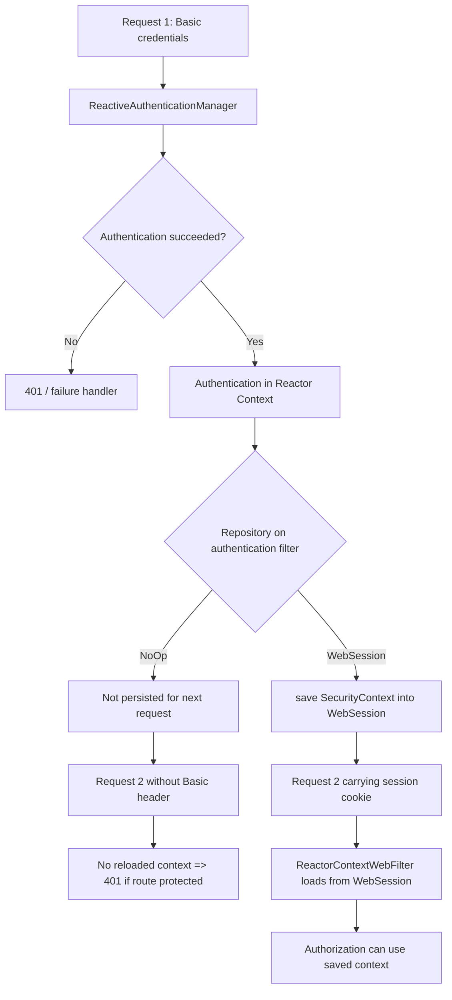

# Choosing Whether to Persist Security Context with HTTP Basic in Spring Security Reactive

In **Spring Security Reactive (Spring WebFlux)**, HTTP Basic reads credentials from the `Authorization: Basic ...` header and verifies username/password for the request. After successful authentication, Spring Security can place `Authentication` into `SecurityContext` inside the **Reactor Context** so controllers and authorization can read it during the **current request**. An independent decision is whether to **persist** `SecurityContext` for reuse on subsequent requests.

The two options behave very differently:

- **Do not persist** (usually suitable for APIs called by tools/apps sending Basic credentials on every request): `Authentication` is only valid within the current request pipeline; a new request without credentials will be challenged again.
- **Persist with WebSession** (only when you genuinely want server-side login state): after one valid HTTP Basic request, the context can be saved in `WebSession`; a subsequent request carrying the session cookie can be recognized even **without** re-sending the Basic header.

This lesson covers separate load/save mechanics, Spring Boot 3.x / Spring Security 6.x configuration examples on Java 17+, how to test with `curl` and `WebTestClient`, CSRF risks, logout implications, and common misconfigurations.

> Scope is **Spring WebFlux**, not Servlet. Use `ServerHttpSecurity`, `SecurityWebFilterChain`, `ServerSecurityContextRepository`, and `ReactiveSecurityContextHolder`. APIs like `HttpSecurity`, `HttpSessionSecurityContextRepository`, ThreadLocal-based `SecurityContextHolder`, and `SessionCreationPolicy.STATELESS` belong to Servlet configuration; do not copy them directly to WebFlux.

## 1. What does HTTP Basic solve, and what does it not solve?

A client sends a username/password pair in the HTTP Basic header. Structural example (the actual value must be Base64-encoded from `username:password`):

```http
GET /secure/whoami HTTP/1.1
Host: localhost:8080
Authorization: Basic <base64-of-username-colon-password>
```

**Base64 is only representational encoding, not security encryption.** Anyone who obtains the header can decode the credentials back; use Basic only over **HTTPS/TLS**, and never put the header in logs, URLs, tracing, or message queues. A client can resend Basic on every request; browsers may remember and automatically resend entered credentials within the protection space.

In WebFlux, the typical authentication flow includes:

1. `WebFilterChainProxy` selects the matching `SecurityWebFilterChain`.
2. The HTTP Basic filter reads the header and creates an unauthenticated `Authentication`.
3. `ReactiveAuthenticationManager` verifies credentials against the user store and `PasswordEncoder`.
4. If successful, the verified `Authentication` is attached to `SecurityContext` for downstream stages of the current **subscription**.
5. Authorization evaluates the user/permissions; controllers can read `ReactiveSecurityContextHolder.getContext()`.
6. **Only when a persistence mechanism is configured** is the result saved for a later request to reload.

If neither credentials nor a saved context are present, endpoints requiring authentication typically return `401 Unauthorized` with `WWW-Authenticate: Basic ...`. If credentials are wrong, Basic authentication fails; no fake authenticated context is granted. If credentials are valid but a role is missing, the result is usually `403 Forbidden`.

HTTP Basic is not session login: by protocol, every request can independently carry credentials. However, **an application can intentionally pair HTTP Basic with WebSession**. When doing so, the lifetime of the authenticated result changes and must be tested and accepted as an architectural choice.

## 2. Distinguishing "having a context in the request" from "persisting context across requests"

Two concepts are frequently confused:

**A. Context within the current request.** After HTTP Basic succeeds, `AuthenticationWebFilter`/the success flow makes `Authentication` available in the Reactor Context for downstream operators. Controllers access it via:

```java
// Integration snippet inside a reactive handler/service with imports already present:
Mono<String> currentUser =
    ReactiveSecurityContextHolder.getContext()
        .map(ctx -> ctx.getAuthentication().getName());
```

`ReactiveSecurityContextHolder` is in package `org.springframework.security.core.context`. The context follows the **subscription** and works across Reactor scheduler boundaries when the chain is properly composed. It does not require session persistence and does not become a Servlet `ThreadLocal`.

**B. Whether the context exists on the next request.** The next request has a new subscription. It only has authentication if one of the following occurs:

- The client resends Basic credentials and the manager re-authenticates;
- A repository loads a saved `SecurityContext` from the session, if the cookie/session is still valid;
- Another authentication mechanism in the chain is configured and succeeds.

Merely calling `.securityContextRepository(...)` does not make an `Authentication` appear out of thin air, nor does it prove credentials were saved. **Creating**, **attaching**, **saving**, and **reloading** are distinct steps.



The diagram shows the lesson's simple cases: the second request sends no Basic header and no other auth mechanism applies. For a request **with** a Basic header, the Basic filter can still authenticate based on the submitted header even if a session exists; sending **wrong** credentials does not guarantee being "forgiven" just because a session exists.

## 3. Which repository loads, and which repository saves?

The core API is `org.springframework.security.web.server.context.ServerSecurityContextRepository`. Its contract:

```java
// Illustrative API signatures; do not recreate this interface.
Mono<Void> save(ServerWebExchange exchange, SecurityContext context);
Mono<SecurityContext> load(ServerWebExchange exchange);
```

There are two key implementations:

| Implementation | `load(exchange)` | `save(exchange, context)` | Suitable model |
| --- | --- | --- | --- |
| `NoOpServerSecurityContextRepository` | Does not look up persisted context | Does not save | Do not want to keep login state across requests |
| `WebSessionServerSecurityContextRepository` | Reads context from WebSession bound to exchange | Saves context into WebSession | Want later requests to reuse login session |

`NoOpServerSecurityContextRepository` does not eliminate all sessions in the application. Components like request caches, CSRF token repositories, app code using `WebSession`, or another chain may still create sessions. NoOp only governs **how that repository loads/saves SecurityContext**.

`WebSessionServerSecurityContextRepository` stores the context in `WebSession`; when saving a context, the implementation rotates the session ID to mitigate session fixation risks. How long sessions live, which attributes cookies carry, and whether to use local or distributed session stores require separate configuration and operations.

### Two configuration spots easily missed in WebFlux

For HTTP Basic, Spring Security 6.x has **two different APIs**:

```java
http.securityContextRepository(repository);
```

This line selects the repository that **`ReactorContextWebFilter` uses to load** `SecurityContext` into the request's Reactor Context (load-side). Per the `ServerHttpSecurity` Javadoc, it **does not automatically control** how every authentication filter saves its result.

```java
http.httpBasic(basic ->
    basic.securityContextRepository(repository));
```

This line selects the repository used to **save** `SecurityContext` after HTTP Basic succeeds (save-side). The `ServerHttpSecurity.HttpBasicSpec` Javadoc notes that HTTP Basic's default save repository is `NoOpServerSecurityContextRepository`, and explicitly states that the load-side in `ReactorContextWebFilter` is not automatically wired to the save-side.

**To persist HTTP Basic to subsequent requests, you must configure both load and save.** To avoid mismatches, pass **the exact same `WebSessionServerSecurityContextRepository` instance** to both places. Conversely, to explicitly indicate not persisting Basic context, use NoOp in both places, then review whether other features create sessions.

A system with multiple `SecurityWebFilterChain` beans can configure different repositories per chain. Never assume one chain's configuration applies to all requests.

## 4. Which approach should you choose?

| Criterion | Do not persist Basic context | Persist Basic context in WebSession |
| --- | --- | --- |
| New request without Basic and without valid cookie | `401` on protected routes | `401` |
| New request carrying session cookie from prior Basic call, no Basic | Still needs credentials unless another mechanism exists | Can continue with `Authentication` loaded from session |
| New request carrying valid Basic | Authenticates using the request's credentials | Can authenticate via Basic, and can save/update context |
| Server state dependency | No need to store Basic login state | Needs session store, timeout, and invalidation policy |
| Multi-instance scaling | Simpler authentication state | Requires session consistency/replication design when needed |
| Immediate access revocation | Re-checks user/password per policy on re-authentication | Cached session context may retain old authorities until refreshed/invalidated |
| Logout | No Basic login session to clear | Needs session termination mechanism, though browsers may keep resending Basic |
| Common use cases | Service/API scripts, CLIs, per-request Basic systems | Scenarios intentionally transitioning from Basic into session state |

**Default recommendation for Basic APIs:** do not persist SecurityContext across requests if clients already send credentials on every request and login sessions are unnecessary. This is easier to reason about for request independence and avoids unexpected login sessions.

**Only persist to WebSession when explicitly required**, such as browsers designed to keep calling APIs via session cookies, application requirements needing server-side login state, or legacy compatibility. Evaluate CSRF, cookies, logout, session fixation, and role revocation consequences. In many interactive web designs, **form login or OAuth2/OIDC login** fits better than turning HTTP Basic into "log in once then use a cookie".

Do not choose "persist" just to skip sending a header during a quick test call. Whether clients actively send Basic credentials should be decided by the API contract.

## 5. Complete example: switching modes via Spring profiles

We will build a small application with **one Basic configuration using NoOp** and **one Basic configuration using WebSession**. Only **one profile** is active at runtime: `stateless` or `session`. Each profile registers **one** `SecurityWebFilterChain` matching the app's routes. They share the same demo user and controller to observe the difference.

Requirements: Java 17+, Spring Boot 3.x / Spring Security 6.x, Gradle configured with the Spring Boot plugin and repositories. Required dependencies in `build.gradle`:

```groovy
dependencies {
    implementation 'org.springframework.boot:spring-boot-starter-webflux'
    implementation 'org.springframework.boot:spring-boot-starter-security'
    testImplementation 'org.springframework.boot:spring-boot-starter-test'
}
```

Do not add `spring-boot-starter-web` just to run this example because the target is Spring WebFlux.

### File 1 — `src/main/java/demo/basic/BasicContextApplication.java`

```java
package demo.basic;

import org.springframework.boot.SpringApplication;
import org.springframework.boot.autoconfigure.SpringBootApplication;

@SpringBootApplication
public class BasicContextApplication {
    public static void main(String[] args) {
        SpringApplication.run(BasicContextApplication.class, args);
    }
}
```

### File 2 — `src/main/java/demo/basic/BasicSecurityConfig.java`

```java
package demo.basic;

import org.springframework.context.annotation.Bean;
import org.springframework.context.annotation.Configuration;
import org.springframework.context.annotation.Profile;
import org.springframework.security.config.annotation.web.reactive.EnableWebFluxSecurity;
import org.springframework.security.config.web.server.ServerHttpSecurity;
import org.springframework.security.core.userdetails.ReactiveUserDetailsService;
import org.springframework.security.core.userdetails.User;
import org.springframework.security.core.userdetails.UserDetails;
import org.springframework.security.crypto.factory.PasswordEncoderFactories;
import org.springframework.security.crypto.password.PasswordEncoder;
import org.springframework.security.provisioning.MapReactiveUserDetailsService;
import org.springframework.security.web.server.SecurityWebFilterChain;
import org.springframework.security.web.server.context.NoOpServerSecurityContextRepository;
import org.springframework.security.web.server.context.WebSessionServerSecurityContextRepository;

@Configuration
@EnableWebFluxSecurity
public class BasicSecurityConfig {

    @Bean
    PasswordEncoder passwordEncoder() {
        return PasswordEncoderFactories.createDelegatingPasswordEncoder();
    }

    @Bean
    ReactiveUserDetailsService users(PasswordEncoder encoder) {
        UserDetails reader = User.withUsername("reader")
            .password(encoder.encode("demo123"))
            .roles("READER")
            .build();
        return new MapReactiveUserDetailsService(reader);
    }

    // Mode 1: Basic result serves only the current request.
    @Bean
    @Profile("stateless")
    SecurityWebFilterChain statelessBasic(ServerHttpSecurity http) {
        var repo = NoOpServerSecurityContextRepository.getInstance();

        return http
            .authorizeExchange(exchanges -> exchanges
                .pathMatchers("/public/**").permitAll()
                .anyExchange().authenticated())
            .securityContextRepository(repo) // LOAD: do not load old context
            .httpBasic(basic ->
                basic.securityContextRepository(repo)) // SAVE: do not persist
            .formLogin(form -> form.disable())
            .requestCache(cache -> cache.disable())
            .build();
    }

    // Mode 2: Basic result is saved and loaded via WebSession.
    @Bean
    @Profile("session")
    SecurityWebFilterChain sessionBasic(ServerHttpSecurity http) {
        var repo = new WebSessionServerSecurityContextRepository();

        return http
            .authorizeExchange(exchanges -> exchanges
                .pathMatchers("/public/**").permitAll()
                .anyExchange().authenticated())
            .securityContextRepository(repo) // LOAD from WebSession
            .httpBasic(basic ->
                basic.securityContextRepository(repo)) // SAVE into WebSession
            .formLogin(form -> form.disable())
            .requestCache(cache -> cache.disable())
            .build();
    }
}
```

**What to observe:** The two chain beans are mutually exclusive via `@Profile`. In each configuration, we set both the **load repository** on `ServerHttpSecurity` and the **save repository** on `HttpBasicSpec`. If another profile simultaneously registers an overlapping chain, behavior can change depending on matchers/order; this example assumes only **one** profile is active with no other chains.

`PasswordEncoderFactories.createDelegatingPasswordEncoder()` uses a suitable password hash for the demo, and Spring Security verifies against stored data. Username/password `reader/demo123` is for local machines only, never production. The example **does not disable CSRF** because HTTP Basic can also be auto-sent by browsers; the demo endpoints are GET, so CSRF protection does not block testing.

`NoOpServerSecurityContextRepository` means **do not save Basic results for later requests**, not "clear authentication within the current request". `WebSessionServerSecurityContextRepository` means **the context can be reused across the session** after successful authentication.

### File 3 — `src/main/java/demo/basic/BasicController.java`

```java
package demo.basic;

import org.springframework.security.core.context.ReactiveSecurityContextHolder;
import org.springframework.web.bind.annotation.GetMapping;
import org.springframework.web.bind.annotation.RestController;
import reactor.core.publisher.Mono;

@RestController
public class BasicController {

    @GetMapping("/public/ping")
    public Mono<String> ping() {
        return Mono.just("pong");
    }

    @GetMapping("/secure/whoami")
    public Mono<String> whoami() {
        return ReactiveSecurityContextHolder.getContext()
            .map(ctx -> ctx.getAuthentication().getName());
    }
}
```

`whoami()` does not read the Basic header and does not construct `Authentication`. It reads the result placed into the Reactor Context by Spring Security filters. Because of `.anyExchange().authenticated()`, protected routes must clear security before the controller is invoked.

Expected output upon successful authentication:

```text
reader
```

The controller returns a verified name provided by Spring Security. Never return `Authentication`, `UserDetails`, or password hashes directly in JSON responses.

## 6. Testing the **non-persisting** mode with `curl`

Run the application with the `stateless` profile. From the project directory containing the Gradle wrapper:

```bash
# Linux/macOS
./gradlew bootRun --args="--spring.profiles.active=stateless"

# Windows
gradlew.bat bootRun --args="--spring.profiles.active=stateless"
```

Open another terminal and invoke sequentially:

```bash
curl -i http://localhost:8080/public/ping

curl -i http://localhost:8080/secure/whoami

curl -i -u reader:demo123 \
  -c basic-cookies.txt \
  http://localhost:8080/secure/whoami

curl -i -b basic-cookies.txt \
  http://localhost:8080/secure/whoami
```

Logical results to observe:

| Call | Expected result | Reason |
| --- | --- | --- |
| `/public/ping` without credentials | `200 OK`, body `pong` | Permitted by `permitAll` |
| `/secure/whoami` without credentials | `401 Unauthorized` | Unauthenticated, no saved context |
| `/secure/whoami` with `-u reader:demo123` | `200 OK`, body `reader` | Basic authenticates directly on this request |
| `/secure/whoami` with `-b basic-cookies.txt` but **without** `-u` | `401 Unauthorized` | NoOp repository does not restore Basic authentication |

`-u` tells `curl` to send HTTP Basic; the lesson uses demo credentials. `-c` writes cookies sent by the server, and `-b` sends cookies back on the next request. In this setup, **do not rely on the presence/absence of cookies to prove NoOp**, because another feature could create a WebSession. What matters is that even if any cookies are sent back, prior Basic authentication alone **is not persisted** through the NoOp repository.

The valid Basic call still has a `SecurityContext` during **that request**: the controller returned `reader`. What is absent is automatic reloading of the authenticated result from the previous request.

If the password changes in the user store, a new request with old credentials undergoes fresh verification (subject to any external caching/replication). There is no Basic login session state to silently reuse a saved authentication.

## 7. Testing the **WebSession-persisting** mode with `curl`

Stop the app running the `stateless` profile, then run it **again** with the `session` profile:

```bash
# Linux/macOS
./gradlew bootRun --args="--spring.profiles.active=session"

# Windows
gradlew.bat bootRun --args="--spring.profiles.active=session"
```

Invoke:

```bash
# Call 1: send Basic credentials to establish authentication.
curl -i -u reader:demo123 \
  -c session-cookies.txt \
  http://localhost:8080/secure/whoami

# Call 2: send only the cookie returned by the server; DO NOT send -u.
curl -i -b session-cookies.txt \
  http://localhost:8080/secure/whoami

# Call 3: send neither credentials nor cookies.
curl -i http://localhost:8080/secure/whoami
```

Expected results in a normally functioning demo app using a WebSession store:

| Call | Expected status | Explanation |
| --- | --- | --- |
| Valid Basic + `-c session-cookies.txt` | `200 OK` | Security saves context in WebSession; server issues/maintains session cookie |
| Cookie only with `-b session-cookies.txt` | `200 OK` | `ReactorContextWebFilter` loads context and authorization recognizes the user |
| No Basic and no cookie | `401 Unauthorized` | Request has no authenticated identity |

The body in both successful requests is `reader`. Spring WebFlux's default session cookie is usually named `SESSION`, though customizable; `curl` uses a cookie jar so it does not depend on a hardcoded name. Cookies must be sent back to the right domain/path while the session remains valid.

Why isn't configuring only `.httpBasic(basic -> basic.securityContextRepository(repo))` enough? Because the Basic filter may **save** the context, yet **subsequent requests fail to reload it** if `ReactorContextWebFilter` uses a different repository. Conversely, configuring only `http.securityContextRepository(repo)` lets it **load** an existing context, while the Basic filter defaults to NoOp for **saving** and thus never creates a session upon success. Both sides must align if the goal is persisting Basic logins.

**An accurate explanation:** when session mode receives the second request **without a Basic header**, the app is not "re-authenticating with the password"; it is **relying on the authentication result saved** from the previous request in the session. This is a different security model from non-persisted Basic.

## 8. Integration testing with `WebTestClient`

HTTP scenarios should be automated to catch misconfigurations during refactoring. The two test classes below use **the same application** but boot two Spring test contexts under two different profiles.

`build.gradle` already includes `spring-boot-starter-test`. Place tests in `src/test/java/demo/basic/` and run with Gradle. The tests verify **session behavior across requests**, not just whether a setter was invoked.

### `StatelessBasicTest.java`

```java
package demo.basic;

import org.junit.jupiter.api.Test;
import org.springframework.beans.factory.annotation.Autowired;
import org.springframework.boot.test.context.SpringBootTest;
import org.springframework.boot.test.autoconfigure.web.reactive.AutoConfigureWebTestClient;
import org.springframework.test.context.ActiveProfiles;
import org.springframework.test.web.reactive.server.WebTestClient;

@SpringBootTest(webEnvironment = SpringBootTest.WebEnvironment.RANDOM_PORT)
@AutoConfigureWebTestClient
@ActiveProfiles("stateless")
class StatelessBasicTest {

    @Autowired
    WebTestClient client;

    @Test
    void cannotReuseBasicAuthenticationViaCookies() {
        var first = client.get().uri("/secure/whoami")
            .headers(headers -> headers.setBasicAuth("reader", "demo123"))
            .exchange()
            .expectStatus().isOk()
            .expectBody(String.class).isEqualTo("reader")
            .returnResult();

        // Explicitly forward all response cookies, if any,
        // but the new request has no Authorization header.
        var second = client.get().uri("/secure/whoami");
        first.getResponseCookies().forEach((name, cookies) ->
            cookies.forEach(cookie ->
                second.cookie(name, cookie.getValue())));

        second.exchange().expectStatus().isUnauthorized();
    }

    @Test
    void requiresValidBasicCredentials() {
        client.get().uri("/secure/whoami")
            .headers(headers -> headers.setBasicAuth("reader", "wrong"))
            .exchange()
            .expectStatus().isUnauthorized();
    }
}
```

The first test proves **authentication does not persist to subsequent requests**, even when forwarding every cookie from the prior response to the new request. The second test proves wrong passwords are rejected. A successful request having `getContext()` in the Reactor Context does **not** conflict with rejecting the next request.

### `SessionBasicTest.java`

```java
package demo.basic;

import org.junit.jupiter.api.Test;
import org.springframework.beans.factory.annotation.Autowired;
import org.springframework.boot.test.context.SpringBootTest;
import org.springframework.boot.test.autoconfigure.web.reactive.AutoConfigureWebTestClient;
import org.springframework.test.context.ActiveProfiles;
import org.springframework.test.web.reactive.server.WebTestClient;

import static org.junit.jupiter.api.Assertions.assertFalse;

@SpringBootTest(webEnvironment = SpringBootTest.WebEnvironment.RANDOM_PORT)
@AutoConfigureWebTestClient
@ActiveProfiles("session")
class SessionBasicTest {

    @Autowired
    WebTestClient client;

    @Test
    void reusesVerifiedAuthenticationViaWebSession() {
        var first = client.get().uri("/secure/whoami")
            .headers(headers -> headers.setBasicAuth("reader", "demo123"))
            .exchange()
            .expectStatus().isOk()
            .expectBody(String.class).isEqualTo("reader")
            .returnResult();

        assertFalse(first.getResponseCookies().isEmpty(),
            "Successful Basic authentication should create a session cookie");

        // Next request carries only the cookie, without resending Basic.
        var second = client.get().uri("/secure/whoami");
        first.getResponseCookies().forEach((name, cookies) ->
            cookies.forEach(cookie ->
                second.cookie(name, cookie.getValue())));

        second.exchange()
            .expectStatus().isOk()
            .expectBody(String.class).isEqualTo("reader");
    }

    @Test
    void absentCredentialsAndSessionAreRejected() {
        client.get().uri("/secure/whoami")
            .exchange()
            .expectStatus().isUnauthorized();
    }
}
```

Run both test classes:

```bash
# Linux/macOS
./gradlew test --tests 'demo.basic.StatelessBasicTest' \
  --tests 'demo.basic.SessionBasicTest'

# Windows (single line)
gradlew.bat test --tests "demo.basic.StatelessBasicTest" --tests "demo.basic.SessionBasicTest"
```

Note that the two test contexts use different profiles; do not run the app with both `stateless,session` active simultaneously, as that would register two chains matching the same requests and defeat the example. These tests are runnable templates on a properly configured project; build task counts/logs may differ, while the assertions above reflect the intended contract.

## 9. CSRF: why using HTTP Basic does not mean you can disable CSRF

HTTP Basic has a common trap: once a browser caches Basic credentials for a protection space, the browser **can automatically resend** the `Authorization` header. When a malicious page triggers a state-changing request to the same site, those auto-sent credentials can create a **CSRF risk**, even if the application uses no session cookies.

Therefore:

- Do not enable `csrf.disable()` solely because an HTTP Basic API does not persist `SecurityContext`.
- If the API serves only controlled **non-browser clients** where `Authorization` is explicitly added by client code, you can evaluate disabling CSRF on a **dedicated security chain** after reviewing the threat model.
- If browsers, session cookies, or browser-cached Basic credentials are involved, keep CSRF for state-changing HTTP methods; use an appropriate CSRF token/origin policy.
- If the system persists HTTP Basic context into WebSession, the cookie becomes the authentication credential for subsequent requests. CSRF is then a direct concern just like in other session-based apps.

The example **does not disable CSRF** in either profile because the learning endpoints only use `GET`. Spring Security Reactive enables CSRF protection by default. When adding `POST`/`PUT`/`DELETE`, clients/browsers must satisfy CSRF policy, or the API architecture must explicitly define the scope and rationale for exclusion.

Distinguish **CORS** from CSRF: CORS controls whether JavaScript from another origin can read/use certain responses; it does not replace defenses against forged requests carrying auto-sent credentials.

## 10. Logout, session invalidation, and "cached Basic credentials" are three different things

When using NoOp, there is no saved **Basic login context** to "log out" from the repository. When the client stops sending Basic credentials, the next request fails to authenticate, assuming no other mechanism exists. If a browser remembers the username/password, it may **keep sending the Basic header** on new requests; the server cannot simply command every browser to forget cached passwords the way regular session logout works.

When using WebSession:

1. You may need a logout/session-termination endpoint, timeout policies, and session invalidation.
2. Invalidating the WebSession ensures the saved context is no longer reloaded when the client sends only the old cookie.
3. **However, if the client still sends valid Basic credentials**, the Basic filter can authenticate **again**, build a new context, and even save a new session. Thus "deleting cookies" or "invalidating the session" does not disable the Basic password.
4. If access must be revoked immediately, consider locking the user, changing the password, checking account status, limiting concurrent sessions/logins, and updating stored authorities.

For browser applications with real logout requirements, form login or OAuth2/OIDC is usually far more convenient. If you still want HTTP Basic + session, clearly document behavior when users close tabs, log out, and when browsers auto-resend credentials.

Persisting `SecurityContext` containing overly large `UserDetails` or sensitive data can widen data exposure. Store only the verified principal and necessary authorities; never store raw passwords or full HTTP Basic headers in sessions. Session lifetimes, multi-node synchronization, and permission updates are separate operational decisions.

## 11. SecurityContext is not identical to WebSession for the whole app

Common misconceptions to avoid:

**Misconception 1: `.securityContextRepository(NoOp...)` guarantees no session exists anywhere.** False. NoOp applies only to SecurityContext in that repository. `WebSession` can still be created by app handlers, CSRF token repositories, request caches, other modules, or other chains.

**Misconception 2: Successful Basic authentication must produce a cookie.** False. Under NoOp, `Authentication` still works within the current request, without persisting. The existence of a cookie is not the sole indicator of authentication state.

**Misconception 3: Setting only `http.securityContextRepository(webSessionRepo)` makes Basic auto-save.** False: that configures **loading** for `ReactorContextWebFilter`; Basic needs save-side via `HttpBasicSpec.securityContextRepository(...)` in Spring Security 6.x.

**Misconception 4: Setting only `httpBasic(...securityContextRepository(webSessionRepo))` makes later requests auto-load.** Not guaranteed if the load-side uses a different repository. The two spots are not automatically linked.

**Misconception 5: `isAuthenticated()==true` always means a real logged-in user.** Anonymous authentication can have that flag set true yet still be distinguished from authenticated users by the framework. Use `authorizeExchange(...authenticated())`/role/scope policies rather than checking this boolean manually to open access.

**Misconception 6: WebFlux uses Servlet's `HttpSessionSecurityContextRepository`.** False. For WebFlux, use `WebSessionServerSecurityContextRepository` and `ServerSecurityContextRepository`, not Servlet's `HttpSession`/`SecurityContextRepository`.

**Misconception 7: Saving a session re-checks username/password on every request.** False. When a later request sends only a cookie, the app can use the saved authentication **without** re-verifying the password. This must be accounted for when accounts are locked or roles change.

**Misconception 8: Not saving a session makes every request secure.** False. Basic repeats the password on every request, creating risks without HTTPS, from header logging, credential replay, or brute force. TLS, password policies, rate limiting, and auditing remain essential.

## 12. When you have multiple SecurityWebFilterChains

The example above uses profiles to compare two options. A real app may have multiple chains—for instance, `/api/**` using non-persisted Basic and `/ui/**` using form login with WebSession. In that case:

- Use `securityMatcher` to target each `SecurityWebFilterChain`'s request group.
- Use `@Order` so specific chains are evaluated before fallback chains.
- Configure **the load repository and the authentication filter's save repository** properly on each chain.
- Never place a default catch-all chain ahead of `/api/**`, which would prevent the API policy from ever being selected.
- Never assume a UI `WebSession` automatically grants access to the API if the API chain uses NoOp; conversely, an API receiving HTTP Basic does not automatically create a browser login session if save-side is NoOp.
- Test one request per matcher, covering both with/without Basic and with/without cookies.

This is an **architectural note**, not a requirement to have multiple chains. When first learning the load/save distinction, the independent profile example in section 5 is easier to observe.

## 13. Diagnosing unexpected behavior

### Case A: Valid Basic returns 200, subsequent cookie-only request returns 401

Check in order:

1. Is the Basic filter configured with `httpBasic(basic -> basic.securityContextRepository(webSessionRepo))` to **save**?
2. Is `ServerHttpSecurity.securityContextRepository(webSessionRepo)` configured so `ReactorContextWebFilter` **loads**?
3. Do both point to compatible repository settings (session attribute name, session store, cookie scope)?
4. Did the first response actually save/issue a session cookie? Does the client send the cookie back for the right domain/path and SameSite/Secure policy?
5. Did the session expire, get invalidated, or fail to save to the backing store?
6. Did the request hit **a different security chain**?

Do not hack around this by manually calling `ReactiveSecurityContextHolder.withAuthentication(...)` in a controller or manually `.subscribe()`ing a stray context save; that does not replace proper persistence.

### Case B: Set NoOp yet still see cookies or sessions

Inspect other features using `WebSession`, request caches, CSRF, form/OAuth2 login, custom WebFilters, and other chains. If the goal is "strictly zero WebSessions", analyze **the entire application**; NoOp is only one piece of that requirement.

### Case C: Cookie still exists but API suddenly returns 401/403

Possible causes: session expired, unable to read store, wrong repository/matcher, stored info invalidated, user locked if re-checked, or authorization rules changed. `401` usually indicates missing/invalid authentication; `403` usually indicates missing permissions or CSRF, though inspect request methods, headers, and security logs.

### Case D: Browser immediately gets back in after "logout"

The browser may still be sending valid Basic credentials, causing the app to re-authenticate. Check whether the new request has `Authorization: Basic ...` (check presence/absence only; **never log the header value**), whether the old session was invalidated, and whether the logout policy fits Basic.

### Observing with tools

Use `WebTestClient` or `curl -i` to verify:

- Does the first request include `Authorization`?
- Does the next request carry only the cookie, or accidentally still carry `Authorization`?
- Are statuses/bodies correctly 200/401/403?
- Was `Set-Cookie` sent when saving the session, and was that cookie sent back?
- Which chain did the request enter, and does it have the corresponding load/save repositories?

You can temporarily enable logging in development:

```properties
logging.level.org.springframework.security=DEBUG
```

Turn it off once diagnosis is complete, and never log raw passwords, `Authorization`, cookies, or session IDs. To measure session behavior, write integration tests using a cookie jar. Do not rely on thread names to understand `ReactiveSecurityContextHolder`.

## 14. Pre-deployment checklist

| Question | Why a decision is needed? |
| --- | --- |
| Are API clients scripts/servers or browsers? | Browsers can auto-send Basic credentials/cookies, introducing CSRF |
| Must every new request carry a Basic header? | If yes, NoOp aligns with the authentication semantics |
| Do we genuinely need log-in-once then use a session? | If yes, both save and load must use the same policy |
| Do load-side and save-side match? | Prevents saving without loading or vice versa |
| Is HTTPS enforced everywhere? | Basic carries passwords decodable from Base64 |
| Is CSRF protected for browsers/unsafe methods? | Both browser Basic and session cookies can be exploited |
| What are session TTL, logout, and user/role revocation? | Persisting context extends authentication lifetime |
| Does the session store support multiple instances? | Sticky sessions or distributed stores depending on architecture |
| Does `Authentication` hold unneeded passwords/tokens/PII? | Reduces risk of storing and propagating sensitive data |
| Did we test cookie-only calls after the initial Basic call? | This is the decisive test verifying persistence vs. non-persistence |
| Do multiple chains overlap? | An out-of-order chain can break context policy |
| Do logs/metrics contain credentials? | Ensure no secrets leak during debugging |

## 15. Self-assessment questions

**Question 1.** `httpBasic()` succeeds while `NoOpServerSecurityContextRepository` is used. Can the controller read `Authentication` during that same request?  
**Yes.** Spring Security still provides the verified authentication in the downstream Reactor Context. NoOp only skips persisting it across other requests.

**Question 2.** To save Basic into WebSession, is calling `http.securityContextRepository(webSessionRepo)` alone enough?  
**No.** You must configure **save-side** at `httpBasic(basic -> basic.securityContextRepository(webSessionRepo))` and **load-side** at `http.securityContextRepository(webSessionRepo)`.

**Question 3.** Once a session saves the context, will a subsequent request without a Basic header always succeed?  
**Not always.** There must be a valid cookie/session, the request must hit a chain that loads the session, authorization must permit access, and no other filter may reject it.

**Question 4.** With NoOp configured, can we guarantee the whole app never creates a WebSession?  
**No.** Other features and handlers can still use WebSession; NoOp only applies to SecurityContext for that repository.

**Question 5.** Since HTTP Basic does not use cookies, can CSRF always be disabled?  
**No.** Browsers can automatically send Basic credentials; analyze clients and the threat model, especially for state-changing requests.

**Question 6.** After session logout, a browser resends a valid Basic header and logs in again. Does that mean session invalidation is broken?  
**No.** Basic is an independent authentication mechanism; the browser can auto-resend the password, creating a fresh authentication.

## Key takeaways

- **HTTP Basic authenticates every request that supplies credentials**; persisting `SecurityContext` is an additional application decision.
- **NoOp**: does not load/save Basic context across other requests, yet authentication still works in the Reactor Context of the **current request**.
- **WebSession**: lets verified results be reused via session cookies, bringing responsibilities for CSRF, timeouts, session stores, stale roles, and logout.
- **Must configure both sides**: `ServerHttpSecurity.securityContextRepository(...)` for **loading** via `ReactorContextWebFilter`, and `HttpBasicSpec.securityContextRepository(...)` for **saving** after Basic authentication.
- **Do not equate** "not saving SecurityContext" with "the app has no sessions". Do not equate session invalidation with clearing browser-remembered Basic passwords.
- Verify the decision with **two requests**: first with valid Basic, second with only the cookie (no Basic). Expected outcomes are `401` under NoOp and `200` under an active WebSession.
- Basic requires HTTPS, credential hygiene, and appropriate CSRF handling; API design differs from browser login UX.

### Official references

- [Spring Security 6.5 — `ServerHttpSecurity` (load-side `securityContextRepository` and HTTP Basic)](https://docs.spring.io/spring-security/reference/6.5/api/java/org/springframework/security/config/web/server/ServerHttpSecurity.html)
- [Spring Security 6.5 — `ServerHttpSecurity.HttpBasicSpec` (save-side, defaults to NoOp)](https://docs.spring.io/spring-security/site/docs/6.5.x/api/org/springframework/security/config/web/server/ServerHttpSecurity.HttpBasicSpec.html)
- [Spring Security 6.5 — `AuthenticationWebFilter` (success handler, repository)](https://docs.spring.io/spring-security/reference/6.5/api/java/org/springframework/security/web/server/authentication/AuthenticationWebFilter.html)
- [Spring Security — `ServerSecurityContextRepository` (load/save contract)](https://docs.spring.io/spring-security/reference/api/java/org/springframework/security/web/server/context/ServerSecurityContextRepository.html)
- [Spring Security — `NoOpServerSecurityContextRepository`](https://docs.spring.io/spring-security/reference/api/java/org/springframework/security/web/server/context/NoOpServerSecurityContextRepository.html)
- [Spring Security — `WebSessionServerSecurityContextRepository`](https://docs.spring.io/spring-security/reference/api/java/org/springframework/security/web/server/context/WebSessionServerSecurityContextRepository.html)
- [Spring Security — WebFlux CSRF](https://docs.spring.io/spring-security/reference/6.5/reactive/exploits/csrf.html)
