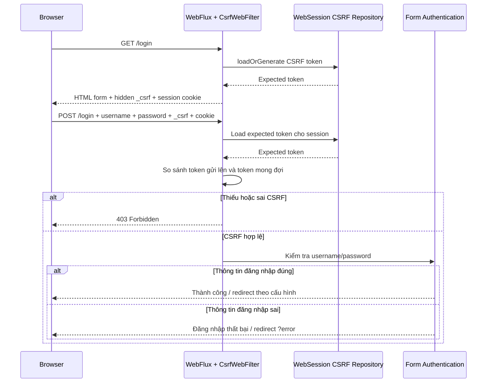

# Tích hợp CSRF token vào biểu mẫu đăng nhập trong Spring Security Reactive

Một biểu mẫu đăng nhập của **Spring WebFlux** thường gửi `username` và `password` bằng `POST /login`. Spring Security Reactive xác thực hai trường này, nhưng trước khi cho phép xử lý yêu cầu POST, hệ thống còn kiểm tra **CSRF token**. Đó là lý do một form có username/password hoàn toàn đúng vẫn có thể trả **403 Forbidden**: request không mang CSRF token hợp lệ, hoặc token không khớp với trạng thái mà máy chủ mong đợi.

Bài này hướng dẫn đầy đủ cách tích hợp CSRF token vào **form login reactive**: lý do cần bảo vệ ngay cả khi người dùng chưa đăng nhập, cách `CsrfWebFilter` sinh/kiểm tra token, cách Thymeleaf tự chèn hidden input, cách tự hiển thị token cho form tùy biến, cách gửi token bằng JavaScript/header, kiểm thử bằng trình duyệt, `curl` và `WebTestClient`, cùng những lỗi triển khai thường gặp.

**Phạm vi kỹ thuật:** Java 17+, Spring Boot 3.x, Spring Security 6.x, Spring WebFlux (Reactor). Dùng `ServerHttpSecurity`, `SecurityWebFilterChain`, `ServerCsrfTokenRepository`, `CsrfToken` và `ServerWebExchange`. Không sao chép các API `HttpSecurity`, `HttpServletRequest`, `CsrfTokenRepository` của Servlet MVC vào ví dụ WebFlux.

## 1. Vì sao chính trang đăng nhập cũng cần CSRF?

**CSRF — Cross-Site Request Forgery** — là kiểu tấn công khiến trình duyệt của nạn nhân gửi yêu cầu đến một ứng dụng mà nạn nhân đang sử dụng, trong khi yêu cầu được khởi tạo từ một trang không đáng tin. Rủi ro xuất hiện khi trình duyệt **tự đính kèm thông tin xác thực** như cookie phiên, hoặc trong một số trường hợp credentials đã được trình duyệt lưu.

Đối với đăng nhập, nguy cơ không chỉ là “kẻ lạ thay đổi dữ liệu của người đã đăng nhập”. Một kịch bản **login CSRF** là:

1. Kẻ tấn công sở hữu một tài khoản riêng ở ứng dụng đích.
2. Kẻ tấn công tìm cách ép trình duyệt nạn nhân gửi `POST /login` với credentials **của kẻ tấn công**.
3. Nếu ứng dụng chấp nhận POST đăng nhập mà không có CSRF token, trình duyệt nạn nhân có thể bị gắn vào **phiên của tài khoản kẻ tấn công**.
4. Nạn nhân tưởng đang dùng tài khoản của mình và nhập dữ liệu nhạy cảm vào phiên đó; dữ liệu có thể được ghi về tài khoản do kẻ tấn công kiểm soát.

Vì vậy **`POST /login` vẫn phải được bảo vệ CSRF**, dù bản thân người dùng chưa được xác thực. Spring Security WebFlux tự động áp dụng CSRF cho login theo chính sách mặc định.

CSRF token **không thay thế** password, MFA, kiểm tra tài khoản, chống brute force hoặc phân quyền. Nó chỉ giúp chứng minh rằng yêu cầu thay đổi trạng thái được tạo từ một luồng có quyền truy cập token hợp lệ của ứng dụng, thay vì chỉ dựa vào cookies/credentials mà browser tự gửi.

### Nguyên tắc về HTTP method

| Method | Ý nghĩa thông thường | Mặc định CSRF của Spring Security |
| --- | --- | --- |
| `GET`, `HEAD`, `OPTIONS`, `TRACE` | Chỉ đọc, không nên thay đổi trạng thái | Thường không yêu cầu CSRF token |
| `POST`, `PUT`, `PATCH`, `DELETE` | Có thể thay đổi trạng thái | Yêu cầu CSRF token nếu CSRF đang bật |
| `GET /login` | Hiển thị trang có form và token | Không cần gửi CSRF token để lấy trang |
| `POST /login` | Tạo/xác lập trạng thái đăng nhập | **Phải có CSRF token hợp lệ** |
| `POST /logout` | Kết thúc phiên | **Phải có CSRF token hợp lệ** |

“GET an toàn” là **quy ước bảo mật phải được ứng dụng tôn trọng**. Không đặt hành động đổi mật khẩu, ghi đơn hàng hay logout thật ở một URL GET chỉ vì GET không bị CSRF kiểm tra theo mặc định.

## 2. Từ GET form đến POST đăng nhập: vòng đời token



Điểm mấu chốt:

- **Token do server cấp** khi client tải trang form; không tự tạo chuỗi UUID hay `Math.random()` tại frontend để giả làm token.
- Browser cần gửi **cùng phiên/cookie phù hợp** với token đó. CSRF token hợp lệ nhưng thuộc một session khác vẫn có thể bị từ chối.
- Form phải gửi token trong **request parameter** hoặc header được cấu hình. Việc chỉ tồn tại một cookie CSRF không phải lúc nào cũng đủ: synchronizer-token pattern yêu cầu có giá trị được client chủ động đưa vào trường/header.
- CSRF được kiểm tra **trước** việc đăng nhập thành công. Sai token thường dẫn tới **403**, còn password sai sau khi CSRF đã hợp lệ đi theo **luồng lỗi xác thực**.
- Token có thể được tải/tạo **lazily** dưới dạng `Mono<CsrfToken>`; chỉ gọi một getter mà không subscribe publisher không đủ để token xuất hiện trong HTML.
- Login thành công có thể dẫn đến thay đổi session hoặc CSRF state theo cấu hình. Không cache mãi token từ một lần hiển thị form.

## 3. Các lớp/API cần biết trong Spring Security WebFlux

| API | Vai trò |
| --- | --- |
| `CsrfWebFilter` | Filter kiểm tra CSRF trên các request cần bảo vệ |
| `ServerCsrfTokenRepository` | Hợp đồng `generateToken`, `saveToken`, `loadToken` dựa trên `ServerWebExchange` |
| `WebSessionServerCsrfTokenRepository` | Repository mặc định, lưu token mong đợi vào `WebSession` |
| `CookieServerCsrfTokenRepository` | Tùy chọn lưu CSRF token trong cookie, thường cân nhắc khi JavaScript cần đọc/gửi token |
| `CsrfToken` | Chứa `getParameterName()`, `getHeaderName()` và `getToken()` |
| `ServerCsrfTokenRequestHandler` | Phơi bày token cho request/view và diễn giải token do client gửi |
| `XorServerCsrfTokenRequestAttributeHandler` | Handler mặc định từ Spring Security 6.0, thêm lớp biểu diễn XOR chống một số hình thức tấn công BREACH |
| `ServerCsrfTokenRequestAttributeHandler` | Handler đơn giản hơn, có thể cấu hình thay thế nhưng không có lớp XOR/BREACH tương tự |
| `ServerHttpSecurity.CsrfSpec` | DSL cấu hình CSRF cho một `SecurityWebFilterChain` |
| `CsrfRequestDataValueProcessor` | Kết nối Spring view rendering với việc thêm token vào form HTML |

Trong Spring Security 6.x, `CsrfWebFilter` đặt một **`Mono<CsrfToken>`** vào attribute của `ServerWebExchange` với khóa:

```java
CsrfToken.class.getName()
```

Nghĩa là key tương đương chuỗi `org.springframework.security.web.server.csrf.CsrfToken`, chứ không phải một thuộc tính Java Servlet request. View/Thymeleaf có thể subscribe và cung cấp token dưới dạng hidden field. Với các công nghệ view khác, bạn cần chủ động chuyển publisher thành giá trị mà template biết cách hiển thị.

### Token thật, giá trị hiển thị và token cookie

Từ Spring Security 6.0, `XorServerCsrfTokenRequestAttributeHandler` được dùng mặc định để bảo vệ tốt hơn trước rủi ro BREACH. Vì vậy, **giá trị token đã render trong HTML có thể là giá trị được che bằng XOR**, khác với token nền nằm trong repository. Spring Security biết cách diễn giải/mở lớp che khi request quay về.

Do đó, **đừng so sánh thủ công** chuỗi `value` của hidden input với giá trị trong `WebSession`/cookie rồi kết luận token sai. Đừng tự Base64, hash, XOR lần hai hoặc chỉnh sửa giá trị được render trước khi gửi. Với form bình thường, hãy gửi nguyên văn giá trị framework đưa ra.

Mặc định của repo WebSession phù hợp với form login server-rendered. Không cần bật cookie token hay tắt XOR chỉ để làm một form Thymeleaf hoạt động.

## 4. Ba điều kiện để một POST login có CSRF hợp lệ

Một form đăng nhập hoàn chỉnh có:

1. **Action và method đúng:** POST đến URL mà `ServerHttpSecurity.formLogin()` cấu hình, mặc định `/login` hoặc URL login tùy biến.
2. **Fields đăng nhập đúng:** mặc định `username` và `password`.
3. **CSRF token hợp lệ:** một hidden field có `name` bằng `CsrfToken.getParameterName()` (thường `_csrf`) và `value` bằng `CsrfToken.getToken()` được render cho request/phiên tương ứng.

Ví dụ **HTML đã được server render**:

```html
<form action="/login" method="post">
  <label>Tài khoản <input type="text" name="username"></label>
  <label>Mật khẩu <input type="password" name="password"></label>
  <input type="hidden" name="_csrf" value="TOKEN_FROM_CURRENT_PAGE">
  <button type="submit">Đăng nhập</button>
</form>
```

`TOKEN_FROM_CURRENT_PAGE` trong mẫu trên là **ký hiệu minh họa**, không phải giá trị có thể sử dụng để login. Trên trang thật, server/template sẽ thay bằng token động. Không đưa token thật vào tài liệu hoặc log.

**`GET /login` được `permitAll` không có nghĩa `POST /login` được miễn CSRF.** Authorization và CSRF là hai bước kiểm tra độc lập: cho phép người chưa đăng nhập truy cập trang login là đúng; bỏ CSRF trên thao tác tạo phiên đăng nhập là một thay đổi bảo mật khác hẳn.

## 5. Ví dụ chạy được: Spring Boot WebFlux + Thymeleaf tự chèn CSRF

Đây là đường đơn giản và nên dùng đầu tiên cho ứng dụng **server-rendered form login**. Ví dụ gồm các tệp Java 17+ và template HTML trong **dự án Spring Boot 3.x / Spring Security 6.x**.

### 5.1. Dependencies

Trong dự án Gradle đã có Spring Boot plugin và repositories:

```groovy
dependencies {
    implementation 'org.springframework.boot:spring-boot-starter-webflux'
    implementation 'org.springframework.boot:spring-boot-starter-security'
    implementation 'org.springframework.boot:spring-boot-starter-thymeleaf'

    testImplementation 'org.springframework.boot:spring-boot-starter-test'
    testImplementation 'org.springframework.security:spring-security-test'
}
```

Không thêm `spring-boot-starter-web` cho demo vì bài học dùng **Spring WebFlux**, không phải Spring MVC/Servlet. Giữ phiên bản các starter đồng bộ theo Spring Boot BOM của dự án.

### 5.2. `src/main/java/demo/csrf/CsrfLoginApplication.java`

```java
package demo.csrf;

import org.springframework.boot.SpringApplication;
import org.springframework.boot.autoconfigure.SpringBootApplication;

@SpringBootApplication
public class CsrfLoginApplication {
    public static void main(String[] args) {
        SpringApplication.run(CsrfLoginApplication.class, args);
    }
}
```

### 5.3. `src/main/java/demo/csrf/SecurityConfig.java`

```java
package demo.csrf;

import org.springframework.context.annotation.Bean;
import org.springframework.context.annotation.Configuration;
import org.springframework.security.config.Customizer;
import org.springframework.security.config.annotation.web.reactive.EnableWebFluxSecurity;
import org.springframework.security.config.web.server.ServerHttpSecurity;
import org.springframework.security.core.userdetails.ReactiveUserDetailsService;
import org.springframework.security.core.userdetails.User;
import org.springframework.security.core.userdetails.UserDetails;
import org.springframework.security.crypto.factory.PasswordEncoderFactories;
import org.springframework.security.crypto.password.PasswordEncoder;
import org.springframework.security.provisioning.MapReactiveUserDetailsService;
import org.springframework.security.web.server.SecurityWebFilterChain;

@Configuration
@EnableWebFluxSecurity
public class SecurityConfig {

    @Bean
    SecurityWebFilterChain securityWebFilterChain(ServerHttpSecurity http) {
        return http
            .authorizeExchange(exchanges -> exchanges
                .pathMatchers("/login", "/public/**").permitAll()
                .anyExchange().authenticated())
            .formLogin(form -> form.loginPage("/login"))
            .httpBasic(basic -> basic.disable())
            .csrf(Customizer.withDefaults())
            .logout(Customizer.withDefaults())
            .build();
    }

    @Bean
    ReactiveUserDetailsService users() {
        PasswordEncoder encoder =
            PasswordEncoderFactories.createDelegatingPasswordEncoder();

        UserDetails reader = User.withUsername("reader")
            .password(encoder.encode("demo123"))
            .roles("READER")
            .build();

        return new MapReactiveUserDetailsService(reader);
    }
}
```

Ý nghĩa của cấu hình:

- `.formLogin(form -> form.loginPage("/login"))`: ứng dụng **tự cung cấp trang `GET /login`**; cơ chế của Spring Security nhận POST login tương ứng. Vì đã chọn custom login page, đừng mong trang login mặc định tiếp tục được tạo.
- `.pathMatchers("/login", "/public/**").permitAll()`: người chưa đăng nhập vẫn truy cập được trang login. Rule này **không tắt CSRF**.
- `.csrf(Customizer.withDefaults())`: giữ CSRF mặc định, bao gồm bảo vệ POST login.
- `.httpBasic(...disable())`: tránh browser nhận thêm Basic prompt, để ví dụ chỉ tập trung vào form login.
- `.logout(Customizer.withDefaults())`: giữ xử lý logout có bảo vệ; nếu tạo custom logout form POST cũng phải gửi CSRF token.
- User `reader/demo123` phục vụ **demo cục bộ**. Password được mã hóa khi tạo user; không dùng cặp credentials này trong production.

### 5.4. `src/main/java/demo/csrf/LoginPageController.java`

```java
package demo.csrf;

import org.springframework.stereotype.Controller;
import org.springframework.web.bind.annotation.GetMapping;

@Controller
public class LoginPageController {
    @GetMapping("/login")
    public String loginPage() {
        return "login";
    }
}
```

Đây là `@Controller` trả **tên view**, không phải `@RestController` trả chuỗi HTML thuần. Spring Boot Thymeleaf sẽ tìm `src/main/resources/templates/login.html`.

### 5.5. `src/main/resources/templates/login.html`

```html
<!DOCTYPE html>
<html lang="vi" xmlns:th="http://www.thymeleaf.org">
<head>
    <meta charset="UTF-8">
    <title>Đăng nhập</title>
</head>
<body>
<h1>Đăng nhập</h1>

<p th:if="${param.error}">Thông tin đăng nhập không hợp lệ.</p>

<form th:action="@{/login}" method="post">
    <label for="username">Tên đăng nhập</label>
    <input id="username" name="username" type="text"
           autocomplete="username" required>

    <label for="password">Mật khẩu</label>
    <input id="password" name="password" type="password"
           autocomplete="current-password" required>

    <button type="submit">Đăng nhập</button>
</form>
</body>
</html>
```

**Tại sao template không có dòng `<input type="hidden"...>`?** Vì Thymeleaf tích hợp với `CsrfRequestDataValueProcessor`. Với form dùng `th:action` và method `post`, Thymeleaf có thể **tự chèn hidden input CSRF** khi render. Khi xem **HTML đã render** (không phải file template nguyên bản), bạn sẽ thấy một trường tương đương:

```html
<input type="hidden" name="_csrf" value="VALUE_GENERATED_FOR_THIS_REQUEST">
```

Giá trị thực sẽ khác chuỗi minh họa trên và có thể được biểu diễn dưới dạng XOR masked token. **Không cần tự thêm một hidden `_csrf` nữa** nếu integration tự động đã hoạt động; việc chèn trùng có thể dẫn đến nhiều giá trị `_csrf` và gây lỗi khó theo dõi.

Một nguyên tắc quan trọng khi dùng Thymeleaf: `th:action` phải được Thymeleaf xử lý trong một view do Spring render. File HTML tĩnh được phục vụ nguyên trạng, form tạo bằng JavaScript không chạy qua Thymeleaf, hoặc HTML tải từ CDN mà không render server-side sẽ **không tự nhiên có CSRF input**.

### 5.6. `src/main/java/demo/csrf/DemoController.java`

```java
package demo.csrf;

import org.springframework.security.core.context.ReactiveSecurityContextHolder;
import org.springframework.web.bind.annotation.GetMapping;
import org.springframework.web.bind.annotation.RestController;
import reactor.core.publisher.Mono;

@RestController
public class DemoController {

    @GetMapping("/public/ping")
    public Mono<String> ping() {
        return Mono.just("pong");
    }

    @GetMapping("/private/whoami")
    public Mono<String> whoami() {
        return ReactiveSecurityContextHolder.getContext()
            .map(ctx -> ctx.getAuthentication().getName());
    }
}
```

`/private/whoami` chỉ trả username lấy từ **SecurityContext của request đã được xác thực**. Nó không cần biết CSRF token, vì CSRF là bước kiểm tra ở WebFilter và endpoint này là GET.

### 5.7. Chạy ứng dụng và quan sát

Từ thư mục dự án có Gradle wrapper:

```bash
# Linux/macOS
./gradlew bootRun

# Windows
gradlew.bat bootRun
```

Quy trình dùng browser:

1. Mở `http://localhost:8080/private/whoami`. Nếu chưa login, browser được chuyển đến `/login` theo form login entry point.
2. Mở Developer Tools → Elements và xem **DOM đã render**. Trong form cần có hidden input tên `_csrf` (hoặc parameter name bạn đã tùy biến) và một giá trị không rỗng.
3. Mở tab Network, nhập `reader` / `demo123`, nhấn Đăng nhập. Kiểm tra `POST /login` có các trường `username`, `password`, `_csrf` và cookie phiên phù hợp.
4. Sau khi thành công, truy cập lại `/private/whoami`: body dự kiến là `reader`.
5. Không sao chép password/cookie/token thật vào ticket, ảnh chụp màn hình hoặc log dùng chung. Ví dụ local không bật HTTPS chỉ để học; triển khai thật phải dùng HTTPS.

Status thường thấy:

| Request | Kết quả mong đợi |
| --- | --- |
| `GET /login` | `200 OK` với HTML login và CSRF hidden input |
| `POST /login` thiếu CSRF | `403 Forbidden` |
| `POST /login` có CSRF đúng, username/password sai | Theo authentication failure flow, thường redirect `/login?error` |
| `POST /login` có CSRF đúng, credentials đúng | Thành công, thường redirect theo success handler |
| `GET /private/whoami` sau login session hợp lệ | `200 OK`, body `reader` |
| `GET /private/whoami` chưa login | Thường redirect đến trang login |

Đừng đoán chính xác `Location` của redirect thành công nếu ứng dụng có request cache hoặc custom success handler; hãy kiểm tra status và đăng nhập thực sự được duy trì.

## 6. Cách chèn CSRF token **thủ công** khi không dùng Thymeleaf tự động

Một view engine khác, form được xử lý qua plain `action`, hoặc frontend xây dựng giao diện riêng sẽ phải lấy token rồi đặt vào HTML một cách chủ động. Spring Security WebFlux đã đặt `Mono<CsrfToken>` trong `ServerWebExchange` với key `CsrfToken.class.getName()`.

### 6.1. Trình tự reactive chính xác

1. Lấy **publisher** token từ exchange attribute.
2. Subscribe qua `flatMap`/`map` bằng cách **trả `Mono`**, không gọi `.block()` trong request.
3. Đưa `CsrfToken` vào model/view, ví dụ tên `_csrf`.
4. Render `getParameterName()` và `getToken()` vào một hidden input.
5. Browser gửi nguyên giá trị đã render kèm cùng session/cookie trong POST.

Ví dụ thay thế **toàn bộ** `LoginPageController` ở mục 5.4 để cung cấp model `_csrf` rõ ràng:

```java
package demo.csrf;

import org.springframework.security.web.server.csrf.CsrfToken;
import org.springframework.stereotype.Controller;
import org.springframework.ui.Model;
import org.springframework.web.bind.annotation.GetMapping;
import org.springframework.web.server.ServerWebExchange;
import reactor.core.publisher.Mono;

@Controller
public class LoginPageController {

    @GetMapping("/login")
    public Mono<String> loginPage(Model model, ServerWebExchange exchange) {
        Mono<CsrfToken> tokenPublisher =
            exchange.getAttribute(CsrfToken.class.getName());

        if (tokenPublisher == null) {
            return Mono.error(new IllegalStateException(
                "CSRF publisher unavailable for login view"));
        }

        return tokenPublisher.map(token -> {
            model.addAttribute("_csrf", token);
            return "login";
        });
    }
}
```

Đây là **phương án thay thế**, không để hai `LoginPageController` cùng map `GET /login` trong một ứng dụng. Lỗi `CSRF publisher unavailable` báo cấu hình CSRF/filter thiếu trong luồng GET; không dùng một token hardcode để chữa.

Nếu chọn phương án này, file `templates/login.html` có thể dùng **form `action` thuần** và thêm hidden field rõ ràng:

```html
<form action="/login" method="post">
    <label>Tên đăng nhập
        <input type="text" name="username" required>
    </label>
    <label>Mật khẩu
        <input type="password" name="password" required>
    </label>
    <input type="hidden"
           th:name="${_csrf.parameterName}"
           th:value="${_csrf.token}">
    <button type="submit">Đăng nhập</button>
</form>
```

Những biểu thức `th:name` và `th:value` được Thymeleaf giải quyết từ model `_csrf`. Đây là **mẫu manual**, khác với ví dụ `th:action` ở mục 5.5. **Chọn một cách chèn token cho cùng một form**, không chèn tự động và thủ công thành hai hidden input trùng tên.

Không gọi `.block()` trong `@GetMapping`, không dùng `csrfPublisher.subscribe(...)` để ghi model ngoài pipeline trả về: các cách đó có thể gây chặn event loop hoặc response render trước khi token được đưa vào model.

### 6.2. Nếu dùng `@ControllerAdvice`

Tài liệu Spring Security WebFlux cũng mô tả cách một `@ControllerAdvice` với phương thức `@ModelAttribute` trả `Mono<CsrfToken>` rồi đặt token vào exchange attribute tên `_csrf` (qua `CsrfRequestDataValueProcessor.DEFAULT_CSRF_ATTR_NAME`). Cách này hữu ích khi nhiều view cần token.

Tuy nhiên, **không cần thêm advice** cho demo Thymeleaf tự động ở mục 5. Tránh vừa tự đặt `_csrf` vừa tự thêm input vào mọi form mà không kiểm tra giá trị xuất ra. Trong trường hợp HTML hoàn toàn do frontend ngoài Spring render, controller advice của Spring **không thể tự sửa HTML ở CDN**: cần thiết kế endpoint cấp token hoặc cookie token riêng và bảo vệ dữ liệu/cookie đúng cách.

## 7. Mặc định và tùy biến `ServerCsrfTokenRepository`

Spring Security 6.x **bật CSRF theo mặc định**. Repository mặc định của WebFlux là `WebSessionServerCsrfTokenRepository`, lưu token mong đợi vào `WebSession`.

Cấu hình mặc định có thể được thể hiện rõ trong DSL:

```java
// Đoạn minh họa bên trong @Bean SecurityWebFilterChain.
return http
    .csrf(csrf -> csrf
        .csrfTokenRepository(
            new WebSessionServerCsrfTokenRepository()))
    .build();
```

Đoạn này cần import `WebSessionServerCsrfTokenRepository`; các phần authorization/login của ứng dụng vẫn phải được cấu hình thêm ở nơi thích hợp. **Không cần lặp lại cấu hình repository** chỉ để chạy demo ở mục 5, vì Spring Security đã chọn mặc định phù hợp.

### CookieServerCsrfTokenRepository khi nào hữu ích?

Một ứng dụng JavaScript có thể chọn lưu token trong cookie (mặc định tên `XSRF-TOKEN`) và gửi token qua header như `X-XSRF-TOKEN` hoặc request parameter `_csrf`.

```java
// Tùy chọn cho ứng dụng cần JS đọc token từ cookie;
// không phải cấu hình khuyến nghị mặc định cho form Thymeleaf.
.csrf(csrf -> csrf.csrfTokenRepository(
    CookieServerCsrfTokenRepository.withHttpOnlyFalse()))
```

`withHttpOnlyFalse()` cho phép JavaScript đọc cookie. Chỉ cân nhắc nếu client cần đọc cookie để đưa token vào header và bạn hiểu rủi ro khi XSS xảy ra; nếu không cần đọc từ JS, ưu tiên HttpOnly (ví dụ một `CookieServerCsrfTokenRepository` cấu hình phù hợp). Tên cookie và header có thể tùy biến.

**Lưu ý Spring Security 6.x:** handler XOR/BREACH có thể tạo giá trị token được biểu diễn khác với giá trị cookie thô. Khi dùng SPA + cookie-token, phải đối chiếu cách `ServerCsrfTokenRequestHandler` xử lý **header** và **form parameter** ở phiên bản của dự án; không mặc định chỉ copy cookie vào header là tương thích với mọi cấu hình handler. Đường server-rendered form dùng Thymeleaf ở mục 5 tránh được phần lớn sự phức tạp này.

### Không dùng CSRF token trong URL

Đừng đưa `_csrf` vào query string hoặc HTML `action="/login?_csrf=..."` như cách triển khai chính. URL dễ rò vào access logs, browser history, Referer và hệ thống analytics. Ưu tiên hidden field trong form URL-encoded hoặc header được client tự gắn.

## 8. XOR/BREACH: vì sao token trong HTML có thể khác token lưu ở server?

SPRING SECURITY 6.x sử dụng `XorServerCsrfTokenRequestAttributeHandler` làm mặc định cho WebFlux để giảm rủi ro lộ token qua một số dạng **compression side channel (BREACH)**.

- Repository chứa **expected token** để đối chiếu với request.
- Request handler cung cấp một **giá trị token thích hợp để render**; giá trị này có thể được che bằng XOR/mask và thay đổi giữa những lần render.
- Khi form submit, handler hiểu giá trị client gửi và Spring Security xác minh với expected token.
- Vì vậy không thể dùng so sánh string thủ công giữa HTML và cookie/session rồi khẳng định đúng/sai.

Không chủ động thay handler thành `ServerCsrfTokenRequestAttributeHandler` chỉ vì token hiển thị không giống giá trị trong session; việc thay có thể bỏ đi một lớp giảm thiểu rủi ro BREACH. Chỉ tùy biến khi có yêu cầu tích hợp rõ ràng và có test bảo mật tương ứng.

**Quy tắc dễ nhớ:** với form HTML bình thường, **render và gửi lại chính `CsrfToken.getToken()` được framework cung cấp cho view**; đừng đoán token, đừng decode hoặc tự biến đổi nó.

## 9. Test request bằng `curl`: giữ đúng cookie và token

`curl` không tự chạy Thymeleaf hoặc xử lý cookie qua các lệnh độc lập nếu không dùng cookie jar. Để mô phỏng browser, cần tải trang login, lưu cookie, trích token đã render, rồi POST với **cùng cookie**.

Trên Linux/macOS hoặc môi trường có curl:

```bash
# Bước 1: tải form và lưu cookie (bao gồm trạng thái CSRF phiên).
curl -sS -c login-cookies.txt \
  http://localhost:8080/login \
  -o login-page.html

# Bước 2: xem login-page.html, lấy value thuộc input có name="_csrf".
# Đừng dùng giá trị placeholder trong tài liệu để gửi.
# Bước 3: POST giữ nguyên cookie jar và dùng token đã lấy.
curl -i -b login-cookies.txt -c login-cookies.txt \
  --data-urlencode "username=reader" \
  --data-urlencode "password=demo123" \
  --data-urlencode "_csrf=PASTE_ACTUAL_TOKEN_FROM_LOGIN_PAGE" \
  http://localhost:8080/login

# Bước 4: dùng cookie sau login để gọi endpoint protected.
curl -i -b login-cookies.txt \
  http://localhost:8080/private/whoami
```

Giá trị `PASTE_ACTUAL_TOKEN_FROM_LOGIN_PAGE` chỉ là **ký hiệu**, phải thay bằng token thực sự trong HTML vừa tải. Đừng gửi token qua URL. Với `curl --data-urlencode`, dấu `+`, `/`, `=` hoặc ký tự đặc biệt của token được mã hóa chính xác cho `application/x-www-form-urlencoded`.

**Kiểm tra trường hợp thất bại** bằng request mới hoặc cookie jar phù hợp:

```bash
# POST không có token CSRF: dự kiến 403 khi CSRF bật.
curl -i -b login-cookies.txt \
  --data "username=reader&password=demo123" \
  http://localhost:8080/login

# POST có token cố tình sai: dự kiến 403.
curl -i -b login-cookies.txt \
  --data-urlencode "username=reader" \
  --data-urlencode "password=demo123" \
  --data-urlencode "_csrf=invalid-token" \
  http://localhost:8080/login
```

**Tại sao cùng credentials mà status khác?** Vì request không qua được CSRF filter thì chưa tới bước xác minh username/password. Trong log và monitoring, cần phân biệt **CSRF validation failure** và **authentication failure**, không hiển thị cả hai là “Sai mật khẩu”.

Các command trên là thử nghiệm với tài khoản demo cục bộ, không dùng credentials thật trên mạng HTTP không có TLS.

## 10. Kiểm thử tự động với WebTestClient và `spring-security-test`

Để kiểm tra CSRF độc lập với giao diện, `spring-security-test` cung cấp `SecurityMockServerConfigurers.csrf()` cho `WebTestClient`. Bộ hỗ trợ này gắn một CSRF token thử nghiệm **hợp lệ** vào request test để xác nhận cơ chế authentication không bị chặn ở bước CSRF.

Tệp `src/test/java/demo/csrf/CsrfLoginTest.java`:

```java
package demo.csrf;

import org.junit.jupiter.api.Test;
import org.springframework.beans.factory.annotation.Autowired;
import org.springframework.boot.test.context.SpringBootTest;
import org.springframework.boot.test.autoconfigure.web.reactive.AutoConfigureWebTestClient;
import org.springframework.http.MediaType;
import org.springframework.test.web.reactive.server.WebTestClient;
import org.springframework.web.reactive.function.BodyInserters;

import static org.springframework.security.test.web.reactive.server
    .SecurityMockServerConfigurers.csrf;

@SpringBootTest(webEnvironment = SpringBootTest.WebEnvironment.MOCK)
@AutoConfigureWebTestClient
class CsrfLoginTest {

    @Autowired
    WebTestClient client;

    @Test
    void loginPageIsPublic() {
        client.get().uri("/login")
            .exchange()
            .expectStatus().isOk();
    }

    @Test
    void loginPostWithoutCsrfIsRejected() {
        client.post().uri("/login")
            .contentType(MediaType.APPLICATION_FORM_URLENCODED)
            .body(BodyInserters.fromFormData("username", "reader")
                .with("password", "demo123"))
            .exchange()
            .expectStatus().isForbidden();
    }

    @Test
    void loginPostWithValidCsrfCanAuthenticate() {
        client.mutateWith(csrf())
            .post().uri("/login")
            .contentType(MediaType.APPLICATION_FORM_URLENCODED)
            .body(BodyInserters.fromFormData("username", "reader")
                .with("password", "demo123"))
            .exchange()
            .expectStatus().is3xxRedirection();
    }

    @Test
    void wrongPasswordIsNotConfusedWithMissingCsrf() {
        client.mutateWith(csrf())
            .post().uri("/login")
            .contentType(MediaType.APPLICATION_FORM_URLENCODED)
            .body(BodyInserters.fromFormData("username", "reader")
                .with("password", "wrong"))
            .exchange()
            .expectStatus().is3xxRedirection();
    }
}
```

**Lưu ý khi dùng test support:** `mutateWith(csrf())` là cách mô phỏng CSRF hợp lệ trong WebTestClient, phục vụ kiểm thử filter. Nó **không** xác minh template Thymeleaf đã thật sự render hidden input hay browser gửi đúng cookie. Để kiểm tra tích hợp UI từ đầu đến cuối, dùng luồng browser/curl ở mục 5 và 9, hoặc một test HTTP lấy GET form thật rồi POST lại token/cookie.

Với ví dụ này, thành công hay thất bại của form login thường được chuyển hướng, vì vậy `is3xxRedirection()` **chỉ chứng minh request đã đi qua CSRF và trả redirect theo luồng login**, không đủ để khẳng định authentication thành công. Có thể bổ sung assertion về `Location` và request `/private/whoami` sau khi nhận session cookie để xác minh tài khoản thực sự được đăng nhập.

Chạy:

```bash
# Linux/macOS
./gradlew test --tests 'demo.csrf.CsrfLoginTest'

# Windows
gradlew.bat test --tests "demo.csrf.CsrfLoginTest"
```

Nếu thay login URL mặc định `/login` bằng một endpoint khác, cập nhật chính sách Spring Security, view `th:action` và test cho thống nhất.

## 11. CSRF token dùng cho Ajax hoặc form được tạo bằng JavaScript

Một form HTML được render từ Spring/Thymeleaf khác với request gửi bởi `fetch(...)`:

- **Form truyền thống:** trình duyệt gửi `application/x-www-form-urlencoded`, có thể bao gồm hidden input `_csrf`.
- **JavaScript JSON/Ajax:** không có form field tự động; client phải gắn token vào HTTP header được Spring Security chấp nhận, ví dụ `X-CSRF-TOKEN`.
- **SPA khác origin:** phải giải quyết CORS, cookie credentials, CSRF token exchange và SameSite theo kiến trúc. CORS không thay thế CSRF.

Ví dụ **mã minh họa** khi trang đã có meta tags chứa token và header name do server render:

```html
<meta name="_csrf" content="TOKEN_RENDERED_BY_SERVER">
<meta name="_csrf_header" content="X-CSRF-TOKEN">
```

```javascript
const token = document.querySelector('meta[name="_csrf"]').content;
const header = document.querySelector('meta[name="_csrf_header"]').content;

const body = new URLSearchParams({
  username: document.querySelector('#username').value,
  password: document.querySelector('#password').value
});

fetch('/login', {
  method: 'POST',
  headers: {
    'Content-Type': 'application/x-www-form-urlencoded',
    [header]: token
  },
  credentials: 'same-origin',
  body
});
```

`TOKEN_RENDERED_BY_SERVER` là placeholder và `fetch` trên chỉ minh họa cơ chế đưa token vào header, không bao gồm toàn bộ xử lý redirect/error UI. Không tạo một endpoint công khai xuất token bí mật vô điều kiện cho mọi origin. Với WebFlux 6.x, token nên lấy qua rendering/context phù hợp với XOR handler; không tự đọc một giá trị raw ở nơi khác rồi gửi theo cách handler không hỗ trợ.

Nếu JavaScript cần biết token từ cookie, `CookieServerCsrfTokenRepository` có thể hỗ trợ, nhưng phải thiết kế thêm xử lý token header tương thích với request handler, và cân nhắc rủi ro tắt HttpOnly. Với **login form server-side** ở mục 5, lựa chọn ít phức tạp hơn vẫn là Thymeleaf + WebSession repository mặc định.

## 12. Vì sao login CSRF và logout CSRF cùng quan trọng?

Login và logout đều thay đổi trạng thái liên quan tới danh tính:

- Login CSRF có thể khiến nạn nhân sử dụng **phiên của tài khoản do kẻ tấn công kiểm soát**.
- Logout CSRF có thể ép nạn nhân bị đăng xuất ngoài ý muốn, làm gián đoạn phiên và gây nhầm lẫn.
- Form reset password, thay email, đổi thông tin thanh toán hay cập nhật hồ sơ cũng phải được đánh giá tương tự nếu browser tự đính kèm cookie xác thực.

Spring Security WebFlux mặc định bảo vệ cả login và logout POST. Nếu tạo nút logout trong Thymeleaf, dùng form POST, không dùng link GET đổi trạng thái:

```html
<form th:action="@{/logout}" method="post">
    <button type="submit">Đăng xuất</button>
</form>
```

Với Thymeleaf integration, CSRF hidden field có thể được tự thêm tương tự form login. Nếu dùng cách manual, thêm field `_csrf` của request hiện tại. Không chuyển logout thành GET chỉ để tránh xử lý token.

**Một chú ý về trạng thái:** session có thể hết hạn hoặc được thay thế sau login/logout, khiến token từ trang cũ không còn hợp lệ. Khi browser gửi form đã để quá lâu và nhận 403, hành vi phù hợp có thể là tải lại trang/khởi tạo session mới, chứ không phải tắt CSRF để “hết lỗi”.

## 13. Lỗi 403 ở `POST /login`: quy trình chẩn đoán có thứ tự

Hãy kiểm tra từng điểm, tránh chỉnh nhiều cấu hình một lúc:

1. **HTTP method:** có thật là POST? Dữ liệu login có được gửi trong form body không?
2. **Đúng login endpoint:** `formLogin().loginPage("/login")` và `th:action="@{/login}"` đã thống nhất chưa? Nếu đổi URL, cả trang GET và POST cần đúng contract.
3. **View engine:** HTML đã được Thymeleaf xử lý hay chỉ là file tĩnh? Rendered DOM có input `_csrf` không?
4. **Tên trường:** HTML có `name="_csrf"` (hoặc tên từ `CsrfToken.getParameterName()`) không? `id="_csrf"` đơn thuần không đủ.
5. **Giá trị:** token có rỗng, bị escape/cắt ký tự, hoặc bị JavaScript thay bằng giá trị giả không?
6. **Session/cookie:** GET form và POST login có cùng cookie jar/phiên hợp lệ không? Domain/path/SameSite/Secure có làm cookie không được gửi không?
7. **Form trùng token:** Thymeleaf có đã auto-inject và bạn lại thêm manual input `_csrf` thứ hai không?
8. **XOR/BREACH:** có đang lấy raw token từ WebSession rồi so/ghép với token masked trong view không? Hãy dùng giá trị framework render.
9. **Repository mismatch:** CSRF repository có thay đổi giữa GET và POST, hoặc request rơi vào hai `SecurityWebFilterChain` khác nhau không?
10. **Session timeout:** form đã mở quá lâu; expected token đã hết hạn hoặc session mới đã được tạo?
11. **CSRF filter thực sự có chạy:** `csrf` có bị disable ở chain khác hoặc matcher loại trừ `/login` không?
12. **Phân biệt lỗi:** khi CSRF hợp lệ nhưng mật khẩu sai, failure handler thường redirect hoặc trả lỗi authentication, không mặc định luôn là 403 CSRF.

Bật log Security ở môi trường phát triển khi cần:

```properties
logging.level.org.springframework.security=DEBUG
```

Không log raw `Authorization`, cookie/session ID, password, CSRF token, JWT hoặc toàn bộ request body. Chỉ ghi metadata thích hợp như request ID, path, status, nguyên nhân đã phân loại và chain được chọn. Sau khi chẩn đoán, hạ mức log.

## 14. Những sai lầm thường gặp và cách sửa

### Sai lầm 1 — Tắt CSRF toàn cục để POST login chạy được

**Không nên làm:**

```java
// Đây là ví dụ gây rủi ro với form login dùng cookie/session.
.csrf(csrf -> csrf.disable())
```

Nếu web app nhận cookie xác thực từ browser, việc tắt CSRF vì 403 có thể mở lại login CSRF và các CSRF khác. Sửa form để lấy đúng token và gửi nó về server. Chỉ miễn CSRF cho **security chain/API có threat model độc lập**, sau khi chứng minh không dùng browser-automatically-sent credentials.

### Sai lầm 2 — Cho phép `/login` bằng `permitAll` rồi cho rằng miễn CSRF

`permitAll` chỉ là policy **authorization**; `CsrfWebFilter` vẫn kiểm tra POST. Trang login phải public, nhưng token POST vẫn bắt buộc. Không cần dùng `web.ignoring()` hay tắt cả security chain để công khai form.

### Sai lầm 3 — Copy đúng tên field nhưng dùng token sai phiên

Token trên một trang GET không phải token hợp lệ cho mọi browser hoặc mọi phiên. Không tái sử dụng token của máy A cho máy B; không lưu token chung trong tài liệu, JavaScript bundle hoặc cache HTML công khai.

### Sai lầm 4 — Nhét CSRF token vào query string

Token trong URL có thể bị ghi vào logs/history/Referer. Dùng hidden field hoặc header. Cookie token nếu có chỉ phục vụ repository/client protocol đã thiết kế, không thay thế vô điều kiện giá trị của form field.

### Sai lầm 5 — Dùng mã Servlet MVC cho WebFlux

`HttpServletRequest`, `CsrfTokenRepository` Servlet, `HttpSecurity` và `SecurityFilterChain` không phải bộ API cho **Spring WebFlux Reactive**. Dùng `ServerWebExchange`, `ServerCsrfTokenRepository`, `ServerHttpSecurity`, `SecurityWebFilterChain`, `Mono<CsrfToken>`.

### Sai lầm 6 — Gọi `.block()` để lấy token trong controller

`Mono<CsrfToken>` là publisher reactive. Đưa việc lấy token vào `map`/`flatMap` và trả lại `Mono`, hoặc dùng tích hợp Thymeleaf. `.block()` trên Netty event loop có thể lỗi hoặc nghẽn request.

### Sai lầm 7 — Chèn cả token tự động lẫn manual

Một form có hai input cùng `name="_csrf"` có thể dẫn đến danh sách parameter đa giá trị; behavior phụ thuộc cách converter/handler chọn giá trị, dễ gây 403. Chọn **một** đường integration, kiểm tra DOM đã render trước khi bổ sung mã.

### Sai lầm 8 — Tắt XOR để “khớp” token theo cách tự viết

XOR handler bảo vệ trước một số rủi ro BREACH. Không hủy biện pháp này chỉ để so sánh chuỗi trong debug. Framework đã biết cách nhận token masked; gửi lại nguyên token đã render.

### Sai lầm 9 — Cho rằng CSRF token ngăn brute force hoặc XSS

CSRF không thay thế throttling, account lockout, MFA hoặc CSRF-safe session/cookie policy. XSS có thể truy cập/điều khiển nội dung cùng origin và làm suy yếu nhiều cơ chế phòng vệ; cần mã hóa output, CSP, tránh inline script không kiểm soát và giới hạn quyền.

### Sai lầm 10 — Test chỉ `GET /login` rồi tuyên bố tích hợp thành công

GET thành công không chứng minh POST có token hợp lệ. Cần test **POST thiếu token → 403**, **POST sai token → 403**, **POST đúng token + sai password → authentication failure**, **POST đúng token + đúng password → login success** và request protected sau login.

## 15. Checklist trước khi đưa lên môi trường thật

| Kiểm tra | Tiêu chí đạt |
| --- | --- |
| Form render qua WebFlux/Thymeleaf | HTML thực có hidden CSRF đúng tên/giá trị |
| Form GET public | Người chưa login có thể truy cập form |
| Form POST | Chỉ được xử lý khi có token khớp và session/cookie phù hợp |
| Không cache HTML chứa token dùng chung | Token không phát tán sang phiên khác |
| Bảo vệ login/logout | POST login/logout đều có CSRF; không dùng GET để thay đổi trạng thái |
| Bảo mật transport | HTTPS, cookie Secure/SameSite/HttpOnly theo kiến trúc |
| Không lộ bí mật | Không log token, cookie, password hoặc request body chứa credentials |
| CSRF repo/handler | GET và POST sử dụng cấu hình nhất quán; XOR không bị vô hiệu hóa vô cớ |
| Forms JS / SPA | Token được gửi đúng header/parameter, policy CORS/cookie và BREACH đã được kiểm thử |
| Session timeout | UX xử lý form stale bằng reload/đăng nhập lại, không tự tắt CSRF |
| Nhiều security chain | Route login nằm trong chain form login có CSRF bật |
| Tự động hóa | Có test missing/invalid/valid CSRF và login success/failure tách biệt |

## 16. Câu hỏi tự kiểm tra

**Câu 1.** Tại sao `POST /login` cần CSRF khi người dùng chưa đăng nhập?  
**Trả lời:** để chống **login CSRF** — hành vi ép trình duyệt nạn nhân đăng nhập vào tài khoản do kẻ tấn công kiểm soát. CSRF không chỉ bảo vệ thao tác của người đã đăng nhập.

**Câu 2.** `pathMatchers("/login").permitAll()` có bỏ kiểm tra CSRF cho POST không?  
**Không.** `permitAll` là authorization; CSRF là filter độc lập.

**Câu 3.** Cách ngắn nhất để thêm token vào form Thymeleaf trong WebFlux?  
**Trả lời:** giữ CSRF mặc định, dùng template Thymeleaf render server-side với `<form th:action="@{/login}" method="post">` và kiểm tra hidden `_csrf` được tự thêm trong HTML thực.

**Câu 4.** Trong Spring Security 6.x, vì sao token ở HTML có thể khác token trong WebSession?  
**Trả lời:** mặc định có `XorServerCsrfTokenRequestAttributeHandler` để giảm rủi ro BREACH. Giá trị đưa vào form có thể đã được che; framework sẽ diễn giải khi nhận request.

**Câu 5.** `Mono<CsrfToken>` xuất hiện ở đâu và dùng thế nào?  
**Trả lời:** `ServerWebExchange` attribute có key `CsrfToken.class.getName()`; subscribe qua reactive pipeline/view engine, không dùng `.block()` trong request.

**Câu 6.** Hai request có `_csrf` bằng nhau nhưng một request bị 403, có thể vì sao?  
**Trả lời:** cookie/session khác nhau, token stale/hết hạn, repository/handler/matcher không nhất quán hoặc token bị biến đổi trong quá trình gửi. Cần kiểm tra đầy đủ trạng thái, không chỉ so string.

**Câu 7.** Tắt CSRF có sửa được sai mật khẩu không?  
**Không.** CSRF và authentication là hai bước khác nhau. Tắt CSRF chỉ bỏ một lớp kiểm tra và có thể tạo lỗ hổng.

## Ghi nhớ

- Spring Security WebFlux bật CSRF theo mặc định; **form login POST cần CSRF token hợp lệ ngay cả trước khi có Authentication**.
- Với HTML server-rendered, **Thymeleaf + `th:action`** là đường dễ triển khai nhất vì có integration chèn hidden token tự động.
- Với form tùy biến, lấy `Mono<CsrfToken>` từ `ServerWebExchange`, render `parameterName`/`token` và gửi cùng cookie/phiên; không tự sinh token và không `.block()`.
- `WebSessionServerCsrfTokenRepository` là mặc định; `CookieServerCsrfTokenRepository` là tùy chọn cho kiến trúc cần cookie token, có lưu ý về HttpOnly và XOR/BREACH.
- Spring Security 6.x có **XOR token handler** mặc định, nên không tự so token masked trong HTML với raw token ở server.
- Phân biệt **403 CSRF** với **authentication failure**, kiểm thử cả browser/curl và `WebTestClient`.
- Không tắt CSRF toàn cục chỉ để tránh lỗi form; bảo vệ cả **POST /login** và **POST /logout**, đồng thời dùng HTTPS và chính sách cookie phù hợp.

### Tài liệu chính thức

- [Spring Security 6.5 — Cross Site Request Forgery (CSRF) for WebFlux](https://docs.spring.io/spring-security/reference/6.5/reactive/exploits/csrf.html)
- [Spring Security 6.5 — WebFlux Security configuration](https://docs.spring.io/spring-security/reference/6.5/reactive/configuration/webflux.html)
- [Spring Security 6.5 — `ServerHttpSecurity.FormLoginSpec` API](https://docs.spring.io/spring-security/reference/6.5/api/java/org/springframework/security/config/web/server/ServerHttpSecurity.FormLoginSpec.html)
- [Spring Security — Testing with CSRF in WebFlux](https://docs.spring.io/spring-security/reference/reactive/test/web/csrf.html)
- [Spring Security 6.5 — `ServerHttpSecurity.CsrfSpec` API](https://docs.spring.io/spring-security/reference/6.5/api/java/org/springframework/security/config/web/server/ServerHttpSecurity.CsrfSpec.html)
