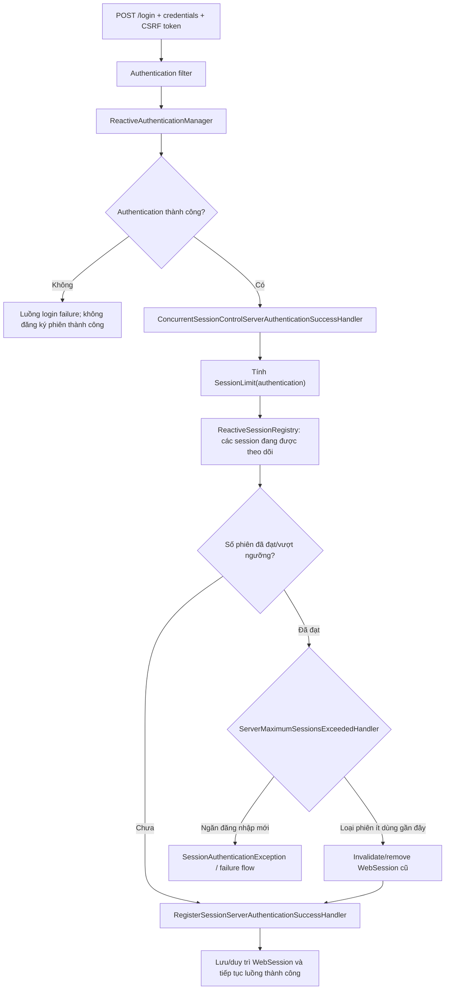

# Giới hạn số phiên đồng thời bằng `maximumSessions` và `ReactiveSessionRegistry` trong Spring Security Reactive

Một người dùng có thể đăng nhập cùng lúc từ laptop, điện thoại và nhiều trình duyệt. Nếu ứng dụng dùng **Spring WebFlux + Spring Security Reactive** và lưu trạng thái đăng nhập vào **WebSession**, bạn có thể quyết định cho phép tối đa bao nhiêu phiên đồng thời trên cùng một danh tính. Từ Spring Security **6.3**, cấu hình reactive có cơ chế **Concurrent Sessions Control**: đặt `maximumSessions(...)`, theo dõi session với `ReactiveSessionRegistry`, và chọn cách xử lý khi đăng nhập mới vượt giới hạn.

Ví dụ `maximumSessions(SessionLimit.of(1))` có nghĩa: tối đa **một phiên được theo dõi cho mỗi principal** trong phạm vi registry có hiệu lực. Khi lần đăng nhập thứ hai thành công và tạo một phiên mới, hành vi mặc định là **vô hiệu hóa phiên ít được sử dụng gần đây nhất**; bạn cũng có thể thay bằng chính sách **từ chối đăng nhập mới, giữ phiên cũ**.

Tuy nhiên, đây không phải công tắc “mỗi user chỉ được dùng một thiết bị” theo nghĩa tuyệt đối. Hiệu lực phụ thuộc cơ chế đăng nhập nào được hook, session registry dùng chung hay chỉ trong một JVM, nguyên tắc xác định principal, session store, race condition của các lần đăng nhập đồng thời và việc ứng dụng có dùng token độc lập hay không.

**Sau bài học, bạn có thể:**

1. Phân biệt `WebSession`, `SecurityContext`, `ReactiveSessionInformation` và `ReactiveSessionRegistry`.
2. Cấu hình `SessionLimit.of(1)`, giới hạn động theo `Authentication`, hoặc `SessionLimit.UNLIMITED`.
3. Chọn chiến lược *đăng nhập mới thay thế phiên cũ* hoặc *giữ phiên cũ, chặn đăng nhập mới*.
4. Viết cấu hình Java 17+ cho Spring Boot 3.x, **Spring Security 6.3+** và WebFlux.
5. Thử hai phiên độc lập, đọc registry, thu hồi phiên và nhận diện giới hạn của triển khai phân tán.
6. Tránh trộn API Concurrent Session Control **Servlet** với API **Reactive**.

> **Phạm vi:** bài này nói về **phiên đăng nhập được Spring Security Reactive theo dõi**. Nó không tự giới hạn số JWT/access token đã phát hành, số TCP connection, số tab trình duyệt, số request đang xử lý hay tất cả phiên tại một Identity Provider (IdP) bên ngoài.

## 1. “Một phiên” là gì và tại sao phải giới hạn?

Trong WebFlux, `WebSession` là cơ chế session của Spring WebFlux; browser có thể mang cookie phiên để server tìm lại trạng thái giữa các request. Khi dùng form login hoặc OAuth2 login kiểu browser, Spring Security có thể lưu `SecurityContext` chứa `Authentication` vào session.

Một người dùng mở hai **tab trong cùng browser profile** thường **dùng chung cookie và cùng WebSession** — không phải hai phiên. Ngược lại, hai cửa sổ private độc lập, hai browser profiles, hoặc browser trên hai thiết bị có thể mang **hai cookie/session ID khác nhau**.

Với `maximumSessions(SessionLimit.of(1))`, mục tiêu là giới hạn số **session login được ghi nhận cho một danh tính**:

| Tình huống | Có phải hai phiên? | Nhận xét |
| --- | --- | --- |
| Hai tab Chrome cùng profile, cùng cookie | Thường không | Có thể chia sẻ một WebSession |
| Chrome thường và profile riêng, login cùng user | Thường có | Hai session ID độc lập |
| Laptop và điện thoại, login cùng user | Thường có | Nếu hai thiết bị có session riêng |
| Hai request song song từ cùng một cookie | Không nhất thiết | Request count không phải session count |
| Hai API call mang cùng JWT bearer, không session | Không phải hai WebSession login | Token và session là hai mô hình khác nhau |
| Hai phiên tại IdP bên ngoài | Chưa chắc được biết | Spring Security chỉ biết những session ứng dụng/registry theo dõi |

Lý do thường cần policy giới hạn: giảm nguy cơ tài khoản bị chia sẻ không kiểm soát, hỗ trợ ứng dụng nhạy cảm yêu cầu chỉ một phiên đang dùng, giúp thu hồi phiên khi đổi mật khẩu, và cung cấp trải nghiệm rõ ràng khi đăng nhập từ thiết bị mới. Đây **không phải** biện pháp chống đánh cắp cookie hoàn chỉnh: kẻ tấn công có cùng session cookie có thể dùng chung **một** session ID mà không vượt giới hạn.

## 2. Kiến trúc: registry theo dõi, session store giữ trạng thái

Các khái niệm sau phải được tách riêng:

| Thành phần | Nhiệm vụ | Dữ liệu nổi bật |
| --- | --- | --- |
| `Authentication` | Người dùng đã được kiểm chứng và authorities | Principal, roles/scopes |
| `SecurityContext` | Context cho authorization và các bước downstream | `Authentication` |
| `WebSession` | Lưu trạng thái theo cookie/session ID | Session attributes, có thể gồm SecurityContext |
| `ReactiveSessionInformation` | Bản ghi một phiên cho cơ chế concurrent session control | Principal, session ID, last access, trạng thái expired |
| `ReactiveSessionRegistry` | Đăng ký, truy vấn, cập nhật hoặc xóa **bản ghi phiên** | Danh sách session information theo principal |
| `WebSessionStore` | Lưu, truy xuất, hủy session thực tế của WebFlux | Session data, expiry |
| `SessionLimit` | Chính sách tính số phiên tối đa cho một `Authentication` | `Mono<Integer>`, hoặc empty nghĩa unlimited |
| `ServerMaximumSessionsExceededHandler` | Quyết định khi giới hạn bị vượt | Invalidate phiên cũ hoặc chặn phiên mới |

`ReactiveSessionRegistry` **không đồng nhất** với `WebSessionStore`. Registry chứa **metadata để biết ai đang có những session nào**; session store chứa **trạng thái WebSession thực**. Nếu bạn chỉ xóa một bản ghi ở registry mà không vô hiệu hóa WebSession tương ứng, đừng mặc định rằng browser đã bị đăng xuất. Ngược lại, nếu dữ liệu session bị xóa ở nơi khác mà registry không được cập nhật, bộ đếm có thể bị sai lệch; cần đồng bộ vòng đời hai nơi.

Sơ đồ tổng quát:



Đây là **mô hình logic** của cơ chế hook vào authentication success; thứ tự và thành phần cụ thể do Spring Security cấu hình. Đừng tự triển khai sơ đồ này như chuỗi callback đồng bộ, hoặc gọi `subscribe()` thủ công trong filter.

## 3. `maximumSessions(...)` hoạt động như thế nào?

Trong cấu hình reactive, DSL chuẩn là:

```java
// Trích đoạn ở trong @Bean SecurityWebFilterChain.
http.sessionManagement(sessions -> sessions
    .concurrentSessions(concurrency -> concurrency
        .maximumSessions(SessionLimit.of(1))
    )
);
```

Đây **không phải** cú pháp Servlet `.sessionManagement(s -> s.maximumSessions(1))`. WebFlux dùng `ServerHttpSecurity`, có `concurrentSessions(...)`, và `maximumSessions` nhận một `SessionLimit`.

Các mức thường dùng:

| Cấu hình | Ý nghĩa |
| --- | --- |
| `.maximumSessions(SessionLimit.of(1))` | Tối đa một phiên đăng nhập cho principal |
| `.maximumSessions(SessionLimit.of(2))` | Tối đa hai phiên |
| `.maximumSessions(SessionLimit.UNLIMITED)` | Không đặt giới hạn số phiên |
| `.maximumSessions(authentication -> Mono.just(1))` | Giới hạn một phiên theo hàm reactive |
| `.maximumSessions(authentication -> Mono.empty())` | Không giới hạn với authentication đó |
| `.maximumSessions(customSessionLimit())` | Tùy biến theo role, tenant hoặc chính sách được xác minh |

`SessionLimit` nằm trong package:

```java
import org.springframework.security.web.server.authentication.SessionLimit;
```

Nó là một functional interface kế thừa `Function<Authentication, Mono<Integer>>`. Vì vậy, bạn có thể tính giới hạn theo quyền đã được hệ thống kiểm chứng và thậm chí truy vấn một cấu hình reactive, nếu cần. Không dùng blocking I/O để tính giới hạn trên event loop.

**Mặc định khi chưa cấu hình Concurrent Sessions Control**: Spring Security không tự giới hạn mỗi người một phiên. `maximumSessions(1)` chỉ có hiệu lực khi đặt trên **đúng `SecurityWebFilterChain`** xử lý authentication của người dùng.

### Cơ chế nào được hook vào?

Spring Security reactive concurrent session control tích hợp với **form login, OAuth2 login và HTTP Basic authentication** bằng cách thêm:

- `ConcurrentSessionControlServerAuthenticationSuccessHandler`: đánh giá giới hạn trước/sau một sự kiện xác thực thành công.
- `RegisterSessionServerAuthenticationSuccessHandler`: đăng ký phiên mới vào `ReactiveSessionRegistry`.

Điều này chỉ diễn ra theo đường authentication success mà Spring Security cấu hình đúng. Một **custom authentication filter** không dùng các hook này có thể không được theo dõi. Resource server **bearer JWT** thuần stateless cũng không tự biến mỗi token thành một session trong registry. Không nói rằng mọi API có `Authorization` header đều chịu `maximumSessions` như nhau.

**Riêng HTTP Basic:** tài liệu có liệt kê Basic trong những cơ chế được hook. Nhưng ứng dụng Basic thuần mỗi request có thể không dùng session persistence như form login. Nếu mục tiêu là giới hạn những **phiên web** được lưu, cần quyết định rõ Basic có thuộc policy này không, kiểm thử tác động của success handler, và cân nhắc chain riêng cho API Basic.

## 4. `ReactiveSessionRegistry` có những phương thức nào?

Spring Security cung cấp interface:

```java
package org.springframework.security.core.session;

public interface ReactiveSessionRegistry {
    Flux<ReactiveSessionInformation> getAllSessions(Object principal);
    Mono<ReactiveSessionInformation> getSessionInformation(String sessionId);
    Mono<Void> saveSessionInformation(ReactiveSessionInformation information);
    Mono<ReactiveSessionInformation> removeSessionInformation(String sessionId);
    Mono<ReactiveSessionInformation> updateLastAccessTime(String sessionId);
}
```

Đoạn trên mô tả **API contract** để học, không tạo lại interface trong source project; các kiểu `Flux`/`Mono` của Reactor phải import nếu tự viết implementation.

Các điểm chính:

- `getAllSessions(principal)`: xem những phiên mà registry ghi nhận cho principal tương ứng.
- `getSessionInformation(sessionId)`: tra cứu bản ghi cụ thể.
- `saveSessionInformation(info)`: đăng ký bản ghi phiên mới.
- `removeSessionInformation(sessionId)`: xóa bản ghi khỏi registry.
- `updateLastAccessTime(sessionId)`: cập nhật mốc truy cập gần nhất; thông tin này liên quan chiến lược **least recently used**.

`ReactiveSessionInformation` có `getPrincipal()`, `getSessionId()`, `getLastAccessTime()`, `isExpired()` và `invalidate()`; `invalidate()` trả `Mono<Void>` làm bản ghi hết hiệu lực. Nhưng **đánh dấu expired** không thay thế mọi bước xóa trạng thái WebSession thực tế. Khi tự vô hiệu hóa phiên, nên xử lý cả `WebSessionStore` đúng theo use case.

Một implementation sẵn có:

```java
@Bean
ReactiveSessionRegistry reactiveSessionRegistry() {
    return new InMemoryReactiveSessionRegistry();
}
```

Import:

```java
import org.springframework.security.core.session.InMemoryReactiveSessionRegistry;
import org.springframework.security.core.session.ReactiveSessionRegistry;
```

`InMemoryReactiveSessionRegistry` là registry **trong bộ nhớ tiến trình**. Nó thích hợp học tập, một server hoặc một phạm vi dùng thử; nó **không tự có** khả năng áp đặt giới hạn toàn cụm nhiều instance.

### Đăng ký bean hay gắn trực tiếp vào DSL?

Bạn có thể để Spring Security dùng một bean `ReactiveSessionRegistry` từ application context, hoặc chỉ định trực tiếp:

```java
.sessionManagement(sessions -> sessions
    .concurrentSessions(concurrency -> concurrency
        .maximumSessions(SessionLimit.of(1))
        .sessionRegistry(myReactiveSessionRegistry)
    )
)
```

Trong đoạn trên, `myReactiveSessionRegistry` phải là biến đã được ứng dụng cung cấp và là implementation hợp lệ. **Đừng** tạo `new InMemoryReactiveSessionRegistry()` riêng trong mỗi request hoặc mỗi success handler, vì các bản ghi sẽ bị phân mảnh và không thể áp đặt giới hạn đúng.

Khi cần thao tác quản trị, dùng **cùng registry** mà security chain đang dùng. Tránh có hai bean registry khác nhau rồi một bean phục vụ login còn bean kia phục vụ logout all.

## 5. Hai chiến lược khi người dùng đăng nhập vượt giới hạn

Giả sử `maximumSessions(SessionLimit.of(1))`; user `reader` đang có phiên A. Sau đó họ đăng nhập thành công từ một browser profile B khác.

### 5.1. Mặc định: cho B vào, vô hiệu hóa phiên ít được dùng gần đây

Spring Security mặc định chọn `InvalidateLeastUsedServerMaximumSessionsExceededHandler`.

```text
Trước đăng nhập:
  Registry("reader") => [Session A]

Browser B đăng nhập cùng "reader":
  Xác thực password thành công
  Phát hiện số phiên sẽ vượt 1
  Vô hiệu hóa/xóa session ít dùng gần đây (ví dụ A)
  Đăng ký Session B

Sau khi hoàn tất:
  Registry("reader") => [Session B]
  B vào trang cần authentication: được
  A gửi lại cookie cũ: không còn phiên xác thực hợp lệ
```

Cần hiểu **least recently used (LRU)** chứ không phải luôn là “session được tạo lâu nhất”. Nếu giới hạn là hai phiên, A và B đã tồn tại nhưng B ít được truy cập hơn, phiên bị thay khi C đăng nhập có thể là **B**, không nhất thiết A.

Handler mặc định chỉ vô hiệu hóa **số phiên dư** cần thiết, không xóa tất cả phiên của cùng user. Nếu giới hạn là 2 và hệ thống đang có 2 phiên, một phiên mới thường thay thế một phiên cũ.

Ưu điểm: user có thể tiếp tục đăng nhập từ thiết bị mới khi quên logout ở thiết bị cũ. Nhược điểm: người đang dùng thiết bị cũ có thể bị chuyển về login bất ngờ; với hệ thống nhạy cảm, cần thông báo, audit và bảo vệ chống chiếm quyền phiên.

### 5.2. Tùy chọn: giữ phiên A, từ chối lần đăng nhập của B

Spring Security cung cấp `PreventLoginServerMaximumSessionsExceededHandler`:

```java
// Trích đoạn cấu hình reactive:
.sessionManagement(sessions -> sessions
    .concurrentSessions(concurrency -> concurrency
        .maximumSessions(SessionLimit.of(1))
        .maximumSessionsExceededHandler(
            new PreventLoginServerMaximumSessionsExceededHandler())
    )
)
```

Import:

```java
import org.springframework.security.web.server.authentication
    .PreventLoginServerMaximumSessionsExceededHandler;
```

Về mặt ý nghĩa:

```text
Trước đăng nhập:
  Registry("reader") => [Session A]

Browser B thử login:
  Username/password có thể đã được xác minh
  Session limit báo đã có đủ 1 phiên
  Handler từ chối đăng ký session đăng nhập mới

Sau đó:
  A vẫn được giữ
  B không có phiên login mới thành công
```

Handler làm phát sinh lỗi xác thực/giới hạn phiên để luồng login xử lý (ví dụ `SessionAuthenticationException`). Với form login, client có thể thấy redirect về trang login kèm thông báo lỗi; không nên khẳng định mọi cấu hình đều trả một status cố định như 429/403. HTTP status và thông điệp phụ thuộc entry point/failure handler của ứng dụng.

**Hai phương án là lựa chọn thiết kế**, không phải “một cái bảo mật tuyệt đối hơn”. Policy giữ phiên cũ có thể cần luồng hỗ trợ người dùng bị mất thiết bị: xem danh sách phiên, đóng phiên cũ, đổi mật khẩu, recovery. Policy cho phiên mới thay phiên cũ có thể cần cảnh báo khi người dùng không chủ động đăng nhập ở thiết bị mới.

## 6. Ví dụ Java 17+ chạy được: một phiên cho mỗi tài khoản

Phần này là một ứng dụng WebFlux nhỏ dùng **form login mặc định** và giới hạn một phiên. Cần:

- Java 17+;
- Spring Boot 3.x **sử dụng Spring Security 6.3 trở lên**;
- `spring-boot-starter-webflux`, `spring-boot-starter-security`;
- Gradle hoặc Maven được cấu hình với Spring Boot dependency management tương ứng.

Vì `ReactiveSessionRegistry` và `SessionLimit` được giới thiệu từ Spring Security **6.3**, nếu dự án Boot 3.x của bạn đang kéo Spring Security 6.0/6.1/6.2, các class/API sẽ chưa tồn tại. Nên nâng phiên bản **thông qua BOM Spring Boot tương thích**, không trộn tùy tiện jar khác thế hệ.

### 6.1. Dependencies

Với một dự án Spring Boot Gradle có plugin và repositories phù hợp:

```groovy
dependencies {
    implementation 'org.springframework.boot:spring-boot-starter-webflux'
    implementation 'org.springframework.boot:spring-boot-starter-security'

    testImplementation 'org.springframework.boot:spring-boot-starter-test'
    testImplementation 'io.projectreactor:reactor-test'
}
```

Không dùng `spring-boot-starter-web` để chạy ví dụ này; đó là Web MVC/Servlet, khác bộ security API đang học.

### 6.2. `src/main/java/demo/concurrency/ConcurrentSessionsApplication.java`

```java
package demo.concurrency;

import org.springframework.boot.SpringApplication;
import org.springframework.boot.autoconfigure.SpringBootApplication;

@SpringBootApplication
public class ConcurrentSessionsApplication {
    public static void main(String[] args) {
        SpringApplication.run(ConcurrentSessionsApplication.class, args);
    }
}
```

### 6.3. `src/main/java/demo/concurrency/SecurityConfig.java`

```java
package demo.concurrency;

import org.springframework.context.annotation.Bean;
import org.springframework.context.annotation.Configuration;
import org.springframework.security.config.Customizer;
import org.springframework.security.config.annotation.web.reactive.EnableWebFluxSecurity;
import org.springframework.security.config.web.server.ServerHttpSecurity;
import org.springframework.security.core.session.InMemoryReactiveSessionRegistry;
import org.springframework.security.core.session.ReactiveSessionRegistry;
import org.springframework.security.core.userdetails.ReactiveUserDetailsService;
import org.springframework.security.core.userdetails.User;
import org.springframework.security.core.userdetails.UserDetails;
import org.springframework.security.crypto.factory.PasswordEncoderFactories;
import org.springframework.security.crypto.password.PasswordEncoder;
import org.springframework.security.provisioning.MapReactiveUserDetailsService;
import org.springframework.security.web.server.SecurityWebFilterChain;
import org.springframework.security.web.server.authentication.SessionLimit;

@Configuration
@EnableWebFluxSecurity
public class SecurityConfig {

    @Bean
    SecurityWebFilterChain webSecurity(ServerHttpSecurity http) {
        return http
            .authorizeExchange(exchanges -> exchanges
                .pathMatchers("/public/**", "/login").permitAll()
                .anyExchange().authenticated())
            .formLogin(Customizer.withDefaults())
            .httpBasic(basic -> basic.disable())
            .csrf(Customizer.withDefaults())
            .sessionManagement(sessions -> sessions
                .concurrentSessions(concurrency -> concurrency
                    .maximumSessions(SessionLimit.of(1))))
            .build();
    }

    @Bean
    ReactiveSessionRegistry reactiveSessionRegistry() {
        return new InMemoryReactiveSessionRegistry();
    }

    @Bean
    ReactiveUserDetailsService demoUsers() {
        PasswordEncoder encoder =
            PasswordEncoderFactories.createDelegatingPasswordEncoder();

        UserDetails reader = User.withUsername("reader")
            .password(encoder.encode("demo123"))
            .roles("READER")
            .build();

        return new MapReactiveUserDetailsService(reader);
    }
}
```

**Đây là phần cấu hình trọng tâm:**

- `formLogin(...)` bật login tương tác và trang login mặc định; không cần viết HTML riêng để học giới hạn phiên.
- `csrf(withDefaults())` giữ CSRF cho `POST /login` và `POST /logout`. Trang login mặc định cung cấp luồng token phù hợp.
- `httpBasic(...disable())` tránh thêm đường HTTP Basic, để hai browser sessions chỉ được tạo từ form login.
- `sessionManagement(...concurrentSessions(...maximumSessions(SessionLimit.of(1))))` bật giới hạn reactive một phiên.
- Bean `InMemoryReactiveSessionRegistry` giúp Spring Security ghi/tra cứu session information ở tiến trình hiện tại.
- **Không** cấu hình `PreventLoginServerMaximumSessionsExceededHandler` ở demo này: dùng hành vi mặc định là cho phiên mới vào và loại phiên ít dùng gần đây.
- `reader/demo123` chỉ là user demo local, password được mã hóa bằng encoder; không dùng tài khoản ví dụ ở production.

**Cần phân biệt:** session registry trong demo là in-memory. Đừng lấy kết quả thử thành công trên một JVM làm bằng chứng cluster nhiều replica có một giới hạn toàn cục.

### 6.4. `src/main/java/demo/concurrency/DemoController.java`

```java
package demo.concurrency;

import org.springframework.security.core.context.ReactiveSecurityContextHolder;
import org.springframework.web.bind.annotation.GetMapping;
import org.springframework.web.bind.annotation.RestController;
import reactor.core.publisher.Mono;

@RestController
public class DemoController {

    @GetMapping("/public/ping")
    public Mono<String> ping() {
        return Mono.just("pong");
    }

    @GetMapping("/private/me")
    public Mono<String> me() {
        return ReactiveSecurityContextHolder.getContext()
            .map(ctx -> "current-user:"
                + ctx.getAuthentication().getName());
    }
}
```

Đường `/private/me` chỉ được handler khi authorization cho qua; `ReactiveSecurityContextHolder` đọc context từ subscription reactive. Controller không cần truy cập `ReactiveSessionRegistry` để tự đếm phiên: đó là trách nhiệm của authentication success handlers.

### 6.5. Chạy thử

Từ thư mục dự án Spring Boot có Gradle wrapper:

```bash
# Linux/macOS
./gradlew bootRun

# Windows
gradlew.bat bootRun
```

Khi khởi động xong, máy học tập phục vụ `http://localhost:8080`. Môi trường thực phải dùng HTTPS, cookie flags, cấu hình session store và bảo vệ đăng nhập phù hợp.

Các request để xác nhận route:

```bash
curl -i http://localhost:8080/public/ping
curl -i http://localhost:8080/private/me
```

Khi chưa đăng nhập:

- `/public/ping` → `200 OK`, body `pong`.
- `/private/me` → thường redirect tới `/login` do form-login entry point được bật; status/location cụ thể phụ thuộc cấu hình request cache/success handler.

Sau khi đăng nhập bằng browser, `/private/me` trả:

```text
current-user:reader
```

Chỉ khi cookie/session còn hiệu lực mới đọc được identity này ở request sau.

## 7. Thử thực tế bằng hai browser profiles — cách thấy chính sách rõ nhất

Đây là phép thử tích hợp quan trọng vì chính sách dựa vào **hai session ID khác nhau**. Không nên chỉ mở hai tab trong cùng browser profile.

**Kịch bản A — mặc định loại phiên cũ:**

1. Mở **Browser A** (ví dụ profile thường), truy cập `/private/me`, được chuyển đến `/login`.
2. Đăng nhập `reader`/`demo123`, rồi mở `/private/me`; xác nhận body `current-user:reader`.
3. Mở **Browser B độc lập** (ví dụ một profile riêng không chia sẻ cookies), truy cập `/login`; đăng nhập cùng user `reader`/`demo123`.
4. Trên B, `/private/me` tiếp tục trả `current-user:reader`.
5. Quay về A và **tạo một request mới** đến `/private/me`. Theo chiến lược mặc định và registry/session store hoạt động đúng, session A đã bị vô hiệu hóa; A thường được đưa về login.
6. Lặp lại để thấy khi user đăng nhập mới, session ít được dùng gần đây bị thay. Nếu thấy kết quả khác, kiểm tra rằng A/B có thực sự mang hai cookie/session ID khác nhau và không đăng nhập qua chain khác.

**Đừng chỉ nhìn trang đã tải trước đó trên A** rồi kết luận session vẫn hợp lệ: trình duyệt có thể hiển thị nội dung cache cũ. Phải **gửi request mới** tới protected endpoint. Một WebSocket/long-running request đã thiết lập trước khi session bị invalidated có thể cần chính sách xử lý riêng; concurrent session control không hứa cắt ngay mọi kết nối đang mở.

**Kịch bản B — chuyển sang chặn đăng nhập mới:**

Đổi duy nhất phần concurrency trong `SecurityConfig` thành:

```java
.sessionManagement(sessions -> sessions
    .concurrentSessions(concurrency -> concurrency
        .maximumSessions(SessionLimit.of(1))
        .maximumSessionsExceededHandler(
            new PreventLoginServerMaximumSessionsExceededHandler())))
```

Thêm import:

```java
import org.springframework.security.web.server.authentication
    .PreventLoginServerMaximumSessionsExceededHandler;
```

Chạy lại app với một registry mới rồi thử:

1. A login thành công.
2. B login cùng user trong browser profile độc lập.
3. B không được tạo một phiên đăng nhập hợp lệ do đã đạt ngưỡng; failure handler của form login quyết định thông báo/redirect.
4. A vẫn sử dụng phiên của mình được.

Để test công bằng, **khởi động lại ứng dụng demo và đăng nhập lại** sau khi đổi chiến lược; đừng dùng cookie cũ bị vô hiệu hóa hoặc session registry từ một run khác để suy đoán kết quả.

### Thử qua curl với hai cookie jar

`curl` có thể mô phỏng hai client độc lập bằng **hai cookie jar**. Với Spring Security form login và CSRF mặc định, cần lấy **token thực sự từ trang GET /login** rồi gửi kèm cookie tương ứng. Ví dụ các bước (token được lấy thủ công từ HTML, không phải placeholder dùng được):

```bash
# Client A lấy trang login, lưu cookie phiên CSRF.
curl -sS -c a.cookies \
  http://localhost:8080/login -o a-login.html

# Xem a-login.html, lấy value của input name="_csrf".
# Sau đó dùng token THẬT CỦA A:
curl -i -b a.cookies -c a.cookies \
  --data-urlencode "username=reader" \
  --data-urlencode "password=demo123" \
  --data-urlencode "_csrf=TOKEN_FROM_A_LOGIN_PAGE" \
  http://localhost:8080/login

# Client B phải có một cookie jar độc lập:
curl -sS -c b.cookies \
  http://localhost:8080/login -o b-login.html

# Dùng token THẬT CỦA B, không tái sử dụng token từ A:
curl -i -b b.cookies -c b.cookies \
  --data-urlencode "username=reader" \
  --data-urlencode "password=demo123" \
  --data-urlencode "_csrf=TOKEN_FROM_B_LOGIN_PAGE" \
  http://localhost:8080/login

# Kiểm tra request mới bằng cookie của từng client.
curl -i -b a.cookies http://localhost:8080/private/me
curl -i -b b.cookies http://localhost:8080/private/me
```

`TOKEN_FROM_A_LOGIN_PAGE` và `TOKEN_FROM_B_LOGIN_PAGE` **chỉ là ký hiệu**; thay bằng giá trị `_csrf` đã render thật. Không gửi token trong query string, không log mật khẩu hay token thực. `--data-urlencode` giữ đúng các ký tự đặc biệt khi form POST.

**Không coi việc POST nhận `302` là bằng chứng duy nhất login thành công.** Cả success và failure handler đều có thể redirect. Hãy kiểm tra request `/private/me` sau đó bằng **cookie tương ứng** và xác minh session nào được chấp nhận.

## 8. Giới hạn động theo vai trò người dùng

Có thể phân biệt số phiên dựa trên `Authentication` đã được kiểm chứng, ví dụ:

- User thường: tối đa một phiên.
- Admin được cấp vai trò `ROLE_ADMIN`: tối đa hai phiên.
- Nhân viên vận hành có `ROLE_UNLIMITED_SESSIONS`: không giới hạn theo registry.

Đoạn cấu hình thay phần `maximumSessions` ở demo:

```java
// Trong class SecurityConfig; thêm các import ở dưới.
private SessionLimit perRoleLimit() {
    return authentication -> {
        var authorities = authentication.getAuthorities();

        if (authorities.contains(
                new SimpleGrantedAuthority("ROLE_UNLIMITED_SESSIONS"))) {
            return Mono.empty(); // Không giới hạn phiên
        }
        if (authorities.contains(
                new SimpleGrantedAuthority("ROLE_ADMIN"))) {
            return Mono.just(2); // Tối đa 2 phiên
        }
        return Mono.just(1); // Mặc định tối đa 1 phiên
    };
}
```

Import bổ sung:

```java
import org.springframework.security.core.authority.SimpleGrantedAuthority;
import reactor.core.publisher.Mono;
```

Đổi DSL thành:

```java
.sessionManagement(sessions -> sessions
    .concurrentSessions(concurrency -> concurrency
        .maximumSessions(perRoleLimit())))
```

`SessionLimit.UNLIMITED` cũng có thể dùng nếu toàn bộ user được phép không giới hạn; nhưng nếu chỉ một số user được miễn, `Mono.empty()` trong hàm `SessionLimit` thể hiện đúng trường hợp đó.

**Lưu ý thiết kế quyền:** chỉ tin authorities do quá trình xác thực/authorization của server tạo ra. Không để client gửi header `X-Max-Sessions: 10`, query parameter `role=ADMIN` hoặc claim chưa xác minh rồi dùng làm giới hạn. Giới hạn theo role có thể là quyết định chính sách hợp lệ, nhưng cần cập nhật khi vai trò người dùng thay đổi: những phiên đang tồn tại không tự biến mất ngay lập tức chỉ vì rule mới được triển khai nếu không có luồng re-evaluation/invalidation phù hợp.

## 9. Thay đổi chính sách bằng custom exceeded handler

Cấu hình built-in đủ dùng cho hai chiến lược cơ bản. Đôi khi nghiệp vụ yêu cầu:

- Đánh dấu phiên cũ sắp hết hạn và hiển thị cảnh báo.
- Ghi audit event an toàn khi phiên mới thay phiên cũ.
- Đăng nhập từ thiết bị đáng tin thay thế thiết bị cũ, còn thiết bị không tin cậy thì bị từ chối.
- Đồng thời thu hồi phiên ứng dụng và gọi API của IdP để kết thúc session SSO bên ngoài.
- Yêu cầu bước xác minh bổ sung trước khi thay session.

Spring Security cung cấp interface `ServerMaximumSessionsExceededHandler`. Bạn có thể implement handler phù hợp rồi gắn qua:

```java
.sessionManagement(sessions -> sessions
    .concurrentSessions(concurrency -> concurrency
        .maximumSessions(SessionLimit.of(1))
        .maximumSessionsExceededHandler(customExceededHandler)))
```

Đây chỉ là **trích đoạn tích hợp**: biến `customExceededHandler` phải được cung cấp và triển khai với hợp đồng của Spring Security 6.x đang dùng; không coi đoạn này là class độc lập. Đừng thực hiện blocking JDBC/HTTP trong event loop hoặc gọi `.subscribe()` rời rạc. Các bước ghi audit/invalidate trong handler phải được ghép vào reactive pipeline, xử lý error/cancel và giới hạn timeout rõ ràng.

**Điểm thường bị bỏ qua:** Concurrent Sessions Control của WebFlux biết các session được **ứng dụng đăng ký** trong `ReactiveSessionRegistry`, nhưng không tự biết session ở Google/Microsoft/Keycloak hay một IdP ngoài. Nếu muốn “đăng nhập mới sẽ logout SSO ở IdP”, bạn phải tích hợp API logout/revocation của IdP và xử lý việc gọi đó thất bại. Chỉ hủy WebSession không bảo đảm token hoặc IdP session bị thu hồi.

## 10. Custom authentication success handler có thể làm mất giới hạn phiên

Đây là một bẫy quan trọng theo tài liệu Spring Security Reactive.

Khi cấu hình Concurrent Sessions Control, Spring Security tự thêm các success handlers kiểm tra giới hạn và đăng ký session cho **form login, OAuth2 login, HTTP Basic** *nếu các cơ chế này không tự chỉ định một success handler thay thế*. Ví dụ:

```java
// Trích đoạn để minh họa RỦI RO:
.formLogin(form -> form
    .authenticationSuccessHandler(
        new RedirectServerAuthenticationSuccessHandler("/dashboard")))
.sessionManagement(sessions -> sessions
    .concurrentSessions(concurrency -> concurrency
        .maximumSessions(SessionLimit.of(1))))
```

Import:

```java
import org.springframework.security.web.server.authentication
    .RedirectServerAuthenticationSuccessHandler;
```

Việc dùng overload **thay thế** success handler như trên có thể làm bộ xử lý giới hạn/đăng ký phiên **không được thêm vào đường form-login đó**. Kết quả: ứng dụng tưởng đã có `maximumSessions(1)`, nhưng form login thực tế có thể bỏ qua kiểm soát đồng thời.

Nếu cần thêm một handler mà vẫn giữ các handler session control do framework quản lý, Spring Security có overload nhận `Consumer<List<ServerAuthenticationSuccessHandler>>` để **thêm** handler vào danh sách thay vì thay thế toàn bộ:

```java
// Trích đoạn từ tài liệu Spring Security Reactive (điều chỉnh theo use case).
.formLogin(form -> form
    .authenticationSuccessHandler(handlers ->
        handlers.add(
            new RedirectServerAuthenticationSuccessHandler("/dashboard"))))
```

Trong ứng dụng thật, cần kiểm thử **thứ tự và response completion** của handlers, tránh một handler viết response quá sớm hoặc gây bỏ qua thao tác đăng ký phiên. Nếu login do một `AuthenticationWebFilter` tùy biến hoàn toàn đảm nhiệm, bạn phải tích hợp concurrent session control cho success flow đó; DSL của form login không tự áp vào mọi filter do bạn tạo.

**Câu hỏi QA bắt buộc:** Sau khi chỉnh login success handler, hai browser profiles đăng nhập cùng account có còn chịu đúng policy một phiên không? Nếu không, kiểm tra success-handler chain trước khi đổ lỗi cho `ReactiveSessionRegistry`.

## 11. Thu hồi phiên bằng `ReactiveSessionRegistry` và `WebSessionStore`

Ngoài kiểm soát lúc login, đôi khi phải vô hiệu hóa những phiên đã tồn tại khi:

- Người dùng đổi mật khẩu;
- Tài khoản bị khóa;
- Hệ thống phát hiện nguy cơ chiếm đoạt tài khoản;
- Người dùng nhấn “Đăng xuất khỏi mọi thiết bị”;
- Quản trị viên yêu cầu chấm dứt phiên.

Có thể lấy danh sách session đang được theo dõi bằng `getAllSessions(principal)` rồi xử lý mỗi bản ghi. Cần vô hiệu hóa thông tin session **và** xóa phiên thực khỏi WebSessionStore.

Ví dụ `src/main/java/demo/concurrency/SessionRevocationService.java`:

```java
package demo.concurrency;

import org.springframework.security.core.session.ReactiveSessionRegistry;
import org.springframework.stereotype.Service;
import org.springframework.web.server.session.WebSessionStore;
import reactor.core.publisher.Mono;

@Service
public class SessionRevocationService {

    private final ReactiveSessionRegistry registry;
    private final WebSessionStore sessionStore;

    public SessionRevocationService(
            ReactiveSessionRegistry registry, WebSessionStore sessionStore) {
        this.registry = registry;
        this.sessionStore = sessionStore;
    }

    public Mono<Void> invalidateAllFor(Object principal) {
        return registry.getAllSessions(principal)
            .flatMap(info ->
                info.invalidate()
                    .then(sessionStore.removeSession(info.getSessionId())))
            .then();
    }
}
```

Đoạn trên dùng các API reactive và **trả `Mono<Void>`** cho caller; không gọi `.subscribe()` hoặc `.block()` trong handler. Nó được thiết kế làm phần mở rộng của ứng dụng WebFlux đang có cùng registry và cùng `WebSessionStore` với cấu hình security.

**Giới hạn/cẩn trọng:**

- `principal` truyền vào `getAllSessions` phải khớp với **khóa danh tính** mà registry đã ghi; đừng nhận tên user tùy ý từ request không được ủy quyền để xóa phiên của người khác.
- Trong production, cần phân quyền chặt chẽ với thao tác invalidate-all, audit sự kiện và tránh tiết lộ session IDs.
- `invalidate()` và `removeSession()` là các hành động có trạng thái. Nếu một bước thất bại, hãy có cơ chế xử lý/retry phù hợp, giám sát và kiểm thử theo phiên bản repository/registry; không tuyên bố mọi phân tán đã được đồng bộ nếu không có bảo đảm giao dịch.
- Không in raw session ID vào log, metrics labels hoặc response API.
- Đoạn này không tự thu hồi refresh token/JWT và không kết thúc phiên tại IdP.
- Một request hoặc WebSocket đã được xác thực từ trước khi invalidation có thể còn tiếp tục cho đến khi cơ chế riêng xử lý; session control chủ yếu tác động đến truy cập **kế tiếp** và lifecycle session.

Nếu ứng dụng có nhiều loại principal (đặc biệt OAuth2 `OAuth2User`, custom `UserDetails`) hãy thiết kế khóa nhận diện ổn định. Tránh phụ thuộc vào object `equals()`/`hashCode()` thiếu nhất quán khiến registry xem hai lần đăng nhập cùng người là hai principal khác nhau.

## 12. Unit test hành vi registry bằng Reactor `StepVerifier`

Bản demo `SecurityConfig` đã đăng ký bean `InMemoryReactiveSessionRegistry`; ta có thể kiểm tra riêng contract reactive mà không cần khởi động browser. Đây là **test của registry**, **không phải** test end-to-end rằng `maximumSessions(1)` đã vô hiệu hóa WebSession thật. Hai loại test kiểm tra những ranh giới khác nhau.

Tệp `src/test/java/demo/concurrency/ReactiveSessionRegistryTest.java`:

```java
package demo.concurrency;

import java.time.Instant;

import org.junit.jupiter.api.Test;
import org.springframework.security.core.session.InMemoryReactiveSessionRegistry;
import org.springframework.security.core.session.ReactiveSessionInformation;
import org.springframework.security.core.session.ReactiveSessionRegistry;
import reactor.test.StepVerifier;

import static org.junit.jupiter.api.Assertions.assertEquals;

class ReactiveSessionRegistryTest {

    @Test
    void savesFindsAndRemovesSessionInformation() {
        ReactiveSessionRegistry registry =
            new InMemoryReactiveSessionRegistry();

        var info = new ReactiveSessionInformation(
            "reader", "demo-session-a",
            Instant.parse("2026-01-01T00:00:00Z"));

        StepVerifier.create(registry.saveSessionInformation(info))
            .verifyComplete();

        StepVerifier.create(registry.getAllSessions("reader").collectList())
            .assertNext(sessions -> {
                assertEquals(1, sessions.size());
                assertEquals("demo-session-a",
                    sessions.get(0).getSessionId());
            })
            .verifyComplete();

        StepVerifier.create(
                registry.getSessionInformation("demo-session-a"))
            .assertNext(found ->
                assertEquals("reader", found.getPrincipal()))
            .verifyComplete();

        StepVerifier.create(
                registry.removeSessionInformation("demo-session-a"))
            .assertNext(removed ->
                assertEquals("demo-session-a", removed.getSessionId()))
            .verifyComplete();

        StepVerifier.create(registry.getAllSessions("reader"))
            .verifyComplete();
    }
}
```

Chạy:

```bash
# Linux/macOS
./gradlew test --tests 'demo.concurrency.ReactiveSessionRegistryTest'

# Windows
gradlew.bat test --tests "demo.concurrency.ReactiveSessionRegistryTest"
```

Khi các dependencies của ví dụ đã đủ, test phải thành công: bản ghi được lưu, truy vấn theo principal/session ID, xóa rồi không còn trong registry. `StepVerifier` là thành phần của `reactor-test`, đã được thêm ở phần dependencies.

**Không nhầm test này với kiểm tra chính sách concurrent login.** Test trên lưu registry một cách thủ công, nên chưa hề chạy `ReactiveAuthenticationManager`, session limit handler, session cookie hoặc WebSessionStore. Để xác minh behavior toàn chuỗi, cần thêm integration test sử dụng hai HTTP clients có cookie jar riêng, đăng nhập qua form và quan sát request protected của client A sau khi client B login. Khi tự động hóa form login, nhớ cung cấp CSRF token hợp lệ cho từng client hoặc dùng Spring Security test support dành cho WebFlux.

## 13. Thử nghiệm có cấu trúc: LRU khác “chặn đăng nhập mới”

| Bước | Chính sách mặc định loại LRU | Chính sách chặn login mới |
| --- | --- | --- |
| A login lần đầu với account `reader` | Thành công | Thành công |
| A GET route protected | `200` | `200` |
| B ở client độc lập login cùng `reader` | Thành công, có thể thay session A | Đăng nhập B bị từ chối theo failure flow |
| A GET route protected sau B | Thường bị yêu cầu login lại | A còn authenticated |
| B GET route protected sau lần thử | B authenticated | B không authenticated |
| B logout, A thử lại | Tùy phiên đã bị invalidated và chính sách login mới | A vẫn dùng session cũ nếu còn hợp lệ |
| Đổi password và thu hồi mọi session | Phải có logic invalidation riêng | Phải có logic invalidation riêng |

Với `maximumSessions(2)`:

1. A login → có một session.
2. B login → có hai session.
3. A được truy cập gần đây nhất, còn B không hoạt động.
4. C login → theo LRU, **B** có thể bị invalidated để nhường chỗ cho C.

Không nhầm “ít dùng gần đây” với “được tạo sớm nhất” và không dựa vào mốc đăng nhập khi chọn phiên thay. Về mặt kiểm thử, cần gửi request thực để cập nhật last access và cho framework xử lý session; đừng chỉ chỉnh biến thời gian ở frontend.

**Các trường hợp biên** nên test thêm: đăng nhập song song với timestamp sát nhau, session hết hạn tự nhiên, logout ở A trước khi B login, đổi principal/username, nhiều bảo mật chain, và hai node cùng nhận login đồng thời.

## 14. Session limits và OAuth2/OIDC: ranh giới của ứng dụng

Một ứng dụng dùng `oauth2Login()` có thể có:

- Session tại **ứng dụng WebFlux** để biết người dùng đã đăng nhập;
- Session tại **Identity Provider** phục vụ Single Sign-On;
- Access token/refresh token dùng gọi resource servers khác.

`ReactiveSessionRegistry` chỉ thấy những phiên mà security application đưa vào registry, không biết toàn bộ session tại IdP hoặc các dịch vụ khác. Khi người dùng đăng nhập browser B, việc invalidate session A của ứng dụng **không mặc nhiên** logout IdP session hoặc revoke OAuth2 tokens.

Một thiết kế “một thiết bị duy nhất trên toàn hệ sinh thái” cần phối hợp nhiều hệ thống: IdP logout/revocation API, refresh-token rotation/revocation, resource-server validation, session lifecycle của từng ứng dụng, thiết bị offline và trải nghiệm người dùng. `maximumSessions(1)` chỉ là một lớp ở **ứng dụng cụ thể**.

Với **JWT bearer resource server** không có browser session, việc một người dùng gọi API bằng nhiều access token không nhất thiết tạo nhiều WebSession. Muốn hạn chế số thiết bị/token, cần chính sách tại authorization server/token store hoặc hệ thống quản lý thiết bị; không dựa vào `ReactiveSessionRegistry` làm danh sách token.

## 15. Triển khai nhiều instance: vì sao in-memory registry không đủ?

Giả sử service chạy hai JVM:

```text
Load balancer
  +-- Node A: InMemoryReactiveSessionRegistry riêng
  +-- Node B: InMemoryReactiveSessionRegistry riêng

User reader login trên Node A: A thấy 1 session.
User reader login trên Node B: B cũng thấy 1 session.
```

Dù mỗi node cấu hình `maximumSessions(1)`, **toàn cụm vẫn có thể có hai phiên** vì registry in-memory không chia sẻ state. Đặt sticky session cũng không tự giải quyết tình huống người dùng đăng nhập từ thiết bị khác được định tuyến sang node khác.

Để áp dụng giới hạn nhất quán trong production nhiều replica, cần:

1. **Registry phân tán**: một implementation `ReactiveSessionRegistry` lưu và truy vấn metadata dùng chung theo principal/session ID, có TTL và cập nhật last-access phù hợp.
2. **WebSessionStore dùng chung**: các instance có thể đọc và vô hiệu hóa session thực tế, thường qua Spring Session Reactive với backing store thích hợp. Đừng mặc định một custom registry là đủ nếu WebSession còn nằm trong RAM từng node.
3. **Concurrency control có tính nguyên tử**: hai login gần đồng thời có thể cùng thấy “còn slot” rồi đều đăng ký; phải thiết kế lock/CAS/transaction hoặc quy trình bảo đảm giới hạn phù hợp.
4. **Đồng bộ xóa/expiry**: logout, timeout, node crash và phiên bị thay thế cần cập nhật registry và session store; xử lý bản ghi mồ côi.
5. **Khả năng chịu lỗi**: nếu registry/Redis mất kết nối, xác định chính sách fail-open/fail-closed theo mức độ nhạy cảm của sản phẩm; không tự mở giới hạn vì timeout rồi tuyên bố bảo đảm một phiên.
6. **Bảo mật dữ liệu**: không đưa session IDs hoặc token vào logs/metrics; giới hạn quyền truy cập backing store và bật mã hóa đường truyền.
7. **Giám sát**: số session theo user (không gắn PII làm metrics label), số lượt exceeded, lỗi invalidate, lệch registry/store, độ trễ đăng nhập và số lần recovery.

**Lưu ý Spring Session:** tài liệu về `SessionRegistry` trong nhánh **Servlet** có thể trình bày cách tích hợp cluster bằng `FindByIndexNameSessionRepository` và `SessionRegistry` của Servlet. Không sao chép class đó như thể nó tự là implementation của **ReactiveSessionRegistry**. Với Spring Security Reactive, phải kiểm chứng tương thích cụ thể của registry, WebSessionStore và phiên bản Spring Session đang dùng.

## 16. Sai lầm phổ biến

### Lỗi 1 — Dùng DSL maximumSessions của Servlet trong WebFlux

Sai ngữ cảnh:

```java
// Không phải API cấu hình reactive:
http.sessionManagement(s -> s.maximumSessions(1));
```

Cấu hình WebFlux dùng:

```java
http.sessionManagement(s -> s
    .concurrentSessions(c -> c
        .maximumSessions(SessionLimit.of(1))));
```

`ServerHttpSecurity` / `SecurityWebFilterChain` là API reactive; `HttpSecurity` / `SecurityFilterChain` là nhánh Servlet. `SessionLimit` cũng có **hai class ở hai package khác nhau**; import đúng `org.springframework.security.web.server.authentication.SessionLimit`.

### Lỗi 2 — Bật `maximumSessions(1)` nhưng không dùng registry nhất quán

Tạo registry riêng trong nhiều cấu hình hoặc mỗi lần request khiến các session không được đếm chung. Dùng bean singleton/registry dùng chung cho các chain cần phối hợp và một implementation phân tán khi triển khai nhiều node.

### Lỗi 3 — Có custom login success handler nhưng không còn session handlers

Overload `.authenticationSuccessHandler(new RedirectServerAuthenticationSuccessHandler(...))` có thể thay thế handler do Concurrent Sessions Control thêm. Sử dụng overload thêm handler vào danh sách hoặc cấu hình đầy đủ, rồi test lại hai lần đăng nhập thật.

### Lỗi 4 — Thử hai tab rồi kết luận maximumSessions không hoạt động

Hai tab cùng profile chia sẻ cookie. Cần hai browser profiles/thiết bị hoặc cookie jars độc lập, không chỉ hai tab.

### Lỗi 5 — Nghĩ least-recently-used luôn là phiên login đầu tiên

LRU dựa trên lần sử dụng gần nhất theo registry, không phải chỉ theo thứ tự tạo session. Với giới hạn 2, phiên mới có thể loại phiên đăng nhập sau nhưng ít hoạt động hơn.

### Lỗi 6 — Dùng `maximumSessions` để giới hạn JWT

JWT/access token có vòng đời riêng. Resource server stateless không tự đăng ký mỗi token làm WebSession; nếu muốn giới hạn token, thiết kế tại token issuer/device registry.

### Lỗi 7 — Nghĩ invalidate session tại app sẽ logout IdP

Spring Security không tự hủy session tại IdP. Muốn SSO logout hoặc token revocation, phải tích hợp hệ thống Identity Provider.

### Lỗi 8 — Chỉ xóa bản ghi registry khi nhấn “Đăng xuất mọi nơi”

Xóa metadata registry không đủ để hủy state ở WebSessionStore. Phải xử lý đúng session thực, quyền truy cập và lỗi một phần khi invalidate.

### Lỗi 9 — Không kiểm soát principal equality

Nếu registry coi các object principal không tương đương, số phiên của cùng người có thể bị chia nhóm sai. Với custom `UserDetails`/OAuth2 principal, thiết kế danh tính ổn định và kiểm thử lookup/invalidation; tránh dùng object mutable làm khóa mà `equals/hashCode` thay đổi trong suốt vòng đời.

### Lỗi 10 — Nghĩ limit 1 là cơ chế chống chia sẻ cookie tuyệt đối

Một cookie/session bị đánh cắp có thể được gửi từ nhiều thiết bị nhưng vẫn dùng **một session ID**. Thêm TLS, cookie Secure/HttpOnly/SameSite, CSRF, session fixation protection, cảnh báo thiết bị lạ, MFA và kiểm soát hành vi rủi ro.

### Lỗi 11 — Mở `GET /logout` hoặc tắt CSRF để dễ test

Form login/ logout dựa trên cookie cần CSRF cho request làm thay đổi trạng thái. Khi chạy `curl` POST login, phải gửi token của đúng phiên; tắt CSRF chỉ vì test báo 403 có thể che lỗ hổng.

### Lỗi 12 — Chỉ nhìn redirect 302 để kết luận B login thành công

Cả form login thành công và thất bại đều có thể redirect. Kiểm tra request protected kế tiếp bằng cookie của B, đồng thời kiểm tra A còn phiên hay không.

### Lỗi 13 — Cho rằng registry luôn cập nhật tức thời ở mọi node

Đó là chi tiết triển khai. `InMemoryReactiveSessionRegistry` không có global consistency. Custom distributed registry cần thiết kế atomic count, expiry cleanup và behavior khi network partition.

### Lỗi 14 — Chặn Reactor event loop trong custom SessionLimit/handler

`SessionLimit` trả `Mono<Integer>`; không dùng `Thread.sleep`, JDBC blocking trực tiếp hoặc `.block()` trong pipeline. Dùng client reactive và quản lý timeout khi phải tra chính sách ngoài.

### Lỗi 15 — Không có đường hỗ trợ người dùng mất thiết bị

Nếu chọn prevent-login, người dùng mất điện thoại có thể bị chặn đăng nhập vào thiết bị mới. Nên có chức năng bảo mật để thu hồi phiên cũ hoặc quy trình khôi phục sau xác minh danh tính.

## 17. Checklist QA trước production

| Kiểm tra | Kết quả cần đạt |
| --- | --- |
| Framework version | WebFlux + Spring Security 6.3+ (API reactive concurrent sessions có tồn tại) |
| Đúng DSL | `ServerHttpSecurity.sessionManagement(...concurrentSessions(...))` |
| Đúng `SessionLimit` package | `org.springframework.security.web.server.authentication.SessionLimit` |
| Đúng registry | Bean hoặc DSL dùng cùng `ReactiveSessionRegistry` thực tế |
| Một phiên | Hai browser profiles, A login rồi B login; policy thực thi như dự kiến |
| LRU | Giới hạn 2 và ba sessions; phiên ít được dùng gần đây bị chọn đúng |
| Prevent login | B không có session mới, A vẫn truy cập được |
| Form login và CSRF | POST login có token đúng, không tắt CSRF vì 403 |
| Tùy chỉnh success handler | Concurrent session handlers vẫn được gọi và session mới được đăng ký |
| Logout | Registry và WebSessionStore được dọn theo vòng đời |
| Expiry | Session hết hạn tự nhiên không để lại bộ đếm sai |
| Role-based limit | Authorities đã xác minh và policy thay đổi được kiểm thử |
| Custom principal | Equality/identity ổn định, lookup theo principal đúng |
| OAuth2 login | Không nhầm app session với IdP session/token |
| Stateless JWT | Có chính sách riêng nếu cần giới hạn token/devices |
| Nhiều replica | Registry và session store dùng chung, có atomicity/cleanup |
| Lỗi hạ tầng | Đã xác định cách xử lý khi backend session/registry unavailable |
| Observability | Không log password, CSRF token, session ID, bearer token |

## 18. Câu hỏi tự kiểm tra

**Câu 1.** Có hai tab cùng browser và cùng cookie. `maximumSessions(1)` nên cho rằng đã có hai phiên?  
**Không.** Hai tab thường chia sẻ một WebSession; phải so session ID.

**Câu 2.** `maximumSessions(SessionLimit.of(1))` mặc định xử lý lần login thứ hai ra sao?  
**Cho phép lần login mới và vô hiệu hóa phiên ít được sử dụng gần đây nhất**, với registry/session store đang hoạt động đúng.

**Câu 3.** Muốn giữ phiên cũ, chặn đăng nhập mới dùng lớp nào?  
**`PreventLoginServerMaximumSessionsExceededHandler`** thông qua `.maximumSessionsExceededHandler(...)`.

**Câu 4.** `ReactiveSessionRegistry` và `WebSessionStore` có giống nhau?  
**Không.** Registry quản lý session information cho giới hạn; WebSessionStore lưu dữ liệu session thực. Invalidate đúng cần quan tâm cả hai.

**Câu 5.** Vì sao một app chạy hai replica đều có `InMemoryReactiveSessionRegistry` vẫn có thể cho cùng user hai phiên?  
**Vì** mỗi replica giữ registry riêng; giới hạn một phiên chỉ được nhìn thấy trong phạm vi của từng process.

**Câu 6.** Khi thay `authenticationSuccessHandler` tùy biến cho form login, có điều gì cần test lại?  
**Cần xác minh** các handler kiểm soát/đăng ký session còn được gọi. Một overload success handler thay thế có thể vô hiệu hóa concurrent session control cho cơ chế login đó.

**Câu 7.** `SessionLimit.UNLIMITED` và `Mono.empty()` trong hàm `SessionLimit` có ý nghĩa gì?  
**Không giới hạn số phiên** trong chính sách của authentication đó.

**Câu 8.** Nếu IdP có phiên riêng, invalidate một WebSession của ứng dụng đã logout IdP chưa?  
**Chưa chắc.** Cần tích hợp logout/revocation của IdP nếu nghiệp vụ muốn thu hồi SSO toàn hệ thống.

**Câu 9.** Xóa một session khỏi registry đã chắc chắn ngăn browser dùng cookie cũ chưa?  
**Không.** Phải hủy/kiểm soát session thực tế trong WebSessionStore và các đường xác thực khác.

**Câu 10.** `maximumSessions(1)` có ngăn kẻ tấn công dùng cookie của nạn nhân trên máy khác không?  
**Không tuyệt đối.** Cả hai có thể đang dùng cùng một session ID; cần biện pháp chống chiếm phiên và phát hiện hành vi bất thường.

## Ghi nhớ

- **`maximumSessions(SessionLimit.of(n))`** là cấu hình giới hạn phiên **Reactive** qua `ServerHttpSecurity.sessionManagement().concurrentSessions()`.
- **`ReactiveSessionRegistry`** theo dõi các bản ghi phiên; **`WebSessionStore`** giữ trạng thái WebSession thực. Hai thành phần cần nhất quán.
- **Mặc định** khi vượt limit là **invalidate phiên ít sử dụng gần đây nhất**. Nếu muốn giữ phiên cũ, dùng `PreventLoginServerMaximumSessionsExceededHandler`.
- **`SessionLimit`** có thể tính theo `Authentication` và trả `Mono<Integer>`, `Mono.empty()` cho unlimited; `SessionLimit.UNLIMITED` áp dụng cho mọi user nếu được chọn.
- Cơ chế tự hook vào **form login, OAuth2 login, HTTP Basic** khi không bị custom success handler thay thế. Đừng mặc định nó áp dụng cho JWT stateless hoặc mọi custom filter.
- **Hai tab không phải hai phiên.** Hãy test bằng hai cookie jars/browser profiles độc lập và một request protected mới sau login.
- **InMemory registry không toàn cụm.** Production nhiều node cần registry/session store dùng chung cùng chiến lược atomicity, expiry, audit và khả năng chịu lỗi.
- Invalidate WebSession của ứng dụng **không đồng nghĩa** logout IdP hoặc thu hồi mọi access token.

### Tài liệu chính thức

- [Spring Security 6.5 — Concurrent Sessions Control (Reactive)](https://docs.spring.io/spring-security/reference/6.5/reactive/authentication/concurrent-sessions-control.html)
- [Spring Security 6.5 — `SessionLimit` Reactive Javadoc](https://docs.spring.io/spring-security/site/docs/6.5.x/api/org/springframework/security/web/server/authentication/SessionLimit.html)
- [Spring Security 6.5 — `ReactiveSessionRegistry` Javadoc](https://docs.spring.io/spring-security/reference/6.5/api/java/org/springframework/security/core/session/ReactiveSessionRegistry.html)
- [Spring Security 6.5 — `ReactiveSessionInformation` Javadoc](https://docs.spring.io/spring-security/reference/6.5/api/java/org/springframework/security/core/session/ReactiveSessionInformation.html)
- [Spring Security 6.5 — `ConcurrentSessionsSpec` Javadoc](https://docs.spring.io/spring-security/reference/6.5/api/java/org/springframework/security/config/web/server/ServerHttpSecurity.SessionManagementSpec.ConcurrentSessionsSpec.html)
- [Spring Security 6.5 — `InvalidateLeastUsedServerMaximumSessionsExceededHandler` Javadoc](https://docs.spring.io/spring-security/reference/6.5/api/java/org/springframework/security/web/server/authentication/InvalidateLeastUsedServerMaximumSessionsExceededHandler.html)
- [Spring Security 6.5 — `PreventLoginServerMaximumSessionsExceededHandler` Javadoc](https://docs.spring.io/spring-security/reference/6.5/api/java/org/springframework/security/web/server/authentication/PreventLoginServerMaximumSessionsExceededHandler.html)
