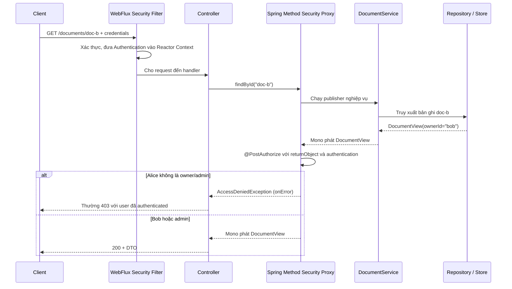

# `@PostAuthorize` và kiểm tra kết quả trước khi trả dữ liệu trong Spring Security Reactive

## Mục tiêu

`@PostAuthorize` là annotation bảo mật **sau khi phương thức trả kết quả**. Với Spring Security Reactive và Spring WebFlux, nó đặc biệt hữu ích khi điều kiện cấp quyền phụ thuộc vào **chính đối tượng đã được tìm thấy**: ví dụ tài liệu thuộc người dùng nào, chủ tài khoản nào sở hữu bản ghi, hoặc đơn hàng thuộc tenant nào. Bạn không thể luôn quyết định quyền truy cập chỉ từ `id` do client gửi; đôi khi phải tải đối tượng để biết chủ sở hữu thật rồi mới kiểm tra quyền.

Ví dụ: Alice gọi `GET /documents/doc-a`, dịch vụ tải một tài liệu có `ownerId="alice"` và annotation chỉ cho phép phát kết quả khi `returnObject.ownerId == authentication.name` hoặc người gọi có `ROLE_ADMIN`. Bob truy cập cùng ID vẫn có thể khiến tầng truy vấn tải được bản ghi, nhưng **giá trị không được chuyển tiếp cho controller/client** khi authorization từ chối.

Bài này giải thích vòng đời kiểm tra, cách sử dụng `returnObject` trong SpEL, sự khác nhau giữa `@PreAuthorize` và `@PostAuthorize`, mã Java 17+ dùng Spring Boot 3.x/Spring Security 6.x chạy trên **WebFlux**, kiểm thử HTTP và Reactor, xử lý `403/404`, cùng các giới hạn: side effect, truy vấn dữ liệu nhạy cảm, quan hệ `Mono`/`Flux`, proxy Spring AOP, Reactor Context và performance.

> Phạm vi: **reactive method security**, không phải `@EnableMethodSecurity` cho ứng dụng Servlet. Dùng `@EnableReactiveMethodSecurity`, `Mono`/`Flux` và `ReactiveSecurityContextHolder`. Ví dụ không dùng `HttpSecurity`, `SecurityFilterChain` của servlet, `SecurityContextHolder` theo `ThreadLocal`, `.block()` hoặc `.subscribe()` trong request.

## 1. `@PostAuthorize` là gì?

Đây là annotation trong package:

```java
import org.springframework.security.access.prepost.PostAuthorize;
```

Ví dụ biểu thức quen thuộc:

```java
@PostAuthorize(
    "returnObject.ownerId == authentication.name or hasRole('ADMIN')")
public Mono<DocumentView> findById(String id) {
    return repository.findById(id);
}
```

Ở đây:

- `returnObject` là **đối tượng kết quả mà hậu kiểm muốn cấp quyền**; trong trường hợp `Mono<DocumentView>` thông thường, việc kiểm tra gắn với kết quả đã được publisher phát ra theo vòng đời reactive.
- `ownerId` là property của `DocumentView`, đọc qua getter tương ứng (`getOwnerId()`) hoặc accessor được SpEL hỗ trợ.
- `authentication.name` là tên của principal đã được xác thực trong `Authentication`, lấy từ context hiện tại.
- `hasRole('ADMIN')` kiểm tra authority theo quy ước prefix `ROLE_`. Trong cấu hình mặc định, `hasRole('ADMIN')` có nghĩa authority `ROLE_ADMIN`, **không phải** chuỗi raw `ADMIN`.
- Chỉ khi điều kiện SpEL trả `true` thì giá trị mới tiếp tục tới caller.

Trong dự án thực, `returnObject` phải có hợp đồng dữ liệu rõ ràng: `getOwnerId()` không được trả một trường do client tự khai báo; nó phải xuất phát từ bản ghi do server truy xuất và tin cậy sau validation.

### Tại sao gọi là “sau” nhưng vẫn ngăn lộ dữ liệu?

`@PostAuthorize` chạy **sau khi kết quả đã được tạo/tải**, nhưng **trước khi kết quả được trao cho caller đi tiếp** trong luồng được proxy bảo vệ. Trong WebFlux, kết quả được biểu diễn dưới dạng publisher; Spring Security dùng interceptor reactive để đánh giá authorization khi dữ liệu liên quan đi qua publisher. Khi bị từ chối, nó chuyển thành tín hiệu lỗi truy cập thay vì phát đối tượng bị cấm cho các bước downstream.

Điều này khác với việc controller đã nhận `DocumentView`, serialize response rồi mới làm một `if` kiểm tra: **kiểm tra sau khi trả HTTP response là quá muộn**. `@PostAuthorize` bảo vệ ranh giới method-result **trước khi controller sử dụng giá trị đã cấp quyền**, nếu ứng dụng gọi bean qua Spring proxy và không tạo đường bypass.

Tuy nhiên, dữ liệu vẫn có thể đã được đọc từ database, giải mã, ghi log hoặc gửi tới hệ thống khác **bên trong phương thức** trước khi hậu kiểm diễn ra. Vì thế `@PostAuthorize` không bảo đảm “dữ liệu chưa từng được xử lý”: nó chỉ ngăn **kết quả không được cấp quyền đi qua ranh giới được bảo vệ**.

## 2. Điều kiện để reactive method security hoạt động

**Bật method security** bằng annotation:

```java
@Configuration
@EnableReactiveMethodSecurity
public class ReactiveMethodSecurityConfig {
}
```

Import:

```java
import org.springframework.context.annotation.Configuration;
import org.springframework.security.config.annotation.method.configuration.EnableReactiveMethodSecurity;
```

Với Spring Security 6.x, `@EnableReactiveMethodSecurity` sử dụng cơ chế `AuthorizationManager` theo mặc định. Có thể gặp ví dụ cũ viết `useAuthorizationManager = true`; từ Spring Security 6.0, thuộc tính này thường không cần thiết.

**Các điều kiện còn lại:**

1. Class chứa phương thức được tạo và quản lý dưới dạng **Spring bean**, ví dụ `@Service`.
2. Caller gọi phương thức **qua Spring AOP proxy**, không phải `new DocumentService()` tự tạo hoặc `this.findById(...)` gọi nội bộ cùng class.
3. Phương thức có kiểu trả về reactive được hỗ trợ, trong bài là `Mono<DocumentView>`; không chuyển `Mono` thành giá trị đồng bộ bằng `.block()` trong WebFlux handler.
4. Request/subscription có `Authentication` hợp lệ trong **Reactor Context** (thường do Spring Security WebFlux filters thiết lập).
5. Expression đọc đúng property/các quyền đã được xác minh. Không dùng principal ID/role từ header tùy ý của client.
6. Endpoint bảo mật gọi **đúng service method đã gắn annotation**, không bypass qua repository công khai.

Chỉ thêm `spring-boot-starter-security` **chưa bật method-level security**. `ServerHttpSecurity.authorizeExchange(...)` bảo vệ ở mức đường dẫn HTTP nhưng không thay thế policy của một service được gọi từ HTTP, message listener, scheduled task hoặc thành phần khác.

## 3. Luồng reactive: từ request đến quyết định sau kết quả



Diễn giải chính:

1. HTTP filter lấy danh tính/authorities của caller và thiết lập context reactive.
2. Controller gọi service bean **qua proxy**.
3. Truy vấn cung cấp object thật, có `ownerId` không phụ thuộc parameter client.
4. `AuthorizationManagerAfterReactiveMethodInterceptor` / cơ chế hậu kiểm đánh giá biểu thức `@PostAuthorize`.
5. Nếu được cấp quyền, downstream nhận object và được serialize thành HTTP response.
6. Nếu từ chối, publisher phát lỗi truy cập; WebFlux/Spring Security xử lý lỗi phù hợp. Với người dùng authenticated, kết quả thông thường là `403 Forbidden`. Cách ánh xạ lỗi có thể bị thay đổi bởi exception handler của ứng dụng.

**Điểm cần nhớ:** hậu kiểm đã chặn **trả kết quả ra ngoài** nhưng có thể đã tốn chi phí truy vấn. Không lạm dụng nó cho danh sách hàng triệu bản ghi, dữ liệu có tính bí mật cao trước khi đọc, hoặc thao tác ghi tiền/chuyển khoản.

## 4. `@PreAuthorize` và `@PostAuthorize` không thay thế nhau

| Tiêu chí | `@PreAuthorize` | `@PostAuthorize` |
| --- | --- | --- |
| Thời điểm đánh giá | Trước khi cấp phép thực hiện method logic/publisher | Sau khi có kết quả cần kiểm tra, trước khi kết quả vượt qua ranh giới method |
| Dữ liệu thuận tiện để kiểm tra | Authentication, role/scope, method args, `#id`, `#tenant` | Authentication, method args và `returnObject` |
| Có thể tránh truy vấn khi bị từ chối | Thường có, nếu policy quyết định được từ đầu | Không; dữ liệu có thể đã được tải |
| Phù hợp cho | Kiểm tra role, policy đầu vào, quyền gọi thao tác ghi | Kiểm tra owner của object đã truy xuất, bảo vệ IDOR |
| Rủi ro | Nếu chỉ dựa vào `#id` thì có thể không biết owner thật | Side effects đã có thể xảy ra trước khi từ chối |
| Với `Mono` | Interceptor reactive tham gia chuỗi publisher | Kiểm tra kết quả reactive trước khi phát cho caller |

Ví dụ phối hợp:

```java
@PreAuthorize("hasAnyRole('READER','ADMIN')")
@PostAuthorize(
    "hasRole('ADMIN') or returnObject.ownerId == authentication.name")
public Mono<DocumentView> getDocument(String id) {
    return repository.findById(id);
}
```

Trước hết Spring Security kiểm tra caller có role hợp lệ hay không. Chỉ những người vượt qua bước này mới thực hiện phần truy vấn cần thiết; sau đó `@PostAuthorize` kiểm tra object thuộc đúng owner. Các annotation được thực thi qua Spring proxy và Reactor Context; đừng trông đợi chúng hoạt động khi gọi nội bộ không qua proxy.

**Chiến lược thường tốt hơn khi dữ liệu nhạy cảm:** đẩy ownership constraint xuống truy vấn, chẳng hạn `SELECT ... WHERE id = :id AND owner_id = :currentUser`, đồng thời dùng method authorization như **phòng tuyến bổ sung**, không phải thay thế thiết kế truy vấn có scope.

## 5. `returnObject` trong SpEL: viết thế nào?

Các dạng thường gặp:

```java
// Người sở hữu hoặc admin có thể xem kết quả.
@PostAuthorize(
    "returnObject.ownerId == authentication.name or hasRole('ADMIN')")

// Owner và trạng thái được phép.
@PostAuthorize(
    "returnObject.ownerId == authentication.name and returnObject.status == 'ACTIVE'")

// Policy qua bean bảo mật do server kiểm soát.
@PostAuthorize(
    "@documentPolicy.mayView(authentication, returnObject)")
```

Dạng thứ ba là **đoạn tích hợp minh họa**: ứng dụng phải có bean `documentPolicy` với phương thức `mayView(...)` tương thích, an toàn, không chặn event loop. Nó giúp thay điều kiện dài bằng Java rõ ràng, dễ test và có thể dùng ở nhiều lớp.

### Biểu thức owner đơn giản

Nếu principal username là `"alice"` và kết quả `getOwnerId()` là `"alice"`, điều kiện owner đúng. Nếu kết quả `"bob"`, điều kiện sai, trừ khi caller có quyền admin.

Nếu authentication tên hiển thị là email nhưng database lưu user ID, so sánh `authentication.name` với `ownerId` có thể luôn sai hoặc sai về mặt định danh. Hãy thiết kế **ID ổn định** (ví dụ UUID/subject của token đã xác minh) và có component xác định identity từ authentication đúng hệ thống.

### `hasRole` khác `hasAuthority`

```java
@PostAuthorize(
    "hasAuthority('SCOPE_documents.read') and returnObject.ownerId == authentication.name")
```

`hasAuthority('SCOPE_documents.read')` so khớp chính xác authority; nó không tự thêm `ROLE_`. Với JWT resource server, scope thường được map sang authority `SCOPE_...` theo cấu hình. Cần xác định lại mapper và issuer/audience, không suy ra có scope chỉ vì token chưa kiểm chứng chứa claim.

### Thứ tự toán tử và null

Ưu tiên dấu ngoặc khi biểu thức phức tạp:

```java
@PostAuthorize(
    "hasRole('ADMIN') or (returnObject != null and returnObject.ownerId == authentication.name)")
```

Đối với `Mono.empty()` thì **không có object để kiểm tra ownership**. Không biến trường hợp “không tìm thấy” thành được phép truy cập dữ liệu khác. Chính sách HTTP 404 và exception handling phải được thiết kế riêng; không dựa vào việc expression luôn nhận một object non-null khi publisher không phát giá trị.

Với tài liệu demo này, service chuyển không-tìm-thấy thành `ResponseStatusException(HttpStatus.NOT_FOUND)` **trước hậu kiểm**, nên không có nhập nhằng `returnObject == null` ở đường thành công.

## 6. Ví dụ Java 17+ chạy được: tài liệu chỉ được chủ sở hữu hoặc admin xem

Ta tạo REST API nhỏ:

- `GET /documents/doc-a`: tài liệu của Alice.
- `GET /documents/doc-b`: tài liệu của Bob.
- `GET /documents/missing`: không tồn tại.
- User `alice`, `bob` có `ROLE_READER`; user `admin` có `ROLE_ADMIN`.
- HTTP Basic chỉ để demo authentication đơn giản. WebFlux method security mới thực hiện kiểm tra owner.

Kết quả mong muốn: Alice đọc doc-a được, không đọc doc-b; Bob ngược lại; admin có thể đọc cả hai; tài liệu không tồn tại trả 404.

### 6.1. Cấu hình build

Cần dự án Spring Boot 3.x, Java 17+, Gradle plugin Spring Boot và repositories đã thiết lập. Trong `build.gradle`:

```groovy
dependencies {
    implementation 'org.springframework.boot:spring-boot-starter-webflux'
    implementation 'org.springframework.boot:spring-boot-starter-security'

    testImplementation 'org.springframework.boot:spring-boot-starter-test'
    testImplementation 'org.springframework.security:spring-security-test'
    testImplementation 'io.projectreactor:reactor-test'
}
```

Nếu dùng Maven, chọn các starter tương ứng và quản lý phiên bản qua Spring Boot BOM. Không thêm `spring-boot-starter-web` cho demo này vì điều đó có thể chuyển ứng dụng sang Servlet stack. Dùng Spring Security 6.x tương thích với Spring Boot đang sử dụng.

### 6.2. Tệp `src/main/java/demo/postauth/PostAuthApplication.java`

```java
package demo.postauth;

import org.springframework.boot.SpringApplication;
import org.springframework.boot.autoconfigure.SpringBootApplication;

@SpringBootApplication
public class PostAuthApplication {
    public static void main(String[] args) {
        SpringApplication.run(PostAuthApplication.class, args);
    }
}
```

### 6.3. Tệp `src/main/java/demo/postauth/SecurityConfig.java`

```java
package demo.postauth;

import org.springframework.context.annotation.Bean;
import org.springframework.context.annotation.Configuration;
import org.springframework.security.config.Customizer;
import org.springframework.security.config.annotation.method.configuration.EnableReactiveMethodSecurity;
import org.springframework.security.config.annotation.web.reactive.EnableWebFluxSecurity;
import org.springframework.security.config.web.server.ServerHttpSecurity;
import org.springframework.security.core.userdetails.ReactiveUserDetailsService;
import org.springframework.security.core.userdetails.User;
import org.springframework.security.crypto.factory.PasswordEncoderFactories;
import org.springframework.security.crypto.password.PasswordEncoder;
import org.springframework.security.provisioning.MapReactiveUserDetailsService;
import org.springframework.security.web.server.SecurityWebFilterChain;

@Configuration
@EnableWebFluxSecurity
@EnableReactiveMethodSecurity
public class SecurityConfig {

    @Bean
    SecurityWebFilterChain chain(ServerHttpSecurity http) {
        return http
            .authorizeExchange(exchanges -> exchanges
                .pathMatchers("/public/ping").permitAll()
                .anyExchange().authenticated())
            .httpBasic(Customizer.withDefaults())
            .formLogin(form -> form.disable())
            .build();
    }

    @Bean
    ReactiveUserDetailsService users() {
        PasswordEncoder encoder =
            PasswordEncoderFactories.createDelegatingPasswordEncoder();

        return new MapReactiveUserDetailsService(
            User.withUsername("alice")
                .password(encoder.encode("demo123"))
                .roles("READER").build(),
            User.withUsername("bob")
                .password(encoder.encode("demo123"))
                .roles("READER").build(),
            User.withUsername("admin")
                .password(encoder.encode("demo123"))
                .roles("ADMIN").build());
    }
}
```

**Hai lớp bảo vệ độc lập:**

1. `authorizeExchange(...authenticated())`: bảo vệ mọi endpoint không phải `/public/ping` ở mức HTTP.
2. `@EnableReactiveMethodSecurity`: bật interceptor cho `@PostAuthorize` bên trong service.

`formLogin` bị tắt để `curl` dễ kiểm thử 401/403 theo HTTP Basic. Ví dụ chỉ dùng GET nên **không cần tắt CSRF**. User/password minh họa chỉ dùng ở môi trường học tập; production phải dùng TLS, user store/encoder, credential rotation, brute-force protection và quản lý quyền nghiêm ngặt.

### 6.4. Tệp `src/main/java/demo/postauth/DocumentView.java`

```java
package demo.postauth;

public final class DocumentView {
    private final String id;
    private final String ownerId;
    private final String title;

    public DocumentView(String id, String ownerId, String title) {
        this.id = id;
        this.ownerId = ownerId;
        this.title = title;
    }

    public String getId() {
        return id;
    }

    public String getOwnerId() {
        return ownerId;
    }

    public String getTitle() {
        return title;
    }
}
```

`DocumentView` là DTO chỉ chứa ba trường được phép công khai **sau khi authorization thành công**. Trong ứng dụng thật, không trả password hash, access token, thông tin hồ sơ nhạy cảm hoặc toàn bộ entity Hibernate/JSON tùy tiện.

Getter `getOwnerId()` là một JavaBeans property rõ ràng cho biểu thức SpEL `returnObject.ownerId`. Nó giúp bài tập tránh nhầm lẫn giữa tên trường, method accessor và cú pháp SpEL.

### 6.5. Tệp `src/main/java/demo/postauth/DocumentService.java`

```java
package demo.postauth;

import java.util.Map;

import org.springframework.http.HttpStatus;
import org.springframework.security.access.prepost.PostAuthorize;
import org.springframework.stereotype.Service;
import org.springframework.web.server.ResponseStatusException;
import reactor.core.publisher.Mono;

@Service
public class DocumentService {
    // Demo dùng bộ nhớ; production thường là R2DBC/repository reactive.
    private final Map<String, DocumentView> documents = Map.of(
        "doc-a", new DocumentView("doc-a", "alice", "Alice's plan"),
        "doc-b", new DocumentView("doc-b", "bob", "Bob's report"));

    @PostAuthorize(
        "hasRole('ADMIN') or returnObject.ownerId == authentication.name")
    public Mono<DocumentView> findById(String id) {
        return Mono.defer(() -> {
            DocumentView document = documents.get(id);
            if (document == null) {
                return Mono.error(new ResponseStatusException(
                    HttpStatus.NOT_FOUND, "Document not found"));
            }
            return Mono.just(document);
        });
    }
}
```

**Giải thích từng điểm:**

- Annotation nằm tại **public method của Spring `@Service`**, không phải trong một helper được gọi qua `this`.
- `Mono.defer` trì hoãn truy xuất dữ liệu tới lúc subscribe; trong ứng dụng thật, repository reactive cũng cung cấp publisher lazy tương ứng.
- Nếu ID không tồn tại, service trả `Mono.error` mang status 404; không đánh đồng missing resource với denied ownership.
- Nếu ID tồn tại, `DocumentView` có `ownerId` xác định ở server.
- **Sau khi có kết quả**, interceptor `@PostAuthorize` đọc `ownerId` và `authentication.name`/role, cho phép hoặc từ chối trước khi downstream controller nhận object.
- Nếu denial, **không phát `DocumentView` cho controller**; exception được xử lý theo security error flow.
- Dù dùng `Mono.defer`, authorization sau kết quả vẫn không thể hoàn tác side effects nếu developer thêm thao tác ghi hoặc gửi email bên trong phương thức. Bài học chọn một thao tác **đọc** có tác dụng phụ tối thiểu.

Cấu trúc `Map` chỉ phục vụ bài học và bất biến ở mức map. Nó không cung cấp transaction, tenancy, audit hoặc data consistency của một database thật.

### 6.6. Tệp `src/main/java/demo/postauth/DocumentController.java`

```java
package demo.postauth;

import org.springframework.web.bind.annotation.GetMapping;
import org.springframework.web.bind.annotation.PathVariable;
import org.springframework.web.bind.annotation.RestController;
import reactor.core.publisher.Mono;

@RestController
public class DocumentController {
    private final DocumentService documents;

    public DocumentController(DocumentService documents) {
        this.documents = documents;
    }

    @GetMapping("/documents/{id}")
    public Mono<DocumentView> one(@PathVariable String id) {
        // Gọi bean qua proxy, không truy cập map/repository trực tiếp.
        return documents.findById(id);
    }

    @GetMapping("/public/ping")
    public Mono<String> ping() {
        return Mono.just("pong");
    }
}
```

Controller không tự lấy user từ request parameter và không làm `if (isAdmin)` thủ công. Nó chuyển publisher mà service/proxy bảo vệ cho WebFlux serialize. Chính **biên service** là nơi policy được thực thi, kể cả khi một controller khác gọi cùng service.

### 6.7. Chạy ứng dụng

Trong thư mục dự án:

```bash
# Linux/macOS
./gradlew bootRun

# Windows
gradlew.bat bootRun
```

Thử bằng `curl`:

```bash
# Endpoint công khai.
curl -i http://localhost:8080/public/ping

# Chưa xác thực.
curl -i http://localhost:8080/documents/doc-a

# Alice đọc tài liệu của Alice.
curl -i -u alice:demo123 http://localhost:8080/documents/doc-a

# Alice cố đọc tài liệu của Bob.
curl -i -u alice:demo123 http://localhost:8080/documents/doc-b

# Bob đọc tài liệu của Bob.
curl -i -u bob:demo123 http://localhost:8080/documents/doc-b

# Admin đọc tài liệu của Bob.
curl -i -u admin:demo123 http://localhost:8080/documents/doc-b

# Alice yêu cầu ID không tồn tại.
curl -i -u alice:demo123 http://localhost:8080/documents/missing
```

Status mong đợi với cấu hình demo:

| Request | Status | Giải thích |
| --- | --- | --- |
| `/public/ping`, không credentials | `200` | Rule `permitAll` |
| `/documents/doc-a`, không credentials | `401` | HTTP Basic entry point yêu cầu xác thực |
| Alice → `doc-a` | `200` | `ownerId=alice`, trùng `authentication.name` |
| Alice → `doc-b` | `403` | Object tồn tại nhưng Alice không phải owner/admin |
| Bob → `doc-b` | `200` | Bob sở hữu tài liệu |
| Admin → `doc-b` | `200` | Role `ROLE_ADMIN` vượt owner restriction |
| Alice → ID không tồn tại | `404` | `ResponseStatusException` từ service |

Body JSON của request thành công, ví dụ Alice đọc doc-a:

```json
{
  "id": "doc-a",
  "ownerId": "alice",
  "title": "Alice's plan"
}
```

Body lỗi 401/403/404 tùy phiên bản Spring Boot, error attributes và exception handler. Không dựa vào một JSON error body cố định để kết luận security đúng; điều quan trọng là **status và việc không rò nội dung của tài liệu bị từ chối**.

## 7. Kiểm thử tích hợp `WebTestClient`

Một vài đơn vị kiểm thử chỉ gọi `new DocumentService()` hoặc gọi trực tiếp method trong cùng bean có thể bỏ qua Spring AOP. Vì thế **kiểm thử quan trọng nhất** của `@PostAuthorize` là đi qua Spring context/proxy hoặc HTTP request thật.

Tệp `src/test/java/demo/postauth/DocumentSecurityTest.java`:

```java
package demo.postauth;

import org.junit.jupiter.api.Test;
import org.springframework.beans.factory.annotation.Autowired;
import org.springframework.boot.test.context.SpringBootTest;
import org.springframework.boot.test.autoconfigure.web.reactive.AutoConfigureWebTestClient;
import org.springframework.test.web.reactive.server.WebTestClient;

@SpringBootTest(webEnvironment = SpringBootTest.WebEnvironment.RANDOM_PORT)
@AutoConfigureWebTestClient
class DocumentSecurityTest {
    @Autowired
    WebTestClient client;

    @Test
    void publicEndpointDoesNotRequireLogin() {
        client.get().uri("/public/ping")
            .exchange().expectStatus().isOk()
            .expectBody(String.class).isEqualTo("pong");
    }

    @Test
    void unauthenticatedRequestGets401() {
        client.get().uri("/documents/doc-a")
            .exchange().expectStatus().isUnauthorized();
    }

    @Test
    void aliceCanSeeHerOwnDocument() {
        client.get().uri("/documents/doc-a")
            .headers(h -> h.setBasicAuth("alice", "demo123"))
            .exchange().expectStatus().isOk()
            .expectBody()
            .jsonPath("$.ownerId").isEqualTo("alice")
            .jsonPath("$.title").isEqualTo("Alice's plan");
    }

    @Test
    void aliceCannotSeeBobsDocument() {
        client.get().uri("/documents/doc-b")
            .headers(h -> h.setBasicAuth("alice", "demo123"))
            .exchange().expectStatus().isForbidden();
    }

    @Test
    void bobCanSeeHisDocument() {
        client.get().uri("/documents/doc-b")
            .headers(h -> h.setBasicAuth("bob", "demo123"))
            .exchange().expectStatus().isOk()
            .expectBody()
            .jsonPath("$.ownerId").isEqualTo("bob");
    }

    @Test
    void adminCanSeeEitherDocument() {
        client.get().uri("/documents/doc-a")
            .headers(h -> h.setBasicAuth("admin", "demo123"))
            .exchange().expectStatus().isOk();

        client.get().uri("/documents/doc-b")
            .headers(h -> h.setBasicAuth("admin", "demo123"))
            .exchange().expectStatus().isOk();
    }

    @Test
    void missingDocumentGets404() {
        client.get().uri("/documents/missing")
            .headers(h -> h.setBasicAuth("alice", "demo123"))
            .exchange().expectStatus().isNotFound();
    }
}
```

Chạy:

```bash
# Linux/macOS
./gradlew test --tests 'demo.postauth.DocumentSecurityTest'

# Windows
gradlew.bat test --tests "demo.postauth.DocumentSecurityTest"
```

Một suite hoàn chỉnh nên chạy các tests này trong Spring context **có `@EnableReactiveMethodSecurity`**. Test thứ tư là test bảo mật cốt lõi: với credentials hợp lệ nhưng tài liệu không thuộc owner, phải trả **403**, không trả 200 cùng DTO và không lộ nội dung qua error body.

Nếu test thứ tư đột nhiên trả 200, hãy kiểm tra trước tiên `@EnableReactiveMethodSecurity`, đường gọi qua proxy, sự khác nhau giữa principal name và owner ID, annotation có được đặt ở public bean method không, và cấu hình context trong HTTP request. Đừng “sửa” bằng cách chặn cứng ID `doc-b`; đó chỉ che lấp lỗi policy.

## 8. Kiểm thử trực tiếp Reactor Context và proxy bằng `StepVerifier`

Không phải mọi service call đều đi qua HTTP. Trong một integration test của service Spring-managed, bạn có thể tạo một `Authentication` **giả lập cho kiểm thử** và gắn nó vào Reactor Context của publisher:

```java
Authentication alice = new TestingAuthenticationToken(
    "alice", "unused", "ROLE_READER");

Mono<DocumentView> result = documentService
    .findById("doc-b")
    .contextWrite(
        ReactiveSecurityContextHolder.withAuthentication(alice));

StepVerifier.create(result)
    .expectError(AccessDeniedException.class)
    .verify();
```

Các import cần thiết:

```java
import org.springframework.security.core.Authentication;
import org.springframework.security.authentication.TestingAuthenticationToken;
import org.springframework.security.core.context.ReactiveSecurityContextHolder;
import org.springframework.security.access.AccessDeniedException;
import reactor.core.publisher.Mono;
import reactor.test.StepVerifier;
```

Đây là **trích đoạn trong method `@Test`**; `documentService` phải là bean được lấy từ Spring context để AOP proxy có hiệu lực. `TestingAuthenticationToken` chỉ dùng trong test, không dùng token tự nhận authorities trong production. Tùy phiên bản và đường từ chối, class exception cụ thể có thể là subclass của `AccessDeniedException`; `expectError(AccessDeniedException.class)` khớp kiểu mong đợi và có thể điều chỉnh theo behavior thực tế.

**Không dùng** `.block()` trong handler WebFlux để “xem thử” `returnObject`. Reactor Context thuộc về subscription; `contextWrite` đặt authentication trên pipeline được test. Cũng không dùng `.subscribe()` thủ công ở controller rồi trả `Mono.empty()`; làm thế mất ranh giới method security và khiến lỗi xuất hiện ngoài HTTP lifecycle.

### Khi test với `mockUser`

Trong WebFlux, `spring-security-test` có `SecurityMockServerConfigurers.mockUser(...)` để tạo request có user giả khi bạn đang kiểm thử **authorization**. Nhưng mock user **không kiểm chứng password, token chữ ký, issuer hoặc database**. Để kiểm thử tổng hợp authentication + post-authorization, dùng các request Basic thật như ví dụ `WebTestClient` ở phần 7.

## 9. Bảo vệ khỏi IDOR/BOLA nhưng không tiết lộ trạng thái tài nguyên

Lỗ hổng **IDOR (Insecure Direct Object Reference)** hoặc **BOLA (Broken Object Level Authorization)** xảy ra khi người dùng biết/đoán một ID tài nguyên và truy cập được bản ghi thuộc người khác do thiếu kiểm tra quyền trên object.

`@PostAuthorize` giảm rủi ro này khi:

1. Truy xuất được đối tượng thật cùng owner/tenant từ nguồn đáng tin.
2. Kiểm tra owner/role/tenant trước khi trả object cho caller.
3. Không có đường gọi không qua proxy hay endpoint khác trả dữ liệu trực tiếp.
4. Không ghi nội dung trái phép ra log, trace, email, event hoặc cache công khai trước hậu kiểm.

**Vấn đề 403 so với 404:** nếu một tài liệu tồn tại nhưng không được phép đọc trả 403, còn ID không tồn tại trả 404, client có thể suy ra sự tồn tại của ID. Đây là quyết định bảo mật của API. Một số hệ thống muốn **ẩn sự tồn tại** bằng 404 cho cả hai trường hợp; cách thông dụng và dễ lập luận hơn là truy vấn **đã scope theo owner/tenant**, nên tài liệu không thuộc phạm vi của caller sẽ không được truy xuất và được xem là not found.

Không thay toàn bộ `AccessDeniedException` bằng `404` một cách vô điều kiện: có thể phá policy audit, che lỗi authorization thật, làm sai các endpoint khác và tạo sự khác biệt thông qua timing. Quyết định 403/404 cần nhất quán với API contract và threat model.

### Khi nào dùng truy vấn có điều kiện owner ngay từ đầu?

Nếu danh tính của caller đã có trong Reactor Context, service có thể tính owner/tenant đã xác minh rồi gọi repository tương tự:

```java
// Đoạn minh họa, cần repository reactive có method phù hợp:
Mono<DocumentView> result =
    ReactiveSecurityContextHolder.getContext()
        .map(ctx -> ctx.getAuthentication().getName())
        .flatMap(name -> documentRepository
            .findByIdAndOwnerId(documentId, name));
```

Đoạn trên **không phải class hoàn chỉnh**: `documentRepository` và `documentId` do ứng dụng cung cấp, kiểu trả về method repository tùy model. Truy vấn giới hạn theo người dùng giúp **giảm dữ liệu được tải vào tầng ứng dụng**. Tuy nhiên vẫn cần test method permission, role override (admin), tenant isolation, và tránh TOCTOU khi cập nhật dữ liệu sau truy vấn.

## 10. `Mono`, `Flux`, list và streaming: chọn ranh giới cho đúng

Bài học sử dụng `Mono<DocumentView>` vì một request lấy một object là kịch bản rõ nhất cho hậu kiểm ownership. Một số điểm quan trọng khi API chuyển sang trả nhiều kết quả:

- `@PostAuthorize` là **hậu kiểm** quyền được trả kết quả; nó không phải công cụ tối ưu để lọc một tập dữ liệu rất lớn.
- `@PostFilter` có mục đích **lọc các phần tử** của kết quả theo biểu thức, nhưng cần kiểm tra khả năng hỗ trợ và chi phí xử lý đối với collection/Flux ở phiên bản Spring Security mà dự án sử dụng.
- Đừng giả định rằng `@PostAuthorize("returnObject.ownerId == authentication.name")` trên `Flux<DocumentView>` sẽ tự động xây một query `WHERE owner_id = ...`, hay sẽ tạo phân trang đúng theo owner. `Flux` có thể là một luồng dài; một phần dữ liệu có thể đã được xử lý/đẩy đi trước khi toàn bộ luồng kết thúc nếu thiết kế pipeline kém.
- Không biến cả `Flux` thành `collectList()` chỉ để kiểm tra owner sau khi đọc hàng triệu record; cách này tăng RAM và có thể làm DoS.
- Với danh sách/sự kiện streaming có nhiều người sở hữu, nên áp đặt quyền **ở tầng truy vấn** hoặc trong pipeline reactive **trước khi phát dữ liệu**. Khi cần `@PostFilter`, viết integration test xác nhận chính xác những phần tử nào được phát ra trong Spring Security phiên bản đang chạy.
- Đừng đặt việc gửi email, chuyển tiền, ghi audit nhạy cảm hoặc phát WebSocket event **trước** hậu kiểm rồi hy vọng `@PostAuthorize` “thu hồi” được side effects. Hậu kiểm không rollback các tác vụ đã xảy ra.

Nếu object lồng nhau chứa những field cần kiểm soát riêng (ví dụ một account được xem nhưng email chủ sở hữu cần quyền khác), **`@PostAuthorize` trên method trả object không tự ẩn một số field bên trong object**. Hãy tạo DTO tối giản hoặc dùng cơ chế field-level authorization đúng thiết kế. Đừng trả thẳng entity có password, access token hoặc dữ liệu PII không cần thiết.

## 11. Lỗi phổ biến với Spring AOP proxy

### 11.1. Self-invocation bỏ qua annotation

**Ví dụ nguy hiểm:**

```java
@Service
class BadDocumentService {

    public Mono<DocumentView> unsafe(String id) {
        return this.secured(id); // Cùng object, không đi qua proxy.
    }

    @PostAuthorize("returnObject.ownerId == authentication.name")
    public Mono<DocumentView> secured(String id) {
        // ...
    }
}
```

Đây là **đoạn minh họa không độc lập**, với phần thân `secured` được lược bỏ có chủ ý. `this.secured(...)` có thể bypass interceptor vì proxy Spring AOP hoạt động tại lời gọi từ bên ngoài bean. Không dùng cấu trúc này để cấp quyền.

**Cách sửa:** controller hoặc một bean riêng gọi public method của service qua dependency injection, để Spring proxy có thể chạy. Nếu có các helper private, hãy giữ logic dữ liệu ở đó nhưng đặt annotation trên **ranh giới public bean method mà caller thực sự đi qua**.

### 11.2. Tự `new` service hoặc quên bật method security

```java
DocumentService unproxied = new DocumentService();
// unproxied.findById(...) không nhận interceptor @PostAuthorize.
```

Một service tạo thủ công không được Spring áp proxy, dù method có annotation trong source. Đây là lý do test đúng phải `@Autowired` bean hoặc đi qua HTTP endpoint, không chỉ unit-test class gốc.

### 11.3. Thêm annotation nhầm lên method đồng bộ

Spring Security reactive method security cần Reactor Context và phương thức trả publisher `Mono`/`Flux` trong bài. Nếu method trả `DocumentView` đồng bộ và dùng `.block()` để tải từ reactive repository, bạn đã phá mô hình non-blocking và có thể không nhận được behavior method interception mong muốn. Giữ pipeline reactive xuyên suốt.

### 11.4. Bị lỗi vì `getOwnerId()` hoặc property sai

Nếu SpEL dùng `returnObject.owner` nhưng DTO chỉ có `getOwnerId()`, expression có thể không resolve đúng property. Lỗi cú pháp hoặc property chưa tồn tại nên **fail closed**: điều tra exception và sửa expression/DTO, không dùng `onErrorResume(e -> Mono.just(document))` để biến denial thành success.

### 11.5. Không gắn `Authentication` vào Reactor Context

Trong WebFlux HTTP bình thường, Spring Security đưa authentication vào Reactor Context. Nếu một test hoặc tác vụ không-HTTP gọi service mà không có context, expression có thể không có authentication hợp lệ. Phải cung cấp context từ một cơ chế xác thực đáng tin hoặc một test authentication có kiểm soát. Không dựa vào `SecurityContextHolder.getContext()` theo `ThreadLocal` rồi kết luận proxy đã có user.

## 12. Tránh side effect trước `@PostAuthorize`

Đây là giới hạn **rất quan trọng** của hậu kiểm.

```java
@PostAuthorize("returnObject.ownerId == authentication.name")
public Mono<DocumentView> expensiveRead(String id) {
    return documentRepository.findById(id)
        .doOnNext(doc -> auditLogger.logFullDocument(doc))
        .map(this::toView);
}
```

Đây chỉ là **đoạn minh họa không chạy độc lập**. Nếu `auditLogger.logFullDocument(doc)` đã ghi dữ liệu nhạy cảm, hậu kiểm sau đó không xóa được dữ liệu khỏi hệ thống logging. Truy vấn database, gọi API bên ngoài hay side effect trong `doOnNext` cũng có thể đã xảy ra.

Thay vào đó:

- Kiểm tra role/scope bằng `@PreAuthorize` để tránh thao tác rõ ràng không được phép.
- Với owner/tenant, tốt nhất truy vấn đã scope bằng identity được xác minh (`findByIdAndOwnerId(...)`) hoặc dùng policy trước thao tác ghi.
- Hạn chế object chứa bí mật; không log entity nguyên vẹn.
- Chỉ trả DTO cần thiết sau bước hậu kiểm.
- Không dùng `@PostAuthorize` làm cơ chế duy nhất cho **write**, transfer funds, publish event, delete/modify resource.
- Nếu nghiệp vụ bắt buộc có side effect, thiết kế authorization trước side effect và transaction/concurrency phù hợp; hậu kiểm có thể là **lớp phòng vệ** chứ không phải quyền chấp thuận cuối cùng sau hành động.

Ví dụ “đọc tài liệu rồi kiểm tra owner” là use case hậu kiểm có ý nghĩa vì truy vấn để biết owner được chấp nhận trong trust boundary của service. Khi dữ liệu quá nhạy cảm (cross-tenant) hoặc chính truy vấn là rủi ro, đẩy policy xuống data access layer.

## 13. Error handling: không mở quyền vì muốn hiển thị lỗi thân thiện

`AccessDeniedException` trong reactive pipeline báo rằng người dùng **không đủ quyền**. Với request đã authenticated và WebFlux security exception handling bình thường, nó thường được chuyển thành `403 Forbidden`. Nếu request chưa authenticated thì entry point có thể yêu cầu authentication, chẳng hạn `401` cho HTTP Basic.

**Không nên làm:**

```java
// Ví dụ nguy hiểm: nuốt mọi exception rồi trả object mặc định.
return documents.findById(id)
    .onErrorResume(error -> Mono.just(sensitiveFallback));
```

Đoạn trên không độc lập vì các biến phụ thuộc ứng dụng; mục đích là minh họa lỗi. Nếu handler bắt luôn `AccessDeniedException` và trả tài liệu nhạy cảm, bạn đã **vô hiệu hóa hậu kiểm bằng fallback**.

Nếu business muốn trả `404` khi không thấy tài liệu thì dùng exception xử lý riêng cho lookup failure, như ví dụ chính. Không log `DocumentView` bị từ chối hoặc username/email/token quá chi tiết trong response lỗi.

### Các loại lỗi có thể phân biệt

| Trường hợp | Response thường gặp | Ý nghĩa |
| --- | --- | --- |
| Không có Basic credentials | `401 Unauthorized` | Cần xác thực |
| Credentials sai | `401 Unauthorized` | Authentication failure |
| Credentials đúng, owner/role không phù hợp | `403 Forbidden` | Hậu kiểm từ chối |
| ID không tồn tại | `404 Not Found` | Không có object để trả |
| Phương thức không đi qua AOP proxy | Có thể trả `200` sai | Policy không được thực thi — lỗi nghiêm trọng |
| Expression lỗi syntax/không resolve property | Lỗi security hoặc server tùy trường hợp | Cần sửa code, không “fail open” |
| Policy được viết ở controller sau khi serialize | Có thể đã lộ dữ liệu | Quá muộn để ngăn response |

Trong môi trường production, 403/404 được lựa chọn theo chính sách tiết lộ sự tồn tại của tài nguyên; không thể dùng một status đơn lẻ làm toàn bộ bằng chứng app an toàn. Cần xác minh **không có body trái phép, không có side effect**, kể cả khi request bị chặn.

## 14. Debugging có trật tự

Khi `@PostAuthorize` không hoạt động, kiểm tra theo thứ tự:

1. App có thực sự chạy **WebFlux** và đã thêm `@EnableReactiveMethodSecurity` chưa?
2. Có import `org.springframework.security.access.prepost.PostAuthorize` đúng không?
3. Method nằm trên Spring bean `@Service`/`@Component` và được caller gọi qua proxy chứ không gọi bằng `this` hoặc `new`?
4. Method trả `Mono<T>`/`Flux<T>` phù hợp, không `.block()` hoặc `.subscribe()` bên trong?
5. Client đã authenticated? `ReactiveSecurityContextHolder` có context trong subscription?
6. `authentication.name` đại diện cho đúng user ID hay chỉ là display name/email?
7. `returnObject.ownerId` có accessor hợp lệ và dữ liệu từ server tin cậy?
8. Phép so sánh role/scope có đúng prefix và `GrantedAuthority` thật không?
9. Có `@PreAuthorize`, web authorization hay exception handler khác làm thay đổi kết quả?
10. Dữ liệu đã bị ghi log/serialize/emit trước khi hậu kiểm?
11. Các đường gọi khác (GraphQL, message listener, scheduled jobs) có bypass service được bảo vệ?
12. Tests với user khác và admin có chạy qua Spring proxy không?

Có thể bật log Spring Security tại máy phát triển:

```properties
logging.level.org.springframework.security=DEBUG
```

Chỉ ghi request ID, method/route, trạng thái grant/deny và thông tin kiểm toán được phép. **Không log password, bearer token, session ID, raw `Authentication` hay tài liệu bị từ chối**. Sau khi chẩn đoán, hạ mức logging.

## 15. Checklist kiểm thử tối thiểu trước production

| Điều kiện kiểm thử | Kết quả cần đạt |
| --- | --- |
| Có annotation đúng trên bean | Method chịu hậu kiểm khi gọi qua proxy |
| Chưa đăng nhập | Không đọc được route bảo mật |
| User A đọc object của A | Thành công, DTO đúng |
| User A đọc object của B | Bị từ chối, không lộ object trong response |
| Admin đọc object bất kỳ theo policy | Được phép nếu thực sự có role hợp lệ |
| Object không tồn tại | Theo API contract: 404, không tạo dữ liệu giả |
| Owner/tenant ID không tin cậy từ client | Không được dùng trực tiếp để cấp quyền |
| Kết quả rỗng/ngoại lệ repository | Được xử lý rõ ràng, không mở quyền |
| Truy vấn lớn/streaming | Giới hạn dữ liệu tại DB hoặc trước phát |
| Method write/send side effects | Authorization xảy ra trước thao tác nhạy cảm |
| Self-invocation | Không có đường bypass annotation |
| Đổi cấu hình role/scope | Test chứng minh expression còn đúng |
| Reactor scheduler/context | Security context hiện diện trong subscription |
| Test HTTP/proxy | `WebTestClient` thực thi kết quả 200/401/403/404 |
| Logging/metrics | Không có dữ liệu nhạy cảm trái phép |
| Field-level exposure | DTO không chứa password, token hay PII không cần thiết |

## 16. Câu hỏi tự kiểm tra

**1. Vì sao `@PostAuthorize` phù hợp với IDOR?** Vì nó có thể kiểm tra object thực sự được truy xuất, ví dụ `ownerId`, thay vì chỉ dựa vào ID tham số do client cung cấp.

**2. Phải bật annotation nào trong WebFlux?** `@EnableReactiveMethodSecurity` trên class `@Configuration`; `@EnableMethodSecurity` là cơ chế khác của servlet-style method security.

**3. `returnObject` là gì?** Đối tượng kết quả được xem xét ở pha after-authorization. Với ví dụ `Mono<DocumentView>`, biểu thức kiểm tra `ownerId` của đối tượng tài liệu trong luồng reactive đã hoàn thành truy xuất, trước khi nó được trao cho downstream.

**4. Nếu người dùng hợp lệ nhưng không sở hữu tài liệu, response thường là gì?** Thường `403 Forbidden` nếu WebFlux exception handling mặc định áp dụng, dù database đã tải được document.

**5. `@PostAuthorize` có rollback việc chuyển khoản thực hiện bên trong method không?** Không. Hậu kiểm không hoàn tác side effects. Quyền cho thao tác ghi phải được xác định trước thao tác và bảo vệ bằng transaction/policy phù hợp.

**6. Tại sao test gọi `new DocumentService().findById(...)` không đủ?** Vì có thể bỏ qua Spring proxy, khiến annotation không chạy.

**7. `authentication.name` có luôn là user ID lưu trong database không?** Không. Nó phụ thuộc principal và cách mapping. So sánh với owner phải dùng danh tính ổn định và đáng tin.

**8. `@PostAuthorize` có tự cắt bớt các field nhạy cảm của object?** Không. Nó quyết định **cho phép/từ chối cả kết quả** trong use case này; cần DTO/field-level policy riêng.

**9. Với `Flux` rất dài, nên dùng `@PostAuthorize` để lọc mọi record không?** Không nên mặc định. Hãy scope tại repository/query, kiểm thử `@PostFilter` hoặc filter reactive theo policy nếu phù hợp, và ngăn dữ liệu rò trước khi serialize.

**10. `@PreAuthorize` và `@PostAuthorize` dùng chung được không?** Được: trước tiên kiểm tra role/scope, sau đó kiểm tra owner của object thực. Điều này giúp tránh nhiều truy vấn không cần thiết và bổ sung lớp bảo vệ.

## Ghi nhớ

- **`@PostAuthorize` kiểm tra dữ liệu kết quả trước khi nó được trao cho caller**, phù hợp kiểm tra quyền theo owner/tenant và chống truy cập trực tiếp vào object trái phép.
- Bật **`@EnableReactiveMethodSecurity`**, dùng bean qua **Spring AOP proxy**, trả về **`Mono`/`Flux`** và giữ `Authentication` trong Reactor Context.
- SpEL tiêu biểu: **`returnObject.ownerId == authentication.name or hasRole('ADMIN')`**. ID và role phải đến từ nguồn đã được xác minh.
- Sau khi có kết quả không có nghĩa chưa có side effect. **Không** phụ thuộc vào hậu kiểm làm ranh giới duy nhất cho ghi dữ liệu/chuyển khoản/đẩy event.
- **`@PreAuthorize`** giúp kiểm tra role trước công việc; **`@PostAuthorize`** giúp kiểm tra object trả về; **truy vấn đã scope owner/tenant** thường là phương án hiệu quả và bảo mật dữ liệu hơn.
- Kiểm thử bằng `WebTestClient` qua proxy với đủ **200/401/403/404**, chặn body trái phép và không nuốt `AccessDeniedException`.
- Tránh self-invocation, `.block()`, `.subscribe()`, log object nhạy cảm và giả định hậu kiểm tự lọc danh sách/field.

### Tài liệu chính thức

- [Spring Security 6.5 — EnableReactiveMethodSecurity](https://docs.spring.io/spring-security/reference/6.5/reactive/authorization/method.html)
- [Spring Security 6.5 — PostAuthorizeReactiveAuthorizationManager API](https://www.springframework.org/spring-security/reference/6.5/api/java/org/springframework/security/authorization/method/PostAuthorizeReactiveAuthorizationManager.html)
- [Spring Security 6.5 — AuthorizationManagerAfterReactiveMethodInterceptor API](https://docs.spring.io/spring-security/reference/6.5/api/java/org/springframework/security/authorization/method/AuthorizationManagerAfterReactiveMethodInterceptor.html)
- [Spring Security 6.5 — Reactive HTTP authorization](https://docs.spring.io/spring-security/reference/6.5/reactive/authorization/authorize-http-requests.html)
- [Spring Security 6.5 — WebFlux security testing](https://docs.spring.io/spring-security/reference/6.5/reactive/test/index.html)
- [Spring Security 6.5 — Method Security (Servlet) để đối chiếu SpEL; không áp dụng trực tiếp servlet code cho WebFlux](https://docs.spring.io/spring-security/reference/6.5/servlet/authorization/method-security.html)
