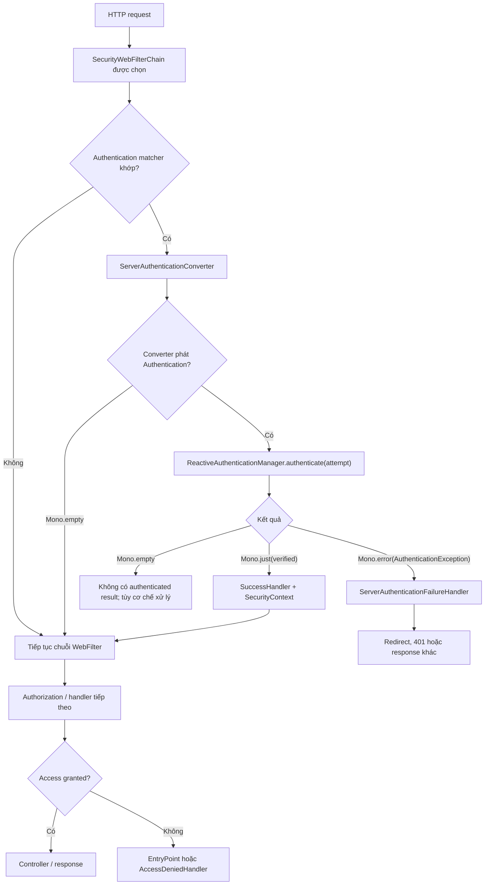
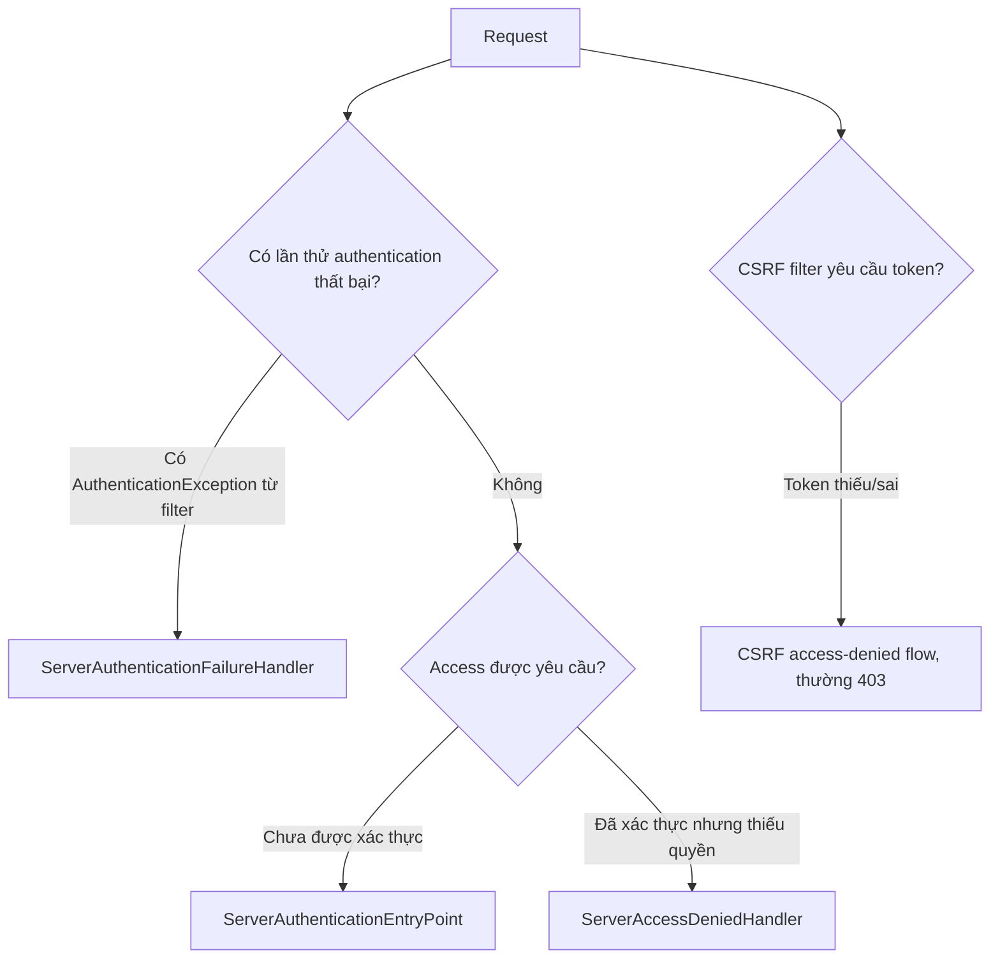

# `AuthenticationFailureHandler` và lỗi phát sinh trong quá trình đăng nhập — Spring Security Reactive

Trong **Spring Security Reactive** (Spring WebFlux), khi người dùng gửi biểu mẫu đăng nhập nhưng cung cấp mật khẩu sai, tài khoản bị khóa hoặc nguồn dữ liệu xác thực không hoạt động, ứng dụng cần trả về **phản hồi thất bại có chủ đích**. Với WebFlux, thành phần trực tiếp xử lý một lần *authentication attempt* thất bại là **`ServerAuthenticationFailureHandler`**. Nó không phải interface Servlet có tên `AuthenticationFailureHandler`.

Một biểu mẫu HTML thường cần quay về trang `/login?error` với thông báo chung. Một ứng dụng API có thể cần status `401` và JSON cố định. Một lỗi hạ tầng xác thực (như user store bị lỗi) không nên bị che thành “sai mật khẩu” trong giám sát; có thể cần `503 Service Unavailable` và cảnh báo vận hành. Trong khi đó **CSRF thất bại** hay **thiếu quyền sau khi đã đăng nhập** là những nhánh lỗi khác, không mặc nhiên đi vào login failure handler.

Bài này giải thích các ranh giới đó, luồng Reactor của `AuthenticationWebFilter`, những `AuthenticationException` thường gặp, cách viết handler an toàn, ví dụ Java 17+ chạy trên Spring Boot 3.x / Spring Security 6.x / WebFlux, cách thử `curl` và `WebTestClient`, cùng các quy tắc chống lộ tài khoản và bí mật.

## 1. Trước tiên, phân biệt năm tình huống

| Tình huống | Bước đang xử lý | Phản hồi thông thường | Có phải `ServerAuthenticationFailureHandler`? |
| --- | --- | --- | --- |
| POST login với username/password sai, CSRF hợp lệ | `ReactiveAuthenticationManager` xác thực | Form: redirect `/login?error` | **Có**, theo form authentication filter |
| Gọi route cần login nhưng chưa cung cấp credentials | Authorization yêu cầu bắt đầu xác thực | Form: redirect `/login`; Basic: `401` challenge | **Thường không**; dùng `ServerAuthenticationEntryPoint` |
| User đã xác thực nhưng thiếu role/scope | Authorization từ chối | `403 Forbidden` | **Không**; dùng `ServerAccessDeniedHandler` |
| POST `/login` thiếu hoặc sai CSRF token | `CsrfWebFilter` chặn request | Thường `403 Forbidden` | **Không**; không đồng nhất với sai password |
| Database/Identity Provider xác thực bị lỗi | Manager hoặc hạ tầng phát lỗi | `5xx`, hoặc chính sách lỗi hạ tầng của ứng dụng | **Tùy loại exception và filter**; không coi mọi `Throwable` đều là `AuthenticationException` |

Lưu ý: status và redirect có thể đổi khi bạn tùy biến entry point, failure handler, exception handler hoặc có nhiều `SecurityWebFilterChain`. Bảng mô tả hành vi phổ biến, không phải một bản hợp đồng cứng cho mọi giao thức.

### Vì sao “không login được” không nhất thiết là authentication failure?

Một người dùng có thể không vào được `/private/me` vì chưa gửi credentials, vì CSRF chặn request, vì tài khoản không có quyền đọc resource, vì request body lỗi cú pháp hoặc vì máy chủ bị sự cố. Nếu UI hiển thị mọi trường hợp là “Mật khẩu không đúng”, người dùng không thể khắc phục và đội vận hành khó phân biệt dấu hiệu tấn công với outage.

**Ranh giới quan trọng:** `ServerAuthenticationFailureHandler` giải quyết **lần thử xác thực thất bại** của một authentication filter; nó không phải global exception handler cho cả WebFlux.

## 2. Luồng Reactive Authentication và vị trí failure handler

`AuthenticationWebFilter` vận hành theo mô hình:



Cách đọc sơ đồ:

1. `WebFilterChainProxy` chọn `SecurityWebFilterChain` theo request matcher. Một ứng dụng có thể có nhiều chain, ví dụ `/api/**` và UI browser.
2. Với **form login**, matcher thông thường là **POST `/login`**. Với **HTTP Basic**, filter xem header Basic trên request.
3. `ServerAuthenticationConverter` chuyển request thành `Authentication` chưa được tin cậy; có thể trả `Mono.empty()` nếu không có credentials phù hợp.
4. `ReactiveAuthenticationManager.authenticate(...)` kiểm tra bằng chứng. **Thành công** trả `Mono<Authentication>` đã xác minh; **thất bại do xác thực** phát `AuthenticationException`.
5. `AuthenticationWebFilter` ủy quyền lỗi xác thực cho `ServerAuthenticationFailureHandler`. Handler **trả `Mono<Void>`**, hoàn tất response/redirect theo mô hình reactive, không tự gọi `.block()`/`.subscribe()` bên trong.
6. Nếu converter không tạo attempt, luồng có thể tiếp tục tới authorization. Khi route bảo vệ yêu cầu login, entry point sẽ yêu cầu xác thực; đó không nhất thiết là một lần thử login sai.
7. Lỗi hệ thống bất thường có thể không được chuyển thành `AuthenticationException`, và lỗi phát sinh **trước khi đi vào authentication filter** cũng không buộc phải qua failure handler.

Tài liệu `AuthenticationWebFilter` nêu rõ trường hợp request không khớp matcher hoặc converter trả empty, filter cho chain đi tiếp; sau khi manager trả lỗi xác thực, failure handler được gọi.

### Ba dạng tín hiệu của manager

```java
// Chữ ký API Spring Security minh họa:
Mono<Authentication> authenticate(Authentication authentication);
```

| Tín hiệu reactive | Ý nghĩa | Điều không nên làm |
| --- | --- | --- |
| `Mono.just(verifiedAuthentication)` | Xác thực thành công | Không tiếp tục báo “login failed” |
| `Mono.error(new BadCredentialsException(...))` | Xác thực bị từ chối | Không trả lại raw password, token hay thông điệp nội bộ cho client |
| `Mono.empty()` | Manager không quyết định được với token này | Không tự coi là authenticated hoặc thành công |

`Mono.error(new RuntimeException(...))` không phải lúc nào cũng được xử lý như `AuthenticationException`. Khi tích hợp user store/IdP, phải phân loại error ở đúng tầng, bảo vệ secrets và giữ đúng semantic giữa **credentials không hợp lệ** với **service unavailable**.

## 3. Interface đúng cho WebFlux: `ServerAuthenticationFailureHandler`

Đường dẫn API:

```java
import org.springframework.security.web.server.authentication
    .ServerAuthenticationFailureHandler;
```

Hợp đồng:

```java
// Đây là chữ ký minh họa của interface Spring Security.
Mono<Void> onAuthenticationFailure(
    WebFilterExchange webFilterExchange,
    AuthenticationException exception);
```

- `WebFilterExchange` kết hợp `ServerWebExchange` và `WebFilterChain`; dùng `webFilterExchange.getExchange()` để lấy request/response reactive nếu cần.
- `AuthenticationException` là nguyên nhân từ bước xác thực; nên dùng loại exception để **phân loại ở server** và hiển thị thông báo chung cho người dùng.
- `Mono<Void>` là publisher đại diện cho việc hoàn tất xử lý lỗi. Để framework subscribe; không gọi `.subscribe()` riêng.
- Handler có thể redirect, đặt status, trả JSON hoặc delegate cho `ServerAuthenticationEntryPoint`, tùy kiểu ứng dụng.
- Handler **không phải nơi xác minh lại password**, không tự cấp `SecurityContext`, không gọi `chain.filter(...)` để bỏ qua lỗi và cho request vào controller.

**Không nhầm Servlet API:**

| WebFlux Reactive | Servlet MVC |
| --- | --- |
| `ServerAuthenticationFailureHandler` | `AuthenticationFailureHandler` |
| `WebFilterExchange`, `ServerWebExchange` | `HttpServletRequest`, `HttpServletResponse` |
| `Mono<Void>` | Phương thức `void`, có thể ném `IOException`/`ServletException` |
| `AuthenticationWebFilter` | `UsernamePasswordAuthenticationFilter` / `AbstractAuthenticationProcessingFilter` |
| `ServerHttpSecurity`, `SecurityWebFilterChain` | `HttpSecurity`, `SecurityFilterChain` |

Ví dụ copy từ bài Servlet có `SimpleUrlAuthenticationFailureHandler` và override `onAuthenticationFailure(HttpServletRequest, ...)` **không dùng trực tiếp** trong WebFlux.

## 4. Hai implementation có sẵn và lựa chọn phản hồi

Spring Security WebFlux cung cấp:

**`RedirectServerAuthenticationFailureHandler`**

- Dùng khi **trình duyệt** cần quay lại form.
- Constructor nhận URL location, ví dụ `new RedirectServerAuthenticationFailureHandler("/login?error")`.
- Thực hiện một redirect response; view `GET /login?error` tự hiển thị thông báo chung, không nhận raw password.
- FormLoginSpec mặc định sử dụng redirect tới **`/login?error`** theo tài liệu Spring Security 6.5.

**`ServerAuthenticationEntryPointFailureHandler`**

- Delegate việc xử lý failure sang một `ServerAuthenticationEntryPoint` (ví dụ cơ chế HTTP Basic challenge).
- Hữu ích cho các giao thức/API cần challenge chính xác.
- Ở Spring Security 6.5, `setRethrowAuthenticationServiceException(boolean)` cho phép điều chỉnh chính sách ném lại lỗi service; **mặc định là true**. Đây là tín hiệu rằng lỗi hạ tầng không nên tự động bị xem là “credentials sai”.
- Cần giữ các header chuẩn của giao thức. Ví dụ HTTP Basic có thể yêu cầu `WWW-Authenticate`; một JSON handler tùy biến trả 401 nhưng bỏ header có thể thay đổi hành vi client.

Ví dụ chọn built-in redirect trong cấu hình:

```java
.formLogin(form -> form
    .loginPage("/login")
    .authenticationFailureHandler(
        new RedirectServerAuthenticationFailureHandler("/login?error")))
```

Đây là **đoạn DSL tích hợp**, không phải class Java độc lập. Import `RedirectServerAuthenticationFailureHandler` từ `org.springframework.security.web.server.authentication`.

Không đổi tất cả lỗi thành redirect một cách máy móc: script/API thường muốn JSON và status hợp lệ; browser form thường muốn UI có thể thử lại. Lỗi hạ tầng có thể cần status 503 hoặc trang bảo trì, thay vì giả làm lỗi password.

## 5. `AuthenticationException` thường gặp trong quá trình login

| Exception / tình huống | Ý nghĩa | Cách hiển thị an toàn |
| --- | --- | --- |
| `BadCredentialsException` | Username/password hoặc bí mật không khớp | Thông báo chung “Không thể đăng nhập với thông tin đã cung cấp” |
| `UsernameNotFoundException` | User store không tìm được username | **Không tiết lộ** tài khoản có tồn tại hay không |
| `DisabledException` | Tài khoản đã bị vô hiệu hóa | Cân nhắc thông báo chung ra ngoài; hướng dẫn hỗ trợ qua kênh an toàn |
| `LockedException` | Tài khoản đang khóa | Không tiết lộ thông tin tài khoản cho người lạ; báo riêng cho chủ đã xác minh nếu cần |
| `AccountExpiredException` | Thời hạn tài khoản đã hết | Chính sách hỗ trợ riêng; không trả chi tiết user store |
| `CredentialsExpiredException` | Password/credentials cần đổi | Có thể chuyển sang luồng đổi mật khẩu **sau khi xác minh danh tính theo policy** |
| `AuthenticationServiceException` | Sự cố hạ tầng/chức năng phục vụ authentication | Báo tình trạng hệ thống/503, cảnh báo vận hành; không dán nhãn sai mật khẩu |
| `SessionAuthenticationException` | Chính sách phiên từ chối, ví dụ giới hạn đăng nhập đồng thời | Báo giới hạn phiên một cách phù hợp mà không rò thông tin nhạy cảm |
| `InsufficientAuthenticationException` | Mức xác thực chưa đủ theo policy cụ thể | Yêu cầu xác thực đầy đủ/MFA nếu ứng dụng có flow đó |

Tên exception ở bảng là các loại Spring Security chung; **không phải tất cả xuất hiện trong mọi manager hoặc giao thức**. Ví dụ JWT validation thường có loại exception khác với password login. Một số manager cố tình che `UsernameNotFoundException` bằng `BadCredentialsException` để chống **username enumeration**. Vì vậy, không viết business logic phụ thuộc vào việc luôn biết được username không tồn tại từ client response.

### Phân biệt lỗi do client và lỗi do hạ tầng

Một hệ thống nên có ít nhất hai nhóm ở tầng quan sát:

- **Từ chối xác thực dự kiến:** password sai, tài khoản không đủ điều kiện, session policy từ chối. Không nên làm lộ lý do chi tiết cho client chưa được xác minh.
- **Lỗi hạ tầng:** timeout tới DB/LDAP/IdP, database connection pool cạn, lỗi mạng, secret/config sai, service bị gián đoạn. Phải quan sát bằng metric/audit; không biến thành chuỗi đăng nhập thất bại do người dùng gây ra.

Tránh `onErrorResume(Throwable.class, e -> Mono.error(new BadCredentialsException("wrong password")))` áp dụng cho mọi lỗi. Nó che outage, làm sai thông điệp và gây khóa tài khoản nhầm nếu hệ thống đếm thất bại.

## 6. `ServerAuthenticationEntryPoint`, `ServerAccessDeniedHandler` và CSRF khác gì?

Ba extension point có ngữ nghĩa riêng:



**Entry point:** cách bắt đầu quá trình xác thực khi truy cập tài nguyên được bảo vệ nhưng chưa có danh tính phù hợp. HTML form → redirect `/login`; HTTP Basic → thường 401 với challenge. Cấu hình qua:

```java
.exceptionHandling(errors -> errors
    .authenticationEntryPoint(entryPoint))
```

`entryPoint` phải là một bean/type `ServerAuthenticationEntryPoint` phù hợp. Ví dụ này là trích đoạn; không tự định nghĩa giá trị đó từ HTTP request.

**Access denied:** khi người dùng đã login nhưng thiếu `GrantedAuthority`, Spring Security gọi nhánh từ chối truy cập, thường trả 403. Cấu hình qua:

```java
.exceptionHandling(errors -> errors
    .accessDeniedHandler(accessDeniedHandler))
```

Ở đây `accessDeniedHandler` phải là `ServerAccessDeniedHandler`. Đừng gọi lại failure handler đăng nhập rồi yêu cầu user nhập password nếu vấn đề là thiếu role/scope.

**CSRF:** form login dùng session/cookie và request `POST /login` thường phải có CSRF token. Nếu token thiếu hoặc sai, `CsrfWebFilter` có thể trả 403 **trước khi manager kiểm chứng password**. Không thể sửa lỗi CSRF chỉ bằng `.authenticationFailureHandler(...)`. Hãy kiểm tra form, hidden `_csrf`, cookie/session, view rendering, XOR request handler và cách client gửi token.

**HTTP 400:** JSON lỗi cú pháp, content type không hợp lệ hoặc input validation có thể được tầng WebFlux xử lý trước khi gọi manager. Trạng thái thực tế tùy converter và handler. Không khẳng định tất cả lỗi form request đều đi qua `ServerAuthenticationFailureHandler`.

## 7. Thực hành đầy đủ: Spring Boot WebFlux form login với failure handler riêng

Ví dụ dưới đây có một UI đăng nhập server-rendered bằng Thymeleaf. Khi username/password sai, handler **ghi log phân loại tối thiểu** và redirect `/login?error`; khi user store/authentication service thật sự không sẵn sàng và exception thuộc `AuthenticationServiceException`, handler trả **503** chứ không nói sai mật khẩu. Đó là quyết định minh họa có chủ đích, bạn có thể đổi response theo contract của sản phẩm.

**Yêu cầu:** Java 17+, Spring Boot 3.x dùng Spring Security 6.x tương thích, Gradle wrapper và plugin Spring Boot đã thiết lập. Mã dành cho **Spring WebFlux**; không thêm `spring-boot-starter-web` vào ứng dụng.

### 7.1. Dependencies

Trong `build.gradle` của dự án Spring Boot:

```groovy
dependencies {
    implementation 'org.springframework.boot:spring-boot-starter-webflux'
    implementation 'org.springframework.boot:spring-boot-starter-security'
    implementation 'org.springframework.boot:spring-boot-starter-thymeleaf'

    testImplementation 'org.springframework.boot:spring-boot-starter-test'
    testImplementation 'org.springframework.security:spring-security-test'
}
```

Các starter thuộc cùng Spring Boot BOM. `spring-security-test` hỗ trợ tạo CSRF request hợp lệ trong `WebTestClient`; test này **không thay thế** kiểm thử browser thực về hidden field/cookie.

### 7.2. Tệp `src/main/java/demo/loginerrors/LoginErrorsApplication.java`

```java
package demo.loginerrors;

import org.springframework.boot.SpringApplication;
import org.springframework.boot.autoconfigure.SpringBootApplication;

@SpringBootApplication
public class LoginErrorsApplication {
    public static void main(String[] args) {
        SpringApplication.run(LoginErrorsApplication.class, args);
    }
}
```

### 7.3. Tệp `src/main/java/demo/loginerrors/SafeFormFailureHandler.java`

```java
package demo.loginerrors;

import org.slf4j.Logger;
import org.slf4j.LoggerFactory;
import org.springframework.http.HttpStatus;
import org.springframework.security.authentication.AuthenticationServiceException;
import org.springframework.security.core.AuthenticationException;
import org.springframework.security.web.server.WebFilterExchange;
import org.springframework.security.web.server.authentication
    .RedirectServerAuthenticationFailureHandler;
import org.springframework.security.web.server.authentication
    .ServerAuthenticationFailureHandler;
import org.springframework.stereotype.Component;
import reactor.core.publisher.Mono;

@Component
public class SafeFormFailureHandler
        implements ServerAuthenticationFailureHandler {

    private static final Logger log =
        LoggerFactory.getLogger(SafeFormFailureHandler.class);

    private final RedirectServerAuthenticationFailureHandler redirect =
        new RedirectServerAuthenticationFailureHandler("/login?error");

    @Override
    public Mono<Void> onAuthenticationFailure(
            WebFilterExchange webFilterExchange,
            AuthenticationException exception) {

        // Service failure không được báo sai mật khẩu.
        if (exception instanceof AuthenticationServiceException) {
            log.error("Authentication service is unavailable");
            var response = webFilterExchange.getExchange().getResponse();
            response.setStatusCode(HttpStatus.SERVICE_UNAVAILABLE);
            response.getHeaders().setCacheControl("no-store");
            return response.setComplete();
        }

        // Chỉ ghi loại lỗi, KHÔNG ghi exception.getMessage(),
        // request body, username, password hay raw token.
        log.info("Login rejected; category={}",
            exception.getClass().getSimpleName());

        // Giữ response chung để tránh user enumeration.
        return redirect.onAuthenticationFailure(
            webFilterExchange, exception);
    }
}
```

**Giải thích kỹ:**

- `@Component` đăng ký handler trong Spring context. `ServerAuthenticationFailureHandler` nhận `AuthenticationException` và `WebFilterExchange`, trả `Mono<Void>`.
- `RedirectServerAuthenticationFailureHandler` thực hiện redirect an toàn tới **URL cố định**, không nối username/query parameter chưa kiểm chứng vào `Location`.
- Với `AuthenticationServiceException`, ví dụ trả 503 và không chuyển sang `/login?error`; theo dõi lỗi hạ tầng ở log nội bộ. Ứng dụng thật có thể có trang bảo trì/JSON 503, timeout và alerting riêng.
- Tránh `log.error("login failed", exception)` vô điều kiện nếu stack trace/exception message có thể chứa dữ liệu nhạy cảm từ thư viện xác thực. Khi cần stack trace để điều tra, phải có cơ chế redaction và giới hạn quyền truy cập.
- Handler **không** gọi `chain.filter` sau thất bại, không tự tạo authenticated token, và không dùng `.block()`/`.subscribe()`.
- **Không mặc định handler này bắt mọi timeout/unchecked exception**. Chỉ những lỗi đi qua authentication failure flow và là `AuthenticationException` mới đến nhánh này. Error handling tổng quát là việc của WebFlux, gateway và vận hành.

Lớp trên là code độc lập trong phạm vi project, nhưng chưa thể một mình xử lý HTTP: phải **gắn nó vào form login** bằng cấu hình tiếp theo.

### 7.4. Tệp `src/main/java/demo/loginerrors/SecurityConfig.java`

```java
package demo.loginerrors;

import org.springframework.context.annotation.Bean;
import org.springframework.context.annotation.Configuration;
import org.springframework.security.config.Customizer;
import org.springframework.security.config.annotation.web.reactive.EnableWebFluxSecurity;
import org.springframework.security.config.web.server.ServerHttpSecurity;
import org.springframework.security.core.userdetails.ReactiveUserDetailsService;
import org.springframework.security.core.userdetails.User;
import org.springframework.security.core.userdetails.UserDetails;
import org.springframework.security.crypto.factory.PasswordEncoderFactories;
import org.springframework.security.crypto.password.PasswordEncoder;
import org.springframework.security.provisioning.MapReactiveUserDetailsService;
import org.springframework.security.web.server.SecurityWebFilterChain;

@Configuration
@EnableWebFluxSecurity
public class SecurityConfig {

    @Bean
    SecurityWebFilterChain security(
            ServerHttpSecurity http,
            SafeFormFailureHandler failureHandler) {

        return http
            .authorizeExchange(exchanges -> exchanges
                .pathMatchers("/login", "/public/**").permitAll()
                .anyExchange().authenticated())
            .formLogin(form -> form
                .loginPage("/login")
                .authenticationFailureHandler(failureHandler))
            .httpBasic(basic -> basic.disable())
            .csrf(Customizer.withDefaults())
            .build();
    }

    @Bean
    PasswordEncoder passwordEncoder() {
        return PasswordEncoderFactories.createDelegatingPasswordEncoder();
    }

    @Bean
    ReactiveUserDetailsService users(PasswordEncoder encoder) {
        UserDetails reader = User.withUsername("reader")
            .password(encoder.encode("demo123"))
            .roles("READER")
            .build();
        return new MapReactiveUserDetailsService(reader);
    }
}
```

Những quyết định có ý nghĩa:

- `.formLogin(form -> form.loginPage("/login")...)` dùng **POST `/login`** để xác thực; ứng dụng phải tự cung cấp **GET `/login`** vì đã chọn custom page.
- `.authenticationFailureHandler(failureHandler)` điều khiển phản hồi **khi có login attempt thất bại** của form flow, không thay thế entry point/CSRF/authorization.
- `.pathMatchers("/login").permitAll()` cho phép người chưa đăng nhập xem form; **không miễn CSRF** cho POST.
- `.httpBasic(...disable())` giữ ví dụ chỉ có form login, không làm browser hiện Basic prompt. Với API có Basic, có thể cấu hình handler riêng qua `.httpBasic(basic -> basic.authenticationFailureHandler(...))`; không áp dụng mẫu redirect form cho HTTP Basic nếu client đang chờ 401 challenge.
- `.csrf(Customizer.withDefaults())` giữ CSRF token bắt buộc trên POST login; ví dụ không tắt CSRF.
- Password `demo123` dành cho **máy học tập**; `PasswordEncoder` bảo đảm lưu hash thay vì plain text trong user store.

### 7.5. Tệp `src/main/java/demo/loginerrors/LoginPageController.java`

```java
package demo.loginerrors;

import org.springframework.stereotype.Controller;
import org.springframework.web.bind.annotation.GetMapping;

@Controller
public class LoginPageController {

    @GetMapping("/login")
    public String loginPage() {
        return "login";
    }
}
```

Vì đây là `@Controller` trả tên view, Thymeleaf sẽ render `src/main/resources/templates/login.html`. Nếu dùng `@RestController` trả chuỗi `"login"`, Spring sẽ trả text thay vì render HTML view và form sẽ không hoạt động như thiết kế.

### 7.6. Tệp `src/main/resources/templates/login.html`

```html
<!DOCTYPE html>
<html lang="vi" xmlns:th="http://www.thymeleaf.org">
<head>
    <meta charset="UTF-8">
    <title>Đăng nhập</title>
</head>
<body>
<h1>Đăng nhập</h1>

<p th:if="${param.error}">
    Không thể đăng nhập. Hãy kiểm tra thông tin và thử lại.
</p>

<form th:action="@{/login}" method="post">
    <label for="username">Tên đăng nhập</label>
    <input id="username" name="username"
           type="text" autocomplete="username" required>

    <label for="password">Mật khẩu</label>
    <input id="password" name="password"
           type="password" autocomplete="current-password" required>

    <button type="submit">Đăng nhập</button>
</form>
</body>
</html>
```

**Tại sao không có hidden `_csrf` trong source template?** Với Spring Security + Thymeleaf integration và `th:action` trên form POST, view processing có thể tự chèn hidden CSRF input. Hãy **kiểm tra HTML đã render trong browser**: phải có input tên `_csrf` và giá trị token phù hợp. Đây là giá trị cho **phiên/request hiện tại**, không được đặt cố định trong HTML template hoặc JavaScript bundle.

Đừng “sửa” 403 bằng `csrf.disable()`. Nếu dùng HTML tĩnh hoặc SPA không render qua Thymeleaf, bạn phải tự cung cấp và gửi CSRF token qua cơ chế WebFlux phù hợp.

Thông điệp ở trang login **cố tình chung chung**. Khi account bị khóa hoặc username không tồn tại, người chưa được xác minh không nên biết sự khác biệt chỉ bằng response.

### 7.7. Tệp `src/main/java/demo/loginerrors/DemoController.java`

```java
package demo.loginerrors;

import org.springframework.security.core.context.ReactiveSecurityContextHolder;
import org.springframework.web.bind.annotation.GetMapping;
import org.springframework.web.bind.annotation.RestController;
import reactor.core.publisher.Mono;

@RestController
public class DemoController {

    @GetMapping("/public/ping")
    public Mono<String> ping() {
        return Mono.just("pong");
    }

    @GetMapping("/")
    public Mono<String> home() {
        return Mono.just("home");
    }

    @GetMapping("/private/me")
    public Mono<String> me() {
        return ReactiveSecurityContextHolder.getContext()
            .map(ctx -> ctx.getAuthentication().getName());
    }
}
```

`/private/me` lấy username từ `SecurityContext` của Reactor Context, không tin trường username do client gửi. User chưa đăng nhập bị redirect tới login; user đã đăng nhập có thể nhận `reader`. Route `/` được bảo vệ, giúp redirect thành công từ form login mặc định có đích tồn tại.

### 7.8. Chạy ứng dụng

Trong thư mục dự án có Gradle wrapper:

```bash
# Linux/macOS
./gradlew bootRun

# Windows
gradlew.bat bootRun
```

Mở `http://localhost:8080/login`, nhập username `reader`.

- Mật khẩu **`demo123`** → login thành công và thường redirect đến `/` hoặc URL đã lưu theo request cache/success handler. Sau đó `GET /private/me` trong cùng session cho body `reader`.
- Mật khẩu **`wrong`** → manager từ chối, handler redirect đến `/login?error`, trang hiển thị thông báo chung.
- Nếu bỏ hidden CSRF token trong POST (trong khi CSRF bật), request thường bị **403** trước bước kiểm chứng password; đó là một lỗi khác, không kích hoạt `SafeFormFailureHandler` trong ví dụ.
- Nếu bạn cố ý tạo một `AuthenticationServiceException` từ manager custom vì user store không sẵn sàng, handler trả **503**. Demo in-memory thông thường **không tự sinh outage 503**; tình huống này phải được kiểm thử riêng, không tuyên bố rằng nhập mật khẩu sai sẽ dẫn đến 503.

Chỉ dùng HTTP localhost cho bài học. Trên môi trường thật, form login cần HTTPS, Secure/HttpOnly/SameSite cookie policy, CSRF và bảo vệ chống thử mật khẩu hàng loạt.

## 8. Test tích hợp: phân biệt redirect login lỗi, CSRF 403 và đăng nhập thành công

Tệp `src/test/java/demo/loginerrors/LoginFailureFlowTest.java`:

```java
package demo.loginerrors;

import org.junit.jupiter.api.Test;
import org.springframework.beans.factory.annotation.Autowired;
import org.springframework.boot.test.context.SpringBootTest;
import org.springframework.boot.test.autoconfigure.web.reactive.AutoConfigureWebTestClient;
import org.springframework.http.MediaType;
import org.springframework.test.web.reactive.server.WebTestClient;
import org.springframework.web.reactive.function.BodyInserters;

import static org.junit.jupiter.api.Assertions.assertTrue;
import static org.springframework.security.test.web.reactive.server
    .SecurityMockServerConfigurers.csrf;

@SpringBootTest(webEnvironment = SpringBootTest.WebEnvironment.MOCK)
@AutoConfigureWebTestClient
class LoginFailureFlowTest {

    @Autowired
    WebTestClient client;

    @Test
    void loginPageIsPublicAndRendered() {
        client.get().uri("/login")
            .exchange()
            .expectStatus().isOk()
            .expectBody(String.class)
            .value(body -> assertTrue(body.contains("name=\"_csrf\"")));
    }

    @Test
    void missingCsrfIsNotWrongPassword() {
        client.post().uri("/login")
            .contentType(MediaType.APPLICATION_FORM_URLENCODED)
            .body(BodyInserters.fromFormData("username", "reader")
                .with("password", "wrong"))
            .exchange()
            .expectStatus().isForbidden();
    }

    @Test
    void invalidPasswordRedirectsToGenericErrorPage() {
        client.mutateWith(csrf())
            .post().uri("/login")
            .contentType(MediaType.APPLICATION_FORM_URLENCODED)
            .body(BodyInserters.fromFormData("username", "reader")
                .with("password", "wrong"))
            .exchange()
            .expectStatus().is3xxRedirection()
            .expectHeader().value("Location", location ->
                assertTrue(location.endsWith("/login?error")));
    }

    @Test
    void validPasswordReachesAuthenticationSuccessFlow() {
        client.mutateWith(csrf())
            .post().uri("/login")
            .contentType(MediaType.APPLICATION_FORM_URLENCODED)
            .body(BodyInserters.fromFormData("username", "reader")
                .with("password", "demo123"))
            .exchange()
            .expectStatus().is3xxRedirection();
    }

    @Test
    void unauthenticatedProtectedRequestOpensLoginPage() {
        client.get().uri("/private/me")
            .exchange()
            .expectStatus().is3xxRedirection()
            .expectHeader().value("Location", location ->
                assertTrue(location.endsWith("/login")));
    }
}
```

Chạy:

```bash
# Linux/macOS
./gradlew test --tests 'demo.loginerrors.LoginFailureFlowTest'

# Windows
gradlew.bat test --tests "demo.loginerrors.LoginFailureFlowTest"
```

Các test kiểm tra:

- GET login public và HTML đã render có hidden CSRF.
- POST **thiếu CSRF** dẫn đến 403: chưa phải lỗi password của authentication manager.
- POST **password sai, CSRF hợp lệ** đến failure handler và redirect cố định.
- POST **password đúng, CSRF hợp lệ** theo luồng success; status redirect chưa đủ chứng minh session đã được giữ.
- GET endpoint protected chưa login dẫn đến entry point redirect, không phải form failure handler.

`mutateWith(csrf())` của `spring-security-test` hỗ trợ mock CSRF hợp lệ cho test. Nó **không thay thế** end-to-end browser test với token và cookie thật, và cũng không tự xác minh user/password nếu test đồng thời mock authentication.

### Kiểm thử session thành công thay vì chỉ status 3xx

Một redirect sau POST có thể là success hoặc failure, vì vậy cần thử request tiếp theo bằng **cookie của cùng browser**. Bằng trình duyệt:

1. Mở `/login`, xác nhận hidden `_csrf` và cookie phiên.
2. Đăng nhập `reader/demo123`.
3. Mở `/private/me`; body phải là `reader`.
4. Đăng xuất rồi thử lại; request không có phiên hợp lệ phải yêu cầu login.
5. Đăng nhập sai rồi truy cập `/private/me` bằng browser/chrome profile độc lập chưa login; không được tự cấp session thành công.

Với API/test thật, có thể thu thập `Set-Cookie` từ response POST thành công bằng `WebTestClient` hoặc cookie jar của `curl`, sau đó gửi cookie đó đến endpoint protected. Đừng chỉ assert `.is3xxRedirection()` rồi tuyên bố security đã đúng toàn diện.

### Kiểm thử trực tiếp nhánh 503 với lỗi dịch vụ

Đường demo có `MapReactiveUserDetailsService` không chủ động phát outage. Để kiểm thử **chính handler** mà không gây sự cố database, viết một unit test dùng `MockServerWebExchange` và `StepVerifier` hoặc gọi handler với `AuthenticationServiceException` trong môi trường test. Mục đích là kiểm tra:

- `getResponse().getStatusCode()` là `503 Service Unavailable`.
- Response không chứa username, password, exception message hay stack trace.
- `Mono<Void>` hoàn tất, không cố tiếp tục filter chain.
- Monitoring nội bộ nhận biết lỗi hạ tầng; không đếm nó như một password mismatch.

Điều này khác với integration test một `ReactiveAuthenticationManager` thực sự phát lỗi. Để test toàn bộ đường manager-to-handler, có thể thay manager bằng test bean chỉ trong test profile hoặc mô phỏng user store phát `AuthenticationServiceException` có kiểm soát.

## 9. Handler trả JSON cho API: khi nào phù hợp?

Một ứng dụng frontend gọi API có thể muốn JSON thay vì redirect HTML. Từ contract `ServerAuthenticationFailureHandler`, có thể tạo class:

```java
package demo.loginerrors;

import java.nio.charset.StandardCharsets;

import org.springframework.http.HttpStatus;
import org.springframework.http.MediaType;
import org.springframework.security.core.AuthenticationException;
import org.springframework.security.web.server.WebFilterExchange;
import org.springframework.security.web.server.authentication
    .ServerAuthenticationFailureHandler;
import reactor.core.publisher.Mono;

public final class JsonLoginFailureHandler
        implements ServerAuthenticationFailureHandler {

    @Override
    public Mono<Void> onAuthenticationFailure(
            WebFilterExchange webFilterExchange,
            AuthenticationException exception) {

        var response = webFilterExchange.getExchange().getResponse();
        response.setStatusCode(HttpStatus.UNAUTHORIZED);
        response.getHeaders().setContentType(MediaType.APPLICATION_JSON);
        response.getHeaders().setCacheControl("no-store");

        byte[] payload = (
            "{\"code\":\"AUTHENTICATION_FAILED\","
            + "\"message\":\"Unable to authenticate\"}")
            .getBytes(StandardCharsets.UTF_8);

        return response.writeWith(Mono.just(
            response.bufferFactory().wrap(payload)));
    }
}
```

Đây là **một class tùy chọn**, không phải bean được sử dụng đồng thời với `SafeFormFailureHandler` trong cấu hình chính. Bạn có thể gắn nó vào một authentication flow chuyên dành cho API, ví dụ:

```java
// Trích đoạn thay cấu hình failure handler của form login:
.formLogin(form -> form
    .authenticationFailureHandler(new JsonLoginFailureHandler()))
```

**Cảnh báo tích hợp:** Đổi failure response thành JSON **không** khiến form login mặc định tự nhận JSON request body. Bộ chuyển đổi form login vẫn mong đợi các form parameters như `username`, `password` trên endpoint phù hợp. Nếu muốn `POST /api/login` với request JSON, bạn phải cấu hình **converter/filter riêng** cho JSON và policy CSRF phù hợp; đó là thiết kế khác với ví dụ HTML chính.

Khi dùng HTTP Basic, một status 401 thường cần `WWW-Authenticate` đúng giao thức. Class JSON đơn giản trên **không tự tạo Basic challenge**; đừng gắn nó thay thế Basic failure handler nếu client phụ thuộc header challenge. Hãy sử dụng `ServerAuthenticationEntryPointFailureHandler` với entry point thích hợp hoặc chủ động bảo toàn header theo contract API.

Nếu API dùng OAuth2 bearer token, status/header lỗi (chẳng hạn `WWW-Authenticate: Bearer ...`) có giao thức riêng. Không tùy tiện chuyển lỗi token thành redirect đến form HTML hoặc trả JSON thiếu header bắt buộc.

## 10. Lỗi CSRF 403 khác “mật khẩu sai”

Một lỗi dễ gặp khi xây custom login form WebFlux:

```text
POST /login
username=reader
password=demo123
```

Nếu không gửi CSRF token hợp lệ trong khi Spring Security bật CSRF mặc định, request có thể bị `CsrfWebFilter` chặn với **403** **trước khi** `ReactiveAuthenticationManager` đọc password.

Với Thymeleaf server-rendered, dùng:

```html
<form th:action="@{/login}" method="post">
    <input name="username" type="text">
    <input name="password" type="password">
    <button type="submit">Đăng nhập</button>
</form>
```

Khi integration hoạt động, Thymeleaf tự thêm hidden input CSRF vào HTML được render; không cần tự chế token. Người dùng phải gửi kèm **cookie/session** tương ứng với form đó.

Nếu bạn xây frontend hoàn toàn bằng JavaScript, cần lấy token từ luồng Spring Security WebFlux và gửi trong **header hoặc parameter** theo handler/repository được cấu hình. Từ Spring Security 6.x, token có thể được biểu diễn qua XOR handler để chống BREACH; đừng so sánh raw token trong WebSession với masked token trong HTML bằng cách thủ công.

**Không dùng**:

```java
// Đây là lựa chọn nguy hiểm nếu browser form login dùng cookie.
.csrf(csrf -> csrf.disable())
```

chỉ để “sửa” lỗi POST. CSRF protection và authentication failure handler là hai cơ chế riêng; bỏ CSRF có thể tạo rủi ro **login CSRF** và request giả mạo sau đăng nhập.

## 11. Không tiết lộ username có tồn tại hay không

**User enumeration** xảy ra khi attacker phân biệt username hợp lệ với username không tồn tại thông qua status, redirect, thông báo, thời gian hoặc chi tiết kỹ thuật khác.

Những cách phản hồi nguy hiểm:

- Username không tồn tại → “Không có tài khoản này”; password sai → “Sai mật khẩu”.
- Tài khoản bị khóa → trả JSON kèm username, email và thời điểm khóa trước khi xác minh.
- Trả thẳng `AuthenticationException.getMessage()` vào HTML/JSON.
- Redirect `/login?error=UsernameNotFoundException&user=alice` rồi log/tracking public URL.
- Đối với một username, trả rất nhanh; username khác chạy password hashing chậm hơn rõ rệt.

Cách an toàn hơn:

1. Trả **cùng một thông báo chung** cho đa số lỗi credentials từ client chưa xác minh.
2. Phân loại lý do trong **log/metric nội bộ tối giản** nếu có chính sách cho phép; không dùng raw password/token/cookie hoặc full request body.
3. Đặt rate limit và chống credential stuffing theo IP, account/identity có cân nhắc quyền riêng tư, độ tin cậy và false positives. Không mặc định đếm outage của DB là password sai.
4. Với user đã xác minh và có chính sách hỗ trợ, có thể có luồng cụ thể để mở khóa tài khoản/đổi mật khẩu nhưng cần tránh mở ra kênh kiểm tra username công khai.
5. Cẩn thận timing differences; dùng password encoder phù hợp, giới hạn chi phí và test phát hiện kênh rò rỉ nếu hệ thống có yêu cầu cao.

Ví dụ handler chính chỉ log **class lỗi** mà không log username, exception message hay cả đối tượng `Authentication`.

## 12. Lỗi hạ tầng xác thực cần được tách khỏi lỗi người dùng

Giả sử `ReactiveUserDetailsService` dùng database/reactive LDAP:

```java
Mono<UserDetails> user = userRepository.findByUsername(username)
    .switchIfEmpty(Mono.error(
        new UsernameNotFoundException("Account unavailable")));
```

Đây là **đoạn minh họa tích hợp**, không phải class hoàn chỉnh: `userRepository` là abstraction của ứng dụng. Khi truy vấn trả empty thực sự vì không có user, `UsernameNotFoundException` mô tả trường hợp business; manager có thể chuyển nó thành `BadCredentialsException` để giảm enumeration.

Nhưng khi database **timeout**, application không nên cố biến `TimeoutException` thành `UsernameNotFoundException`. Lỗi hạ tầng phải được xử lý theo một policy rõ ràng:

- Đảm bảo authentication manager/client có timeout và không chặn event loop.
- Gắn loại lỗi hạ tầng (`AuthenticationServiceException`, hoặc để lỗi nền lan tới error layer phù hợp) theo contract implementation.
- Log lỗi vận hành ở mức an toàn và phát cảnh báo nếu tăng đột biến.
- Không cấp quyền “tạm thời” bằng token tự tạo khi identity provider không sẵn sàng.
- Không mở endpoint login bằng `.permitAll()` như cách giải quyết outage; `permitAll` chỉ là web authorization, không sửa manager.
- Chú ý **fail closed**: khi không kiểm chứng được mật khẩu, không tự coi request thành công; phản hồi 503 phù hợp hơn trong nhiều sản phẩm, nhưng API contract cần quyết định.

`SafeFormFailureHandler` minh họa cách trả 503 khi chính handler **nhận được** `AuthenticationServiceException`. Nếu thư viện phát một exception khác hoặc lỗi xảy ra trước filter, request có thể theo WebFlux error handling và không đi qua nhánh này; cần test chính hệ thống thật.

## 13. Lỗi khi phiên đăng nhập hoặc quyền không phù hợp

Một lượt login có credentials đúng vẫn có thể bị từ chối vì **chính sách phiên** hoặc **authentication success processing**:

- Concurrent session limit: hệ thống muốn giữ phiên trước và chặn login mới; có thể phát `SessionAuthenticationException` theo đường authentication processing.
- Chính sách MFA: password đúng nhưng cần xác thực bổ sung; đây không nhất thiết là “login hoàn tất”, và cần flow xác thực nhiều bước rõ ràng.
- Session store không lưu được `SecurityContext` sau thành công; đó là **sự cố hạ tầng/session**, không phải password mismatch.
- Redirect success handler hoặc security context persistence lỗi; cần giám sát đúng loại lỗi thay vì lặp lại password.
- CSRF hoặc cookie policy khiến người dùng login thành công nhưng request sau không có session, tạo cảm giác “đăng nhập liên tục bị lỗi”.

**Điểm cần phân biệt:** lỗi trong/ sau *success handler* không tự bảo đảm sẽ quay về *failure handler*; phụ thuộc vị trí lỗi trong reactive pipeline và cách authentication filter tích hợp. Không hứa tất cả các lỗi sau password verification sẽ được một handler bắt chung.

Một người dùng đã đăng nhập nhưng không có quyền gọi `/admin` sẽ gặp **authorization denial**, không phải login failure. Không redirect họ trở lại `/login?error` để che việc thiếu quyền.

## 14. Nguyên tắc trả response đúng và không chặn Reactor

Một custom failure handler tốt cần:

- **Trả publisher**: `return response.setComplete()` hoặc `return response.writeWith(...)` hay delegate một `ServerAuthenticationFailureHandler` khác. Framework chịu trách nhiệm subscription.
- **Không tự gọi `.subscribe()`** bên trong handler; hành vi này có thể tách response khỏi vòng đời HTTP và làm mất kiểm soát lỗi.
- **Không gọi `.block()`** trong Netty event loop; không chạy JDBC đồng bộ/truy vấn mạng blocking chỉ để định dạng message.
- **Không ghi response hai lần**: nếu đã redirect thì không tiếp tục ghi JSON; nếu response đã committed, đừng đặt thêm status/header/body.
- **Không gọi chain tiếp sau login thất bại** để “cho phép route public”; failure đã được kết luận và cần hoàn tất đúng.
- **Không tự tạo `Authentication` có `isAuthenticated=true`** trong error handler.
- **Không cho credentials vào Reactor Context hoặc session** của thất bại để “dùng lại lần sau”.
- **Không trả exception message/stack trace** cho client; dùng mã lỗi ổn định và thông điệp chung.
- **Không giữ plaintext password** trong log, request cache, telemetry span, analytics URL hoặc message queue.
- **Có kiểm thử concurrency và cancellation** nếu handler gọi thêm audit service reactive; các bước đó phải được ghép vào `Mono` chứ không fire-and-forget một cách ngẫu nhiên.

Với giao thức API có body JSON, dùng `Content-Type: application/json`, charset UTF-8 và policy cache phù hợp (`Cache-Control: no-store`). Với OAuth2 Basic/Bearer, giữ challenge header theo chuẩn. Với HTML form, redirect phù hợp UX và không gắn thông tin nhạy cảm vào query string.

### Tại sao không nên gửi password lại trong redirect?

URL có thể được browser lưu vào history, gửi qua `Referer`, analytics, access logs hoặc copied link. Kể cả ứng dụng chỉ muốn prefill username, phải cân nhắc PII, XSS và chính sách hiển thị; tuyệt đối không prefill password trong response. Đối với lỗi form, nên yêu cầu người dùng nhập lại mật khẩu.

## 15. Chẩn đoán: cùng nhập sai password nhưng status khác nhau

Khi người dùng nói “đăng nhập bị lỗi”, theo trình tự sau:

1. **Xem request method và URL:** có phải POST tới login processing URL đã cấu hình không? `loginPage("/login")` mặc định tương ứng POST `/login`.
2. **Xem response type:** 302 tới `/login?error`, 401 challenge, 403, 503 hay 500? Mỗi loại gợi ý nhánh khác.
3. **Kiểm tra CSRF trước:** POST có hidden `_csrf`/header đúng và cookie cùng session không? Nếu thiếu, 403 xảy ra trước manager.
4. **Xác định security chain:** có `securityMatcher`/`@Order` khiến request vào nhầm chain API thay vì form không?
5. **Kiểm tra converter:** form có đúng `username`/`password`, Content-Type phù hợp không? JSON gửi vào form converter mặc định sẽ không tự được parse như một JSON login endpoint.
6. **Kiểm tra manager và user store:** password encoder có khớp hash format? User có enabled/locked/expired? Nguồn dữ liệu reactive có timeout/hạ tầng lỗi?
7. **Kiểm tra handler đã được gắn:** `.formLogin(form -> form.authenticationFailureHandler(...))` chạy trên đúng chain? Có custom filter độc lập không?
8. **Kiểm tra success flow:** nếu password đúng nhưng cookie/session không tồn tại ở request sau, kiểm tra persistence, session timeout, SameSite/Secure, load/save repository, redirect và sticky/shared session.
9. **Kiểm tra auth vs authorization:** 401/redirect vì chưa authenticated, 403 vì thiếu role hoặc CSRF; không quy mọi 403 về password.
10. **Kiểm tra observability an toàn:** có log request ID, exception category, user store health, latency, retry/timeout? Không log plaintext username nếu không được phép, và không bao giờ log password/token.

### Bảng định hướng

| Dấu hiệu | Nguyên nhân cần kiểm tra |
| --- | --- |
| POST login trả 403, handler log không xuất hiện | CSRF, chain hoặc filter đứng trước login |
| POST login redirect `/login?error` | Manager hoặc login success-policy bị từ chối, handler đã xử lý |
| GET `/private/me` redirect `/login` | Chưa có authentication hợp lệ, entry point được gọi |
| Basic request sai trả 401 | Basic auth failure/challenge; khác HTML form redirect |
| Credentials đúng nhưng `/admin` trả 403 | Authority/role hoặc method security từ chối |
| Trong lúc DB outage mọi login trả 503 | Handler/hạ tầng phân loại service exception |
| Login redirect success nhưng request sau chưa authenticated | Cookie/session repository, persistence, browser policy |
| Custom JSON handler không được gọi | Không gắn đúng authentication filter hoặc lỗi xảy ra trước đó |
| Response in raw exception message | Nguy cơ lộ thông tin nội bộ và user enumeration |
| Reactors bị nghẽn khi login | Blocking I/O/password hash quá nặng trên event loop hoặc `block()` |

Không sửa lỗi theo kiểu “tắt SecurityWebFilterChain”, “bỏ CSRF”, hoặc “cứ onErrorResume rồi cấp user giả”. Đó là thay đổi chính sách bảo mật, không phải sửa nhánh response.

## 16. Kiểm thử bảo mật và chất lượng phản hồi

Các test nên bao quát:

| Test case | Kỳ vọng |
| --- | --- |
| GET login khi chưa xác thực | 200, trang login không có thông tin nội bộ |
| POST form thiếu CSRF | 403, không thông báo sai password |
| POST form token hợp lệ + password sai | Generic error redirect/response, không lộ password |
| POST form token hợp lệ + password đúng | Success flow, request protected sau đó dùng session hợp lệ |
| Username không tồn tại | Phản hồi public không cho phép enumeration |
| Account locked/disabled | Chính sách public thống nhất, logs nội bộ an toàn |
| User store timeout/outage | Không cấp quyền; kết quả operational error phù hợp, có monitoring |
| Unauthorized protected GET | Entry point, không nhầm form failure |
| Authenticated user thiếu role | Access denied, không yêu cầu nhập lại password |
| POST logout thiếu CSRF | Bị CSRF chặn nếu CSRF bật |
| Invalid JSON/Content-Type | Input validation/converter xử lý rõ, không tự coi là bad password |
| Multiple chains | Chain UI và API có failure responses riêng |
| Basic / bearer challenge | 401 và các header giao thức cần thiết |
| Async errors/cancellation | Không commit response hai lần, không mất tracing/audit bắt buộc |
| Log và metrics | Không chứa password, raw cookie, CSRF token, JWT hoặc stack trace nhạy cảm |

**Test nào xác định handler thực sự đã chạy?** Với ví dụ, password sai + CSRF hợp lệ phải dẫn đến `/login?error` do handler lựa chọn. Muốn chính xác hơn, có thể viết unit test cho `SafeFormFailureHandler` truyền `BadCredentialsException` và `AuthenticationServiceException`, assert redirect/503 và verify logger không nhận credentials bằng một test appender có redaction.

**Test nào không đủ?** Một test chỉ assert `POST /login -> 302` không phân biệt success với failure; cần assert `Location`, cookie, security context và protected request tiếp theo.

## 17. Các câu hỏi tự kiểm tra

**1. Trong WebFlux nên implement interface nào để xử lý login attempt thất bại?**  
`ServerAuthenticationFailureHandler`, với `onAuthenticationFailure(WebFilterExchange, AuthenticationException): Mono<Void>`.

**2. Sai username/password khi form POST có CSRF hợp lệ thường đến đâu?**  
`ReactiveAuthenticationManager` phát `AuthenticationException`, `AuthenticationWebFilter` gọi failure handler, form login mặc định redirect `/login?error`.

**3. Gọi GET endpoint protected khi chưa login có phải form failure handler không?**  
Không. Đó thường là **authentication entry point** yêu cầu đăng nhập.

**4. Người dùng đã login nhưng thiếu `ROLE_ADMIN` bị 403 có phải password sai?**  
Không. Đây là **authorization denial**, thường do access-denied handler xử lý.

**5. POST login thiếu CSRF dù password đúng thì kết quả gì?**  
Thông thường `403 Forbidden` từ CSRF flow, và manager chưa cần kiểm tra password.

**6. Vì sao không trả `exception.getMessage()` ra UI?**  
Có thể lộ username existence, trạng thái tài khoản, user store hoặc bí mật kỹ thuật; cần thông báo chung.

**7. `AuthenticationServiceException` nên xử lý thế nào?**  
Đây là dấu hiệu lỗi xác thực từ dịch vụ/hạ tầng: không cấp quyền, ghi nhận vận hành và trả lỗi theo contract (ví dụ 503). Không mặc định chuyển thành sai mật khẩu.

**8. Có thể gọi `.block()` trong `onAuthenticationFailure` để ghi audit database không?**  
Không nên trong WebFlux. Dùng repository/client reactive và kết hợp publisher vào chain; không block event loop.

**9. Có nên dùng `JsonLoginFailureHandler` cho browser form?**  
Chỉ khi frontend thực sự cần JSON. Form HTML thường phù hợp redirect; đổi handler response không tự biến request input thành JSON converter.

**10. Tại sao Basic 401 cần chú ý `WWW-Authenticate`?**  
Header challenge thuộc hợp đồng HTTP Basic, giúp client biết cách gửi credentials. Custom handler chỉ trả 401 nhưng quên header có thể khiến client không hoạt động như kỳ vọng.

## Ghi nhớ

- **`ServerAuthenticationFailureHandler`** là API reactive để xử lý **authentication attempt thất bại**; không nhầm với Servlet `AuthenticationFailureHandler`.
- **Form login mặc định**: redirect `/login?error`; có thể tùy biến qua `ServerHttpSecurity.formLogin(form -> form.authenticationFailureHandler(...))`.
- **Không đồng nhất** failure handler với **entry point** (chưa login), **access-denied handler** (thiếu quyền) hoặc **CSRF filter** (token không hợp lệ).
- **`AuthenticationException`** mang lý do xác thực; lỗi backend có thể là `AuthenticationServiceException` hoặc loại khác tùy implementation. Không bắt mọi `Throwable` rồi quy hết thành sai mật khẩu.
- **Không lộ thông tin:** thông điệp chung cho người dùng, log nội bộ tối giản, không echo username/password/token hoặc stack trace.
- **Giữ đúng Reactor:** `Mono<Void>` điều khiển response; không `.block()`/`.subscribe()`, không ghi response hai lần và không tự mở quyền.
- **Kiểm thử phân loại:** password sai + CSRF hợp lệ, thiếu CSRF, route protected chưa login, thiếu role, lỗi hạ tầng, và login thành công rồi truy cập session.
- **UI và API khác nhau:** redirect HTML khác JSON 401; HTTP Basic/Bearer có các challenge headers cần được giữ.

### Tài liệu chính thức

- [Spring Security 6.5 — `ServerAuthenticationFailureHandler`](https://docs.spring.io/spring-security/reference/6.5/api/java/org/springframework/security/web/server/authentication/ServerAuthenticationFailureHandler.html)
- [Spring Security 6.5 — `AuthenticationWebFilter`](https://docs.spring.io/spring-security/reference/6.5/api/java/org/springframework/security/web/server/authentication/AuthenticationWebFilter.html)
- [Spring Security 6.5 — `ServerHttpSecurity.FormLoginSpec`](https://docs.spring.io/spring-security/reference/6.5/api/java/org/springframework/security/config/web/server/ServerHttpSecurity.FormLoginSpec.html)
- [Spring Security 6.5 — `RedirectServerAuthenticationFailureHandler`](https://docs.spring.io/spring-security/reference/6.5/api/java/org/springframework/security/web/server/authentication/RedirectServerAuthenticationFailureHandler.html)
- [Spring Security 6.5 — `ServerAuthenticationEntryPointFailureHandler`](https://docs.spring.io/spring-security/reference/6.5/api/java/org/springframework/security/web/server/authentication/ServerAuthenticationEntryPointFailureHandler.html)
- [Spring Security 6.5 — `ServerHttpSecurity.HttpBasicSpec`](https://docs.spring.io/spring-security/reference/6.5/api/java/org/springframework/security/config/web/server/ServerHttpSecurity.HttpBasicSpec.html)
- [Spring Security 6.5 — `ServerHttpSecurity.ExceptionHandlingSpec`](https://docs.spring.io/spring-security/reference/6.5/api/java/org/springframework/security/config/web/server/ServerHttpSecurity.ExceptionHandlingSpec.html)
- [Spring Security 6.5 — WebFlux CSRF](https://docs.spring.io/spring-security/reference/6.5/reactive/exploits/csrf.html)
