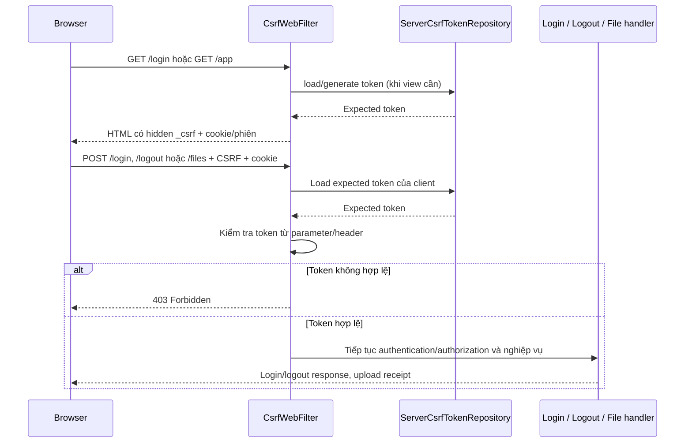

# CSRF cho đăng nhập, đăng xuất và tải tệp trong Spring Security Reactive

Trong ứng dụng **Spring WebFlux** dùng cookie phiên để nhận diện người dùng, ba luồng thường xuất hiện sát nhau: biểu mẫu **đăng nhập**, biểu mẫu **đăng xuất**, và thao tác **tải tệp**. Chúng trông giống những request HTTP thông thường, nhưng không có cùng quy tắc bảo vệ CSRF:

- **`POST /login`** thay đổi trạng thái đăng nhập: **phải kiểm tra CSRF token**, kể cả khi chưa có người dùng đã xác thực.
- **`POST /logout`** thay đổi trạng thái phiên: **phải kiểm tra CSRF token**; không biến logout thành thao tác GET chỉ vì muốn dùng một link.
- **Tải tệp lên (`POST multipart/form-data`)** thay đổi dữ liệu: phải xác thực, kiểm tra quyền và CSRF; trong WebFlux cần chú ý cách đọc token từ **multipart body**.
- **Tải tệp xuống (`GET /files/{id}`)** chỉ đọc một tài nguyên: **thường không yêu cầu CSRF token**, nhưng bắt buộc kiểm tra quyền đối với đúng tệp và tránh biến GET thành một thao tác thay đổi trạng thái.

Bài học làm rõ sự khác biệt giữa **CSRF**, **authentication**, **authorization** và bảo vệ nội dung tệp; giải thích `CsrfWebFilter`, repository, hidden input, multipart upload, cookie, XOR/BREACH, session timeout, sau đó xây dựng ví dụ **Java 17+ / Spring Boot 3.x / Spring Security 6.x / WebFlux** có trang đăng nhập, logout, upload và download, kèm `WebTestClient` và hướng dẫn kiểm thử với trình duyệt/`curl`.

> **Đúng nền tảng:** bài này dùng Reactive stack: `ServerHttpSecurity`, `SecurityWebFilterChain`, `ServerWebExchange`, `CsrfWebFilter`, `ServerCsrfTokenRepository`, `FilePart`. `HttpSecurity`, `CsrfTokenRepository` Servlet, `MultipartFile`, `HttpServletRequest` và `HttpSession` không phải API của các ví dụ WebFlux này.

## 1. CSRF thực sự ngăn chặn điều gì?

**Cross-Site Request Forgery (CSRF)** là hành vi khiến trình duyệt của nạn nhân gửi một yêu cầu ngoài ý muốn tới một ứng dụng mà trình duyệt có khả năng tự cung cấp thông tin xác thực. Kịch bản có thể xảy ra khi browser tự gửi **session cookie** hoặc credentials HTTP đã được nhớ, dù request bắt nguồn từ một trang web khác.

Ví dụ nạn nhân đang đăng nhập vào ứng dụng quản lý tài liệu. Một trang độc hại có thể gửi form POST đến endpoint của ứng dụng. Nếu ứng dụng chỉ dựa vào cookie để biết người dùng và **không kiểm tra nguồn gốc ý định của request**, thao tác thay đổi trạng thái có thể được thực hiện với danh tính nạn nhân.

**CSRF token** là một bằng chứng do ứng dụng cấp theo cơ chế đã thiết kế, được gửi về trong **form parameter hoặc request header** — vị trí mà trang tấn công bên ngoài không thể đơn giản yêu cầu browser tự thêm theo cùng cách cookie được tự gửi. Spring Security kiểm tra token đó trước khi xử lý request cần bảo vệ.

CSRF không thay thế:

- **Authentication:** kiểm tra người dùng/password, phiên, OAuth2 token.
- **Authorization:** quyết định người dùng có quyền upload/download/đọc tệp cụ thể hay không.
- **XSS protection:** nếu attacker thực thi JavaScript cùng origin, họ có thể đọc/điều khiển form và đánh bại nhiều kiểm soát CSRF.
- **File scanning:** chống malware, zip bomb, content-type spoofing.
- **Resource limits:** hạn chế dung lượng file, phần multipart, tốc độ và chi phí tài nguyên.
- **CORS và SameSite:** những lớp bảo vệ/bổ trợ có mục tiêu riêng, không thay thế toàn bộ CSRF token.

## 2. Bảng quyết định cho login, logout và file

| Request | Có thay đổi trạng thái? | CSRF mặc định khi bật? | Kiểm soát quan trọng khác |
| --- | --- | --- | --- |
| `GET /login` | Không, hiển thị form | Không yêu cầu token trong request GET | Public view, cấp token an toàn, session/cookie |
| `POST /login` | Có, tạo/trả trạng thái xác thực | **Có** | Username/password, rate limit, chống login CSRF |
| `POST /logout` | Có, xóa trạng thái đăng nhập | **Có** | Session/context invalidation, cookie policy |
| `GET /logout` | Chỉ hiển thị trang xác nhận (nếu dùng) | Không; **không thực hiện logout** | Tránh mutate state qua GET |
| `GET /app` | Chỉ render giao diện | Không | Authentication để vào giao diện và render token |
| `POST /files` với `multipart/form-data` | **Có** | **Có** | Ownership, file validation, quotas, parsing limits |
| `GET /files/{id}` | Chỉ đọc/tải xuống | Thường không | **Object-level authorization**, response headers an toàn |
| `DELETE /files/{id}` | Xóa file | **Có** | Authorization + CSRF + audit |
| `POST /files/{id}/share` | Chia sẻ/đổi quyền | **Có** | Authorization + CSRF + policy người nhận |
| `GET /files/{id}?delete=true` | **Sai thiết kế** nếu gây xóa | GET thường không được CSRF kiểm tra | **Đổi sang POST/DELETE**, không dùng GET cho mutation |

Spring Security WebFlux mặc định bảo vệ các phương thức **không an toàn** (thường POST, PUT, PATCH, DELETE), trong khi `GET`, `HEAD`, `OPTIONS`, `TRACE` được xem là những phương thức an toàn theo mô hình mặc định. Ứng dụng phải **tôn trọng giả định đó**: nếu một URL GET xóa file, gửi email, trừ phí hoặc thay đổi quyền thì CSRF mặc định không cứu được thiết kế này.

### Hai nghĩa của “tải tệp”

Trong tiếng Việt, “tải tệp” có thể ám chỉ **upload** hoặc **download**, nhưng cách bảo vệ CSRF hoàn toàn khác:

- **Upload:** browser gửi nội dung lên server để ghi/lưu. Nếu dùng POST và cookie phiên, đây là một trong những thao tác **phải qua CSRF**.
- **Download:** server trả bytes của tài liệu. Nếu chỉ đọc bằng GET, **không cần CSRF token**, nhưng attacker vẫn có thể dụ browser gửi request GET tới một URL; điều đó không có nghĩa attacker được đọc response nhờ Same-Origin Policy. Vì vậy cần kiểm tra quyền xem tệp, chống công khai tệp nhạy cảm và tránh side effect bất ngờ.

Đừng tạo endpoint file như `GET /download?id=...&markPaid=true` rồi nghĩ “đã dùng HTTPS nên ổn”. HTTPS bảo vệ đường truyền, không giải quyết ý định của request.

## 3. Vòng đời CSRF token trong WebFlux

Spring Security Reactive dùng `CsrfWebFilter` và một `ServerCsrfTokenRepository` để tạo, tải và lưu token được kỳ vọng.



**Điểm quan trọng:** CSRF được xác minh **trước** khi request POST đi tới phần nghiệp vụ. Nếu POST login thiếu token, lỗi **403** có thể xảy ra **trước khi** password được kiểm chứng. Nếu POST upload thiếu token, controller `FilePart` không được phép lưu file vào vùng lưu trữ nghiệp vụ; tuy nhiên xử lý multipart ở tầng framework có thể đã tiêu thụ tài nguyên, đặc biệt khi token nằm **trong body**.

Spring Security 6.x mặc định lưu expected token bằng `WebSessionServerCsrfTokenRepository`. `CsrfWebFilter` làm `Mono<CsrfToken>` khả dụng qua `ServerWebExchange` attribute mang key `CsrfToken.class.getName()`. Publisher có thể được subscribe bởi view engine để render token.

### Token được tạo khi nào?

Không nên giả định GET request nào cũng tạo token và cookie. Token có thể được **tải/tạo lazily** khi template/rendering cần nó. Với trang login có form POST được Thymeleaf xử lý, token thường được yêu cầu để chèn hidden input. Với GET download chỉ truyền bytes, không nhất thiết cần tạo token.

### Token hiển thị có thể khác token gốc trong session

Từ Spring Security 6.0, `XorServerCsrfTokenRequestAttributeHandler` là handler mặc định cho WebFlux. Nó biểu diễn token bằng cơ chế XOR/masking để giảm một số rủi ro BREACH (compression side channel). Vì vậy giá trị hidden `_csrf` ở HTML không nhất thiết giống raw token trong WebSession/cookie. **Gửi nguyên giá trị được framework render**; đừng tự so sánh hoặc tái mã hóa khi POST.

## 4. Đăng nhập: vì sao form của người chưa login vẫn cần CSRF?

Kịch bản **login CSRF** khác với việc attacker đăng nhập thay nạn nhân bằng mật khẩu của nạn nhân.

1. Attacker có một tài khoản của **chính attacker** trên website.
2. Attacker dụ browser nạn nhân POST credentials **của attacker** tới `/login`.
3. Nếu server chấp nhận đăng nhập mà không cần CSRF token, session browser nạn nhân có thể chuyển sang **tài khoản attacker**.
4. Nạn nhân tưởng đang ở tài khoản của mình và có thể lưu tài liệu/thông tin vào tài khoản do attacker kiểm soát.

Bởi vậy Spring Security Reactive bảo vệ `POST /login` **theo mặc định**, dù người dùng chưa xác thực.

Form login mặc định thường dùng các field `username`, `password` và `_csrf`:

```html
<!-- Đây là HTML được server render; value phải là token thực của phiên. -->
<form action="/login" method="post">
  <label>Tên đăng nhập <input name="username" type="text"></label>
  <label>Mật khẩu <input name="password" type="password"></label>
  <input type="hidden" name="_csrf" value="TOKEN_FROM_SERVER">
  <button type="submit">Đăng nhập</button>
</form>
```

`TOKEN_FROM_SERVER` chỉ là ký hiệu cho bài học, **không phải giá trị cố định để dùng thực tế**.

### Thymeleaf có thể tự thêm hidden input

Nếu form được render bằng Thymeleaf và sử dụng:

```html
<form th:action="@{/login}" method="post">
    <input name="username" type="text">
    <input name="password" type="password">
    <button type="submit">Đăng nhập</button>
</form>
```

thì tích hợp `RequestDataValueProcessor`/`CsrfRequestDataValueProcessor` của Spring Security có thể tự thêm hidden `_csrf` vào HTML **đã render**. Điều này đòi hỏi view được xử lý bởi Spring + Thymeleaf; không áp dụng cho file HTML thuần lấy từ CDN hoặc form được JavaScript dựng ngoài view engine.

Kiểm tra **DOM/Network** trong trình duyệt: nếu hidden `_csrf` không xuất hiện, không tắt CSRF. Hãy kiểm tra Thymeleaf, `th:action`, security chain, phiên/cookie và CSRF repository. Không tự chèn một hidden token thứ hai nếu Thymeleaf đã chèn, vì POST có hai tham số `_csrf` có thể gây hành vi không mong muốn.

### Kết quả login không chỉ có 200/403

| Tình huống | Kết quả thường gặp |
| --- | --- |
| `GET /login` | `200`, HTML chứa token cho POST |
| `POST /login` thiếu/sai CSRF | `403 Forbidden` |
| CSRF hợp lệ, credentials sai | Theo authentication-failure flow, thường redirect `/login?error` |
| CSRF hợp lệ, credentials đúng | Theo authentication-success flow, thường redirect tới trang ứng dụng |
| GET route protected khi chưa login | Entry point redirect tới login |
| Đã login nhưng không đủ role | `403`, đây là **authorization denial**, không phải login failure |

Status/body/`Location` có thể khác khi ứng dụng tùy biến authentication handlers. CSRF failure, sai password và thiếu quyền là ba nhánh độc lập, không nên hiển thị tất cả là “Sai mật khẩu”.

## 5. Đăng xuất: chỉ cho POST thực hiện thao tác

Đăng xuất làm thay đổi trạng thái xác thực và session. Một trang độc hại có thể ép browser nạn nhân logout nếu endpoint `GET /logout` thực thi ngay. Đó là **logout CSRF**.

Spring Security Reactive mặc định yêu cầu **POST** để thực hiện logout khi CSRF được bật. `GET /logout` có thể hiển thị trang xác nhận logout, nhưng **không nên tự xóa session qua GET**.

Form phù hợp:

```html
<form th:action="@{/logout}" method="post">
    <button type="submit">Đăng xuất</button>
</form>
```

Thymeleaf/Spring Security có thể tự chèn hidden token vào form POST. Nếu render thủ công:

```html
<form action="/logout" method="post">
  <input type="hidden"
         th:name="${_csrf.parameterName}"
         th:value="${_csrf.token}">
  <button type="submit">Đăng xuất</button>
</form>
```

Mẫu manual chỉ hoạt động khi `_csrf` đã được đưa vào model từ `Mono<CsrfToken>` của WebFlux. **Chọn một cách chèn token** cho mỗi form.

**Không làm:**

```html
<a href="/logout">Nhấn để đăng xuất ngay</a>
```

nếu link GET gây ra logout thật. Nếu muốn giao diện giống link, hãy dùng nút hoặc JavaScript gửi POST có token, đồng thời hỗ trợ form fallback khi JavaScript bị vô hiệu hóa.

### Logout và vô hiệu hóa WebSession là hai việc cần phân biệt

Theo tài liệu **Spring Security Reactive**, mặc định logout có thể dọn `ServerCsrfTokenRepository`/`ServerSecurityContextRepository` rồi redirect về login. Nếu nghiệp vụ muốn **hủy hẳn WebSession** (để dọn thêm những session attributes khác), có thể thêm `WebSessionServerLogoutHandler`, thay vì mặc định rằng mọi WebSession luôn bị invalidate giống cách logout Servlet.

Ví dụ cấu hình logout reactive:

```java
var logoutHandler = new DelegatingServerLogoutHandler(
    new SecurityContextServerLogoutHandler(),
    new WebSessionServerLogoutHandler());

http.logout(logout -> logout.logoutHandler(logoutHandler));
```

Các class này thuộc `org.springframework.security.web.server.authentication.logout`; trong dự án thật phải import. Đoạn cấu hình hoàn chỉnh xuất hiện ở phần ví dụ.

**Chú ý:** một browser dùng HTTP Basic đã nhớ credentials có thể xác thực lại ngay request sau, kể cả session trước đã bị hủy; còn OAuth2/OIDC có thể có session tại Identity Provider. Logout một WebSession ứng dụng **không tự thu hồi** mọi access token, refresh token hay IdP session.

## 6. Tải tệp lên: tại sao `multipart/form-data` phức tạp hơn form thông thường?

Một form upload có file:

```html
<form method="post" enctype="multipart/form-data" action="/files">
  <input type="file" name="file">
  <input type="hidden" name="_csrf" value="TOKEN_FROM_SERVER">
  <button type="submit">Tải tệp lên</button>
</form>
```

Về nguyên tắc, hidden `_csrf` và cookie phiên phải đi cùng request. Nhưng trong **Spring Security WebFlux**, việc CSRF filter có đọc token từ **multipart body** hay không là **một cấu hình riêng**. Mặc định `CsrfSpec.tokenFromMultipartDataEnabled` là **false**.

Khi form upload **không dùng JavaScript**, chọn token nằm trong body:

```java
.csrf(csrf -> csrf
    .tokenFromMultipartDataEnabled(true))
```

Lệnh trên yêu cầu `CsrfWebFilter` thử đọc actual token từ multipart data. Nếu **quên cấu hình này**, form Thymeleaf có hidden `_csrf` đúng vẫn có thể bị `403` khi submit multipart, bởi WebFlux CSRF filter không mặc định lấy CSRF token từ part trong body.

### “Con gà và quả trứng” trong multipart upload

Để đọc `_csrf` nằm bên trong multipart body, server **có thể phải parse/nhận dữ liệu multipart trước khi quyết định request có CSRF hợp lệ hay không**. Như vậy attacker có thể buộc hệ thống tiêu thụ một lượng tài nguyên trước khi bị trả 403, thậm chí tạo file tạm tùy parser.

Đây là điểm bảo mật quan trọng: **controller có thể chưa lưu tệp vào kho chính thức, nhưng chi phí mạng, RAM, disk temporary và parsing đã có thể xảy ra**.

Các biện pháp bổ trợ:

1. Giới hạn tổng dung lượng request/part, số parts, tốc độ upload, thời gian đọc, disk quota và kích thước file tạm ở **gateway và framework**.
2. Xác thực và rate-limit phù hợp trước khi cho upload lớn; phân tách quyền upload của từng user.
3. Giữ file tạm ở vùng cách ly, cleanup khi lỗi/hủy request, không cho thực thi.
4. Kiểm tra loại nội dung thật, tên file, định dạng, malware và phần mở rộng; đừng tin `FilePart.filename()` làm đường dẫn lưu.
5. Theo dõi disk use và concurrency; tránh để multipart parser làm cạn tài nguyên.
6. Khi có JavaScript, ưu tiên **CSRF token trong HTTP header** để kiểm tra trước khi parse multipart body.

### Cách được ưu tiên khi dùng JavaScript: gửi token qua header

Nếu trang đã nhận CSRF token an toàn từ server (ví dụ meta tag được render đúng với XOR handler), frontend có thể gửi:

```javascript
const formData = new FormData();
formData.append("file", fileInput.files[0]);

const token = document.querySelector('meta[name="_csrf"]').content;
const headerName =
  document.querySelector('meta[name="_csrf_header"]').content;

const response = await fetch("/files", {
  method: "POST",
  headers: { [headerName]: token },
  credentials: "same-origin",
  body: formData
});
```

**Đoạn trên là mã tích hợp minh họa**, giả định các biến `fileInput` và hai meta tags đã được trang trusted render. Đừng đặt `Content-Type: multipart/form-data` thủ công: browser cần tự thêm boundary phù hợp. `credentials: "same-origin"` gửi cookie cần cho session khi request same-origin. Đảm bảo token header phù hợp với `ServerCsrfTokenRequestHandler` được cấu hình; đừng tự băm hoặc XOR giá trị.

Với header hợp lệ, CSRF filter có thể đọc header **mà không phải parse file body chỉ để tìm token**. Đây là lý do Spring Security khuyến nghị dùng header cho multipart khi JavaScript khả dụng.

### Không ưu tiên CSRF token trong URL

Spring Security cũng mô tả giải pháp đặt token vào query string của form action:

```html
<!-- Chỉ minh họa; không khuyến nghị khi đã có header/body an toàn hơn. -->
<form method="post"
      th:action="@{/files(${_csrf.parameterName}=${_csrf.token})}"
      enctype="multipart/form-data">
</form>
```

Mặc dù cách này có thể cho filter đọc token trước multipart body, **URL dễ lộ trong server access logs, browser history, Referer, proxy metrics và link được chia sẻ**. Vì vậy nên ưu tiên **header** khi có JS, hoặc **hidden body + resource limits** khi form truyền thống; chỉ dùng query token nếu đánh giá trade-off cụ thể và tránh lộ token.

## 7. Tải tệp xuống: vì sao GET thường không yêu cầu CSRF?

Download thông thường là:

```http
GET /files/8a8e... HTTP/1.1
Cookie: SESSION=...
```

Nếu request chỉ đọc tài liệu và trả bytes:

- **GET phải read-only:** không xóa tệp, không thực hiện thanh toán, không thay quyền, không chấp thuận hợp đồng, không bắt đầu thao tác không thể hoàn tác.
- **Không cần CSRF token trên GET** theo chính sách mặc định, kể cả khi tài liệu nhạy cảm.
- **Authentication:** client phải có phiên hoặc credential hợp lệ khi tệp không công khai.
- **Authorization theo object:** user Alice không được lấy tệp của Bob chỉ vì đoán đúng ID.
- **Response headers:** `Content-Disposition: attachment`, `Content-Type` phù hợp, `X-Content-Type-Options: nosniff`, cache policy để tránh lưu nội dung nhạy cảm không mong muốn.
- **URL/ID:** không nhúng raw access token, password, session ID vào link tải; không dùng tên file do client cung cấp làm đường dẫn filesystem.
- **Cross-origin:** Same-Origin Policy thường ngăn script trang khác đọc nội dung response khi không được cấp quyền CORS, nhưng không ngăn browser *gửi* tất cả cross-origin GET. Vì vậy GET phải vô hại đối với trạng thái server, và CORS/cookie policy cần chặt chẽ.

**Không được nhầm: “GET download không cần CSRF” với “ai cũng được download”.** Một endpoint download có thể không cần CSRF mà vẫn trả **401/redirect** cho người chưa login, **403/404** khi không sở hữu tệp.

### Download có side effect thì sao?

Một số “tải xuống” thực tế tạo báo cáo, tính phí, gửi email, hoặc đánh dấu văn bản đã ký/đã nhận. Nếu nghiệp vụ có tác động thực:

- Tách thành `POST /reports` hoặc `POST /files/{id}/acknowledge` **có CSRF**, có authorization và idempotency phù hợp.
- Trả một ID/ticket hoặc URL chỉ đọc sau khi tác vụ hoàn tất.
- Dùng `GET /reports/{id}/download` để **chỉ lấy kết quả đã tồn tại**.

Ghi log kỹ thuật vô hại của GET thường không làm GET thành một thao tác nghiệp vụ nguy hiểm, nhưng không nên dùng GET để thực hiện quyết định bảo mật như “đã chấp nhận điều khoản” hay “đã chuyển quyền sở hữu”.

## 8. Mẫu ứng dụng Java 17+ chạy được: login, logout, upload và download

Demo sử dụng Spring Boot 3.x, Spring Security 6.x, Spring WebFlux, Thymeleaf; có:

- `GET /login` là trang login công khai với CSRF hidden input tự động.
- `POST /login` do form login của Spring Security xử lý.
- `GET /app` là trang đã xác thực có form logout và upload.
- `POST /logout` thực hiện logout khi token hợp lệ; session bị invalidate qua custom logout handler.
- `POST /files` tải tệp lên bằng `FilePart`, yêu cầu CSRF và authenticated user.
- `GET /files/{id}` trả file qua reactive stream, kiểm tra owner, không cần CSRF.
- `GET /public/ping` cho health demo.

**Chú ý:** demo lưu metadata trong `ConcurrentHashMap` và bytes ở thư mục temporary của JVM; không có antivirus, scanner, object storage, quota hay cleanup production. Phần sản xuất phải bổ sung chúng; việc demo chạy đúng **không** có nghĩa nó là hệ thống lưu tệp hoàn chỉnh để công khai Internet.

### 8.1. Dependencies trong `build.gradle`

Tạo dự án Spring Boot có plugin, repositories và Java 17+ được cấu hình trước. Thêm:

```groovy
dependencies {
    implementation 'org.springframework.boot:spring-boot-starter-webflux'
    implementation 'org.springframework.boot:spring-boot-starter-security'
    implementation 'org.springframework.boot:spring-boot-starter-thymeleaf'

    testImplementation 'org.springframework.boot:spring-boot-starter-test'
    testImplementation 'org.springframework.security:spring-security-test'
}
```

Không thêm `spring-boot-starter-web` cho demo này: `spring-boot-starter-web` phục vụ MVC/Servlet, còn ta đang minh họa `ServerHttpSecurity` và reactive `FilePart`.

### 8.2. `src/main/java/demo/filecsrf/FileCsrfApplication.java`

```java
package demo.filecsrf;

import org.springframework.boot.SpringApplication;
import org.springframework.boot.autoconfigure.SpringBootApplication;

@SpringBootApplication
public class FileCsrfApplication {
    public static void main(String[] args) {
        SpringApplication.run(FileCsrfApplication.class, args);
    }
}
```

### 8.3. `src/main/java/demo/filecsrf/SecurityConfig.java`

```java
package demo.filecsrf;

import org.springframework.context.annotation.Bean;
import org.springframework.context.annotation.Configuration;
import org.springframework.security.config.Customizer;
import org.springframework.security.config.annotation.web.reactive.EnableWebFluxSecurity;
import org.springframework.security.config.web.server.ServerHttpSecurity;
import org.springframework.security.core.userdetails.ReactiveUserDetailsService;
import org.springframework.security.core.userdetails.User;
import org.springframework.security.crypto.factory.PasswordEncoderFactories;
import org.springframework.security.crypto.password.PasswordEncoder;
import org.springframework.security.provisioning.MapReactiveUserDetailsService;
import org.springframework.security.web.server.SecurityWebFilterChain;
import org.springframework.security.web.server.authentication.logout
    .DelegatingServerLogoutHandler;
import org.springframework.security.web.server.authentication.logout
    .SecurityContextServerLogoutHandler;
import org.springframework.security.web.server.authentication.logout
    .WebSessionServerLogoutHandler;

@Configuration
@EnableWebFluxSecurity
public class SecurityConfig {

    @Bean
    SecurityWebFilterChain chain(ServerHttpSecurity http) {
        var logoutHandlers = new DelegatingServerLogoutHandler(
            new SecurityContextServerLogoutHandler(),
            new WebSessionServerLogoutHandler());

        return http
            .authorizeExchange(exchanges -> exchanges
                .pathMatchers("/login", "/public/**").permitAll()
                .anyExchange().authenticated())
            .formLogin(form -> form.loginPage("/login"))
            .httpBasic(basic -> basic.disable())
            .csrf(csrf -> csrf
                .tokenFromMultipartDataEnabled(true))
            .logout(logout -> logout
                .logoutHandler(logoutHandlers))
            .build();
    }

    @Bean
    ReactiveUserDetailsService users() {
        PasswordEncoder encoder =
            PasswordEncoderFactories.createDelegatingPasswordEncoder();

        return new MapReactiveUserDetailsService(
            User.withUsername("alice")
                .password(encoder.encode("demo123"))
                .roles("USER").build(),
            User.withUsername("bob")
                .password(encoder.encode("demo123"))
                .roles("USER").build());
    }
}
```

**Giải thích cấu hình:**

- `.formLogin(form -> form.loginPage("/login"))` dùng custom GET login page nhưng Spring Security vẫn xử lý POST login; `LoginPageController` cung cấp view cho GET.
- `.httpBasic(...disable())` giúp luồng browser tập trung vào cookie/form login, không bị hộp thoại Basic chen vào.
- `.csrf(csrf -> csrf.tokenFromMultipartDataEnabled(true))` giữ CSRF **đang bật** và cho phép đọc token từ multipart body. Đây là **dòng khác biệt quan trọng** khi form HTML tải file qua hidden field.
- `.logout(...logoutHandler(...))` kết hợp dọn `SecurityContext` và **invalidate WebSession**. Đây là quyết định chủ động của demo; không dựa vào giả định Servlet logout.
- `anyExchange().authenticated()` bảo vệ upload/download và UI; tuy nhiên vẫn cần **kiểm tra owner ở cấp tệp** trong controller.
- User `alice/demo123` và `bob/demo123` chỉ dành cho local demo; không dùng credentials này ở production.

Nếu upload được gửi bằng JavaScript với CSRF header, không nhất thiết phải bật đọc multipart body chỉ để nhận token từ header. Với demo form Thymeleaf **không JS**, `tokenFromMultipartDataEnabled(true)` là điểm cần thiết.

### 8.4. `src/main/java/demo/filecsrf/PageController.java`

```java
package demo.filecsrf;

import org.springframework.stereotype.Controller;
import org.springframework.web.bind.annotation.GetMapping;

@Controller
public class PageController {

    @GetMapping("/")
    public String index() {
        return "redirect:/app";
    }

    @GetMapping("/login")
    public String login() {
        return "login";
    }

    @GetMapping("/app")
    public String app() {
        return "app";
    }
}
```

`@Controller` trả tên view thay vì `@RestController` trả text. Các template nằm trong `src/main/resources/templates/`.

### 8.5. `src/main/resources/templates/login.html`

```html
<!DOCTYPE html>
<html lang="vi" xmlns:th="http://www.thymeleaf.org">
<head>
    <meta charset="UTF-8">
    <title>Đăng nhập</title>
</head>
<body>
<h1>Đăng nhập</h1>

<p th:if="${param.error}">Không thể đăng nhập.</p>
<p th:if="${param.logout}">Đã kết thúc phiên.</p>

<form th:action="@{/login}" method="post">
    <label>Tên đăng nhập
        <input name="username" type="text"
               autocomplete="username" required>
    </label>
    <label>Mật khẩu
        <input name="password" type="password"
               autocomplete="current-password" required>
    </label>
    <button type="submit">Đăng nhập</button>
</form>
</body>
</html>
```

Nhờ integration Thymeleaf/Spring Security, form với `th:action` và method POST có thể được thêm hidden `_csrf` khi render. Kiểm tra DOM trong browser, không chỉ xem source template. Nếu bị 403 trước xác thực, kiểm tra hidden token và cookie, **không** sửa bằng `csrf.disable()`.

### 8.6. `src/main/resources/templates/app.html`

```html
<!DOCTYPE html>
<html lang="vi" xmlns:th="http://www.thymeleaf.org">
<head>
    <meta charset="UTF-8">
    <title>Quản lý tệp</title>
</head>
<body>
<h1>Tải tệp an toàn</h1>

<h2>Tải tệp lên</h2>
<form th:action="@{/files}" method="post"
      enctype="multipart/form-data">
    <label>Chọn tệp
        <input type="file" name="file" required>
    </label>
    <button type="submit">Tải lên</button>
</form>

<h2>Đăng xuất</h2>
<form th:action="@{/logout}" method="post">
    <button type="submit">Đăng xuất</button>
</form>
</body>
</html>
```

Cả hai form POST đều cần hidden CSRF token. Thymeleaf có thể tự thêm thông qua `th:action`; khi gửi form upload kiểu `multipart/form-data`, SecurityConfig đã **bật đọc token từ multipart body**.

Mẫu `app.html` tối giản không có JavaScript xử lý kết quả upload. Khi upload thành công, controller trả JSON chứa ID tệp và URL download trong header `Location`. Bạn có thể sao chép URL đó trong cùng browser profile để tải xuống; tài nguyên download vẫn kiểm tra owner.

### 8.7. `src/main/java/demo/filecsrf/FileController.java`

```java
package demo.filecsrf;

import java.io.IOException;
import java.net.URI;
import java.nio.file.Files;
import java.nio.file.Path;
import java.security.Principal;
import java.util.UUID;
import java.util.concurrent.ConcurrentHashMap;
import java.util.concurrent.ConcurrentMap;

import org.springframework.core.io.buffer.DataBuffer;
import org.springframework.core.io.buffer.DataBufferUtils;
import org.springframework.core.io.buffer.DefaultDataBufferFactory;
import org.springframework.http.HttpHeaders;
import org.springframework.http.HttpStatus;
import org.springframework.http.MediaType;
import org.springframework.http.ResponseEntity;
import org.springframework.http.codec.multipart.FilePart;
import org.springframework.web.bind.annotation.GetMapping;
import org.springframework.web.bind.annotation.PathVariable;
import org.springframework.web.bind.annotation.PostMapping;
import org.springframework.web.bind.annotation.RequestPart;
import org.springframework.web.bind.annotation.RestController;
import org.springframework.web.server.ResponseStatusException;

import reactor.core.publisher.Flux;
import reactor.core.publisher.Mono;

@RestController
public class FileController {

    private record StoredFile(String owner, Path path) {}
    public record UploadReceipt(String id) {}

    private final ConcurrentMap<String, StoredFile> stored =
        new ConcurrentHashMap<>();

    // Chỉ để demo: thư mục ngẫu nhiên dưới vùng tạm.
    private final Path root;

    public FileController() throws IOException {
        this.root = Files.createTempDirectory("file-csrf-demo-");
    }

    @PostMapping(
        value = "/files",
        consumes = MediaType.MULTIPART_FORM_DATA_VALUE)
    public Mono<ResponseEntity<UploadReceipt>> upload(
            @RequestPart("file") FilePart file,
            Principal principal) {

        // Không dùng file.filename() để tạo đường dẫn:
        // attacker có thể gửi "../secret" hoặc tên nguy hiểm.
        String id = UUID.randomUUID().toString();
        Path destination = root.resolve(id + ".bin");

        // Chỉ ghi metadata sau khi transferTo hoàn tất.
        return file.transferTo(destination)
            .then(Mono.fromSupplier(() -> {
                stored.put(id, new StoredFile(
                    principal.getName(), destination));

                return ResponseEntity
                    .created(URI.create("/files/" + id))
                    .body(new UploadReceipt(id));
            }));
    }

    @GetMapping("/files/{id}")
    public Mono<ResponseEntity<Flux<DataBuffer>>> download(
            @PathVariable String id,
            Principal principal) {

        StoredFile found = stored.get(id);

        // Cố ý trả 404 cho file không tồn tại HOẶC không phải owner
        // để giảm tiết lộ sự tồn tại của file.
        if (found == null
                || !found.owner().equals(principal.getName())) {
            return Mono.error(new ResponseStatusException(
                HttpStatus.NOT_FOUND, "File not found"));
        }

        Flux<DataBuffer> data = DataBufferUtils.read(
            found.path(), new DefaultDataBufferFactory(), 8192);

        return Mono.just(ResponseEntity.ok()
            .header(HttpHeaders.CONTENT_DISPOSITION,
                "attachment; filename=\"download.bin\"")
            .header(HttpHeaders.CACHE_CONTROL, "private, no-store")
            .header("X-Content-Type-Options", "nosniff")
            .contentType(MediaType.APPLICATION_OCTET_STREAM)
            .body(data));
    }
}
```

**Giải thích bảo mật:**

1. `@RequestPart("file") FilePart` là API WebFlux cho multipart part, **không phải** `MultipartFile` của Servlet.
2. POST upload không cần tự đọc `_csrf` trong controller: `CsrfWebFilter` đã kiểm tra theo cấu hình trước khi request vào handler.
3. `Principal principal` do hệ thống xác thực cung cấp trong request đã qua security chain. Không dùng `owner` từ form parameter để cấp quyền.
4. `file.transferTo(destination)` trả `Mono<Void>`; khi hoàn tất mới đưa metadata `StoredFile` vào map. Không gọi `.block()` hoặc `.subscribe()` trong handler.
5. Tên file client gửi lên không được ghép vào `Path`; server sinh UUID, tránh traversal dễ gặp như `../../secret`.
6. GET download tra metadata, so `owner` với principal; nếu khác, **trả 404**, không phát bytes. Đó là object-level authorization riêng, **không liên quan đến CSRF token**.
7. `DataBufferUtils.read(...)` phát `Flux<DataBuffer>` để WebFlux stream file; không cần `Files.readAllBytes(...)` rồi ôm toàn bộ file lớn vào heap.
8. Header `Content-Disposition: attachment` và `nosniff` giảm nguy cơ browser hiển thị tệp upload như HTML/script; `Cache-Control: private, no-store` yêu cầu tránh lưu tệp nhạy cảm qua cache.
9. Demo chưa có **file-size quota, scanning, cleanup, storage lifecycle, retry và concurrency policy**; production phải bổ sung.

**Về filesystem:** `Files.createTempDirectory` dùng để học, còn hệ thống thật nên dùng object storage/vùng cách ly có quyền truy cập chặt và cơ chế quét nội dung. File upload có thể được framework parse trước khi CSRF body token được kiểm chứng, nên giới hạn body/temp disk ở gateway/runtime vẫn bắt buộc.

### 8.8. Chạy và quan sát

Trong thư mục dự án có Gradle wrapper:

```bash
# Linux/macOS
./gradlew bootRun

# Windows
gradlew.bat bootRun
```

Mở `http://localhost:8080/login`, đăng nhập:

```text
User: alice
Password: demo123
```

Sau đăng nhập, mở `/app`. Trong Developer Tools → Elements, xác nhận:

- Form `/login` đã có hidden `_csrf`.
- Form upload `/files` có hidden `_csrf` và `enctype="multipart/form-data"`.
- Form logout `/logout` có hidden `_csrf`.

Chọn một tệp nhỏ và submit. Controller trả `201 Created` với body tương tự:

```json
{"id":"c0a801d4-10f0-42cf-aa0b-1df9100469c2"}
```

ID trong ví dụ này là **minh họa**, ID thật do UUID sinh ra sẽ khác. Header `Location` có đường dẫn `/files/{id}`. Truy cập URL đó trong cùng browser session để download. Nếu logout rồi thử download ở browser chưa login, security chain thường redirect về `/login`; nếu login thành `bob` và dùng ID của Alice, controller trả `404` vì không phải owner.

**Sự khác nhau giữa logout và download:** logout là POST có CSRF; download là GET chỉ đọc nên **không gửi `_csrf`**. Khi chuyển thành HTTP GET bằng link, vẫn kiểm tra authentication và owner để không rò file.

## 9. Thử bằng `curl`: đúng phiên, đúng token, đúng method

Để POST login, upload hoặc logout bằng `curl`, phải lấy token **thực sự** từ HTML được server render và giữ cookie jar tương ứng. Các biến trong ví dụ là ký hiệu minh họa; không có cách dùng token cứng từ tài liệu để đăng nhập.

### 9.1. Đăng nhập với CSRF

```bash
# 1. Lấy trang login và cookie jar.
curl -sS -c alice.cookies \
  http://localhost:8080/login -o alice-login.html

# 2. Mở alice-login.html, tìm hidden input name="_csrf".
#    Copy value thật của trang này, không dùng token ví dụ.

# 3. POST login cùng cookie và actual token.
curl -i -b alice.cookies -c alice.cookies \
  --data-urlencode "username=alice" \
  --data-urlencode "password=demo123" \
  --data-urlencode "_csrf=ACTUAL_LOGIN_CSRF_TOKEN" \
  http://localhost:8080/login
```

Nếu token sai/không có, thường nhận `403`. Nếu password sai nhưng token hợp lệ, thường đi theo **form authentication failure** và redirect `/login?error`. Sau login thành công, cookie jar phải dùng lại cho GET `/app` và các bước sau.

### 9.2. Upload với multipart token trong body

```bash
# 4. Tải trang /app sau khi login, lấy token của form upload.
curl -sS -b alice.cookies -c alice.cookies \
  http://localhost:8080/app -o alice-app.html

# 5. Copy _csrf value mới nhất trong alice-app.html.
# 6. Upload với cùng cookie jar. -F tạo multipart/form-data.
curl -i -b alice.cookies -c alice.cookies \
  -F "file=@./note.txt" \
  -F "_csrf=ACTUAL_UPLOAD_CSRF_TOKEN" \
  http://localhost:8080/files
```

`ACTUAL_UPLOAD_CSRF_TOKEN` là ký hiệu phải thay bằng value HTML thật. Với Spring Security 6.x, token có thể được XOR-mask, nên đừng lấy raw token từ cookie/session rồi tự gửi nếu handler không nhận kiểu đó.

Nếu thiếu token:

```bash
curl -i -b alice.cookies \
  -F "file=@./note.txt" \
  http://localhost:8080/files
```

Kết quả dự kiến là `403` khi CSRF bật. Tuy vậy, **body multipart có thể vẫn tiêu thụ tài nguyên trong quá trình parse**, nên đừng lấy status 403 làm bằng chứng hệ thống đã tránh hoàn toàn chi phí upload.

### 9.3. Download không cần token nhưng phải có quyền

Sau khi upload thành công, đọc ID thực trong JSON hoặc URL header `Location`:

```bash
# Thay ID_THAT bằng ID thực từ response upload.
curl -i -b alice.cookies \
  http://localhost:8080/files/ID_THAT \
  -o downloaded.bin
```

Vì lệnh dùng `-o`, cả HTTP headers và body có thể được ghi vào cùng output theo cách tùy option; khi cần tách rõ header và dữ liệu nhị phân, nên dùng:

```bash
curl -sS -b alice.cookies \
  -D download-headers.txt \
  -o downloaded.bin \
  http://localhost:8080/files/ID_THAT
```

Không có `_csrf` trong GET download. Nếu dùng cookie jar của Bob để tải ID của Alice, demo trả 404. Nếu không có phiên xác thực, form-login entry point thường redirect tới `/login`.

### 9.4. Đăng xuất bằng POST

```bash
# GET /app để lấy token hợp lệ hiện tại trước khi logout.
curl -sS -b alice.cookies -c alice.cookies \
  http://localhost:8080/app -o alice-app.html

# POST logout với cookie và token vừa lấy.
curl -i -b alice.cookies -c alice.cookies \
  --data-urlencode "_csrf=ACTUAL_LOGOUT_CSRF_TOKEN" \
  http://localhost:8080/logout

# Thử lại GET /app bằng cookie cũ:
curl -i -b alice.cookies http://localhost:8080/app
```

Khi logout thành công và WebSession đã được invalidated, request sau không còn session login hợp lệ và thường được chuyển về `/login`. Nếu thiếu CSRF trên POST logout, thường bị `403`; không coi việc token hết hạn hoặc cookie bị đổi là lý do để cho phép GET logout.

## 10. Test tự động bằng `WebTestClient` và `spring-security-test`

Cần kiểm thử **từng loại request** vì CSRF không áp dụng giống nhau:

1. GET login public và form đã render token.
2. POST login không có token: 403; token đúng + credentials đúng/sai: đi vào success/failure flow phù hợp.
3. POST logout từ một user đã đăng nhập thiếu token: 403; có token: logout flow thành công.
4. POST multipart upload thiếu token: 403.
5. POST multipart upload có token + authenticated user: 201, ghi file.
6. GET download của owner: 200 với attachment; user khác không xem được.
7. GET download không có token vẫn được sau khi authenticated; **không thêm yêu cầu CSRF sai chỗ**.

Tệp test minh họa: `src/test/java/demo/filecsrf/FileCsrfTest.java`.

```java
package demo.filecsrf;

import java.nio.charset.StandardCharsets;

import org.junit.jupiter.api.Test;
import org.springframework.beans.factory.annotation.Autowired;
import org.springframework.boot.test.context.SpringBootTest;
import org.springframework.boot.test.autoconfigure.web.reactive
    .AutoConfigureWebTestClient;
import org.springframework.core.io.ByteArrayResource;
import org.springframework.http.MediaType;
import org.springframework.test.web.reactive.server.WebTestClient;
import org.springframework.web.reactive.function.BodyInserters;

import static org.junit.jupiter.api.Assertions.assertTrue;
import static org.springframework.security.test.web.reactive.server
    .SecurityMockServerConfigurers.csrf;
import static org.springframework.security.test.web.reactive.server
    .SecurityMockServerConfigurers.mockUser;

@SpringBootTest(webEnvironment = SpringBootTest.WebEnvironment.MOCK)
@AutoConfigureWebTestClient
class FileCsrfTest {

    @Autowired
    WebTestClient client;

    private ByteArrayResource file() {
        return new ByteArrayResource(
                "sample".getBytes(StandardCharsets.UTF_8)) {
            @Override
            public String getFilename() {
                return "note.txt";
            }
        };
    }

    @Test
    void loginPageIsPublic() {
        client.get().uri("/login").exchange()
            .expectStatus().isOk()
            .expectBody(String.class)
            .value(html -> assertTrue(html.contains("name=\"_csrf\"")));
    }

    @Test
    void loginPostWithoutCsrfIsForbidden() {
        client.post().uri("/login")
            .contentType(MediaType.APPLICATION_FORM_URLENCODED)
            .body(BodyInserters.fromFormData(
                "username", "alice").with("password", "demo123"))
            .exchange()
            .expectStatus().isForbidden();
    }

    @Test
    void loginWithCsrfReachesSuccessFlow() {
        client.mutateWith(csrf())
            .post().uri("/login")
            .contentType(MediaType.APPLICATION_FORM_URLENCODED)
            .body(BodyInserters.fromFormData(
                "username", "alice").with("password", "demo123"))
            .exchange()
            .expectStatus().is3xxRedirection();
    }

    @Test
    void logoutWithoutCsrfIsForbidden() {
        client.mutateWith(mockUser("alice"))
            .post().uri("/logout")
            .exchange()
            .expectStatus().isForbidden();
    }

    @Test
    void logoutWithCsrfReachesLogoutFlow() {
        client.mutateWith(mockUser("alice"))
            .mutateWith(csrf())
            .post().uri("/logout")
            .exchange()
            .expectStatus().is3xxRedirection();
    }

    @Test
    void multipartUploadWithoutCsrfIsForbidden() {
        client.mutateWith(mockUser("alice"))
            .post().uri("/files")
            .body(BodyInserters.fromMultipartData("file", file()))
            .exchange()
            .expectStatus().isForbidden();
    }

    @Test
    void uploadWithCsrfThenDownloadOwnerOnly() {
        FileController.UploadReceipt receipt =
            client.mutateWith(mockUser("alice"))
                .mutateWith(csrf())
                .post().uri("/files")
                .body(BodyInserters.fromMultipartData("file", file()))
                .exchange()
                .expectStatus().isCreated()
                .expectBody(FileController.UploadReceipt.class)
                .returnResult()
                .getResponseBody();

        assertTrue(receipt != null && receipt.id() != null);

        // GET download không cần CSRF; owner đã xác thực.
        client.mutateWith(mockUser("alice"))
            .get().uri("/files/{id}", receipt.id())
            .exchange()
            .expectStatus().isOk()
            .expectHeader()
                .valueEquals("X-Content-Type-Options", "nosniff")
            .expectBody(byte[].class)
                .isEqualTo("sample".getBytes(StandardCharsets.UTF_8));

        // User Bob đã authenticated nhưng không sở hữu file.
        client.mutateWith(mockUser("bob"))
            .get().uri("/files/{id}", receipt.id())
            .exchange()
            .expectStatus().isNotFound();
    }
}
```

Chạy:

```bash
# Linux/macOS
./gradlew test --tests 'demo.filecsrf.FileCsrfTest'

# Windows
gradlew.bat test --tests "demo.filecsrf.FileCsrfTest"
```

**Giới hạn của test support:** `mutateWith(mockUser("alice"))` dựng user giả cho thử nghiệm phân quyền, không kiểm tra password, database hay phiên browser thật. `mutateWith(csrf())` tạo CSRF request mock hợp lệ để test security integration, không chứng minh rằng Thymeleaf đã chèn hidden input vào multipart form hay browser gửi lại đúng cookie. Test GET login kiểm tra rendered HTML; để kiểm tra end-to-end session/cookie, cần thử browser hoặc `curl` với cookie jar theo phần 9.

**Hạn chế concurrency của demo:** metadata file nằm trong map của một JVM; test dùng cùng context sẽ thấy map tương ứng. Triển khai nhiều replica cần storage/metadata dùng chung và ownership policy kiểm tra ở data layer.

## 11. Token từ multipart body, cookie hay header: bảng lựa chọn

| Nơi đặt token client gửi | Tích hợp | Ưu điểm | Cảnh báo |
| --- | --- | --- | --- |
| Hidden `_csrf` trong form URL-encoded | Login/logout HTML | Thymeleaf tự chèn; đơn giản | Cần cookie/session hợp lệ; tránh token trùng |
| Hidden `_csrf` trong multipart body | Form upload không JavaScript | Người dùng chỉ cần form HTML | **Phải bật `tokenFromMultipartDataEnabled(true)`**; body có thể parse trước CSRF validation |
| Header `X-CSRF-TOKEN` do JS gắn | AJAX/upload JS | Kiểm tra token trước khi parse multipart | Phải render/cấp token đúng, không làm lộ qua CORS/XSS |
| Cookie `XSRF-TOKEN` + header `X-XSRF-TOKEN` | SPA/cookie CSRF repository | Framework JS có thể hỗ trợ | Nếu JS đọc cookie thì phải cân nhắc `HttpOnly=false`, XOR handler, XSS |
| Token trong URL/query string | Bất đắc dĩ khi không dùng JS | Filter có thể kiểm tra trước body | Dễ lộ qua logs, history, Referer, tracing — **không ưu tiên** |
| Không có token trên GET download | GET thuần read-only | Phù hợp HTTP safe methods | Vẫn cần authentication/authorization; GET không được mutate |

### `CookieServerCsrfTokenRepository` có phải luôn tốt hơn?

Không. Mặc định WebFlux lưu CSRF token mong đợi bằng `WebSessionServerCsrfTokenRepository`; cách đó phù hợp cho form login/server-rendered UI. Cookie repository hữu ích với SPA, ví dụ:

```java
.csrf(csrf -> csrf.csrfTokenRepository(
    CookieServerCsrfTokenRepository.withHttpOnlyFalse()))
```

Đây là **đoạn minh họa** khác với cấu hình demo chính. `withHttpOnlyFalse()` cho phép JavaScript đọc cookie token; chỉ dùng khi thật sự cần. Với hệ thống không cần JS đọc token, mặc định HttpOnly là biện pháp giảm rủi ro. Cookie token vẫn phải được client gửi ở **header/parameter hợp lệ**, không phải chỉ dựa vào việc browser tự đính kèm cookie.

Với Spring Security 6.x, **XOR/BREACH** có thể khiến raw cookie token khác giá trị expected trên header theo cách handler diễn giải. Khi xây SPA, phải kiểm tra cách `ServerCsrfTokenRequestHandler` nhận token từ header và parameter trên **đúng phiên bản framework**; không mặc định “đọc cookie rồi copy y nguyên sang header” luôn hoạt động với mọi cấu hình.

## 12. Session timeout, token rotation và nhiều tab

Với WebSession token repository, CSRF token gắn với trạng thái được lưu. Nếu người dùng mở form rồi để lâu:

1. Session có thể hết hạn.
2. Token trong HTML cũ không còn khớp expected token mới.
3. POST login/logout/upload trả 403, dù credentials hoặc nội dung file hợp lệ.

Hướng xử lý UX: hiển thị thông báo “Phiên biểu mẫu đã hết hạn, vui lòng tải lại trang”, làm mới form và token, giữ lại dữ liệu nhập **không nhạy cảm** khi phù hợp. Không cố chấp nhận mọi token cũ vô thời hạn và không tự tắt CSRF để xử lý stale session.

### Login/logout có thể làm thay đổi phiên

Sau login thành công, session có thể bị thay ID hoặc context được thay đổi để chống session fixation. Sau logout, `SecurityContext`/CSRF state được dọn và demo còn invalidate WebSession. Một hidden token được lấy **trước** các thay đổi đó có thể không còn hợp lệ; hãy lấy token từ trang mới, không cache một token cho toàn bộ đời sống frontend.

### Hai tab cùng browser

Hai tab thường chia sẻ cookie phiên nhưng có thể có những giá trị masked token **khác nhau** trong HTML do XOR handler. Điều đó **không tự động là lỗi**; framework diễn giải masked token rồi kiểm tra against expected token tương ứng. Nếu một tab logout/hủy phiên, form ở tab còn lại có thể trở thành stale và trả 403.

### Distributed session

Nếu WebSession được lưu trong nhiều server node, cần đảm bảo session store và CSRF repository nhất quán, cookie đúng domain/path, tránh các node tự có secret/cache khác không đồng bộ. `Session` ở browser không chứng minh rằng mọi node đều tải được CSRF token như nhau; phải có integration test nhiều instance.

## 13. CORS, SameSite, HTTPS và CSRF cùng tồn tại như thế nào?

Các cơ chế sau bổ trợ chứ không thay thế nhau:

**HTTPS/TLS:** bảo vệ cookie, password, CSRF token và file bytes khỏi nghe lén trên đường truyền. Trên production, dùng HSTS phù hợp và không gửi credentials qua HTTP.

**Cookie `Secure`, `HttpOnly`, `SameSite`:** giúp giới hạn khi nào browser gửi cookie và JavaScript có thể đọc cookie. SameSite có thể giảm một số CSRF nhưng có ngoại lệ và không được coi là thay thế duy nhất cho CSRF token khi ứng dụng dựa vào cookies.

**CORS:** chính sách cho script cross-origin truy cập response và dùng một số request headers/methods. CORS không đảm bảo chặn mọi cross-site form POST, nên **không thay CSRF**. Tránh `Access-Control-Allow-Origin: *` đi cùng credentials và tránh tin bất kỳ Origin nào chỉ vì nó gửi cùng tên miền trong text.

**Content Security Policy / XSS phòng vệ:** hạn chế khả năng chạy mã độc trong trang trusted. Nếu XSS xảy ra, script của attacker trong same-origin thường có thể lấy token từ DOM và gửi request như người dùng; vì vậy CSRF không phải lớp chống XSS.

**Authorization theo file:** với download, object ID phải được kiểm tra owner/tenant/scope, không chỉ dựa vào việc user đã login. URL không nên là bearer token vĩnh viễn; với signed download URL, phải quản lý expiry, audience, permissions và khả năng revoke phù hợp.

## 14. File upload cần nhiều lớp bảo vệ ngoài CSRF

CSRF chỉ giúp xác minh tính hợp lệ của request theo mô hình browser; nó không kiểm tra file có độc hại hay không.

Một hệ thống upload production cần:

- **Content limit:** max request size, max part size, max number of parts, disk usage quota, concurrency/rate limit; đặt ở gateway và WebFlux multipart stack.
- **File type validation:** không tin `Content-Type`, `filename` hoặc phần mở rộng từ client; kiểm tra magic bytes/format và use case.
- **Malware scanning/quarantine:** quét file trước khi publish/download tùy mức rủi ro.
- **Filename/path isolation:** sinh server-side ID, tránh path traversal, race conditions, symlink attacks; lưu ở nơi không thể thực thi mã.
- **Storage ACL và ownership:** người dùng chỉ xem/ghi/xóa file được cấp phép; không dùng owner do client tự khai.
- **Timeout/error/cancel cleanup:** xóa file tạm hoặc phần upload dở; tránh rác khi request bị hủy.
- **Audit:** ghi ID sự kiện và outcome đủ điều tra, nhưng không log password, CSRF token, cookie, raw file body, access token.
- **Quota và billing:** nếu upload tính phí/điểm/quota, tính đúng chính sách, tách các thao tác thay đổi trạng thái thành POST với CSRF.
- **Download protections:** attachment/nosniff, cache policy, authorization, xử lý Range/streaming/ETag theo loại file; không mặc định file upload được phục vụ như HTML.
- **Lifecycle:** retention, deletion, GDPR/PII policy, encryption at rest, backups và disaster recovery.

Demo ở phần 8 chủ đích dùng file tạm và map để minh họa **CSRF integration**, không phải bản thiết kế storage production.

## 15. Tình huống kiểm thử sai phổ biến

### Tình huống A: Form login đúng password vẫn trả 403

Nguyên nhân hay gặp: token `_csrf` thiếu/sai hoặc cookie/phiên không khớp. Kiểm tra rendered DOM, POST body, WebSession cookie, `CsrfWebFilter` và XOR handler. Không quy về sai password; đừng `csrf.disable()`.

### Tình huống B: Form logout là một thẻ `<a href="/logout">`

GET không nên xóa session. Spring Security Reactive cung cấp GET confirmation page hoặc yêu cầu POST có token để logout. Dùng POST form hoặc JS gửi POST; không cấu hình logout matcher nhận mọi HTTP method chỉ để link “hoạt động”.

### Tình huống C: Upload form đã có hidden `_csrf`, vẫn 403

Với **multipart/form-data** trong WebFlux, cần:

```java
.csrf(csrf -> csrf.tokenFromMultipartDataEnabled(true))
```

nếu token nằm trong body. Không nhầm với form URL-encoded thường. Hoặc dùng CSRF header khi có JS; trong trường hợp đó không cần parse body chỉ để tìm token.

### Tình huống D: Bật token đọc multipart body rồi nghĩ 403 tránh được mọi upload

Không đúng. Body có thể được parse/stream tới vùng tạm **trước khi** filter kiểm tra xong token. Phải kiểm soát size/time/disk và chống abuse tại nhiều lớp.

### Tình huống E: Download GET không có `_csrf` trả 200 nên bị cho là lỗ hổng

Không mặc nhiên. GET chỉ đọc **không cần CSRF** theo mặc định. Hãy kiểm tra quyền sở hữu: nếu Bob lấy được file Alice thì đó là **IDOR/BOLA**, không phải lỗi thiếu CSRF token.

### Tình huống F: Đưa token vào query string của URL upload

Có thể hoạt động nhưng dễ lộ qua access logs/Referer/history; ưu tiên header/body, cấu hình resource limits và bảo vệ logs. Đừng nhầm giải pháp thay thế này là mặc định tốt.

### Tình huống G: Tắt `HttpOnly` cho session cookie để JS đọc CSRF

**Không** tắt HttpOnly của session cookie chỉ để lấy CSRF. Nếu dùng cookie repository và cần JS đọc riêng cookie token, chỉ cân nhắc `HttpOnly=false` cho cookie token đó, không phải cookie phiên đăng nhập.

### Tình huống H: Trả tệp của người khác vì ID hợp lệ

`anyExchange().authenticated()` chỉ chứng minh user đã login. Phải kiểm tra `ownerId`/tenant/scope ở file metadata hoặc truy vấn scoped tại DB. Thử hai user độc lập.

### Tình huống I: Dùng `GET /files/{id}/delete` để tiện tạo link

Nếu endpoint xóa file, phải dùng POST/DELETE và kiểm tra CSRF. Một bot preview, browser prefetch hoặc ảnh nhúng có thể kích hoạt GET ngoài dự kiến.

### Tình huống J: Logout rồi browser vẫn vào được với Basic credentials

Nếu browser tự gửi lại HTTP Basic header hợp lệ, Spring Security có thể xác thực lại. Logout WebSession không phải revoke password/token. Bài demo đã tắt Basic để dễ quan sát session logout.

### Tình huống K: Test `mutateWith(csrf())` thành công nhưng browser vẫn 403

`spring-security-test` tạo CSRF request hợp lệ ở tầng mock; nó **không** chứng minh HTML thực render token, multipart body token được gửi đúng, hay cookie policy trên browser. Phải kiểm thử end-to-end.

### Tình huống L: React code tự đặt `Content-Type: multipart/form-data`

Browser cần tự sinh boundary; tự đặt Content-Type thiếu boundary có thể khiến multipart parser không đọc được file/field. Khi dùng `FormData`, thường bỏ header Content-Type để browser tự thiết lập; chỉ thêm header CSRF.

## 16. Quy trình chẩn đoán theo HTTP status

| Phản hồi | Trường hợp cần kiểm tra trước |
| --- | --- |
| `200` GET login | View engine render token; đây chưa chứng minh POST login hoạt động |
| `302` POST login | Redirect có thể là success **hoặc** failure; kiểm tra `Location` và session tiếp theo |
| `403` POST login | CSRF token/cookie/handler nếu chưa vào manager |
| Redirect `/login?error` | CSRF có thể đã qua, nhưng credentials hoặc account policy bị từ chối |
| `403` POST logout | Thiếu/sai CSRF token hoặc request không thuộc session mong đợi |
| `403` POST multipart upload | CSRF token thiếu/sai, body token chưa bật, session mismatch |
| `400`/`415` upload | Content type/form parts/parser/validation sai, chưa chắc là CSRF |
| `413` upload | Request size vượt giới hạn gateway/server nếu có |
| `201` upload | Đã ghi file (trong demo); tiếp tục kiểm tra owner và download |
| `200` GET download | Được authentication và object authorization cho phép |
| `404` GET download | Không tồn tại hoặc không thuộc owner theo demo |
| Redirect `/login` từ download | Chưa có phiên đăng nhập hợp lệ |
| `500`/`503` | Lỗi server/storage/DB hoặc logic; không giả là token sai |

**Khi debug**, chỉ log request ID, route, method, trạng thái, category và các metrics tối giản. Không log `Cookie`, `Authorization`, raw CSRF token, session ID, multipart body hoặc password. Không trả stack trace/file path vật lý trong response.

## 17. Checklist triển khai

| Nội dung | Tiêu chí đạt |
| --- | --- |
| Dùng đúng WebFlux API | `ServerHttpSecurity`, `SecurityWebFilterChain`, `ServerCsrfTokenRepository`, `FilePart` |
| CSRF bật | Không disable toàn cục để “sửa” login/upload |
| GET login | View public, form có hidden token trong HTML đã render |
| POST login | Token + credentials đúng; thiếu token trả 403 |
| POST logout | Form POST với token; không logout thực qua GET |
| Invalidate session | Chính sách clear context và WebSession được định nghĩa rõ |
| Upload body token | `tokenFromMultipartDataEnabled(true)` nếu dùng hidden trong multipart |
| Upload JS header | Token ở header, không tự đặt multipart Content-Type |
| Multipart limits | Size, parts, temp disk, timeout, rate limit có thể kiểm chứng |
| Server-side filenames | Không tin client `filename`, chống path traversal |
| File authorization | Owner/tenant/scope được kiểm tra trước khi tải |
| GET download | Read-only; không yêu cầu CSRF sai chỗ |
| Download response | Header cache/attachment/nosniff phù hợp |
| Không lộ token | Không đưa CSRF token vào URL/log/analytics nếu có lựa chọn khác |
| XOR/BREACH | Giữ handler mặc định trừ khi có lý do và tests |
| Session timeout | UI làm mới token/form stale |
| Cookie và TLS | HTTPS, HttpOnly/Secure/SameSite được thiết kế |
| CORS/XSS | Không xem CORS/SameSite là thay thế CSRF |
| Test HTTP thực | Browser/curl cookie jar và `WebTestClient` đều kiểm tra |
| Multi-node | Session/CSRF repository và storage metadata nhất quán |
| Vận hành | File scan, retention, cleanup, audit, quota và alerting |

## 18. Câu hỏi tự kiểm tra

**1. Vì sao POST `/login` cần CSRF khi user chưa đăng nhập?**  
Để chống **login CSRF**: ép browser nạn nhân đăng nhập vào tài khoản do attacker kiểm soát.

**2. Vì sao logout không nên là GET?**  
Vì GET có thể được browser/prefetch/trang ngoài kích hoạt tự động, còn logout thay đổi trạng thái phiên và phải yêu cầu CSRF token.

**3. Form multipart upload đã có hidden `_csrf` nhưng WebFlux trả 403. Thiếu gì?**  
Nếu token nằm **trong multipart body**, cần `.csrf(csrf -> csrf.tokenFromMultipartDataEnabled(true))` hoặc thay bằng CSRF header đúng cách khi dùng JavaScript.

**4. Vì sao khuyến nghị gửi CSRF token trong header cho upload AJAX?**  
Để filter có thể kiểm tra token mà không cần parse file body chỉ để tìm token, giảm nguy cơ tiêu thụ tài nguyên của upload chưa được xác minh.

**5. GET download có cần `_csrf` không?**  
Thông thường **không**, miễn GET chỉ đọc. Tuy nhiên authentication và quyền truy cập **tệp cụ thể** vẫn bắt buộc.

**6. Một user có session hợp lệ nhưng yêu cầu file của user khác, lỗi gì?**  
Object-level authorization phải từ chối, chẳng hạn trả 404 trong ví dụ; không phải “cần thêm CSRF cho GET”.

**7. Có nên đưa token CSRF vào query string action upload?**  
Có thể theo một số cấu hình, nhưng không ưu tiên vì token dễ lộ qua logs/Referer/history. Chọn header hoặc body và đánh giá chi phí parsing.

**8. `WebSessionServerCsrfTokenRepository` và `CookieServerCsrfTokenRepository` giống nhau?**  
Không. Repository mặc định lưu expected token trong WebSession; cookie repository hỗ trợ một số SPA nhưng phải cân nhắc HttpOnly, cách JS gửi header, XOR handler và XSS.

**9. Tại sao token hiển thị trong HTML có thể khác token raw lưu trong server?**  
Spring Security 6.x dùng XOR handler mặc định để giảm rủi ro BREACH. Framework hiểu masked value; không tự biến đổi.

**10. Sau logout có chắc mọi file và OAuth token đã bị xóa?**  
Không. Logout dọn security/session state theo cấu hình; file storage và IdP/OAuth token có lifecycle/revocation riêng.

**11. CSRF có đảm bảo file an toàn khi upload không?**  
Không. Cần file type validation, malware scanning, size/disk limits, path isolation, authorization, retention và cleanup.

**12. Vì sao test `mutateWith(csrf())` không đủ để xác nhận form upload hoàn chỉnh?**  
Nó mô phỏng CSRF hợp lệ ở tầng test, không kiểm tra HTML hidden field, cookie jar và browser multipart encoding thực tế.

## Ghi nhớ

- **Login:** `POST /login` luôn cần CSRF trong browser form dù user chưa login; CSRF và kiểm tra mật khẩu là hai bước khác nhau.
- **Logout:** dùng `POST /logout` với CSRF token, không thực hiện logout thật bằng GET; nếu cần hủy toàn bộ WebSession, cấu hình `WebSessionServerLogoutHandler` rõ ràng.
- **Upload:** `POST multipart/form-data` cần CSRF. Token trong body đòi `tokenFromMultipartDataEnabled(true)` ở WebFlux; nếu có JS, ưu tiên **header** để tránh parse file trước CSRF validation.
- **Download:** `GET /files/{id}` không cần CSRF nếu read-only, nhưng luôn kiểm tra authentication, owner/tenant/scope và response headers.
- **XOR/BREACH:** gửi nguyên token được framework render; không so raw token trong WebSession với masked HTML token.
- **Không tắt CSRF để chữa 403.** Chẩn đoán method, cookie/session, repository, handler, token và multipart parsing.
- **CSRF không phải bảo mật tệp toàn diện:** file scan, giới hạn dung lượng, storage ACL, CSRF-safe mutation, no URL token và chống XSS vẫn cần thiết.
- Kiểm thử **cả 4 luồng**: login, logout, upload, download bằng request thật cùng cookie jar và unit/integration tests.

### Tài liệu chính thức

- [Spring Security 6.5 — CSRF for WebFlux, gồm login/logout và multipart](https://docs.spring.io/spring-security/reference/6.5/reactive/exploits/csrf.html)
- [Spring Security 6.5 — Reactive logout và `WebSessionServerLogoutHandler`](https://docs.spring.io/spring-security/reference/6.5/reactive/authentication/logout.html)
- [Spring Security 6.5 — `ServerHttpSecurity.CsrfSpec` API](https://docs.spring.io/spring-security/reference/6.5/api/java/org/springframework/security/config/web/server/ServerHttpSecurity.CsrfSpec.html)
- [Spring Security 6.5 — `CsrfWebFilter` API](https://docs.spring.io/spring-security/reference/6.5/api/java/org/springframework/security/web/server/csrf/CsrfWebFilter.html)
- [Spring Security 6.5 — `WebSessionServerCsrfTokenRepository` API](https://docs.spring.io/spring-security/reference/6.5/api/java/org/springframework/security/web/server/csrf/WebSessionServerCsrfTokenRepository.html)
- [Spring Security 6.5 — `CookieServerCsrfTokenRepository` API](https://docs.spring.io/spring-security/reference/6.5/api/java/org/springframework/security/web/server/csrf/CookieServerCsrfTokenRepository.html)
- [Spring Framework — Multipart Content with WebFlux](https://docs.spring.io/spring-framework/reference/web/webflux/controller/ann-methods/multipart-forms.html)
- [Spring Security — CSRF multipart threat model](https://docs.spring.io/spring-security/reference/features/exploits/csrf.html)
