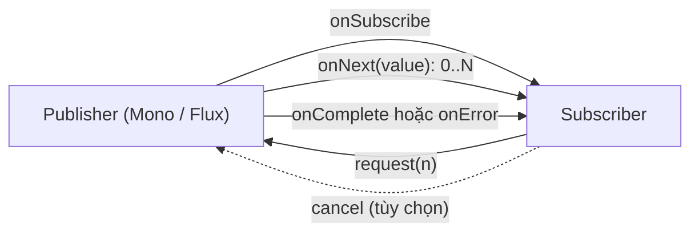

# Luồng sự kiện, Scheduler và giới hạn của mã chặn luồng trong Project Reactor

Trong ứng dụng **Spring Security Reactive** chạy trên Spring WebFlux, việc xử lý xác thực, phân quyền và truy cập dữ liệu thường được biểu diễn bằng `Mono` hoặc `Flux`. Để viết đúng mã reactive, cần phân biệt **luồng dữ liệu/sự kiện** (stream), **luồng thực thi** (`Thread`), **event loop** của máy chủ HTTP và **Scheduler** của Reactor. Một pipeline trả về `Mono` chưa chắc đã không chặn luồng: chỉ một lời gọi JDBC, `Thread.sleep()` hoặc `.block()` sai chỗ cũng có thể giữ event loop và làm tăng độ trễ của nhiều request.

## 1. Publisher, Subscriber và tín hiệu trong Reactor

Theo Reactive Streams, một `Publisher` phát tín hiệu cho `Subscriber` qua một `Subscription`. Reactor cung cấp hai kiểu chính:

- `Mono<T>`: hoàn thành với **0 hoặc 1** giá trị, hoặc lỗi; phù hợp với một người dùng, một kết quả xác thực, một phản hồi HTTP.
- `Flux<T>`: phát **0 đến N** giá trị, hoặc lỗi; phù hợp với một chuỗi sự kiện, danh sách bản ghi hoặc nhiều thông điệp.

Một vòng đời thông thường:

1. Subscriber đăng ký, nhận `onSubscribe(subscription)`.
2. Subscriber yêu cầu số lượng phần tử qua `subscription.request(n)`; đó là cơ chế **backpressure**.
3. Publisher có thể phát `onNext(value)` theo nhu cầu đã yêu cầu.
4. Publisher kết thúc bằng **một trong hai** tín hiệu `onComplete()` hoặc `onError(error)`. Sau tín hiệu kết thúc không còn `onNext`.
5. Subscriber có thể `cancel()` để ngừng quan tâm tới nguồn; hủy không bảo đảm một lời gọi I/O đồng bộ đang chạy sẽ dừng ngay.

`onNext`, `onError`, `onComplete` là **tín hiệu của stream**, không phải những `Thread` riêng. Backpressure kiểm soát số phần tử được yêu cầu trong pipeline có hỗ trợ cơ chế này; nó không tự làm cho một API đồng bộ trở nên bất đồng bộ, cũng không bảo đảm mọi hệ thống bên ngoài đều có thể giảm tốc độ phát.



### Assembly khác subscription

Việc khai báo chuỗi operator gọi là **assembly**; phần lớn pipeline Reactor chỉ bắt đầu hoạt động khi có **subscription**. Ví dụ, `Mono.fromCallable(() -> load())` hoãn lời gọi `load()` đến lúc có subscriber. Ngược lại, `Mono.just(load())` phải tính giá trị `load()` **ngay khi assembly** để truyền vào `just`, nên nếu `load()` là mã chặn luồng thì việc chặn xảy ra trước khi Reactor có cơ hội sắp lịch.

Với Spring WebFlux, thông thường framework thực hiện subscription trên `Mono`/`Flux` mà controller, filter hoặc service trả về. Không tự gọi `.subscribe()` bên trong handler chỉ để kích hoạt xử lý: cách đó tách công việc khỏi vòng đời request, làm khó truyền lỗi, hủy, bảo mật và quản lý tài nguyên.

## 2. Event loop xử lý request như thế nào?

Với cấu hình Spring WebFlux dùng Reactor Netty, một số ít **event-loop threads** phục vụ nhiều kết nối bằng I/O không chặn. Khi kết nối chưa có dữ liệu để đọc/ghi, event loop có thể chuyển sang công việc khác, rồi tiếp tục khi có sự kiện I/O. Đây không phải mô hình “mỗi request luôn có một thread riêng”.

Một pipeline Reactor **không tự chuyển thread** chỉ vì có `map()`, `flatMap()` hoặc vì kiểu trả về là `Mono`. Các operator thông thường chạy trên thread đang phát tín hiệu, trừ khi một nguồn bất đồng bộ hoặc một ranh giới lập lịch thay đổi thread thực thi. Vì vậy:

- `map(x -> cpuWork(x))` chạy ngay trên thread nhận `onNext`; tác vụ CPU quá nặng vẫn có thể giữ thread lâu.
- `map(x -> jdbcCall(x))` vẫn thực thi JDBC đồng bộ trên thread đó; kiểu `Mono` bên ngoài không sửa được vấn đề.
- `flatMap(x -> reactiveClient.get(x))` có thể phối hợp I/O không chặn **khi** client bên trong thực sự là reactive.
- `Mono.delay(Duration.ofMillis(100))` thể hiện một khoảng đợi bằng tín hiệu hẹn giờ, không chiếm thread bằng `Thread.sleep(100)` trong suốt khoảng chờ.

Khi event loop bị chặn, request khác cùng chia sẻ event loop có thể bị trễ dù CPU tổng thể chưa đầy. Tác động thường thấy là tăng latency, timeout, giảm thông lượng và khó hủy yêu cầu.

## 3. Scheduler là gì? `subscribeOn` và `publishOn` khác nhau ra sao?

`Scheduler` là cơ chế Reactor dùng để lên lịch tác vụ trên môi trường thực thi phù hợp. Nó **không đồng nghĩa** với stream, event loop hay một thread cố định: một Scheduler có thể quản lý nhiều worker/thread theo chính sách riêng.

| Scheduler | Mục đích điển hình | Lưu ý |
| --- | --- | --- |
| `Schedulers.immediate()` | Chạy công việc trên thread hiện tại | Không tạo ranh giới bất đồng bộ |
| `Schedulers.single()` | Công việc ngắn cần một luồng thực thi dùng chung | Một tác vụ chậm có thể làm chậm các tác vụ tiếp theo |
| `Schedulers.parallel()` | Công việc CPU ngắn, độc lập | Số worker giới hạn theo CPU; **không** phù hợp để chờ I/O chặn luồng |
| `Schedulers.boundedElastic()` | Cô lập tạm thời API **blocking** chưa thể thay thế | Số worker và tác vụ chờ bị giới hạn; có thể bão hòa |
| Scheduler từ `ExecutorService` | Cần kiểm soát vòng đời/pool chuyên biệt | Người tạo executor phải quản lý và đóng tài nguyên phù hợp |

**`subscribeOn(scheduler)`** ảnh hưởng đến việc subscription và phần xử lý từ **upstream/source** được lên lịch. Vị trí đặt trong chuỗi thường không làm đổi ý nghĩa chính của nó; nên đặt gần nguồn cần cô lập để người đọc thấy rõ ý định. Đừng xếp nhiều `subscribeOn` với kỳ vọng mỗi operator sẽ nhảy sang một scheduler mới.

**`publishOn(scheduler)`** đưa phần xử lý tín hiệu **downstream**, từ sau operator đó đến một `publishOn` khác, sang scheduler chỉ định. Các operator **phía trước** nó không được chuyển đi hồi tố.

```java
// Các đoạn sau là minh họa bên trong một phương thức đã có import Reactor.
Flux<Integer> values = Flux.range(1, 3)
    .map(n -> n + 1)                       // upstream
    .publishOn(Schedulers.parallel())      // ranh giới chuyển thực thi
    .map(n -> n * n);                      // downstream trên parallel

Mono<String> legacyResult = Mono.fromCallable(() -> legacyBlockingCall())
    .subscribeOn(Schedulers.boundedElastic())
    .map(String::trim);
```

`legacyBlockingCall()` là tên hàm minh họa, không phải API có sẵn. Ví dụ thứ nhất **không có nghĩa** ba phần tử tự chạy song song: `publishOn` chuyển nơi thực thi downstream, còn thứ tự và mức song song hóa phải xem riêng. Ví dụ thứ hai dùng `fromCallable` để trì hoãn lời gọi blocking và `subscribeOn(boundedElastic)` để cô lập nó khỏi event loop.

Lưu ý rằng `publishOn` cũng tạo hàng đợi/prefetch giữa các công đoạn; thêm ranh giới scheduler quá nhiều gây chuyển ngữ cảnh, tốn bộ nhớ và có thể làm chậm pipeline. Chọn scheduler dựa trên đặc tính công việc, không rải `publishOn` cho mọi operator.

## 4. Ví dụ chạy được: tín hiệu, blocking được cô lập và Reactor Context

Lưu tệp `ReactorFlowDemo.java` vào dự án Java 17+ đã có dependency `io.projectreactor:reactor-core` (ví dụ ứng dụng Spring Boot WebFlux đã dùng Reactor). Có thể chạy `main` từ IDE hoặc qua cấu hình chạy Java của dự án.

```java
import reactor.core.publisher.Flux;
import reactor.core.publisher.Mono;
import reactor.core.scheduler.Schedulers;
import reactor.util.context.Context;

public class ReactorFlowDemo {
    public static void main(String[] args) {
        Flux.just("A", "B")
            .doOnSubscribe(s -> System.out.println("subscribed"))
            .doOnNext(v -> System.out.println("onNext " + v))
            .doOnComplete(() -> System.out.println("complete"))
            .subscribe(v -> System.out.println("consume " + v));

        // Chỉ để mô phỏng một thư viện blocking cũ.
        String value = Mono.fromCallable(() -> {
                Thread.sleep(20);
                return "legacy";
            })
            .subscribeOn(Schedulers.boundedElastic())
            .map(String::toUpperCase)
            .block(); // Chỉ dùng trong main/demo, KHÔNG làm vậy trong WebFlux handler.
        System.out.println("result " + value);

        String traceId = Mono.deferContextual(ctx ->
                Mono.just(ctx.get("traceId").toString()))
            .publishOn(Schedulers.parallel())
            .contextWrite(Context.of("traceId", "req-42"))
            .block(); // Chỉ dùng để quan sát kết quả trong main.
        System.out.println("context " + traceId);
    }
}
```

Với chương trình trên, stdout là:

```text
subscribed
onNext A
consume A
onNext B
consume B
complete
result LEGACY
context req-42
```

Phần đầu phát đồng bộ trên thread gọi `subscribe()`, theo thứ tự đăng ký → phát giá trị → hoàn thành. Phần thứ hai cho thấy có thể gói lời gọi đồng bộ cũ trong `fromCallable` và chuyển nó sang `boundedElastic`. Phần cuối minh họa `Reactor Context` vẫn cung cấp `traceId` dọc theo subscription dù có ranh giới `publishOn`; Context **không phải** `ThreadLocal`.

Ở ví dụ này `.block()` là thao tác **cố ý ở `main`** để một chương trình dòng lệnh đợi kết quả và in stdout xác định. Trong một request WebFlux, phải **trả về** `Mono` hoặc `Flux` để runtime quản lý việc hoàn thành, thay vì gọi `.block()`.

## 5. Những dạng blocking thường làm hỏng pipeline

Các lời gọi sau có thể chiếm thread hiện tại trong lúc chờ: JDBC/JPA đồng bộ, HTTP client đồng bộ, đọc file đồng bộ, `Thread.sleep`, `Future.get`, `CompletableFuture.join`, lock/`wait` và `.block()` trên publisher khác. Thời gian blocking càng lớn hoặc số request đồng thời càng nhiều, ảnh hưởng càng nặng.

### Sai: gọi blocking ngay khi tạo `Mono`

```java
// SAI nếu loadUserSynchronously() chặn luồng:
Mono<User> user = Mono.just(loadUserSynchronously());
```

`loadUserSynchronously()` thực thi **trước** khi `Mono.just` được tạo. Việc đặt `.subscribeOn(...)` sau `just` cũng không thể đưa lời gọi đã xảy ra lên scheduler khác.

### Tạm chấp nhận: cô lập ở sát ranh giới legacy

```java
Mono<User> user = Mono.fromCallable(() -> loadUserSynchronously())
    .subscribeOn(Schedulers.boundedElastic());
```

`User` và `loadUserSynchronously()` ở đây là kiểu/hàm của ứng dụng, không phải mã độc lập có thể biên dịch nguyên đoạn. `fromCallable` chỉ gọi hàm khi được subscribe; `boundedElastic` giữ công việc chờ I/O tránh khỏi event loop. Nếu `Callable` trả về `null`, `Mono.fromCallable` hoàn thành rỗng, vì vậy cần thiết kế rõ ý nghĩa “không tìm thấy”.

Đây là biện pháp **chuyển tiếp** cho thư viện blocking, không biến JDBC/HTTP đồng bộ thành non-blocking. `boundedElastic` có giới hạn tài nguyên và hàng chờ; nếu nhiều yêu cầu blocking chạy lâu, nó vẫn có thể bão hòa. Ưu tiên giải pháp reactive thực sự, như `WebClient` cho HTTP và driver/repository reactive cho cơ sở dữ liệu khi hệ thống hỗ trợ.

### Sai: `map` hoặc `doOnNext` ẩn tác vụ blocking

```java
// SAI khi lookupLegacy(...) là lời gọi blocking:
return reactiveRepository.findById(id)
    .map(entity -> lookupLegacy(entity));
```

Nếu không thể bỏ API đồng bộ, cô lập **từng lời gọi** và ghép bằng `flatMap`:

```java
return reactiveRepository.findById(id)
    .flatMap(entity ->
        Mono.fromCallable(() -> lookupLegacy(entity))
            .subscribeOn(Schedulers.boundedElastic()));
```

Đây là đoạn minh họa trong service đã có `id`, `reactiveRepository` và `lookupLegacy`. Nếu nguồn là `Flux`, cần giới hạn đồng thời phù hợp, chẳng hạn `flatMap(mapper, concurrency)`, để tránh tạo quá nhiều thao tác blocking cùng lúc. Di chuyển một `map` nặng sang `publishOn(boundedElastic)` cũng có thể giúp cô lập, nhưng với API trả về một kết quả, cách gói nguồn bằng `fromCallable` thường rõ ràng và ít gây hiểu nhầm hơn.

### Sai: chặn để lấy giá trị bên trong controller/filter

```java
// SAI trong WebFlux handler:
User user = userService.findReactive(id).block();
return Mono.just(user);
```

Thay vào đó, nối các bước bất đồng bộ để giữ luồng tín hiệu, truyền lỗi và hủy:

```java
// ĐÚNG, giả sử findReactive trả Mono<User>:
return userService.findReactive(id)
    .flatMap(user -> reactiveAuditService.recordAccess(user).thenReturn(user));
```

Các đoạn dùng `User`, repository và service ở đây là **mã tích hợp minh họa**; chỉ chương trình `ReactorFlowDemo` ở phần 4 là tệp Java độc lập.

### Timeout không giải phóng mọi công việc blocking

`timeout(Duration)` báo lỗi hoặc hủy subscription khi quá hạn, nhưng không bảo đảm chấm dứt ngay một lời gọi đồng bộ đang giữ socket/thread. Hãy đặt timeout ở **driver/client thật**, giới hạn kết nối/concurrency, đo thời gian đợi và đóng tài nguyên đúng cách. Với publisher reactive, luôn xem xét cả luồng `onError`, `cancel` và cleanup.

## 6. Tác động trực tiếp đến Spring Security Reactive

Chuỗi bảo mật WebFlux thường xử lý request qua các `WebFilter` và các thành phần trả về `Mono`, ví dụ `ReactiveAuthenticationManager` có thể trả `Mono<Authentication>`. Authentication, authorization và truy cập thông tin người dùng cần tiếp tục được biểu diễn trong **cùng chuỗi reactive**. Chèn `.block()` trong filter, authentication manager hay controller có thể gây nghẽn event loop đúng tại đường đi quan trọng của mọi request.

Spring Security Reactive gắn thông tin bảo mật vào **Reactor Context** theo subscription. Đừng mặc định đọc `SecurityContextHolder` kiểu `ThreadLocal` như trong Spring MVC: đổi scheduler không phải cơ chế lưu danh tính người dùng. Để lấy authentication hiện tại trong pipeline reactive, dùng `ReactiveSecurityContextHolder`:

```java
import org.springframework.security.core.Authentication;
import org.springframework.security.core.context.ReactiveSecurityContextHolder;
import org.springframework.web.bind.annotation.GetMapping;
import org.springframework.web.bind.annotation.RestController;
import reactor.core.publisher.Mono;

@RestController
public class WhoamiController {
    @GetMapping("/whoami")
    public Mono<String> whoami() {
        return ReactiveSecurityContextHolder.getContext()
            .flatMap(ctx -> Mono.justOrEmpty(ctx.getAuthentication()))
            .map(Authentication::getName)
            .defaultIfEmpty("anonymous");
    }
}
```

Đoạn này là lớp controller đầy đủ (lưu trong `WhoamiController.java`) khi đã có Spring WebFlux và Spring Security trên classpath. Nếu security filter từ chối truy cập trước controller, request sẽ nhận kết quả từ tầng bảo mật thay vì vào `whoami()`. Khi authentication hiện diện, kết quả là tên được cung cấp bởi đối tượng authentication; giá trị mặc định chỉ áp dụng nếu chuỗi không phát authentication.

Điểm mấu chốt: `Reactor Context` đi **theo subscription** và có thể đi qua `publishOn`/`subscribeOn`; một biến `ThreadLocal` của thư viện đồng bộ không tự có cùng ngữ nghĩa. Khi tích hợp MDC, tracing hoặc legacy library dựa vào `ThreadLocal`, phải dùng cơ chế context propagation tương thích và kiểm thử thực tế, thay vì suy ra từ tên thread.

Đối với `ReactiveUserDetailsService` hoặc `ReactiveAuthenticationManager` tự viết, nếu dữ liệu người dùng vẫn nằm trong kho đồng bộ, phải bọc lời gọi blocking ở ranh giới legacy như phần 5; ưu tiên thay bằng repository/driver non-blocking khi có thể. Tránh tự `subscribe()` trong bộ xác thực vì nó làm kết quả/lỗi bị tách khỏi quá trình quyết định quyền truy cập.

## 7. Backpressure, concurrency, CPU và tài nguyên

Backpressure không có nghĩa hệ thống có vô hạn năng lực xử lý. Khi thiết kế pipeline, phân biệt bốn tình huống:

- **I/O non-blocking**: dùng API reactive, ghép với `flatMap`, `zip`, `then`; không cần tự chuyển mọi bước sang `boundedElastic`.
- **I/O đồng bộ còn phải dùng**: `fromCallable`/`fromRunnable` cùng `subscribeOn(boundedElastic)` và giới hạn số việc song song; đo chiều dài hàng đợi, timeout và pool kết nối.
- **CPU nặng**: phân tách công việc và kiểm soát concurrency; `Schedulers.parallel()` dành cho CPU, nhưng chỉ `publishOn(parallel())` **không tự chia** một vòng lặp nặng thành nhiều tác vụ chạy song song.
- **Dòng dữ liệu lớn**: chọn chiến lược request/prefetch/buffer và giới hạn `flatMap` phù hợp. `buffer()`, `collectList()` hoặc hàng đợi không giới hạn có thể làm tăng bộ nhớ dù có backpressure ở nơi khác.

Ví dụ thay `Thread.sleep()` bằng hẹn giờ reactive khi nghiệp vụ chỉ cần trì hoãn:

```java
// Chờ bằng tín hiệu hẹn giờ, không giữ thread trong lúc đợi:
Mono<String> delayed = Mono.delay(java.time.Duration.ofMillis(100))
    .thenReturn("ready");
```

Không được chuyển một đoạn mã có tranh chấp trạng thái sang scheduler nhiều thread mà chưa kiểm tra tính thread-safe. Trong cùng một subscription, tín hiệu tuân thủ hợp đồng Reactive Streams; nhưng các subscription khác nhau có thể xử lý đồng thời và chia sẻ tài nguyên của ứng dụng.

## 8. Cách chẩn đoán và tự kiểm tra

Khi thấy request WebFlux chậm hoặc timeout, hãy kiểm tra theo thứ tự:

1. **Nguồn I/O**: có JDBC/JPA, HTTP sync, file sync, `sleep`, `get/join` hay `.block()` nằm trên đường xử lý request không? Tìm cả trong thư viện gián tiếp và các operator như `map`, `doOnNext`.
2. **Vị trí thực thi**: đoạn blocking chạy trên event loop, `parallel`, `single` hay `boundedElastic`? Ghi tên thread trong môi trường phát triển để xác nhận, nhưng đừng dùng tên thread làm logic nghiệp vụ.
3. **Vòng đời tín hiệu**: ai subscribe, error đi đâu, cancellation có xử lý không, đã có timeout ở client thật và cleanup tài nguyên chưa?
4. **Nhu cầu/concurrency**: `Flux` có giới hạn số tác vụ `flatMap` đồng thời không; các pool, hàng đợi, connection pool có đang bão hòa không?
5. **Security Context**: authentication có được lấy từ `ReactiveSecurityContextHolder` trong subscription không; có chỗ nào tự subscribe hoặc chuyển sang callback ngoài pipeline khiến mất ngữ cảnh không?
6. **Đo kết quả**: so sánh throughput, p95/p99 latency, event-loop responsiveness, thread/queue saturation và số timeout trước/sau thay đổi. Một ví dụ hoạt động đúng với 1 request chưa chứng minh an toàn dưới tải.

Trong kiểm thử, `StepVerifier` (artifact `reactor-test`) giúp kiểm tra `onNext`, `onComplete`, `onError`, request/cancel và hẹn giờ khi thích hợp. Một công cụ phát hiện blocking như BlockHound có thể hữu ích ở môi trường thử nghiệm tương thích, nhưng không thay thế việc nhận diện API đồng bộ và đo tải thật.

## Ghi nhớ

- **Stream/event** là dòng tín hiệu; **Thread** là tài nguyên thực thi; **Scheduler** quyết định nơi chạy tác vụ; **event loop** phải được giữ ngắn và không bị chặn.
- `subscribeOn` phù hợp để cô lập **nguồn** blocking được hoãn bằng `fromCallable`; `publishOn` chuyển **đoạn downstream**. Không operator nào biến I/O đồng bộ thành non-blocking.
- `boundedElastic` là “cầu nối” có giới hạn cho legacy blocking; ưu tiên API reactive thật và kiểm soát tải.
- Trong Spring Security WebFlux, hãy trả `Mono`/`Flux` xuyên suốt request và đọc authentication qua **Reactor Context**; chỉ dùng `.block()` ở ranh giới thực sự đồng bộ như chương trình `main`/một bài test có chủ đích.
