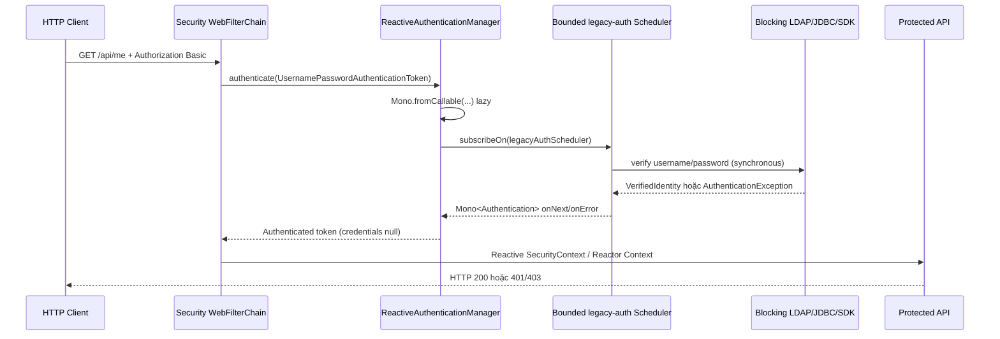

# Tích hợp hệ thống xác thực đồng bộ qua ranh giới chặn luồng có kiểm soát

## 1. Vì sao bài toán này xuất hiện trong Spring Security Reactive?

Ứng dụng **Spring WebFlux** xử lý HTTP trên Netty event loops, nơi một số ít threads có thể phục vụ số lượng lớn kết nối nhờ I/O không chặn. Tuy nhiên, nhiều hệ thống doanh nghiệp vẫn còn các dịch vụ xác thực **đồng bộ**:

- LDAP/JNDI SDK truyền thống thực hiện bind/search đồng bộ.
- JDBC driver cũ đọc người dùng, password hash, trạng thái khóa tài khoản và nhóm quyền.
- SOAP hoặc SDK Java nội bộ gọi SSO, máy chủ core banking, mainframe hay HSM.
- `UserDetailsService` hoặc `AuthenticationManager` vốn được xây cho chương trình Spring Security Servlet.
- Một thư viện xử lý credential (BCrypt/Argon2/PBKDF2) tốn CPU, không phải I/O bất đồng bộ, vẫn có thể làm nghẽn một event loop nếu tính toán nặng tại đó.

Nếu Spring Security Reactive gọi thẳng `legacyDirectory.verify(username, password)` trên thread `reactor-http-nio-*`, thread này bị giữ trong toàn bộ khoảng chờ I/O. Một backend chậm vài trăm mili giây có thể ảnh hưởng latency của nhiều kết nối **khác** cùng được phục vụ bởi event loop.

Mục tiêu bài này là xây **ranh giới chặn luồng có kiểm soát** (*controlled blocking boundary*): bọc thao tác đồng bộ thành một `Mono` lazy, offload **chỉ thao tác đồng bộ** sang `Scheduler` giới hạn, kết nối với `ReactiveAuthenticationManager`, kiểm soát timeout/capacity và giữ nguyên security semantics.

Sau khi học, bạn sẽ:

1. Hiểu vì sao `Mono.just(blockingCall())` vẫn chặn thread và `subscribeOn` khác `publishOn`.
2. Sử dụng `Mono.fromCallable(...).subscribeOn(Schedulers.boundedElastic())` đúng vị trí.
3. Viết một `ReactiveAuthenticationManager` dùng SDK xác thực đồng bộ mà không `.block()` trong HTTP path.
4. Ánh xạ kết quả thành authenticated `UsernamePasswordAuthenticationToken` và `GrantedAuthority` đáng tin.
5. Phân biệt sai mật khẩu, account bị khóa và backend xác thực không sẵn sàng.
6. Giới hạn threads/queue/connections, timeout, cancellation, rate limiting và load test.
7. Kiểm thử với **Java 17+, Spring Boot 3.x, Spring Security 6.x**, `StepVerifier` và `WebTestClient`.
8. Biết khi nào nên thay bridge bằng LDAP async, R2DBC, `WebClient` hoặc authentication service riêng.

> **Phạm vi:** `ServerHttpSecurity`, `SecurityWebFilterChain`, `ReactiveAuthenticationManager` của Spring Security **WebFlux**, không phải `HttpSecurity` của Servlet. Kỹ thuật offload là một giải pháp tích hợp hệ thống cũ; nó **không biến JDBC/LDAP driver đồng bộ thành driver nonblocking**.

## 2. Phân biệt “blocking”, “Reactive” và “async”

**Blocking:** lời gọi giữ thread của caller cho đến khi có kết quả hoặc timeout:

```java
// API giả định của một SDK đồng bộ, chỉ minh họa.
VerifiedIdentity user =
    legacyVerifier.verify(username, rawPassword);
```

Nếu LDAP chờ 400 ms, thread thực hiện `verify` phải chờ 400 ms. Trên Netty event loop, đó là một vấn đề nghiêm trọng vì event loop cần tiếp tục phục vụ các kết nối khác.

**Reactive:** thao tác trả về `Publisher` (`Mono`/`Flux`) để framework điều khiển subscription, tín hiệu kết quả/lỗi và cancellation. **Một method trả `Mono` không tự động trở thành nonblocking**. Nếu bên trong nó thực hiện I/O đồng bộ trên event loop, ứng dụng vẫn bị chặn.

**Offload:** có thể chuyển lời gọi blocking sang một scheduler dành cho công việc này, để caller event loop không chờ đồng bộ. Thread ở scheduler vẫn bị chặn trong lúc SDK thực thi; ta chỉ **giới hạn và cô lập** tác động.

**Native nonblocking:** khi LDAP/HTTP/database client thực sự cung cấp I/O bất đồng bộ, không cần giữ một worker thread cho mỗi request chờ network. Đây thường là đích kiến trúc tốt hơn nếu hệ thống, driver và team cho phép.

### Những thao tác cần để ý

| Công việc | Bản chất | Quyết định |
| --- | --- | --- |
| JDBC `.executeQuery()` đồng bộ | Blocking I/O | Offload hoặc đổi sang R2DBC nếu phù hợp |
| LDAP bind/search sync | Blocking I/O | Offload, driver timeout, connection pool |
| SDK SOAP đồng bộ | Blocking I/O | Offload hoặc dùng async HTTP adapter |
| BCrypt/Argon2 | CPU-intensive | Đo chi phí, tránh giữ event loop quá lâu |
| Map/validation rất nhẹ | CPU ngắn, không chặn | Thường không cần đổi scheduler |
| `Thread.sleep()` | Blocking thread | Chỉ dùng mô phỏng/test; không dùng để implement authentication |
| `WebClient` network I/O | Reactive nonblocking | Giữ trong Reactor pipeline; không `.block()` |

## 3. Mẫu chuẩn của Project Reactor: `Mono.fromCallable` và `subscribeOn`

```java
Mono<VerifiedIdentity> verified =
    Mono.fromCallable(() ->
            legacyVerifier.verify(username, rawPassword))
        .subscribeOn(Schedulers.boundedElastic());
```

**Giải thích từng phần:**

1. `Mono.fromCallable` tạo **source lazy**: callable không chạy khi xây pipeline mà chạy lúc một subscriber đăng ký.
2. `subscribeOn(scheduler)` quyết định thread thực thi subscription/source. Đặt ngay sau `fromCallable` để phần blocking được chạy tại worker phù hợp.
3. `Schedulers.boundedElastic()` dành cho công việc đồng bộ có thể chờ I/O và có giới hạn về số backing threads cùng số task chờ.
4. `Mono` chuyển kết quả thành `onNext + onComplete`, sai credential thành `onError`; Spring Security tự subscribe trong request pipeline.
5. Không cần tự tạo thread bằng `new Thread(...)`, không `.subscribe()` fire-and-forget trong filter.

### Những cách viết gây lỗi

**Sai: `Mono.just` không làm lời gọi trước nó trở thành lazy.**

```java
return Mono.just(
    legacyVerifier.verify(username, rawPassword));
```

Java đánh giá tham số `verify(...)` **trước** khi gọi `Mono.just`. Nếu code chạy trên Netty, event loop đã bị block.

**Sai: `map` chứa blocking call trên một source không có scheduling.**

```java
return Mono.just(username)
    .map(u -> legacyVerifier.verify(u, rawPassword));
```

`map` chạy trên thread upstream phát tín hiệu. Nếu đó là event loop, lời gọi này block event loop.

**Sai: `publishOn` sau blocking source.**

```java
return Mono.fromCallable(() ->
        legacyVerifier.verify(username, rawPassword))
    .publishOn(Schedulers.boundedElastic());
```

`publishOn` đổi context của **downstream operators** sau vị trí nó được đặt. Nó không bảo đảm callable upstream đã được đưa ra khỏi event loop. Với một source blocking, dùng `subscribeOn` sát `fromCallable`.

**Sai: `.block()` trong `ReactiveAuthenticationManager`.**

```java
VerifiedIdentity user = mono.block();
```

`block()` chiếm thread caller; trên một Reactor nonblocking thread, nó có thể bị từ chối bằng `IllegalStateException`. Trong Spring WebFlux phải **trả `Mono`**, không block để lấy value ngay.

**Sai: `.subscribe()` rồi trả kết quả rỗng.**

```java
mono.subscribe(value -> updateLoginState(value));
return Mono.empty();
```

Spring Security không đợi tác vụ này hoàn tất; lỗi, cancellation và authentication của request bị tách khỏi nhau. Không tự subscribe ở đây.

### `Mono.empty()` có ý nghĩa bảo mật

Contract của `ReactiveAuthenticationManager.authenticate(...)`:

- `Mono.just(Authentication)` — authentication thành công.
- `Mono.error(AuthenticationException)` — đã thử xác thực nhưng **thất bại**.
- `Mono.empty()` — manager **không thể xác định/xử lý** loại authentication này.

Nếu một manager chuyên username/password nhận token JWT không thuộc khả năng của mình, trả empty là phù hợp. Nhưng khi nó nhận đúng username/password và password sai, phải phát `BadCredentialsException`, không trả empty để provider khác có cơ hội “cho qua”.

Với `Mono.fromCallable`, callable trả `null` sẽ khiến publisher thành empty. **Không dùng `null` như quy ước “sai password”** ở backend xác thực.

## 4. Kiến trúc Spring Security WebFlux với legacy authentication



Spring Security HTTP Basic có converter tích hợp để trích username/password từ `Authorization: Basic ...` và tạo một `UsernamePasswordAuthenticationToken` **chưa authenticated**. Adapter `ReactiveAuthenticationManager` sẽ xác minh bằng nguồn đồng bộ. Controller **không phải** tự parse Base64 hay nhận raw password.

Sau success, Spring Security đặt `Authentication` vào **Reactive SecurityContext**, được truyền qua **Reactor Context**. Không giả định `SecurityContextHolder.getContext()` dựa trên `ThreadLocal` ở bất kỳ boundedElastic thread nào sẽ tự có identity.

### Một authentication bridge không cấp quyền trước khi verify

Không tạo `UsernamePasswordAuthenticationToken.authenticated(...)` từ username do request tự gửi nếu chưa gọi backend. Điều kiện thành công phải bao gồm kiểm tra credentials, account status, authority nguồn đáng tin và các yếu tố MFA nếu backend có yêu cầu.

**Phân quyền** xảy ra sau authentication: có `ROLE_READER` không đồng nghĩa được gọi `/api/admin` nếu endpoint yêu cầu `ROLE_ADMIN`.

## 5. Chọn Scheduler và giới hạn luồng

| Scheduler | Thiết kế phù hợp | Blocking LDAP/JDBC? |
| --- | --- | --- |
| Netty event loop | HTTP nonblocking I/O | **Không** |
| `Schedulers.parallel()` | Tính toán ngắn trên CPU | Không dùng cho I/O chặn thread |
| `Schedulers.single()` | Một worker tuần tự | Thường thiếu capacity cho login |
| `Schedulers.boundedElastic()` | Blocking sources với cap threads/queue | Có |
| `Schedulers.newBoundedElastic(...)` | Pool riêng, cap cấu hình được | Có, khi cần isolation |
| Executor tùy chỉnh | Hệ thống có thread pool riêng | Có nếu lifecycle/rejection/cancellation đúng |

Ví dụ pool **chỉ cho legacy auth**:

```java
Scheduler legacyAuthScheduler =
    Schedulers.newBoundedElastic(
        8,              // tối đa 8 backing threads
        64,             // tối đa queue cap trên mỗi backing thread
        "legacy-auth");
```

API `newBoundedElastic(threadCap, queuedTaskCap, name)` được Reactor document. Lưu ý **`queuedTaskCap` áp dụng theo backing thread**, không phải giới hạn duy nhất trên toàn bộ ứng dụng hay giới hạn số connections LDAP.

Nên có pool riêng nếu ứng dụng còn chạy job blocking khác (đọc PDF, ERP, báo cáo tài chính) để login không bị chiếm chỗ bởi các công việc không liên quan.

### Scheduler cap không thay thế giới hạn backend

Một JDBC pool có `maximumPoolSize=10` vẫn chỉ cho 10 connections, bất kể scheduler có 100 threads. Nếu nhiều threads cùng chờ connection, queue chuyển từ scheduler sang connection pool chứ không biến mất. Cần phối hợp:

- Thread cap và queued tasks cap.
- Connection pool max/pending queue/lease timeout của SDK.
- Connect timeout, read timeout và query timeout.
- Rate limiting trên login endpoints.
- Bulkhead để bảo vệ concurrent calls nếu backend chịu được ít requests.
- Circuit breaker khi backend không ổn định.
- Metrics queue wait, active threads, latency p95/p99, rejected tasks và backend errors.

Với lưu lượng 100 requests/giây và mỗi sync call mất 200 ms, số requests đồng thời trung bình khoảng `100 * 0,2 = 20` nếu các giả thiết ổn định. Đây là một **ước lượng capacity thô** theo Little's Law; burst, variance và lock contention có thể làm peak lớn hơn. Pool 8 có nguy cơ tạo queue ngay cả khi event loops vẫn khỏe.

**Saturation là một nhánh lỗi phải thiết kế.** Khi không nhận thêm task, scheduler có thể ném `RejectedExecutionException`. Không catch exception rồi trả authentication thành công để “giữ uptime”.

## 6. Timeout và cancellation: giới hạn thời gian không có nghĩa chặn luồng đã dừng

Một `Mono` có thể đặt deadline:

```java
return Mono.fromCallable(() -> legacyVerifier.verify(user, password))
    .subscribeOn(legacyAuthScheduler)
    .timeout(Duration.ofSeconds(2));
```

Nếu quá thời gian, Reactor phát `TimeoutException` và cancel upstream. Nhưng một lời gọi JDBC/socket đồng bộ đang chờ có thể không đáp ứng interruption/cancel ngay. **Đừng giả định timeout đã giải phóng thread hoặc connection**.

Cần đặt timeout **ở nơi blocking thực sự xảy ra**: JDBC query timeout, LDAP connect/read timeout, HTTP SDK socket timeout. `Mono.timeout` giúp bảo vệ thời gian chờ của HTTP request; driver timeout bảo vệ tài nguyên backend và thread.

### Phân biệt các loại lỗi

| Lỗi | Exception/policy phù hợp | Response HTTP thường gặp |
| --- | --- | --- |
| Password sai hoặc user không tồn tại | `BadCredentialsException` | 401 Basic challenge |
| Account locked | `LockedException` | 401 hoặc mapping riêng theo security policy |
| Account disabled | `DisabledException` | 401 hoặc mapping riêng |
| Backend LDAP/JDBC down | `AuthenticationServiceException` | Cần phân loại service outage; HTTP tùy failure handler |
| Scheduler quá tải | Map `RejectedExecutionException` sang service error | Fail closed; có thể thiết kế 503 rõ ràng |
| Blocking call quá hạn | Map `TimeoutException` sang service error | Fail closed; có thể thiết kế 503 rõ ràng |
| Password hợp lệ, thiếu role | Spring authorization denied | 403 Forbidden |

**Không hứa rằng `AuthenticationServiceException` tự sinh 503.** HTTP Basic authentication failure handler mặc định có thể đưa exception về 401; nếu API muốn client phân biệt outage với bad password qua 503, cần custom `ServerAuthenticationFailureHandler`/entry point và integration tests cho đúng chain.

**Không `.retry(3)` mọi authentication error.** Sai mật khẩu không phải lỗi transient. Backend outage mà cả trăm requests retry đồng thời có thể tạo retry storm, làm backend sập nặng hơn. Nếu cần retry lỗi network ngắn hạn, giới hạn attempts, backoff/jitter, total deadline, classification và account-lock side effects.

## 7. Ví dụ hoàn chỉnh Java 17+, Spring Boot 3.x: HTTP Basic tới SDK đồng bộ

Demo có:

- `GET /public/ping`: không cần login.
- `GET /api/me`: yêu cầu username/password Basic.
- `GET /api/admin`: cần `ROLE_ADMIN`; demo user chỉ có `ROLE_READER`.
- Legacy verifier giả lập **120 ms blocking** bằng `Thread.sleep(120)` và kiểm tra BCrypt hash.
- Bridge tạo `Mono.fromCallable(...).subscribeOn(legacyAuthScheduler)`, giới hạn timeout 2 giây.
- `NoOpServerSecurityContextRepository`: không giữ login session giữa các requests.
- Không tắt CSRF mặc định; demo chỉ có GET. Nếu thêm state-changing methods bằng browser Basic authentication, phải đánh giá CSRF cụ thể.

**Không coi giả lập sleep là cách triển khai authentication thật.** Trong production thay verifier bằng SDK/JDBC/LDAP đồng bộ, TLS, per-operation timeout, rate limit, account lock và connection pool. HTTP Basic chỉ dùng qua **HTTPS** khi có credentials thật.

### 7.1. Cấu trúc dự án

```text
legacy-auth-bridge/
  settings.gradle
  build.gradle
  src/main/java/demo/legacy/
    LegacyAuthApplication.java
    LegacyCredentialVerifier.java
    VerifiedIdentity.java
    SimulatedLegacyCredentialVerifier.java
    LegacyBridgeAuthenticationManager.java
    SecurityConfig.java
    ApiController.java
  src/test/java/demo/legacy/
    LegacyBridgeAuthenticationManagerTest.java
    BasicAuthIntegrationTest.java
```

### 7.2. `settings.gradle`

```groovy
rootProject.name = 'legacy-auth-bridge'
```

### 7.3. `build.gradle`

```groovy
plugins {
    id 'java'
    id 'org.springframework.boot' version '3.5.0'
    id 'io.spring.dependency-management' version '1.1.7'
}

group = 'demo'
version = '0.0.1-SNAPSHOT'

java {
    toolchain {
        languageVersion = JavaLanguageVersion.of(17)
    }
}

repositories {
    mavenCentral()
}

dependencies {
    implementation 'org.springframework.boot:spring-boot-starter-webflux'
    implementation 'org.springframework.boot:spring-boot-starter-security'

    testImplementation 'org.springframework.boot:spring-boot-starter-test'
    testImplementation 'io.projectreactor:reactor-test'
}

tasks.named('test') {
    useJUnitPlatform()
}
```

Đây là một Gradle project Java 17+ sử dụng Spring Boot BOM để quản lý Spring Security/Reactor dependencies. Dùng Gradle wrapper phù hợp với Spring Boot plugin. Không thêm `spring-boot-starter-web` để tránh auto-config Servlet/MVC thay vì Reactive.

### 7.4. `src/main/java/demo/legacy/LegacyAuthApplication.java`

```java
package demo.legacy;

import org.springframework.boot.SpringApplication;
import org.springframework.boot.autoconfigure.SpringBootApplication;

@SpringBootApplication
public class LegacyAuthApplication {
    public static void main(String[] args) {
        SpringApplication.run(LegacyAuthApplication.class, args);
    }
}
```

### 7.5. `src/main/java/demo/legacy/VerifiedIdentity.java`

```java
package demo.legacy;

import java.util.List;
import org.springframework.security.core.GrantedAuthority;

public record VerifiedIdentity(
        String username,
        List<GrantedAuthority> authorities) {
}
```

Kết quả chỉ chứa identity và authorities đã được backend **xác minh**. Không truyền password/hash/OTP secret, security questions hoặc toàn bộ bản ghi LDAP vào `Authentication`.

### 7.6. `src/main/java/demo/legacy/LegacyCredentialVerifier.java`

```java
package demo.legacy;

// API thuần đồng bộ của hệ thống cũ.
public interface LegacyCredentialVerifier {
    VerifiedIdentity verify(String username, String rawPassword);
}
```

Tên method `verify` mang nghĩa backend tự kiểm tra password và trả identity. Nếu hệ thống cũ chỉ cung cấp `UserDetailsService.loadUserByUsername` và hash, xem phương án `ReactiveUserDetailsService` ở phần sau; không kiểm tra password hai lần.

### 7.7. `src/main/java/demo/legacy/SimulatedLegacyCredentialVerifier.java`

```java
package demo.legacy;

import java.util.List;
import java.util.Map;

import org.springframework.security.authentication.AuthenticationServiceException;
import org.springframework.security.authentication.BadCredentialsException;
import org.springframework.security.core.authority.SimpleGrantedAuthority;
import org.springframework.security.crypto.password.PasswordEncoder;

public final class SimulatedLegacyCredentialVerifier
        implements LegacyCredentialVerifier {

    private final PasswordEncoder encoder;
    private final Map<String, String> passwordHashes;
    private final String dummyHash;

    public SimulatedLegacyCredentialVerifier(PasswordEncoder encoder) {
        this.encoder = encoder;
        this.passwordHashes = Map.of(
            "reader", encoder.encode("demo123"));
        this.dummyHash = encoder.encode("no-such-account");
    }

    @Override
    public VerifiedIdentity verify(
            String username, String rawPassword) {

        // Chỉ mô phỏng một lời gọi JDBC/LDAP đang chờ I/O.
        try {
            Thread.sleep(120);
        } catch (InterruptedException ex) {
            Thread.currentThread().interrupt();
            throw new AuthenticationServiceException(
                "Legacy authentication interrupted", ex);
        }

        String realHash = passwordHashes.get(username);
        String hashToCheck =
            realHash != null ? realHash : dummyHash;

        // Vẫn chạy phép so khớp hash cho user không tồn tại để
        // giảm chênh lệch timing thô, không cam kết constant-time.
        boolean valid = encoder.matches(rawPassword, hashToCheck);

        if (realHash == null || !valid) {
            throw new BadCredentialsException(
                "Invalid username or password");
        }

        return new VerifiedIdentity(
            username,
            List.of(new SimpleGrantedAuthority("ROLE_READER")));
    }
}
```

**Đánh giá security:**

- Không lưu plaintext password trong map; password hash dùng BCrypt theo `PasswordEncoder` bean.
- Cùng một thông báo sai username/password giúp hạn chế account enumeration; dummy hash giảm khác biệt timing đơn giản nhưng không thay toàn bộ anti-enumeration strategy.
- Không log raw password, Basic Authorization header, hash hoặc full user record.
- Trả role từ backend sau khi verify, không nhận role từ query/body của caller.
- Không áp dụng mã demo này cho production nếu chưa có per-user lockout, rate limit, MFA/account-status logic và monitoring.

### 7.8. `src/main/java/demo/legacy/LegacyBridgeAuthenticationManager.java`

```java
package demo.legacy;

import java.time.Duration;
import java.util.concurrent.RejectedExecutionException;
import java.util.concurrent.TimeoutException;

import org.springframework.security.authentication.AuthenticationServiceException;
import org.springframework.security.authentication.ReactiveAuthenticationManager;
import org.springframework.security.authentication.UsernamePasswordAuthenticationToken;
import org.springframework.security.core.Authentication;
import reactor.core.publisher.Mono;
import reactor.core.scheduler.Scheduler;

public final class LegacyBridgeAuthenticationManager
        implements ReactiveAuthenticationManager {

    private final LegacyCredentialVerifier verifier;
    private final Scheduler scheduler;
    private final Duration timeout;

    public LegacyBridgeAuthenticationManager(
            LegacyCredentialVerifier verifier,
            Scheduler scheduler,
            Duration timeout) {
        this.verifier = verifier;
        this.scheduler = scheduler;
        this.timeout = timeout;
    }

    @Override
    public Mono<Authentication> authenticate(
            Authentication authentication) {

        // Chỉ hỗ trợ UsernamePasswordAuthenticationToken.
        if (!(authentication instanceof UsernamePasswordAuthenticationToken)
                || !(authentication.getCredentials()
                    instanceof String rawPassword)) {
            return Mono.empty();
        }

        String username = authentication.getName();

        return Mono.fromCallable(() -> {
                // Nguồn sync + password checking đều ở bên trong Callable.
                VerifiedIdentity verified =
                    verifier.verify(username, rawPassword);

                // Chỉ tạo authenticated token SAU khi verify thành công.
                return (Authentication)
                    UsernamePasswordAuthenticationToken.authenticated(
                        verified.username(),
                        null,
                        verified.authorities());
            })
            .subscribeOn(scheduler)
            .timeout(timeout)
            .onErrorMap(TimeoutException.class, error ->
                new AuthenticationServiceException(
                    "Legacy authentication timed out", error))
            .onErrorMap(RejectedExecutionException.class, error ->
                new AuthenticationServiceException(
                    "Legacy authentication queue exhausted", error));
    }
}
```

**Kiểm tra logic:**

1. Không nhận những authentication types không được hỗ trợ; trả `Mono.empty()` đúng contract.
2. `Mono.fromCallable` lazy bảo đảm không gọi SDK ngay khi filter tạo publisher.
3. `subscribeOn(scheduler)` đưa callable blocking lên scheduler giới hạn, không dùng event loop.
4. `timeout` giới hạn thời gian caller chờ; không thay timeout trong SDK.
5. `onErrorMap` phân loại timeout và scheduler saturation, **không** nuốt `BadCredentialsException`.
6. Authenticated token có `credentials=null`, giảm khả năng credentials bị giữ ở security context/controller.
7. `Mono<Authentication>` nối trọn vẹn vào HTTP Basic authentication pipeline.
8. Không `.block`, không tự `.subscribe`, không retry credentials sai.

**Thận trọng:** raw password vẫn tồn tại tạm thời trong incoming `Authentication`/Java `String` cho tới khi request/GC giải phóng; không thể “xóa ngay mọi byte” bằng việc đặt credentials null trên một token mới. Không lưu vào cache/static field/log và hạn chế retention của dữ liệu nhạy cảm.

### 7.9. `src/main/java/demo/legacy/SecurityConfig.java`

```java
package demo.legacy;

import java.time.Duration;

import org.springframework.beans.factory.annotation.Qualifier;
import org.springframework.context.annotation.Bean;
import org.springframework.context.annotation.Configuration;
import org.springframework.security.authentication.ReactiveAuthenticationManager;
import org.springframework.security.config.annotation.web.reactive.EnableWebFluxSecurity;
import org.springframework.security.config.web.server.ServerHttpSecurity;
import org.springframework.security.crypto.bcrypt.BCryptPasswordEncoder;
import org.springframework.security.crypto.password.PasswordEncoder;
import org.springframework.security.web.server.SecurityWebFilterChain;
import org.springframework.security.web.server.context
    .NoOpServerSecurityContextRepository;
import reactor.core.scheduler.Scheduler;
import reactor.core.scheduler.Schedulers;

@Configuration
@EnableWebFluxSecurity
public class SecurityConfig {

    @Bean
    PasswordEncoder passwordEncoder() {
        return new BCryptPasswordEncoder(10);
    }

    @Bean
    LegacyCredentialVerifier legacyVerifier(
            PasswordEncoder encoder) {
        return new SimulatedLegacyCredentialVerifier(encoder);
    }

    @Bean(value = "legacyAuthScheduler", destroyMethod = "dispose")
    Scheduler legacyAuthScheduler() {
        // Các thông số 8/64 là ví dụ, cần đo thực tế.
        return Schedulers.newBoundedElastic(8, 64, "legacy-auth");
    }

    @Bean("legacyAuthenticationManager")
    ReactiveAuthenticationManager legacyAuthenticationManager(
            LegacyCredentialVerifier verifier,
            @Qualifier("legacyAuthScheduler") Scheduler scheduler) {

        return new LegacyBridgeAuthenticationManager(
            verifier, scheduler, Duration.ofSeconds(2));
    }

    @Bean
    SecurityWebFilterChain securityChain(
            ServerHttpSecurity http,
            @Qualifier("legacyAuthenticationManager")
            ReactiveAuthenticationManager manager) {

        return http
            .securityContextRepository(
                NoOpServerSecurityContextRepository.getInstance())
            .authorizeExchange(exchanges -> exchanges
                .pathMatchers("/public/**").permitAll()
                .pathMatchers("/api/admin").hasRole("ADMIN")
                .pathMatchers("/api/**").authenticated()
                .anyExchange().denyAll())
            .httpBasic(basic -> basic.authenticationManager(manager))
            .formLogin(form -> form.disable())
            .build();
    }
}
```

**Giải thích:**

- `legacyAuthScheduler` là **scheduler riêng** với tối đa 8 backing threads và queued task cap 64 trên mỗi backing thread. `destroyMethod="dispose"` được Spring gọi khi context đóng.
- `httpBasic` sử dụng đúng `ReactiveAuthenticationManager`, không gọi `AuthenticationManager` đồng bộ trong Netty filter.
- `NoOpServerSecurityContextRepository` không lưu authentication vào session: client gửi Basic credentials ở từng protected request. **Không phải** cách tạo remembered login session.
- `hasRole("ADMIN")` yêu cầu `ROLE_ADMIN`; demo trả `ROLE_READER`, giúp thấy rõ 403 khác 401.
- CSRF mặc định vẫn bật, nhưng demo chỉ dùng GET. Khi dùng HTTP Basic trong browser có state-changing POST/DELETE, cần đánh giá CSRF đúng threat model; đừng tắt global chỉ vì nghĩ “không có form login”.
- `formLogin` tắt để API dùng Basic challenge thay vì HTML login; nếu cần token/session/MFA thì thiết kế security chains riêng.

### 7.10. `src/main/java/demo/legacy/ApiController.java`

```java
package demo.legacy;

import java.util.Map;

import org.springframework.security.core.GrantedAuthority;
import org.springframework.security.core.context.ReactiveSecurityContextHolder;
import org.springframework.web.bind.annotation.GetMapping;
import org.springframework.web.bind.annotation.RestController;
import reactor.core.publisher.Mono;

@RestController
public class ApiController {

    @GetMapping("/public/ping")
    public Mono<Map<String, String>> ping() {
        return Mono.just(Map.of("status", "ok"));
    }

    @GetMapping("/api/me")
    public Mono<Map<String, Object>> me() {
        return ReactiveSecurityContextHolder.getContext()
            .map(ctx -> Map.<String, Object>of(
                "username", ctx.getAuthentication().getName(),
                "authorities",
                ctx.getAuthentication().getAuthorities().stream()
                    .map(GrantedAuthority::getAuthority)
                    .toList()));
    }

    @GetMapping("/api/admin")
    public Mono<String> admin() {
        return Mono.just("only-admin");
    }
}
```

Không lấy username từ header rồi coi là principal; lấy `Authentication` sau khi Spring Security verify thành công thông qua **ReactiveSecurityContextHolder**. Không dùng `SecurityContextHolder.getContext()` dạng ThreadLocal làm nguồn sự thật trong WebFlux controller.

Output logic với demo password:

```json
{
  "username": "reader",
  "authorities": ["ROLE_READER"]
}
```

Thứ tự JSON fields không có ý nghĩa; test theo JSONPath.

### 7.11. Chạy và kiểm tra bằng curl

Từ project có Gradle wrapper:

```bash
# Linux/macOS
./gradlew bootRun

# Windows
gradlew.bat bootRun
```

Các request:

```bash
# Public endpoint: 200
curl -i http://localhost:8080/public/ping

# Không credentials: 401 và Basic challenge
curl -i http://localhost:8080/api/me

# Sai password: 401
curl -i -u reader:wrong http://localhost:8080/api/me

# Đúng password: 200 với JSON identity
curl -i -u reader:demo123 http://localhost:8080/api/me

# Đúng password nhưng thiếu ROLE_ADMIN: 403
curl -i -u reader:demo123 http://localhost:8080/api/admin
```

Bảng mong đợi:

| Request | Status | Lý do |
| --- | --- | --- |
| `GET /public/ping` | 200 | Public |
| `GET /api/me` thiếu Basic | 401 | Chưa authenticated |
| `GET /api/me` với password sai | 401 | `BadCredentialsException` |
| `GET /api/me` với demo credentials đúng | 200 | Được backend xác minh |
| `GET /api/admin` với demo credentials đúng | 403 | Có `ROLE_READER`, thiếu `ROLE_ADMIN` |

HTTP Basic chỉ mã hóa username/password bằng Base64, **không bảo mật dữ liệu trước người nghe lén**. Chỉ dùng trên HTTPS thật và không đưa thông tin đăng nhập demo vào frontend production.

## 8. Unit test: công việc đồng bộ phải chạy trên scheduler riêng

Tệp `src/test/java/demo/legacy/LegacyBridgeAuthenticationManagerTest.java`:

```java
package demo.legacy;

import java.time.Duration;
import java.util.List;
import java.util.concurrent.atomic.AtomicReference;

import org.junit.jupiter.api.Test;
import org.springframework.security.authentication.BadCredentialsException;
import org.springframework.security.authentication.UsernamePasswordAuthenticationToken;
import org.springframework.security.core.authority.SimpleGrantedAuthority;
import reactor.core.scheduler.Scheduler;
import reactor.core.scheduler.Schedulers;
import reactor.test.StepVerifier;

import static org.junit.jupiter.api.Assertions.assertEquals;
import static org.junit.jupiter.api.Assertions.assertNull;
import static org.junit.jupiter.api.Assertions.assertTrue;

class LegacyBridgeAuthenticationManagerTest {

    @Test
    void blockingVerifierRunsOnDedicatedScheduler() {
        AtomicReference<String> actualThread = new AtomicReference<>();

        LegacyCredentialVerifier fake = (user, password) -> {
            actualThread.set(Thread.currentThread().getName());
            return new VerifiedIdentity(
                user,
                List.of(new SimpleGrantedAuthority("ROLE_READER")));
        };

        Scheduler scheduler =
            Schedulers.newBoundedElastic(2, 10, "test-legacy");

        try {
            var manager = new LegacyBridgeAuthenticationManager(
                fake, scheduler, Duration.ofSeconds(2));

            var request =
                UsernamePasswordAuthenticationToken.unauthenticated(
                    "reader", "demo123");

            // Chưa subscribe: verifier chưa được gọi.
            var result = manager.authenticate(request);
            assertNull(actualThread.get());

            StepVerifier.create(result)
                .assertNext(auth -> {
                    assertTrue(auth.isAuthenticated());
                    assertEquals("reader", auth.getName());
                    assertNull(auth.getCredentials());
                    assertTrue(
                        actualThread.get().startsWith("test-legacy"));
                })
                .verifyComplete();
        } finally {
            scheduler.dispose();
        }
    }

    @Test
    void badCredentialsAreNotSwallowed() {
        LegacyCredentialVerifier fake = (user, password) -> {
            throw new BadCredentialsException(
                "Invalid username or password");
        };

        Scheduler scheduler =
            Schedulers.newBoundedElastic(1, 10, "test-legacy");

        try {
            var manager = new LegacyBridgeAuthenticationManager(
                fake, scheduler, Duration.ofSeconds(2));

            StepVerifier.create(manager.authenticate(
                    UsernamePasswordAuthenticationToken.unauthenticated(
                        "reader", "wrong")))
                .expectError(BadCredentialsException.class)
                .verify();
        } finally {
            scheduler.dispose();
        }
    }
}
```

Test chứng minh **lazy behavior** (chưa subscribe thì backend chưa chạy) và **offload** (thread có prefix của scheduler riêng), đồng thời sai password phát `BadCredentialsException` chứ không biến thành empty. Không phụ thuộc LDAP thực.

Tên thread prefix được set ở scheduler demo, không phải tên chuẩn mọi Reactor worker. Test bảo đảm tính chất “công việc này chạy trên scheduler được cấu hình”, chứ chưa chứng minh hệ thống chịu tải production.

## 9. WebTestClient integration: authentication và authorization tách biệt

Tệp `src/test/java/demo/legacy/BasicAuthIntegrationTest.java`:

```java
package demo.legacy;

import org.junit.jupiter.api.Test;
import org.springframework.beans.factory.annotation.Autowired;
import org.springframework.boot.test.context.SpringBootTest;
import org.springframework.boot.test.autoconfigure.web.reactive
    .AutoConfigureWebTestClient;
import org.springframework.http.HttpHeaders;
import org.springframework.test.web.reactive.server.WebTestClient;

@SpringBootTest(webEnvironment = SpringBootTest.WebEnvironment.MOCK)
@AutoConfigureWebTestClient
class BasicAuthIntegrationTest {

    @Autowired
    WebTestClient client;

    @Test
    void publicEndpointWorksWithoutLogin() {
        client.get().uri("/public/ping").exchange()
            .expectStatus().isOk()
            .expectBody()
            .jsonPath("$.status").isEqualTo("ok");
    }

    @Test
    void protectedEndpointRequiresCredentials() {
        client.get().uri("/api/me").exchange()
            .expectStatus().isUnauthorized()
            .expectHeader().exists(HttpHeaders.WWW_AUTHENTICATE);
    }

    @Test
    void incorrectPasswordIs401() {
        client.get().uri("/api/me")
            .headers(h -> h.setBasicAuth("reader", "wrong"))
            .exchange()
            .expectStatus().isUnauthorized();
    }

    @Test
    void validPasswordCreatesReactiveIdentity() {
        client.get().uri("/api/me")
            .headers(h -> h.setBasicAuth("reader", "demo123"))
            .exchange()
            .expectStatus().isOk()
            .expectBody()
            .jsonPath("$.username").isEqualTo("reader")
            .jsonPath("$.authorities[0]").isEqualTo("ROLE_READER");
    }

    @Test
    void authenticatedButNotAuthorizedIs403() {
        client.get().uri("/api/admin")
            .headers(h -> h.setBasicAuth("reader", "demo123"))
            .exchange()
            .expectStatus().isForbidden();
    }
}
```

Chạy:

```bash
# Linux/macOS
./gradlew test
./gradlew test --tests 'demo.legacy.LegacyBridgeAuthenticationManagerTest'
./gradlew test --tests 'demo.legacy.BasicAuthIntegrationTest'

# Windows
gradlew.bat test
```

Tests kiểm tra cả đường Spring Security authentication filter, manager, role authorization và controller context. **Không thay thế** load test, test LDAP/JDBC thật, TLS, driver timeout hoặc kết quả đồng bộ nhiều replicas.

Nếu môi trường bật additional security filters khác, phải kiểm tra 401/403 response contract của chính ứng dụng. Không tự ép status 200 khi backend lỗi.

## 10. Tùy chọn A: tích hợp `AuthenticationManager` đồng bộ có sẵn

Spring Security có adapter chính thức:

```java
ReactiveAuthenticationManagerAdapter
```

Class này nhận một `AuthenticationManager` đồng bộ và có thể cấu hình scheduler cho công việc đó. Ví dụ **đoạn tích hợp**, giả sử ứng dụng đã có đối tượng `AuthenticationManager syncManager`:

```java
ReactiveAuthenticationManagerAdapter adapter =
    new ReactiveAuthenticationManagerAdapter(syncManager);
adapter.setScheduler(legacyAuthScheduler);
```

Các import cần thiết:

```java
import org.springframework.security.authentication.AuthenticationManager;
import org.springframework.security.authentication.ReactiveAuthenticationManagerAdapter;
```

Lớp này thích hợp khi legacy code đã có toàn bộ logic `authenticate(Authentication)` ở Java, không phụ thuộc Servlet request.

**Phải đánh giá trước khi tái sử dụng:**

- Manager đồng bộ có đọc `HttpServletRequest`, `HttpSession` hay `SecurityContextHolder` ThreadLocal không? Chúng không tự xuất hiện trong WebFlux.
- Manager có thread-safe khi nhiều login được offload đồng thời?
- Có timeout và connection pool cho LDAP/JDBC/SDK không?
- Sai password, locked account và backend outage có exception semantics đúng không?
- Có giữ password trong authenticated token hoặc log credentials không?
- Có khởi tạo session hoặc commit HTTP response trực tiếp không? Điều này không phù hợp một adapter thuần authentication.

`ReactiveAuthenticationManagerAdapter` giúp bọc API, nhưng **không làm Selenium browser session/Servlet filter được chuyển tự động sang WebFlux**. Nếu manager cũ phụ thuộc Servlet, hãy tách riêng lớp nghiệp vụ kiểm chứng credential.

## 11. Tùy chọn B: adapter `ReactiveUserDetailsService` cho kho user đồng bộ

Trong nhiều ứng dụng, SDK cũ chỉ cung cấp `UserDetailsService.loadUserByUsername(...)` trả password hash và authorities; phần **kiểm tra password** nên để Spring Security chuẩn thực hiện qua `UserDetailsRepositoryReactiveAuthenticationManager`.

Ví dụ **cấu hình thay thế**, không đăng ký đồng thời với demo custom manager nếu chưa chọn owner:

```java
@Bean
ReactiveUserDetailsService reactiveUsers(
        UserDetailsService oldService,
        @Qualifier("legacyAuthScheduler") Scheduler scheduler) {

    return username -> Mono.fromCallable(() ->
            oldService.loadUserByUsername(username))
        .subscribeOn(scheduler);
}

@Bean
ReactiveAuthenticationManager userDetailsManager(
        ReactiveUserDetailsService reactiveUsers,
        PasswordEncoder encoder) {

    var manager =
        new UserDetailsRepositoryReactiveAuthenticationManager(
            reactiveUsers);
    manager.setPasswordEncoder(encoder);
    return manager;
}
```

Imports cần bổ sung:

```java
import org.springframework.security.core.userdetails.UserDetailsService;
import org.springframework.security.core.userdetails.ReactiveUserDetailsService;
import org.springframework.security.authentication.UserDetailsRepositoryReactiveAuthenticationManager;
import org.springframework.security.authentication.ReactiveAuthenticationManager;
```

Lợi ích: Spring Security quản lý password check và account-status semantics. Nhưng cần chú ý:

- `loadUserByUsername` phải thật sự nằm trong `Mono.fromCallable` nếu JDBC/LDAP blocking.
- BCrypt có chi phí CPU; đo thread/capacity thực tế khi manager thực hiện hash verification.
- `UsernameNotFoundException` khác backend availability error; không trả default user nếu kho dữ liệu tạm không truy cập được.
- Nếu backend cũ **đã verify password**, đừng dùng lại một manager chuẩn khiến password được kiểm hai lần mà không có hợp đồng rõ.
- Không tạo hai `ReactiveAuthenticationManager` beans rồi để auto-config chọn tùy ý; gắn manager cần dùng vào `httpBasic` hoặc filter tương ứng.

## 12. Reactor Context khác ThreadLocal: chỗ dễ mắc lỗi nhất

Trong WebFlux, authenticated principal thường nằm trong **Reactive SecurityContext**, đọc bằng:

```java
ReactiveSecurityContextHolder.getContext()
```

Các thư viện Servlet/legacy lại thường dùng `ThreadLocal`, `SecurityContextHolder.getContext()` hoặc MDC. **`subscribeOn` không tự chuyển mọi ThreadLocal** sang scheduler worker. Trước khi verify credentials, một request còn **chưa có trusted authenticated principal**, nên không được đặt username lấy từ header chưa xác minh vào `SecurityContextHolder` như một authenticated user.

Nếu legacy SDK cần những giá trị context:

1. Truyền tham số rõ ràng (client ID, tenant routing **đã được xác minh**, request correlation ID).
2. Nếu buộc dùng ThreadLocal, set bên trong blocking callable chạy trên worker và **clear trong `finally`**.
3. Không log/copy password, Basic header, Bearer token hoặc OTP vào MDC.
4. Không giả định ThreadLocal tồn tại trên các bước `flatMap`, `publishOn`, `subscribeOn` khác.
5. Có thể dùng Micrometer context propagation theo version/framework, nhưng cần cấu hình và test riêng.
6. Với audit, chỉ ghi category/result/request ID/metadata được phép; tránh secret/user enumeration.

Ví dụ đọc một correlation ID **không nhạy cảm**, giả định WebFilter đã đặt key `requestId` vào Reactor Context:

```java
Mono<VerifiedIdentity> result =
    Mono.deferContextual(ctx -> {
        String requestId =
            ctx.getOrDefault("requestId", "unknown");

        return Mono.fromCallable(() -> {
                // requestId chỉ dành cho telemetry an toàn.
                return verifier.verify(username, rawPassword);
            })
            .subscribeOn(legacyAuthScheduler);
    });
```

Đây là đoạn minh họa, không phải class Java độc lập. Không hiểu `requestId` là giá trị Reactor tự sinh mặc định; ứng dụng phải có tracing/filter cung cấp nếu muốn sử dụng.

### Không tự giả mạo security context khi offload

Không đặt `SecurityContextHolder.getContext().setAuthentication(...)` từ một thread worker trước khi backend verify. Cũng không để biến static giữ `Authentication` của request trước; worker threads được tái sử dụng và có thể làm lẫn security context giữa requests nếu cleanup sai.

## 13. Giới hạn concurrency và chính sách admission

`Schedulers.newBoundedElastic` có giới hạn threads/queue, nhưng hệ thống legacy có thể chỉ hỗ trợ một số **sessions/connections đồng thời** ít hơn nhiều. Cần policy ở cả tầng scheduler, network driver và backend.

### Những trường hợp cần đo

- 100–1.000 login requests đồng thời.
- Password verification mất 100 ms nhưng LDAP bind lúc xấu kéo dài 5 giây.
- JDBC pool hết connection khi backend query bị lock.
- Rate limiter nhận diện traffic brute-force.
- Scheduler queue đạt cap và ném `RejectedExecutionException`.
- Client HTTP hủy request khi job SDK đang thực hiện.
- Backend lên lại sau outage, nhiều retries cùng bắn vào service.

### Cảnh báo về semaphore và cancellation

Một số snippet tự viết:

```java
if (!semaphore.tryAcquire()) {
    return Mono.error(new IllegalStateException("busy"));
}
// Bắt đầu offload rồi release trong doFinally.
```

**Không nên đem nguyên mẫu này vào production.** Nếu subscriber cancel và `doFinally` release permit trong khi lời gọi JDBC/LDAP sync **vẫn chạy**, số permits thực tế có thể bị tính sai. Ngược lại, nếu chỉ release ở `Callable.finally` mà task chưa kịp chạy do cancellation lúc đang queue, có thể rò permit.

Khi cần bulkhead, chọn implementation/test đã xem xét **cancellation, queue admission, scheduling rejection và resource release**. Không gộp thời gian timeout của Reactor với connection timeout thành một khái niệm.

### Kỹ thuật bảo vệ backend

| Tầng | Biện pháp |
| --- | --- |
| HTTP ingress | Rate limiting login, WAF/bot protection khi phù hợp |
| Reactor | Dedicated bounded scheduler, task queue cap, timeout |
| Adapter | Phân loại failure, fail closed, giới hạn retry |
| Driver/SDK | Connect/read/query timeout, close/cancel semantics |
| Connection pool | Maximum connections, acquisition timeout |
| Legacy server | Account lock policy, operational SLO, capacity |
| Monitoring | Active/queued tasks, p95/p99, timeout/rejection |
| Security | TLS, hash policy, MFA, secret redaction |

Đừng chuyển mọi blocking SDK vào chung `Schedulers.boundedElastic()` rồi để batch jobs nhiều phút chiếm hết queue xác thực. Isolation có giá trị khi hai loại tải có mức ưu tiên/SLO khác nhau.

## 14. Phân biệt lỗi login với lỗi hệ thống

Một hệ thống production thường cần tách:

**Bad credentials:** user không tồn tại hoặc password sai. Trả message chung, 401 Basic challenge, không tiết lộ có tài khoản hay không. Rate limiting và account lockout áp dụng.

**Backend unavailable:** LDAP timeout, JDBC pool down, scheduler rejected task. Không coi người dùng “không hợp lệ” về mặt audit hay tự cấp quyền khi offline. `AuthenticationServiceException` giúp mô tả đây là một lỗi hạ tầng; response HTTP mặc định vẫn phụ thuộc failure handler.

**Authorized but insufficient role:** manager tạo `Authentication` hợp lệ nhưng `GrantedAuthority` thiếu `ROLE_ADMIN`. Security authorization trả 403. Không sửa bằng cách thêm `ROLE_ADMIN` vào tất cả authenticated users.

**Second factor required:** một legacy identity provider có thể yêu cầu OTP/MFA hoặc thêm trạng thái challenge. Không được tự coi password-only success là đủ nếu policy bắt buộc MFA; dùng một authentication flow có hỗ trợ multi-step phù hợp, không gắn `isAuthenticated=true` quá sớm.

### Không mặc định map tất cả failure thành HTTP 401

Khi API cần rõ 503 cho outage, cần custom `ServerAuthenticationFailureHandler` hoặc entry point **phân biệt** `BadCredentialsException` và `AuthenticationServiceException`, đồng thời test chính đường HTTP Basic filter. Đừng chỉ `onErrorMap(TimeoutException.class, ...)` rồi nói framework chắc chắn tự trả 503.

Không trả stack trace, username/password, connection string, LDAP bind DN/secret hoặc IP nội bộ trong response JSON. Telemetry nội bộ có thể ghi error type và request ID an toàn.

## 15. Quan sát tải và phát hiện chặn event loop

Chỉ có một integration test 200/401 không chứng minh hệ thống không bị nghẽn khi nhiều login.

**Các chỉ số nên có:**

- Incoming auth requests/s, success, bad credentials, locked/disabled, unavailable.
- Thời gian chờ scheduler queue, thời gian blocking call, tổng login latency p95/p99.
- Scheduler thread count, active workers, pending tasks, rejected submissions.
- Connection pool active/idle/pending, SDK connect/read timeouts.
- Tỷ lệ client cancellations trong lúc backend vẫn xử lý.
- Số requests bị rate limiting/bulkhead.
- Reactor Netty event loop latency/blocked-thread findings.
- Trace/span correlation ID không chứa raw credentials.

**BlockHound** có thể hỗ trợ bắt một số blocking APIs chạy sai thread trong test (ví dụ `Thread.sleep`), nhưng cần cấu hình phù hợp phiên bản JDK/Reactor và có ngoại lệ hợp lý; không coi mọi call không được BlockHound phát hiện là nonblocking. Thread dump, JFR, load test và scheduler instrumentation vẫn quan trọng.

**Test kịch bản lỗi:** backend mất mạng, timeout 10 giây, connection pool cạn, một node lệch configuration, cancellation trước khi worker bắt đầu, shutdown scheduler lúc app đang dừng. Cần xác minh CPU/event loop vẫn phản hồi và backend không tiếp tục bị đẩy task vô hạn.

## 16. Khi nào nên thay blocking bridge bằng giải pháp khác?

Blocking bridge hữu ích khi:

- SDK cũ là dependency bắt buộc nhưng chưa có reactive/async API.
- Tải authentication ở mức có thể kiểm soát và backend timeout/connection cap đã có.
- Cần migration từng bước, không thể thay toàn bộ authentication provider ngay.
- Đã có một `AuthenticationManager` sync hoặc `UserDetailsService` lâu năm, có thể tách khỏi Servlet.

Nên cân nhắc redesign khi:

- Cần throughput rất lớn, việc giữ một blocking worker/request khiến CPU/threads/capacity đắt.
- SDK không hỗ trợ timeouts/cancel hoặc thường treo connection dài.
- Backend legacy quá thiếu ổn định, khiến một adapter trong API-facing JVM khó bảo vệ.
- Có lựa chọn **R2DBC**, **WebClient** hoặc một async LDAP/HTTP SDK đáng tin.
- Có thể chuyển xác thực sang dịch vụ IAM/OIDC hoặc auth adapter service độc lập có SLO/rate limits riêng.

Cô lập blocking SDK thành một service riêng không có nghĩa downstream trở nên nonblocking; nó chuyển failure domain, làm rõ ownership/monitoring và cho phép HTTP client phía WebFlux dùng I/O async. Vẫn phải giữ rate limit, credential handling và network security.

## 17. Checklist trước khi triển khai

| Hạng mục | Tiêu chí |
| --- | --- |
| Blocking boundary | Chỉ sync SDK/JDBC/LDAP nằm trong callable |
| Lazy execution | Không gọi legacy backend khi tạo publisher |
| Correct offload | `Mono.fromCallable(...).subscribeOn(legacyScheduler)` |
| Event-loop safety | Không `.block()`/`.subscribe()` trong HTTP auth path |
| Scheduler capacity | Có bounded threads/queue, isolation và lifecycle |
| Backend timeouts | Connect/read/query timeout của driver thực |
| Cancellation | Test driver có dừng/giải phóng thread sau timeout không |
| Backpressure | Queue cap/rejection/admission policy rõ |
| Error semantics | Bad credentials khác backend outage, fail closed |
| Authentication | Success trả trusted authorities, credentials null |
| Authorization | Role/tenant/object permissions kiểm tra riêng |
| CSRF | Không tắt vô điều kiện với browser Basic/session |
| Secret handling | Không log Basic header, password, hash/OTP |
| Rate limiting | Anti-brute-force và credential stuffing |
| Context | Reactor Context vs ThreadLocal/MDC được xử lý rõ |
| Tests | Unit scheduler/laziness, HTTP 401/403, load/outage |
| Metrics | p95/p99, active/queued tasks, timeouts/rejection |
| Migration | Có đánh giá nonblocking driver hoặc service riêng |

## 18. Câu hỏi tự kiểm tra

**1. Tại sao không gọi LDAP đồng bộ trên Netty event loop?**  
Vì thread đang chờ I/O không phục vụ các kết nối khác; nhiều login chậm làm nghẽn event loop và tăng latency.

**2. `Mono.just(legacy.verify(...))` có nonblocking không?**  
Không. Hàm `verify` đã chạy trước khi `Mono.just` nhận đối số.

**3. Mẫu chuẩn cho blocking call trả một kết quả là gì?**  
`Mono.fromCallable(() -> legacy.verify(...)).subscribeOn(Schedulers.boundedElastic())`, với scheduler và timeouts được kiểm soát.

**4. `publishOn` đặt sau callable blocking có giải quyết được nguồn block không?**  
Không bảo đảm. Nó điều khiển downstream signals; dùng `subscribeOn` ở nguồn blocking.

**5. Khi username/password sai, `Mono.empty()` có phù hợp không?**  
Không. Manager đã xử lý type này và thất bại, nên dùng `BadCredentialsException`. Empty chỉ nghĩa manager không xác định/không xử lý type.

**6. Timeout Reactor có luôn dừng JDBC call chưa?**  
Không. Driver có thể vẫn chặn thread; phải có timeout ở SDK/connection/query và kiểm tra cancellation.

**7. Scheduler cap có tương đương connection cap LDAP không?**  
Không. Thread pool, scheduler queue và connection pool là các tài nguyên riêng.

**8. Vì sao không giữ raw password trong `Authentication` sau success?**  
Controller/filters tiếp theo không cần password; giảm retention và nguy cơ lộ credential.

**9. Reactor Context có giống `ThreadLocal SecurityContextHolder` không?**  
Không. Reactive context được truyền theo subscription, không tự sao chép mọi ThreadLocal sang boundedElastic worker.

**10. Backend tạm không truy cập được có nên coi password sai không?**  
Không. Đây là lỗi dịch vụ, cần fail closed, phân loại monitoring/error policy và không cấp quyền.

**11. User `ROLE_READER` truy cập endpoint cần `ROLE_ADMIN` trả gì?**  
Thông thường HTTP 403, vì authentication thành công nhưng authorization từ chối.

**12. Khi nào nên thay blocking bridge?**  
Khi có driver/SDK async phù hợp, backend cần throughput cao hoặc cần cô lập failure domain, trong khi vẫn đảm bảo security policy.

## Ghi nhớ

- **Không block Netty event loop** bằng một SDK/JDBC/LDAP đồng bộ.
- **`Mono.fromCallable(...).subscribeOn(boundedElastic)`** là cách phổ biến để tạo ranh giới chặn luồng; scheduler riêng giúp cô lập auth workload.
- **Thread cap/queue cap không thay connection/read timeout**; Reactor cancellation không luôn dừng blocking I/O.
- `ReactiveAuthenticationManager` trả **authenticated token** chỉ sau khi backend verify, **`Mono.error`** khi bad credentials, **`Mono.empty`** nếu không xử lý authentication type.
- **Không `.block()` hoặc `.subscribe()`** trong Security WebFlux authentication pipeline.
- Giữ raw credentials ngoài authenticated context, không log secrets, dùng trusted authorities và phân quyền riêng.
- **Backend outage khác wrong password**; cần phân loại failure và fail closed.
- Blocking bridge là **phương án chuyển tiếp**: ưu tiên async I/O thực sự khi có điều kiện.

### Tài liệu chính thức

- [Project Reactor — FAQ: How Do I Wrap a Synchronous, Blocking Call?](https://projectreactor.io/docs/core/release/reference/faq.html#faq.wrap-blocking)
- [Project Reactor — Schedulers and Threading](https://projectreactor.io/docs/core/release/reference/coreFeatures/schedulers.html)
- [Reactor — `Schedulers.newBoundedElastic` Javadoc](https://projectreactor.io/docs/core/release/api/reactor/core/scheduler/Schedulers.html)
- [Spring Security 6.5 — `ReactiveAuthenticationManager` API](https://docs.spring.io/spring-security/reference/6.5/api/java/org/springframework/security/authentication/ReactiveAuthenticationManager.html)
- [Spring Security 6.5 — `ReactiveAuthenticationManagerAdapter` API](https://docs.spring.io/spring-security/reference/6.5/api/java/org/springframework/security/authentication/ReactiveAuthenticationManagerAdapter.html)
- [Spring Security 6.5 — `ServerHttpSecurity` API](https://docs.spring.io/spring-security/reference/6.5/api/java/org/springframework/security/config/web/server/ServerHttpSecurity.html)
- [Spring Security 6.5 — `UserDetailsRepositoryReactiveAuthenticationManager` API](https://docs.spring.io/spring-security/reference/6.5/api/java/org/springframework/security/authentication/UserDetailsRepositoryReactiveAuthenticationManager.html)
- [Spring Security 6.5 — Reactive Authentication](https://docs.spring.io/spring-security/reference/6.5/reactive/authentication/index.html)
