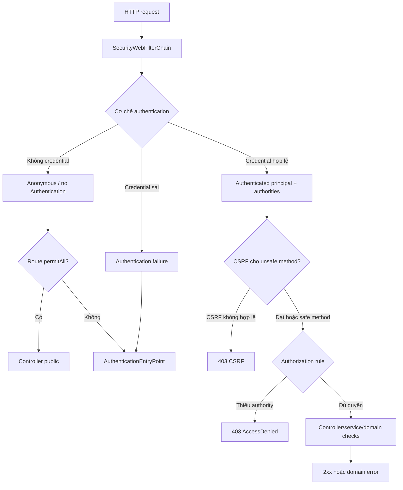

# Ma trận kiểm thử điểm công khai, chưa xác thực, thiếu quyền và đủ quyền trong Spring Security Reactive

## 1. Mục tiêu bài học

Khi triển khai **Spring WebFlux + Spring Security**, một test “user admin mở được trang admin” là chưa đủ. Ứng dụng có thể vẫn lộ dữ liệu qua route public nhầm, chấp nhận một request **chưa xác thực**, hoặc coi “đã đăng nhập” là “có mọi quyền”.

Để kiểm tra có hệ thống, hãy xây **ma trận kiểm thử bảo mật HTTP** (*HTTP security test matrix*) theo hai chiều:

1. **Trạng thái của người gọi**: guest/anonymous (không gửi thông tin xác thực), credentials sai, đã authenticated nhưng thiếu authority, đã authenticated và đủ authority.
2. **Yêu cầu của endpoint**: public (permitAll), chỉ cần login, yêu cầu role/scope cụ thể, thay đổi dữ liệu cần CSRF, hoặc route chưa được đưa vào allowlist.

Các kết quả cốt lõi cần chứng minh:

- **Public endpoint**: guest truy cập được, ví dụ HTTP 200.
- **Protected endpoint + chưa xác thực**: thường **401 Unauthorized** nếu API dùng Basic/Bearer, hoặc **302 redirect login** nếu dùng form login; phải assert theo cơ chế authentication thực tế.
- **Authenticated + thiếu quyền**: **403 Forbidden** trong flow API được cấu hình phù hợp.
- **Authenticated + đủ quyền**: **2xx**, với **body và hiệu ứng nghiệp vụ chính xác**, không chỉ “không báo lỗi”.
- **HTTP method và CSRF**: request POST có thể bị **403 bởi CSRF** trước khi kiểm tra quyền; cần chuẩn bị token CSRF đúng khi muốn đo riêng role.
- **Unknown route, method, tenant hoặc resource**: phải theo chính sách explicit deny/404, không được vô tình public.

Bài này dùng một **ứng dụng Java 17+ chạy Spring Boot 3.x, Spring Security 6.x, WebFlux**, một `SecurityWebFilterChain` khai báo routes, user database in-memory có password hash và **`WebTestClient`** tích hợp `spring-security-test`. Nó trình bày test thật qua HTTP Basic và test phân quyền bằng `mockUser()`, cách test CSRF, mở rộng cho JWT và method security, các lỗi giả dương/giả âm, cùng checklist áp dụng ở CI.

> **Phạm vi:** kiểm thử **HTTP endpoints** trong **Spring Security Reactive**, không dùng `MockMvc`, Servlet `HttpSecurity` hay `MockHttpServletRequest`. Với WebFlux, dùng `ServerHttpSecurity`, `SecurityWebFilterChain`, `WebTestClient`, `SecurityMockServerConfigurers` và Reactor Context. Các ví dụ Java có thể biên dịch trong project Spring Boot 3.x được trình bày; những snippet mở rộng được đánh dấu rõ khi không phải chương trình độc lập.

## 2. Bốn trạng thái không thể đánh đồng

| Trạng thái người gọi | Có credential? | Có `Authentication` trusted? | Kết quả trên protected route |
| --- | --- | --- | --- |
| **Anonymous/guest** | Không | Không | Thường 401 / login redirect |
| **Credentials không hợp lệ** | Có nhưng sai, hết hạn hoặc không được tin | Không | Thường 401; không được “fallback” thành một user hợp lệ |
| **Authenticated, thiếu quyền** | Có và đã xác minh | Có, nhưng authority không đủ | Thường 403 |
| **Authenticated, đủ quyền** | Có và đã xác minh | Có, đủ authority và điều kiện nghiệp vụ | 2xx theo hợp đồng endpoint |

**Authentication** trả lời *ai đang gọi?*; **authorization** trả lời *người này có được làm thao tác này trên tài nguyên này không?*

Ví dụ: user có `ROLE_VIEWER` được đọc báo cáo, nhưng không thể tạo báo cáo nếu route đòi `ROLE_EDITOR`. User có `ROLE_ADMIN` chưa chắc được đọc báo cáo của tenant khác; phân quyền ở route không thay **object-level authorization**.

**Bẫy thường gặp:** một test anonymous bị 401 khi gọi `/api/admin` **không chứng minh** có rule `hasRole("ADMIN")`. Route chỉ cấu hình `.authenticated()` cũng cho anonymous 401. Cần thêm test một user **đã login nhưng thiếu role** được 403 và user admin được 200.

## 3. Ma trận mẫu: route, HTTP method và người gọi

Ta sẽ bảo vệ API:

| Endpoint/method | Chính sách | Guest | Viewer | Editor | Admin |
| --- | --- | --- | --- | --- | --- |
| `GET /public/ping` | `permitAll` | **200** | 200 | 200 | 200 |
| `GET /api/me` | `authenticated` | **401** | **200** | 200 | 200 |
| `GET /api/reports` | `hasRole("VIEWER")` | **401** | **200** | 200 | 200 |
| `POST /api/reports` (CSRF hợp lệ) | `hasRole("EDITOR")` | **401** | **403** | **201** | 201 |
| `POST /api/reports` (thiếu CSRF) | CSRF filter chặn | **403** có thể trước authentication | **403** | **403** | **403** |
| `GET /api/admin` | `hasRole("ADMIN")` | **401** | **403** | **403** | **200** |
| `GET /not-allowed` | `denyAll` | 401 hoặc handler/entry point theo chain | **403** | **403** | **403** |

Giả định roles:

- `viewer` → `ROLE_VIEWER`.
- `editor` → `ROLE_VIEWER`, `ROLE_EDITOR`.
- `admin` → `ROLE_VIEWER`, `ROLE_EDITOR`, `ROLE_ADMIN`.

Phân nhóm tăng dần này chỉ để làm ma trận demo; **không mặc định mọi tổ chức phải có “admin bao gồm mọi role”**. Trong production, gán authorities theo nguyên tắc ít quyền nhất.

### Ma trận theo dimension, không chỉ theo URL

Ít nhất nên xét bảy chiều:

1. HTTP **method**: GET/POST/PUT/PATCH/DELETE, đôi khi HEAD/OPTIONS.
2. **Path và pattern**: public, private, admin, unknown, trailing slash, biến route.
3. **Principal**: anonymous, wrong credentials, authenticated viewer/editor/admin.
4. **Authorities**: đúng role, thiếu role, scope khác, role trùng prefix.
5. **CSRF và browser credentials**: unsafe method có hay không có CSRF token, session/cookie.
6. **Object ownership/tenant**: cùng role nhưng tài nguyên thuộc user/tenant khác.
7. **Authentication mechanism**: HTTP Basic, form login, OAuth2 JWT; 401, redirect và headers khác nhau.

Không cần tạo toàn bộ tích Descartes của mọi chiều nếu quá lớn; cần bao phủ **mỗi security rule** ít nhất một positive và một negative case, thêm **boundary cases** và những branch có rủi ro cao.

## 4. HTTP 401, 403, 302 và 404: đừng đoán một cách máy móc

### 4.1. 401 Unauthorized

Khi request vào route yêu cầu authentication nhưng không có credential hoặc credential không thể xác minh, một API HTTP Basic/Bearer thường trả:

```http
HTTP/1.1 401 Unauthorized
WWW-Authenticate: Basic realm="Realm"
```

hoặc:

```http
HTTP/1.1 401 Unauthorized
WWW-Authenticate: Bearer
```

`WWW-Authenticate` là challenge; **không nên chỉ assert status mà bỏ header** nếu API có hợp đồng với client/SDK. Với JWT không hợp lệ, Bearer challenge có thể thêm `error="invalid_token"`; với thiếu token, thường chỉ là `Bearer`.

Trong **form login**, anonymous truy cập trang protected có thể được **302** tới trang login, không phải 401. Nếu test cứng `401` cho cả Basic và form login, sẽ có false failures.

### 4.2. 403 Forbidden

Một user **đã authenticated** nhưng không có role/authority phù hợp thường nhận 403. Với HTTP Basic demo, viewer được 200 ở `/api/me` rồi 403 ở `/api/admin`. Hai assertion này kết hợp mới chứng minh viewer có authentication hợp lệ và authorization không cho phép.

`403` cũng có thể xuất hiện **trước** authorization nếu CSRF filter từ chối một POST thiếu token. Vì vậy, khi test **thiếu `ROLE_EDITOR`**, phải thêm **CSRF token hợp lệ** vào request POST để cô lập lý do từ chối. Ngược lại, khi test CSRF, phải dùng user đủ quyền để chắc chắn chỉ thiếu CSRF là nguyên nhân.

### 4.3. 404 Not Found

Nếu route không tồn tại, MVC/WebFlux có thể trả 404 **sau khi** security cho phép request đi vào route layer. Nhưng một `anyExchange().denyAll()` có thể trả 403 trước cả route lookup. Do đó, **không dùng 404 làm kết luận duy nhất rằng route đã được bảo vệ**. Trong bài, unknown route được policy denyAll chặn; user admin vẫn không được tự vào URL chưa allowlist.

Đối với object-level authorization, một API đôi khi chọn 404 thay 403 để giảm khả năng suy đoán sự tồn tại của resource. Đây là **hợp đồng sản phẩm**, cần test nhất quán và tránh lộ dữ liệu qua body/timing.

### 4.4. 2xx không phải bằng chứng đủ nếu body sai

Status 200 với data của tenant khác là lỗi bảo mật nghiêm trọng. Positive tests nên assert **danh tính, authority tác động, ID resource, dữ liệu nghiệp vụ** và nếu có write thì assert side effect theo contract. Đừng chỉ `.expectStatus().isOk()` rồi dừng.

## 5. Luồng xử lý của WebFlux Security



Sơ đồ là mô hình khái niệm, **không hứa thứ tự mọi WebFilter trong mọi configuration y hệt**; xử lý CSRF có thể xảy ra trước authentication/authorization cho một request cụ thể. Lấy case POST thiếu CSRF làm ví dụ: nếu muốn đo thiếu credentials/role, cấp CSRF token trước; nếu muốn đo CSRF, giữ credentials/role đúng để loại biến nhiễu.

Các thành phần:

- `ServerHttpSecurity.authorizeExchange(...)`: khai báo route/path/method rules.
- `SecurityWebFilterChain`: chạy trong WebFlux filter chain.
- `ReactiveAuthenticationManager` / `ReactiveUserDetailsService`: xác minh HTTP Basic credentials, tạo `Authentication`.
- `ReactiveSecurityContextHolder`: đọc identity trong reactive controller/service.
- `SecurityMockServerConfigurers.springSecurity()`: tích hợp security filters với `WebTestClient` bind vào ApplicationContext.
- `SecurityMockServerConfigurers.mockUser()`: giả lập một user để test authorization; không kiểm tra password.
- `SecurityMockServerConfigurers.csrf()`: cung cấp CSRF token trong WebTestClient khi test unsafe methods.
- `SecurityMockServerConfigurers.mockJwt()`: giả lập JWT-authenticated request khi kiểm thử OAuth2 Resource Server.
- `@WithMockUser`: cách khác để tạo principal cho tests, nhưng với `WebTestClient` per-request, `mutateWith(mockUser())` làm ma trận rõ ràng hơn.

## 6. Dự án Java 17+ chạy được

Ta tạo một ứng dụng **Spring Boot 3.5 / Spring Security 6.x / WebFlux** dùng **HTTP Basic** để phân biệt rõ 401, 403, 200, 201; với form login/OIDC/JWT sẽ cần điều chỉnh expectations. Tài khoản lưu trong `MapReactiveUserDetailsService` với mật khẩu được **hash**. Các routes là demo, không có database hoặc secrets production.

Cấu trúc:

```text
http-security-matrix/
  settings.gradle
  build.gradle
  src/main/java/demo/httpmatrix/
    HttpMatrixApplication.java
    SecurityConfig.java
    MatrixController.java
  src/test/java/demo/httpmatrix/
    RealBasicHttpMatrixTest.java
    MockUserAuthorizationMatrixTest.java
```

### 6.1. `settings.gradle`

```groovy
rootProject.name = 'http-security-matrix'
```

### 6.2. `build.gradle`

```groovy
plugins {
    id 'java'
    id 'org.springframework.boot' version '3.5.0'
    id 'io.spring.dependency-management' version '1.1.7'
}

group = 'demo'
version = '0.0.1-SNAPSHOT'

java {
    toolchain {
        languageVersion = JavaLanguageVersion.of(17)
    }
}

repositories {
    mavenCentral()
}

dependencies {
    implementation 'org.springframework.boot:spring-boot-starter-webflux'
    implementation 'org.springframework.boot:spring-boot-starter-security'

    testImplementation 'org.springframework.boot:spring-boot-starter-test'
    testImplementation 'org.springframework.security:spring-security-test'
    testImplementation 'io.projectreactor:reactor-test'
}

tasks.named('test') {
    useJUnitPlatform()
}
```

Spring Boot BOM quản lý phiên bản Spring Framework, Spring Security và Reactor. Không thêm `spring-boot-starter-web` (Servlet/MVC) vào ví dụ này. `WebTestClient` nằm trong Spring WebFlux test support; `mockUser()` và `csrf()` nằm trong `spring-security-test`. `StepVerifier` thuộc `reactor-test` để test dịch vụ reactive ngoài HTTP.

### 6.3. `src/main/java/demo/httpmatrix/HttpMatrixApplication.java`

```java
package demo.httpmatrix;

import org.springframework.boot.SpringApplication;
import org.springframework.boot.autoconfigure.SpringBootApplication;

@SpringBootApplication
public class HttpMatrixApplication {
    public static void main(String[] args) {
        SpringApplication.run(HttpMatrixApplication.class, args);
    }
}
```

### 6.4. `src/main/java/demo/httpmatrix/SecurityConfig.java`

```java
package demo.httpmatrix;

import org.springframework.context.annotation.Bean;
import org.springframework.context.annotation.Configuration;
import org.springframework.http.HttpMethod;
import org.springframework.security.config.Customizer;
import org.springframework.security.config.annotation.web.reactive.EnableWebFluxSecurity;
import org.springframework.security.config.web.server.ServerHttpSecurity;
import org.springframework.security.core.userdetails.MapReactiveUserDetailsService;
import org.springframework.security.core.userdetails.User;
import org.springframework.security.core.userdetails.UserDetails;
import org.springframework.security.crypto.factory.PasswordEncoderFactories;
import org.springframework.security.crypto.password.PasswordEncoder;
import org.springframework.security.web.server.SecurityWebFilterChain;
import org.springframework.security.web.server.context
    .NoOpServerSecurityContextRepository;

@Configuration
@EnableWebFluxSecurity
public class SecurityConfig {

    @Bean
    PasswordEncoder passwordEncoder() {
        return PasswordEncoderFactories.createDelegatingPasswordEncoder();
    }

    @Bean
    MapReactiveUserDetailsService users(PasswordEncoder encoder) {
        UserDetails viewer = User.withUsername("viewer")
            .password(encoder.encode("viewer-pass"))
            .roles("VIEWER")
            .build();

        UserDetails editor = User.withUsername("editor")
            .password(encoder.encode("editor-pass"))
            .roles("VIEWER", "EDITOR")
            .build();

        UserDetails admin = User.withUsername("admin")
            .password(encoder.encode("admin-pass"))
            .roles("VIEWER", "EDITOR", "ADMIN")
            .build();

        return new MapReactiveUserDetailsService(viewer, editor, admin);
    }

    @Bean
    SecurityWebFilterChain springSecurityFilterChain(ServerHttpSecurity http) {
        return http
            .securityContextRepository(
                NoOpServerSecurityContextRepository.getInstance())
            .authorizeExchange(ex -> ex
                // Specific rules trước, catch-all sau.
                .pathMatchers(HttpMethod.GET, "/public/ping").permitAll()
                .pathMatchers(HttpMethod.GET, "/api/me")
                    .authenticated()
                .pathMatchers(HttpMethod.GET, "/api/reports")
                    .hasRole("VIEWER")
                .pathMatchers(HttpMethod.POST, "/api/reports")
                    .hasRole("EDITOR")
                .pathMatchers(HttpMethod.GET, "/api/admin")
                    .hasRole("ADMIN")
                .anyExchange().denyAll())
            .httpBasic(Customizer.withDefaults())
            .formLogin(form -> form.disable())
            // Không disable CSRF: chủ động kiểm tra POST có/không CSRF.
            .build();
    }
}
```

**Vì sao cấu hình này phục vụ kiểm thử ma trận?**

- Rule `GET /public/ping` `permitAll()` đứng đầu, nhưng **chỉ** GET công khai; POST cùng path không tự được phép.
- `GET /api/me` chỉ cần `authenticated()`, không cần role cụ thể.
- `GET /api/reports` yêu cầu `ROLE_VIEWER` (do `hasRole("VIEWER")` tự dùng prefix `ROLE_`).
- `POST /api/reports` yêu cầu `ROLE_EDITOR` **và** CSRF token hợp lệ vì CSRF mặc định được bật.
- `GET /api/admin` yêu cầu `ROLE_ADMIN`.
- `.anyExchange().denyAll()` chặn những routes/methods chưa nằm trong allowlist, kể cả với admin nếu không có override riêng.
- `NoOpServerSecurityContextRepository` tránh lưu session authentication; HTTP Basic được gửi ở mỗi request protected, controller vẫn đọc principal từ Reactor Context cho request hiện tại.
- `.formLogin(...disable())` ngăn browser redirect sang login HTML khi API muốn HTTP Basic challenge.
- Mật khẩu demo dùng `DelegatingPasswordEncoder` có `{bcrypt}` prefix; không lưu plaintext password trong `MapReactiveUserDetailsService`.
- **Giữ CSRF** vì HTTP Basic được browser có thể tự gửi trong những ngữ cảnh nhất định; nếu ứng dụng có cookie credentials cũng cần threat model CSRF. Không tắt CSRF chỉ để POST test đỡ phiền.

**Lưu ý:** HTTP Basic Base64 **không phải mã hóa bảo mật**. Không dùng Basic qua HTTP mạng công cộng, không hardcode demo credentials trong sản phẩm thật. Ở đây dùng localhost/test client để có một cơ chế kiểm chứng password rõ ràng, không cần IdP.

### 6.5. `src/main/java/demo/httpmatrix/MatrixController.java`

```java
package demo.httpmatrix;

import java.util.List;
import java.util.Map;

import org.springframework.http.HttpStatus;
import org.springframework.http.ResponseEntity;
import org.springframework.security.core.GrantedAuthority;
import org.springframework.security.core.context.ReactiveSecurityContextHolder;
import org.springframework.web.bind.annotation.GetMapping;
import org.springframework.web.bind.annotation.PostMapping;
import org.springframework.web.bind.annotation.RequestBody;
import org.springframework.web.bind.annotation.RestController;
import reactor.core.publisher.Mono;

@RestController
public class MatrixController {

    public record NewReport(String title) {}

    @GetMapping("/public/ping")
    public Mono<Map<String, String>> ping() {
        return Mono.just(Map.of("status", "PONG"));
    }

    @GetMapping("/api/me")
    public Mono<Map<String, Object>> me() {
        return ReactiveSecurityContextHolder.getContext()
            .map(ctx -> Map.<String, Object>of(
                "username", ctx.getAuthentication().getName(),
                "authorities",
                ctx.getAuthentication().getAuthorities().stream()
                    .map(GrantedAuthority::getAuthority)
                    .sorted()
                    .toList()));
    }

    @GetMapping("/api/reports")
    public Mono<List<Map<String, String>>> reports() {
        return Mono.just(List.of(
            Map.of("id", "r-101", "title", "Quarterly")));
    }

    @PostMapping("/api/reports")
    public Mono<ResponseEntity<Map<String, String>>> createReport(
            @RequestBody Mono<NewReport> request) {

        // Demo không ghi DB; thực tế test cần kiểm tra side effects.
        return request.map(value ->
            ResponseEntity.status(HttpStatus.CREATED)
                .body(Map.of(
                    "id", "r-new",
                    "title", value.title())));
    }

    @GetMapping("/api/admin")
    public Mono<Map<String, String>> admin() {
        return Mono.just(Map.of("status", "ADMIN_OK"));
    }
}
```

`ReactiveSecurityContextHolder` dùng Reactor Context chứ không giả định `SecurityContextHolder` ThreadLocal của Servlet. Positive test ở `/api/me` kiểm tra identity và authorities thật, không chỉ HTTP status.

Các methods trả `Mono` để giữ WebFlux flow. Controller **không tự kiểm tra roles bằng cách đọc query/header do người dùng đưa**; `SecurityWebFilterChain` xử lý route-level authorization trước. Trong ứng dụng thực, service vẫn phải có object/tenant-level authorization.

### 6.6. Chạy thử thủ công

Từ project có Gradle wrapper phù hợp Spring Boot 3.x:

```bash
# Linux/macOS
./gradlew bootRun

# Windows
gradlew.bat bootRun
```

Thử các requests:

```bash
# Public: 200.
curl -i http://localhost:8080/public/ping

# Anonymous protected: 401 + Basic challenge.
curl -i http://localhost:8080/api/me

# Credentials sai: 401.
curl -i -u viewer:wrong http://localhost:8080/api/reports

# Viewer đủ quyền GET reports: 200.
curl -i -u viewer:viewer-pass http://localhost:8080/api/reports

# Viewer thiếu quyền admin: 403.
curl -i -u viewer:viewer-pass http://localhost:8080/api/admin

# Admin đủ quyền admin: 200.
curl -i -u admin:admin-pass http://localhost:8080/api/admin

# POST không có CSRF: 403 dù editor đúng credential.
curl -i -u editor:editor-pass \
  -H 'Content-Type: application/json' \
  -d '{"title":"Monthly"}' \
  http://localhost:8080/api/reports
```

**Không thể dùng curl POST thông thường mà không tạo CSRF token hợp lệ rồi kỳ vọng 201** khi server bật CSRF. Bộ test `WebTestClient` bên dưới thêm CSRF token bằng `mutateWith(csrf())`. Để thử qua browser thật, cần CSRF token repository/cookie/form integration phù hợp, không tắt filter chỉ để thấy POST thành công.

## 7. Tích hợp Spring Security với `WebTestClient`

Khi test WebFlux `ApplicationContext` mà không mở network port thật, Spring Security khuyên dùng:

```java
WebTestClient.bindToApplicationContext(context)
    .apply(springSecurity())
    .configureClient()
    .build();
```

Đây là cách test **WebFlux request pipeline** với Security WebFilters thật, không cần Netty server bind một port. Nó nhanh, lặp lại được và phù hợp kiểm tra route policy, authentication manager, CSRF.

Từ Spring Security Test:

```java
import static org.springframework.security.test.web.reactive.server
    .SecurityMockServerConfigurers.springSecurity;

import static org.springframework.security.test.web.reactive.server
    .SecurityMockServerConfigurers.mockUser;

import static org.springframework.security.test.web.reactive.server
    .SecurityMockServerConfigurers.csrf;
```

Phân biệt:

- `springSecurity()` — gắn Spring Security filter support vào WebTestClient.
- `mockUser()` — chèn `Authentication` giả vào **một request**; không xác minh HTTP Basic password.
- `csrf()` — mô phỏng CSRF token hợp lệ cho **một request**.
- `@SpringBootTest` — tạo context đầy đủ; test có thể tự tạo WebTestClient bằng `bindToApplicationContext`.
- `@AutoConfigureWebTestClient` — một phương án khác để inject client trong Boot test; **không bắt buộc** khi ta xây thủ công như ở bài này.

**Không dùng `MockMvc` với WebFlux.** API test Selenium/Playwright không phù hợp để chỉ kiểm tra security filter unit/integration nhanh; browser end-to-end bổ sung sau khi security contract đã có tests.

## 8. Integration test 1: ma trận với HTTP Basic credentials thật

Tệp `src/test/java/demo/httpmatrix/RealBasicHttpMatrixTest.java`:

```java
package demo.httpmatrix;

import org.junit.jupiter.api.BeforeEach;
import org.junit.jupiter.api.Test;
import org.springframework.beans.factory.annotation.Autowired;
import org.springframework.boot.test.context.SpringBootTest;
import org.springframework.context.ApplicationContext;
import org.springframework.http.HttpHeaders;
import org.springframework.http.MediaType;
import org.springframework.test.web.reactive.server.WebTestClient;

import static org.junit.jupiter.api.Assertions.assertTrue;
import static org.springframework.security.test.web.reactive.server
    .SecurityMockServerConfigurers.springSecurity;
import static org.springframework.security.test.web.reactive.server
    .SecurityMockServerConfigurers.csrf;

@SpringBootTest
class RealBasicHttpMatrixTest {

    @Autowired
    ApplicationContext context;

    WebTestClient client;

    @BeforeEach
    void setUp() {
        client = WebTestClient.bindToApplicationContext(context)
            .apply(springSecurity())
            .configureClient()
            .build();
    }

    @Test
    void publicEndpointAllowsAnonymous() {
        client.get().uri("/public/ping")
            .exchange()
            .expectStatus().isOk()
            .expectBody()
            .jsonPath("$.status").isEqualTo("PONG");
    }

    @Test
    void anonymousCannotReadProfile() {
        client.get().uri("/api/me")
            .exchange()
            .expectStatus().isUnauthorized()
            .expectHeader().value(HttpHeaders.WWW_AUTHENTICATE,
                header -> assertTrue(header.startsWith("Basic")));
    }

    @Test
    void anonymousCannotReadReports() {
        client.get().uri("/api/reports")
            .exchange()
            .expectStatus().isUnauthorized();
    }

    @Test
    void invalidPasswordCannotReadReports() {
        client.get().uri("/api/reports")
            .headers(h -> h.setBasicAuth("viewer", "wrong"))
            .exchange()
            .expectStatus().isUnauthorized();
    }

    @Test
    void viewerCanReadOwnAuthentication() {
        client.get().uri("/api/me")
            .headers(h -> h.setBasicAuth("viewer", "viewer-pass"))
            .exchange()
            .expectStatus().isOk()
            .expectBody()
            .jsonPath("$.username").isEqualTo("viewer")
            .jsonPath("$.authorities[0]")
                .isEqualTo("ROLE_VIEWER");
    }

    @Test
    void viewerCanReadReports() {
        client.get().uri("/api/reports")
            .headers(h -> h.setBasicAuth("viewer", "viewer-pass"))
            .exchange()
            .expectStatus().isOk()
            .expectBody()
            .jsonPath("$[0].id").isEqualTo("r-101")
            .jsonPath("$[0].title").isEqualTo("Quarterly");
    }

    @Test
    void viewerCannotReadAdmin() {
        client.get().uri("/api/admin")
            .headers(h -> h.setBasicAuth("viewer", "viewer-pass"))
            .exchange()
            .expectStatus().isForbidden();
    }

    @Test
    void editorCannotReadAdmin() {
        client.get().uri("/api/admin")
            .headers(h -> h.setBasicAuth("editor", "editor-pass"))
            .exchange()
            .expectStatus().isForbidden();
    }

    @Test
    void adminCanReadAdmin() {
        client.get().uri("/api/admin")
            .headers(h -> h.setBasicAuth("admin", "admin-pass"))
            .exchange()
            .expectStatus().isOk()
            .expectBody()
            .jsonPath("$.status").isEqualTo("ADMIN_OK");
    }

    @Test
    void viewerCannotCreateReportEvenWithValidCsrf() {
        client.mutateWith(csrf())
            .post().uri("/api/reports")
            .headers(h -> h.setBasicAuth("viewer", "viewer-pass"))
            .contentType(MediaType.APPLICATION_JSON)
            .bodyValue("{\"title\":\"Monthly\"}")
            .exchange()
            .expectStatus().isForbidden();
    }

    @Test
    void anonymousCannotCreateReportEvenWithValidCsrf() {
        client.mutateWith(csrf())
            .post().uri("/api/reports")
            .contentType(MediaType.APPLICATION_JSON)
            .bodyValue("{\"title\":\"Monthly\"}")
            .exchange()
            .expectStatus().isUnauthorized();
    }

    @Test
    void editorCannotCreateReportWithoutCsrf() {
        client.post().uri("/api/reports")
            .headers(h -> h.setBasicAuth("editor", "editor-pass"))
            .contentType(MediaType.APPLICATION_JSON)
            .bodyValue("{\"title\":\"Monthly\"}")
            .exchange()
            .expectStatus().isForbidden();
    }

    @Test
    void editorCanCreateReportWithValidCsrf() {
        client.mutateWith(csrf())
            .post().uri("/api/reports")
            .headers(h -> h.setBasicAuth("editor", "editor-pass"))
            .contentType(MediaType.APPLICATION_JSON)
            .bodyValue("{\"title\":\"Monthly\"}")
            .exchange()
            .expectStatus().isCreated()
            .expectBody()
            .jsonPath("$.id").isEqualTo("r-new")
            .jsonPath("$.title").isEqualTo("Monthly");
    }

    @Test
    void adminCanCreateReportWithValidCsrf() {
        client.mutateWith(csrf())
            .post().uri("/api/reports")
            .headers(h -> h.setBasicAuth("admin", "admin-pass"))
            .contentType(MediaType.APPLICATION_JSON)
            .bodyValue("{\"title\":\"Admin Report\"}")
            .exchange()
            .expectStatus().isCreated()
            .expectBody()
            .jsonPath("$.title").isEqualTo("Admin Report");
    }

    @Test
    void authenticatedAdminCannotOpenUnknownRoute() {
        client.get().uri("/not-allowed")
            .headers(h -> h.setBasicAuth("admin", "admin-pass"))
            .exchange()
            .expectStatus().isForbidden();
    }

    @Test
    void unlistedMethodOnPublicPathIsNotPublic() {
        // POST này chưa được permitAll, và test có CSRF để cô lập
        // authorization. Guest vẫn phải bị từ chối.
        client.mutateWith(csrf())
            .post().uri("/public/ping")
            .exchange()
            .expectStatus().isUnauthorized();
    }
}
```

### 8.1. Vì sao dùng hai loại negative test?

- `invalidPasswordCannotReadReports()` gửi Basic credential thật nhưng sai, kiểm tra **authentication manager** thực sự từ chối, không phải chỉ gắn một user giả.
- `viewerCannotReadAdmin()` dùng Basic credential thật **hợp lệ**. Viewer đã có quyền đọc `/api/reports` nhưng không có `ROLE_ADMIN`, cho nên 403 là minh chứng authorization rule.
- `viewerCannotCreateReportEvenWithValidCsrf()` cấp CSRF đúng để thấy 403 do **thiếu role**, không phải thiếu CSRF.
- `editorCannotCreateReportWithoutCsrf()` dùng user đúng role nhưng bỏ CSRF để chứng minh **CSRF** hoạt động độc lập với roles.
- `authenticatedAdminCannotOpenUnknownRoute()` kiểm tra `.anyExchange().denyAll()` có hiệu lực.
- `unlistedMethodOnPublicPathIsNotPublic()` bảo đảm chỉ **GET** được permit, không vô tình công khai mọi method cùng URL.

### 8.2. Expected test results

Khi chạy trên project được cấu hình chính xác, các tests dự kiến cho HTTP statuses:

```text
GET  /public/ping, guest                  -> 200
GET  /api/me, guest                      -> 401 Basic challenge
GET  /api/reports, guest                 -> 401
GET  /api/reports, wrong password        -> 401
GET  /api/reports, viewer                -> 200
GET  /api/admin, viewer                 -> 403
GET  /api/admin, admin                  -> 200
POST /api/reports, viewer + valid CSRF   -> 403
POST /api/reports, editor no CSRF        -> 403
POST /api/reports, editor + valid CSRF   -> 201
GET  /not-allowed, admin                -> 403
```

Đây là **kỳ vọng theo cấu hình demo**, không phải log Gradle đã chạy. Security contract ở app production có thể khác (ví dụ JWT Bearer 401/403, form login 302, fallback 404 theo routing policy). Cần test đúng setup thật, không copy statuses trái mô hình.

## 9. Integration test 2: tách riêng authorization bằng `mockUser()`

Test Basic ở phần trên đã xác minh cả password và role. Khi policy phức tạp, **đăng nhập thật cho mọi test** có thể làm tests chậm và khó chẩn đoán. Spring Security Test cung cấp `mockUser()` để chèn user đã authenticated vào WebFlux request và tập trung kiểm tra authorization.

Tệp `src/test/java/demo/httpmatrix/MockUserAuthorizationMatrixTest.java`:

```java
package demo.httpmatrix;

import org.junit.jupiter.api.BeforeEach;
import org.junit.jupiter.api.Test;
import org.springframework.beans.factory.annotation.Autowired;
import org.springframework.boot.test.context.SpringBootTest;
import org.springframework.context.ApplicationContext;
import org.springframework.http.MediaType;
import org.springframework.test.web.reactive.server.WebTestClient;

import static org.springframework.security.test.web.reactive.server
    .SecurityMockServerConfigurers.springSecurity;
import static org.springframework.security.test.web.reactive.server
    .SecurityMockServerConfigurers.mockUser;
import static org.springframework.security.test.web.reactive.server
    .SecurityMockServerConfigurers.csrf;

@SpringBootTest
class MockUserAuthorizationMatrixTest {

    @Autowired
    ApplicationContext context;

    WebTestClient client;

    @BeforeEach
    void setUp() {
        client = WebTestClient.bindToApplicationContext(context)
            .apply(springSecurity())
            .configureClient()
            .build();
    }

    @Test
    void guestCanReadPublicEndpoint() {
        client.get().uri("/public/ping")
            .exchange()
            .expectStatus().isOk();
    }

    @Test
    void guestCannotReadProtectedEndpoint() {
        client.get().uri("/api/reports")
            .exchange()
            .expectStatus().isUnauthorized();
    }

    @Test
    void mockViewerHasViewerRoleOnly() {
        client.mutateWith(
                mockUser("alice").roles("VIEWER"))
            .get().uri("/api/me")
            .exchange()
            .expectStatus().isOk()
            .expectBody()
            .jsonPath("$.username").isEqualTo("alice")
            .jsonPath("$.authorities[0]")
                .isEqualTo("ROLE_VIEWER");
    }

    @Test
    void mockViewerCanReadReportsButNotAdmin() {
        client.mutateWith(
                mockUser("alice").roles("VIEWER"))
            .get().uri("/api/reports")
            .exchange()
            .expectStatus().isOk();

        client.mutateWith(
                mockUser("alice").roles("VIEWER"))
            .get().uri("/api/admin")
            .exchange()
            .expectStatus().isForbidden();
    }

    @Test
    void mockAdminCanReadAdmin() {
        client.mutateWith(
                mockUser("carol").roles("ADMIN"))
            .get().uri("/api/admin")
            .exchange()
            .expectStatus().isOk()
            .expectBody()
            .jsonPath("$.status").isEqualTo("ADMIN_OK");
    }

    @Test
    void mockEditorCannotPostWithoutCsrf() {
        client.mutateWith(
                mockUser("bob").roles("EDITOR"))
            .post().uri("/api/reports")
            .contentType(MediaType.APPLICATION_JSON)
            .bodyValue("{\"title\":\"Q4\"}")
            .exchange()
            .expectStatus().isForbidden();
    }

    @Test
    void mockEditorCanPostWithCsrf() {
        client.mutateWith(
                mockUser("bob").roles("EDITOR"))
            .mutateWith(csrf())
            .post().uri("/api/reports")
            .contentType(MediaType.APPLICATION_JSON)
            .bodyValue("{\"title\":\"Q4\"}")
            .exchange()
            .expectStatus().isCreated()
            .expectBody()
            .jsonPath("$.title").isEqualTo("Q4");
    }

    @Test
    void mockViewerCannotPostEvenWithCsrf() {
        client.mutateWith(
                mockUser("alice").roles("VIEWER"))
            .mutateWith(csrf())
            .post().uri("/api/reports")
            .contentType(MediaType.APPLICATION_JSON)
            .bodyValue("{\"title\":\"Q4\"}")
            .exchange()
            .expectStatus().isForbidden();
    }

    @Test
    void mockAdminStillCannotAccessUnknownRoute() {
        client.mutateWith(
                mockUser("carol").roles("ADMIN"))
            .get().uri("/not-allowed")
            .exchange()
            .expectStatus().isForbidden();
    }
}
```

### 9.1. `mockUser()` kiểm tra được và không kiểm tra được gì?

**Kiểm tra được:**

- `authorizeExchange` đã áp chính sách role/authority đúng chưa?
- Route public có cho guest không?
- Authenticated user có đến controller với tên/authorities mong đợi không?
- Role VIEWER bị từ chối ở admin route?
- POST vẫn cần CSRF khi role đúng?

**Không kiểm tra:**

- Password hash/`PasswordEncoder.matches` có hoạt động không.
- User store/JDBC/LDAP có trả roles thật và account status đúng không.
- HTTP Basic header có được parse và xác minh đúng không.
- JWT signature, issuer, audience, token expiry hoặc scope mapping từ decoder thật có hoạt động không.
- Session persistence, login redirect hay refresh token flow có đúng không.

Vì vậy **nên có cả hai tầng tests**: vài ca Basic hoặc token authentication **thật** để bảo đảm cơ chế xác thực, và nhiều ca `mockUser()`/`mockJwt()` để bao phủ các security rules.

### 9.2. Tránh “mock admin” che mất lỗi phân quyền

Nếu mọi test dùng `mockUser().roles("ADMIN", "EDITOR", "VIEWER")`, nhiều route trông có vẻ hoạt động nhưng không có negative role cases. Đừng dùng một user super-admin cho toàn bộ matrix. Với mỗi rule, có ít nhất:

- Guest → bị từ chối nếu protected.
- Authenticated thiếu đúng role → bị từ chối.
- Authenticated đủ đúng role → được phép.
- Với role hierarchy/tenant: có ca test chứng minh quyền **không** bị lan truyền ngoài policy.

## 10. CSRF: cách tách bạch lỗi thiếu token và lỗi thiếu quyền

CSRF mặc định được bật trong Spring Security WebFlux. Browser có thể tự gửi cookie/session hoặc HTTP Basic credentials, vì vậy một site khác có thể cố khiến browser gửi một request thay đổi dữ liệu. CSRF token là một yếu tố giúp giảm nguy cơ đó khi mô hình authentication dựa vào browser tự gửi credentials.

Với `WebTestClient`:

```java
// Đúng role, thiếu CSRF: kiểm tra CSRF bảo vệ POST.
client.mutateWith(mockUser().roles("EDITOR"))
    .post().uri("/api/reports")
    .bodyValue("{\"title\":\"Q4\"}")
    .exchange()
    .expectStatus().isForbidden();
```

```java
// Đúng role và CSRF: kiểm tra positive case.
client.mutateWith(mockUser().roles("EDITOR"))
    .mutateWith(csrf())
    .post().uri("/api/reports")
    .bodyValue("{\"title\":\"Q4\"}")
    .exchange()
    .expectStatus().isCreated();
```

```java
// Thiếu role nhưng CSRF hợp lệ: kiểm tra role policy.
client.mutateWith(mockUser().roles("VIEWER"))
    .mutateWith(csrf())
    .post().uri("/api/reports")
    .bodyValue("{\"title\":\"Q4\"}")
    .exchange()
    .expectStatus().isForbidden();
```

**Không nhầm ba ca trên.** Nếu chỉ viết một test viewer POST không có CSRF rồi thấy 403, chưa chứng minh VIEWER bị `hasRole("EDITOR")` từ chối: CSRF filter có thể dừng request trước.

**Một anonymous POST thiếu CSRF cũng có thể trả 403**, thay vì 401, tùy thứ tự filters. Khi muốn chứng minh anonymous authentication bị chặn, cung cấp CSRF token hợp lệ hoặc dùng GET protected. Khi muốn chứng minh CSRF được bật, dùng user đủ quyền và bỏ CSRF.

### Khi app là stateless Bearer API

Một Resource Server chỉ nhận `Authorization: Bearer ...` mà browser không tự gửi credentials có thể chọn tắt CSRF **sau đánh giá threat model**, nhưng không copy toàn bộ ma trận CSRF của demo Basic sang rồi coi 403 là lỗi. Nếu có session cookie/OAuth2 login kết hợp Bearer API trong cùng app, CSRF phải xét **theo các authentication flows**, thường nên tách `SecurityWebFilterChain` hoặc matcher.

### CSRF token thật khác test mutator

`mutateWith(csrf())` là tiện ích test để mô phỏng token hợp lệ. Nó **không chứng minh SPA/template thật đang gửi đúng cookie/header/hidden field**, không kiểm tra BREACH mitigation hoặc SameSite cookie strategy end-to-end. Thêm browser/HTTP integration tests thích hợp nếu sản phẩm có login form.

## 11. Thêm test contract theo HTTP method và fallback rules

Các security vulnerabilities thường đến từ các đường đi **không nằm trong những test happy-path chính**:

- GET `/public/ping` public nhưng POST cùng URL bị mở.
- GET `/api/reports` yêu cầu viewer, nhưng DELETE `/api/reports` không có security rule.
- `/api/admin` được bảo vệ nhưng `/api/admin/` hoặc `/api/admin/export` đi qua matcher khác.
- URL encoded/normalized path có matching khác ở proxy vs Spring gateway.
- `OPTIONS` preflight bị chặn gây lỗi CORS; sửa sai bằng permitAll mọi method của API.
- API có nhiều security chains: một route bị match vào chain lỏng hơn vì `@Order`/`securityMatcher`.
- Unknown route lộ object metadata/stack trace dù security trả 404.
- Method-level guard vô tình bị self-invocation bypass.

Với demo, `.anyExchange().denyAll()` chặn default tất cả chưa khai báo. Không assert “mọi unknown route phải 403” ở mọi app; security chain có thể chọn 404 nếu request qua authorization. Điều quan trọng là **không bất ngờ trả 2xx dữ liệu nhạy cảm** và policy đã được viết/kiểm tra.

### Một matrix cho GET/POST/DELETE

| Route/method | Guest | Viewer | Editor | Admin | Ghi chú |
| --- | --- | --- | --- | --- | --- |
| GET `/public/ping` | 200 | 200 | 200 | 200 | Public |
| POST `/public/ping` | 401 nếu CSRF đã hợp lệ | 403 | 403 | 403 | Không có handler/allowlist |
| GET `/api/reports` | 401 | 200 | 200 | 200 | VIEWER |
| POST `/api/reports` | 401 nếu CSRF đã hợp lệ | 403 | 201 | 201 | EDITOR + CSRF |
| DELETE `/api/reports` | Policy-dependent deny | 403 | 403 | 403 | Deny by default |
| GET `/api/admin` | 401 | 403 | 403 | 200 | ADMIN |

Với DELETE, nếu CSRF không được cấp, nó có thể bị chặn trước authorization; để kiểm tra fallback denyAll tách biệt, **cung cấp CSRF token hợp lệ**. Không test nhầm 403 CSRF thành bằng chứng route denied.

## 12. Mở rộng ma trận sang OAuth2 Resource Server JWT

Ứng dụng thực tế có thể không dùng Basic mà dùng **JWT Bearer**. Khi đó, cần thêm các trạng thái authentication:

- Không có Bearer header → thường **401** và `WWW-Authenticate: Bearer`.
- `Bearer` sai cú pháp → có thể **400 invalid_request** hoặc 401 tùy loại lỗi/handler.
- JWT sai chữ ký/issuer/audience, expired → thường **401 invalid_token**.
- JWT hợp lệ nhưng thiếu `SCOPE_reports.read` → thường **403 insufficient_scope**.
- JWT hợp lệ có đúng `SCOPE_reports.read` → 200 khi đúng resource/tenant.
- JWT có scope nhưng subject không sở hữu resource → 403/404 theo domain policy.

Nếu security config dùng:

```java
.oauth2ResourceServer(oauth2 -> oauth2
    .jwt(Customizer.withDefaults()))
```

và:

```java
.pathMatchers(HttpMethod.GET, "/api/reports")
    .hasAuthority("SCOPE_reports.read")
```

thì `hasAuthority("SCOPE_reports.read")` **khác** `hasRole("VIEWER")`. Mặc định `JwtGrantedAuthoritiesConverter` chuyển scopes từ `scope`/`scp` thành authorities có prefix `SCOPE_`.

### JWT authorization test bằng `mockJwt()`

Spring Security Reactive có test mutator:

```java
import static org.springframework.security.test.web.reactive.server
    .SecurityMockServerConfigurers.mockJwt;
```

Một **snippet riêng cho ứng dụng Resource Server**, không chạy nguyên trong demo Basic trừ khi bạn đổi security chain:

```java
// Valid authentication, thiếu scope:
client.mutateWith(mockJwt().jwt(
        jwt -> jwt.claim("scope", "profile")))
    .get().uri("/api/reports")
    .exchange()
    .expectStatus().isForbidden();
```

```java
// Đủ scope cho route reports:
client.mutateWith(mockJwt().jwt(
        jwt -> jwt.claim("scope", "reports.read")))
    .get().uri("/api/reports")
    .exchange()
    .expectStatus().isOk();
```

**Quan trọng:** `mockJwt()` bypass việc decode/verify JWT thật. Nó kiểm tra authorization rules và authority mapping trong test; không chứng minh signature, `iss`, `aud`, `exp`, JWKS hoặc token transport thật. Cần một bộ test với signed JWT và test JWK server/IdP để kiểm tra cryptographic validation và 401 `invalid_token`.

Không dùng ID token OIDC thay access token cho API. Không phân quyền chỉ bằng cách Base64 decode JWT payload mà bỏ signature/claim validation.

## 13. Mở rộng cho OAuth2 login, form login và session

Một API có **`oauth2Login()`** hoặc **`formLogin()`** có thể dùng cookie session. Khi guest vào protected route, kết quả có thể là redirect 302/303 tới login, không phải 401. Vì vậy cần **viết matrix theo authentication entry point** của ứng dụng:

| Cơ chế | Guest protected route | Authenticated thiếu role | Đủ role |
| --- | --- | --- | --- |
| HTTP Basic API | 401 + `WWW-Authenticate: Basic` | Thường 403 | 2xx |
| JWT Bearer API | 401 + Bearer challenge | Thường 403 | 2xx |
| Form login browser | Thường 302 tới login | Thường 403 hoặc access-denied page | 2xx |
| OAuth2/OIDC login | Thường redirect tới IdP/login selection | 403/policy denial | 2xx |
| Mixed chains | Phụ thuộc matcher/entry point | Phụ thuộc matched chain | Phụ thuộc matched chain |

Các tests session cần chú ý:

- Cookie session có được lưu/khôi phục không?
- Logout có xóa session authentication hay không?
- Remember-me hoặc session fixation policy có thay đổi identity?
- Redirect URI/`state`/CSRF khi OAuth2 login có được validate không?
- Session của user A có bị sử dụng cho user B trong concurrent WebTestClient tests không?
- Roles thay đổi sau login có được cập nhật theo cơ chế xác định không?

**Không lạm dụng `mockUser()`** để “test đã đăng nhập bằng OIDC”. `mockUser` tạo principal giả và bỏ qua redirect, ID token validation, cookie/session persistence; những bước đó cần integration test với IdP giả lập/test tenant.

## 14. Kiểm tra Spring Security matchers và thứ tự rules

Rule được duyệt theo thứ tự. Một cấu hình sai phổ biến:

```java
.authorizeExchange(ex -> ex
    .pathMatchers("/api/**").authenticated()
    .pathMatchers("/api/admin").hasRole("ADMIN")
    .anyExchange().denyAll())
```

Rule `/api/**` match trước `/api/admin`; vì vậy `hasRole("ADMIN")` có thể **không bao giờ được áp** cho admin path. Test anonymous `/api/admin` vẫn thấy 401 nên tưởng đã bảo vệ đúng, nhưng viewer authenticated có thể nhận 200.

Thứ tự đúng:

```java
.authorizeExchange(ex -> ex
    .pathMatchers("/public/**").permitAll()
    .pathMatchers("/api/admin").hasRole("ADMIN")
    .pathMatchers("/api/**").authenticated()
    .anyExchange().denyAll())
```

**Nhưng** mẫu này còn phải xem HTTP methods/CSRF; ví dụ `GET /api/admin` và `POST /api/admin` có thể cần rules khác nhau. Cấu hình demo chính dùng `pathMatchers(HttpMethod.X, ...)` để tránh mở tất cả methods cùng route.

### `hasRole` và `hasAuthority`

`hasRole("ADMIN")` thường yêu cầu `GrantedAuthority` có tên **`ROLE_ADMIN`**. `hasAuthority("ADMIN")` đòi đúng chuỗi `"ADMIN"` chứ không tự thêm prefix; `hasAuthority("SCOPE_reports.read")` thường dành cho OAuth2 scopes.

Tests phải dùng đúng namespace:

```java
mockUser("alice").roles("VIEWER")
```

tạo authority `ROLE_VIEWER`, trong khi:

```java
mockUser("alice").authorities(
    new SimpleGrantedAuthority("SCOPE_reports.read"))
```

tạo authority `SCOPE_reports.read`. Không gọi `roles("ROLE_VIEWER")` vì API `.roles(...)` thường tự thêm prefix, hoặc có validation không nhận chuỗi đã có prefix.

## 15. Test object ownership và multi-tenant sau ma trận route

Ma trận route là cần thiết nhưng chưa đủ cho authorization dạng **IDOR/BOLA**. Ví dụ:

```text
GET /api/reports/r-101  → chủ sở hữu Alice/tenant A
GET /api/reports/r-202  → chủ sở hữu Bob/tenant B
```

Ngay cả khi cả Alice và Bob đều có `ROLE_VIEWER`, API phải kiểm tra mỗi người chỉ đọc resource được phép.

Test cần có:

| Actor | Resource | Kỳ vọng |
| --- | --- | --- |
| Guest | `r-101` | 401/redirect |
| Alice có viewer | `r-101` thuộc Alice | 200 |
| Alice có viewer | `r-202` thuộc Bob | 403/404 theo policy |
| Bob có viewer | `r-202` thuộc Bob | 200 |
| Editor tenant A | Report tenant B | 403/404 nếu không được phép |
| Admin tenant A | Report tenant B | Chỉ được phép nếu policy định nghĩa cross-tenant |
| Invalid JWT/credential | Bất kỳ protected report | 401 |

**Không bổ sung endpoint này vào demo chính nếu chưa có data store/ownership enforcement**, vì một controller trả dữ liệu giả mà không kiểm tra owner sẽ tạo mẫu xấu. Trong sản phẩm, triển khai owner/tenant checks ở service, method security hoặc query có filter đúng, rồi test bằng data fixtures riêng và kiểm tra cả **status lẫn không có data leak**.

### Mối liên hệ giữa status và thông tin rò rỉ

Một API có thể chọn trả 404 thay 403 để không tiết lộ một report private có tồn tại hay không. Nhưng phải kiểm tra **cả message, body, timing, danh sách search, error logs phía client** tránh việc status 404 nhưng body lại chứa owner/title hoặc ID nhạy cảm.

## 16. Làm ma trận dễ duy trì ở CI

Nếu mọi endpoint được lặp lại theo nhiều roles, test suite có thể rất lớn. Tổ chức ma trận thành một **bộ trường hợp có chủ đích**:

1. Mỗi public route: guest success và không bị redirect.
2. Mỗi authenticated-only route: guest denial, một user hợp lệ success.
3. Mỗi role/scope route: guest denial, authenticated thiếu quyền denial, authorized success.
4. Mỗi unsafe method: đủ quyền + CSRF success, đủ quyền - CSRF denial, thiếu quyền + CSRF denial.
5. Mỗi fallback/unknown path: guest hoặc authenticated actor bị deny theo policy.
6. Mỗi domain resource nhạy cảm: owner success, non-owner same role denial, cross-tenant denial.
7. Mỗi authentication mechanism: bad credential/token failure và proper challenge/redirect.
8. Mỗi special case: logout, CORS preflight, 429/rate limit hoặc public asset route khi có.

### Không kiểm thử implementation text quá cứng

Nên assert:

- HTTP status, `WWW-Authenticate` khi có, redirect location nếu đó là contract.
- Response JSON keys/values nghiệp vụ không nhạy cảm.
- Các collection không chứa records của tenant khác.
- Không có side effect ở denied POST/DELETE.
- Token/secret không xuất hiện trong error body hoặc logs được kiểm tra trong test environment.

Hạn chế assert:

- Toàn bộ stack trace hoặc error message framework.
- Thứ tự fields trong JSON không có hợp đồng.
- Lỗi phát sinh do router không tìm thấy handler nhưng nhầm thành security denial.
- Thời gian chính xác đến mili giây của authentication/filter.
- Một role super-admin cho tất cả cases.
- `mockUser` cho mọi test rồi tưởng password/JWT validation đã được kiểm tra.

### Test data có tính xác định

Dùng fixture users với roles rõ ràng, dữ liệu test tách biệt và tránh global mutable state. Nếu suite chạy song song, không dùng một singleton counter rồi so sánh trước/sau mà không isolation. Nếu test chứa thao tác ghi DB, reset bằng test transaction/dataset rõ và xác minh rollback hoặc cleanup.

Khi thêm route mới, cập nhật bảng policy và negative tests; không cho route âm thầm đi qua `.anyExchange().authenticated()` nếu nghiệp vụ cần role cụ thể.

## 17. CORS và preflight: một trục test không được bỏ quên

Browser gửi `OPTIONS` preflight khi request cross-origin dùng header hoặc method không simple, ví dụ `Authorization` hoặc JSON POST. Nếu server/gateway chưa cấu hình CORS, browser có thể hiển thị “CORS error” dù backend trả 401/403 đúng security semantics. **Không sửa bằng cách tắt Security hoặc cho mọi origins/credentials.**

Cần test:

- Allowed origin có `Access-Control-Allow-Origin` đúng.
- Allowed methods/headers bao gồm những phần được phép (`Authorization`, `Content-Type`) theo contract.
- Credentialed browser request không đi cùng wildcard origin nếu cấu hình CORS cấm điều đó.
- Preflight được xử lý **trước khi** yêu cầu authentication phù hợp, không bị chặn sai vì thiếu Bearer token.
- Origin không được phép không nhận cross-origin access.
- HTTP 401/403 responses cũng có headers CORS phù hợp để client nhận được lỗi đúng.

Trong Spring WebFlux, cấu hình CORS qua `CorsWebFilter`, `CorsConfigurationSource` hoặc integration DSL phù hợp với version. Đừng copy code Servlet `CorsFilter` rồi mong WebFlux dùng đúng.

**CORS không phải authorization.** CORS hạn chế browser JavaScript đọc response từ origin khác; curl/native clients không chịu ràng buộc tương tự. Không dùng CORS làm cách bảo vệ tài nguyên thay authentication/authorization.

## 18. Kiểm thử theo `StepVerifier` và method security

HTTP matrix dùng `WebTestClient`, nhưng logic ở service có thể trả `Mono`/`Flux` và được bảo vệ bằng `@PreAuthorize`/`@PostAuthorize` khi bật:

```java
@EnableReactiveMethodSecurity
```

Ở unit tests service, có thể viết:

```java
StepVerifier.create(reportService.readPrivateReport("r-101"))
    .expectError(AccessDeniedException.class)
    .verify();
```

**Đây là snippet minh họa**, giả định `reportService`, proxy method security và Reactor Context đã được cấu hình đúng. Không chạy độc lập nếu chưa có implementation. Nếu service kiểm tra owner/tenant, test cần cung cấp user identity/claims bằng `ReactiveSecurityContextHolder.withAuthentication(...)` hoặc Spring Security Test support phù hợp.

**Mức độ kiểm thử:**

- HTTP route tests chứng minh WebFilter policy.
- Method-security tests chứng minh proxy/annotation được áp trong gọi thực, không bị `this.method()` self-invocation bypass.
- Domain service/data query tests chứng minh ownership, tenant filtering và side effects.
- Full integration tests chứng minh identity từ credential/token thật được chuyển thành authorities đúng.
- End-to-end browser tests chứng minh CSRF/session/redirect thật trong UI.

Không thay tất cả tầng bằng một test duy nhất vì mỗi tầng có những failure modes khác nhau.

## 19. Tại sao nhiều bài test bảo mật tưởng xanh nhưng vô giá trị?

### Sai lầm 1: Chỉ test positive case

Một user admin nhận 200 ở `/api/admin` không chứng minh viewer bị chặn. Cần negative case authenticated viewer → 403.

### Sai lầm 2: Chỉ test anonymous vào admin

Anonymous 401 vẫn có thể xảy ra nếu route chỉ `.authenticated()`. Test này không chứng minh `hasRole("ADMIN")`.

### Sai lầm 3: Test thiếu quyền bằng POST **thiếu CSRF**

Viewer nhận 403 do CSRF, không chứng minh viewer thiếu `ROLE_EDITOR`. Thêm `.mutateWith(csrf())`.

### Sai lầm 4: Test đủ quyền bằng `mockUser()` rồi kết luận Basic/JWT login chuẩn

`mockUser()` bypass password/token decoding. Cần một integration test với credential/token thật.

### Sai lầm 5: Dùng `MockMvc` hoặc Servlet `HttpSecurity` cho WebFlux

Security WebFilters/reactive context khác Servlet filters. Dùng `WebTestClient`, `springSecurity()` và `ServerHttpSecurity`.

### Sai lầm 6: Chỉ assert `expectError`/status 403 ở route không tồn tại

Một route bị 404 có thể do handler missing. Cần positive control với cùng route/user đủ quyền.

### Sai lầm 7: Quên HTTP method

GET public không đồng nghĩa POST public. Test method matchers và fallback `denyAll`.

### Sai lầm 8: Nhầm `ROLE_` với `SCOPE_`

JWT scope `reports.read` thường thành `SCOPE_reports.read`; `hasRole("VIEWER")` đòi `ROLE_VIEWER`. Không tự coi là một.

### Sai lầm 9: Cho `anyExchange().authenticated()` quá sớm

Matcher tổng quát đứng trước role-specific matcher có thể cấp quyền quá rộng. Test viewer vào admin để phát hiện.

### Sai lầm 10: Không test data leakage

Status 200 nhưng body chứa data của tenant khác là lỗi. Test ownership và body có dữ liệu được phép.

### Sai lầm 11: Tắt CSRF trên sản phẩm để test POST pass

Mẫu demo Basic để CSRF bật có chủ ý. Nếu muốn stateless bearer-only API, đánh giá riêng threat model; không dùng việc test lỗi như lý do tắt bảo vệ.

### Sai lầm 12: Tin mọi 401 đều là “token expired”

401 có thể do thiếu token, sai Basic password, issuer/audience/JWT signature hoặc config entry point. Phân loại theo scheme/challenge.

### Sai lầm 13: Quên kiểm tra fallback route

Route mới không thuộc allowlist có thể bị công khai nếu rule `permitAll` quá rộng. Cần negative fallback case.

### Sai lầm 14: Mock user quá mạnh

Nếu mock admin có mọi roles trong toàn bộ suite, lỗi thiếu rule phân quyền khó được phát hiện. Cần least-privilege fixtures.

### Sai lầm 15: Dùng test suite chỉ dựa vào status

Test cần xem body JSON, side effects, quyền trên object/tenant, headers, session/cookie và log secrets theo contract.

## 20. Quy trình phân tích khi một case fail

| Hiện tượng | Điều cần kiểm tra |
| --- | --- |
| Guest GET private trả 200 | Route policy thiếu `authenticated`, matcher public quá rộng |
| Viewer GET admin trả 200 | Role matcher bị bypass bởi rule rộng đứng trước |
| Admin GET admin trả 403 | User không có `ROLE_ADMIN`, security chain khác, role hierarchy/mapping sai |
| Guest GET private trả 302 thay 401 | Form/OIDC login entry point đang hoạt động |
| Guest POST protected trả 403 thay 401 | CSRF filter chặn trước authentication |
| Editor POST nhận 403 dù đủ role | Thiếu/không đúng CSRF token hoặc route rule sai |
| Viewer POST nhận 403 không có CSRF | Test không chứng minh thiếu role; cấp CSRF rồi thử lại |
| Test `mockUser` pass nhưng real Basic fail | Password encoder, user store, Basic filter hoặc credential mismatch |
| JWT mock pass nhưng JWT thật 401 | Signature/JWKS, `iss`, `aud`, `exp`, token type |
| GET `/api/reports` 404 khi test | Route/controller path/method sai, không phải security denial |
| Unknown path trả 403 với admin | `.anyExchange().denyAll()` chặn trước handler; đúng theo demo |
| HTTP status đúng nhưng response lộ token | Error serialization/logging/handler không sanitize |
| Browser báo CORS thay 401 | CORS preflight/header path, không tự tắt auth |
| Flaky tests khi chạy song song | State/session/DB fixture/counter dùng chung |
| Test phản hồi 200 nhưng data sai | Authorization ở service/query hoặc wrong tenant |
| Form login test giả 401 | Phải assert redirect/Location theo entry point |
| App có nhiều chains, test match sai chain | `securityMatcher`, `@Order`, HTTP method/path |

### Checklist debug nhanh

1. Kiểm tra **route/method** thật của request.
2. Kiểm tra đúng **`SecurityWebFilterChain`** được match.
3. Phân biệt guest, wrong credentials, authenticated viewer, authorized admin.
4. Xem CSRF/CORS trước khi kết luận 403 là do role.
5. Kiểm tra `ROLE_`/`SCOPE_` và nguồn authorities.
6. Với 401, xem `WWW-Authenticate`/login redirect và auth mechanism.
7. Với 2xx, kiểm tra response body + ownership/tenant/side effect.
8. Với unknown path, xác định policy denyAll hay route-level 404.
9. Thêm positive control cùng route và least-privileged negative case.
10. Không “chữa” test bằng cách tắt security, CSRF hoặc cho phép toàn bộ paths.

## 21. Checklist trước khi đưa security matrix vào CI

| Hạng mục | Điều kiện |
| --- | --- |
| Public | Guest nhận đúng 2xx và body hợp lệ |
| Private | Guest bị từ chối theo entry point |
| Wrong credentials | Không được authenticate, status/challenge đúng |
| Insufficient authority | Authenticated low-role bị 403 |
| Sufficient authority | User đúng role nhận đúng 2xx/body |
| Specific rules first | Admin rule không bị catch-all bypass |
| Method specificity | GET public không mở POST/DELETE |
| CSRF | Unsafe method có CSRF positive/negative riêng |
| JWT nếu có | Test missing/invalid token thật và scope mock riêng |
| Session/form nếu có | Redirect/login/logout/cookie/CSRF phù hợp |
| Unknown path | Denied hoặc 404 đúng policy, không lộ data |
| Object ownership | Same-role non-owner bị từ chối |
| Tenant isolation | Cross-tenant bị từ chối |
| Headers | WWW-Authenticate, Location, CORS nếu contract |
| Error response | Không lộ raw token, password, stack trace |
| Test layers | WebTestClient + service/DB + E2E thích hợp |
| Fixtures | Least-privilege roles và deterministic data |
| CI | Không phụ thuộc port cố định hay thứ tự tests |
| Regression | Mỗi route/rule mới có positive và negative case |
| Production | Không copy demo credentials, có TLS/secret management |

## 22. Câu hỏi tự kiểm tra

**1. Ma trận tối thiểu cho một route yêu cầu ADMIN gồm những ai?**  
Guest → denial, user authenticated không có `ROLE_ADMIN` → 403, user có `ROLE_ADMIN` → success. Bổ sung wrong credential nếu cần test authentication thực.

**2. Vì sao user anonymous bị 401 ở `/api/admin` chưa chứng minh role ADMIN đang được bảo vệ?**  
Vì `.authenticated()` cũng từ chối anonymous. Cần một viewer đã login nhưng thiếu role và một admin positive control.

**3. CSRF gây nhầm lẫn gì khi test POST?**  
Một POST thiếu CSRF có thể 403 **trước** role check. Khi test thiếu quyền, luôn cung cấp CSRF token hợp lệ để cô lập quyền.

**4. `mockUser()` có kiểm tra mật khẩu BCrypt không?**  
Không. Nó tạo authentication giả cho test; cần Basic/form/JWT integration test thật.

**5. `WebTestClient.bindToApplicationContext` cần gì để áp Spring Security filters?**  
Dùng `.apply(springSecurity())` trước `.configureClient().build()` trong Spring Security Test.

**6. `hasRole("VIEWER")` tương đương authority nào?**  
Mặc định là `ROLE_VIEWER`, không phải `VIEWER` hoặc `SCOPE_VIEWER`.

**7. Vì sao HTTP Basic thiếu credentials thường là 401, trong khi form login có thể 302?**  
Entry point của hai cơ chế khác nhau: Basic challenge cho client gửi credentials, form login redirect browser tới trang login.

**8. `anyExchange().denyAll()` giúp điều gì?**  
Không vô tình cho phép routes/methods mới chưa nằm trong allowlist; nhưng status có thể là 403 thay vì 404.

**9. Status 200 có chứng minh không có IDOR không?**  
Không. Phải kiểm tra nội dung và ownership/tenant của resource được trả.

**10. Khi dùng JWT Bearer, vì sao scope mock test không đủ?**  
`mockJwt()` không chứng minh signature/JWKS/issuer/audience/expiry validation. Cần signed-JWT test riêng.

**11. Khi WebFlux tests báo 403 ở POST dù đúng role, cần nhìn vào đâu đầu tiên?**  
CSRF token và method/path security matchers, trước khi thay đổi role.

**12. Tại sao không disable CSRF để chạy green hết các tests?**  
Vì đó là thay đổi policy bảo mật, có thể mở lỗ hổng với browser-managed credentials. Test phải đáp ứng security contract, không sửa contract để phù hợp test.

## Ghi nhớ

- **Ma trận HTTP bảo mật** cần đủ bốn trạng thái: public, chưa xác thực, đã xác thực thiếu quyền, đủ quyền.
- **401 khác 403**: Authentication thất bại/thiếu vs authorization từ chối; form login có thể trả redirect thay vì 401.
- **Thiếu quyền chỉ được chứng minh khi user đã authenticated**; phải có positive control cùng route với user đủ quyền.
- **CSRF là trục riêng của unsafe methods**: muốn test thiếu role ở POST, gửi CSRF token hợp lệ.
- Dùng **`WebTestClient` + `springSecurity()`** cho WebFlux, kết hợp real Basic/JWT integration và `mockUser()`/`mockJwt()` policy tests.
- Test **HTTP method, route ordering, fallback `denyAll`**, body, resource ownership và tenant isolation, không chỉ một status code.
- **`ROLE_` khác `SCOPE_`**, credential thật khác mock authentication, route authorization khác domain authorization.
- CI cần least-privilege fixtures, positive/negative tests, error/header checks và không làm yếu security config để tests pass.

### Nguồn tham khảo chính thức

- [Spring Security 6.5 — WebTestClient Security Setup](https://docs.spring.io/spring-security/reference/6.5/reactive/test/web/setup.html)
- [Spring Security 6.5 — Testing Authentication](https://docs.spring.io/spring-security/reference/6.5/reactive/test/web/authentication.html)
- [Spring Security 6.5 — Testing CSRF with WebTestClient](https://docs.spring.io/spring-security/reference/6.5/reactive/test/web/csrf.html)
- [Spring Security 6.5 — Testing OAuth2 with WebTestClient](https://docs.spring.io/spring-security/reference/6.5/reactive/test/web/oauth2.html)
- [Spring Security 6.5 — Reactive Authorize HTTP Requests](https://docs.spring.io/spring-security/reference/6.5/reactive/authorization/authorize-http-requests.html)
- [Spring Security 6.5 — CSRF Protection for WebFlux](https://docs.spring.io/spring-security/reference/6.5/reactive/exploits/csrf.html)
- [Spring Security 6.5 — Reactive Method Security](https://docs.spring.io/spring-security/reference/6.5/reactive/authorization/method.html)
- [Spring Framework 6.2 — WebTestClient](https://docs.spring.io/spring-framework/reference/testing/webtestclient.html)
- [Spring Boot 3.5 — Testing Spring Boot Applications](https://docs.spring.io/spring-boot/3.5/reference/testing/spring-boot-applications.html)
