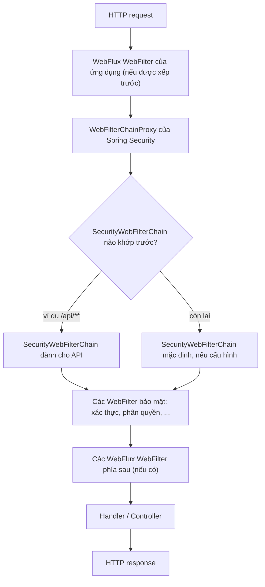

# Phân biệt WebFilter của ứng dụng và bộ lọc bên trong chuỗi bảo mật (Spring Security Reactive)

Trong **Spring WebFlux**, `WebFilter` là một giao diện xử lý yêu cầu HTTP theo dạng reactive. Spring Security cũng dùng các `WebFilter` để xác thực, phân quyền và bảo vệ yêu cầu, nhưng không phải mọi `WebFilter` đều được đăng ký tại cùng một nơi. Cần phân biệt **bộ lọc cấp ứng dụng** (tham gia chuỗi xử lý chung của WebFlux) với **bộ lọc nội bộ của một `SecurityWebFilterChain`** (chỉ chạy khi Spring Security chọn chuỗi bảo mật phù hợp).

Sự phân biệt này giúp trả lời các câu hỏi thường gặp: Vì sao một filter chạy với cả đường dẫn công khai? Vì sao filter bảo mật không chạy với một API? Vì sao thêm `@Component` lại khiến filter bị gọi hai lần? Vì sao `@Order` không thay thế được `SecurityWebFiltersOrder`?

## 1. Các thành phần và ranh giới cần hiểu

| Thành phần | Kiểu/API reactive | Vai trò |
| --- | --- | --- |
| WebFlux `WebFilter` | `org.springframework.web.server.WebFilter` | Một mắt xích của luồng xử lý HTTP, có phương thức `Mono<Void> filter(ServerWebExchange, WebFilterChain)` |
| `WebFilterChain` | `org.springframework.web.server.WebFilterChain` | Lời gọi `chain.filter(exchange)` để chuyển quyền cho mắt xích WebFlux kế tiếp |
| `WebFilterChainProxy` | `org.springframework.security.web.server.WebFilterChainProxy` | Một **`WebFilter`** của Spring Security đứng tại ranh giới WebFlux và các chuỗi bảo mật |
| `SecurityWebFilterChain` | `org.springframework.security.web.server.SecurityWebFilterChain` | Định nghĩa điều kiện khớp request và các WebFilter bảo mật cần thực thi |
| `ServerHttpSecurity` | `org.springframework.security.config.web.server.ServerHttpSecurity` | DSL tạo/cấu hình `SecurityWebFilterChain` |
| `SecurityWebFiltersOrder` | `org.springframework.security.config.web.server.SecurityWebFiltersOrder` | Các vị trí sắp thứ tự **bên trong** một chuỗi bảo mật |
| `ReactiveSecurityContextHolder` | `org.springframework.security.core.context.ReactiveSecurityContextHolder` | Truy cập `SecurityContext` bằng Reactor Context trong luồng reactive |

`SecurityWebFilterChain` **không đồng nghĩa** với `WebFilterChain`. Cái thứ nhất mô tả tập filter bảo mật có điều kiện áp dụng; cái thứ hai là cơ chế tiếp tục xử lý request của WebFlux. Các filter nằm *trong* `SecurityWebFilterChain` vẫn thường triển khai chính giao diện `WebFilter`, nhưng chúng được Spring Security điều phối theo một lớp lồng nhau.

### Hình dung chuỗi lồng nhau



Đây là mô hình khái niệm, không phải danh sách cố định của mọi filter: số lượng, thứ tự và hoạt động của filter bảo mật tùy cấu hình. Filter có thể **dừng** luồng bằng cách không gọi `chain.filter(exchange)`; khi đó các mắt xích phía sau (kể cả controller) có thể không chạy. Các `WebFilter` ứng dụng cũng có thể được xếp **sau** proxy, nên không được mặc định rằng tất cả chúng luôn chạy trước Spring Security.

## 2. WebFilter của ứng dụng là gì?

Một bộ lọc cấp ứng dụng thường được Spring phát hiện dưới dạng bean `WebFilter`, chẳng hạn một lớp `@Component` hoặc một `@Bean` trả về `WebFilter`. Nó tham gia **chuỗi WebFlux chung** và có thể áp dụng cho nhiều request, tùy điều kiện do chính filter đặt ra và vị trí trong chuỗi.

Các việc điển hình:

- Gắn request ID, quan sát thời gian xử lý, thống kê số request hoặc ghi log kỹ thuật.
- Chuẩn hóa metadata không liên quan đến quyết định quyền truy cập.
- Chặn nhanh request theo quy tắc hạ tầng chung nếu thật sự cần, với chính sách rõ ràng và không thay thế cơ chế bảo mật.

Ví dụ một filter ghi thời điểm bắt đầu/kết thúc:

```java
package demo.filters;

import org.springframework.core.Ordered;
import org.springframework.core.annotation.Order;
import org.springframework.stereotype.Component;
import org.springframework.web.server.ServerWebExchange;
import org.springframework.web.server.WebFilter;
import org.springframework.web.server.WebFilterChain;
import reactor.core.publisher.Mono;

@Component
@Order(Ordered.HIGHEST_PRECEDENCE)
public class RequestTraceWebFilter implements WebFilter {
    @Override
    public Mono<Void> filter(ServerWebExchange exchange, WebFilterChain chain) {
        String path = exchange.getRequest().getPath().value();

        return Mono.defer(() -> {
            System.out.println("APP enter " + path);
            return chain.filter(exchange)
                .doFinally(signal -> System.out.println(
                    "APP exit " + path + " (" + signal + ")"));
        });
    }
}
```

Lớp này có thể lưu dưới tên `RequestTraceWebFilter.java` trong dự án Spring Boot WebFlux đã có package `demo.filters`. `@Component` đưa nó vào danh sách bean WebFlux; `@Order` đặt mức ưu tiên của nó **trong thứ tự các WebFilter cấp ứng dụng**. `Mono.defer` hoãn tác dụng phụ đến lúc subscribe, còn `doFinally` giúp ghi dấu cả trường hợp hoàn thành, lỗi hoặc hủy.

Không nên dựa vào `doFinally` để thay đổi HTTP response vì response có thể đã được commit. Bộ lọc này cũng **không xác thực** ai đang gọi API, dù nó có thể quan sát một request mà Spring Security sẽ từ chối sau đó.

## 3. Bộ lọc bên trong SecurityWebFilterChain là gì?

Spring Security Reactive đưa một `WebFilterChainProxy` vào hạ tầng WebFlux. Proxy nhận request, tìm một `SecurityWebFilterChain` khớp với request và điều phối các `WebFilter` bảo mật của chuỗi được chọn.

Một `SecurityWebFilterChain` do `ServerHttpSecurity.build()` tạo ra có thể chứa các bước cho:

- Bảo vệ HTTP: security headers, CSRF, CORS hoặc chuyển hướng HTTPS, tùy cấu hình.
- Khôi phục/lưu security context và hỗ trợ xác thực.
- HTTP Basic, form login, OAuth2 Resource Server hoặc cơ chế khác nếu được bật.
- Xử lý ngoại lệ bảo mật, quyết định 401/403 và kiểm tra quyền (`authorizeExchange`).

**Không phải mọi filter ở danh sách trên đều luôn tồn tại**: chúng được bật/tắt và đặt vị trí theo cấu hình cụ thể. Việc `pathMatchers("/public/**").permitAll()` **không bỏ qua toàn bộ security chain**; nó chỉ cho phép yêu cầu ở khâu phân quyền, trong khi các filter bảo mật khác vẫn có thể chạy.

Muốn bổ sung logic **chỉ thuộc chuỗi bảo mật**, sử dụng các API của `ServerHttpSecurity`:

```java
// Đoạn minh họa nằm trong phương thức @Bean tạo SecurityWebFilterChain.
WebFilter securityOnly = (exchange, chain) -> {
    System.out.println("SECURITY path="
        + exchange.getRequest().getPath().value());
    return chain.filter(exchange);
};

return http
    .authorizeExchange(exchanges -> exchanges
        .pathMatchers("/public/**").permitAll()
        .anyExchange().authenticated())
    .httpBasic(org.springframework.security.config.Customizer.withDefaults())
    .addFilterBefore(securityOnly, SecurityWebFiltersOrder.AUTHORIZATION)
    .build();
```

`SecurityWebFiltersOrder.AUTHORIZATION` đánh dấu **vị trí** chèn filter tương đối với công đoạn phân quyền trong chuỗi bảo mật, không phải là một `@Order` toàn cục. Đoạn code trên giả định phương thức đã có `ServerHttpSecurity http` và import `WebFilter`, `SecurityWebFiltersOrder`, `SecurityWebFilterChain` tương ứng. Lưu ý filter minh họa **không thực hiện phân quyền**; nó chỉ cho biết một request đã đi đến vị trí đó.

Các phương thức `addFilterBefore`, `addFilterAfter`, `addFilterAt` đều là thao tác trên **SecurityWebFilterChain** đang được cấu hình. Nếu một cơ chế đã có DSL chuyên dụng (Basic, OAuth2, CORS, CSRF, authorization...), ưu tiên cấu hình qua DSL thay vì tự tái hiện toàn bộ hành vi bảo mật trong filter tùy biến.

## 4. So sánh nhanh ba loại thứ tự

| Cơ chế | Sắp xếp đối tượng nào? | Tác động thực tế |
| --- | --- | --- |
| `@Order` / `Ordered` trên **WebFilter ứng dụng** | Các WebFilter tham gia chuỗi WebFlux chung | Ảnh hưởng vị trí tương đối giữa filter ứng dụng và proxy bảo mật |
| `@Order` trên bean **SecurityWebFilterChain** | Các chuỗi bảo mật ứng viên | Chuỗi có mức ưu tiên cao được **thử khớp trước** |
| `SecurityWebFiltersOrder` trong `ServerHttpSecurity.addFilterBefore/After/At` | Filter **bên trong chuỗi bảo mật** đã chọn | Quyết định vị trí tương đối với các bước bảo mật như authentication/authorization |

Quy ước số thứ tự của Spring là **giá trị nhỏ hơn có độ ưu tiên cao hơn**. Tuy nhiên, ba cơ chế vận hành trên **ba phạm vi khác nhau**. Dùng `@Order(-100)` trên WebFilter ứng dụng không tự đưa nó vào trước `AUTHORIZATION` bên trong mọi SecurityWebFilterChain. Dùng `SecurityWebFiltersOrder.AUTHORIZATION` cũng không đặt filter đó vào vị trí giữa hai WebFilter toàn cục bất kỳ.

Nếu filter cần thông tin người dùng **đã được xác thực**, đừng chọn vị trí chỉ theo số thứ tự để đoán context đã sẵn sàng. Hãy đặt logic vào security chain hoặc một extension point bảo mật thích hợp, rồi xác nhận bằng test cho từng cơ chế xác thực.

## 5. Ví dụ đầy đủ trong ứng dụng Spring Boot WebFlux

Ví dụ dưới đây dùng **Java 17+**, Spring Boot 3.x/Spring Security 6.x và có bốn lớp. Thêm hai starter vào cấu hình Gradle của **dự án Spring Boot hiện có**:

```groovy
dependencies {
    implementation 'org.springframework.boot:spring-boot-starter-webflux'
    implementation 'org.springframework.boot:spring-boot-starter-security'
}
```

Không thêm `spring-boot-starter-web` cho ví dụ này: mẫu đang minh họa cơ chế WebFlux reactive, không phải servlet MVC. Gradle plugin, repositories, phiên bản Spring Boot và toolchain dùng cấu hình sẵn của dự án. Đặt các tệp dưới `src/main/java/demo/filters/`.

**Tệp 1 — `FilterDemoApplication.java`:**

```java
package demo.filters;

import org.springframework.boot.SpringApplication;
import org.springframework.boot.autoconfigure.SpringBootApplication;

@SpringBootApplication
public class FilterDemoApplication {
    public static void main(String[] args) {
        SpringApplication.run(FilterDemoApplication.class, args);
    }
}
```

**Tệp 2 — `RequestTraceWebFilter.java`:** sử dụng nguyên lớp đầy đủ tại mục 2. Vì có `@Component`, nó được đăng ký tại tầng WebFlux chung; không đăng ký thêm nó qua `ServerHttpSecurity`.

**Tệp 3 — `SecurityConfig.java`:**

```java
package demo.filters;

import org.springframework.context.annotation.Bean;
import org.springframework.context.annotation.Configuration;
import org.springframework.security.config.Customizer;
import org.springframework.security.config.annotation.web.reactive.EnableWebFluxSecurity;
import org.springframework.security.config.web.server.SecurityWebFiltersOrder;
import org.springframework.security.config.web.server.ServerHttpSecurity;
import org.springframework.security.core.userdetails.User;
import org.springframework.security.core.userdetails.UserDetails;
import org.springframework.security.provisioning.MapReactiveUserDetailsService;
import org.springframework.security.web.server.SecurityWebFilterChain;
import org.springframework.web.server.WebFilter;

@Configuration
@EnableWebFluxSecurity
public class SecurityConfig {

    @Bean
    SecurityWebFilterChain securityWebFilterChain(ServerHttpSecurity http) {
        // Không có @Component/@Bean cho securityOnly:
        // chỉ đưa đối tượng này vào chuỗi bảo mật.
        WebFilter securityOnly = (exchange, chain) -> {
            System.out.println("SECURITY filter "
                + exchange.getRequest().getPath().value());
            return chain.filter(exchange);
        };

        return http
            .authorizeExchange(exchanges -> exchanges
                .pathMatchers("/public/**").permitAll()
                .anyExchange().authenticated())
            .httpBasic(Customizer.withDefaults())
            .addFilterBefore(
                securityOnly, SecurityWebFiltersOrder.AUTHORIZATION)
            .build();
    }

    @Bean
    MapReactiveUserDetailsService reactiveUserDetailsService() {
        UserDetails user = User.withUsername("reader")
            .password("{noop}demo123")
            .roles("READER")
            .build();
        return new MapReactiveUserDetailsService(user);
    }
}
```

`{noop}` là cách dùng **mật khẩu dạng rõ chỉ cho bài demo**. Trong ứng dụng thực tế phải lưu mật khẩu đã băm với encoder phù hợp hoặc tích hợp hệ thống định danh chuẩn; tuyệt đối không dùng tài khoản/mật khẩu demo này trong môi trường triển khai.

**Tệp 4 — `DemoController.java`:**

```java
package demo.filters;

import org.springframework.web.bind.annotation.GetMapping;
import org.springframework.web.bind.annotation.RestController;
import reactor.core.publisher.Mono;

@RestController
public class DemoController {
    @GetMapping("/public/ping")
    public Mono<String> ping() {
        return Mono.just("pong");
    }

    @GetMapping("/private/data")
    public Mono<String> privateData() {
        return Mono.just("private");
    }
}
```

Chạy bằng lệnh `./gradlew bootRun` (Linux/macOS) hoặc `gradlew.bat bootRun` (Windows) từ thư mục dự án đã cấu hình Spring Boot plugin. Dùng lệnh kiểm tra:

```bash
curl -i http://localhost:8080/public/ping
curl -i http://localhost:8080/private/data
curl -i -u reader:demo123 http://localhost:8080/private/data
```

Kết quả HTTP cần quan sát:

| Lời gọi | Status dự kiến | Body / ý nghĩa |
| --- | --- | --- |
| `GET /public/ping`, không credentials | `200 OK` | `pong`, do quy tắc `permitAll` |
| `GET /private/data`, không credentials | `401 Unauthorized` | Bị chặn trước controller do yêu cầu xác thực |
| `GET /private/data`, Basic credentials hợp lệ | `200 OK` | `private`, đi qua xác thực và phân quyền |

Thông điệp `APP enter ...`/`APP exit ...` cho thấy bộ lọc ứng dụng chạy theo vòng đời request. Thông điệp `SECURITY filter ...` cho thấy **bộ lọc được thêm vào chuỗi bảo mật** chạy ở vị trí gần `AUTHORIZATION`. Không so sánh thứ tự dòng log giữa các request **đồng thời** để suy ra quy tắc sắp xếp; chúng có thể xen kẽ. Ví dụ sử dụng một security chain mặc định khớp tất cả request, nên cả đường dẫn `/public/ping` vẫn đi qua security filter.

Ví dụ này cố ý dùng một cơ chế Basic đơn giản để thấy luồng chạy. Trong hệ thống thật, phản hồi 401/403, behavior của session, CSRF, CORS, matcher và các filter khác còn phụ thuộc cấu hình security cụ thể.

## 6. Nhiều SecurityWebFilterChain: phạm vi không giống WebFilter ứng dụng

Một ứng dụng có thể tách quy tắc bảo mật API và web. Spring Security chọn **một chuỗi khớp đầu tiên** theo thứ tự ưu tiên, không gộp tất cả các `SecurityWebFilterChain` khớp lại. Dùng `securityMatcher` để giới hạn phạm vi của từng chain.

```java
// Các @Bean sau là cấu hình THAY THẾ phương thức
// securityWebFilterChain ở ví dụ trước, không khai báo đồng thời.

@Bean
@Order(0)
SecurityWebFilterChain apiChain(ServerHttpSecurity http) {
    return http
        .securityMatcher(
            new PathPatternParserServerWebExchangeMatcher("/api/**"))
        .authorizeExchange(ex -> ex
            .anyExchange().authenticated())
        .httpBasic(Customizer.withDefaults())
        .build();
}

@Bean
@Order(1)
SecurityWebFilterChain fallbackChain(ServerHttpSecurity http) {
    return http
        .authorizeExchange(ex -> ex
            .pathMatchers("/public/**").permitAll()
            .anyExchange().authenticated())
        .httpBasic(Customizer.withDefaults())
        .build();
}
```

Đây là **đoạn cấu hình minh họa**, đặt trong một lớp `@Configuration` có imports cho `@Bean`, `@Order`, `SecurityWebFilterChain`, `ServerHttpSecurity`, `PathPatternParserServerWebExchangeMatcher` và `Customizer`. Cần giữ `ReactiveUserDetailsService` hoặc cơ chế xác thực khác khi chạy.

Với `GET /api/orders`, `apiChain` khớp và các filter của `fallbackChain` **không** được gộp thêm. Với `GET /public/ping`, `apiChain` không khớp, nên `fallbackChain` xử lý. `RequestTraceWebFilter` dạng `@Component` vẫn ở chuỗi WebFlux chung và có thể quan sát **cả hai đường dẫn**.

Mỗi chuỗi có thể có tập filter, cơ chế xác thực và quy tắc authorization khác nhau. Đặt chain đặc thù trước chain bao quát; nếu chain khớp mọi request đứng đầu thì chain hẹp phía sau có thể không bao giờ được chọn. Cấu hình fallback chủ động để không vô tình để đường dẫn nằm ngoài các chain mong muốn.

**Ba khái niệm dễ nhầm:**

1. `securityMatcher("/api/**")`: quyết định **có chọn chain này** cho request hay không.
2. `authorizeExchange().pathMatchers("/public/**").permitAll()`: quyết định **có cho phép request** tại bước authorization trong chain đã chọn hay không.
3. `@Order` của `SecurityWebFilterChain`: quyết định **thử matcher nào trước** khi có nhiều chain.

`permitAll` không có nghĩa tắt xác thực tùy chọn hoặc bỏ qua filter bảo mật; nó cũng không đảm bảo filter ứng dụng chạy trước khi Spring Security đánh giá request.

## 7. Security Context và ranh giới reactive

Spring Security Reactive lưu/truyền thông tin bảo mật qua **Reactor Context** của subscription. Nó khác việc gọi `SecurityContextHolder.getContext()` dựa trên `ThreadLocal` như cách quen thuộc trong Spring Security Servlet.

Để đọc tên người dùng trong đoạn mã **đang nằm trong luồng reactive**, có thể làm như sau:

```java
// Đoạn minh họa trong một component reactive đã được tích hợp.
Mono<String> currentUserName =
    ReactiveSecurityContextHolder.getContext()
        .flatMap(ctx ->
            Mono.justOrEmpty(ctx.getAuthentication()))
        .map(Authentication::getName)
        .defaultIfEmpty("anonymous");
```

Cần import `org.springframework.security.core.context.ReactiveSecurityContextHolder`, `org.springframework.security.core.Authentication` và `reactor.core.publisher.Mono`. Giá trị `anonymous` là fallback của đoạn ví dụ, không khẳng định Spring Security luôn tạo một authentication với tên đó.

Một WebFilter ứng dụng chạy **trước** `WebFilterChainProxy` không nên giả định context đã được nạp, vì các bước của security chain có thể chưa diễn ra. Ngay cả khi một WebFilter ứng dụng chạy sau proxy, vẫn cần xét cơ chế xác thực, trạng thái request và đường đi thực tế. Nếu chức năng **quyết định quyền truy cập theo user**, hãy dùng những extension point reactive đúng nghĩa (ví dụ `ReactiveAuthorizationManager`, `ReactiveAuthenticationManager`, `ServerAuthenticationConverter`) hoặc một filter được đặt có chủ đích trong security chain.

Một số quy tắc quan trọng:

- Trả về `Mono`/`Flux` để Spring WebFlux và Spring Security quản lý subscription, lỗi và hủy.
- Không gọi `.block()` hoặc `Thread.sleep()` trên event loop, đặc biệt trong filter xử lý mọi request.
- Không tự `.subscribe()` bên trong filter để “chạy thêm” bước kiểm tra; kết quả có thể bị tách khỏi luồng trả về và không được dùng để chặn yêu cầu.
- Khi truyền dữ liệu request như trace ID, ưu tiên Reactor Context hoặc cơ chế context propagation tương thích. Không xem `ThreadLocal` là ngữ cảnh bảo mật đáng tin xuyên qua mọi scheduler.

## 8. Lỗi đăng ký phổ biến và cách khắc phục

### 8.1. Một filter chạy hai lần

Ví dụ gây nhầm lẫn:

```java
@Component
public class MyAuditFilter implements WebFilter {
    // ...
}

// Ở cấu hình bảo mật:
http.addFilterBefore(myAuditFilter, SecurityWebFiltersOrder.AUTHORIZATION);
```

Đây là **mã minh họa lỗi**: `MyAuditFilter` vừa là bean WebFilter được WebFlux phát hiện, vừa được thêm lần nữa vào security chain. Tùy điều kiện khớp và thứ tự, cùng một request có thể đi qua logic đó hai lần. Cách sửa thông thường: nếu chỉ cần lọc bên trong security chain, tạo đối tượng **không** được tự đăng ký như một `WebFilter` toàn cục, chẳng hạn `new MyAuditFilter(dependency)` với `dependency` được inject vào cấu hình security. Nếu cần filter ứng dụng, chỉ đăng ký qua WebFlux, không thêm qua `ServerHttpSecurity`.

Cẩn thận: quy tắc của **Servlet `FilterRegistrationBean`** không phải cơ chế trực tiếp cần áp dụng cho `WebFilter` của WebFlux. Đây là hai hệ thống đăng ký khác nhau.

### 8.2. Đặt `@Order` nhưng filter vẫn chạy sai bước bảo mật

`@Order` trên `WebFilter` ứng dụng tác động ở chuỗi chung; nó không thay cho `addFilterBefore/After(..., SecurityWebFiltersOrder...)`. Muốn lọc logic chỉ sau authentication hoặc trước authorization, phải cấu hình vị trí **trong security chain** và kiểm tra hành vi thực tế. Ngược lại, `SecurityWebFiltersOrder` không điều khiển mọi filter ứng dụng.

### 8.3. Dùng sai API Servlet cho WebFlux

Các lớp `jakarta.servlet.Filter`, `OncePerRequestFilter`, `HttpSecurity`, `SecurityFilterChain`, `FilterChainProxy` thuộc nhánh **Servlet**. Bài này sử dụng `org.springframework.web.server.WebFilter`, `ServerHttpSecurity`, `SecurityWebFilterChain` và `WebFilterChainProxy` thuộc nhánh **Reactive**. Tên lớp giống nhau không đồng nghĩa cơ chế giống nhau.

### 8.4. Filter ghi log/metrics vô tình làm chặn request

Đưa JDBC sync, gọi HTTP client đồng bộ, đọc file lớn, `.block()` hoặc thao tác CPU nặng trực tiếp vào `WebFilter.filter()` có thể chặn event loop. Nếu chưa thể thay API blocking, cô lập nguồn đồng bộ bằng `Mono.fromCallable(...).subscribeOn(Schedulers.boundedElastic())` và kiểm soát tải; không biến filter ghi log thành chỗ thực hiện công việc nặng cho mọi request.

### 8.5. Nghĩ rằng `permitAll()` làm filter bảo mật không chạy

`permitAll` là một **quyết định authorization**. Để kiểm tra chain thực sự đã chọn và filter nào được gọi, cần xem `securityMatcher`, thứ tự các chain và log Spring Security. Một request tới endpoint công khai vẫn có thể đi qua CSRF/CORS, context, Basic authentication filter hoặc những filter khác tùy cấu hình.

### 8.6. Tự xử lý 401/403 trong filter ứng dụng

Một WebFilter toàn cục trả về response mà không gọi `chain.filter(exchange)` có thể bỏ qua toàn bộ các bước phía sau, gồm cả Spring Security nếu đứng trước proxy. Đối với lỗi xác thực/phân quyền, ưu tiên handler/entry point/authorization mechanism do Spring Security cung cấp. Không dùng filter hạ tầng chung để tự thay thế toàn bộ policy bảo mật.

## 9. Chẩn đoán theo đường đi của một request

Khi một filter “không chạy” hoặc “chạy quá nhiều lần”, lần lượt xác nhận:

1. **Loại filter:** bean `WebFilter` cấp WebFlux, filter được gắn vào `ServerHttpSecurity`, hay cả hai?
2. **Phạm vi:** đang dùng `securityMatcher` để chọn chain hay `pathMatchers` để quyết định authorization trong chain?
3. **Thứ tự:** thứ tự WebFlux, thứ tự `SecurityWebFilterChain`, hay vị trí `SecurityWebFiltersOrder`?
4. **Điểm dừng:** filter trước nó có gọi `chain.filter(exchange)` không? Có bị chặn bởi CSRF, authentication, authorization hoặc response đã hoàn tất không?
5. **Context:** đã ở trong subscription có security context chưa? Có `subscribe()` thủ công hoặc đổi sang callback làm mất context không?
6. **Độ trễ:** có lời gọi blocking trên event loop hoặc ghi log đồng bộ quá lớn ở filter dùng cho mọi request không?

Có thể bật logging trong môi trường phát triển:

```properties
logging.level.org.springframework.security=DEBUG
```

Tùy phiên bản, có thể tăng lên `TRACE` để điều tra sâu hơn. Chỉ bật mức chi tiết cần thiết, chú ý bảo vệ dữ liệu nhạy cảm trong log và tắt log mức cao khi không còn cần thiết. Đặt một log duy nhất với tên rõ ràng tại WebFilter ứng dụng và filter security tùy biến giúp quan sát đường đi chính xác hơn là dự đoán từ HTTP status.

Dùng `WebTestClient` để kiểm thử cả request công khai, request chưa xác thực, request đã xác thực và route áp dụng chain đặc thù. Với nhiều chain, kiểm tra ít nhất một request cho mỗi matcher và một request chỉ khớp fallback; với filter đếm lượt, kiểm tra số lần gọi để phát hiện đăng ký trùng.

## 10. Tình huống tự kiểm tra

**Tình huống A.** Ứng dụng có `RequestTraceWebFilter` là `@Component`, còn `/api/**` được bảo vệ bởi `apiChain`. Request `GET /public/ping` có thể đi qua `RequestTraceWebFilter` không?

Có. Filter ứng dụng thuộc chuỗi WebFlux chung và không phụ thuộc vào matcher `/api/**` của `apiChain`. Nó vẫn có thể chạy nếu luồng request đi tới vị trí của nó, dù một security chain khác xử lý `/public/ping`.

**Tình huống B.** Thêm `WebFilter` bằng `http.addFilterBefore(custom, SecurityWebFiltersOrder.AUTHORIZATION)` rồi gọi `/api/orders`. Nếu chain chứa filter đó không khớp thì filter có chạy không?

Không qua đường **security chain đó**. Spring Security chỉ dùng filter của chuỗi đã chọn. Nếu cũng vô tình đăng ký cùng đối tượng làm `@Component WebFilter`, nó vẫn có thể chạy qua đường WebFlux chung; đây chính là nguồn gốc hiện tượng chạy ngoài ý muốn.

**Tình huống C.** Tại sao `@Order(0)` trên `apiChain` và `@Order(0)` trên một WebFilter ứng dụng không cùng một ý nghĩa?

Vì cái thứ nhất quyết định **ưu tiên chọn security chain**, còn cái thứ hai quyết định **vị trí WebFilter trong WebFlux**. Cùng một con số không làm hai phần tử thuộc chung một danh sách sắp xếp.

**Tình huống D.** Một endpoint `permitAll` vẫn ghi log `SECURITY filter`. Có lỗi bảo mật không?

Không nhất thiết. `permitAll` cho phép truy cập tại bước authorization; các filter bảo mật vẫn có thể được thực thi. Hãy kiểm tra security matcher và vị trí filter, thay vì coi `permitAll` là “bỏ qua Spring Security”.

## Ghi nhớ

- **WebFilter ứng dụng** được WebFlux quản lý trong chuỗi xử lý chung; thích hợp cho tác vụ hạ tầng không phụ thuộc quyền truy cập.
- **WebFilter bảo mật** được Spring Security quản lý bên trong `SecurityWebFilterChain`; phạm vi áp dụng phụ thuộc chain được chọn và cấu hình bảo mật.
- `WebFilterChainProxy` là **cầu nối** giữa hai tầng; `SecurityWebFilterChain` mô tả điều kiện và danh sách filter, không phải là `WebFilterChain` WebFlux.
- Phân biệt ba thứ tự: `@Order` của WebFilter ứng dụng, `@Order` của security chain và `SecurityWebFiltersOrder` bên trong chain.
- Tránh đăng ký một `WebFilter` cả dưới dạng `@Component` toàn cục lẫn qua `ServerHttpSecurity`; bảo đảm filter trả về `chain.filter(...)` khi muốn cho các bước sau tiếp tục.
- Kiểm tra bằng request thực tế: route công khai, route yêu cầu xác thực, nhiều chain và tình huống bị từ chối.

### Tài liệu tham khảo chính thức

- [Spring Security — WebFlux Security và Multiple Chains](https://docs.spring.io/spring-security/reference/6.5/reactive/configuration/webflux.html)
- [Spring Security — WebFilterChainProxy (Reactive API)](https://docs.spring.io/spring-security/reference/6.5/api/java/org/springframework/security/web/server/WebFilterChainProxy.html)
- [Spring Security — ServerHttpSecurity (Reactive API)](https://docs.spring.io/spring-security/reference/6.5/api/java/org/springframework/security/config/web/server/ServerHttpSecurity.html)
