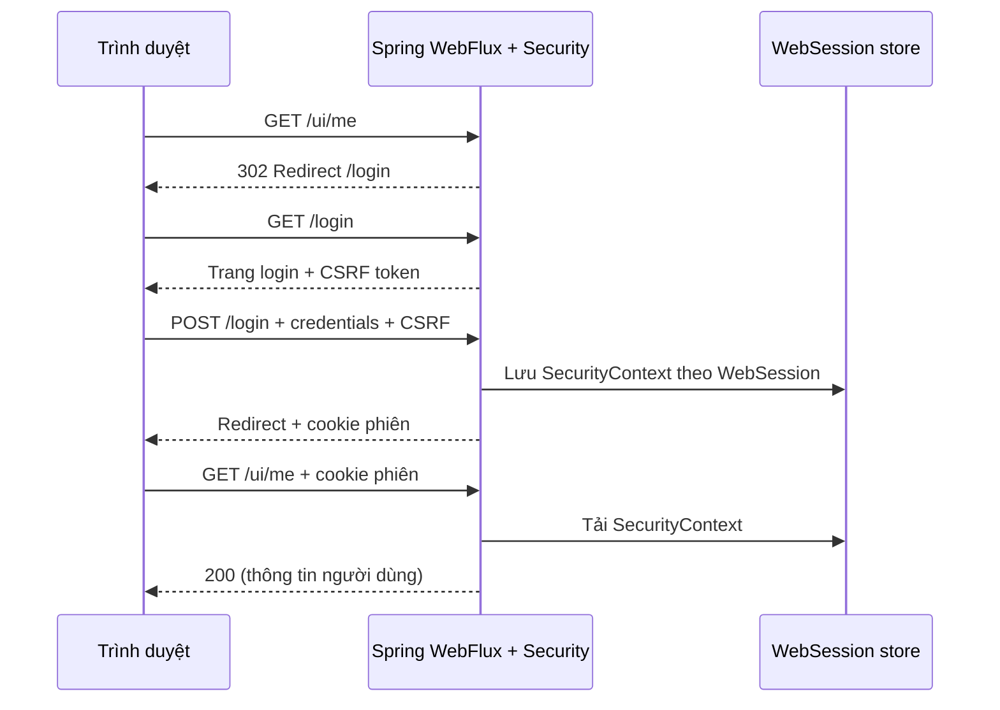
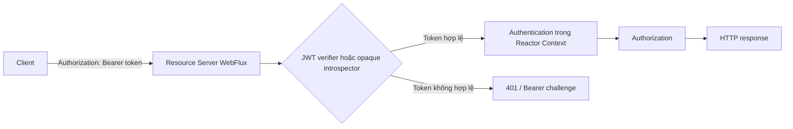

# Bật hoặc tắt từng cơ chế theo mô hình phiên và token trong Spring Security Reactive

Một ứng dụng **Spring WebFlux** có thể phục vụ trình duyệt đăng nhập bằng **phiên (session)**, API được gọi bằng **bearer token**, hoặc cả hai. Spring Security Reactive cho phép bật/tắt cơ chế xác thực và bảo vệ HTTP bằng `ServerHttpSecurity` trên từng `SecurityWebFilterChain`. Cấu hình đúng không chỉ là chọn `formLogin()` hay `oauth2ResourceServer()`: còn phải hiểu nơi lưu `SecurityContext`, cơ chế logout, CSRF, request cache, cách chọn security chain và cách trình duyệt gửi thông tin xác thực.

Mục tiêu sau bài học:

1. Phân biệt session cookie với access token gửi qua header `Authorization`.
2. Chọn **cơ chế bật/tắt** dựa trên cách client gửi credentials và yêu cầu nghiệp vụ.
3. Viết cấu hình Spring Security **WebFlux/Reactive** bằng Java 17+.
4. Biết vì sao `csrf().disable()` hoặc `NoOpServerSecurityContextRepository` không tự động có nghĩa “API an toàn và stateless”.
5. Kiểm tra các trường hợp 200, 302, 401, 403 và các lỗi cấu hình phổ biến.

> Phạm vi: Spring Boot 3.x / Spring Security 6.x với **Spring WebFlux**, sử dụng `ServerHttpSecurity`, `SecurityWebFilterChain`, `WebSession` và Reactor Context. Các API `HttpSecurity`, `SecurityFilterChain`, `HttpSession`, `SessionCreationPolicy.STATELESS` thuộc mô hình **Servlet**, không được sao chép trực tiếp vào ví dụ WebFlux.

## 1. Hai mô hình xác thực có cách hoạt động khác nhau

### Mô hình A — phiên đăng nhập trên máy chủ

Một trình duyệt gửi thông tin đăng nhập qua form hoặc quy trình đăng nhập tương tác. Sau khi xác thực thành công, hệ thống có thể lưu `SecurityContext` trong `WebSession`. Trình duyệt giữ **cookie định danh phiên**; các request kế tiếp tự gửi cookie phù hợp và máy chủ lấy ngữ cảnh đã lưu.



Đây là mô hình tương tác phổ biến cho website có trang đăng nhập, logout, redirect về trang trước khi login hoặc ứng dụng server-side. Cookie xác thực được trình duyệt tự đính kèm theo chính sách domain/path/SameSite, nên phải phân tích **CSRF**. `WebSession` ở đây thuộc WebFlux; nó không đồng nhất với `HttpSession` của Servlet. Một session store có thể cần chia sẻ giữa các instance khi triển khai nhiều máy.

### Mô hình B — API nhận bearer access token

Client có được access token từ một hệ thống cấp token đáng tin cậy, rồi gửi nó trên **mỗi request**:

```http
GET /api/me HTTP/1.1
Host: api.example.test
Authorization: Bearer <access-token>
```

Resource server kiểm tra token, tạo `Authentication` cho request hiện tại và quyết định quyền truy cập. Với JWT, hệ thống thường kiểm tra chữ ký, thời hạn (`exp`, `nbf`), issuer (`iss`) và các ràng buộc bổ sung như audience (`aud`) khi yêu cầu. Với **opaque token**, máy chủ có thể phải hỏi hệ thống introspection để đánh giá token.



Trong mô hình bearer thuần túy, không cần lưu danh tính đã xác thực vào session để dùng ở request sau, vì request tiếp theo mang token mới/đang còn hiệu lực. Tuy nhiên **token không có nghĩa bắt buộc là JWT**, **JWT không đồng nghĩa mọi thành phần ứng dụng đều stateless**, và quyền truy cập còn phụ thuộc scope/role/authorization policy.

### Bảng quyết định ban đầu

| Câu hỏi | Web UI dùng session | API dùng bearer token thuần |
| --- | --- | --- |
| Client gửi credentials | Cookie phiên tự đi theo request | Header `Authorization: Bearer ...` được client chủ động gửi |
| Nơi duy trì thông tin đăng nhập | `WebSession` và kho lưu phiên | Token được xác thực cho từng request; không cần session xác thực |
| Login tương tác | `formLogin` hoặc `oauth2Login` | Tại authorization server/identity provider, không phải form login của resource server |
| Xác thực API | Thường dùng session đã có | `oauth2ResourceServer().jwt(...)` hoặc `.opaqueToken(...)` |
| CSRF | Thường phải **giữ bật** | Có thể tắt **nếu** không dựa vào credentials tự động gửi bằng cookie/browser |
| Logout | Xóa/đóng phiên và context thích hợp | Client bỏ token; token đã phát hành vẫn có thể dùng đến khi hết hạn hoặc bị thu hồi |
| Request cache/redirect sau login | Có thể hữu ích | Thường không cần và nên tắt để trả lỗi API rõ ràng |
| Header bảo mật, TLS, authorization | Tiếp tục cần | Tiếp tục cần |

## 2. Mỗi cơ chế của `ServerHttpSecurity` bảo vệ điều gì?

Không chọn cơ chế theo mẹo “tắt hết để API hoạt động”. Hãy xác định nó giải quyết rủi ro hoặc luồng nào:

| Cơ chế | Web UI dùng session | API chỉ nhận Bearer header | Cấu hình thường dùng trong Spring Security 6.x |
| --- | --- | --- | --- |
| `authorizeExchange` | **Bật**: giới hạn route và role | **Bật**: giới hạn route và scope | `.authorizeExchange(ex -> ex.anyExchange().authenticated())` |
| `formLogin` | **Bật** khi đăng nhập bằng form | **Tắt** | `.formLogin(withDefaults())` / `.formLogin(form -> form.disable())` |
| `httpBasic` | Chỉ bật nếu thực sự muốn HTTP Basic | **Tắt** cho API chỉ dùng bearer | `.httpBasic(basic -> basic.disable())` |
| `oauth2Login` | Bật khi cần login người dùng qua OAuth2/OIDC | Không phải resource-server validation | `.oauth2Login(withDefaults())` hoặc `login -> login.disable()` |
| `oauth2ResourceServer` | Chỉ bật nếu web chain cũng nhận bearer | **Bật** JWT hoặc opaque | `.oauth2ResourceServer(o -> o.jwt(withDefaults()))` |
| `securityContextRepository` | WebSession nếu cần duy trì context | NoOp cho context của API | `WebSessionServerSecurityContextRepository` / `NoOpServerSecurityContextRepository` |
| `csrf` | **Giữ bật** cho form/cookie credentials | Chỉ tắt sau khi chứng minh không có xác thực tự gửi | `.csrf(withDefaults())` / `.csrf(csrf -> csrf.disable())` |
| `logout` | **Bật** và giữ CSRF cho POST logout | Tắt nếu endpoint không có session login | `.logout(withDefaults())` / `.logout(logout -> logout.disable())` |
| `requestCache` | Có thể dùng cho redirect về URL đã yêu cầu | Thường tắt | `.requestCache(cache -> cache.disable())` |
| `headers` | Giữ các security headers thích hợp | Giữ các security headers thích hợp | Mặc định được cấu hình; điều chỉnh có mục đích |
| `cors` | Tùy có truy cập khác origin hay không | Thường cần khi browser gọi API khác origin | Cấu hình nguồn gốc hợp lệ; CORS không thay thế xác thực/CSRF |

`withDefaults()` trong bảng là `org.springframework.security.config.Customizer.withDefaults()`. Lời gọi `disable()` theo lambda là kiểu cấu hình hiện đại cho Spring Security 6.x; hạn chế dùng chuỗi `.formLogin().disable().and()` đã bị đánh dấu deprecated trong dòng 6.x.

**Ba điều tuyệt đối không đánh đồng:**

- `permitAll()` cho phép một endpoint tại bước authorization, **không tắt** cả security chain và cũng không có nghĩa request được miễn CSRF.
- `securityContextRepository(NoOpServerSecurityContextRepository.getInstance())` định nghĩa cách `ReactorContextWebFilter` tải context; cơ chế **lưu** context còn có thể được cấu hình trên từng authentication filter (ví dụ `formLogin`). Vì vậy chỉ gọi dòng này **không đủ** chứng minh toàn hệ thống không sử dụng session.
- `csrf.disable()` chỉ bỏ một lớp bảo vệ CSRF, **không** tạo ra cơ chế bearer, xác thực token hoặc kiểm tra scope.

## 3. CSRF: dựa vào cách browser gửi credentials, không dựa vào nhãn “REST” hay “JWT”

CSRF xảy ra khi trình duyệt của nạn nhân **tự gửi** credentials mà website khác có thể lợi dụng để kích hoạt một request thay đổi trạng thái. Cookie phiên là trường hợp quen thuộc. HTTP Basic được browser ghi nhớ hoặc **access token đặt trong cookie** cũng có thể có rủi ro CSRF. Việc JSON hay REST không tự loại bỏ rủi ro.

Với web form/session, giữ bảo vệ CSRF cho các HTTP method thay đổi trạng thái (POST/PUT/PATCH/DELETE theo chính sách). Spring Security Reactive mặc định bật CSRF; token dự kiến được lưu trong `WebSession` bằng `WebSessionServerCsrfTokenRepository` theo cấu hình mặc định. Với form đăng nhập và logout, token CSRF phải được gửi đúng. Trang login mặc định do Spring Security tạo cung cấp luồng cần thiết; form do bạn tự tạo phải tích hợp CSRF token và tên field/header đúng.

Ví dụ request form là **minh họa**, token phải lấy từ session hiện tại chứ không được hardcode:

```http
POST /login HTTP/1.1
Content-Type: application/x-www-form-urlencoded
Cookie: SESSION=<session-id>

username=reader&password=demo123&_csrf=<token-from-current-session>
```

Với API dùng header `Authorization: Bearer` **do client chủ động đặt**, không dùng cookie/session để xác thực, việc tắt CSRF tại **security chain riêng của API** thường hợp lý vì trình duyệt của website lạ không thể tùy ý thêm bearer token của người dùng vào header. Tuy vậy vẫn phải kiểm soát CORS, XSS, lưu trữ token và đường đi của credentials.

Nếu một SPA lưu JWT vào cookie và browser tự gửi cookie đó, **đừng** lấy việc “dùng JWT” làm lý do tắt CSRF. Khi có cookie xác thực, đánh giá lại CSRF, SameSite, Secure, HttpOnly và chính sách origin.

## 4. Cấu hình phiên: bật form login, CSRF và lưu context

Ví dụ hoàn chỉnh dưới đây dùng Spring Boot 3.x, Java 17+ và Spring Security 6.x. Đây là một **cấu hình độc lập** cho website phiên; các ví dụ token ở phần sau là phương án khác, không đặt nhiều cấu hình toàn cục cạnh nhau nếu không có matcher rõ ràng.

Tệp `SessionSecurityConfig.java`:

```java
package demo.security;

import org.springframework.context.annotation.Bean;
import org.springframework.context.annotation.Configuration;
import org.springframework.security.config.Customizer;
import org.springframework.security.config.annotation.web.reactive.EnableWebFluxSecurity;
import org.springframework.security.config.web.server.ServerHttpSecurity;
import org.springframework.security.core.userdetails.ReactiveUserDetailsService;
import org.springframework.security.core.userdetails.User;
import org.springframework.security.core.userdetails.UserDetails;
import org.springframework.security.crypto.factory.PasswordEncoderFactories;
import org.springframework.security.crypto.password.PasswordEncoder;
import org.springframework.security.provisioning.MapReactiveUserDetailsService;
import org.springframework.security.web.server.SecurityWebFilterChain;
import org.springframework.security.web.server.context.WebSessionServerSecurityContextRepository;

@Configuration
@EnableWebFluxSecurity
public class SessionSecurityConfig {
    @Bean
    SecurityWebFilterChain browserChain(ServerHttpSecurity http) {
        var contextRepository =
            new WebSessionServerSecurityContextRepository();

        return http
            .authorizeExchange(exchanges -> exchanges
                .pathMatchers("/public/**", "/login").permitAll()
                .anyExchange().authenticated())
            .securityContextRepository(contextRepository)
            .formLogin(form ->
                form.securityContextRepository(contextRepository))
            .httpBasic(basic -> basic.disable())
            .csrf(Customizer.withDefaults())
            .logout(Customizer.withDefaults())
            .build();
    }

    @Bean
    ReactiveUserDetailsService demoUsers() {
        PasswordEncoder encoder =
            PasswordEncoderFactories.createDelegatingPasswordEncoder();
        UserDetails reader = User.withUsername("reader")
            .password(encoder.encode("demo123"))
            .roles("READER")
            .build();
        return new MapReactiveUserDetailsService(reader);
    }
}
```

Giải thích theo luồng thực tế:

1. `authorizeExchange` mở `/public/**` và `/login`, yêu cầu xác thực với các đường dẫn khác. Quy tắc `permitAll` không bỏ qua CSRF cho method thay đổi trạng thái.
2. `formLogin` bật xử lý login tương tác, thường kèm trang đăng nhập do Spring Security tạo nếu không có trang tùy biến.
3. `WebSessionServerSecurityContextRepository` dùng để tải context qua `ReactorContextWebFilter`; đặt **cùng repository** ở `FormLoginSpec` để cơ chế form login lưu kết quả xác thực vào nơi có thể tải cho request sau.
4. `httpBasic(...disable())` làm rõ rằng ứng dụng này ưu tiên form/session, không muốn thêm prompt HTTP Basic.
5. `csrf(withDefaults())` bảo vệ thao tác có rủi ro CSRF; `logout(withDefaults())` cung cấp xử lý logout theo cơ chế bảo mật, không phải chỉ xóa cookie ở client.
6. `MapReactiveUserDetailsService` và tài khoản `reader` là **demo local**; khi triển khai, dùng kho tài khoản đáng tin, chính sách mật khẩu, MFA/SSO thích hợp. Mật khẩu demo dù được encode không được dùng ở production.

Đối với browser login bằng OAuth2/OIDC thay cho form truyền thống, cấu hình `oauth2Login(Customizer.withDefaults())` với `ReactiveClientRegistrationRepository`/client registration; khi đó phải thiết kế session và OAuth2 authorization request, redirect callback phù hợp. `oauth2Login` dùng để **đăng nhập người dùng**, khác với `oauth2ResourceServer` dùng để **kiểm tra access token của request đến**. Không tự bật cả hai chỉ vì API dùng giao thức OAuth2.

### Trải nghiệm HTTP của mô hình phiên

- `GET /public/status` → được xử lý công khai nếu controller có route.
- `GET /ui/me` chưa login → thường `302` đến `/login` khi form login được chọn làm entry point.
- Browser vào `/login`, đăng nhập hợp lệ → được đưa về trang phù hợp; request sau mang cookie phiên.
- `POST /logout` phải được thực hiện theo flow logout và CSRF đã bật.
- Cookie phiên hết hạn/bị thu hồi → request kế tiếp yêu cầu xác thực lại.

Các hành vi redirect cụ thể còn phụ thuộc `ServerAuthenticationEntryPoint`, request cache và cấu hình ứng dụng. Không cố ép browser login trả `401` cho mọi request HTML rồi cho rằng đó là lỗi khi nhìn thấy `302`.

## 5. Cấu hình token-only: bật resource server, tắt login/session không cần thiết

Một resource server WebFlux nhận **JWT bearer** khác hoàn toàn luồng form login. Dưới đây là cấu hình **độc lập** với `SessionSecurityConfig`; trong ứng dụng chỉ dùng API, thay cấu hình phiên bằng cấu hình này.

Tệp `TokenSecurityConfig.java`:

```java
package demo.security;

import org.springframework.context.annotation.Bean;
import org.springframework.context.annotation.Configuration;
import org.springframework.security.config.Customizer;
import org.springframework.security.config.annotation.web.reactive.EnableWebFluxSecurity;
import org.springframework.security.config.web.server.ServerHttpSecurity;
import org.springframework.security.web.server.SecurityWebFilterChain;
import org.springframework.security.web.server.context.NoOpServerSecurityContextRepository;

@Configuration
@EnableWebFluxSecurity
public class TokenSecurityConfig {
    @Bean
    SecurityWebFilterChain apiChain(ServerHttpSecurity http) {
        return http
            .authorizeExchange(exchanges -> exchanges
                .pathMatchers("/api/public").permitAll()
                .anyExchange().authenticated())
            .securityContextRepository(
                NoOpServerSecurityContextRepository.getInstance())
            .formLogin(form -> form.disable())
            .httpBasic(basic -> basic.disable())
            .logout(logout -> logout.disable())
            .requestCache(cache -> cache.disable())
            .csrf(csrf -> csrf.disable())
            .oauth2ResourceServer(oauth2 ->
                oauth2.jwt(Customizer.withDefaults()))
            .build();
    }
}
```

Nếu dùng Spring Boot, thêm dependency **resource server** và cấu hình issuer thực tế của tổ chức:

```groovy
dependencies {
    implementation 'org.springframework.boot:spring-boot-starter-webflux'
    implementation 'org.springframework.boot:spring-boot-starter-security'
    implementation 'org.springframework.boot:spring-boot-starter-oauth2-resource-server'
}
```

```yaml
# application.yml — thay URI mẫu bằng issuer thực tế, có metadata/JWK hợp lệ
spring:
  security:
    oauth2:
      resourceserver:
        jwt:
          issuer-uri: https://idp.example.test/real-issuer
```

**URI trên chỉ là placeholder minh họa**, không cung cấp dịch vụ xác thực. Để xác nhận token hợp lệ, resource server cần kết nối được với issuer/JWK thực và nhận access token có chữ ký, thời hạn, issuer hợp lệ. Tùy yêu cầu bảo mật, cấu hình thêm **audience**, issuer đáng tin, thuật toán chữ ký, scope/role mapping và kiểm soát key rotation. Spring Security mặc định không kiểm tra mọi điều kiện nghiệp vụ chỉ vì đã khai báo `issuer-uri`.

Tại sao các lựa chọn trong `TokenSecurityConfig` hợp lý cho API chỉ dùng bearer:

- **Bật `oauth2ResourceServer().jwt()`** để trích và xác thực JWT bearer từ request.
- **Tắt `formLogin` và HTTP Basic** để không vô tình chấp nhận mật khẩu/redirect kiểu browser.
- **Không dùng context từ session** qua `NoOpServerSecurityContextRepository`. Các authentication filter cũng cần cấu hình lưu context phù hợp; resource server bearer mặc định không cần lưu authentication vào session cho lần sau.
- **Tắt `logout`** vì endpoint logout phiên không có ý nghĩa đối với access token đã được phát hành. Thu hồi token (nếu hỗ trợ) là một nghiệp vụ riêng.
- **Tắt `requestCache`** để API không giữ request trước khi redirect login.
- **Tắt CSRF chỉ vì giả định rõ**: đường API nhận bearer bằng header, không nhận cookie tự gửi làm credentials. Nếu sau này thêm cookie auth, phải đánh giá lại quyết định này.
- **Giữ authorization**: một token hợp lệ vẫn phải có quyền truy cập tài nguyên; nên thêm chính sách scope/role thay vì mọi route chỉ cần `.authenticated()`.

Ví dụ kiểm tra scope JWT thường được gắn ở authorization:

```java
// Đoạn minh họa thay cho phần authorizeExchange ở trên.
.authorizeExchange(exchanges -> exchanges
    .pathMatchers("/api/public").permitAll()
    .pathMatchers("/api/admin/**").hasAuthority("SCOPE_admin")
    .anyExchange().authenticated())
```

Resource server mặc định thường chuyển claim `scope`/`scp` trong JWT thành authority có prefix `SCOPE_`. Để kiểm tra `SCOPE_admin`, token phải mang scope tương ứng và được decoder chấp nhận; rule này không tự sinh scope.

**Opaque access token** cần `oauth2.opaqueToken(...)` cùng thông tin introspection; không thể dùng `jwt()` để hiểu mọi token dạng chuỗi. Đừng vừa bật JWT vừa bật opaque token rồi mặc định rằng Spring Security sẽ tự đoán đúng định dạng khi thiếu thiết kế rõ ràng.

## 6. Cùng một ứng dụng: tách chain `/api/**` (token) và các route web (session)

Khi một dịch vụ vừa phục vụ browser UI vừa phục vụ API, nên phân tách bằng **hai `SecurityWebFilterChain`**. Spring Security thử các security matcher theo `@Order` và chọn chuỗi khớp đầu tiên. Các cấu hình bên trong API chain không được áp sang web chain, và ngược lại.

Mã dưới đây là ví dụ chính **kết hợp**; dùng nó **thay thế** hai cấu hình độc lập ở phần 4 và 5. Đừng giữ cả ba lớp `@Configuration` vì sẽ tạo các chain trùng phạm vi.

### 6.1. Dependencies, cấu hình và các tệp

Trong dự án Spring Boot Java 17+ đã có Gradle plugin và repositories phù hợp:

```groovy
dependencies {
    implementation 'org.springframework.boot:spring-boot-starter-webflux'
    implementation 'org.springframework.boot:spring-boot-starter-security'
    implementation 'org.springframework.boot:spring-boot-starter-oauth2-resource-server'
}
```

Tệp `src/main/resources/application.yml`:

```yaml
server:
  port: 8080
spring:
  security:
    oauth2:
      resourceserver:
        jwt:
          # Phải thay bằng issuer thật trước khi thử Bearer JWT hợp lệ
          issuer-uri: https://idp.example.test/real-issuer
```

Tệp `src/main/java/demo/security/SecurityModeApplication.java`:

```java
package demo.security;

import org.springframework.boot.SpringApplication;
import org.springframework.boot.autoconfigure.SpringBootApplication;

@SpringBootApplication
public class SecurityModeApplication {
    public static void main(String[] args) {
        SpringApplication.run(SecurityModeApplication.class, args);
    }
}
```

Tệp `src/main/java/demo/security/HybridSecurityConfig.java`:

```java
package demo.security;

import org.springframework.context.annotation.Bean;
import org.springframework.context.annotation.Configuration;
import org.springframework.core.annotation.Order;
import org.springframework.security.config.Customizer;
import org.springframework.security.config.annotation.web.reactive.EnableWebFluxSecurity;
import org.springframework.security.config.web.server.ServerHttpSecurity;
import org.springframework.security.core.userdetails.ReactiveUserDetailsService;
import org.springframework.security.core.userdetails.User;
import org.springframework.security.core.userdetails.UserDetails;
import org.springframework.security.crypto.factory.PasswordEncoderFactories;
import org.springframework.security.crypto.password.PasswordEncoder;
import org.springframework.security.provisioning.MapReactiveUserDetailsService;
import org.springframework.security.web.server.SecurityWebFilterChain;
import org.springframework.security.web.server.context.NoOpServerSecurityContextRepository;
import org.springframework.security.web.server.context.WebSessionServerSecurityContextRepository;
import org.springframework.security.web.server.util.matcher.PathPatternParserServerWebExchangeMatcher;

@Configuration
@EnableWebFluxSecurity
public class HybridSecurityConfig {

    @Bean
    @Order(0)
    SecurityWebFilterChain tokenApi(ServerHttpSecurity http) {
        return http
            .securityMatcher(
                new PathPatternParserServerWebExchangeMatcher("/api/**"))
            .authorizeExchange(exchanges -> exchanges
                .pathMatchers("/api/public").permitAll()
                .pathMatchers("/api/admin/**").hasAuthority("SCOPE_admin")
                .anyExchange().authenticated())
            .securityContextRepository(
                NoOpServerSecurityContextRepository.getInstance())
            .formLogin(form -> form.disable())
            .httpBasic(basic -> basic.disable())
            .logout(logout -> logout.disable())
            .requestCache(cache -> cache.disable())
            .csrf(csrf -> csrf.disable())
            .oauth2ResourceServer(oauth2 ->
                oauth2.jwt(Customizer.withDefaults()))
            .build();
    }

    @Bean
    @Order(1)
    SecurityWebFilterChain browser(ServerHttpSecurity http) {
        var contextRepository =
            new WebSessionServerSecurityContextRepository();

        return http
            .authorizeExchange(exchanges -> exchanges
                .pathMatchers("/public/**", "/login").permitAll()
                .anyExchange().authenticated())
            .securityContextRepository(contextRepository)
            .formLogin(form ->
                form.securityContextRepository(contextRepository))
            .httpBasic(basic -> basic.disable())
            .csrf(Customizer.withDefaults())
            .logout(Customizer.withDefaults())
            .build();
    }

    @Bean
    ReactiveUserDetailsService demoUsers() {
        PasswordEncoder encoder =
            PasswordEncoderFactories.createDelegatingPasswordEncoder();
        UserDetails reader = User.withUsername("reader")
            .password(encoder.encode("demo123"))
            .roles("READER")
            .build();
        return new MapReactiveUserDetailsService(reader);
    }
}
```

Tệp `src/main/java/demo/security/DemoController.java`:

```java
package demo.security;

import org.springframework.security.core.context.ReactiveSecurityContextHolder;
import org.springframework.web.bind.annotation.GetMapping;
import org.springframework.web.bind.annotation.RestController;
import reactor.core.publisher.Mono;

@RestController
public class DemoController {

    @GetMapping("/public/status")
    public Mono<String> status() {
        return Mono.just("up");
    }

    @GetMapping("/api/public")
    public Mono<String> apiPublic() {
        return Mono.just("api-public");
    }

    @GetMapping("/ui/me")
    public Mono<String> uiIdentity() {
        return ReactiveSecurityContextHolder.getContext()
            .map(ctx -> "session:" + ctx.getAuthentication().getName());
    }

    @GetMapping("/api/me")
    public Mono<String> apiIdentity() {
        return ReactiveSecurityContextHolder.getContext()
            .map(ctx -> "token:" + ctx.getAuthentication().getName());
    }

    @GetMapping("/api/admin/report")
    public Mono<String> adminReport() {
        return Mono.just("admin-report");
    }
}
```

**Tính runnable:** Các tệp Java trên là các lớp độc lập có đầy đủ package/import cho Spring Boot 3.x + Spring Security 6.x và Java 17+. Chúng cần đặt trong một **dự án Spring Boot đã cấu hình Gradle đúng** với các starter nói trên. Việc xác thực JWT **thành công** phụ thuộc vào issuer và token thật; URI `idp.example.test` phải được thay. Tài khoản `reader/demo123` chỉ để trải nghiệm session local, không dùng ngoài môi trường học tập.

### 6.2. Chạy và quan sát đúng luồng

Chạy từ thư mục dự án Spring Boot:

```bash
# Linux/macOS
./gradlew bootRun

# Windows
gradlew.bat bootRun
```

Trong ví dụ có phần token, hãy cấu hình issuer có thể truy cập trước khi kiểm tra token. Nếu chưa có IdP, phần session/form có thể được học tách riêng bằng `SessionSecurityConfig` ở mục 4 và bỏ resource-server starter/issuer config. Đừng coi một URI mẫu hay token bịa là dữ liệu xác thực hợp lệ.

Lệnh kiểm tra các endpoint không cần token:

```bash
curl -i http://localhost:8080/public/status
curl -i http://localhost:8080/api/public
curl -i http://localhost:8080/ui/me
curl -i http://localhost:8080/api/me
curl -i -u reader:demo123 http://localhost:8080/api/me
```

Với hệ thống đã cấu hình đúng, kết quả **về mặt ý nghĩa HTTP** dự kiến:

| Thử nghiệm | Kết quả dự kiến | Giải thích |
| --- | --- | --- |
| `GET /public/status` | `200`, body `up` | Web chain cho phép route công khai |
| `GET /api/public` | `200`, body `api-public` | API chain cho phép route công khai |
| `GET /ui/me` chưa login | Thường `302` tới login | Web chain bật form login |
| `GET /api/me` không bearer | `401` | API chain đòi bearer authentication |
| `GET /api/me` chỉ gửi HTTP Basic | `401` | API chain đã tắt HTTP Basic, không nhận mật khẩu theo cách này |
| Browser login `reader/demo123`, rồi `GET /ui/me` | `200`, body `session:reader` | Session đã giữ `SecurityContext` qua các request |
| `GET /api/me` với JWT hợp lệ, đúng issuer | `200`, body bắt đầu `token:` | Request được xác thực từ bearer token |
| `GET /api/admin/report` với JWT hợp lệ nhưng thiếu `admin` scope | `403` | Đã xác thực nhưng không đủ quyền `SCOPE_admin` |

Để thử UI session: mở `http://localhost:8080/ui/me` trong trình duyệt, theo luồng chuyển hướng đến trang login, nhập tài khoản demo, rồi truy cập lại `/ui/me`. Với JWT, lấy **access token thật** từ issuer và kiểm tra:

```bash
curl -i \
  -H "Authorization: Bearer $ACCESS_TOKEN" \
  http://localhost:8080/api/me
```

`$ACCESS_TOKEN` là biến shell dùng cho ví dụ trên Linux/macOS; ở PowerShell dùng cú pháp biến tương ứng. Không in token thật vào log, README hoặc commit.

Một token có chữ ký đúng nhưng sai issuer/hết hạn sẽ bị từ chối. Token hợp lệ vẫn có thể nhận `403` nếu thiếu scope/authority phù hợp. Một endpoint `permitAll` cũng có thể từ chối request chứa bearer token **không hợp lệ** do authentication filter xử lý token được gửi trước khi xét quyền.

### 6.3. Tại sao cùng cookie session không tự mở `/api/me`?

`GET /api/me` khớp `/api/**`, nên Spring Security chọn **`tokenApi` với `@Order(0)`** trước. Chain này dùng bearer JWT, đã tắt form login và không tải `SecurityContext` từ WebSession. Cookie session browser có được từ `/ui/me` không tự làm người dùng authenticated ở API chain. Ngược lại, bearer JWT ở `/api/me` cũng không phải một browser login session cho `/ui/me`.

Đây là cách phân tách **đường xác thực**, không phải chỉ là phân tách controller. Tuy nhiên những `WebFilter` ứng dụng nằm ngoài security chain vẫn có thể chạy trên cả hai đường; các thành phần khác cũng có thể tạo `WebSession` độc lập, vì vậy không kết luận “toàn JVM không có session” chỉ từ cấu hình security.

## 7. Khi chọn mô hình, nhớ cả hành vi ở client

### Trình duyệt với session

- Dùng cookie `Secure`, `HttpOnly`, `SameSite` theo mô hình triển khai, và HTTPS.
- Giữ CSRF cho thao tác thay đổi trạng thái; trang/form custom phải gửi CSRF token thực.
- Chọn session store và chính sách timeout phù hợp. Với nhiều instance, cân nhắc session store dùng chung.
- Logout phải kết thúc phiên/`SecurityContext` đúng cách, không chỉ xóa biến trên UI.
- Xử lý redirect/login trang web có chủ đích; phần JS fetch có thể cần nhận diện `302` khác với mong đợi JSON API.

### Client dùng bearer access token

- Client gắn header `Authorization: Bearer ...` trên từng request; không nhúng token cố định vào mã frontend hay URL.
- Chỉ nhận issuer/JWK tin cậy; kiểm tra signature, `exp`, `nbf`, issuer, audience và scope theo policy.
- Dùng access token ngắn hạn phù hợp; refresh/revocation là luồng riêng của client/authorization server.
- Nếu browser lưu token, tránh thiết kế khiến XSS dễ lấy token; nếu đưa token vào cookie thì đánh giá lại CSRF.
- CORS phải giới hạn origin/method/header phù hợp nếu browser gọi cross-origin. CORS không phải một lớp authorization.
- Đảm bảo mọi endpoint quan trọng được bảo vệ bởi chain khớp và authorization policy rõ ràng.

### HTTP Basic không đồng nghĩa bearer

`httpBasic` gửi username/password theo header `Authorization: Basic ...`, còn resource server thường mong `Authorization: Bearer ...`. Đó là **hai cơ chế khác nhau**. Một API chỉ dùng bearer thường tắt Basic để tránh chấp nhận một con đường xác thực ngoài thiết kế. Browser có thể tự gửi lại Basic credentials đã lưu, nên cũng không được mặc định tắt CSRF chỉ vì không có cookie session.

### OAuth2 Login không đồng nghĩa OAuth2 Resource Server

`oauth2Login` đưa **người dùng** qua login/redirect/callback của OAuth2/OIDC, thường phục vụ web app có phiên. `oauth2ResourceServer` xác minh **access token gửi đến API**. `oauth2Client` lại phục vụ ứng dụng **gọi API phía ngoài** bằng access token của client/đại diện người dùng. Chỉ bật các feature thực sự phục vụ vai trò của ứng dụng.

## 8. Lỗi cấu hình phổ biến và cách phát hiện

**Lỗi 1: Tắt CSRF toàn cục để POST form không còn bị 403.** Đây là việc che triệu chứng thiếu CSRF token. Giải pháp đúng cho web session là tích hợp token trong form/header, giữ CSRF; chỉ cân nhắc tắt trên chain xác định rõ không dùng xác thực browser tự gửi.

**Lỗi 2: Chỉ set `NoOpServerSecurityContextRepository` rồi tuyên bố stateless.** Repository cấp `ServerHttpSecurity` chủ yếu phục vụ tải `SecurityContext`; mỗi authentication mechanism có thể có cách lưu context khác. Phải rà lại form login, OAuth2 login, HTTP Basic, custom authentication filter và các thành phần khác tạo session. Không dùng `SessionCreationPolicy.STATELESS` trong cấu hình WebFlux vì nó thuộc Servlet.

**Lỗi 3: Vô tình bật form login cho API.** Khi đó request API thiếu credentials có thể nhận redirect HTML thay vì 401 Bearer; hệ thống cũng có thể cho phép một phương thức xác thực ngoài thiết kế. Dùng security matcher chuyên biệt và tắt `formLogin` trong API chain.

**Lỗi 4: Tắt tất cả security chain hoặc dùng `anyExchange().permitAll()` khi gặp lỗi 401/403.** Việc này có thể mở endpoint nhạy cảm. Phải xác định lỗi nằm ở missing bearer, JWT không hợp lệ, CSRF, matcher hay thiếu authority; chỉ sửa đúng nguyên nhân.

**Lỗi 5: Nghĩ `permitAll` bỏ qua token authentication.** Một request tới endpoint công khai nhưng chủ động gửi bearer token hỏng vẫn có thể bị authentication filter từ chối. Phân biệt “không cần token” với “bỏ qua mọi cơ chế lọc”.

**Lỗi 6: Dùng `@Order` sai hoặc để chain tổng quát đứng trước.** Nếu fallback chain khớp mọi request được thử trước, API chain hẹp phía sau có thể không bao giờ chạy. Đặt `/api/**` ở độ ưu tiên cao hơn, và kiểm thử cả route khớp lẫn không khớp.

**Lỗi 7: Dùng JWT nhưng không kiểm tra audience hoặc scope.** Chữ ký hợp lệ chưa bảo đảm token được cấp cho resource server này hay người dùng có quyền gọi endpoint. Thiết lập validation phù hợp, mapper authority và rule chi tiết.

**Lỗi 8: Cho rằng logout endpoint của session sẽ thu hồi JWT.** Vô hiệu hóa phiên web không tự vô hiệu hóa access token đã phát hành; cần tính đến thời hạn token, refresh token, revocation/introspection hoặc các cơ chế nghiệp vụ riêng.

**Lỗi 9: Trộn HTTP Basic, form login, OAuth2 login và bearer chỉ vì dependency có sẵn.** Mỗi đường xác thực tạo hành vi, entry point và rủi ro khác nhau. Định nghĩa một mô hình mong đợi theo từng nhóm request rồi cấu hình rõ mỗi chain.

**Lỗi 10: Chặn event loop trong quá trình xác thực.** Dù chọn session hay token, `WebFilter`, `ReactiveAuthenticationManager` và truy cập dữ liệu phải tuân theo nguyên tắc non-blocking. JDBC, HTTP client đồng bộ, `.block()` hoặc `Thread.sleep()` trên event loop có thể làm nghẽn nhiều request. Dùng reactive APIs hoặc cô lập nguồn blocking có kiểm soát.

## 9. Checklist kiểm thử tối thiểu

| Test | Session web chain | Token API chain |
| --- | --- | --- |
| Trang công khai không credentials | 200 | 200 nếu route thực sự permitAll |
| Trang/endpoint cần bảo vệ không credentials | Redirect đến login hoặc entry point đã cấu hình | 401 kèm Bearer challenge phù hợp |
| Credentials đúng | Login tạo/dùng phiên; request sau dùng cookie | JWT/opaque token được xác thực ở mỗi request |
| Credentials sai/hết hạn | Login thất bại hoặc phiên hết hạn | 401 |
| Đủ authentication, thiếu quyền | 403 | 403 |
| POST thiếu CSRF token | Bị chặn nếu thao tác thuộc vùng CSRF | Hành vi tùy policy; token-only header thường không dùng CSRF |
| Logout | Phiên không còn được dùng để xác thực | Không có session logout; kiểm tra vòng đời token riêng |
| Cookie phiên gửi đến API bearer | Không làm API tự authenticated | API vẫn yêu cầu bearer |
| Bearer gửi đến web session chain | Không tự thành form login/session | Chỉ hiệu lực nếu web chain được cấu hình nhận bearer |
| Request tới route thuộc chain khác | Không được vô tình dùng policy sai | Không được vô tình dùng policy sai |

Dùng `WebTestClient` cùng hỗ trợ Spring Security reactive test để kiểm thử method, status, authentication và CSRF một cách tự động. Với JWT, mock JWT/authority cho bài test authorization, và dành bài kiểm thử tích hợp riêng cho decoder/issuer/JWK thực. Bật log `org.springframework.security=DEBUG` trong môi trường kiểm thử khi cần xác minh chain được chọn; hạn chế log token/credentials, tránh DEBUG lâu dài trên production.

## 10. Câu hỏi tự đánh giá

1. Một SPA dùng JWT **trong cookie HttpOnly**. Có được tắt CSRF chỉ vì tên cơ chế là JWT không?  
   **Không.** Trình duyệt có thể tự gửi cookie, nên vẫn có nguy cơ CSRF; phải đánh giá đúng kiểu vận chuyển credentials và cơ chế chống CSRF.

2. Có thể dùng `.securityContextRepository(NoOpServerSecurityContextRepository.getInstance())` để chặn mọi việc tạo session trong ứng dụng không?  
   **Không.** Cài đặt này liên quan đến repository tải context và không ngăn tất cả filter hoặc thành phần khác tạo/lưu session.

3. `formLogin` và `oauth2ResourceServer` khác nhau ở đâu?  
   `formLogin` xác thực người dùng qua luồng login tương tác của ứng dụng; `oauth2ResourceServer` xác thực access token mà client gửi tới API.

4. Một API hợp lệ về JWT nhưng không đủ `SCOPE_admin` nên nhận 403. Có nên `permitAll()` để sửa không?  
   **Không.** Cần xem quyền được cấp, mapper scope và policy; không xóa rào bảo vệ.

5. Một ứng dụng có `/ui/**` dùng session và `/api/**` dùng JWT. Nên cấu hình thế nào?  
   Dùng các `SecurityWebFilterChain` với `securityMatcher` và `@Order` rõ ràng; mỗi chain chủ động bật/tắt cơ chế phù hợp.

## Ghi nhớ

- **Phiên** là mô hình lưu trạng thái đăng nhập phía máy chủ, thường dùng cookie và form/OAuth2 login; **bearer token** là credential đi theo request, thường không cần lưu xác thực vào session.
- `ServerHttpSecurity` cho phép chọn cơ chế theo **từng chain**: form login, HTTP Basic, OAuth2 login/resource server, CSRF, logout, request cache, security context repository và authorization.
- **Giữ CSRF** khi browser tự gửi credentials (đặc biệt cookie phiên, token trong cookie hoặc Basic tự động). Chỉ tắt trong phạm vi đã phân tích an toàn.
- `NoOpServerSecurityContextRepository` **không phải** công tắc bảo đảm mọi thành phần stateless; kiểm tra cả cách các authentication filters lưu context.
- API bearer thường trả 401/403; web form thường có login redirect. Kiểm thử cả các request công khai, sai credentials, thiếu quyền, logout và cả các route chéo chain.

### Tài liệu tham khảo chính thức

- [Spring Security 6.5 — WebFlux Security & Multiple Chains](https://docs.spring.io/spring-security/reference/6.5/reactive/configuration/webflux.html)
- [Spring Security 6.5 — `ServerHttpSecurity` API](https://docs.spring.io/spring-security/reference/6.5/api/java/org/springframework/security/config/web/server/ServerHttpSecurity.html)
- [Spring Security — CSRF for WebFlux](https://docs.spring.io/spring-security/reference/6.5/reactive/exploits/csrf.html)
- [Spring Security — Reactive Resource Server JWT](https://docs.spring.io/spring-security/reference/6.5/reactive/oauth2/resource-server/jwt.html)
- [Spring Security — OAuth2/OIDC Login for WebFlux](https://docs.spring.io/spring-security/reference/6.5/reactive/oauth2/login/core.html)
- [Spring Security — `WebSessionServerSecurityContextRepository` API](https://docs.spring.io/spring-security/reference/6.5/api/java/org/springframework/security/web/server/context/WebSessionServerSecurityContextRepository.html)
