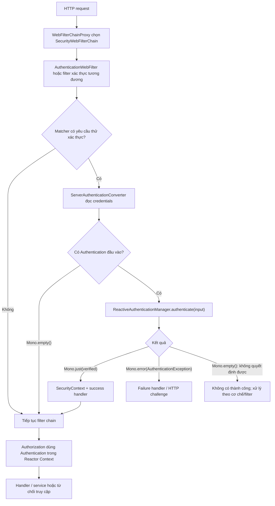
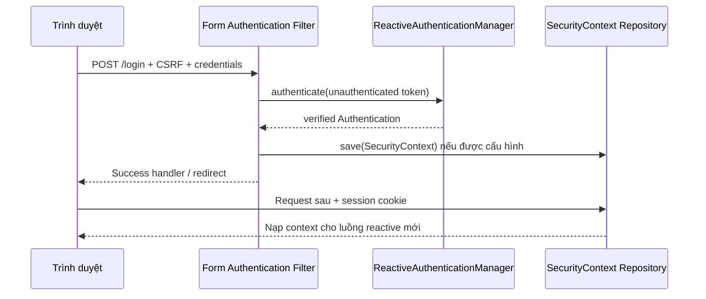

# Vòng đời `Authentication` trước và sau khi xác thực thành công trong Spring Security Reactive

Khi một request đi vào ứng dụng **Spring WebFlux** có bảo vệ bởi **Spring Security Reactive**, đối tượng `Authentication` có thể xuất hiện ở nhiều giai đoạn với ý nghĩa khác nhau. Trước khi hệ thống kiểm chứng, nó có thể chỉ là **yêu cầu xác thực** mang username/password hoặc bearer token do client gửi; sau khi `ReactiveAuthenticationManager` xác minh thành công, nó trở thành **kết quả xác thực đáng tin cậy** chứa danh tính và quyền. Spring Security sau đó đưa kết quả vào `SecurityContext` gắn với **Reactor Context** để các bước xử lý tiếp theo biết người dùng hiện tại là ai.

Đây là ranh giới bảo mật rất quan trọng: **client cung cấp bằng chứng; authentication manager kiểm chứng bằng chứng; hệ thống mới được tin kết quả**. Tự tạo một `Authentication` với `isAuthenticated=true` từ dữ liệu request là một lỗi bảo mật, dù API cho phép tạo object như vậy.

Bài học tập trung vào **vòng đời một lần xác thực** và khả năng sử dụng kết quả trong request hiện tại, rồi giải thích điều gì thay đổi với những request sau. Ví dụ dùng Java 17+, Spring Boot 3.x/Spring Security 6.x trên **WebFlux**; các API `AuthenticationManager` đồng bộ, `SecurityContextHolder` theo `ThreadLocal` và servlet `Filter` không được dùng làm cơ chế chính của ứng dụng reactive.

## 1. Bốn đối tượng cần phân biệt

| Đối tượng | Nơi xuất hiện | Chứa gì? | Độ tin cậy |
| --- | --- | --- | --- |
| Credential từ HTTP | `Authorization` header, form login, cookie hoặc giao thức xác thực khác | Username/password, bearer token, chứng chỉ... | **Chưa tin**; do bên gọi gửi |
| `Authentication` đầu vào | Kết quả của `ServerAuthenticationConverter` hoặc cơ chế tạo yêu cầu xác thực | Principal dự kiến, credentials và metadata; nhiều triển khai có `isAuthenticated() == false` | **Chỉ là yêu cầu kiểm chứng** |
| `Authentication` đầu ra | Được `ReactiveAuthenticationManager.authenticate(...)` phát qua `Mono<Authentication>` | Principal đã được xác minh, authorities đã xác định; thường `isAuthenticated() == true` | **Đáng tin nếu đến từ thành phần xác thực tin cậy** |
| `SecurityContext` | Ngữ cảnh bảo mật cho subscription/request hiện tại; có thể được lưu cho request sau | Một `Authentication` hiện tại | Dùng bởi authorization, controller và service reactive |

`Authentication` là interface `org.springframework.security.core.Authentication`, không phải “một trạng thái toàn cục”. Nó đại diện cho cả **authentication request** và **authentication result**, tùy giai đoạn và implementation.

Những API quan trọng trên `Authentication`:

- `getPrincipal()`: danh tính/chủ thể. Có thể là chuỗi username, `UserDetails`, `Jwt`, `OAuth2User` hoặc kiểu principal của cơ chế riêng.
- `getCredentials()`: bằng chứng xác thực (ví dụ password hoặc token), **không được in ra log**. Một số implementation xóa credentials sau thành công.
- `getAuthorities()`: các `GrantedAuthority` mà hệ thống dùng để quyết định quyền (ví dụ `ROLE_READER`, `SCOPE_orders.read`).
- `isAuthenticated()`: cờ trạng thái; **không đủ** để quyết định rằng đây là một người dùng đã login hợp lệ nếu không hiểu nguồn gốc/loại token.
- `getName()`: tên hiển thị logic của principal theo implementation.
- `getDetails()`: metadata bổ sung, không phải nơi để mặc nhiên tin thông tin quyền của client.

`SecurityContext` có phương thức `getAuthentication()`; trong luồng reactive, truy cập nó qua `ReactiveSecurityContextHolder`, không giả định object có thể lấy ổn định từ một `ThreadLocal`.

## 2. Luồng tổng quát: từ HTTP request đến Authentication đã xác minh

Một đường đi tiêu biểu khi request cần xác thực:



Sơ đồ mô tả chuỗi của `AuthenticationWebFilter` và các bước lân cận, **không khẳng định mọi cơ chế xác thực đều dùng đúng một filter/class**. Spring Security có những filter và converter khác nhau cho HTTP Basic, form login, OAuth2 login, JWT/opaque bearer, chứng chỉ và cấu hình tùy biến. `SecurityWebFilterChain` được chọn dựa trên matcher; mỗi chain có thể có các cơ chế xác thực riêng.

Các bước cần hiểu:

1. **Request đi vào SecurityWebFilterChain.** Spring Security chọn chuỗi khớp với request và chạy các WebFilter theo thứ tự bảo mật.
2. **Filter xem request có cần thử xác thực không.** `setRequiresAuthenticationMatcher(...)` của `AuthenticationWebFilter` quyết định phạm vi thử; không khớp thì cho chuỗi tiếp tục.
3. **Converter đọc credentials.** `ServerAuthenticationConverter.convert(exchange)` trả `Mono<Authentication>` yêu cầu kiểm chứng, hoặc `Mono.empty()` nếu không có dữ liệu phù hợp để xử lý. Đọc được header không đồng nghĩa đã xác thực thành công.
4. **Manager kiểm chứng.** `ReactiveAuthenticationManager.authenticate(input)` dùng dữ liệu đáng tin (user store, password encoder, JWT signature/issuer, opaque introspection...) để trả một kết quả hoặc lỗi.
5. **Khi thành công**, Spring Security tạo/cập nhật `SecurityContext` trong **Reactor Context** của phần xử lý tiếp theo; `ServerAuthenticationSuccessHandler` có thể tiếp tục chain, redirect hoặc trả response theo kiểu xác thực. Việc **lưu** context cho request sau là một quyết định riêng.
6. **Khi thất bại**, `ServerAuthenticationFailureHandler`/exception handling xử lý theo cấu hình. Không có authentication thành công để cấp quyền.
7. **Authorization** đánh giá danh tính và authorities của request hiện tại, sau đó cho handler chạy hoặc từ chối truy cập.

Chú ý hai loại “không có kết quả”: converter `Mono.empty()` nghĩa là không tạo được yêu cầu xác thực từ request, còn manager `Mono.empty()` nghĩa là manager **không quyết định được** cho token loại đó. Cả hai đều **không phải** “xác thực thành công”.

## 3. Trước khi xác thực: `Authentication` là yêu cầu chưa được tin

Với username/password, Spring Security thường tạo `UsernamePasswordAuthenticationToken` ở trạng thái chưa xác thực:

```java
Authentication attempt =
    UsernamePasswordAuthenticationToken.unauthenticated(
        "reader", "demo123");

System.out.println(attempt.isAuthenticated()); // false
System.out.println(attempt.getName());          // reader
```

Đây là **đoạn minh họa** nằm trong Java code đã import `Authentication` và `UsernamePasswordAuthenticationToken`. `"reader"` là tên do người gửi request khai báo, chưa phải danh tính đã kiểm chứng. Password chỉ tồn tại để manager so khớp và không được ghi log.

Ở phiên bản Spring Security hỗ trợ factory method, `UsernamePasswordAuthenticationToken.unauthenticated(...)` tạo token có `isAuthenticated() == false`, không tự cấp authorities. Một token hai tham số tương ứng cũng đại diện cho yêu cầu chưa xác thực. Đừng dùng constructor ba tham số hoặc factory `.authenticated(principal, credentials, authorities)` để **tự phong** kết quả tin cậy từ dữ liệu HTTP.

Với bearer JWT, converter có thể tạo một `BearerTokenAuthenticationToken` chứa chuỗi bearer chưa xác minh; sau khi decoder/manager kiểm tra, kết quả thường là `JwtAuthenticationToken`. Với HTTP Basic/form login, đầu vào thường là `UsernamePasswordAuthenticationToken`; kết quả có thể chứa `UserDetails` thay cho chuỗi tên ban đầu. **Cùng interface `Authentication` không có nghĩa cùng class trước và sau xác thực.**

Cần tách ba khái niệm:

- **Identification**: một username hoặc token khai báo danh tính nào đó.
- **Authentication**: hệ thống kiểm chứng bằng chứng bằng một cơ chế phù hợp.
- **Authorization**: hệ thống xác định danh tính đã được kiểm chứng có được phép làm hành động này hay không.

Không suy ra vai trò admin từ request parameter, JWT chưa kiểm chữ ký hoặc thuộc tính tự gửi của client.

## 4. `ReactiveAuthenticationManager` trả về những tín hiệu nào?

Hợp đồng quan trọng:

```java
public interface ReactiveAuthenticationManager {
    Mono<Authentication> authenticate(Authentication authentication);
}
```

| Tín hiệu trả về | Diễn giải | Ví dụ |
| --- | --- | --- |
| `Mono<Authentication>` phát 1 kết quả | Manager **xác thực thành công** và trả object được hệ thống tin | Password hợp lệ; token chữ ký/issuer hợp lệ |
| `Mono.error(AuthenticationException)` | Manager xác thực **thất bại** | Password sai, tài khoản khóa, token hết hạn/sai chữ ký |
| `Mono.empty()` | Manager **không thể quyết định** hoặc không xử lý được kiểu authentication đó | Manager chỉ hỗ trợ một loại token khác |

Thực tế, có thể có manager tổng hợp hoặc resolver chọn manager theo request; không phải mọi cơ chế cùng xử lý một class `Authentication`. Khi thất bại, không nên tự gọi `onErrorResume(e -> Mono.just(anonymousOrAdmin))` rồi xem đó là xác thực hợp lệ; đặc biệt nguy hiểm nếu fallback tự cấp quyền.

Kết quả thành công thường khác đầu vào:

| Đặc điểm | Trước kiểm chứng | Sau thành công |
| --- | --- | --- |
| `principal` | Tên dự kiến hoặc token thô | UserDetails/JWT/OAuth2 principal đã được kiểm chứng |
| `credentials` | Có thể chứa password/token | Có thể đã bị xóa/được giữ tùy implementation; luôn coi là nhạy cảm |
| `authorities` | Chưa được tin để cấp quyền | Do hệ thống xác thực/mapper tin cậy thiết lập |
| `isAuthenticated` | Thường `false` | Thường `true` |
| Có trong `ReactiveSecurityContextHolder`? | **Không tự động**, chỉ vì vừa tạo một object | **Có trong ngữ cảnh downstream** khi filter/handler cấu hình đúng |
| Tồn tại ở request tiếp theo? | Không | Chỉ nếu request sau tự xác thực lại hoặc có context persistence phù hợp |

`isAuthenticated() == true` **không phải** lời giải chung cho authorization: một `AnonymousAuthenticationToken` có thể báo `true` ở mức interface nhưng vẫn được Spring Security phân biệt là anonymous, không tương đương người dùng đã đăng nhập. Việc kiểm tra quyền phải dùng authorization framework/trust resolver và authorities tin cậy. Đừng viết quy tắc bảo mật thủ công chỉ dựa vào boolean này.

## 5. Sau thành công: đưa kết quả vào `SecurityContext` và Reactor Context

`Authentication` trả về từ manager mới là dữ liệu kết quả. Để controller/service bên dưới đọc được người dùng hiện tại, Spring Security tạo `SecurityContext` chứa authentication đã được xác minh rồi gắn nó vào **Reactor Context** theo vòng đời subscription.

Trong WebFlux, Spring Security có `ReactiveSecurityContextHolder`; nội dung context không mặc định gắn vĩnh viễn vào `Thread.currentThread()`. Các operator của Reactor có thể tiếp tục thực thi trên thread khác mà vẫn truy cập được Reactor Context trong subscription phù hợp.

Đọc authentication tại một điểm sau khi filter bảo mật đã xử lý:

```java
// Đoạn code trong một phương thức reactive được bảo vệ.
Mono<String> currentUsername =
    ReactiveSecurityContextHolder.getContext()
        .flatMap(context ->
            Mono.justOrEmpty(context.getAuthentication()))
        .map(Authentication::getName);
```

Cần import:

```java
import org.springframework.security.core.Authentication;
import org.springframework.security.core.context.ReactiveSecurityContextHolder;
import reactor.core.publisher.Mono;
```

`getContext()` trả `Mono<SecurityContext>` theo subscriber hiện tại; với request chưa có context, nó có thể rỗng. Không nên coi `Mono.empty()` là tên người dùng `"anonymous"` tự động; việc anonymous filter có tạo authentication riêng hay không còn phụ thuộc cấu hình/điểm đặt đoạn mã.

Ở mã **tự học** có thể minh họa ranh giới bằng:

```java
Mono<String> visibleName =
    ReactiveSecurityContextHolder.getContext()
        .map(ctx -> ctx.getAuthentication().getName())
        .contextWrite(
            ReactiveSecurityContextHolder.withAuthentication(
                verifiedAuthentication));
```

Ở đây `verifiedAuthentication` **phải là kết quả đã được manager xác thực**, không phải token tự nhận quyền từ client. `contextWrite` chỉ thay đổi context cho **subscription của publisher đó**. Đoạn này là phép minh họa phạm vi Reactor Context, **không tự tạo một phiên đăng nhập HTTP**, không lưu `SecurityContext` cho request sau và không thay thế `AuthenticationWebFilter`/success handler.

Đặc biệt: nếu một service gọi manager rồi tự `.subscribe()` một pipeline rời rạc, hoặc gọi `.block()` để “lấy user” trong WebFlux handler, nó có thể làm mất liên kết với Reactor Context và làm hỏng luồng xử lý non-blocking. Hãy **trả về** `Mono`/`Flux` cho framework quản lý subscription.

## 6. Ví dụ chạy được: quan sát BEFORE, AFTER và CONTEXT

Ví dụ Spring Boot dưới đây cho thấy hai sự thật tách biệt:

- `ReactiveAuthenticationManager` kiểm chứng yêu cầu và trả **một authentication mới/đã xác minh**.
- `ReactiveSecurityContextHolder` chỉ đọc được user trong **ngữ cảnh Reactor được gắn đúng cách**. Ở HTTP request thực, Spring Security filter đảm nhiệm việc đó.

Yêu cầu: Java 17+, dự án Spring Boot 3.x sử dụng Spring Security 6.x, có Gradle wrapper và plugin Spring Boot đã cấu hình. Thêm dependencies:

```groovy
dependencies {
    implementation 'org.springframework.boot:spring-boot-starter-webflux'
    implementation 'org.springframework.boot:spring-boot-starter-security'
    testImplementation 'org.springframework.boot:spring-boot-starter-test'
}
```

Không dùng `spring-boot-starter-web` cho ví dụ này vì đây là ứng dụng WebFlux reactive. Các đoạn Java dưới đây là **các tệp hoàn chỉnh**, đặt trong `src/main/java/demo/authlife/`.

### Tệp 1 — `AuthLifeApplication.java`

```java
package demo.authlife;

import org.springframework.boot.SpringApplication;
import org.springframework.boot.autoconfigure.SpringBootApplication;

@SpringBootApplication
public class AuthLifeApplication {
    public static void main(String[] args) {
        SpringApplication.run(AuthLifeApplication.class, args);
    }
}
```

### Tệp 2 — `SecurityConfig.java`

```java
package demo.authlife;

import org.springframework.context.annotation.Bean;
import org.springframework.context.annotation.Configuration;
import org.springframework.security.authentication.ReactiveAuthenticationManager;
import org.springframework.security.authentication.UserDetailsRepositoryReactiveAuthenticationManager;
import org.springframework.security.config.Customizer;
import org.springframework.security.config.annotation.web.reactive.EnableWebFluxSecurity;
import org.springframework.security.config.web.server.ServerHttpSecurity;
import org.springframework.security.core.userdetails.ReactiveUserDetailsService;
import org.springframework.security.core.userdetails.User;
import org.springframework.security.core.userdetails.UserDetails;
import org.springframework.security.crypto.factory.PasswordEncoderFactories;
import org.springframework.security.crypto.password.PasswordEncoder;
import org.springframework.security.provisioning.MapReactiveUserDetailsService;
import org.springframework.security.web.server.SecurityWebFilterChain;

@Configuration
@EnableWebFluxSecurity
public class SecurityConfig {
    @Bean
    PasswordEncoder passwordEncoder() {
        return PasswordEncoderFactories.createDelegatingPasswordEncoder();
    }

    @Bean
    ReactiveUserDetailsService users(PasswordEncoder encoder) {
        UserDetails reader = User.withUsername("reader")
            .password(encoder.encode("demo123"))
            .roles("READER")
            .build();
        return new MapReactiveUserDetailsService(reader);
    }

    @Bean
    ReactiveAuthenticationManager authenticationManager(
            ReactiveUserDetailsService users, PasswordEncoder encoder) {
        var manager =
            new UserDetailsRepositoryReactiveAuthenticationManager(users);
        manager.setPasswordEncoder(encoder);
        return manager;
    }

    @Bean
    SecurityWebFilterChain security(
            ServerHttpSecurity http,
            ReactiveAuthenticationManager authenticationManager) {
        return http
            .authenticationManager(authenticationManager)
            .authorizeExchange(exchanges -> exchanges
                .pathMatchers("/public/ping").permitAll()
                .pathMatchers("/private/admin").hasRole("ADMIN")
                .anyExchange().authenticated())
            .httpBasic(Customizer.withDefaults())
            .formLogin(form -> form.disable())
            .build();
    }
}
```

`MapReactiveUserDetailsService` và mật khẩu `demo123` chỉ phục vụ demo **cục bộ**, không dùng trong môi trường thật. `PasswordEncoderFactories.createDelegatingPasswordEncoder()` tạo cơ chế encode an toàn hơn so với lưu `{noop}` password. Cấu hình xác thực HTTP Basic cho phép quan sát một lần xác thực **trên từng request**. CSRF mặc định vẫn hoạt động; toàn bộ endpoint minh họa dùng `GET`, nên không cần tắt CSRF để chạy ví dụ.

`UserDetailsRepositoryReactiveAuthenticationManager` kiểm tra password bằng encoder và nguồn `ReactiveUserDetailsService`. Đây là một implementation cụ thể của `ReactiveAuthenticationManager`. Việc tạo bean manager và cấu hình nó trong `ServerHttpSecurity` khiến luồng HTTP Basic và bài demo dòng lệnh cùng sử dụng cùng quy tắc xác thực.

### Tệp 3 — `LifecycleProbe.java`

```java
package demo.authlife;

import org.springframework.boot.CommandLineRunner;
import org.springframework.security.authentication.ReactiveAuthenticationManager;
import org.springframework.security.authentication.UsernamePasswordAuthenticationToken;
import org.springframework.security.core.Authentication;
import org.springframework.security.core.GrantedAuthority;
import org.springframework.security.core.context.ReactiveSecurityContextHolder;
import org.springframework.stereotype.Component;

@Component
public class LifecycleProbe implements CommandLineRunner {
    private final ReactiveAuthenticationManager manager;

    public LifecycleProbe(ReactiveAuthenticationManager manager) {
        this.manager = manager;
    }

    @Override
    public void run(String... args) {
        Authentication attempt =
            UsernamePasswordAuthenticationToken.unauthenticated(
                "reader", "demo123");

        System.out.println("BEFORE authenticated="
            + attempt.isAuthenticated());
        System.out.println("BEFORE name=" + attempt.getName());

        Authentication verified =
            manager.authenticate(attempt).block();

        System.out.println("AFTER authenticated="
            + verified.isAuthenticated());
        System.out.println("AFTER name=" + verified.getName());
        System.out.println("AFTER authorities="
            + verified.getAuthorities().stream()
                .map(GrantedAuthority::getAuthority)
                .sorted()
                .toList());

        String nameInContext =
            ReactiveSecurityContextHolder.getContext()
                .map(ctx -> ctx.getAuthentication().getName())
                .contextWrite(
                    ReactiveSecurityContextHolder.withAuthentication(
                        verified))
                .block();

        System.out.println("CONTEXT name=" + nameInContext);
    }
}
```

**Quan trọng:** `.block()` trong `CommandLineRunner` là có chủ đích vì nó chạy ở **ranh giới startup đồng bộ**, chỉ để in kết quả học tập, không phải trong một WebFlux request/event loop. Không sao chép `.block()` sang controller, WebFilter hoặc authentication service reactive.

Khi ứng dụng khởi động thành công, các dòng của ví dụ là:

```text
BEFORE authenticated=false
BEFORE name=reader
AFTER authenticated=true
AFTER name=reader
AFTER authorities=[ROLE_READER]
CONTEXT name=reader
```

Các log khởi động khác của Spring Boot vẫn xuất hiện. Password được mã hóa với salt ngẫu nhiên, nhưng các dòng kết quả trên không phụ thuộc giá trị hash. `verified` được lấy từ manager, rồi được đưa vào **một subscription Reactor cụ thể** bằng `contextWrite`. Lưu ý mã không hề in password hoặc raw credentials.

### Tệp 4 — `DemoController.java`

```java
package demo.authlife;

import org.springframework.security.core.Authentication;
import org.springframework.security.core.GrantedAuthority;
import org.springframework.security.core.context.ReactiveSecurityContextHolder;
import org.springframework.web.bind.annotation.GetMapping;
import org.springframework.web.bind.annotation.RestController;
import reactor.core.publisher.Mono;

@RestController
public class DemoController {
    @GetMapping("/public/ping")
    public Mono<String> ping() {
        return Mono.just("pong");
    }

    @GetMapping("/private/me")
    public Mono<String> me() {
        return ReactiveSecurityContextHolder.getContext()
            .flatMap(ctx ->
                Mono.justOrEmpty(ctx.getAuthentication()))
            .map(this::describe);
    }

    @GetMapping("/private/admin")
    public Mono<String> admin() {
        return Mono.just("admin-only");
    }

    private String describe(Authentication authentication) {
        var authorities = authentication.getAuthorities().stream()
            .map(GrantedAuthority::getAuthority)
            .sorted()
            .toList();

        return "name=" + authentication.getName()
            + "; authenticated=" + authentication.isAuthenticated()
            + "; authorities=" + authorities;
    }
}
```

Trong `/private/me`, controller chỉ chạy sau khi security filter đã cho qua. Phương thức `describe` dùng **authentication lấy từ Reactor Context**, không tạo một token mới và không đọc username từ query parameter. Route `/private/admin` yêu cầu `ROLE_ADMIN`; user demo chỉ có `ROLE_READER`, nên bị từ chối dù đã xác thực.

### Chạy và thử bằng HTTP

Từ thư mục dự án Spring Boot:

```bash
# Linux/macOS
./gradlew bootRun

# Windows
gradlew.bat bootRun
```

Dùng `curl` để quan sát request độc lập:

```bash
curl -i http://localhost:8080/public/ping
curl -i http://localhost:8080/private/me
curl -i -u reader:demo123 http://localhost:8080/private/me
curl -i -u reader:wrong http://localhost:8080/private/me
curl -i -u reader:demo123 http://localhost:8080/private/admin
```

Với cấu hình và user demo đúng:

| Request | Status dự kiến | Body / ý nghĩa |
| --- | --- | --- |
| `GET /public/ping`, không credentials | `200 OK` | `pong` |
| `GET /private/me`, không credentials | `401 Unauthorized` | Security yêu cầu HTTP Basic |
| `GET /private/me`, Basic `reader:demo123` | `200 OK` | `name=reader; authenticated=true; authorities=[ROLE_READER]` |
| `GET /private/me`, Basic `reader:wrong` | `401 Unauthorized` | Password không khớp; controller không chạy |
| `GET /private/admin`, Basic hợp lệ | `403 Forbidden` | Đã xác thực nhưng thiếu `ROLE_ADMIN` |

Đừng kỳ vọng status 401/403 phân biệt theo username/password có tồn tại hay không: thông báo công khai phải tránh lộ chi tiết nhạy cảm về tài khoản. Hành vi header/body phụ thuộc cấu hình exception handling; status và nội dung trên là mục tiêu quan sát của ví dụ.

## 7. Request HTTP thật: kết quả xác thực đi đâu?

Trong mã `LifecycleProbe`, `manager.authenticate(...)` tạo kết quả nhưng **không tự gắn** nó vào một request đang chạy. HTTP request đi qua các filter của Spring Security để thực hiện phần đó.

Với HTTP Basic đã bật:

1. Client gửi `Authorization: Basic ...` cho `/private/me`.
2. Basic converter trích username/password, tạo yêu cầu `Authentication` chưa xác thực.
3. `ReactiveAuthenticationManager` kiểm tra username/password với nguồn user và `PasswordEncoder`.
4. Khi hợp lệ, `AuthenticationWebFilter` chuyển kết quả đã xác minh vào `SecurityContext` trong Reactor Context của downstream.
5. Authorization kiểm tra `.authenticated()`; controller đọc `ReactiveSecurityContextHolder.getContext()` rồi trả về `name=reader`.
6. Với request Basic kế tiếp, client thường **gửi lại credentials**. Authentication được thực hiện lại theo request nếu không có cơ chế lưu riêng; đừng mặc định rằng Basic tạo một phiên đăng nhập bền vững.

Với request thiếu header Basic: converter có thể trả `Mono.empty()`, nghĩa là **không có yêu cầu xác thực phù hợp**. Filter tiếp tục và bước authorization yêu cầu đăng nhập sẽ dẫn đến challenge `401`. Với password sai, converter tạo được request nhưng manager phát lỗi xác thực; failure handler xử lý lỗi mà không đưa kết quả giả vào context.

### Form login có điểm khác

Một trang web dùng form login thường có chuỗi sau:



Một cấu hình session có thể dùng `WebSessionServerSecurityContextRepository`. Để bảo đảm **lưu** kết quả login, filter/form login phải được cấu hình với repository phù hợp; việc đặt repository chung ở `ServerHttpSecurity` chủ yếu liên quan việc **tải** context thông qua `ReactorContextWebFilter`, còn cách **lưu** được thiết lập theo filter xác thực. `NoOpServerSecurityContextRepository` không lưu giữa các request. Tắt/đổi repository cần dựa trên mô hình session hay token, không làm tùy tiện để “chữa” lỗi login.

Form login cần chính sách CSRF phù hợp và thường có redirect; ví dụ HTTP Basic trước đó không đại diện cho toàn bộ hành vi form login.

### Bearer JWT/opaque token có điểm khác

Với resource server API, client gửi `Authorization: Bearer <access-token>`:

1. Converter tạo yêu cầu mang bearer token chưa kiểm chứng.
2. JWT manager/decoder xác minh chữ ký, thời hạn và các điều kiện issuer/audience theo cấu hình; opaque-token manager dùng introspection.
3. Nếu hợp lệ, manager tạo `Authentication` có principal/authorities đã ánh xạ từ token.
4. Spring Security đưa authentication vào Reactor Context của request.
5. Authorization kiểm tra scope/role; request tiếp theo lại gửi token và được xác thực theo cơ chế của resource server.

Với JWT, `JwtAuthenticationToken` có thể chứa một `Jwt` làm principal; không giả định `getPrincipal()` luôn là `UserDetails`. Cần tránh in cả token. Với token-only API, không cần tạo session đăng nhập chỉ để giữ kết quả cho request khác; tuy nhiên phải kiểm tra cấu hình cụ thể trước khi kết luận toàn ứng dụng stateless.

## 8. Success handler, failure handler và nơi xử lý quyền

`AuthenticationWebFilter` có các điểm mở rộng:

| Hook/API | Nhận/điều khiển gì? | Khi nào sử dụng |
| --- | --- | --- |
| `setRequiresAuthenticationMatcher(...)` | Chọn request để thử authentication | Filter custom chỉ bảo vệ một nhóm đường dẫn |
| `setServerAuthenticationConverter(...)` | Tạo authentication request từ `ServerWebExchange` | Credential ở header/cookie/format riêng |
| `ReactiveAuthenticationManager` | Thực hiện kiểm chứng không chặn | User store, token validator, identity service |
| `setSecurityContextRepository(...)` | Quyết định cách filter lưu context | Session login hoặc NoOp theo thiết kế |
| `setAuthenticationSuccessHandler(...)` | Xử lý sau thành công | Tiếp tục chain, redirect, thêm response phù hợp |
| `setAuthenticationFailureHandler(...)` | Xử lý lỗi xác thực | Challenge 401 hoặc trang login báo lỗi |

`ServerAuthenticationSuccessHandler` **không phải** authorization manager. Thành công khi xác thực **không bảo đảm** có quyền `/admin`. Authorization được đánh giá sau đó theo rule `authorizeExchange`, method security như `@PreAuthorize` hoặc `ReactiveAuthorizationManager`.

Không đặt quyết định cấp quyền nhạy cảm vào logger, header tự gửi hoặc một success handler tự viết thiếu kiểm tra. Không ghi log `Authentication.toString()` một cách vô điều kiện nếu implementation chứa metadata nhạy cảm; tốt hơn chỉ log request id, cơ chế đã dùng và kết quả ở mức tối thiểu.

## 9. `401`, `403` và trường hợp anonymous

Ba tình huống khác nhau:

| Tình huống | Authentication đã xác minh? | Kết quả thường gặp |
| --- | --- | --- |
| Thiếu hoặc sai credentials với endpoint đòi login | Không | `401` (API/Basic/Bearer) hoặc redirect tới login (form) |
| Credentials hợp lệ, nhưng thiếu authority cần thiết | Có | `403 Forbidden` |
| Endpoint được `permitAll` | Không nhất thiết | Request vẫn được xử lý; security filter vẫn có thể chạy |

Không dùng `isAuthenticated()==true` đơn lẻ để tuyên bố một request là người dùng đã login: anonymous support có thể cung cấp một `AnonymousAuthenticationToken` mà `isAuthenticated()` vẫn là `true`. Spring Security phân biệt anonymous và người dùng đã xác thực bằng các cơ chế trust/authorization thích hợp. Dùng `.authenticated()` hoặc `hasRole(...)` trong DSL, thay vì tự kiểm tra boolean ở một `WebFilter` thủ công.

Một request đến route `permitAll` vẫn có thể bị từ chối khi chủ động mang token **không hợp lệ** mà authentication filter thử xử lý; “không yêu cầu credentials” khác với “bỏ qua tất cả authentication filters”.

Khi nào được in trạng thái `isAuthenticated`? Trong demo nhằm hiểu vòng đời thì được, nhưng **không dùng thông tin đó thay cho kiểm tra quyền nghiệp vụ**.

## 10. Kiểm thử vòng đời và ranh giới bảo mật

Ngoài thử `curl`, có thể kiểm tra hành vi HTTP bằng `WebTestClient`. Đặt tệp sau ở `src/test/java/demo/authlife/AuthenticationFlowTest.java`. Đây là kiểm thử tích hợp cho ví dụ gồm `SecurityConfig` và `DemoController` ở trên.

```java
package demo.authlife;

import org.junit.jupiter.api.Test;
import org.springframework.beans.factory.annotation.Autowired;
import org.springframework.boot.test.context.SpringBootTest;
import org.springframework.boot.test.autoconfigure.web.reactive.AutoConfigureWebTestClient;
import org.springframework.test.web.reactive.server.WebTestClient;

@SpringBootTest(webEnvironment = SpringBootTest.WebEnvironment.RANDOM_PORT)
@AutoConfigureWebTestClient
class AuthenticationFlowTest {
    @Autowired
    WebTestClient client;

    @Test
    void publicRouteIsAccessible() {
        client.get().uri("/public/ping")
            .exchange()
            .expectStatus().isOk()
            .expectBody(String.class).isEqualTo("pong");
    }

    @Test
    void missingCredentialsAreRejected() {
        client.get().uri("/private/me")
            .exchange()
            .expectStatus().isUnauthorized();
    }

    @Test
    void validCredentialsCreateAuthenticatedContext() {
        client.get().uri("/private/me")
            .headers(h -> h.setBasicAuth("reader", "demo123"))
            .exchange()
            .expectStatus().isOk()
            .expectBody(String.class)
            .isEqualTo("name=reader; authenticated=true; "
                + "authorities=[ROLE_READER]");
    }

    @Test
    void invalidCredentialsAreRejected() {
        client.get().uri("/private/me")
            .headers(h -> h.setBasicAuth("reader", "wrong"))
            .exchange()
            .expectStatus().isUnauthorized();
    }

    @Test
    void authenticatedDoesNotMeanAuthorizedAsAdmin() {
        client.get().uri("/private/admin")
            .headers(h -> h.setBasicAuth("reader", "demo123"))
            .exchange()
            .expectStatus().isForbidden();
    }
}
```

Chạy:

```bash
# Linux/macOS
./gradlew test --tests 'demo.authlife.AuthenticationFlowTest'

# Windows
gradlew.bat test --tests "demo.authlife.AuthenticationFlowTest"
```

Với dự án Boot và các dependency đúng, năm case trên có kết quả mong đợi. Kiểm thử thực tế của ứng dụng cần thêm tình huống token hết hạn/sai issuer, account locked, session logout, authority mapping và không lộ credentials, nếu các cơ chế đó được bật.

`WebTestClient` có thể dùng `spring-security-test` để mock authentication trong unit tests, nhưng **mock user không kiểm chứng password hay token thật**. Phân biệt rõ:

- **Kiểm thử authorization**: mock một người dùng đã có role/scope và kiểm tra policy.
- **Kiểm thử authentication**: gửi credentials thật vào cơ chế đang kiểm thử, xác nhận manager/decoder thành công hoặc thất bại.
- **Kiểm thử context propagation**: kiểm tra một bước downstream đọc được `ReactiveSecurityContextHolder` trong cùng subscription, kể cả khi có `publishOn` phù hợp.

## 11. Lỗi thường gặp trong ứng dụng reactive

### Lỗi 1 — Tự đánh dấu token từ client là đã xác thực

**Sai về bảo mật:**

```java
Authentication unsafe =
    UsernamePasswordAuthenticationToken.authenticated(
        requestUsername, null,
        java.util.List.of(
            new SimpleGrantedAuthority("ROLE_ADMIN")));
```

`requestUsername` ở đây là dữ liệu chưa kiểm chứng của client; `SimpleGrantedAuthority` cần import từ `org.springframework.security.core.authority.SimpleGrantedAuthority`. **Đừng sử dụng đoạn minh họa lỗi** này làm cơ chế xác thực. Cần gọi manager/validator tin cậy rồi dùng `Authentication` do nó phát ra.

### Lỗi 2 — Nhầm “converter trả object” với “đã login”

`ServerAuthenticationConverter` chỉ phân tích request. Nó không xác minh password, JWT signature hoặc quyền truy cập. `Mono.just(UsernamePasswordAuthenticationToken.unauthenticated(...))` là một yêu cầu kiểm chứng, không phải bằng chứng thành công.

### Lỗi 3 — Manager trả kết quả nhưng downstream không thấy context

Gọi `manager.authenticate(...)` **ngoài** security flow không tự làm Spring Security biết đó là user của HTTP request. Phải dùng filter/success flow thích hợp để gắn `SecurityContext` vào Reactor Context, và cấu hình lưu context khi cần duy trì login giữa các request.

### Lỗi 4 — Giả định `SecurityContextHolder` Servlet theo ThreadLocal vẫn dùng được

Với WebFlux, work có thể chuyển thread qua scheduler. Không dựa vào `ThreadLocal` để kết luận authentication của một request. Dùng `ReactiveSecurityContextHolder` và trả các publisher cho framework quản lý.

### Lỗi 5 — `block()` hoặc `subscribe()` thủ công trong WebFilter/controller

`.block()` có thể chặn event loop và phá ngữ nghĩa context. `.subscribe()` thủ công tạo subscription khác, làm kết quả xử lý rời khỏi vòng đời HTTP, khó chuyển lỗi/hủy và gây mất ngữ cảnh bảo mật. Sử dụng `flatMap`, `then`, `switchIfEmpty` hoặc trả `Mono` trực tiếp.

### Lỗi 6 — Nhầm lỗi xác thực và lỗi phân quyền

`401`/redirect thường tương ứng cần xác thực; `403` thường là đã xác thực nhưng thiếu quyền. Đừng xóa policy bằng `permitAll` hoặc tự cấp `ROLE_ADMIN` khi thấy `403`. Xác định lại credentials, principal, authorities và rule được áp dụng.

### Lỗi 7 — Log mật khẩu, bearer token, session id hoặc toàn bộ Authentication

Credential có thể vẫn nằm trong object, nhất là trước xác thực. Khi cần điều tra, ghi tối thiểu request id, loại cơ chế, trạng thái thành công/thất bại và thời gian; không ghi dữ liệu bí mật. Kể cả sau thành công, không mặc định `getCredentials()` luôn `null`.

### Lỗi 8 — Lưu context không đúng mô hình

Form login thường cần repository có khả năng lưu phiên. Basic/bearer token có thể xác thực lại trên từng request mà không duy trì phiên. `NoOpServerSecurityContextRepository` không lưu giữa các request; `WebSessionServerSecurityContextRepository` lưu vào WebSession. Phải phân biệt nơi **load** và nơi **save** của từng authentication filter khi cấu hình.

### Lỗi 9 — Dùng manager blocking trực tiếp trên event loop

Không gọi JDBC/HTTP sync hoặc password hashing quá nặng một cách thiếu kiểm soát trong `map`/filter chỉ vì API trả `Mono`. Ưu tiên reactive store/driver; nếu phải dùng thư viện đồng bộ, cô lập có giới hạn và quan sát latency. `Mono.just(blockingCall())` vẫn thực hiện lời gọi ngay lập tức.

### Lỗi 10 — Đặt authentication tùy biến trong filter chung và bỏ qua SecurityWebFilterChain

Một `@Component WebFilter` cấp ứng dụng chạy ngoài security chain có thể khiến context chưa tồn tại, hoặc vô tình bỏ qua xác thực khi không gọi `chain.filter(exchange)`. Khi cần authentication extension, dùng `ServerHttpSecurity`/`AuthenticationWebFilter` trong chain phù hợp. Tránh đăng ký cùng filter vừa ở WebFlux toàn cục vừa trong security chain dẫn đến chạy trùng.

## 12. Câu hỏi tự kiểm tra

**Câu 1.** `UsernamePasswordAuthenticationToken.unauthenticated("reader", "demo123")` có nghĩa người dùng đã đăng nhập không?  
**Không.** Nó chỉ mô tả credentials cần được kiểm chứng. Manager phải xác minh và tạo kết quả tin cậy.

**Câu 2.** Manager trả `Mono.empty()` thì có được xem là xác thực thành công không?  
**Không.** Nó có nghĩa manager chưa thể đưa ra quyết định; thành công phải phát một `Authentication` được xác minh.

**Câu 3.** Vì sao `Authentication` đã xác minh trong một hàm không tự xuất hiện ở mọi request khác?  
**Vì** Reactor Context được gắn theo subscription. Muốn có danh tính ở request sau, cần client gửi lại credentials/token hoặc có repository lưu và tải context phù hợp.

**Câu 4.** Password đúng nhưng endpoint trả `403`. Có thể đã xác thực thành công không?  
**Có.** Xác thực và phân quyền là hai bước khác nhau; user hợp lệ vẫn có thể thiếu authority.

**Câu 5.** Khi bật `AnonymousAuthenticationWebFilter`, `isAuthenticated() == true` có bảo đảm user đã login không?  
**Không.** Anonymous authentication cần được Spring Security phân biệt bằng cơ chế authorization/trust resolution.

**Câu 6.** Có thể làm API stateless bằng cách gọi `.contextWrite(...)` ở controller không?  
**Không.** `contextWrite` thay ngữ cảnh của publisher/subscription đó; nó không phải giải pháp xác thực HTTP hoặc persistence giữa các request.

## Ghi nhớ

- **Trước xác thực**: `Authentication` thường là request token chưa tin, chỉ mang thông tin do client cung cấp.
- **Trong xác thực**: `ReactiveAuthenticationManager` phát một kết quả hợp lệ, báo lỗi hoặc không thể quyết định; chỉ manager/validator tin cậy được công nhận kết quả.
- **Sau xác thực thành công**: Spring Security gắn kết quả vào `SecurityContext` của Reactor Context cho xử lý downstream. Authorization vẫn có thể từ chối nếu thiếu quyền.
- **Giữa các request**: kết quả có thể được khôi phục từ `WebSession` nếu có lưu, hoặc xác thực lại từ HTTP Basic/bearer token. Đây là quyết định cấu hình riêng.
- **Khi lập trình WebFlux**: dùng `ReactiveSecurityContextHolder`, không tự phong quyền, tránh `block()`/`subscribe()` trong request, bảo vệ credentials và kiểm thử 401/403.

### Tài liệu chính thức để tra cứu

- [Spring Security 6.5 — AuthenticationWebFilter API](https://docs.spring.io/spring-security/reference/6.5/api/java/org/springframework/security/web/server/authentication/AuthenticationWebFilter.html)
- [Spring Security 6.5 — ReactiveAuthenticationManager API](https://docs.spring.io/spring-security/site/docs/6.5.0-M1/api/org/springframework/security/authentication/ReactiveAuthenticationManager.html)
- [Spring Security 6.5 — ServerHttpSecurity API](https://docs.spring.io/spring-security/reference/6.5/api/java/org/springframework/security/config/web/server/ServerHttpSecurity.html)
- [Spring Security 6.5 — WebFlux Testing Authentication](https://docs.spring.io/spring-security/reference/6.5/reactive/test/web/authentication.html)
- [Spring Security 6.5 — Reactive Method Security và Reactor Context](https://docs.spring.io/spring-security/reference/6.5/reactive/authorization/method.html)
- [Spring Security 6.5 — ReactorContextWebFilter và context repositories](https://docs.spring.io/spring-security/reference/6.5/api/java/org/springframework/security/web/server/context/ReactorContextWebFilter.html)
