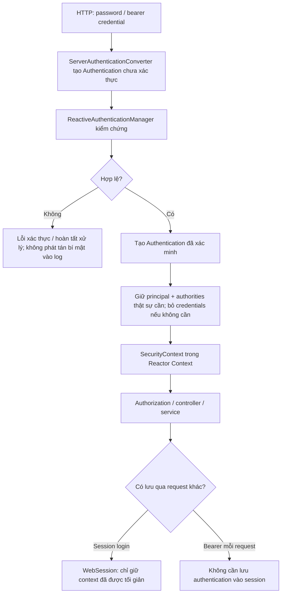

# Xóa thông tin bí mật và giới hạn dữ liệu được giữ trong `Authentication` (Spring Security Reactive)

Trong Spring Security Reactive, `Authentication` là đối tượng mà các bước xác thực và phân quyền dùng để đại diện cho danh tính hiện tại. Trước xác thực, nó có thể mang mật khẩu hoặc bearer token do client gửi; sau xác thực, nó thường giữ `principal`, các `GrantedAuthority` và thông tin cần thiết cho những bước xử lý tiếp theo. **Điều quan trọng là không để bí mật đầu vào tiếp tục sống trong `SecurityContext`, WebSession, cache hoặc log lâu hơn mức cần thiết.**

Bài học này giải thích hai việc liên quan nhưng khác nhau:

1. **Xóa hoặc ngừng giữ credentials** sau khi chúng đã được kiểm tra: dùng `CredentialsContainer`, `eraseCredentials()` và cách tạo kết quả xác thực không còn chứa bí mật.
2. **Giảm dữ liệu được giữ trong `Authentication`**: chỉ giữ định danh và quyền thực sự cần, tránh giữ password hash, access token thô, toàn bộ hồ sơ người dùng hoặc các đối tượng HTTP quá lớn.

Nội dung áp dụng cho Spring Boot 3.x, Spring Security 6.x và **Spring WebFlux** trên Java 17+. Cần phân biệt những hành vi thuộc API Spring Security chung với các chính sách mặc định của nhánh **Servlet**; không lấy cấu hình `ProviderManager` đồng bộ rồi mặc định rằng một `ReactiveAuthenticationManager` cũng làm y hệt.

## 1. Trong `Authentication` có những dữ liệu nào?

Interface `org.springframework.security.core.Authentication` có các thành phần chính:

| Thành phần | Ví dụ dữ liệu | Có nên giữ lâu? |
| --- | --- | --- |
| `getPrincipal()` | Username, `UserDetails`, đối tượng người dùng, `Jwt` | Giữ **định danh tối thiểu**; tránh hồ sơ đầy đủ, password hash hoặc claims không cần |
| `getCredentials()` | Mật khẩu vừa nhập, bearer access token, bằng chứng xác thực | Chỉ giữ cho đến khi kết thúc kiểm chứng, nếu cơ chế cho phép xóa |
| `getAuthorities()` | `ROLE_READER`, `SCOPE_orders.read` | Giữ các quyền cần cho authorization; cân nhắc thời hạn/độ mới của quyền |
| `getDetails()` | Metadata của request, IP, thông tin client, session id theo implementation | Chỉ giữ giá trị thật sự cần; không lưu HTTP headers/cookie hay `ServerWebExchange` nguyên vẹn |
| `isAuthenticated()` | Cờ trạng thái đã qua bước xác thực | Không chứa bí mật, nhưng **không thay thế** kiểm tra quyền hoặc trust resolver |
| `getName()` | Tên/ID danh tính | Hữu ích cho định danh, nhưng vẫn có thể là dữ liệu cá nhân |

**Thông tin bí mật** không chỉ là password dạng rõ. Password hash, access token/JWT, refresh token, API key, session ID, OTP, khóa riêng và dữ liệu nhận dạng nhạy cảm đều phải được bảo vệ. Password hash không phải mật khẩu gốc nhưng vẫn cần được bảo vệ để hạn chế lộ lọt và tấn công ngoại tuyến.

Một `Authentication` “đã xác thực” có thể vẫn giữ dữ liệu không nên đưa vào log hoặc response. Thấy `getCredentials() == null` cũng **chưa chứng minh** toàn bộ object an toàn: `getPrincipal()` có thể chứa `UserDetails.password`, `Jwt.getTokenValue()` hoặc các claims nhạy cảm; `getDetails()` có thể mang thông tin của request.

## 2. Vòng đời bí mật: thời điểm nào được xóa?



**Ranh giới quan trọng**:

1. Credentials từ HTTP là dữ liệu **chưa tin cậy**. Có thể cần tồn tại trong bộ nhớ trong lúc so khớp password hash, xác thực JWT, introspection hoặc kiểm tra OTP.
2. Sau khi manager hoàn thành kiểm chứng, ứng dụng nên **trả kết quả xác thực không mang credentials thô**, nếu không còn nghiệp vụ hợp lệ nào cần chúng.
3. Nếu cơ chế lưu `SecurityContext` vào WebSession hoặc nơi khác, nên chắc chắn object được lưu đã được tối giản trước khi persist.
4. Các bản sao trong HTTP headers, buffers, log, tracing, biến cục bộ hoặc một `String` khác **không tự biến mất** khi gọi một phương thức `eraseCredentials()` trên object `Authentication`.

Không được xóa credentials **trước** khi thành phần xác thực kiểm chứng xong, vì có thể khiến password check hoặc token validation thất bại. Ngược lại, để raw password đi tới controller hoặc cache sau khi đã xác thực là điều không cần thiết và tạo thêm bề mặt rò rỉ.

## 3. `CredentialsContainer` và `eraseCredentials()` làm gì?

Spring Security định nghĩa:

```java
package org.springframework.security.core;

public interface CredentialsContainer {
    void eraseCredentials();
}
```

Đây là **chữ ký API minh họa**; không cần tự tạo lại interface này trong dự án. Nhiều class Spring Security triển khai `CredentialsContainer`, trong đó có `AbstractAuthenticationToken`, `UsernamePasswordAuthenticationToken` và `org.springframework.security.core.userdetails.User`.

`AbstractAuthenticationToken.eraseCredentials()` gọi `eraseCredentials()` đối với các object trong `credentials`, `principal` và `details` **nếu chúng cũng triển khai `CredentialsContainer`**. `UsernamePasswordAuthenticationToken` còn có hành vi xóa trường credentials của chính token. Với `User` của Spring Security, `eraseCredentials()` làm trường `password` trở thành `null`.

Điều đó dẫn đến hai trường hợp khác nhau:

- Nếu token chứa password kiểu `String`, việc xóa thường **bỏ tham chiếu** tới chuỗi trong trường `credentials`. Nó **không ghi đè từng byte/ký tự** của chuỗi `String` đã được tạo; JVM quyết định khi nào vùng nhớ trở nên không thể truy cập và được thu gom.
- Nếu token chứa principal là một object `User` triển khai `CredentialsContainer`, xóa credentials có thể làm **thay đổi object principal** và làm mất password hash của nó. Đây là nguồn gốc của lỗi dùng chung `UserDetails` từ cache.

Vì vậy cần phân biệt **xóa tham chiếu trong token** với **xóa bản sao bí mật ở mọi nơi**. `eraseCredentials()` là một cơ chế giảm thời gian lưu giữ dữ liệu, không phải cam kết xóa vật lý ngay lập tức khỏi RAM, snapshot, heap dump hoặc log.

### Ví dụ cực ngắn

```java
var attempt =
    UsernamePasswordAuthenticationToken.unauthenticated(
        "reader", "demo-only-password");

System.out.println(attempt.getCredentials() != null); // true
attempt.eraseCredentials();
System.out.println(attempt.getCredentials() == null);  // true
```

Đoạn này cần import `org.springframework.security.authentication.UsernamePasswordAuthenticationToken`; có thể đặt trong một `main` của dự án có Spring Security. Nó xóa credentials trên **đối tượng attempt**, không xác thực thành công và không tạo `SecurityContext`.

## 4. Không nhầm hành vi Servlet `ProviderManager` với reactive manager

Tài liệu Spring Security nhánh **Servlet** nói `ProviderManager` thường gọi `eraseCredentials()` trên `Authentication` trả về sau xác thực thành công; `ProviderManager` có tùy chọn `eraseCredentialsAfterAuthentication`. Đây là cơ chế của `AuthenticationManager` **đồng bộ** trong mô hình Servlet.

Với **WebFlux**:

- `ReactiveAuthenticationManager.authenticate(Authentication)` trả về `Mono<Authentication>`.
- `UserDetailsRepositoryReactiveAuthenticationManager` là một implementation dùng `ReactiveUserDetailsService` và `PasswordEncoder`.
- Những cơ chế HTTP Basic, form login hoặc bearer có thể có token đầu vào/đầu ra khác nhau, và có những implementation đã trả kết quả tối giản theo cách riêng.
- **Không suy ra** mọi reactive manager, authentication filter hoặc token class đều tự xóa toàn bộ credentials sau thành công. Phải kiểm tra **implementation và phiên bản đang dùng**, dữ liệu thực tế trong kết quả, cách context được lưu và test riêng cho cơ chế xác thực của ứng dụng.

Đặc biệt, **không** dùng cấu hình như `AuthenticationManagerBuilder.eraseCredentials(false)` hoặc `ProviderManager.setEraseCredentialsAfterAuthentication(false)` để “sửa” mã WebFlux nếu ứng dụng đang sử dụng `ReactiveAuthenticationManager`; những API trên không phải công tắc toàn cục cho mọi cơ chế xác thực reactive.

Giải pháp an toàn và dễ kiểm chứng trong **custom reactive authentication** là: sau khi manager đáng tin đã xác minh credentials, **trả về object `Authentication` chỉ mang những dữ liệu đã được kiểm chứng và cần thiết**, thay vì phụ thuộc vào việc xóa hàng loạt ở thời điểm muộn.

## 5. Ví dụ Java 17+ chạy được: xác thực thật rồi tạo kết quả tối giản

Ví dụ có một user `reader` với role `READER`, được kiểm tra bằng `UserDetailsRepositoryReactiveAuthenticationManager`. Sau khi manager xác thực thành công, chương trình tạo một `UsernamePasswordAuthenticationToken` mới với:

- `principal`: chuỗi username **đã được manager xác minh**;
- `credentials`: `null`;
- `authorities`: danh sách quyền **đã được manager xác minh**, không lấy trực tiếp từ HTTP.

Việc làm này phù hợp với bài demo username/password. **Không tự ý biến mọi `JwtAuthenticationToken` hoặc `OAuth2AuthenticationToken` thành username/password token**: các cơ chế đó có thể cần claims, attributes và hành vi khác. Việc tối giản phải giữ đúng hợp đồng của loại authentication và tính năng đang sử dụng.

### 5.1. Cấu hình chạy

Tạo/ dùng dự án Spring Boot 3.x đã cấu hình Gradle và Java 17+. Trong `build.gradle` cần các dependencies:

```groovy
dependencies {
    implementation 'org.springframework.boot:spring-boot-starter-webflux'
    implementation 'org.springframework.boot:spring-boot-starter-security'
}
```

Để chạy **lớp demo có `main` độc lập** từ Gradle, thêm task này vào `build.gradle` của dự án:

```groovy
tasks.register('runCredentialDemo', JavaExec) {
    group = 'application'
    description = 'Observe Authentication credential minimization'
    classpath = sourceSets.main.runtimeClasspath
    mainClass = 'demo.credentials.CredentialErasureDemo'
}
```

Task chỉ chạy lớp Java của bài học; nó **không khởi động HTTP server** và không cần `@SpringBootApplication`.

### 5.2. Tệp `src/main/java/demo/credentials/CredentialErasureDemo.java`

```java
package demo.credentials;

import java.util.List;

import org.springframework.security.authentication.UserDetailsRepositoryReactiveAuthenticationManager;
import org.springframework.security.authentication.UsernamePasswordAuthenticationToken;
import org.springframework.security.core.Authentication;
import org.springframework.security.core.GrantedAuthority;
import org.springframework.security.core.context.ReactiveSecurityContextHolder;
import org.springframework.security.core.userdetails.User;
import org.springframework.security.core.userdetails.UserDetails;
import org.springframework.security.crypto.factory.PasswordEncoderFactories;
import org.springframework.security.crypto.password.PasswordEncoder;
import org.springframework.security.provisioning.MapReactiveUserDetailsService;

public class CredentialErasureDemo {
    public static void main(String[] args) {
        // Tài khoản chỉ phục vụ bài học; không dùng làm credential thật.
        PasswordEncoder encoder =
            PasswordEncoderFactories.createDelegatingPasswordEncoder();

        UserDetails storedUser = User.withUsername("reader")
            .password(encoder.encode("demo-only-123"))
            .roles("READER")
            .build();

        var users = new MapReactiveUserDetailsService(storedUser);
        var manager =
            new UserDetailsRepositoryReactiveAuthenticationManager(users);
        manager.setPasswordEncoder(encoder);

        var attempt =
            UsernamePasswordAuthenticationToken.unauthenticated(
                "reader", "demo-only-123");

        System.out.println("INPUT authenticated="
            + attempt.isAuthenticated());
        System.out.println("INPUT credentialsPresent="
            + (attempt.getCredentials() != null));

        Authentication verifiedMinimal;
        try {
            verifiedMinimal = manager.authenticate(attempt)
                .map(verified -> (Authentication)
                    UsernamePasswordAuthenticationToken.authenticated(
                        verified.getName(),
                        null,
                        List.copyOf(verified.getAuthorities())))
                .block();  // Chỉ tại ranh giới main/demo, không ở WebFlux handler.
        }
        finally {
            // Giảm thời gian lưu tham chiếu ở attempt kể cả khi xác thực lỗi.
            attempt.eraseCredentials();
        }

        if (verifiedMinimal == null) {
            throw new IllegalStateException("Authentication was empty");
        }

        System.out.println("INPUT credentialsAfterErase="
            + (attempt.getCredentials() == null));
        System.out.println("RESULT authenticated="
            + verifiedMinimal.isAuthenticated());
        System.out.println("RESULT name=" + verifiedMinimal.getName());
        System.out.println("RESULT credentialsPresent="
            + (verifiedMinimal.getCredentials() != null));
        System.out.println("RESULT authorities="
            + verifiedMinimal.getAuthorities().stream()
                .map(GrantedAuthority::getAuthority)
                .sorted()
                .toList());

        String usernameInContext =
            ReactiveSecurityContextHolder.getContext()
                .map(ctx -> ctx.getAuthentication().getName())
                .contextWrite(
                    ReactiveSecurityContextHolder.withAuthentication(
                        verifiedMinimal))
                .block();  // Demo main, không phải filter/controller HTTP.

        System.out.println("CONTEXT name=" + usernameInContext);
    }
}
```

Chạy từ thư mục dự án Spring Boot:

```bash
# Linux/macOS
./gradlew runCredentialDemo

# Windows
gradlew.bat runCredentialDemo
```

Các dòng **do chương trình demo in ra** theo đúng thứ tự:

```text
INPUT authenticated=false
INPUT credentialsPresent=true
INPUT credentialsAfterErase=true
RESULT authenticated=true
RESULT name=reader
RESULT credentialsPresent=false
RESULT authorities=[ROLE_READER]
CONTEXT name=reader
```

Gradle có thể in thêm thông báo task/build ngoài bảy dòng này. Hash tạo bởi `PasswordEncoder` có thể khác nhau giữa những lần chạy; chương trình không in hash nên output trên không phụ thuộc giá trị salt.

Giải thích:

1. `attempt` là một token **chưa xác thực**, mang mật khẩu demo chỉ để manager so khớp.
2. `manager.authenticate(attempt)` thực sự kiểm tra user/password. Chỉ khi manager phát một kết quả hợp lệ, `.map(...)` mới tạo một token **đã xác thực** giữ `getName()` và `getAuthorities()` từ kết quả tin cậy.
3. Trong kết quả mới, `credentials == null` **ngay từ lúc tạo**, không cần giữ bí mật tới cuối request.
4. `finally` xóa trường credentials của object `attempt` khi bước xác thực đã kết thúc; đây là chương trình dòng lệnh đồng bộ, nên dùng `.block()` **chỉ tại `main`**.
5. `ReactiveSecurityContextHolder.withAuthentication(verifiedMinimal)` chỉ cấp authentication cho **subscription** đang minh họa. Nó không lưu một phiên đăng nhập, cũng không tự tích hợp vào HTTP filter thật.

Hãy quan sát rằng chương trình không gọi `eraseCredentials()` lên `storedUser`/principal của manager. Việc **không xóa tùy tiện object dùng chung** là cố ý; phần tiếp theo giải thích lý do.

### 5.3. Đây là mẫu mô phỏng tốt, nhưng không phải toàn bộ authentication flow HTTP

Trong request WebFlux thực, `AuthenticationWebFilter`/cơ chế tương đương kết hợp converter, manager, success/failure handler và `SecurityContext`. Đoạn `main` trên giúp quan sát việc kiểm chứng và tối giản dữ liệu. Để áp dụng trong ứng dụng, đặt việc tối giản **sau thành công của manager đáng tin** và để các filter Spring Security thực hiện context propagation.

Đối với một custom `ReactiveAuthenticationManager`, pattern sau là **đoạn minh họa tích hợp** (đã có biến `trustedDelegate` kiểu `ReactiveAuthenticationManager`):

```java
ReactiveAuthenticationManager minimalManager = attempt ->
    trustedDelegate.authenticate(attempt)
        .map(verified -> (Authentication)
            UsernamePasswordAuthenticationToken.authenticated(
                verified.getName(),
                null,
                List.copyOf(verified.getAuthorities())));
```

Đây chỉ phù hợp khi hệ thống của bạn chủ đích dùng **username/password**, nơi `principal` dạng String và authorities đã đủ cho downstream. Không dùng pattern này cho OAuth2/JWT/SAML, hoặc cho chức năng cần `UserDetails`, attributes hay token chuyên biệt mà chưa thiết kế phương án thay thế. `minimalManager` cũng chưa tự xử lý lifecycle của input credentials hoặc các đường đi lỗi; điều đó thuộc cấu hình filter và service thực tế.

## 6. Vì sao xóa principal có thể làm hỏng cache `UserDetails`?

Lớp `org.springframework.security.core.userdetails.User` lưu cả password hash và implements `CredentialsContainer`. Khi gọi `eraseCredentials()` lên một `UsernamePasswordAuthenticationToken` có principal là **đối tượng `User`**, cơ chế xóa credentials lồng nhau có thể gọi `User.eraseCredentials()` và đặt password hash thành `null`.

Nếu object `User` đó **chính là instance được một cache hoặc in-memory user store giữ**, bạn đã làm biến đổi dữ liệu mà những lần xác thực sau có thể cần. Hậu quả có thể là password matching bị lỗi hoặc hệ thống buộc phải tải lại user. Lỗi này đặc biệt khó thấy khi test với một request nhưng thất bại ở request thứ hai.

### Minh họa cache bị chia sẻ

```java
// Đoạn minh họa với User của Spring Security.
User cached = (User) User.withUsername("reader")
    .password("{noop}demo-only")
    .roles("READER")
    .build();

var result = UsernamePasswordAuthenticationToken.authenticated(
    cached, null, cached.getAuthorities());

// VÌ principal trỏ đúng instance cached, thao tác này có tác dụng phụ:
result.eraseCredentials();

System.out.println(cached.getPassword() == null); // true
```

Đây là minh họa về **tác dụng phụ của chia sẻ instance**, không phải khuyến nghị dùng `{noop}` hay dùng token tự phong để xác thực. Chỉ password demo giả được sử dụng. Trong ứng dụng thật, phải lấy kết quả từ manager đáng tin.

Các cách giảm rủi ro:

- **Ưu tiên tạo một principal an toàn, tối giản** cho `Authentication` đã xác thực, ví dụ user ID/username và authorities, nếu downstream không cần `UserDetails`.
- Nếu cần `UserDetails` sau xác thực, xem xét **bản sao** tách khỏi object cache; việc xóa credentials trên bản sao sẽ không thay đổi cached instance.
- Không disable việc xóa credentials toàn hệ thống như một cách sửa mặc định. Quyết định giữ lại password hash cần lý do rõ ràng, vòng đời và phạm vi lưu giữ được kiểm soát.
- Kiểm tra implementation user store/cache: `MapReactiveUserDetailsService`, repository custom, Redis cache hay một DTO được chia sẻ có thể có những quy tắc clone/mutable khác nhau.

**Lưu ý:** việc giữ password hash ở cache để xác thực request sau là một nhu cầu **của user store**, khác hẳn việc giữ nó trong `SecurityContext` cho controller. Có thể cần hash ở khu vực lưu trữ được bảo vệ, nhưng không có nghĩa hash phải xuất hiện trong `Authentication` của request.

## 7. Unit test xác nhận xóa credentials và tác dụng phụ

Tệp `src/test/java/demo/credentials/CredentialErasureTest.java` dưới đây kiểm tra hành vi cụ thể của Spring Security token. Thêm dependency JUnit từ Spring Boot:

```groovy
dependencies {
    testImplementation 'org.springframework.boot:spring-boot-starter-test'
}
```

```java
package demo.credentials;

import org.junit.jupiter.api.Test;
import org.springframework.security.authentication.UsernamePasswordAuthenticationToken;
import org.springframework.security.core.userdetails.User;

import static org.junit.jupiter.api.Assertions.*;

class CredentialErasureTest {

    @Test
    void clearsCredentialsInUnauthenticatedToken() {
        var attempt = UsernamePasswordAuthenticationToken.unauthenticated(
            "reader", "demo-only");
        assertNotNull(attempt.getCredentials());

        attempt.eraseCredentials();

        assertNull(attempt.getCredentials());
        assertFalse(attempt.isAuthenticated());
    }

    @Test
    void clearsNestedUserPasswordWhenPrincipalIsShared() {
        var shared = User.withUsername("reader")
            .password("{noop}demo-only")
            .roles("READER")
            .build();
        var authenticated = UsernamePasswordAuthenticationToken.authenticated(
            shared, null, shared.getAuthorities());

        assertNotNull(shared.getPassword());
        authenticated.eraseCredentials();

        assertNull(shared.getPassword());
        assertTrue(authenticated.isAuthenticated());
    }

    @Test
    void safePrincipalDoesNotHoldUserDetailsPassword() {
        var safe = UsernamePasswordAuthenticationToken.authenticated(
            "reader", null, java.util.List.of(
                new org.springframework.security.core.authority
                    .SimpleGrantedAuthority("ROLE_READER")));

        assertEquals("reader", safe.getPrincipal());
        assertNull(safe.getCredentials());
        assertEquals("ROLE_READER",
            safe.getAuthorities().iterator().next().getAuthority());
    }
}
```

Chạy:

```bash
# Linux/macOS
./gradlew test --tests 'demo.credentials.CredentialErasureTest'

# Windows
gradlew.bat test --tests "demo.credentials.CredentialErasureTest"
```

Ba test trên quan sát **sự thay đổi trực tiếp của object**, không cần server HTTP. Test thứ hai cố ý cho thấy việc gọi `eraseCredentials()` lên một token có thể làm password hash của principal dùng chung trở thành `null`; đó là lý do phải tránh lưu cùng một instance `User` trong cache và `SecurityContext` nếu dự kiến sẽ xóa credentials.

## 8. Giữ những gì trong `SecurityContext` của WebFlux?

Trong mô hình WebFlux, Spring Security đưa authentication vào `SecurityContext` qua **Reactor Context** theo subscription. `ReactiveSecurityContextHolder.getContext()` đọc ngữ cảnh đó. Với form/session, `ServerSecurityContextRepository` có thể lưu/khôi phục context giữa các request; với resource server bearer, authentication thường được tạo lại trên từng request.

Việc không dùng `ThreadLocal` không làm dữ liệu tự an toàn hơn. Nếu context giữ object quá lớn, nó vẫn có thể được truy cập bởi nhiều thành phần downstream trong cùng subscription; nếu lưu vào WebSession hoặc cache, thời gian tồn tại còn dài hơn.

Một principal tối giản cho một dịch vụ thông thường có thể chứa:

```text
Principal:
  userId: "user-42"
  tenantId: "tenant-7"       # Chỉ nếu cần phân tách tenant
Authorities:
  - "ROLE_READER"
Credentials:
  null
Details:
  null hoặc metadata tối thiểu đã được kiểm tra
```

Đây là **sơ đồ dữ liệu** minh họa, không phải một định dạng tự động mà Spring Security buộc phải dùng. Quy tắc quan trọng: các trường userId, tenantId và authorities phải đến từ **nguồn đã xác minh**, không lấy tùy ý từ request header.

### Những dữ liệu thường không nên giữ trong `Authentication`

- Raw password/OTP, bearer access token/refresh token, API key, private key hoặc bí mật client.
- Password hash thuộc `UserDetails`, nếu controller/authorization không cần truy cập hash.
- Toàn bộ profile người dùng: email, số điện thoại, địa chỉ, lịch sử đăng nhập, danh sách giao dịch, dữ liệu cá nhân không dùng trong authorization.
- HTTP request/response/body, headers/cookie nguyên vẹn hoặc `ServerWebExchange`, vì vừa giữ dữ liệu nhạy cảm vừa có thể làm tăng phạm vi tham chiếu tới tài nguyên của request.
- Token claims không liên quan tới service; những claim cần để cấp quyền vẫn phải được kiểm chứng và ánh xạ cẩn thận.

Một số protocol đòi hỏi tiếp tục giữ **một token hoặc thuộc tính cần cho tác vụ downstream** (ví dụ một OAuth2 client thực hiện gọi API thay mặt người dùng). Khi đó không được xóa mù quáng khiến chức năng hỏng; cần sử dụng kho token được thiết kế riêng, vòng đời và phạm vi truy cập rõ ràng, tránh lưu thừa trong `Authentication`.

## 9. Riêng với JWT và opaque bearer token

Đừng giả định rằng với JWT “sau xác thực, `getCredentials()` luôn là `null`”. Một số implementation giữ `Jwt` hoặc token object ở `principal`, `credentials` hay thuộc tính riêng để cho phép downstream tra cứu claims và token value. `JwtAuthenticationToken` là một lớp chuyên biệt; `BearerTokenAuthentication` có thể dùng cho opaque token. Truy cập `Jwt.getTokenValue()` vẫn có thể tiết lộ access token ngay cả khi một getter khác đã trả `null`.

Cần áp dụng hai cấp bảo vệ:

1. **Giảm thông tin được dùng cho authorization**: ánh xạ scope/role, subject, audience/issuer/tenant đã xác minh; tránh sao chép tất cả claims vào DTO, log hoặc session nếu không cần.
2. **Bảo vệ chính token ở những nơi nó còn phải tồn tại**: không đưa vào URL/query string, log, exception message, tracing span, metrics label, response error hoặc `toString()` của object tùy biến.

Với **JWT đã được client phát hành**, xóa object trong bộ nhớ server không thu hồi được token ở client, không hủy token đã phát hành và không làm claim nhạy cảm biến mất khỏi payload. Token vẫn có hiệu lực theo chính sách validation/revocation của hệ thống. Với **opaque token**, introspection/kiểm chứng và danh tính được trả về cũng cần được tối giản trước khi chuyển vào các hệ thống logging/cache.

Một thiết kế cần truyền token đi gọi dịch vụ khác phải có quyết định riêng: token relay có thực sự được phép và cần thiết không, phạm vi token có đúng audience không, nơi lưu và truy cập token có được bảo vệ không? Không dùng một token xác thực request đến làm mặc định cho mọi outbound HTTP call.

## 10. Session, logout, cache và giới hạn thời gian giữ dữ liệu

### Session login

Khi ứng dụng lưu `SecurityContext` qua `WebSessionServerSecurityContextRepository`, `Authentication` có thể được giữ **qua nhiều request** cho đến khi session hết hạn hoặc bị vô hiệu hóa. Nếu principal là object nặng hoặc chứa hash/token, dữ liệu đó cũng có thể tồn tại dài hơn và được đưa vào kho session dùng chung.

- Tối giản authentication **trước khi lưu** qua session repository.
- Bảo vệ session store bằng phân quyền, mã hóa truyền và lưu theo mô hình hạ tầng.
- Đặt TTL/idle timeout, logout và session invalidation theo chính sách ứng dụng.
- Nếu authorities/role thay đổi giữa phiên, quyết định khi nào cần nạp lại quyền hoặc buộc người dùng xác thực lại; dữ liệu tối giản nhưng quá cũ vẫn có thể gây lỗi authorization.
- Không cho rằng logout đã xóa ngay mọi bản sao trong cache, log hoặc distributed storage; kiểm tra các vòng đời riêng.

### API bearer không lưu session

Với API chỉ xác thực bearer từng request, thường không cần lưu `Authentication` vào `WebSession`. Tuy vậy bearer token vẫn đi qua HTTP stack và có thể được giữ bởi client, thư viện JWT hoặc một cache chuyên biệt; stateless chỉ mô tả **mô hình trạng thái xác thực**, không phải cam kết mọi dữ liệu đã biến mất khỏi RAM.

### Cache `UserDetails`

Nếu hệ thống cache `UserDetails` có password hash để tránh truy vấn lại user store, phải xác định:

- Ai sở hữu object được cache và object đó mutable hay immutable?
- Token kết quả có dùng **cùng instance** làm principal không?
- Việc xóa credentials ở token có làm thay đổi cache không?
- Cache có TTL, phạm vi truy cập và eviction khi đổi password/khóa tài khoản không?
- Có thể trả một **bản sao cho authentication result** và chỉ giữ hash trong user store/cache bảo vệ tốt không?

Không dùng lời khuyên “disable eraseCredentials” trong Servlet làm mặc định cho reactive. Kiểm chứng bằng test với **ít nhất hai lần xác thực liên tiếp** và kiểm tra object cache không bị vô tình thay đổi.

## 11. Xóa references khác với xóa dữ liệu khỏi toàn JVM

Một số giới hạn kỹ thuật cần biết:

1. **Java `String` là immutable**. Không thể đảm bảo xóa từng byte/ký tự của mọi `String` đã tồn tại chỉ nhờ đặt biến thành `null`. Các bản sao có thể nằm trong parser, string pool, heap, exception hay thread-local khác.
2. `eraseCredentials()` có phạm vi ở **object cụ thể** và những nested object hỗ trợ `CredentialsContainer`. Nó không quét toàn bộ heap, file log, telemetry backend hoặc dữ liệu client.
3. `char[]` hoặc `byte[]` có thể được điền đè khi API cho phép, nhưng thư viện/framework có thể đã tạo bản sao mới hoặc chuyển thành `String`. Không hứa “wipe hoàn toàn” nếu không kiểm soát toàn bộ đường đi dữ liệu.
4. **Password hash** phải còn trong một kho xác thực an toàn nếu hệ thống cần kiểm tra password về sau; xóa hash khỏi `Authentication` không có nghĩa xóa tài khoản/password đã lưu.
5. **JWT đang hợp lệ** vẫn được bên có token sử dụng đến khi hết hạn hoặc bị thu hồi theo cơ chế của issuer/resource server. Xóa local reference không revoke token.
6. Dữ liệu nhạy cảm trong **tracing, logs, crash report, heap dump** phải có chính sách redaction, retention và access control riêng.

Mục tiêu thực tế là **data minimization**: giữ ít nhất có thể, trong thời gian ngắn nhất cần thiết, tại nơi có quyền truy cập tối thiểu, và không tạo bản sao/đường phát tán không cần thiết.

## 12. Dọn dẹp cả đường lỗi trong reactive pipeline

Không phải authentication request nào cũng thành công. Đường sai password, token hết hạn, timeout, client hủy và retry cũng phải được kiểm tra xem có giữ references nhạy cảm không.

Trong một **custom** authentication flow, có thể tạo attempt **theo subscription** bằng `Mono.defer` và giảm thời gian giữ credentials trong `doFinally`:

```java
// Đoạn minh họa trong một hàm đã có biến rawUsername, rawPassword
// và trustedManager kiểu ReactiveAuthenticationManager.
Mono<Authentication> authentication = Mono.defer(() -> {
    var attempt =
        UsernamePasswordAuthenticationToken.unauthenticated(
            rawUsername, rawPassword);

    return trustedManager.authenticate(attempt)
        .map(verified -> (Authentication)
            UsernamePasswordAuthenticationToken.authenticated(
                verified.getName(), null,
                java.util.List.copyOf(verified.getAuthorities())))
        .doFinally(signal -> attempt.eraseCredentials());
});
```

Đoạn trên **không độc lập biên dịch** vì `rawUsername`, `rawPassword`, `trustedManager` được cung cấp từ ứng dụng, và chỉ minh họa thứ tự. `Mono.defer` tránh chia sẻ một mutable attempt giữa nhiều subscription; `doFinally` chạy khi pipeline kết thúc bằng complete/error/cancel. Nó **không** xóa các biến đầu vào `rawPassword`, các bản sao khác hoặc cưỡng bức hủy được một thư viện blocking.

Trong code thực tế, custom filter cần xử lý rõ converter, success/failure handler, concurrency, retry, cancellation và context propagation. Nếu authentication kết quả cần loại token riêng, hãy tạo một **minimal authenticated type** phù hợp thay cho `UsernamePasswordAuthenticationToken`; không ghép mẫu này trực tiếp vào resource server JWT bằng cách thay đổi semantic của token.

**Một lưu ý về thứ tự:** nếu gọi `attempt.eraseCredentials()` ngay **trước** `trustedManager.authenticate(attempt)`, manager sẽ mất bằng chứng cần kiểm tra. Việc thu dọn nằm **sau khi kết thúc** xử lý dùng credentials, trên cả đường thành công/thất bại/hủy nếu có thể.

## 13. Không để logging, monitoring và API trả bí mật trở lại

Những cách dễ làm lộ bí mật ngay cả khi đã tối giản `Authentication`:

- `log.info("auth={}", authentication)` hoặc `log.debug("principal={}", principal)` mà không biết `toString()` của mọi implementation và object lồng nhau in gì.
- Ghi nguyên `Authorization`, `Cookie`, `Set-Cookie`, form body/password, token introspection response hoặc HTTP request body.
- Đưa raw token/user email vào metric tags, trace span attributes, MDC hoặc exception message.
- Trả thẳng `Authentication`/`UserDetails` từ controller rồi để JSON serializer tạo response; khi đó có thể lộ field không cần thiết, tùy serializer/annotation.
- Lưu `Authentication` vào distributed cache hoặc gửi qua message queue để “dễ debug”; đối tượng nội bộ này không phải hợp đồng dữ liệu công khai.

Thay vì trả cả principal:

```java
// Đoạn minh họa trong service/controller đã được bảo vệ.
Mono<CurrentUserView> currentUser =
    ReactiveSecurityContextHolder.getContext()
        .map(context -> new CurrentUserView(
            context.getAuthentication().getName()));

record CurrentUserView(String username) {}
```

Đây là **đoạn tích hợp minh họa**; `CurrentUserView` chỉ là response DTO gồm đúng trường cần trả, không chứa password, token hay authorities trừ khi API thật sự yêu cầu. Ở ứng dụng thực, nên lấy user ID ổn định đã được xác minh nếu endpoint cần định danh kỹ thuật, và xác định chính sách hiển thị tên/PII.

Logging thích hợp hơn:

```text
event=authentication_success mechanism=basic outcome=success requestId=<id>
event=authentication_failure mechanism=bearer outcome=invalid_token requestId=<id>
```

Các giá trị `<id>` là placeholder cho request ID an toàn, **không** phải token/session id. Có thể dùng định danh giả danh hoặc mã kiểm toán đã được phép nếu cần theo dõi danh tính; không sử dụng password hay bearer token làm khóa tương quan.

## 14. Kiểm tra đúng cả nội dung và vòng đời

Một checklist kiểm thử cho dịch vụ WebFlux:

| Tình huống | Điều cần chứng minh |
| --- | --- |
| Password đúng | Manager phát authentication đã xác thực và chỉ có authorities được tin cậy |
| Password sai | Không có `SecurityContext` giả được cấp quyền; lỗi được xử lý không lộ bí mật |
| Credentials bị xóa | `UsernamePasswordAuthenticationToken.getCredentials()` trả `null` sau khi xóa |
| Principal là `User` chia sẻ cache | Test xác nhận không làm mất password hash ở object cache nếu còn cần xác thực |
| Session login | Object được **lưu** qua session không giữ raw password/token ngoài yêu cầu |
| Bearer JWT | Không đưa token value/claims nhạy cảm vào log, response, session hoặc metric |
| Context propagation | Downstream đọc được user/authority cần thiết qua Reactor Context |
| Controller response | DTO chỉ chứa các trường công khai đã định nghĩa |
| Logout/timeout | Session/context bị kết thúc theo policy; các cache/log có vòng đời riêng |
| Retry/concurrent requests | Không tái sử dụng mutable authentication attempt giữa các subscription |
| Error/cancel | Xử lý lỗi/hủy không vô tình giữ reference ở hàng đợi hoặc callback lâu dài |
| Token/role thay đổi | Authorization policy nhận diện token hết hạn và tránh quyền cũ tồn tại quá lâu |

Khi kiểm thử, có thể dùng JUnit cho hành vi `eraseCredentials`, `StepVerifier` cho các tín hiệu Reactor, `WebTestClient` cho request thật và test tích hợp session/token cho các đường lưu context. Đừng chỉ kiểm tra `getCredentials() == null`: phải xem thêm **principal**, **details**, context persistence và các điểm logging. Với hệ thống có `UserDetails` cache, thử nhiều authentication liên tiếp để phát hiện object bị xóa nhầm.

## 15. Lỗi phổ biến và hướng sửa

**Lỗi 1 — Giữ toàn bộ `UserDetails` trong session dù controller chỉ cần username.**  
Hãy cân nhắc principal là ID/username đã xác minh và authorities cần thiết. Password hash và hồ sơ đầy đủ nên nằm trong kho dữ liệu chuyên trách.

**Lỗi 2 — Tưởng `getCredentials() == null` nghĩa token không còn bí mật.**  
Kiểm tra cả `getPrincipal()`, `getDetails()`, token object/claims chuyên biệt và bản sao trong log/cache.

**Lỗi 3 — Gọi `eraseCredentials()` lên `User` được cache dùng chung.**  
Xóa có thể làm password hash của chính object cache trở thành `null`; dùng principal tối giản hoặc bản sao tách biệt, test nhiều request.

**Lỗi 4 — Lấy `ProviderManager.eraseCredentialsAfterAuthentication` làm giả định cho WebFlux.**  
Cần kiểm chứng trực tiếp reactive manager/filter/token hiện hành; không đánh đồng Servlet và Reactive.

**Lỗi 5 — Xóa credentials trước khi manager kiểm chứng.**  
Manager không còn đầu vào hợp lệ. Thu dọn sau khi credentials hết cần thiết, chú ý cả error/cancel.

**Lỗi 6 — Dùng `Mono.just(blockingPasswordCheck())` hoặc `.block()` trong WebFilter.**  
Những lời gọi này có thể chặn event loop. Sử dụng reactive API, phần xử lý CPU password hashing phù hợp scheduler và cô lập I/O blocking đúng cách. Trong demo, `.block()` chỉ xuất hiện ở `main` đồng bộ.

**Lỗi 7 — Tự đặt `isAuthenticated=true` và bỏ credentials để giả làm xác thực.**  
Một token không có password vẫn có thể bị tạo sai từ dữ liệu chưa kiểm chứng. Chỉ tin `Authentication` do manager/validator hợp lệ phát ra rồi mới tối giản.

**Lỗi 8 — Tưởng xóa credentials là logout/revoke token.**  
Xóa dữ liệu cục bộ không đóng session, hủy JWT hay xóa mọi log. Vòng đời đăng nhập/thu hồi token là các cơ chế riêng.

**Lỗi 9 — Trả nguyên `Authentication` từ REST API.**  
Dùng DTO chứa dữ liệu được công khai, không để serializer quyết định thay cho chính sách dữ liệu.

**Lỗi 10 — Cho rằng immutable `String` đã được xóa vật lý khi đặt thành `null`.**  
Đó là giảm tham chiếu. Nếu cần kiểm soát bí mật mạnh hơn, thiết kế cách nhận/xử lý credential từ đầu và không sao chép/ghi log ngoài mức cần; không hứa xóa toàn bộ JVM heap.

## Ghi nhớ

- **Xóa credentials** và **giảm dữ liệu trong Authentication** là hai bước bổ trợ: xóa tham chiếu đến bí mật đầu vào; giữ trong kết quả chỉ định danh và quyền đã xác minh.
- `CredentialsContainer`/`eraseCredentials()` hoạt động theo **implementation và object graph**, không quét toàn bộ bộ nhớ. `UsernamePasswordAuthenticationToken` xóa trường credentials; `User` có thể mất password hash.
- Với **WebFlux**, không mặc định behavior của Servlet `ProviderManager` áp dụng cho mọi `ReactiveAuthenticationManager`. Phải kiểm chứng manager, filter, persistence và token type cụ thể.
- Tránh để cùng một mutable `UserDetails` vừa ở cache vừa là principal bị xóa; ưu tiên principal tối giản hoặc bản sao.
- `SecurityContext` qua Reactor Context có thể tồn tại một request hoặc được lưu theo session; dữ liệu được giữ cần tương xứng **mục đích và thời hạn**.
- `getCredentials()==null` không tự bảo đảm an toàn. Giữ token, claims, PII và metadata nhạy cảm khỏi response/log/cache/tracing; kiểm tra đường thành công, lỗi và hủy.

### Tài liệu chính thức

- [Spring Security 6.5 — `CredentialsContainer`](https://docs.spring.io/spring-security/reference/6.5/api/java/org/springframework/security/core/CredentialsContainer.html)
- [Spring Security 6.5 — `UsernamePasswordAuthenticationToken`](https://docs.spring.io/spring-security/reference/6.5/api/java/org/springframework/security/authentication/UsernamePasswordAuthenticationToken.html)
- [Spring Security 6.5 — `AbstractAuthenticationToken`](https://docs.spring.io/spring-security/reference/6.5/api/java/org/springframework/security/authentication/AbstractAuthenticationToken.html)
- [Spring Security 6.5 — `UserDetailsRepositoryReactiveAuthenticationManager`](https://docs.spring.io/spring-security/reference/6.5/api/java/org/springframework/security/authentication/UserDetailsRepositoryReactiveAuthenticationManager.html)
- [Spring Security 6.5 — `AuthenticationWebFilter`](https://docs.spring.io/spring-security/reference/6.5/api/java/org/springframework/security/web/server/authentication/AuthenticationWebFilter.html)
- [Spring Security — Credential erasure và cache UserDetails (Servlet reference; đọc với chú ý khác biệt Reactive)](https://docs.spring.io/spring-security/reference/6.5/servlet/authentication/passwords/caching.html)
