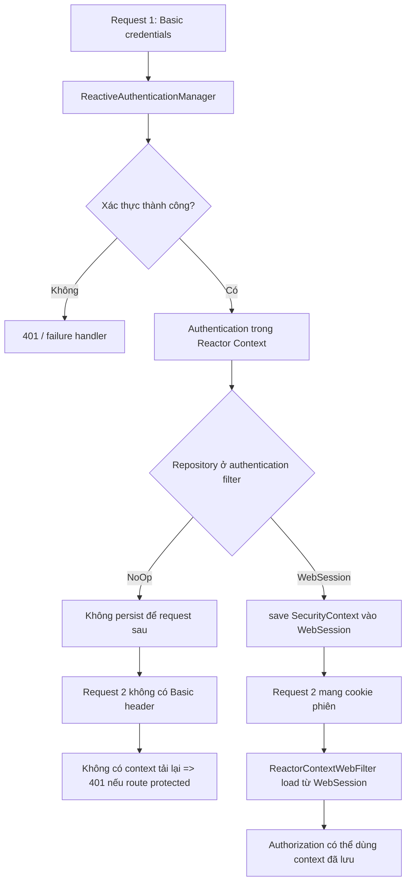

# Lựa chọn lưu hoặc không lưu ngữ cảnh khi dùng HTTP Basic trong Spring Security Reactive

Trong **Spring Security Reactive (Spring WebFlux)**, HTTP Basic đọc thông tin xác thực từ header `Authorization: Basic ...` và kiểm tra username/password cho request. Sau khi xác thực thành công, Spring Security có thể đưa `Authentication` vào `SecurityContext` trong **Reactor Context** để controller và authorization đọc trong **request hiện tại**. Một quyết định độc lập là có **lưu** `SecurityContext` để dùng lại ở những request sau hay không.

Hai lựa chọn có hành vi khác nhau rõ rệt:

- **Không lưu** (thường phù hợp API gọi bằng công cụ/ứng dụng gửi Basic credentials trên từng request): `Authentication` chỉ có hiệu lực trong pipeline request hiện tại; request mới không gửi credentials sẽ bị thách thức xác thực lại.
- **Lưu bằng WebSession** (chỉ khi thực sự muốn trạng thái đăng nhập trên máy chủ): sau một lần HTTP Basic hợp lệ, context có thể được lưu trong `WebSession`; request sau mang cookie phiên có thể được nhận dạng dù **không** gửi lại Basic header.

Bài này trình bày cơ chế tải/lưu riêng biệt, ví dụ cấu hình Spring Boot 3.x / Spring Security 6.x trên Java 17+, cách thử bằng `curl` và `WebTestClient`, rủi ro CSRF, tác động của logout và những tình huống dễ cấu hình sai.

> Phạm vi là **Spring WebFlux**, không phải Servlet. Dùng `ServerHttpSecurity`, `SecurityWebFilterChain`, `ServerSecurityContextRepository` và `ReactiveSecurityContextHolder`. Các API `HttpSecurity`, `HttpSessionSecurityContextRepository`, `SecurityContextHolder` dựa trên `ThreadLocal` và `SessionCreationPolicy.STATELESS` thuộc cách cấu hình Servlet; không sao chép trực tiếp sang WebFlux.

## 1. HTTP Basic giải quyết việc gì, và không giải quyết việc gì?

Một client gửi cặp username/password trong header HTTP Basic. Ví dụ về cấu trúc (giá trị thực phải được Base64-encode từ `username:password`):

```http
GET /secure/whoami HTTP/1.1
Host: localhost:8080
Authorization: Basic <base64-of-username-colon-password>
```

**Base64 chỉ là mã hóa biểu diễn, không mã hóa bảo mật.** Bất kỳ ai có được header đều có thể giải mã lại cặp credentials; chỉ dùng Basic qua **HTTPS/TLS**, không đưa header vào log, URL, tracing hoặc message queue. Một client có thể gửi lại Basic trên mọi request; browser có thể ghi nhớ và tự gửi lại credentials đã được nhập theo phạm vi protection space.

Trong WebFlux, luồng xác thực cơ bản thường gồm:

1. `WebFilterChainProxy` chọn `SecurityWebFilterChain` phù hợp.
2. Filter hỗ trợ HTTP Basic đọc header, tạo `Authentication` chưa xác thực.
3. `ReactiveAuthenticationManager` xác minh credentials với user store và `PasswordEncoder`.
4. Nếu thành công, `Authentication` đã kiểm chứng được gắn vào `SecurityContext` cho phần downstream của **subscription** hiện tại.
5. Authorization đánh giá người dùng/quyền; controller có thể đọc `ReactiveSecurityContextHolder.getContext()`.
6. **Chỉ khi cơ chế persistence được cấu hình**, kết quả mới được lưu để một request sau tải lại.

Nếu không gửi credentials và cũng không có context đã lưu, endpoint yêu cầu xác thực thường trả `401 Unauthorized` với `WWW-Authenticate: Basic ...`. Nếu credentials sai, Basic authentication thất bại; không được cấp context xác thực giả. Nếu credentials đúng nhưng thiếu role, kết quả thường là `403 Forbidden`.

HTTP Basic không phải session login: theo giao thức, mỗi request có thể độc lập mang credentials. Tuy nhiên, **ứng dụng có thể chủ động ghép HTTP Basic với WebSession**. Khi làm vậy, phạm vi tồn tại của kết quả xác thực thay đổi và cần được kiểm thử/chấp nhận như một lựa chọn kiến trúc.

## 2. Phân biệt “có context trong request” và “lưu context giữa các request”

Hai khái niệm thường bị nhầm:

**A. Context trong request hiện tại.** Sau khi HTTP Basic xác thực thành công, `AuthenticationWebFilter`/success flow có thể cung cấp `Authentication` trong Reactor Context cho các operator phía sau. Controller truy cập thông qua:

```java
// Đoạn tích hợp bên trong handler/service reactive đã có import:
Mono<String> currentUser =
    ReactiveSecurityContextHolder.getContext()
        .map(ctx -> ctx.getAuthentication().getName());
```

`ReactiveSecurityContextHolder` nằm trong package `org.springframework.security.core.context`. Context theo **subscription** và hoạt động qua nhiều ranh giới scheduler Reactor khi chain được ghép đúng. Nó không đòi hỏi phải lưu session và không biến thành `ThreadLocal` của servlet.

**B. Context có tồn tại ở request tiếp theo hay không.** Request sau có subscription mới. Nó chỉ có authentication nếu một trong các cơ chế sau xảy ra:

- Client gửi lại Basic credentials và manager xác thực lại;
- Repository tải được `SecurityContext` đã lưu từ phiên, nếu cookie/session còn hợp lệ;
- Một cơ chế xác thực khác của chain được cấu hình và hoạt động hợp lệ.

Chỉ gọi `.securityContextRepository(...)` không làm một `Authentication` xuất hiện từ hư không, cũng không chứng minh credentials đã được lưu. Việc **tạo**, **gắn**, **lưu** và **tải lại** là những bước khác nhau.



Sơ đồ cho các trường hợp đơn giản của bài: request thứ hai không gửi Basic header và không có cơ chế xác thực khác. Với một request **có** Basic header, Basic filter vẫn có thể xác thực dựa trên header được gửi, ngay cả khi session tồn tại; gửi credentials **sai** không có nghĩa chắc chắn được “tha” vì đã có session.

## 3. Repository nào tải, repository nào lưu?

API cốt lõi là `org.springframework.security.web.server.context.ServerSecurityContextRepository`. Contract của nó:

```java
// Chữ ký API minh họa, không tạo lại interface này.
Mono<Void> save(ServerWebExchange exchange, SecurityContext context);
Mono<SecurityContext> load(ServerWebExchange exchange);
```

Có hai implementation quan trọng:

| Implementation | `load(exchange)` | `save(exchange, context)` | Mô hình phù hợp |
| --- | --- | --- | --- |
| `NoOpServerSecurityContextRepository` | Không tìm context đã persist | Không lưu | Không muốn giữ login state giữa request |
| `WebSessionServerSecurityContextRepository` | Đọc context từ WebSession gắn với exchange | Lưu context vào WebSession | Muốn request sau dùng lại phiên đăng nhập |

`NoOpServerSecurityContextRepository` không xóa mọi session trong ứng dụng. Những thành phần như request cache, CSRF token repository, ứng dụng sử dụng `WebSession` hoặc một chain khác vẫn có thể tạo session. NoOp chỉ nói về **cách lưu/tải SecurityContext tại repository đó**.

`WebSessionServerSecurityContextRepository` lưu ngữ cảnh vào `WebSession`; khi lưu context, implementation thay đổi session ID để giảm rủi ro session fixation. Việc session sống bao lâu, cookie mang thuộc tính nào, dùng session store cục bộ hay phân tán đều cần cấu hình và vận hành riêng.

### Hai vị trí cấu hình dễ bỏ sót trong WebFlux

Đối với HTTP Basic, Spring Security 6.x có **hai API khác nhau**:

```java
http.securityContextRepository(repository);
```

Dòng này chọn repository mà **`ReactorContextWebFilter` dùng để tải** `SecurityContext` vào Reactor Context của request (load-side). Theo Javadoc `ServerHttpSecurity`, nó **không tự quyết định** cách mọi authentication filter lưu kết quả.

```java
http.httpBasic(basic ->
    basic.securityContextRepository(repository));
```

Dòng này chọn repository dùng để **lưu** `SecurityContext` sau khi HTTP Basic xác thực thành công (save-side). Javadoc `ServerHttpSecurity.HttpBasicSpec` cho biết mặc định lưu của HTTP Basic là `NoOpServerSecurityContextRepository`; đồng thời nêu rõ load-side trong `ReactorContextWebFilter` không được nối tự động với save-side.

**Muốn HTTP Basic persist sang request sau, phải xem cả load và save.** Để tránh sai lệch, nên truyền **cùng một instance** `WebSessionServerSecurityContextRepository` vào cả hai vị trí. Ngược lại, để biểu thị rõ ý định không persist Basic context, dùng NoOp ở cả hai vị trí, rồi xem xét những feature khác có tạo session hay không.

Một hệ thống có nhiều `SecurityWebFilterChain` có thể cấu hình repository khác nhau theo từng chain. Không mặc định cấu hình của một chain áp dụng cho tất cả request.

## 4. Nên chọn cách nào?

| Tiêu chí | Không lưu Basic context | Lưu Basic context trong WebSession |
| --- | --- | --- |
| Request mới không gửi Basic và không có cookie hợp lệ | `401` với route protected | `401` |
| Request mới mang cookie phiên từ lần Basic trước, không gửi Basic | Vẫn cần credentials nếu không có cơ chế khác | Có thể tiếp tục với `Authentication` được tải từ session |
| Request mới mang Basic hợp lệ | Xác thực dựa trên credentials của request | Có thể xác thực theo Basic, và có thể lưu/cập nhật context |
| Phụ thuộc trạng thái server | Không cần lưu Basic login state | Cần session store, timeout và chính sách vô hiệu hóa |
| Mở rộng nhiều instance | Đơn giản hơn về trạng thái xác thực | Cần thiết kế session consistency/replication khi cần |
| Thu hồi ngay quyền truy cập | Kiểm tra lại user/password theo policy khi xác thực lại | Context trong session có thể giữ authorities cũ tới khi refresh/invalidate |
| Logout | Không có session login cần xóa từ Basic | Cần cơ chế kết thúc session, nhưng browser có thể tiếp tục gửi Basic |
| Trường hợp thường dùng | Service/API script, CLI, hệ thống có Basic mỗi request | Tình huống chủ động muốn chuyển từ Basic sang trạng thái phiên |

**Khuyến nghị mặc định cho API dùng Basic:** không lưu SecurityContext giữa các request nếu client đã chủ động gửi credentials mỗi request và không cần tính năng login session. Cách này dễ hiểu hơn về tính độc lập và không tạo session login ngoài dự kiến.

**Chỉ lưu WebSession khi có yêu cầu rõ ràng** như browser được thiết kế tiếp tục gọi API bằng cookie phiên, đặc tính của ứng dụng cần server-side login state, hoặc cơ chế tương thích legacy. Cần đánh giá hệ quả CSRF, cookie, logout, session fixation và role revocation. Trong nhiều thiết kế web tương tác, **form login hoặc OAuth2/OIDC login** phù hợp hơn so với biến HTTP Basic thành “login một lần rồi dùng cookie”.

Không chọn “lưu” chỉ để tránh gửi header trong một lần gọi thử nghiệm. Việc client có chủ động gửi Basic credentials hay không phải được quyết định ở contract của API.

## 5. Ví dụ hoàn chỉnh: chuyển hai chế độ bằng Spring profile

Ta xây dựng một ứng dụng nhỏ có **một cấu hình Basic dùng NoOp** và **một cấu hình Basic dùng WebSession**. Chỉ **một profile** được bật tại thời điểm chạy: `stateless` hoặc `session`. Mỗi profile đăng ký **một** `SecurityWebFilterChain` áp dụng cho các route của ứng dụng. Chúng dùng cùng user demo và controller để quan sát sự khác biệt.

Yêu cầu: Java 17+, Spring Boot 3.x / Spring Security 6.x, Gradle đã cấu hình plugin Spring Boot và repositories. Các dependencies cần có trong `build.gradle`:

```groovy
dependencies {
    implementation 'org.springframework.boot:spring-boot-starter-webflux'
    implementation 'org.springframework.boot:spring-boot-starter-security'
    testImplementation 'org.springframework.boot:spring-boot-starter-test'
}
```

Không thêm `spring-boot-starter-web` chỉ để chạy ví dụ này vì mục tiêu là Spring WebFlux.

### Tệp 1 — `src/main/java/demo/basic/BasicContextApplication.java`

```java
package demo.basic;

import org.springframework.boot.SpringApplication;
import org.springframework.boot.autoconfigure.SpringBootApplication;

@SpringBootApplication
public class BasicContextApplication {
    public static void main(String[] args) {
        SpringApplication.run(BasicContextApplication.class, args);
    }
}
```

### Tệp 2 — `src/main/java/demo/basic/BasicSecurityConfig.java`

```java
package demo.basic;

import org.springframework.context.annotation.Bean;
import org.springframework.context.annotation.Configuration;
import org.springframework.context.annotation.Profile;
import org.springframework.security.config.annotation.web.reactive.EnableWebFluxSecurity;
import org.springframework.security.config.web.server.ServerHttpSecurity;
import org.springframework.security.core.userdetails.ReactiveUserDetailsService;
import org.springframework.security.core.userdetails.User;
import org.springframework.security.core.userdetails.UserDetails;
import org.springframework.security.crypto.factory.PasswordEncoderFactories;
import org.springframework.security.crypto.password.PasswordEncoder;
import org.springframework.security.provisioning.MapReactiveUserDetailsService;
import org.springframework.security.web.server.SecurityWebFilterChain;
import org.springframework.security.web.server.context.NoOpServerSecurityContextRepository;
import org.springframework.security.web.server.context.WebSessionServerSecurityContextRepository;

@Configuration
@EnableWebFluxSecurity
public class BasicSecurityConfig {

    @Bean
    PasswordEncoder passwordEncoder() {
        return PasswordEncoderFactories.createDelegatingPasswordEncoder();
    }

    @Bean
    ReactiveUserDetailsService users(PasswordEncoder encoder) {
        UserDetails reader = User.withUsername("reader")
            .password(encoder.encode("demo123"))
            .roles("READER")
            .build();
        return new MapReactiveUserDetailsService(reader);
    }

    // Chế độ 1: kết quả Basic chỉ phục vụ request hiện tại.
    @Bean
    @Profile("stateless")
    SecurityWebFilterChain statelessBasic(ServerHttpSecurity http) {
        var repo = NoOpServerSecurityContextRepository.getInstance();

        return http
            .authorizeExchange(exchanges -> exchanges
                .pathMatchers("/public/**").permitAll()
                .anyExchange().authenticated())
            .securityContextRepository(repo) // LOAD: không tải context cũ
            .httpBasic(basic ->
                basic.securityContextRepository(repo)) // SAVE: không persist
            .formLogin(form -> form.disable())
            .requestCache(cache -> cache.disable())
            .build();
    }

    // Chế độ 2: kết quả Basic được lưu và tải qua WebSession.
    @Bean
    @Profile("session")
    SecurityWebFilterChain sessionBasic(ServerHttpSecurity http) {
        var repo = new WebSessionServerSecurityContextRepository();

        return http
            .authorizeExchange(exchanges -> exchanges
                .pathMatchers("/public/**").permitAll()
                .anyExchange().authenticated())
            .securityContextRepository(repo) // LOAD từ WebSession
            .httpBasic(basic ->
                basic.securityContextRepository(repo)) // SAVE vào WebSession
            .formLogin(form -> form.disable())
            .requestCache(cache -> cache.disable())
            .build();
    }
}
```

**Điểm cần quan sát:** Hai bean chain loại trừ nhau qua `@Profile`. Trong mỗi cấu hình, ta đặt cả **repository tải** trên `ServerHttpSecurity` và **repository lưu** trên `HttpBasicSpec`. Nếu một profile khác đồng thời đăng ký chain trùng phạm vi, hành vi có thể thay đổi theo matcher/thứ tự; ví dụ này giả định chỉ kích hoạt **một** profile và không có chain khác.

`PasswordEncoderFactories.createDelegatingPasswordEncoder()` dùng password hash thích hợp cho demo và Spring Security kiểm chứng trên dữ liệu đã lưu. Username/password `reader/demo123` chỉ dành cho máy local, không đưa vào production. Ví dụ **không tắt CSRF** vì HTTP Basic cũng có thể được browser tự gửi lại; các endpoint demo là GET nên CSRF protection không cản trở thử nghiệm.

`NoOpServerSecurityContextRepository` nghĩa là **không lưu kết quả Basic cho request sau**, không phải “xóa authentication trong request hiện tại”. `WebSessionServerSecurityContextRepository` nghĩa là **có thể sử dụng lại context theo session** sau khi xác thực thành công.

### Tệp 3 — `src/main/java/demo/basic/BasicController.java`

```java
package demo.basic;

import org.springframework.security.core.context.ReactiveSecurityContextHolder;
import org.springframework.web.bind.annotation.GetMapping;
import org.springframework.web.bind.annotation.RestController;
import reactor.core.publisher.Mono;

@RestController
public class BasicController {

    @GetMapping("/public/ping")
    public Mono<String> ping() {
        return Mono.just("pong");
    }

    @GetMapping("/secure/whoami")
    public Mono<String> whoami() {
        return ReactiveSecurityContextHolder.getContext()
            .map(ctx -> ctx.getAuthentication().getName());
    }
}
```

`whoami()` không đọc Basic header và không tự tạo `Authentication`. Nó đọc kết quả đã được các filter Spring Security đưa vào Reactor Context. Vì `.anyExchange().authenticated()`, route protected phải được security cho qua trước khi controller được gọi.

Kết quả dự kiến khi xác thực thành công:

```text
reader
```

Controller trả về một tên đã xác minh mà Spring Security cung cấp. Không trả trực tiếp object `Authentication`, `UserDetails` hoặc password hash trong JSON response.

## 6. Thử chế độ **không lưu** bằng `curl`

Chạy ứng dụng với profile `stateless`. Từ thư mục dự án có Gradle wrapper:

```bash
# Linux/macOS
./gradlew bootRun --args="--spring.profiles.active=stateless"

# Windows
gradlew.bat bootRun --args="--spring.profiles.active=stateless"
```

Mở terminal khác và gọi lần lượt:

```bash
curl -i http://localhost:8080/public/ping

curl -i http://localhost:8080/secure/whoami

curl -i -u reader:demo123 \
  -c basic-cookies.txt \
  http://localhost:8080/secure/whoami

curl -i -b basic-cookies.txt \
  http://localhost:8080/secure/whoami
```

Kết quả logic cần quan sát:

| Lần gọi | Kết quả dự kiến | Lý do |
| --- | --- | --- |
| `/public/ping` không credentials | `200 OK`, body `pong` | Được `permitAll` |
| `/secure/whoami` không credentials | `401 Unauthorized` | Chưa xác thực, không có context đã lưu |
| `/secure/whoami` có `-u reader:demo123` | `200 OK`, body `reader` | Basic xác thực ngay trên request |
| `/secure/whoami` có `-b basic-cookies.txt` nhưng **không có** `-u` | `401 Unauthorized` | Repository NoOp không khôi phục Basic authentication |

`-u` bảo `curl` gửi HTTP Basic; trong bài học dùng credentials demo. `-c` ghi cookie được server gửi, `-b` gửi lại cookie ở request sau. Ở cấu hình này, **đừng dựa vào việc có/không có cookie để chứng minh NoOp**, vì tính năng khác có thể tạo WebSession. Điều cần kiểm tra là dù có gửi lại bất kỳ cookie nào, chỉ riêng Basic authentication trước đó **không được persist** qua repository NoOp.

Lần gọi Basic hợp lệ vẫn có `SecurityContext` trong **request đó**: controller đã trả `reader`. Điểm không có là khả năng tự tải lại kết quả đã xác thực từ request cũ.

Nếu đổi mật khẩu trong user store, request mới có credentials cũ sẽ chịu kết quả kiểm chứng mới (có thể còn ảnh hưởng bởi caching/replication bên ngoài). Không có Basic session login state để tự dùng lại một authentication đã lưu.

## 7. Thử chế độ **lưu WebSession** bằng `curl`

Dừng ứng dụng đang chạy profile `stateless`, rồi chạy **một lần khác** với profile `session`:

```bash
# Linux/macOS
./gradlew bootRun --args="--spring.profiles.active=session"

# Windows
gradlew.bat bootRun --args="--spring.profiles.active=session"
```

Gọi:

```bash
# Lần 1: gửi Basic credentials để tạo authentication.
curl -i -u reader:demo123 \
  -c session-cookies.txt \
  http://localhost:8080/secure/whoami

# Lần 2: chỉ gửi cookie mà server đã trả; KHÔNG gửi -u.
curl -i -b session-cookies.txt \
  http://localhost:8080/secure/whoami

# Lần 3: không gửi credentials và không gửi cookie.
curl -i http://localhost:8080/secure/whoami
```

Kết quả mong đợi trong ứng dụng demo dùng WebSession store hoạt động bình thường:

| Lần gọi | Status dự kiến | Giải thích |
| --- | --- | --- |
| Basic hợp lệ + `-c session-cookies.txt` | `200 OK` | Security lưu context vào WebSession, server phát/duy trì cookie phiên |
| Chỉ gửi cookie bằng `-b session-cookies.txt` | `200 OK` | `ReactorContextWebFilter` tải context và authorization nhận ra user |
| Không Basic và không cookie | `401 Unauthorized` | Request không có danh tính đã xác thực |

Body trong hai request thành công là `reader`. Session cookie mặc định của Spring WebFlux thường có tên `SESSION`, nhưng có thể tùy biến; lệnh `curl` dùng cookie jar nên không phụ thuộc vào tên cố định. Cookie phải được gửi lại đúng domain/path và phiên còn hiệu lực.

Tại sao không thể chỉ cấu hình `.httpBasic(basic -> basic.securityContextRepository(repo))`? Vì Basic filter có thể **lưu** được context nhưng **request sau không tải lại** nếu `ReactorContextWebFilter` đang dùng một repository khác. Ngược lại, chỉ cấu hình `http.securityContextRepository(repo)` có thể giúp **tải** context đã có, nhưng Basic filter mặc định dùng NoOp để **lưu** và do đó không tự tạo phiên sau thành công. Hai hướng phải thống nhất nếu mục tiêu là persist Basic login.

**Một câu trả lời chính xác:** khi session mode nhận request lần hai **không có Basic header**, ứng dụng không “xác thực lại bằng password”; nó đang **dựa vào kết quả xác thực được lưu** từ request trước theo session. Đây là một mô hình bảo mật khác với Basic không lưu.

## 8. Kiểm thử tích hợp bằng `WebTestClient`

Các HTTP scenario nên được tự động hóa để tránh cấu hình sai khi refactor. Hai lớp test sau sử dụng **cùng ứng dụng** nhưng khởi động hai Spring test context với hai profile khác nhau.

Trong `build.gradle` đã có `spring-boot-starter-test`. Đặt test tại `src/test/java/demo/basic/` và chạy bằng Gradle. Các test kiểm tra **hành vi session qua request**, không chỉ xác nhận đã gọi một setter.

### `StatelessBasicTest.java`

```java
package demo.basic;

import org.junit.jupiter.api.Test;
import org.springframework.beans.factory.annotation.Autowired;
import org.springframework.boot.test.context.SpringBootTest;
import org.springframework.boot.test.autoconfigure.web.reactive.AutoConfigureWebTestClient;
import org.springframework.test.context.ActiveProfiles;
import org.springframework.test.web.reactive.server.WebTestClient;

@SpringBootTest(webEnvironment = SpringBootTest.WebEnvironment.RANDOM_PORT)
@AutoConfigureWebTestClient
@ActiveProfiles("stateless")
class StatelessBasicTest {

    @Autowired
    WebTestClient client;

    @Test
    void cannotReuseBasicAuthenticationViaCookies() {
        var first = client.get().uri("/secure/whoami")
            .headers(headers -> headers.setBasicAuth("reader", "demo123"))
            .exchange()
            .expectStatus().isOk()
            .expectBody(String.class).isEqualTo("reader")
            .returnResult();

        // Chủ động chuyển tất cả response cookies, nếu có,
        // nhưng request mới không có Authorization header.
        var second = client.get().uri("/secure/whoami");
        first.getResponseCookies().forEach((name, cookies) ->
            cookies.forEach(cookie ->
                second.cookie(name, cookie.getValue())));

        second.exchange().expectStatus().isUnauthorized();
    }

    @Test
    void requiresValidBasicCredentials() {
        client.get().uri("/secure/whoami")
            .headers(headers -> headers.setBasicAuth("reader", "wrong"))
            .exchange()
            .expectStatus().isUnauthorized();
    }
}
```

Test đầu chứng minh **không persist authentication sang request sau**, kể cả khi chuyển toàn bộ cookie của response trước sang request mới. Test thứ hai chứng minh password sai không được chấp nhận. Một request thành công có `getContext()` trong Reactor Context **không** mâu thuẫn với việc request tiếp theo bị từ chối.

### `SessionBasicTest.java`

```java
package demo.basic;

import org.junit.jupiter.api.Test;
import org.springframework.beans.factory.annotation.Autowired;
import org.springframework.boot.test.context.SpringBootTest;
import org.springframework.boot.test.autoconfigure.web.reactive.AutoConfigureWebTestClient;
import org.springframework.test.context.ActiveProfiles;
import org.springframework.test.web.reactive.server.WebTestClient;

import static org.junit.jupiter.api.Assertions.assertFalse;

@SpringBootTest(webEnvironment = SpringBootTest.WebEnvironment.RANDOM_PORT)
@AutoConfigureWebTestClient
@ActiveProfiles("session")
class SessionBasicTest {

    @Autowired
    WebTestClient client;

    @Test
    void reusesVerifiedAuthenticationViaWebSession() {
        var first = client.get().uri("/secure/whoami")
            .headers(headers -> headers.setBasicAuth("reader", "demo123"))
            .exchange()
            .expectStatus().isOk()
            .expectBody(String.class).isEqualTo("reader")
            .returnResult();

        assertFalse(first.getResponseCookies().isEmpty(),
            "Successful Basic authentication should create a session cookie");

        // Request tiếp theo chỉ mang cookie, không gửi lại Basic.
        var second = client.get().uri("/secure/whoami");
        first.getResponseCookies().forEach((name, cookies) ->
            cookies.forEach(cookie ->
                second.cookie(name, cookie.getValue())));

        second.exchange()
            .expectStatus().isOk()
            .expectBody(String.class).isEqualTo("reader");
    }

    @Test
    void absentCredentialsAndSessionAreRejected() {
        client.get().uri("/secure/whoami")
            .exchange()
            .expectStatus().isUnauthorized();
    }
}
```

Chạy hai class test:

```bash
# Linux/macOS
./gradlew test --tests 'demo.basic.StatelessBasicTest' \
  --tests 'demo.basic.SessionBasicTest'

# Windows (một dòng)
gradlew.bat test --tests "demo.basic.StatelessBasicTest" --tests "demo.basic.SessionBasicTest"
```

Cần lưu ý hai test context dùng profile khác nhau; không chạy ứng dụng bằng cả `stateless,session` cùng lúc, vì như vậy có thể sinh hai chain khớp cùng request và làm sai ý nghĩa ví dụ. Các test là mẫu chạy trên dự án được cấu hình đúng; số build task/log có thể khác nhưng những assertion trên phản ánh hợp đồng mong muốn.

## 9. CSRF: vì sao dùng HTTP Basic không đồng nghĩa có thể tắt CSRF?

HTTP Basic có một bẫy thường gặp: khi browser đã lưu Basic credentials cho một protection space, browser **có thể tự gửi lại** header `Authorization`. Khi một trang độc hại gây request thay đổi trạng thái đến cùng site, những credentials tự gửi này có thể làm phát sinh **rủi ro CSRF**, dù ứng dụng không dùng cookie phiên.

Vì thế:

- Không bật `csrf.disable()` chỉ vì HTTP Basic API không lưu `SecurityContext`.
- Nếu API chỉ phục vụ **non-browser clients** có kiểm soát, và Authorization header chỉ được client chủ động thêm, có thể đánh giá việc tắt CSRF trên **security chain riêng** sau khi xem xét threat model.
- Nếu có browser, cookie phiên hoặc Basic credentials mà browser nhớ và tự gửi, giữ CSRF cho những HTTP method thay đổi trạng thái; dùng CSRF token/origin policy phù hợp.
- Nếu hệ thống lưu HTTP Basic context vào WebSession, cookie trở thành phương tiện xác thực cho request sau. Khi đó CSRF là vấn đề trực tiếp như với các ứng dụng session-based khác.

Ví dụ **không tắt CSRF** trong cả hai profile vì các endpoint học tập chỉ dùng `GET`. Spring Security Reactive bật bảo vệ CSRF theo mặc định. Khi thêm `POST`/`PUT`/`DELETE`, client/browser phải đáp ứng chính sách CSRF, hoặc kiến trúc API phải xác định rõ phạm vi và lý do loại trừ.

Cần phân biệt **CORS** với CSRF: CORS điều khiển khả năng JavaScript từ origin khác đọc/sử dụng một số response; nó không thay thế mọi biện pháp chống request giả mạo bằng credentials tự gửi.

## 10. Logout, hủy phiên và “Basic credentials được nhớ” là ba việc khác nhau

Khi dùng NoOp, không có **Basic login context** được lưu để “logout” từ repository. Client ngừng gửi Basic credentials thì request tiếp theo không xác thực được, với điều kiện không có cơ chế khác. Nếu browser nhớ username/password, nó có thể **tiếp tục gửi Basic header** cho request mới; máy chủ không thể đơn giản ra lệnh cho mọi browser quên password đã lưu theo cách logout session thông thường.

Khi dùng WebSession:

1. Có thể cần endpoint logout/chấm dứt phiên, chính sách timeout và session invalidation.
2. Hủy WebSession làm context đã lưu không còn được tải lại khi client chỉ gửi cookie cũ.
3. **Nhưng nếu client vẫn gửi Basic credentials hợp lệ**, Basic filter có thể xác thực **lại**, tạo context mới và thậm chí lưu một phiên mới. Vì vậy “xóa cookie” hoặc “invalidate session” không đồng nghĩa vô hiệu hóa Basic password.
4. Nếu phải thu hồi quyền truy cập ngay, cần cân nhắc khóa user, đổi password, kiểm tra trạng thái account, hạn chế session/concurrent login và cách cập nhật authorities đã được lưu.

Với ứng dụng browser có nhu cầu logout thực sự, form login hoặc OAuth2/OIDC thường thuận tiện hơn. Nếu vẫn muốn HTTP Basic + session, phải viết tài liệu sản phẩm rất rõ về hành vi khi người dùng đóng tab, logout và khi browser tự gửi lại credentials.

Lưu `SecurityContext` với `UserDetails` quá lớn hoặc chứa dữ liệu nhạy cảm có thể mở rộng phạm vi tồn tại của dữ liệu. Chỉ lưu principal và authorities đã được xác minh ở mức cần thiết; không lưu raw password hay cả HTTP Basic header vào session. Thời hạn session, đồng bộ multi-node và cập nhật quyền là những quyết định vận hành riêng.

## 11. SecurityContext không đồng nhất với WebSession của toàn ứng dụng

Một số ngộ nhận cần tránh:

**Ngộ nhận 1: `.securityContextRepository(NoOp...)` bảo đảm không có bất kỳ session nào.** Không đúng. NoOp chỉ áp dụng cho SecurityContext của repository đó. `WebSession` còn có thể được tạo bởi handler ứng dụng, CSRF token repository, request cache, module khác hoặc chain khác.

**Ngộ nhận 2: Basic đã xác thực thành công thì phải có cookie.** Không đúng. Dưới NoOp, `Authentication` vẫn hoạt động trong request hiện tại, nhưng không persist. Sự tồn tại của cookie không phải bằng chứng duy nhất về trạng thái xác thực.

**Ngộ nhận 3: Chỉ set `http.securityContextRepository(webSessionRepo)` là Basic sẽ tự lưu.** Không đúng: đó là cấu hình **load** cho `ReactorContextWebFilter`; Basic cần save-side qua `HttpBasicSpec.securityContextRepository(...)` theo Spring Security 6.x.

**Ngộ nhận 4: Chỉ set `httpBasic(...securityContextRepository(webSessionRepo))` là request sau tự tải.** Không bảo đảm nếu load-side đang dùng repository khác. Hai vị trí không được tự nối với nhau.

**Ngộ nhận 5: `isAuthenticated()==true` luôn là người dùng login thật.** Anonymous authentication có thể có cờ true nhưng vẫn bị hệ thống phân biệt với người dùng đã xác thực. Dùng `authorizeExchange(...authenticated())`/role/scope policy, không tự kiểm tra boolean này để mở quyền.

**Ngộ nhận 6: WebFlux sử dụng `HttpSessionSecurityContextRepository` của Servlet.** Không đúng. Với WebFlux dùng `WebSessionServerSecurityContextRepository` và `ServerSecurityContextRepository`, không phải `HttpSession`/`SecurityContextRepository` của servlet.

**Ngộ nhận 7: Lưu session sẽ giúp user/password được kiểm tra lại trên mọi request.** Không đúng. Khi request sau chỉ có cookie, ứng dụng có thể dùng authentication đã lưu mà **không** truy vấn lại password. Điều này cần được cân nhắc khi tài khoản bị khóa/role bị thay đổi.

**Ngộ nhận 8: Không lưu session thì mọi request đều an toàn.** Không đúng. Basic lặp lại password trên từng request có rủi ro nếu không dùng HTTPS, bị log header, replay credential, hoặc bị brute force. TLS, chính sách mật khẩu, rate limiting và audit vẫn cần thiết.

## 12. Khi có nhiều SecurityWebFilterChain

Ví dụ trên dùng profile để so sánh hai lựa chọn. Trong một ứng dụng thật có thể có nhiều chain, chẳng hạn `/api/**` dùng Basic không lưu và `/ui/**` dùng form login với WebSession. Khi đó:

- Dùng `securityMatcher` để chọn nhóm request của từng `SecurityWebFilterChain`.
- Dùng `@Order` để chain đặc thù được kiểm tra trước fallback chain.
- Cấu hình **load repository và save repository của authentication filter** đúng trên từng chain.
- Không cho một chain mặc định khớp tất cả request đứng trước chain `/api/**`, khiến chính sách API không bao giờ được chọn.
- Không mặc định `WebSession` từ UI tự cấp quyền cho API nếu API chain dùng NoOp; ngược lại, việc API nhận HTTP Basic không tự tạo browser login session nếu save-side là NoOp.
- Kiểm thử một request cho mỗi matcher, cả trường hợp có/không có Basic và có/không có cookie.

Đây là **lưu ý kiến trúc**, không phải yêu cầu phải có nhiều chain. Khi mới học sự khác biệt load/save, ví dụ profile độc lập ở phần 5 dễ quan sát hơn.

## 13. Cách chẩn đoán khi hành vi không như mong đợi

### Trường hợp A: Basic hợp lệ trả 200, request sau chỉ cookie vẫn 401

Kiểm tra theo thứ tự:

1. Basic filter có cấu hình `httpBasic(basic -> basic.securityContextRepository(webSessionRepo))` để **lưu** chưa?
2. `ServerHttpSecurity.securityContextRepository(webSessionRepo)` có cấu hình để `ReactorContextWebFilter` **tải** chưa?
3. Cả hai có trỏ đến cấu hình repository tương thích không (tên thuộc tính session, session store, cookie scope)?
4. Response đầu có thực sự lưu/phát cookie phiên? Client có gửi lại cookie qua đúng domain/path, same site/secure policy không?
5. Session có hết hạn, bị invalidated hoặc thất bại khi lưu vào backing store không?
6. Request có bị áp vào **một security chain khác** không?

Đừng sửa bằng cách tự gán `ReactiveSecurityContextHolder.withAuthentication(...)` ở controller hoặc tự `.subscribe()` một lần lưu context rời rạc; việc đó không thay đúng cơ chế persistence.

### Trường hợp B: Đặt NoOp nhưng vẫn thấy cookie hoặc session

Kiểm tra các tính năng khác dùng `WebSession`, request cache, CSRF, form/OAuth2 login, custom WebFilter và các chain còn lại. Nếu mục tiêu là “tuyệt đối không được có WebSession”, cần phân tích **toàn bộ ứng dụng**; NoOp chỉ là một phần của yêu cầu đó.

### Trường hợp C: Cookie còn nhưng API đột nhiên 401/403

Một số khả năng: session hết hạn, không đọc được store, repository/matcher sai, thông tin lưu bị vô hiệu hóa, username bị khóa nếu được kiểm tra lại, hoặc authorization rule thay đổi. `401` thường liên quan thiếu/sai xác thực; `403` thường liên quan thiếu quyền hoặc CSRF, nhưng cần xem request method, headers và security logs.

### Trường hợp D: Browser “logout” xong lại vào được ngay

Browser có thể tiếp tục gửi Basic credentials hợp lệ, nên ứng dụng xác thực lại. Cần xem request mới có `Authorization: Basic ...` không (chỉ kiểm tra có/không, **không ghi giá trị header vào log**), session cũ có bị hủy không và chính sách logout có phù hợp Basic không.

### Quan sát bằng công cụ

Dùng `WebTestClient` hoặc `curl -i` để xác minh:

- Request đầu có `Authorization`?
- Request sau chỉ mang cookie hay vô tình vẫn mang `Authorization`?
- Status/body có đúng 200/401/403?
- Có `Set-Cookie` ở lần lưu phiên không, cookie đó được gửi lại không?
- Request chạy vào chain nào và có load/save repository tương ứng không?

Có thể tạm bật logging ở môi trường phát triển:

```properties
logging.level.org.springframework.security=DEBUG
```

Tắt khi đã chẩn đoán xong, không log raw password, `Authorization`, cookie hoặc session id. Nếu cần đo hành vi session, dùng integration tests qua cookie jar. Không dựa trên tên thread để hiểu `ReactiveSecurityContextHolder`.

## 14. Checklist trước khi triển khai thực tế

| Câu hỏi | Vì sao cần quyết định? |
| --- | --- |
| API client là script/server hay trình duyệt? | Browser có thể tự gửi Basic credentials/cookie, kéo theo CSRF |
| Request mới bắt buộc mang Basic header không? | Nếu có, NoOp phù hợp về ngữ nghĩa xác thực |
| Có thật sự cần đăng nhập một lần rồi dùng session không? | Nếu có, phải lưu và tải cùng chính sách |
| Load-side và save-side đã khớp chưa? | Tránh lưu được nhưng không tải được hoặc ngược lại |
| Có HTTPS mọi nơi không? | Basic mang password có thể giải mã từ Base64 |
| Có bảo vệ CSRF cho browser/unsafe methods không? | Basic/browser và session cookie đều có thể bị lợi dụng |
| Session TTL, logout, revoke user/role ra sao? | Lưu context làm trạng thái xác thực tồn tại lâu hơn |
| Session store có đáp ứng nhiều instance không? | Sticky session hoặc distributed store tùy kiến trúc |
| `Authentication` có chứa password/token/PII không cần thiết không? | Giảm rủi ro lưu và phân tán dữ liệu nhạy cảm |
| Có kiểm thử cookie-only sau lần Basic đầu không? | Đây là phép thử quyết định chính xác mô hình lưu/ngắt |
| Có nhiều chain cùng khớp không? | Một chain sai thứ tự có thể làm hỏng chính sách context |
| Có log/metrics chứa credentials không? | Đảm bảo không phát tán bí mật khi debug |

## 15. Câu hỏi tự đánh giá

**Câu 1.** `httpBasic()` thành công nhưng `NoOpServerSecurityContextRepository` đang được dùng. Controller có đọc được `Authentication` ngay request đó không?  
**Có.** Spring Security vẫn cung cấp authentication đã xác minh trong Reactor Context của downstream. NoOp chỉ bỏ persistence qua request khác.

**Câu 2.** Muốn Basic lưu vào WebSession thì chỉ gọi `http.securityContextRepository(webSessionRepo)` đã đủ chưa?  
**Chưa.** Cần cấu hình **save-side** tại `httpBasic(basic -> basic.securityContextRepository(webSessionRepo))` và **load-side** tại `http.securityContextRepository(webSessionRepo)`.

**Câu 3.** Session đã lưu context thì request sau không có Basic header có luôn thành công không?  
**Không phải luôn.** Phải có cookie/session hợp lệ, request trúng chain có thể tải session, authorization cho phép truy cập và không bị filter khác từ chối.

**Câu 4.** Đã cấu hình NoOp, có thể khẳng định toàn bộ ứng dụng không tạo WebSession?  
**Không.** Các tính năng và handler khác vẫn có thể dùng WebSession; NoOp chỉ liên quan SecurityContext của repository đó.

**Câu 5.** HTTP Basic không dùng cookie thì có thể luôn tắt CSRF?  
**Không.** Browser có thể tự gửi Basic credentials; phải phân tích client và threat model, đặc biệt với request thay đổi trạng thái.

**Câu 6.** Sau logout session, browser gửi lại Basic header hợp lệ và đăng nhập được. Có chắc session invalidation bị lỗi không?  
**Không.** Basic là một cơ chế xác thực độc lập; browser có thể tự gửi lại password khiến một authentication mới được tạo.

## Ghi nhớ

- **HTTP Basic xác thực mỗi request khi được cung cấp credentials**; persistence của `SecurityContext` là một quyết định thêm của ứng dụng.
- **NoOp**: không tải/lưu Basic context qua request khác, nhưng authentication vẫn hoạt động trong Reactor Context của **request hiện tại**.
- **WebSession**: cho phép tái sử dụng kết quả đã xác minh bằng cookie phiên, với trách nhiệm về CSRF, timeout, session store, quyền cũ và logout.
- **Phải cấu hình cả hai phía**: `ServerHttpSecurity.securityContextRepository(...)` cho **load** qua `ReactorContextWebFilter`, và `HttpBasicSpec.securityContextRepository(...)` cho **save** sau xác thực Basic.
- **Không đồng nhất** “không lưu SecurityContext” với “ứng dụng không có session”. Không đồng nhất hủy session với xóa Basic password được browser nhớ.
- Kiểm chứng quyết định bằng **hai request**: lần đầu Basic hợp lệ, lần sau chỉ mang cookie (không Basic). Kết quả mong đợi là `401` với NoOp và `200` với WebSession còn hiệu lực.
- Basic cần HTTPS, kiểm soát credentials và CSRF phù hợp; thiết kế cho API khác với trải nghiệm browser login.

### Tài liệu tham khảo chính thức

- [Spring Security 6.5 — `ServerHttpSecurity` (load-side `securityContextRepository` và HTTP Basic)](https://docs.spring.io/spring-security/reference/6.5/api/java/org/springframework/security/config/web/server/ServerHttpSecurity.html)
- [Spring Security 6.5 — `ServerHttpSecurity.HttpBasicSpec` (save-side, mặc định NoOp)](https://docs.spring.io/spring-security/site/docs/6.5.x/api/org/springframework/security/config/web/server/ServerHttpSecurity.HttpBasicSpec.html)
- [Spring Security 6.5 — `AuthenticationWebFilter` (success handler, repository)](https://docs.spring.io/spring-security/reference/6.5/api/java/org/springframework/security/web/server/authentication/AuthenticationWebFilter.html)
- [Spring Security — `ServerSecurityContextRepository` (load/save contract)](https://docs.spring.io/spring-security/reference/api/java/org/springframework/security/web/server/context/ServerSecurityContextRepository.html)
- [Spring Security — `NoOpServerSecurityContextRepository`](https://docs.spring.io/spring-security/reference/api/java/org/springframework/security/web/server/context/NoOpServerSecurityContextRepository.html)
- [Spring Security — `WebSessionServerSecurityContextRepository`](https://docs.spring.io/spring-security/reference/api/java/org/springframework/security/web/server/context/WebSessionServerSecurityContextRepository.html)
- [Spring Security — WebFlux CSRF](https://docs.spring.io/spring-security/reference/6.5/reactive/exploits/csrf.html)
