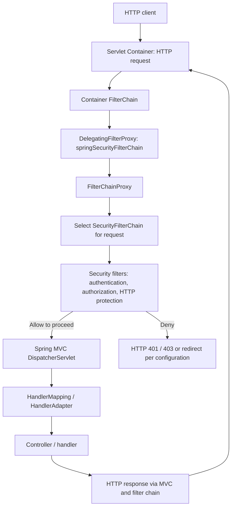

# Relationship Between Spring Security, Spring MVC, the Servlet Container, and Spring Boot

> **Scope:** **Servlet** web applications using Spring Boot 3.x, Spring Framework 6.x, and Spring Security 6.x. The goal is to understand what each component is responsible for, how they wire together at application startup, and how an HTTP request travels through the system. This is the Servlet architecture; WebFlux applications use a different reactive filtering mechanism.

## 1. Four Components, Four Responsibilities

| Component | Primary Responsibility | Common Indicators |
|---|---|---|
| **Servlet Container** (e.g., embedded Tomcat, Jetty) | Listens for and handles HTTP, creates `HttpServletRequest`/`HttpServletResponse`, manages Servlet/Filter lifecycles, sessions, request threads, and invokes the target Servlet. | `Filter`, `FilterChain`, `HttpServlet`, `HttpSession` |
| **Spring MVC** | Handles the web layer: maps URLs and HTTP methods to handlers/controllers, binds and validates input, invokes controllers, and turns results into HTTP responses. | `DispatcherServlet`, `@GetMapping`, `@RestController`, `HandlerMapping` |
| **Spring Security** | Authenticates callers (**authentication**), enforces access permissions (**authorization**), and provides HTTP protections such as CSRF, security headers, and session handling per configuration. For Servlets, integrates primarily through **Servlet Filters**. | `DelegatingFilterProxy`, `FilterChainProxy`, `SecurityFilterChain`, `SecurityContext` |
| **Spring Boot** | Bootstraps/packages the application, auto-configures based on dependencies and beans, creates the Spring `ApplicationContext`, configures/starts the embedded server, and registers integrated components. | `@SpringBootApplication`, starters, and auto-configuration |

Two different **container** concepts must be distinguished: the *Servlet Container* runs Servlets/Filters under the Jakarta Servlet contract; the *Spring IoC Container* (`ApplicationContext`) creates and manages Spring beans. Boot bridges these two worlds. Spring MVC and Spring Security are libraries inside the Spring application; they do not replace the HTTP server themselves.

An application using `spring-boot-starter-web` can serve HTTP via MVC **without Spring Security**. Only when Spring Security is added and configured does the HTTP pipeline gain this framework's protection layer. Conversely, Spring Security can also protect Servlet endpoints not handled by Spring MVC.

## 2. Where Does an HTTP Request Go?

The following diagram depicts a typical path for a request matching a `SecurityFilterChain` in a Boot Servlet application:



**Step-by-step progression:**

1. **Boot starts up:** creates `ApplicationContext`, configures the embedded Servlet Container, and registers MVC's `DispatcherServlet`. When Spring Security is present, a Servlet Filter proxy is registered to delegate processing to the security bean named `springSecurityFilterChain`.
2. **Container receives the request:** creates request/response objects and invokes registered Servlet Filters in container order. Other filters (logging, compression, etc.) may sit before or after the security filter.
3. **`DelegatingFilterProxy` forwards:** the Servlet Container only knows filters via the Servlet API; the proxy looks up the corresponding Spring bean. The `springSecurityFilterChain` bean is actually `FilterChainProxy`.
4. **`FilterChainProxy` selects a chain:** evaluates configured `SecurityFilterChain`s in order; the **first matching chain** is chosen. Each chain holds security filters. Chain selection rules differ from authorization rules inside the chain.
5. **Security filters process:** may load `SecurityContext`, handle authentication mechanisms, verify CSRF, apply security headers, and decide access permissions. If denied, Security can generate the response immediately; the controller is **not invoked**.
6. **If allowed, forwards onward:** after filters invoke `FilterChain`, the request reaches `DispatcherServlet`. MVC locates a handler via `HandlerMapping`, picks an adapter, binds parameters, calls the controller, and serializes the result.
7. **Response travels back out:** MVC returns the response; filters may do post-processing before the container sends it to the client. The request-bound security context is cleared according to lifecycle rules, preventing state leakage between requests.

**Note:** There is no single fixed filter list valid for every application. Their count, order, and behavior change with configuration and version. A request matching no chain may proceed **unprotected by Spring Security**; typical applications should have a chain covering endpoints that need protection.

## 3. Easily Confused "Chains"

| Name | Who Owns It? | What Does It Contain? | When Does It Run? |
|---|---|---|---|
| **Servlet `FilterChain`** | Servlet Container | Servlet Filters registered by the container, including `DelegatingFilterProxy` when Security is present | Before the request reaches the target Servlet |
| **Spring Security `SecurityFilterChain`** | Spring Security, coordinated by `FilterChainProxy` | Security filters applied to requests matching the chain | Inside Security's Servlet Filter |
| **Spring MVC interceptor chain** | Spring MVC | `HandlerInterceptor`s around MVC handlers | After `DispatcherServlet` receives the request and identifies the handler |

A `HandlerInterceptor` only participates in the MVC dispatch flow; it is not a security layer replacing Servlet Filters. For instance, a request blocked due to missing authentication will never reach `preHandle` on an interceptor for that controller. Similarly, error handling with `@ControllerAdvice` applies to errors during MVC processing, not automatically catching every error occurring in security filters.

`SecurityFilterChain` is not the same object as the Servlet API's `FilterChain`: the first is **the filter list selected by Spring Security**, while the second is **the mechanism the container uses to chain Servlet Filters to the target Servlet**.

## 4. Three Key Relationships

### 4.1. Spring Security ↔ Servlet Container

Spring Security sits in the Servlet Container's pipeline via `DelegatingFilterProxy`, yet most of its configuration and dependencies are **Spring beans**. This allows a container-invoked Filter to delegate to objects managed by Spring IoC. `FilterChainProxy` is responsible for picking the right `SecurityFilterChain`, applying its security filters, and continuing the request.

For example, if an unauthenticated user calls an endpoint requiring authentication, Security can return HTTP 401 (with HTTP Basic) **right at the filter layer**, before MVC dispatches the request. If form login is used, the same situation may trigger a redirect to the login page. The outcome depends on the enabled authentication mechanism, not solely on the URL.

### 4.2. Spring Security ↔ Spring MVC

Security controls **who is allowed to proceed**; MVC decides **which handler that request invokes**. The two tasks are related but do not overlap completely.

- `authorizeHttpRequests` defines authorization rules at the HTTP filter layer. `requestMatchers` determine which requests are subject to each rule; rule ordering affects the outcome.
- When using Spring MVC, path-matching semantics, servlet paths, and additional servlets must be considered consistently between Security and MVC. Do not assume every matcher behaves identically to `@RequestMapping`, especially when the application has multiple servlets.
- After MVC resolves a handler, method security such as `@PreAuthorize` can add checks on method invocation **if** the application enables `@EnableMethodSecurity` and the call passes through the corresponding Spring proxy. This is a separate check layer from URL authorization.
- A `Principal` or `Authentication` can be used by a controller to identify the caller; this identity is established by Security in the appropriate context. Controllers do not need to manually parse `Authorization` headers for framework-handled HTTP Basic flows.

A request permitted at the URL level does not mean every business operation is permitted. HTTP rules and method security must align with application policy.

### 4.3. Spring Boot ↔ All Three Components

For Servlet applications, Boot reads dependencies, properties, and beans to auto-configure the web server, `DispatcherServlet`, and necessary integrations.

- With `spring-boot-starter-web`: Boot typically configures Spring MVC with embedded Tomcat by default.
- Adding `spring-boot-starter-security`: Boot/Spring Security configures the Servlet Filter integration and provides protective defaults when the application has not supplied its own security chain.
- If no `SecurityFilterChain` bean is defined, the typical default in Boot 3.x is to require authentication for HTTP requests with default login mechanisms. Boot may generate a development user and print a random password to the logs at startup; never treat that as a production policy.
- When declaring your own `SecurityFilterChain` bean, you **define your own HTTP policy**; adding this bean causes the corresponding default web security auto-configuration to back off. Configuring the user source (for example, `UserDetailsService` or another identity provider) is a separate concern.
- `@SpringBootApplication` kicks off wiring and auto-configuration; it **does not replace** `DispatcherServlet`, the Servlet Container, or the security filters.

You do not need to manually register `DelegatingFilterProxy` with `@WebFilter` in a typical Boot Servlet application when integrating Security via the starter. Accidental manual registration can cause filters to run twice or in the wrong order.

## 5. Runnable Example: Public Endpoint and Protected Endpoint

Assume a **Spring Boot 3.x, Java 17+** project using Gradle, with the two dependencies `spring-boot-starter-web` and `spring-boot-starter-security`. Place the files under package `com.example.demo`.

**`src/main/java/com/example/demo/SecurityMvcDemoApplication.java`**

```java
package com.example.demo;

import org.springframework.boot.SpringApplication;
import org.springframework.boot.autoconfigure.SpringBootApplication;

@SpringBootApplication
public class SecurityMvcDemoApplication {
    public static void main(String[] args) {
        SpringApplication.run(SecurityMvcDemoApplication.class, args);
    }
}
```

**`src/main/java/com/example/demo/SecurityConfig.java`**

```java
package com.example.demo;

import org.springframework.context.annotation.Bean;
import org.springframework.context.annotation.Configuration;
import org.springframework.security.config.Customizer;
import org.springframework.security.config.annotation.web.builders.HttpSecurity;
import org.springframework.security.core.userdetails.User;
import org.springframework.security.core.userdetails.UserDetailsService;
import org.springframework.security.crypto.factory.PasswordEncoderFactories;
import org.springframework.security.crypto.password.PasswordEncoder;
import org.springframework.security.provisioning.InMemoryUserDetailsManager;
import org.springframework.security.web.SecurityFilterChain;

@Configuration
public class SecurityConfig {
    @Bean
    SecurityFilterChain securityFilterChain(HttpSecurity http) throws Exception {
        return http
                .authorizeHttpRequests(auth -> auth
                        .requestMatchers("/public").permitAll()
                        .anyRequest().authenticated())
                .httpBasic(Customizer.withDefaults())
                .build();
    }

    @Bean
    PasswordEncoder passwordEncoder() {
        return PasswordEncoderFactories.createDelegatingPasswordEncoder();
    }

    @Bean
    UserDetailsService userDetailsService(PasswordEncoder encoder) {
        var learner = User.withUsername("learner")
                .password(encoder.encode("demo-pass"))
                .roles("USER")
                .build();
        return new InMemoryUserDetailsManager(learner);
    }
}
```

**`src/main/java/com/example/demo/DemoController.java`**

```java
package com.example.demo;

import java.security.Principal;
import org.springframework.web.bind.annotation.GetMapping;
import org.springframework.web.bind.annotation.RestController;

@RestController
public class DemoController {
    @GetMapping("/public")
    public String publicPage() {
        return "public";
    }

    @GetMapping("/private")
    public String privatePage(Principal principal) {
        return "hello " + principal.getName();
    }
}
```

Run the application from the project directory containing the Gradle wrapper:

```bash
./gradlew bootRun
# On Windows PowerShell: .\gradlew.bat bootRun
```

In another terminal, send requests sequentially:

```bash
curl -i http://localhost:8080/public
curl -i http://localhost:8080/private
curl -i -u learner:demo-pass http://localhost:8080/private
```

Expected results (status/body portion; other HTTP headers may vary):

| Request | Expected Result | Reason |
|---|---|---|
| `GET /public`, no credentials | **200 OK**, body `public` | URL matches `permitAll()`, Security allows request to reach MVC |
| `GET /private`, no credentials | **401 Unauthorized** and HTTP Basic challenge | URL requires authentication; Security blocks before controller |
| `GET /private` with HTTP Basic `learner:demo-pass` | **200 OK**, body `hello learner` | Security authenticates user; MVC receives `Principal` and invokes controller |

**Reading the example layer by layer:** Boot sets up the server and beans; the Servlet Container accepts all three requests; `FilterChainProxy` applies the configured chain; `/public` proceeds, `/private` requires identity; `DispatcherServlet` only invokes `DemoController` after Security permits it. `UserDetailsService` here holds an in-memory user for study; HTTP Basic must use **HTTPS** with real data, and hard-coded credentials are unsuitable for production.

**CSRF is not disabled in the example.** These are three `GET` requests, so they do not require a CSRF token by default. If you add `POST`/`PUT`/`DELETE`, revisit CSRF according to how your application authenticates and stores sessions; do not call `csrf.disable()` out of habit just to avoid 403 errors.

## 6. What Happens When Security Rejects a Request?

| Scenario | Typical Check Point | Common Outcome |
|---|---|---|
| Unauthenticated user accesses a login-required URL | HTTP authorization in security filters | `401` with HTTP Basic; form login may redirect |
| Authenticated user lacks permission | HTTP authorization or method security | Typically `403 Forbidden` |
| State-changing request missing CSRF token when CSRF is enabled | CSRF filter | Typically `403 Forbidden` |
| Controller throws an exception after Security lets the request through | MVC/controller | `@ExceptionHandler` / `@ControllerAdvice` can handle it |
| Request matches no `SecurityFilterChain` at all | Before running security filters | Not protected by a Spring Security chain; review configuration |

Conceptually, `AuthenticationException` and `AccessDeniedException` at the Security layer are typically handled by mechanisms such as `ExceptionTranslationFilter` and corresponding handlers/entry points. Do not assume that a `@ControllerAdvice` alone covers authentication or authorization errors occurring before `DispatcherServlet`.

HTTP `401` means the request needs valid authentication credentials; `403` means the server refuses permission to execute the request (and may be due to CSRF). Exact mechanisms, response bodies, and redirects also depend on configuration.

## 7. Distinguishing Chain Selection from Permission Checks

Two APIs that are easily confused because both match requests:

- `http.securityMatcher("/api/**")` limits **when this entire SecurityFilterChain is selected**.
- `authorizeHttpRequests(auth -> auth.requestMatchers("/public").permitAll()...)` defines **authorization rules inside the already-selected chain**.

When multiple `SecurityFilterChain`s exist, `FilterChainProxy` evaluates them in order (configurable via `@Order`) and runs the **first matching chain**; it does not merge all matching chains. A chain with `securityMatcher("/api/**")` will not protect `/admin`, unless another chain handles `/admin`. For small applications, a single chain ending with `anyRequest().authenticated()` is usually easier to understand and less prone to leaving endpoints uncovered.

**`permitAll()` differs from `web.ignoring()`.** `permitAll()` still passes the request through the Spring Security filter chain while permitting access at the authorization step. `web.ignoring()` bypasses the filter chain for matching requests; doing so also bypasses HTTP protections applied by the chain. When you simply want a public endpoint, prefer `permitAll()`.

## 8. Distinguishing Authentication, Authorization, and Business Processing

- **Authentication:** "Who is sending the request?" For example, HTTP Basic supplies username/password; the authentication filter and authentication provider establish `Authentication`.
- **Authorization:** "Is that person allowed to access this URL or invoke this method?" For example, `anyRequest().authenticated()` requires an identity; `hasRole("ADMIN")` requires the appropriate role.
- **MVC business handling:** "Once the request is valid, how is data processed and the response built?" For example, `DemoController.privatePage` produces the response.

User information is typically attached to `SecurityContext` for the request. When MVC can access `Principal`/`Authentication`, that is the result of integrating the two layers. Do not automatically treat `HttpSession` as synonymous with `SecurityContext`: whether state is saved across sessions depends on `SecurityContextRepository` configuration, session management, and the authentication mechanism (for example, stateless APIs).

A request passing through some filters does not mean every filter authenticates the user; behavior depends on request type, matchers, and security configuration.

## 9. Debugging Request Paths

When encountering unexpected behavior, check in exact order:

1. **Did the request reach the container?** Check port, context path, HTTP method, and path.
2. **Which `SecurityFilterChain` did the request match?** Check `securityMatcher`, `@Order`, and Security logs; confirm a chain covers the endpoint.
3. **Did it stop at authentication or authorization?** Check the `Authorization` header, user store/provider, roles, and CSRF. `401` does not share the same cause as `403`.
4. **Did it reach MVC yet?** Check `DispatcherServlet`, `@RequestMapping`/`@GetMapping`, and handlers. `404` can be a routing error; do not default to blaming Security.
5. **If the controller ran and then failed,** check binding, validation, business logic, exception handlers, and method security.

In development environments you can enable:

```properties
logging.level.org.springframework.security=DEBUG
```

Logs are helpful to see chains and security decisions; only use detailed logging appropriately in development environments, and never write credentials/tokens or secrets to logs.

When writing integration tests with `MockMvc`, test all three cases: **public OK**, **protected anonymous blocked**, and **protected authenticated OK**. You can use `spring-security-test` with `httpBasic(...)` or `@WithMockUser` when appropriate for the test goal. Testing a controller by calling the Java method directly **bypasses servlet security filters**, so it does not replace integration tests for HTTP protection.

## 10. Common Misconceptions

1. **"Spring MVC automatically checks permissions before the controller."** False in this architecture: Security enforces most HTTP checks via Servlet Filters, while MVC handles dispatching. Method security can add checks later.
2. **"Spring Boot is itself the server or security framework."** Boot bootstraps and wires things together; the embedded Servlet Container handles HTTP, Spring MVC dispatches, and Spring Security protects.
3. **"Having `@PreAuthorize` already blocks all requests."** Effective only when method security is enabled and calls go through the protected object/proxy; it does not replace HTTP protection for all entry paths.
4. **"`permitAll()` means no security filters run."** Requests still run through the selected chain; only the authorization rule permits access.
5. **"`@ControllerAdvice` handles all 401/403 errors."** Errors occurring before MVC have different handling mechanisms. Determine whether the error originated in a filter or a handler.
6. **"Adding two `SecurityFilterChain`s runs both sequentially."** `FilterChainProxy` picks the first matching chain. Matchers and ordering must be designed consistently.
7. **"Whenever you see 403, disable CSRF."** 403 can come from permissions or CSRF; diagnose the cause and protect appropriately for the session/cookie/token model.
8. **"Spring-managed filters have nothing to do with the Servlet Container."** `DelegatingFilterProxy` is precisely the bridge: the container calls the proxy, and the proxy delegates to the Spring bean.

## 11. Self-Check Your Understanding

**Q1.** Will `GET /private` without credentials in the example enter `DemoController.privatePage`?  
**Answer:** No. The HTTP Basic entry point responds with 401 from the Security layer before MVC.

**Q2.** Does changing `/public` to `permitAll()` bypass `DelegatingFilterProxy`?  
**Answer:** No. The security chain still runs and the authorization rule permits passage.

**Q3.** What finds `@GetMapping("/private")`?  
**Answer:** Spring MVC via `DispatcherServlet` and the `HandlerMapping` system; the Servlet Container delivers the request to the Servlet, and Security decides whether it may proceed.

**Q4.** If you declare your own `SecurityFilterChain`, does Boot keep all default URL protection rules intact?  
**Answer:** No. Your application's chain bean becomes where HTTP policy is configured; you must specify public and protected paths yourself.

**Q5.** Is a request matching no security chain safe simply because the project uses `spring-boot-starter-security`?  
**Answer:** No. You must ensure endpoints needing protection match an appropriate chain.

**Remember the path:** **Client → Servlet Container → Servlet Filter chain → Spring Security (if a chain matches) → DispatcherServlet/Spring MVC → Controller → response.** **Spring Boot** starts, configures, and connects these components; it does not replace the role of each component.