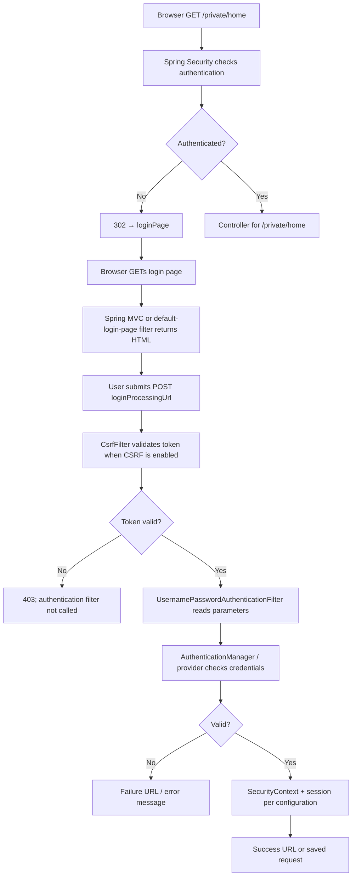

# `formLogin`, `loginPage`, `loginProcessingUrl`, and Form Parameter Names

**Topic:** Spring Security – Servlet · **Group:** Form Login  
**Example environment:** Java 17, Spring Boot 3.3.5, Spring Security 6.x, Spring MVC with embedded Tomcat and Thymeleaf.

This lesson explains how to configure **form login** in a Spring Security application running on Servlet: who renders the login page, who processes the form submission request, how to change URLs and `username`/`password` field names, how redirects work on login success or failure, and issues involving CSRF and `SecurityFilterChain`. Section 6 provides a buildable, runnable Maven project, not just isolated configuration snippets.

## 1. Distinguishing the Login Page from the Login Processing Endpoint

When an application protects a URL, an unauthenticated user can be redirected to a **login page**. That page submits a `POST` form to a **login processing endpoint**. The two URLs may be the same or different, but their **processing responsibilities are completely different**.

| Concept | Typical default method + URL | Who handles it? |
| --- | --- | --- |
| Login page | `GET /login` | Spring Security can generate default HTML via a filter; if using a custom page, your application's Spring MVC/controller/view must serve GET. |
| Credentials processing endpoint (login processing URL) | `POST /login` | Spring Security's `UsernamePasswordAuthenticationFilter` reads parameters from the request and triggers authentication. |
| Username field name | `username` | `UsernamePasswordAuthenticationFilter` reads this request parameter unless reconfigured. |
| Password field name | `password` | Similarly, can be changed via `passwordParameter(...)`. |
| Invalid login | Default destination related to `/login?error` | The failure handler redirects the user to the error URL; the GET page must render it. |
| Successful login | Usually back to saved request or configured target URL | The success handler performs the redirect/forward per configuration; not a POST login controller. |

**Key point:** `GET /login` does not verify passwords; `POST /login` is handled by a **security filter** before `DispatcherServlet` by default. With standard form login, **do not create `@PostMapping("/login")` to check passwords yourself**. You only write controllers for the custom login `GET` page and for post-login content.



The diagram shows the **common form login** flow on Servlet; many details such as saved requests, session fixation, security context repository, or success handler can be configured differently. Do not conflate `302`/`401`/`403`: `302` is usually a browser redirect, `401` can be a challenge from another mechanism like HTTP Basic, while `403` on a POST form usually points to checking CSRF or access permissions.

## 2. What Does `formLogin()` Enable?

A concise way to enable default form login in a `SecurityFilterChain` bean:

```java
@Bean
SecurityFilterChain securityFilterChain(HttpSecurity http) throws Exception {
    http.authorizeHttpRequests(auth -> auth
            .anyRequest().authenticated());
    http.formLogin(Customizer.withDefaults());
    return http.build();
}
```

This is a **configuration fragment**; it needs imports, `@Configuration`, and a Spring Boot/Servlet application to run. `Customizer` is in package `org.springframework.security.config.Customizer`. A complete example with all files is in section 6.

When form login is enabled and no custom page is declared, Spring Security usually provides a **default login page**. Under common default settings:

- `GET /login`: HTML generated by Spring Security when the appropriate login page generator is enabled.
- `POST /login`: login request handled by `UsernamePasswordAuthenticationFilter`.
- Form fields named `username` and `password`.
- A session can preserve authentication across requests when using a session-supporting default policy.
- State-changing requests such as `POST /login` must still satisfy **CSRF** checks when CSRF is enabled.

**Do not confuse:** `formLogin()` is a builder component for the security filter chain, not an API that auto-generates business controllers. If there are multiple `SecurityFilterChain` beans, the request must be routed to the chain containing the login configuration to have the corresponding processing filter.

### 2.1. Why Should `WebSecurityConfigurerAdapter` Not Be Used?

In Spring Security 6 projects, the recommended approach is declaring `@Bean SecurityFilterChain` with `HttpSecurity`, rather than extending `WebSecurityConfigurerAdapter` which was removed in this API line. Similarly, Spring Boot 3 uses `jakarta.servlet.*` instead of `javax.servlet.*`. Throughout this lesson, all configurations follow the modern bean style.

## 3. Options for `loginPage`, `loginProcessingUrl`, `usernameParameter`, and `passwordParameter`

Example custom configuration:

```java
http.formLogin(form -> form
        .loginPage("/auth/sign-in")
        .loginProcessingUrl("/auth/process")
        .usernameParameter("account")
        .passwordParameter("passcode")
        .defaultSuccessUrl("/private/home", true)
        .failureUrl("/auth/sign-in?error")
        .permitAll());
```

### 3.1. `.loginPage("/auth/sign-in")`

Specifies **the URL where users open the login page via GET**. When using a custom page:

1. The application must have a controller/handler for `GET /auth/sign-in` and a corresponding template or view.
2. Anonymous requests must be allowed to access this page; `.permitAll()` on form login and matching `authorizeHttpRequests` rules prevent redirect loops.
3. Assets needed by the page such as CSS, JS, images, or favicon must also be served with proper access policies.
4. Setting `loginPage(...)` does not make Spring Security auto-generate a new HTML template. The framework's default generated login page is usually no longer used.

If a browser visits `/private/home`, gets redirected to `/auth/sign-in`, and `GET /auth/sign-in` returns `404`, check **the handler/view**. If the login page redirects back to itself, check **anonymous access rules and chain matchers**.

### 3.2. `.loginProcessingUrl("/auth/process")`

Specifies where the security filter **receives the POST containing credentials**. You **do not need** `@PostMapping("/auth/process")`; `UsernamePasswordAuthenticationFilter` runs before MVC. Under typical configuration, the filter only accepts POST requests for login processing.

- The form must declare `method="post"`.
- The `action` attribute must point to `/auth/process` (accounting for the application's context path).
- Calling `GET /auth/process` is **not** a valid login request and is not processed as a form POST.
- When using `securityMatcher(...)` to restrict chain scope, the processing URL **must fall within the scope of the chain** containing this filter.
- If CSRF is enabled, the POST must include a **CSRF token**; a missing token can return `403` before the filter attempts username/password verification.

Do not rely on guessing "changing `loginPage` still leaves `loginProcessingUrl` as `/login`." Defaults of the form configurer can depend on the configured page URL. **Explicitly declare both URLs** when you want them to differ as in this lesson, and test both method and path.

### 3.3. `.usernameParameter("account")`

Changes the **request parameter** name read by the filter from the default `username` to `account`. The HTML form must then have `name="account"`.

```html
<input type="text" name="account" autocomplete="username">
```

Values of `id`, `placeholder`, display labels, or server-side Java variable names **do not determine the parameter name**. The example below will not work as intended if the filter expects `account`:

```html
<!-- Wrong for the config above: id is right, but name is wrong. -->
<input type="text" id="account" name="username">
```

When names mismatch, the filter usually receives an empty/missing value from the request and authentication fails, even if the user entered the correct password. Inspect the actual request payload (only on demo data; **never log real passwords**).

### 3.4. `.passwordParameter("passcode")`

Changes the default parameter name `password` to `passcode`:

```html
<input type="password" name="passcode" autocomplete="current-password">
```

Renaming fields **is not a security measure**. Masking characters on screen is handled by `type="password"`, while credentials still travel in the request; real systems must use **HTTPS**, secure password hashing, and never log request bodies/headers containing credentials.

The form login filter reads **request parameters**, typically from `application/x-www-form-urlencoded`. Do not assume sending a JSON body like `{"account":"...","passcode":"..."}` to `loginProcessingUrl` will be automatically handled by the default `UsernamePasswordAuthenticationFilter`. For a custom REST JSON login, design an appropriate filter/endpoint and authentication flow rather than confusing it with form login.

### 3.5. What Username Is Passed to the Provider?

Even though HTML uses `name="account"`, `UsernamePasswordAuthenticationFilter` still creates a `UsernamePasswordAuthenticationToken` with that field's value as the **unauthenticated principal**. Underneath, `AuthenticationManager`/`AuthenticationProvider` or `UserDetailsService` verifies the account based on the received string.

Therefore, changing `usernameParameter("account")` **does not require changing** the `UserDetailsService.loadUserByUsername(...)` API; it only changes how the filter extracts data from the HTTP request.

## 4. URLs and Redirects on Login Success or Failure

| Config | Meaning | Notes |
| --- | --- | --- |
| `loginPage("/auth/sign-in")` | GET login page | Needs handler/view if using a custom page |
| `loginProcessingUrl("/auth/process")` | POST URL to attempt authentication | Handled by security filter |
| `usernameParameter("account")` | Parameter name for username | Must match `name` in the form |
| `passwordParameter("passcode")` | Parameter name for password | Must match `name` in the form |
| `failureUrl("/auth/sign-in?error")` | Redirect destination after failed auth | Login page can display an error message if desired |
| `defaultSuccessUrl("/private/home", true)` | Redirect URL after successful auth | `true` forces always using this URL, not prioritizing saved request |
| `formLogin(...permitAll())` | Allows anonymous access to form login URLs | Does not permit the whole app and does not disable CSRF |

### 4.1. Saved Request and `defaultSuccessUrl`

If a user accesses a protected URL before logging in, Spring Security can save that request. With the default success handler, when not forced to always use a fixed URL, login can return to the **saved request** instead of `defaultSuccessUrl` — which is helpful UX.

In the section 6 example, we use:

```java
.defaultSuccessUrl("/private/home", true)
```

`true` means after successful login, it always redirects to `/private/home`, keeping test results deterministic. If you want to redirect back to the URL the user originally intended to visit, use the `defaultSuccessUrl("/private/home")` overload or pass `false` depending on your configuration and request cache tests.

### 4.2. `failureUrl` Is a GET to the Error Display Page

If the password is wrong, the failure handler can redirect to `/auth/sign-in?error`. The `error` query parameter is only a **signal for the template**; it does not auto-generate a localized message. Thymeleaf example:

```html
<p th:if="${param.error}">Invalid username or password.</p>
```

Do not expose passwords, stack traces, or messages distinguishing "whether the account exists or not" to the client. Generic messages help limit account enumeration.

### 4.3. Avoiding a "Redirect Loop"

A very common mistake is requiring authentication on `/auth/sign-in`:

```java
// Illustrative anti-pattern:
http.authorizeHttpRequests(a -> a.anyRequest().authenticated())
    .formLogin(f -> f.loginPage("/auth/sign-in"));
```

Without permitting the login page, anonymous requests to `/auth/sign-in` can keep redirecting to that same URL. Make sure configuration permits anonymous access to the login page, using `.permitAll()` in form login and/or explicit matchers.

## 5. How Do CSRF, Sessions, and SecurityFilterChain Affect Form Login?

### 5.1. CSRF Is Not Automatically Disabled by `permitAll()`

`permitAll()` means **no authorization is required** for the corresponding endpoint; it **does not skip** CSRF validation. A form login POST must carry a valid CSRF token when CSRF is enabled. If the token is missing/invalid, `CsrfFilter` can block the request with `403` before `UsernamePasswordAuthenticationFilter`.

With Spring MVC and Thymeleaf, when rendering a form via `th:action`, `RequestDataValueProcessor` integration automatically adds a hidden CSRF input into the HTML. The project below uses this approach:

```html
<form th:action="@{/auth/process}" method="post">
    <input name="account" type="text">
    <input name="passcode" type="password">
    <button type="submit">Sign in</button>
</form>
```

In a properly running Thymeleaf/Spring MVC/Spring Security app, the POST form gets the corresponding CSRF field added. If using JSP, plain HTML, or an external frontend, **you must explicitly include the token** in the request according to the active `CsrfTokenRepository`. Never hardcode a static token.

**Important note:** Never disable CSRF globally just to make POST login work. Especially in browser applications using session cookies, CSRF is a critical part of the protection model. If an API application is truly stateless, evaluate its credential/cookie mechanisms and threat model before changing policy.

### 5.2. Form Login Usually Needs Sessions to Remember Identity

After authentication, Spring Security normally sets `Authentication` into `SecurityContext` and can persist the context via `HttpSession` so the browser is recognized on subsequent requests via a session cookie. In the demo project, we **do not** enable `SessionCreationPolicy.STATELESS` because standard form login serves browsers with sessions.

If stateless mode is accidentally enabled on a session-based form login app, users may see POST login succeed yet the very next protected GET ask to log in again. To debug, inspect `SecurityContextRepository`, session policy, cookies, reverse proxy, domain, and HTTPS.

`SecurityContext` should not hold passwords or sensitive data beyond processing needs. On login success, an authenticated `Authentication` is present; clearing credentials depends on the configured provider/token/manager.

### 5.3. When There Are Multiple `SecurityFilterChain` Beans

A `SecurityFilterChain` only runs if the request matches its `securityMatcher` and was not already claimed by a higher-precedence `@Order` chain. Suppose you configure:

```java
// Illustrates the scope issue only; not a complete project:
http.securityMatcher("/private/**")
    .formLogin(form -> form
        .loginPage("/auth/sign-in")
        .loginProcessingUrl("/auth/process"));
```

If the chain's matcher only accepts `/private/**`, then `GET /auth/sign-in` and `POST /auth/process` **do not enter that chain**. That chain's login filter never gets a chance to run. `requestMatchers(...).permitAll()` inside authorization **does not expand** `securityMatcher`.

The fix is to include both the login page and login processing URL within the scope of the chain owning form login, or design appropriate matchers/chains. The section 6 example uses **a single catch-all chain**, so this scope issue does not occur.

## 6. Complete Maven Project: Custom Login Page, Custom Fields

Project layout:

```text
form-login-demo/
├── pom.xml
└── src/
    ├── main/
    │   ├── java/demo/formlogin/
    │   │   ├── FormLoginApplication.java
    │   │   ├── SecurityConfig.java
    │   │   └── PageController.java
    │   └── resources/templates/
    │       ├── sign-in.html
    │       └── home.html
    └── test/java/demo/formlogin/
        └── FormLoginApplicationTests.java
```

You can generate a project from Spring Initializr with **Spring Web**, **Spring Security**, **Thymeleaf**, and JDK 17, then add the files below. To ensure matching versions, `pom.xml` pins Spring Boot 3.3.5 and uses Spring Boot's BOM.

### 6.1. `pom.xml`

```xml
<?xml version="1.0" encoding="UTF-8"?>
<project xmlns="http://maven.apache.org/POM/4.0.0"
         xmlns:xsi="http://www.w3.org/2001/XMLSchema-instance"
         xsi:schemaLocation="http://maven.apache.org/POM/4.0.0 https://maven.apache.org/xsd/maven-4.0.0.xsd">
    <modelVersion>4.0.0</modelVersion>

    <parent>
        <groupId>org.springframework.boot</groupId>
        <artifactId>spring-boot-starter-parent</artifactId>
        <version>3.3.5</version>
        <relativePath/>
    </parent>

    <groupId>demo</groupId>
    <artifactId>form-login-demo</artifactId>
    <version>1.0.0</version>

    <properties>
        <java.version>17</java.version>
    </properties>

    <dependencies>
        <dependency>
            <groupId>org.springframework.boot</groupId>
            <artifactId>spring-boot-starter-web</artifactId>
        </dependency>
        <dependency>
            <groupId>org.springframework.boot</groupId>
            <artifactId>spring-boot-starter-security</artifactId>
        </dependency>
        <dependency>
            <groupId>org.springframework.boot</groupId>
            <artifactId>spring-boot-starter-thymeleaf</artifactId>
        </dependency>
        <dependency>
            <groupId>org.springframework.boot</groupId>
            <artifactId>spring-boot-starter-test</artifactId>
            <scope>test</scope>
        </dependency>
        <dependency>
            <groupId>org.springframework.security</groupId>
            <artifactId>spring-security-test</artifactId>
            <scope>test</scope>
        </dependency>
    </dependencies>

    <build>
        <plugins>
            <plugin>
                <groupId>org.springframework.boot</groupId>
                <artifactId>spring-boot-maven-plugin</artifactId>
            </plugin>
        </plugins>
    </build>
</project>
```

`spring-boot-starter-web` provides Spring MVC and the Servlet container (Tomcat by default); `spring-boot-starter-security` provides Spring Security; `spring-boot-starter-thymeleaf` renders HTML views. The two test dependencies support JUnit 5, MockMvc, and security request post-processors. Do not manually override a separate Spring Security version unless needed.

### 6.2. `src/main/java/demo/formlogin/FormLoginApplication.java`

```java
package demo.formlogin;

import org.springframework.boot.SpringApplication;
import org.springframework.boot.autoconfigure.SpringBootApplication;

@SpringBootApplication
public class FormLoginApplication {
    public static void main(String[] args) {
        SpringApplication.run(FormLoginApplication.class, args);
    }
}
```

Place classes under `demo.formlogin` so default component scanning finds the configuration and controller beans.

### 6.3. `src/main/java/demo/formlogin/SecurityConfig.java`

```java
package demo.formlogin;

import org.springframework.context.annotation.Bean;
import org.springframework.context.annotation.Configuration;
import org.springframework.http.HttpMethod;
import org.springframework.security.config.annotation.web.builders.HttpSecurity;
import org.springframework.security.crypto.bcrypt.BCryptPasswordEncoder;
import org.springframework.security.crypto.password.PasswordEncoder;
import org.springframework.security.core.userdetails.User;
import org.springframework.security.core.userdetails.UserDetails;
import org.springframework.security.core.userdetails.UserDetailsService;
import org.springframework.security.provisioning.InMemoryUserDetailsManager;
import org.springframework.security.web.SecurityFilterChain;

@Configuration
public class SecurityConfig {

    @Bean
    SecurityFilterChain securityFilterChain(HttpSecurity http)
            throws Exception {

        http.authorizeHttpRequests(auth -> auth
                .requestMatchers(HttpMethod.GET,
                        "/auth/sign-in", "/public/ping").permitAll()
                .anyRequest().authenticated());

        http.formLogin(form -> form
                .loginPage("/auth/sign-in")
                .loginProcessingUrl("/auth/process")
                .usernameParameter("account")
                .passwordParameter("passcode")
                .defaultSuccessUrl("/private/home", true)
                .failureUrl("/auth/sign-in?error")
                .permitAll());

        http.logout(logout -> logout
                .logoutUrl("/auth/logout")
                .logoutSuccessUrl("/auth/sign-in?logout")
                .permitAll());

        return http.build();
    }

    @Bean
    PasswordEncoder passwordEncoder() {
        return new BCryptPasswordEncoder();
    }

    @Bean
    UserDetailsService users(PasswordEncoder encoder) {
        UserDetails student = User.withUsername("student")
                .password(encoder.encode("change-me"))
                .roles("USER")
                .build();

        return new InMemoryUserDetailsManager(student);
    }
}
```

**Exact explanation of each setting:**

- **`loginPage("/auth/sign-in")`**: URL of the GET form display page, returned by `PageController` via Thymeleaf.
- **`loginProcessingUrl("/auth/process")`**: where the filter receives POST credentials; do not write a `@PostMapping` in a controller.
- **`usernameParameter("account")`** and **`passwordParameter("passcode")`**: the **`name`** attributes of the fields, not `id`. Reflected directly in `sign-in.html`.
- **`defaultSuccessUrl("/private/home", true)`**: after valid credentials, redirect to `/private/home`, even if a saved request exists.
- **`failureUrl("/auth/sign-in?error")`**: on authentication failure, redirect to the login page with query `error`.
- **`.permitAll()` on form login**: lets anonymous users reach the appropriate login/form processing/failure URLs. The `GET /auth/sign-in` rule in `authorizeHttpRequests` is listed explicitly for clarity when learning.
- **`logoutUrl("/auth/logout")`** and logout success URL support testing the full session lifecycle; with CSRF enabled, the form submits a POST to the logout URL.
- **CSRF is not disabled**, and stateless is not enabled; this suits browser/session login demos.
- **BCrypt `PasswordEncoder`** stores the encoded password in `UserDetails`; `change-me` is only a demo password, never copy it to production.

**Do not assume HTTP Basic also works**: this example configuration only enables form login; it does not call `http.httpBasic(...)`. Sign in using a browser/form rather than `curl -u` in this project.

### 6.4. `src/main/java/demo/formlogin/PageController.java`

```java
package demo.formlogin;

import org.springframework.http.MediaType;
import org.springframework.security.core.Authentication;
import org.springframework.stereotype.Controller;
import org.springframework.ui.Model;
import org.springframework.web.bind.annotation.GetMapping;
import org.springframework.web.bind.annotation.ResponseBody;

@Controller
public class PageController {

    @GetMapping("/auth/sign-in")
    public String loginPage() {
        return "sign-in";
    }

    @GetMapping("/private/home")
    public String home(Authentication authentication, Model model) {
        model.addAttribute("username", authentication.getName());
        return "home";
    }

    @GetMapping(value = "/public/ping",
                produces = MediaType.TEXT_PLAIN_VALUE)
    @ResponseBody
    public String ping() {
        return "pong";
    }
}
```

`@Controller` returns view names matching `src/main/resources/templates/`. `@ResponseBody` on `/public/ping` returns a plain text `"pong"` response. There are only two GET pages and one public GET endpoint; **no POST login/logout handlers are declared in the controller**.

### 6.5. `src/main/resources/templates/sign-in.html`

```html
<!DOCTYPE html>
<html lang="en" xmlns:th="http://www.thymeleaf.org">
<head>
    <meta charset="UTF-8">
    <title>Sign in</title>
</head>
<body>
    <h1>Sign in</h1>

    <p th:if="${param.error}">
        Invalid username or password.
    </p>
    <p th:if="${param.logout}">
        You have been signed out.
    </p>

    <form th:action="@{/auth/process}" method="post">
        <label for="account-input">Account</label>
        <input id="account-input"
               type="text"
               name="account"
               autocomplete="username"
               required>

        <label for="passcode-input">Password</label>
        <input id="passcode-input"
               type="password"
               name="passcode"
               autocomplete="current-password"
               required>

        <button type="submit">Sign in</button>
    </form>
</body>
</html>
```

**Three places that must match the configuration:**

1. `th:action="@{/auth/process}"` matches `.loginProcessingUrl("/auth/process")`.
2. `name="account"` matches `.usernameParameter("account")`.
3. `name="passcode"` matches `.passwordParameter("passcode")`.

`th:action` generates URLs accounting for the context path when the app is mounted under a prefix and integrates with form data processing. With Thymeleaf on Spring MVC/Spring Security, a **hidden CSRF field** is added to the POST form by `RequestDataValueProcessor`. If using plain HTML or building a different view, ensure the CSRF token is added properly. Never copy already-rendered HTML containing an old token into another request.

### 6.6. `src/main/resources/templates/home.html`

```html
<!DOCTYPE html>
<html lang="en" xmlns:th="http://www.thymeleaf.org">
<head>
    <meta charset="UTF-8">
    <title>Personal Page</title>
</head>
<body>
    <h1>Signed-in Page</h1>
    <p th:text="|Xin chào ${username}|">Xin chào</p>

    <form th:action="@{/auth/logout}" method="post">
        <button type="submit">Sign out</button>
    </form>
</body>
</html>
```

`GET /private/home` requires authentication; after login succeeds, the controller passes the `username` variable into the view. The logout form uses **POST**; this is the proper approach when CSRF is enabled. A regular `<a href="/auth/logout">` link sends GET and is not equivalent to a POST logout.

## 7. Observing with a Browser and `curl`

### 7.1. Running with Maven

Requires JDK 17+, Maven, and network access to download dependencies on the first run. From the `form-login-demo/` directory:

```bash
mvn clean test
mvn spring-boot:run
```

The application runs at `http://localhost:8080` unless another port is configured.

### 7.2. Using a Browser to Test the Session Flow

1. Open `http://localhost:8080/private/home` in an unauthenticated browser.
2. The browser is redirected to `http://localhost:8080/auth/sign-in`.
3. Enter **Account:** `student`; **Password:** `change-me`.
4. Click **Sign in**. The browser sends `POST /auth/process` with the form parameters and corresponding CSRF token.
5. On successful authentication, the browser lands on `/private/home`, displaying `Xin chào student`.
6. Click **Sign out** to send `POST /auth/logout`; the success handler redirects to `/auth/sign-in?logout`.

In the browser flow, the session cookie lets the system restore identity between POST login and GET home. The browser does not store the password in `SecurityContext`; Spring Security holds an `Authentication` representing the authenticated user per policy.

### 7.3. Checking GET, Redirect, and CSRF with `curl`

Open another terminal (in older PowerShell, use `curl.exe` to avoid the alias):

```bash
# Public GET: returns body "pong".
curl -s http://localhost:8080/public/ping

# GET public login page: 200.
curl -s -o /dev/null -w '%{http_code}\n' \
  http://localhost:8080/auth/sign-in

# GET protected page without session: 302 redirect.
curl -s -o /dev/null -w '%{http_code}\n' \
  -H 'Accept: text/html' \
  http://localhost:8080/private/home

# POST login without CSRF token: rejected with 403.
curl -s -o /dev/null -w '%{http_code}\n' \
  -d 'account=student&passcode=change-me' \
  http://localhost:8080/auth/process
```

Each command, in order, prints:

```text
pong
200
302
403
```

`curl -s` does not append a newline after the `"pong"` body; these are the outputs of **four separate commands**. To view `Location` and `Set-Cookie`, use `curl -i` on the corresponding request; header/cookie values vary by environment.

**You cannot submit a valid POST login with only a password when CSRF is enabled.** If you want to test with a custom client, obtain the CSRF token and session cookie from a proper GET form first, then send them back with the POST. The simplest way to try the functionality is a browser; the next section uses MockMvc with a CSRF helper for the **test environment**.

## 8. Testing `formLogin` with MockMvc

`spring-boot-starter-test` provides JUnit 5, Spring Test, and MockMvc. `spring-security-test` provides `csrf()` and `user()` to simulate secured requests. The test suite below verifies **the difference between the GET login page and POST login processing**, custom parameter names, success/failure redirects, and CSRF rejecting invalid POST requests.

### `src/test/java/demo/formlogin/FormLoginApplicationTests.java`

```java
package demo.formlogin;

import org.junit.jupiter.api.Test;
import org.springframework.beans.factory.annotation.Autowired;
import org.springframework.boot.test.autoconfigure.web.servlet.AutoConfigureMockMvc;
import org.springframework.boot.test.context.SpringBootTest;
import org.springframework.http.MediaType;
import org.springframework.test.web.servlet.MockMvc;

import static org.hamcrest.Matchers.containsString;
import static org.springframework.security.test.web.servlet.request.SecurityMockMvcRequestPostProcessors.csrf;
import static org.springframework.security.test.web.servlet.request.SecurityMockMvcRequestPostProcessors.user;
import static org.springframework.test.web.servlet.request.MockMvcRequestBuilders.get;
import static org.springframework.test.web.servlet.request.MockMvcRequestBuilders.post;
import static org.springframework.test.web.servlet.result.MockMvcResultMatchers.content;
import static org.springframework.test.web.servlet.result.MockMvcResultMatchers.header;
import static org.springframework.test.web.servlet.result.MockMvcResultMatchers.status;

@SpringBootTest
@AutoConfigureMockMvc
class FormLoginApplicationTests {

    @Autowired
    MockMvc mvc;

    @Test
    void publicPingDoesNotRequireLogin() throws Exception {
        mvc.perform(get("/public/ping"))
                .andExpect(status().isOk())
                .andExpect(content().string("pong"));
    }

    @Test
    void customLoginPageIsAccessibleAndUsesCustomFieldNames()
            throws Exception {
        mvc.perform(get("/auth/sign-in"))
                .andExpect(status().isOk())
                .andExpect(content().string(containsString("name=\"account\"")))
                .andExpect(content().string(containsString("name=\"passcode\"")))
                .andExpect(content().string(containsString("/auth/process")));
    }

    @Test
    void protectedPageRedirectsAnonymousToCustomLogin()
            throws Exception {
        mvc.perform(get("/private/home")
                .accept(MediaType.TEXT_HTML))
                .andExpect(status().is3xxRedirection())
                .andExpect(header().string("Location",
                        containsString("/auth/sign-in")));
    }

    @Test
    void postLoginWithoutCsrfIsForbidden() throws Exception {
        mvc.perform(post("/auth/process")
                .param("account", "student")
                .param("passcode", "change-me"))
                .andExpect(status().isForbidden());
    }

    @Test
    void correctLoginWithCsrfRedirectsToHome() throws Exception {
        mvc.perform(post("/auth/process")
                .with(csrf())
                .param("account", "student")
                .param("passcode", "change-me"))
                .andExpect(status().is3xxRedirection())
                .andExpect(header().string("Location",
                        containsString("/private/home")));
    }

    @Test
    void wrongPasswordWithCsrfRedirectsToFailurePage()
            throws Exception {
        mvc.perform(post("/auth/process")
                .with(csrf())
                .param("account", "student")
                .param("passcode", "wrong"))
                .andExpect(status().is3xxRedirection())
                .andExpect(header().string("Location",
                        containsString("/auth/sign-in?error")));
    }

    @Test
    void wrongFieldNamesCannotAuthenticate() throws Exception {
        mvc.perform(post("/auth/process")
                .with(csrf())
                .param("username", "student")
                .param("password", "change-me"))
                .andExpect(status().is3xxRedirection())
                .andExpect(header().string("Location",
                        containsString("/auth/sign-in?error")));
    }

    @Test
    void authenticatedUserCanViewHome() throws Exception {
        mvc.perform(get("/private/home").with(user("student")))
                .andExpect(status().isOk())
                .andExpect(content().string(
                        containsString("Xin chào student")));
    }

    @Test
    void logoutPostWithoutCsrfIsForbidden() throws Exception {
        mvc.perform(post("/auth/logout")
                .with(user("student")))
                .andExpect(status().isForbidden());
    }

    @Test
    void logoutPostWithCsrfReturnsToLoginPage() throws Exception {
        mvc.perform(post("/auth/logout")
                .with(user("student"))
                .with(csrf()))
                .andExpect(status().is3xxRedirection())
                .andExpect(header().string("Location",
                        containsString("/auth/sign-in?logout")));
    }
}
```

Run:

```bash
mvn test
```

**All 10 tests are expected to PASS** with the exact source/config. The tests do not need to start a server on port `8080` because MockMvc goes through Spring MVC/Spring Security in the test context.

Important notes:

- `.with(csrf())` is only a **test request post-processor** providing a valid CSRF token for MockMvc. A real client cannot send literal `csrf()`.
- `.with(user("student"))` attaches a simulated security principal for the test request; `authenticatedUserCanViewHome` does not prove that a previous login form established a session across two requests. To prove cross-request sessions, write an integration test maintaining `MockHttpSession` and cookies/CSRF across steps, or a browser test.
- `wrongFieldNamesCannotAuthenticate` proves the filter does not fall back to default `username`/`password` once renamed to `account`/`passcode`.
- The tests only check that `Location` contains a specific path, avoiding dependence on whether redirect URLs are returned as relative or absolute in different environments.

## 9. Common Errors and How to Categorize Them

### 9.1. Custom Login Page Returns 404

Check whether `@GetMapping("/auth/sign-in")` and template `templates/sign-in.html` exist. `.loginPage(...)` **does not auto-write a controller**; `.loginProcessingUrl(...)` does not generate a GET view either. With Thymeleaf, the view name returned by the controller must match the template.

### 9.2. Accessing the Login Page Redirects to Itself

Check anonymous access permissions for the GET login page: `.permitAll()` in form login and authorization matchers. If `GET /auth/sign-in` still requires authentication, a redirect loop can occur. With multiple chains, check `securityMatcher` and `@Order` of the chain matching the request first.

### 9.3. GET Login Works but POST Login Does Not Run

Check:

1. Does `<form method="post">` have the right method?
2. Does the rendered `action` match `/auth/process` and the context path?
3. Is `UsernamePasswordAuthenticationFilter` installed in **the chain receiving the POST URL**?
4. Does another chain intercept `/auth/process` earlier?
5. Is the CSRF token valid? A missing token can return `403` before invoking the provider.
6. If you see `404/405`, the request may not be hitting the right filter and is falling through to MVC.

Do not write a POST controller to work around a case where the processing URL is actually outside the security chain.

### 9.4. Correct Username and Password Still Redirect to `?error`

Verify the exact **`name` attribute**, not just `id` or label. `usernameParameter("account")`/`passwordParameter("passcode")` must match the names in the form; form-encoded requests differ from JSON. Check `UserDetailsService`, `PasswordEncoder`, and the user store if the field names already match. Distinguish a failure handler redirect from controller validation; the form login filter handles credentials.

### 9.5. POST Login Returns 403 Even Though the Endpoint Has `permitAll()`

`permitAll()` is an authorization policy, whereas CSRF enforces POST checks by its own rules. With Thymeleaf pages, ensure they were rendered through Spring MVC to include the CSRF token and that the browser preserves the corresponding session/cookie. With plain HTML, generate the hidden input from the provided `CsrfToken`. Never hardcode a token or disable CSRF globally just for a demo.

### 9.6. Login Succeeds but Visiting a Protected Page Still Asks to Log In

Check the session, `JSESSIONID`, `SecurityContextRepository`, session creation policy, redirect target, and reverse proxy. `SessionCreationPolicy.STATELESS` is unsuitable for browser form login flows that retain identity via session unless another mechanism is used. Testing POST success + 302 alone does not prove cookies are sent on the subsequent GET.

### 9.7. Confusing `loginPage`, `loginProcessingUrl`, and `defaultSuccessUrl`

- **`loginPage`**: GET rendering the form.
- **`loginProcessingUrl`**: POST consumed by the filter.
- **`defaultSuccessUrl`**: where the client is redirected on success.
- **`failureUrl`**: where the client is redirected on failure.

Do not create a `@PostMapping` for `loginProcessingUrl`, do not expect `GET` on the processing URL to show a form, and do not point the success URL to a path not yet permitted by authorization or served by a controller.

### 9.8. Assuming `formLogin()` Is Always Used for API Clients

Form login usually serves **browsers/sessions**. APIs using HTTP Basic, bearer tokens, or OAuth2/OIDC use different authentication entry points and tokens. Enable form login only on chains/clients needing browser forms; when using multiple chains, clearly define each chain's matcher, order, and URLs.

### 9.9. Leaking Passwords Through Debug Logging

Do not log full request bodies, raw `Authentication`, `Authorization` headers, or password field inputs; do not place credentials in URL query strings. For debugging, minimally log path/method, selected chain, status, and exception type under controlled levels. Outside localhost, always use HTTPS and store passwords in the account store with proper hashing.

## 10. Form Login Configuration Checklist

1. **GET page:** Is there an explicit `loginPage` and a GET controller/template if using a custom page? Can anonymous users reach it?
2. **POST processing:** Does `loginProcessingUrl` match `form action`, method POST, and `securityMatcher` scope?
3. **Parameter names:** Do `usernameParameter`/`passwordParameter` match the `name` attributes of the inputs actually submitted?
4. **CSRF:** Do login/logout POST forms include a valid token? Is the missing-token `403` case tested?
5. **Redirects:** Are `failureUrl`, `defaultSuccessUrl`, and saved requests clearly designed and tested?
6. **Session policy:** How is `SecurityContext` stored/restored; is stateless mistakenly enabled?
7. **Accounts:** Are `UserDetailsService`, password hashing/`PasswordEncoder`, and account status configured properly?
8. **Chains:** If multiple chains exist, are the GET login and POST processing URLs matched by the chain owning the filter? Does a higher-priority chain intercept them first?
9. **Actual HTML:** Does `th:action` account for context path, are field `name`s right, do errors avoid leaking identity, and are CSS/JS assets served?
10. **Testing:** Test GET login, POST with/without CSRF, right/wrong passwords, wrong field names, protected GET, and redirect/logout.

## 11. Self-Check Questions

**1.** `loginPage("/signin")` is set, but the form submits `POST /login`. Is this guaranteed to work?  
**Answer:** No. You must check the actual processing URL of `UsernamePasswordAuthenticationFilter`; if you want separate GET `/signin` and POST `/login`, explicitly declare `loginProcessingUrl("/login")` and test it.

**2.** You change `usernameParameter("email")`, but HTML still has `name="username"`. What happens?  
**Answer:** The filter does not receive the value under parameter `email`; authentication typically fails even if the user enters a valid account.

**3.** A POST has valid credentials but no CSRF token; does `.permitAll()` let it pass?  
**Answer:** No. When CSRF is enabled, a POST with a missing/invalid token can be rejected with `403` before credentials are checked.

**4.** Is `@PostMapping("/auth/process")` needed in a controller?  
**Answer:** No. The form login processing URL is an endpoint handled by `UsernamePasswordAuthenticationFilter` in the security filter chain.

**5.** Why does the browser go to the URL the user just requested after a successful login instead of the default page?  
**Answer:** The success handler may prioritize the saved request. You can use `.defaultSuccessUrl("/private/home", true)` if business requirements mandate always going to that URL.

**6.** What is the problem with `securityMatcher("/private/**")` when the login processing URL is `/auth/process`?  
**Answer:** `/auth/process` does not match the chain; the login filter inside that chain never receives the request. You must fix the chain's scope or URL architecture.

**Key takeaway:** `formLogin` activates the login flow via security filters; `loginPage` is **GET displaying the form**, `loginProcessingUrl` is **POST authenticating**, and `usernameParameter`/`passwordParameter` define **HTTP field names** that must match `name` in HTML. Setting proper URLs, permitting anonymous access to the login page, sending CSRF tokens, and testing redirects/sessions are the four essentials for reliable form login.