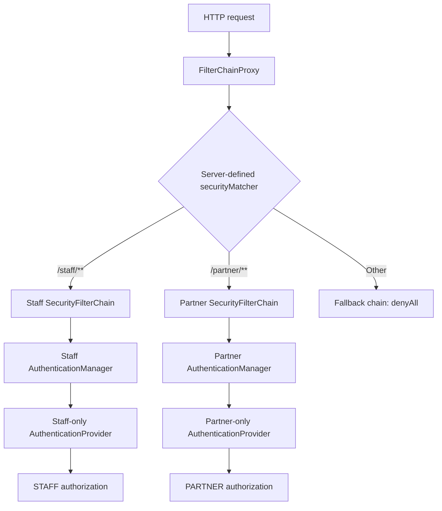

# Choosing an AuthenticationManager per Request with Clear Trust Boundaries

> **Context:** Spring Boot 3.x + Spring Security 6.x, Spring MVC/Servlet stack, and Java 17+. This lesson explains how to select the right `AuthenticationManager` per request scope **without letting client-declared data decide uncontrolledly where identity is verified**. The focus is on selection via `SecurityFilterChain` and, when genuinely needed, `AuthenticationManagerResolver<HttpServletRequest>`; defining trust boundaries, avoiding fallbacks to weaker mechanisms, protecting authentication context, and verifying with negative tests.

## 1. Why Are Multiple AuthenticationManagers Needed?

`AuthenticationManager` receives an unauthenticated `Authentication` and returns an authenticated `Authentication` or throws `AuthenticationException`. Spring Security commonly uses `ProviderManager` to try matching `AuthenticationProvider`s. For instance, `DaoAuthenticationProvider` uses `UserDetailsService` + `PasswordEncoder` to verify username/password.

An application can have **multiple authentication domains** with differing trust levels and identity sources:

- `/staff/**`: internal staff logging in via a dedicated staff store; granted `ROLE_STAFF`.
- `/partner/**`: partners logging in via a partner store; granted `ROLE_PARTNER`.
- `/admin/**`: admin portal that may require MFA or a separate IdP.
- APIs accepting bearer tokens from multiple issuers: each issuer needs its own verification keys, audience, algorithms, and policies.

Lumping all credential sources into a single "shared-for-all" manager without scoping allows a valid identity from portal A to be accepted accidentally at portal B. **Choosing the right manager** is the first step, while post-authentication **authorization** and resource/tenant checks must remain strict.

### Three Concepts That Must Stay Separate

| Concept | Question | Who Is Responsible? |
|---|---|---|
| **Authentication routing** | Which mechanism/identity store is this request allowed to use? | Security chain or resolver with server-owned policy |
| **Authentication** | Do the credentials/token genuinely belong to a valid identity in that domain? | `AuthenticationManager`/`AuthenticationProvider` |
| **Authorization** | Does the authenticated identity have permission for this URL, action, and record? | `authorizeHttpRequests`, method security, domain/service checks |

For example, a client can **pick the URL** `/partner/private`, yet calling that URL does not mean the client **is allowed to decide** that the server must use the staff provider to authenticate. The server sets the policy: URLs under the `/partner/**` zone go strictly through the partner manager; if the client sends staff credentials, the partner manager rejects them.

## 2. What Is a Trust Boundary?

A trust boundary is where data/claims from a less-trusted side cross into security decisions on a more-trusted side. For HTTP requests:

- **Untrusted by default:** query strings, request bodies, `X-Tenant`/`X-Auth-Provider` headers, usernames, unverified tokens, `Host`, or `X-Forwarded-*` without an appropriate proxy policy.
- **Server-controlled configuration:** security matchers and chain ordering, allowlists of identity providers, credential stores, key material, verified tenant mappings, and authorization requirements.
- **Conditionally trustworthy data:** issuer/audience/subject **verified by signatures and appropriate validators**, or a tenant belonging to an authenticated principal authorized to access it.

The key point is not "the request path is unconditionally trusted data": clients still choose paths. What is trusted is the **resource → permitted mechanism mapping rule** defined by the server and enforced independently of arbitrary client claims.

### Dangerous Approaches

```java
// WRONG IDEA: server trusts whichever manager the client requests.
String provider = request.getHeader("X-Auth-Provider");
if ("staff".equals(provider)) {
    return staffManager;
}
return partnerManager;
```

If this header determines authentication for the same resource without binding checks, an attacker can pick the weaker mechanism. Likewise, never select a manager solely because a username ends in `@company.example` or an **unverified** JWT payload contains `"iss"`. Email domains and JWT claims are merely self-assertions until verified.

**Never automatically fall back to a weaker manager** when a strong provider rejects credentials. For example, if staff MFA fails, do not try partner passwords as a substitute for the same admin resource. Any fallback, if permitted, must be an explicitly defined policy that never weakens authentication assurance.

## 3. Two Common Ways to Select a Manager on the Servlet Stack

### Approach A — Multiple SecurityFilterChains, Each with Its Own Manager

Suitable when URL groups have clear boundaries, such as `/staff/**` and `/partner/**`. `FilterChainProxy` receives a request and picks the **first matching SecurityFilterChain** by `@Order`; the selected chain configures its matching manager and authorization rules.



With this approach, selecting the chain for the request occurs **before** invoking that chain's authentication manager. A client can send staff credentials to `/partner/**`, yet cannot cause `staffManager` to be chosen.

### Approach B — Per-Request AuthenticationManagerResolver

`AuthenticationManagerResolver<C>` has `resolve(C context)`, returning the appropriate manager. On Servlet, `AuthenticationManagerResolver<HttpServletRequest>` is typically used. Some integrations like OAuth2 Resource Server have resolver hooks; **not every authentication filter automatically uses any resolver bean**.

If building a custom authentication filter, you must wire the resolver into the filter and handle the full lifecycle: extracting credentials, building an unauthenticated token, calling the resolved manager, checking the result, setting/clearing `SecurityContext`, and forwarding exceptions to an entry point/failure handler. Merely declaring an `@Bean AuthenticationManagerResolver` does not automatically alter how `BasicAuthenticationFilter` or all of `HttpSecurity` selects managers.

**Choose A first** when boundaries are stable URL prefixes; use B when a single filter genuinely needs dynamic manager selection based on controlled request context.

## 4. "Fail Closed" Model for All Unclassified Paths

Every sensitive resource must have a security policy. Never let a request that misses specialized chains fall into an open configuration accidentally created by the framework or application.

Example:

| Request | Chain That Must Match | Permitted Manager | Outcome When Credentials Belong to Wrong Domain |
|---|---|---|---|
| `GET /staff/private` | Staff chain | Staff manager | **401**, does not fall back to partner manager |
| `GET /partner/private` | Partner chain | Partner manager | **401**, does not fall back to staff manager |
| `GET /staff/admin` | Staff chain | Staff manager | If regular staff authenticates yet lacks role → **403** |
| `GET /staff/public` | Staff chain | Staff manager when Basic is sent | No credentials → 200; wrong Basic sent may → 401 |
| `GET /unknown` | Deny-all fallback | No substitute authentication to legitimize unknown paths | Must be denied, not become public due to missing matcher |

Do not assume non-existent URLs always return 404: if the fallback chain actively applies `denyAll`, Security can reject the request **before MVC looks for a handler**. What matters is leaving no authorization gap.

## 5. Runnable Example: Two Independent Authentication Zones

Goals of the example:

1. Staff and partners use **two separate user stores** with `PasswordEncoder`.
2. Two `AuthenticationManager`s are built **independently via `ProviderManager`**, each holding strictly its own zone's `DaoAuthenticationProvider`, with **no parent/fallback manager**.
3. Each `SecurityFilterChain` attaches its own manager with `http.authenticationManager(...)` and enables `httpBasic(...)`.
4. `SessionCreationPolicy.STATELESS` ensures every HTTP request authenticates with its own credentials, preventing reuse of a `SecurityContext` from another zone's session in the example.
5. A fallback chain denies all URLs outside either zone.
6. Tests prove cross-zone credentials are rejected, not just happy-path flows.

### 5.1. Preparing Gradle / Spring Initializr

Create a Spring Boot **3.x**, Java **17+**, Gradle project with dependencies: Spring Web, Spring Security, Spring Boot Starter Test, Spring Security Test. Corresponding `dependencies` block in `build.gradle`:

```groovy
dependencies {
    implementation 'org.springframework.boot:spring-boot-starter-web'
    implementation 'org.springframework.boot:spring-boot-starter-security'
    testImplementation 'org.springframework.boot:spring-boot-starter-test'
    testImplementation 'org.springframework.security:spring-security-test'
}
```

This is a dependencies block, not a full `build.gradle` file. An Initializr project also includes plugins, repositories, and the Spring Boot version; keep the Gradle wrapper with the project.

Project structure:

```text
src/
├── main/java/com/example/routing/
│   ├── AuthenticationRoutingApplication.java
│   ├── ZoneSecurityConfig.java
│   └── ZoneController.java
└── test/java/com/example/routing/
    └── ZoneIsolationTest.java
```

### 5.2. Bootstrap Class

**`src/main/java/com/example/routing/AuthenticationRoutingApplication.java`**

```java
package com.example.routing;

import org.springframework.boot.SpringApplication;
import org.springframework.boot.autoconfigure.SpringBootApplication;

@SpringBootApplication
public class AuthenticationRoutingApplication {
    public static void main(String[] args) {
        SpringApplication.run(AuthenticationRoutingApplication.class, args);
    }
}
```

### 5.3. Configuring Two Separate SecurityFilterChains

**`src/main/java/com/example/routing/ZoneSecurityConfig.java`**

```java
package com.example.routing;

import java.util.List;

import org.springframework.beans.factory.annotation.Qualifier;
import org.springframework.context.annotation.Bean;
import org.springframework.context.annotation.Configuration;
import org.springframework.core.annotation.Order;
import org.springframework.http.HttpMethod;
import org.springframework.security.authentication.AuthenticationManager;
import org.springframework.security.authentication.ProviderManager;
import org.springframework.security.authentication.dao.DaoAuthenticationProvider;
import org.springframework.security.config.Customizer;
import org.springframework.security.config.annotation.web.builders.HttpSecurity;
import org.springframework.security.config.http.SessionCreationPolicy;
import org.springframework.security.core.userdetails.User;
import org.springframework.security.core.userdetails.UserDetailsService;
import org.springframework.security.crypto.factory.PasswordEncoderFactories;
import org.springframework.security.crypto.password.PasswordEncoder;
import org.springframework.security.provisioning.InMemoryUserDetailsManager;
import org.springframework.security.web.SecurityFilterChain;

@Configuration
public class ZoneSecurityConfig {

    @Bean
    PasswordEncoder passwordEncoder() {
        return PasswordEncoderFactories.createDelegatingPasswordEncoder();
    }

    @Bean("staffUsers")
    UserDetailsService staffUsers(PasswordEncoder encoder) {
        return new InMemoryUserDetailsManager(
                User.withUsername("staff")
                        .password(encoder.encode("staff-pass"))
                        .roles("STAFF")
                        .build(),
                User.withUsername("staff-admin")
                        .password(encoder.encode("admin-pass"))
                        .roles("STAFF", "STAFF_ADMIN")
                        .build()
        );
    }

    @Bean("partnerUsers")
    UserDetailsService partnerUsers(PasswordEncoder encoder) {
        return new InMemoryUserDetailsManager(
                User.withUsername("partner")
                        .password(encoder.encode("partner-pass"))
                        .roles("PARTNER")
                        .build()
        );
    }

    // Each manager receives strictly its own zone's UserDetailsService.
    // Do not configure a parent manager or another zone's provider.
    private AuthenticationManager managerFor(
            UserDetailsService users, PasswordEncoder encoder
    ) {
        DaoAuthenticationProvider provider = new DaoAuthenticationProvider();
        provider.setUserDetailsService(users);
        provider.setPasswordEncoder(encoder);
        return new ProviderManager(List.of(provider));
    }

    @Bean
    @Order(1)
    SecurityFilterChain staffChain(
            HttpSecurity http,
            @Qualifier("staffUsers") UserDetailsService staffUsers,
            PasswordEncoder encoder
    ) throws Exception {
        AuthenticationManager staffManager = managerFor(staffUsers, encoder);

        return http
                .securityMatcher("/staff/**")
                .authenticationManager(staffManager)
                .authorizeHttpRequests(auth -> auth
                        .requestMatchers(HttpMethod.GET, "/staff/public")
                            .permitAll()
                        .requestMatchers(HttpMethod.GET, "/staff/admin")
                            .hasRole("STAFF_ADMIN")
                        .anyRequest()
                            .hasRole("STAFF")
                )
                .sessionManagement(session -> session
                        .sessionCreationPolicy(SessionCreationPolicy.STATELESS))
                .httpBasic(Customizer.withDefaults())
                .build();
    }

    @Bean
    @Order(2)
    SecurityFilterChain partnerChain(
            HttpSecurity http,
            @Qualifier("partnerUsers") UserDetailsService partnerUsers,
            PasswordEncoder encoder
    ) throws Exception {
        AuthenticationManager partnerManager =
                managerFor(partnerUsers, encoder);

        return http
                .securityMatcher("/partner/**")
                .authenticationManager(partnerManager)
                .authorizeHttpRequests(auth -> auth
                        .anyRequest().hasRole("PARTNER")
                )
                .sessionManagement(session -> session
                        .sessionCreationPolicy(SessionCreationPolicy.STATELESS))
                .httpBasic(Customizer.withDefaults())
                .build();
    }

    // Catches every request not belonging to the two zones above.
    @Bean
    @Order(3)
    SecurityFilterChain denyUnknownRoutes(HttpSecurity http)
            throws Exception {
        return http
                .authorizeHttpRequests(auth -> auth
                        .anyRequest().denyAll())
                .build();
    }
}
```

**Design explanation:**

- `securityMatcher("/staff/**")` and `securityMatcher("/partner/**")` partition **resource zones**. `FilterChainProxy` selects the first matching chain; `@Order(1)`/`@Order(2)` make the order explicit. There is no need for both managers to try the same request.
- `managerFor(...)` creates a `DaoAuthenticationProvider` with **strictly** that zone's `UserDetailsService`. `ProviderManager(List.of(provider))` in the example **declares no parent**. Hence it has no fallback path to another provider after an authentication failure.
- `http.authenticationManager(staffManager)` is configured **on the staff chain itself**; that chain's Basic authentication filter uses the corresponding manager. `partnerChain` does the same.
- `hasRole("STAFF")` requires authority `ROLE_STAFF`, while `hasRole("PARTNER")` requires `ROLE_PARTNER`. `roles("STAFF","STAFF_ADMIN")` generates both authorities for `staff-admin`.
- `staff/admin` is checked **before** `anyRequest()`; regular staff pass authentication yet still receive 403 when lacking `STAFF_ADMIN`.
- `SessionCreationPolicy.STATELESS` reduces the risk of reusing a security context in a session across zones in the HTTP Basic example. If an app needs sessions, design additional session isolation, CSRF, context lifecycles, and tenant binding; **separate managers alone do not isolate sessions**.
- The `denyAll` fallback chain rejects URLs matching neither staff nor partner. Never add public endpoints to the fallback without re-evaluating the threat model.
- The code runs on the Servlet stack with Spring Security 6.x; the no-arg `DaoAuthenticationProvider` constructor + setters pattern is used because it is present across common Security 6.x releases. In newer versions, prefer the constructor taking `UserDetailsService` if supported by your API/version.

**Demo limitations:** Sample passwords are for localhost only. In production, use an identity provider/datastore, password policies, MFA/rate limiting, and HTTPS. Never copy plain demo credentials to external networks.

### 5.4. Controller

**`src/main/java/com/example/routing/ZoneController.java`**

```java
package com.example.routing;

import java.security.Principal;

import org.springframework.web.bind.annotation.GetMapping;
import org.springframework.web.bind.annotation.RestController;

@RestController
public class ZoneController {

    @GetMapping("/staff/public")
    public String staffPublic() {
        return "STAFF_PUBLIC";
    }

    @GetMapping("/staff/private")
    public String staffPrivate(Principal principal) {
        return "STAFF_OK: " + principal.getName();
    }

    @GetMapping("/staff/admin")
    public String staffAdmin(Principal principal) {
        return "STAFF_ADMIN_OK: " + principal.getName();
    }

    @GetMapping("/partner/private")
    public String partnerPrivate(Principal principal) {
        return "PARTNER_OK: " + principal.getName();
    }
}
```

The controller does not decide which manager is used; that happens in the Security filter chain before invoking the handler. `Principal` in the private/admin endpoints reflects the identity authenticated within the appropriate zone.

## 6. Running and Comparing Requests

Open a terminal at the project root containing the Gradle wrapper:

```bash
# macOS / Linux
./gradlew bootRun

# Windows PowerShell
.\gradlew.bat bootRun
```

With the default port, requests go to `http://localhost:8080`. On Windows PowerShell you can use `curl.exe` instead of the `curl` alias. **The status/body values below are expected when running the exact example code; this document does not claim tests were executed in the reader's environment.**

### 6.1. Staff Zone

```bash
# Public, no credentials needed
curl -i http://localhost:8080/staff/public

# Valid staff
curl -i -u staff:staff-pass http://localhost:8080/staff/private

# Regular staff accessing admin (missing role)
curl -i -u staff:staff-pass http://localhost:8080/staff/admin

# Admin of staff zone
curl -i -u staff-admin:admin-pass http://localhost:8080/staff/admin
```

**Expected respectively:** 200 body `STAFF_PUBLIC`; 200 body `STAFF_OK: staff`; 403; 200 body `STAFF_ADMIN_OK: staff-admin`.

On the 403 request, the staff manager **did authenticate** the principal. Missing `ROLE_STAFF_ADMIN` is an **authorization** error, not evidence that the wrong manager was selected.

### 6.2. Partner Zone

```bash
# Valid partner
curl -i -u partner:partner-pass http://localhost:8080/partner/private

# No credentials
curl -i http://localhost:8080/partner/private
```

**Expected:** valid partner → 200 body `PARTNER_OK: partner`. Omitting Basic credentials → 401 with a Basic challenge `WWW-Authenticate`.

### 6.3. Most Important: Cross-Zone Authentication Must Fail

```bash
# Staff credentials MUST NOT work in partner zone
curl -i -u staff:staff-pass http://localhost:8080/partner/private

# Partner credentials MUST NOT work in staff zone
curl -i -u partner:partner-pass http://localhost:8080/staff/private

# Unknown route belonging to neither zone
curl -i http://localhost:8080/unknown
```

**Expected:** both cross-zone requests return **401** because the zone's manager handling the request does not recognize credentials from the other zone. The `/unknown` request is **rejected** by the fallback chain (never becoming public 200); exact status depends on fallback entry point/exception handling. There is no controller for unknown paths in this configuration.

**Never "rescue" authentication by trying a second manager** after the first manager errors. Doing so breaks the boundary between the two identity stores.

### 6.4. Result Matrix

| URL | Credentials | Expected Manager | Expected Status | Reason |
|---|---|---|---:|---|
| `/staff/public` | None | Staff chain (no authenticate call because anonymous is allowed) | **200** | `permitAll` |
| `/staff/private` | `staff:staff-pass` | Staff | **200** | Valid staff principal + `ROLE_STAFF` |
| `/staff/private` | `partner:partner-pass` | Staff | **401** | Partner credentials not in staff store |
| `/staff/admin` | `staff:staff-pass` | Staff | **403** | Authenticated, missing `ROLE_STAFF_ADMIN` |
| `/staff/admin` | `staff-admin:admin-pass` | Staff | **200** | Has both staff and admin authorities |
| `/partner/private` | `partner:partner-pass` | Partner | **200** | Partner principal + `ROLE_PARTNER` |
| `/partner/private` | `staff:staff-pass` | Partner | **401** | Staff credentials not in partner store |
| `/partner/private` | None | Partner | **401** | Missing Basic credentials |
| `/unknown` | None | Deny fallback | **4xx** | No matching valid zone |

Do not rely on the 401 response body for assertions because Boot/error handlers can format it differently. With Basic authentication, verify **status**, `WWW-Authenticate`, and **no cross-zone access**.

## 7. MockMvc: Testing Both Success and Cross-Zone Rejection

To prove the trust boundary, testing "valid staff gets 200" is not enough. You must test that **staff credentials in the partner zone return 401**, **partner credentials in the staff zone return 401**, and authenticated users lacking a role receive **403**.

**`src/test/java/com/example/routing/ZoneIsolationTest.java`**

```java
package com.example.routing;

import org.junit.jupiter.api.Test;
import org.springframework.beans.factory.annotation.Autowired;
import org.springframework.boot.test.autoconfigure.web.servlet.AutoConfigureMockMvc;
import org.springframework.boot.test.context.SpringBootTest;
import org.springframework.http.HttpHeaders;
import org.springframework.test.web.servlet.MockMvc;

import static org.junit.jupiter.api.Assertions.assertTrue;
import static org.springframework.security.test.web.servlet.request.SecurityMockMvcRequestPostProcessors.httpBasic;
import static org.springframework.test.web.servlet.request.MockMvcRequestBuilders.get;
import static org.springframework.test.web.servlet.result.MockMvcResultMatchers.content;
import static org.springframework.test.web.servlet.result.MockMvcResultMatchers.header;
import static org.springframework.test.web.servlet.result.MockMvcResultMatchers.status;

@SpringBootTest
@AutoConfigureMockMvc
class ZoneIsolationTest {

    @Autowired
    MockMvc mvc;

    @Test
    void publicStaffEndpointAllowsAnonymous() throws Exception {
        mvc.perform(get("/staff/public"))
                .andExpect(status().isOk())
                .andExpect(content().string("STAFF_PUBLIC"));
    }

    @Test
    void staffWithoutCredentialsGetsBasicChallenge() throws Exception {
        mvc.perform(get("/staff/private"))
                .andExpect(status().isUnauthorized())
                .andExpect(header().exists(HttpHeaders.WWW_AUTHENTICATE));
    }

    @Test
    void partnerWithoutCredentialsGetsBasicChallenge() throws Exception {
        mvc.perform(get("/partner/private"))
                .andExpect(status().isUnauthorized())
                .andExpect(header().exists(HttpHeaders.WWW_AUTHENTICATE));
    }

    @Test
    void validStaffCredentialsWorkOnlyInStaffZone() throws Exception {
        mvc.perform(get("/staff/private")
                        .with(httpBasic("staff", "staff-pass")))
                .andExpect(status().isOk())
                .andExpect(content().string("STAFF_OK: staff"));

        mvc.perform(get("/partner/private")
                        .with(httpBasic("staff", "staff-pass")))
                .andExpect(status().isUnauthorized());
    }

    @Test
    void validPartnerCredentialsWorkOnlyInPartnerZone() throws Exception {
        mvc.perform(get("/partner/private")
                        .with(httpBasic("partner", "partner-pass")))
                .andExpect(status().isOk())
                .andExpect(content().string("PARTNER_OK: partner"));

        mvc.perform(get("/staff/private")
                        .with(httpBasic("partner", "partner-pass")))
                .andExpect(status().isUnauthorized());
    }

    @Test
    void staffWithoutAdminRoleGets403() throws Exception {
        mvc.perform(get("/staff/admin")
                        .with(httpBasic("staff", "staff-pass")))
                .andExpect(status().isForbidden());
    }

    @Test
    void staffAdminCanAccessAdminEndpoint() throws Exception {
        mvc.perform(get("/staff/admin")
                        .with(httpBasic("staff-admin", "admin-pass")))
                .andExpect(status().isOk())
                .andExpect(content().string("STAFF_ADMIN_OK: staff-admin"));
    }

    @Test
    void wrongPasswordIsRejected() throws Exception {
        mvc.perform(get("/staff/private")
                        .with(httpBasic("staff", "wrong")))
                .andExpect(status().isUnauthorized());
    }

    @Test
    void unknownRouteIsNotAccidentallyPublic() throws Exception {
        mvc.perform(get("/unknown"))
                .andExpect(result -> assertTrue(
                        result.getResponse().getStatus() >= 400));
    }
}
```

Run:

```bash
# macOS / Linux
./gradlew test

# Windows PowerShell
.\gradlew.bat test
```

**Expected when running the project:** all tests PASS with the configuration and controllers above. This is the expected design result, not a pre-executed result in the lesson. The two **cross-zone authentication** tests matter most: they prove one zone does not silently use another zone's manager.

`MockMvc` is valuable for checking Security filter behavior inside the application context. When reverse proxies, URL rewriting, forwarded headers, or complex session configs are involved, add **integration tests through a real server** and gateway entry point to verify boundaries do not shift unexpectedly.

## 8. AuthenticationManagerResolver<HttpServletRequest> When Dynamic Routing Is Truly Needed

If a custom Servlet authentication filter or an integration supporting `AuthenticationManagerResolver` must choose a manager per request, you can write a resolver enforcing server-side policy.

### 8.1. Zone-Bounded Resolver Pattern

The snippet below is an **illustrative snippet**, not a standalone class; `staffManager` and `partnerManager` must already be built and supplied appropriately. Creating a resolver **does not automatically wire it** into `httpBasic`. Corresponding imports: `jakarta.servlet.http.HttpServletRequest`, `org.springframework.security.authentication.AuthenticationManagerResolver`, `org.springframework.security.authentication.AuthenticationManager`, and `org.springframework.security.authentication.BadCredentialsException`.

```java
AuthenticationManager deny = authentication -> {
    throw new BadCredentialsException("Unsupported authentication zone");
};

AuthenticationManagerResolver<HttpServletRequest> resolver = request -> {
    String path = request.getServletPath();

    if (path.startsWith("/staff/")) {
        return staffManager;
    }
    if (path.startsWith("/partner/")) {
        return partnerManager;
    }

    return deny; // fail closed; do not fall back to a default manager
};
```

Important notes:

- Both prefixes must be server-defined policy and **align with Servlet/MVC routing**; never use `contains("staff")` or a prefix without a trailing `/` that mis-matches `/staff-other`.
- `getServletPath()` is the path already interpreted by the Servlet Container; keep it aligned with `contextPath`, mappings, and reverse proxies. If a gateway rewrites URLs, test **both before and after the gateway**; never trust client-added `X-Original-URL`/`X-Rewrite-URL` headers.
- A resolver **only selects a manager**; it does not perform authentication, check permissions, send 401, or update `SecurityContext`. The integrating filter must execute those steps.
- `deny` is a rejecting manager, preventing the resolver from returning `null` and having a filter inadvertently fall back to a permissive default. Specific HTTP responses belong to the filter's failure handling; never let unhandled exceptions leak stack traces.
- If a partitioned request path can accept multiple credential types, identify **token types** and trust boundaries first; never choose a manager based on unverified claims/usernames.

### 8.2. Issuer/Token-Based Resolver: When Is It Safe?

For multiple JWT issuers, some Spring Security integrations can select an `AuthenticationManager` by issuer. Yet there is a subtle boundary:

1. The `iss` value in a JWT **before signature verification is untrusted data**. You may read it only as a *routing hint to an allowlisted validator*, **never** as proof of a valid issuer.
2. The server must accept only issuers in its **configured allowlist**; never fetch JWKS from a client-supplied `iss` URL without control, to prevent SSRF and trust expansion.
3. The corresponding manager must **verify signature**, allowed algorithms/kids, matching issuer, audience, timestamps, and required policies. If validation fails, **reject** without trying a weaker issuer for the same token.
4. After authentication, verify the subject is permitted for the target API/tenant; a valid token from issuer A **does not automatically grant access to resource B**.
5. For mTLS/service identity, trusted identity must come from the TLS handshake or a protected proxy boundary, not a caller-supplied `X-Client-Cert` header string.

Therefore, in multi-issuer systems, use **Spring Security-supported resolver/decoder/validator mechanisms** with allowlisted issuers and full verification configuration. Never build a homegrown "JWT router" from Base64 payloads and wave requests through to authorization.

## 9. Session Boundaries, Security Context, and Tenant Data

### Separate Managers Do Not Mean Separate Sessions

In the stateless HTTP Basic demo, every request carries credentials; `SessionCreationPolicy.STATELESS` prevents Security from reading `SecurityContext` from HTTP sessions. However, in applications with form login/sessions, a principal may already live in the session from an earlier request; a follow-up request may skip calling the authentication manager yet still carry that principal.

**Consequence:** Splitting `AuthenticationManager` by URL **is not enough** if the same session is shared across multiple security chains. Review session isolation, per-zone authorization, session fixation/cookie settings, and `SecurityContextRepository` lifecycles; do not assume "a request to zone B definitely invokes manager B" when an authenticated session already exists.

### Even Choosing the Right Manager Still Requires Tenant Authorization

Even after a principal passes the right provider:

- `staff` has `ROLE_STAFF`, yet must not automatically read every employee record.
- `partner` has `ROLE_PARTNER`, yet must not access another partner's orders.
- If a request contains `tenantId` in the path/body, bind it against tenants/organizations attached to the **authenticated principal** and per-resource permissions. Never trust `tenantId` solely because it matches a client header.
- When using method security (`@PreAuthorize`) or domain-level authorization, enforce object ownership/tenant membership at the service/data access layer to prevent IDOR/BOLA.
- Do not treat `SecurityContextHolder` as automatically propagating across async threads or custom executors; use Security-supported context propagation mechanisms when needed.

## 10. Common Mistakes and How to Fix Them

| Symptom | Possible Cause | How to Check |
|---|---|---|
| Staff credentials successfully access partner endpoint | Shared chain/manager; parent/fallback; old session context; overly broad authorization | Test cross-zone 401, safely log chain/provider, check stateful sessions |
| Request outside `/staff/**`/`/partner/**` returns 200 | Missing fallback or unintended `permitAll` | Inspect all `SecurityFilterChain`s, `@Order`, deny fallback policy |
| `/staff/private` returns 401 despite valid staff credentials | Wrong chain/manager selected, wrong password encoder, user absent from store | Confirm matcher, manager's provider, and credential store |
| Returns 403 instead of 401 | Principal authenticated yet missing role; CSRF on POST | Distinguish authentication from authorization; check authorities, method |
| Resolver switches manager via `X-Auth-Provider` | Trusting user-controlled request metadata | Move selection to server policy/allowlist and tenant binding |
| JWT from unknown issuer still accepted | Dynamic manager/JWKS from unverified `iss`; missing allowlist | Pin issuers, validate signature/iss/aud, reject unknown |
| Parent manager authenticates instead of staff provider | `ProviderManager` has unclear parent or intentional fallback | Inspect manager instances, providers, and parents per chain |
| Controller exposed despite matcher | Matcher does not cover path, prefix rewrite, or wrong chain priority | Compare actual URL/`servletPath`, gateway mapping, and order |
| One user sees another tenant's data | Correct authentication but missing object-level authorization | Verify subject-tenant binding and resource ownership |
| MockMvc passes, production fails | Proxy rewrites, cookies/sessions, forwarded headers, container filters | Integration test via embedded server/gateway, inspect safe logs |

### Why Not Use Username or Role to Select a Manager Before Authentication?

Username is client-supplied input; there is no guarantee it is a real identity. Authorities/roles are trustworthy only after a provider authenticates and emits them inside `Authentication`. If you pick a provider based on "this account is ADMIN because username starts with admin" and then apply a weak policy, an attacker can steer the path. **Manager selection needs trusted-source policy; role/permission enforcement needs an authenticated principal.**

### Can One Provider Intentionally Accept Multiple Account Types?

Yes, if that is an explicit business design and **still guarantees** accounts from different domains cannot bypass a boundary. When federation is needed, use internal mapping, issuer trust, audience/scope, tenant membership, session assurance, and auditing—not trying every provider until any one says OK.

## 11. Pre-Deployment Security Checklist

1. **Inventory resource zones** and allowed authentication mechanisms/issuers for each zone.
2. **Attach managers in the right place:** per-chain via `http.authenticationManager(...)` or per-filter via a genuinely wired resolver, not merely declaring a bean.
3. **Never let clients choose managers arbitrarily** via headers/queries/usernames/unverified tokens. Configure allowlists, trust validation, and server-side mappings.
4. **Fail closed** on out-of-zone requests or unknown tokens/issuers; never fall back to weaker mechanisms or leave routes public by default.
5. **Avoid unintended shared credential stores/parent managers**; if identity federation exists, write policies and negative tests in each direction.
6. **Separate authentication and authorization:** authenticated principals still need roles, scopes, tenant membership, and record-level permissions.
7. **Verify session isolation:** two chains with different managers do not guarantee `SecurityContext` is not reused; make stateless/stateful policies explicit.
8. **Control URL rewriting:** gateway/proxy, `contextPath`, `servletPath`, case sensitivity, encoded paths; reject ambiguous paths.
9. **Test and operate safely:** never log passwords, Authorization headers, or JWTs; record chain ID, verified provider/issuer, and outcome at appropriate levels.
10. **HTTPS/MFA/rate limiting:** valuable credentials need TLS, brute-force controls, session/token revocation, and step-up for sensitive actions.
11. **Two-way negative tests:** zone A credentials at B and B at A must be rejected; test missing headers, wrong passwords, missing roles, and unknown routes.
12. **Production-like testing:** HTTP through a real Servlet Container, gateway path rewriting, cookies/sessions, concurrency, and proxy configs differing from dev.

## 12. Reinforcement Exercises

**Exercise 1 — Choosing the right chain.** In the current config, suppose a client sends Basic credentials `staff:staff-pass` to `/partner/private`. Why doesn't the server try the staff manager after the partner manager fails?  
**Answer:** `FilterChainProxy` already selected the partner chain by matcher; that chain has a partner-only provider/manager with no parent/fallback to staff.

**Exercise 2 — Separate authorization.** `staff:staff-pass` accesses `/staff/admin`. Does authentication succeed, and why is HTTP still 403?  
**Answer:** The staff manager authenticates the user, yet the user holds only `ROLE_STAFF`, lacking `ROLE_STAFF_ADMIN`.

**Exercise 3 — Fixing a broken trust boundary.** A developer plans to select the manager using request header `X-Auth-Provider: staff`. Identify the risk and fix it.  
**Answer:** The header is client-controlled; use server-defined route/chain policy or a resolver grounded in verified metadata and an allowlist.

**Exercise 4 — Resolver does not wire itself.** You create an `AuthenticationManagerResolver<HttpServletRequest>` bean, yet Basic still uses the old manager. Why?  
**Answer:** A resolver must be wired into a supporting authentication filter/Configurer that calls `resolve(request)`; there is no blanket auto-wiring into every Basic filter.

**Exercise 5 — Sessions.** A user logs in as staff on one endpoint, then opens a partner URL with the same session cookie and no credentials. What must you test?  
**Answer:** Whether `SecurityContext` is reused, whether the other chain lets the old principal through, and whether authorization enforces zone/tenant boundaries. The demo uses `STATELESS` to eliminate session-based context reuse; stateful systems need extra policies.

**Exercise 6 — Multi-issuer JWTs.** A JWT payload claims `iss=https://evil.example`. Can you fetch JWKs from this URL and accept it after signature verification?  
**Answer:** Never expand trust dynamically from an attacker-declared issuer. Use only an issuer allowlist, validate signature/issuer/audience/algorithm properly, and then check subject permissions.

## 13. Summary

- Selecting an `AuthenticationManager` is a decision about the **authentication domain**; it is not the final authorization decision.
- For URL-partitioned zones on the Servlet stack, **multiple `SecurityFilterChain`s + `securityMatcher` + dedicated manager + `@Order` + deny-all fallback** is a clear, testable pattern.
- **`AuthenticationManagerResolver<HttpServletRequest>`** fits filters/integrations genuinely needing dynamic routing, but is not automatically used by every authentication filter.
- **Trust boundary:** user-controlled headers, usernames, unverified JWT claims, or forwarded metadata must never silently select a more-trusted or weaker manager.
- Never fall back to another manager after failure without an explicit policy, and never let unverified tokens/tenants dictate permission scope.
- Separate **authentication manager routing**, **credential verification**, **roles/permissions**, and **object-level authorization**. Separating managers does not automatically separate sessions.
- **Best verification** includes both positive cases and negative cross-zone cases—not just testing one successful request.

**Final principle:** A request can indicate which resource it wants to access; **the server decides which mechanism is permitted to authenticate to that resource**. Authenticating against the right domain is a necessary condition, not a substitute for post-authentication permission and data-boundary checks.