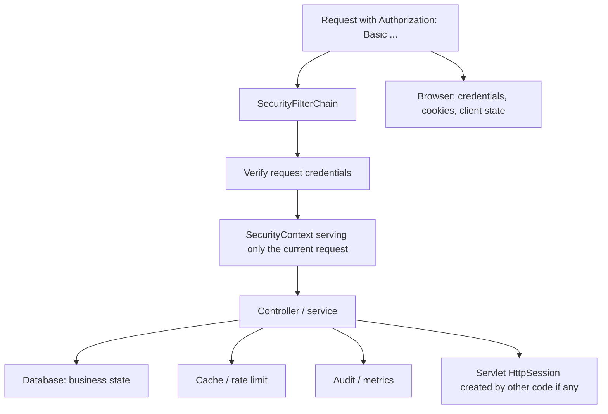

# Not creating a session does not mean zero state across all components

**Topic:** Spring Security – Servlet  
**Group:** Session Management  
**Example environment:** Java 17, Spring Boot 3.3.5, Spring Security 6.x, Spring MVC, and embedded Tomcat.

## Learning objectives

When configuring `SessionCreationPolicy.STATELESS`, many people conclude that the application is “completely stateless”. This confuses **Spring Security's authentication state persistence policy** with **every kind of state in the system**. After this lesson, you should be able to:

1. Distinguish authentication state in `SecurityContext` from `HttpSession`, databases, caches, CSRF tokens, request caches, HTTP clients, and frontend applications.
2. Accurately understand the four `SessionCreationPolicy` options: `ALWAYS`, `IF_REQUIRED`, `NEVER`, and `STATELESS`.
3. Explain why `STATELESS` is not a global ban preventing Servlet, MVC, or library code from creating an `HttpSession`.
4. Distinguish “not using a session to **restore authentication**” from “having zero state during request processing”.
5. Know how to verify with real requests, `MockMvc`, `HttpServletRequest.getSession(false)`, and resending an old session without credentials.
6. Design an API that does not create authentication sessions while still having databases, caches, counters, or audit logs — while understanding CSRF, token, cookie, and logout risks.

**Overarching rule:** *Stateless authentication* refers to how a request proves identity and how the security context is stored across requests; it does **not** imply that business data, browsers, server memory, or other systems must be stateless.

## 1. “State” has many scopes, not just `HttpSession`

In a web application, the word “state” can refer to very different things.

| Type of state | Example | Storage location or lifetime | Does `STATELESS` automatically remove/forbid it? |
| --- | --- | --- | --- |
| Request authentication | `SecurityContextHolder.getContext().getAuthentication()` | Within the request processing lifecycle, typically bound to the thread/request | **No.** The request still needs to know who the caller is. |
| Cross-request authentication | `SPRING_SECURITY_CONTEXT` in `HttpSession` | Configured session/repository | **Affected:** Spring Security does not use `HttpSession` to retrieve/store authentication as a stateful session. |
| Application-created Servlet session | `request.getSession(true)`, `@SessionAttributes` | Servlet container or distributed session store | **Not a blanket ban.** Other code can still create a session. |
| CSRF state | CSRF token in session or cookie | `CsrfTokenRepository`, browser, and server | **Not decided automatically.** Depends on the CSRF configurer and repository. |
| Request cache | Saved request before login | `RequestCache`, possibly the session | **Does not mean all other caches are cleared**; the policy can change how Spring Security uses the request cache. |
| Business data | Users, orders, payments | Database/transaction log | **No.** Applications need durable business state. |
| Cache, rate limit, idempotency | Redis, in-memory map, counters | Server, Redis, key-value store | **No.** Can serve multiple requests concurrently. |
| Client state | Browser cookies, `localStorage`, HTTP Basic auth cache | Browser/HTTP client | **No.** The server does not wipe client data via `STATELESS`. |
| Token/claims | JWT bearer token and client-held token | Token sent in the request | **No.** The token itself carries data; refresh/revocation may still have server state. |
| Operational observability | Audit, tracing, metrics, logs | Logging/telemetry system | **No.** Outside the security session policy. |

Suppose you call an API that uses HTTP Basic on every request: Spring Security does not obtain `Authentication` from a session, yet the controller increments a counter in an `AtomicLong`, the database records an order, and the gateway maintains a rate-limit counter. **Authentication can be stateless while the overall system still holds state.**



The diagram illustrates places that **may** hold state, not an assertion that every application uses all of them.

## 2. Distinguishing `HttpSession` and `SecurityContext`

### 2.1. What is `HttpSession`?

`HttpSession` is a Servlet API mechanism for retaining data across multiple requests from a client. Example:

```java
// Fragment inside a controller/servlet with HttpServletRequest request:
HttpSession current = request.getSession(false); // Do not create a new one.
HttpSession created = request.getSession(true);   // Allow creation if absent.
created.setAttribute("theme", "dark");
```

This is a **fragment**, not a standalone Java program. The Servlet imports are `jakarta.servlet.http.HttpServletRequest` and `jakarta.servlet.http.HttpSession` in Spring Boot 3.

- `request.getSession(false)` returns the existing session or `null`; it does **not** create a session itself.
- `request.getSession()` is equivalent to allowing creation; `getSession(true)` can also create an `HttpSession`.
- `session.setAttribute(...)` stores session data in the container or configured session implementation.
- The client typically receives a cookie containing the session ID, usually `JSESSIONID`; the cookie is an **identifier**, not the full set of session attributes.
- Sessions can be used by Spring MVC, controllers, other frameworks, or custom code, not only Spring Security.

**Note:** `HttpSession` is not a database for long-lived business state. Sessions have a TTL, can expire, can be invalidated, or depend on replication infrastructure. Do not place the single source of truth for critical transactions in the session.

### 2.2. What is `SecurityContext`?

`SecurityContext` holds the `Authentication` describing the verified identity/authorities of a request. Spring Security uses `SecurityContextHolder` as the context access point according to the configured strategy, typically bound to the request-processing thread.

```java
Authentication authentication =
        SecurityContextHolder.getContext().getAuthentication();
```

The line above is a fragment; import `org.springframework.security.core.Authentication` and `org.springframework.security.core.context.SecurityContextHolder`.

`STATELESS` **does not disable having an `Authentication` during a request**. Without an `Authentication` at authorization time, the API would not know who is calling. Instead, with HTTP Basic/Bearer, a filter can verify credentials **from the current request**, construct `Authentication`, place it into the context for the controller/service, and then clear the context per the filter lifecycle.

**Distinguish three statements:**

1. “Do not create a session to remember login” — a decision on managing authentication across requests.
2. “No `HttpSession` exists” — a stronger claim; you must check **all components** capable of creating a session.
3. “The application is stateless” — usually false if there are still databases, caches, message queues, logs, or client-side data.

### 2.3. Mechanism for restoring context across requests

Spring Security uses a `SecurityContextRepository` to determine where to load/save the security context. Implementations to recognize:

- `HttpSessionSecurityContextRepository`: works with `HttpSession`; session creation policy and context saving must be configured appropriately.
- `RequestAttributeSecurityContextRepository`: stores context in request attributes to serve the appropriate dispatch scope; it does **not** persist authentication across multiple independent HTTP requests.
- `NullSecurityContextRepository`: does not save or load context across requests; suitable for per-request authentication mechanisms.
- `DelegatingSecurityContextRepository`: can combine multiple repositories; **Spring Security 6** has default configurations involving request attributes and sessions in stateful modes, though you should not infer a project's specific repository without inspecting its configuration.

Do not assume every Spring Security 6 configuration uses the same repository. `SessionCreationPolicy`, a custom `SecurityContextRepository`, the filter chain, and manual authentication code can all affect the outcome.

## 3. The four `SessionCreationPolicy` values

`SessionCreationPolicy` is in package `org.springframework.security.config.http`.

| Policy | Meaning for Spring Security | Can it use an existing `HttpSession`? | Suitable for |
| --- | --- | --- | --- |
| `ALWAYS` | Spring Security proactively creates `HttpSession` | Yes | Flows that truly require a session and intentionally choose this policy. |
| `IF_REQUIRED` | Creates a session only when Spring Security needs it | Yes | Browser form login/sessions in many applications. |
| `NEVER` | Spring Security **does not create** a session itself, but can **use an existing session** | **Yes** | When wanting to avoid new session creation by Spring Security while still accepting existing state. |
| `STATELESS` | Spring Security does not create a session and **does not use a session to receive `SecurityContext`** | **Not used to restore authentication context** | APIs authenticating each request via Basic/Bearer, when designed accordingly. |

For regular Servlet code, neither `NEVER` nor `STATELESS` **becomes a filter blocking `request.getSession(true)` across every library**. They control **Spring Security's** session management behavior within the configured scope.

### 3.1. `NEVER` and `STATELESS` are not equivalent

This is the most important distinction:

```java
// If a session already exists, Spring Security can use it.
http.sessionManagement(session -> session
        .sessionCreationPolicy(SessionCreationPolicy.NEVER));
```

Compared to:

```java
// Do not use HttpSession to obtain SecurityContext across requests.
http.sessionManagement(session -> session
        .sessionCreationPolicy(SessionCreationPolicy.STATELESS));
```

Both snippets are **fragments** inside an `HttpSecurity` configuration, not standalone compilable classes. With `NEVER`, a session created by a controller or another component can still be used by Spring Security according to the configured repository/flow. With `STATELESS`, if a browser carries a `JSESSIONID` from earlier but **carries no fresh credentials**, that session cookie alone should not be used to restore authentication when the `SecurityContext` repository/chain follows the stateless policy.

**Must test in practice:** A browser can still automatically send `Authorization: Basic ...` on the next request; in that case the request is authenticated **via the new header**, not via `JSESSIONID`. Do not confuse these two paths.

### 3.2. `IF_REQUIRED` does not mean every request spawns a session

With `IF_REQUIRED`, not every public request has to create a session. Whether one is created depends on the needs of authentication, request cache, CSRF, login flow, and other components. Conversely, `STATELESS` does not prove no other component creates a session.

### 3.3. `ALWAYS` is not a substitute for authorization logic checks

Creating a session does not automatically turn an anonymous user into an authenticated user. Valid credentials or a login mechanism and authorization policies are still required. A session is merely a place where data can be stored across requests.

## 4. State sources that still exist when Spring Security is stateless

### 4.1. Servlet or MVC code calling `getSession(true)`

For example, a controller protected by Basic and `STATELESS` can still execute:

```java
@PostMapping("/api/session-demo")
public Map<String, Boolean> createSession(HttpServletRequest request) {
    request.getSession(true).setAttribute("marker", "created");
    return Map.of("created", true);
}
```

This is an illustrative fragment; the complete method is in the project below. It proactively creates a Servlet session or uses an existing one, while Spring Security can still **not use the session to remember authentication**.

**Never return `session.getId()` through an API** just for debugging: a session ID is a bearer secret for the session and should not be printed to logs or public JSON.

### 4.2. `@SessionAttributes` and Spring MVC

An MVC controller using `@SessionAttributes` can store model attributes across requests via Spring MVC's own session mechanism. Likewise, an application can create a session for a shopping cart or UI preferences. These flows are not replaced by `STATELESS` in the security policy.

If the system requirement is **never create an `HttpSession` at all**, establish an application-wide policy, review components, verify with integration tests, and audit calls to `getSession()`, session-scoped beans, and `@SessionAttributes`. Setting one enum on `HttpSecurity` is not enough.

### 4.3. CSRF tokens and `CsrfTokenRepository`

CSRF is an important aspect because some repositories store tokens in `HttpSession`:

- `HttpSessionCsrfTokenRepository` binds the CSRF token to the session when needed.
- `CookieCsrfTokenRepository` uses a cookie; client storage and how JavaScript reads the token depend on the security configuration.
- Custom implementations may use different storage.

When CSRF is enabled and a request forces the repository to generate/store a token, **a session can appear for CSRF reasons**, even though the application uses `SessionCreationPolicy.STATELESS` for authentication. In Spring Security 6, deferred CSRF token loading can postpone token creation until actually needed; thus a simple GET **does not necessarily** create a session, whereas requests involving forms/CSRF may behave differently.

**Do not disable CSRF blindly** just because the system is “stateless”. If a browser automatically sends cookies or HTTP Basic credentials, state-changing requests can face CSRF risks. CSRF configuration must be based on the authentication mechanism, browser behavior, and threat model. CORS does not replace CSRF protection.

### 4.4. Saved request / `RequestCache`

When an anonymous user visits a protected URL in a form login application, `RequestCache` can save the request to redirect them back after logging in. One implementation is `HttpSessionRequestCache`, which can use a session.

A stateless API with Basic or Bearer typically does not need saved-request redirects. However, if the system has another component creating/session-caching requests, that must be checked separately. **“Not saving SecurityContext in the session” does not automatically imply every request cache is empty** across all custom configurations.

### 4.5. Database and transactions

Even when an API uses no cookies at all, each `POST /orders` can create a database row. The database is **state shared across requests**, and this is normal behavior that does not violate the stateless authentication model.

“Stateless service” in distributed architecture usually means **not holding client session state on a specific instance**, so requests can be handled across multiple instances. It does **not** mean the service cannot use a database. Persistent business state is stored in dedicated systems.

### 4.6. Cache, Redis, rate limits, idempotency keys

An API authenticated with JWT or HTTP Basic can use:

- Redis for IP/account-based rate limiting.
- Caches for permissions or profiles with TTL/invalidation.
- Idempotency keys to prevent duplicate transactions.
- In-memory or distributed counters.
- Revocation lists/token versions for revoked tokens.

These values persist across multiple requests and are **not** authentication sessions in `HttpSession`. In production, you must consider synchronization across instances, cache expiration, permission changes, security of stored secrets, and consistency.

### 4.7. Client-side state: cookies, password managers, HTTP Basic cache

The client can hold:

- Session cookies issued by the container or another application.
- HTTP Basic credentials resent by the browser.
- Access/refresh tokens in memory or designated storage mechanisms.
- `localStorage`, `sessionStorage`, service-worker caches, IndexedDB.
- Form inputs and SPA state.

No server-side `STATELESS` configuration automatically erases that data. **Logout** must clearly define what needs to be revoked/cleared; for example, deleting a server session does not guarantee the browser forgets an HTTP Basic password.

### 4.8. JWT does not mean the whole system is stateless

A JWS-format JWT contains signed claims and can be verified without looking up a session on every request, yet:

- The client still stores the token and sends it in requests.
- The resource server may cache JWKS or policies.
- Refresh token rotation, token revocation, security events, or user disabling may require a database/Redis.
- If user permissions change, claims in an unexpired token can be stale.
- A **signed** JWT is not automatically **encrypted**; do not put secrets/unnecessary PII inside claims.
- Stateless authentication does not mean immediate logout/revocation is guaranteed.

## 5. Two-request flow: clear identifying signs

Consider an API with Basic and `STATELESS`:

```text
Request A:
GET /api/me
Authorization: Basic ... (valid)
→ UsernamePasswordAuthenticationToken is authenticated
→ SecurityContext has Authentication for request A
→ 200 OK

Request B:
GET /api/me
Cookie: JSESSIONID=... (possibly generated by another component)
No Authorization
→ Does not restore Authentication from session per stateless policy
→ 401 Unauthorized

Request C:
GET /api/me
Authorization: Basic ... (valid)
Cookie: JSESSIONID=...
→ Authenticated again from request C's Basic header
→ 200 OK
```

**Note:** This is the conditional flow of a chain properly designed for `STATELESS` and its corresponding repository, not a guarantee that every application with custom filters behaves identically. A custom filter that trusts the session or sets authentication from a cookie creates a new authentication path and must be inspected separately.

Place that alongside a business operation:

```text
POST /api/counter (Basic valid, CSRF valid) -> AtomicLong from 0 to 1
GET /api/counter  (Basic valid)             -> still sees 1
```

The counter persists in a **singleton service** across both requests, even though authentication for the second request is not restored from an HTTP session. When the process restarts, the in-memory counter is lost; a production API needs a database/Redis if the counter must be durable or shared across multiple instances.

## 6. Runnable Maven example: stateless authentication, stateful elsewhere

This example has **one** Spring Security Servlet chain. Authentication uses HTTP Basic with `SessionCreationPolicy.STATELESS`. Endpoints:

- `GET /public/ping`: no authentication required.
- `GET /api/me`: requires Basic, returns username and `sessionPresent` from `getSession(false)`.
- `GET /api/counter`: returns the counter in the singleton service.
- `POST /api/counter`: increments the counter in the singleton service; still requires Basic **and a CSRF token** in the demo configuration.
- `POST /api/session-demo`: intentionally calls `getSession(true)` to prove Servlet/MVC can still use sessions. This is an illustrative learning endpoint, **not a production API design pattern**.

The project keeps **default CSRF enabled** to avoid building a habit of disabling CSRF merely because of Basic/STATELESS. The `curl` commands below only call GET; the POST tests use MockMvc's `.with(csrf())` helper.

### 6.1. Directory structure

```text
session-state-demo/
├── pom.xml
└── src/
    ├── main/java/demo/session/
    │   ├── SessionStateApplication.java
    │   ├── SecurityConfig.java
    │   ├── BusinessCounter.java
    │   └── DemoController.java
    └── test/java/demo/session/
        └── SessionStateApplicationTests.java
```

Requires JDK 17+, Maven, and access to the dependency repository on first run.

### 6.2. `pom.xml`

```xml
<?xml version="1.0" encoding="UTF-8"?>
<project xmlns="http://maven.apache.org/POM/4.0.0"
         xmlns:xsi="http://www.w3.org/2001/XMLSchema-instance"
         xsi:schemaLocation="http://maven.apache.org/POM/4.0.0 https://maven.apache.org/xsd/maven-4.0.0.xsd">
    <modelVersion>4.0.0</modelVersion>
    <parent>
        <groupId>org.springframework.boot</groupId>
        <artifactId>spring-boot-starter-parent</artifactId>
        <version>3.3.5</version>
        <relativePath/>
    </parent>

    <groupId>demo</groupId>
    <artifactId>session-state-demo</artifactId>
    <version>1.0.0</version>
    <properties>
        <java.version>17</java.version>
    </properties>

    <dependencies>
        <dependency>
            <groupId>org.springframework.boot</groupId>
            <artifactId>spring-boot-starter-web</artifactId>
        </dependency>
        <dependency>
            <groupId>org.springframework.boot</groupId>
            <artifactId>spring-boot-starter-security</artifactId>
        </dependency>
        <dependency>
            <groupId>org.springframework.boot</groupId>
            <artifactId>spring-boot-starter-test</artifactId>
            <scope>test</scope>
        </dependency>
        <dependency>
            <groupId>org.springframework.security</groupId>
            <artifactId>spring-security-test</artifactId>
            <scope>test</scope>
        </dependency>
    </dependencies>

    <build>
        <plugins>
            <plugin>
                <groupId>org.springframework.boot</groupId>
                <artifactId>spring-boot-maven-plugin</artifactId>
            </plugin>
        </plugins>
    </build>
</project>
```

The Spring Boot BOM manages Spring Security and related dependency versions. The project includes `spring-boot-starter-web`, so it uses **Spring MVC/Servlet** rather than WebFlux.

### 6.3. `src/main/java/demo/session/SessionStateApplication.java`

```java
package demo.session;

import org.springframework.boot.SpringApplication;
import org.springframework.boot.autoconfigure.SpringBootApplication;

@SpringBootApplication
public class SessionStateApplication {
    public static void main(String[] args) {
        SpringApplication.run(SessionStateApplication.class, args);
    }
}
```

### 6.4. `src/main/java/demo/session/SecurityConfig.java`

```java
package demo.session;

import org.springframework.context.annotation.Bean;
import org.springframework.context.annotation.Configuration;
import org.springframework.http.HttpMethod;
import org.springframework.security.config.Customizer;
import org.springframework.security.config.annotation.web.builders.HttpSecurity;
import org.springframework.security.config.http.SessionCreationPolicy;
import org.springframework.security.core.userdetails.User;
import org.springframework.security.core.userdetails.UserDetails;
import org.springframework.security.core.userdetails.UserDetailsService;
import org.springframework.security.crypto.bcrypt.BCryptPasswordEncoder;
import org.springframework.security.crypto.password.PasswordEncoder;
import org.springframework.security.provisioning.InMemoryUserDetailsManager;
import org.springframework.security.web.SecurityFilterChain;

@Configuration
public class SecurityConfig {

    @Bean
    SecurityFilterChain securityFilterChain(HttpSecurity http)
            throws Exception {

        http.authorizeHttpRequests(auth -> auth
                .requestMatchers(HttpMethod.GET, "/public/ping").permitAll()
                .anyRequest().authenticated());

        http.httpBasic(Customizer.withDefaults());

        http.sessionManagement(session -> session
                .sessionCreationPolicy(SessionCreationPolicy.STATELESS));

        // Keep CSRF default; POST must include a token per the CSRF policy.
        return http.build();
    }

    @Bean
    PasswordEncoder passwordEncoder() {
        return new BCryptPasswordEncoder();
    }

    @Bean
    UserDetailsService users(PasswordEncoder encoder) {
        UserDetails learner = User.withUsername("learner")
                .password(encoder.encode("demo-secret"))
                .roles("USER")
                .build();

        return new InMemoryUserDetailsManager(learner);
    }
}
```

`httpBasic` causes the filter to verify credentials sent on **every** request. `STATELESS` does not pull the security context from a session to identify the user across requests. `BCryptPasswordEncoder` only stores hashes in the demo account store and does not keep plaintext passwords in a session.

**Safety boundaries:** The `learner/demo-secret` account is test data for localhost use only. Basic must use HTTPS when sending real credentials. Never log `Authorization`. In applications adding mutation endpoints, evaluate CSRF properly instead of disabling it by default.

### 6.5. `src/main/java/demo/session/BusinessCounter.java`

```java
package demo.session;

import java.util.concurrent.atomic.AtomicLong;

import org.springframework.stereotype.Service;

@Service
public class BusinessCounter {
    private final AtomicLong counter = new AtomicLong(0);

    public long current() {
        return counter.get();
    }

    public long increment() {
        return counter.incrementAndGet();
    }
}
```

`BusinessCounter` is a singleton Spring bean in the example, so `AtomicLong` can retain its value across multiple requests. It does **not** store per-user state, uses no session, and is not directly tied to authentication. When the process restarts or multiple JVMs run without shared memory, values can reset or diverge; production needs appropriate storage.

### 6.6. `src/main/java/demo/session/DemoController.java`

```java
package demo.session;

import jakarta.servlet.http.HttpServletRequest;
import jakarta.servlet.http.HttpSession;

import org.springframework.http.MediaType;
import org.springframework.security.core.Authentication;
import org.springframework.web.bind.annotation.GetMapping;
import org.springframework.web.bind.annotation.PostMapping;
import org.springframework.web.bind.annotation.RestController;

@RestController
public class DemoController {

    private final BusinessCounter counter;

    public DemoController(BusinessCounter counter) {
        this.counter = counter;
    }

    @GetMapping(value = "/public/ping",
                produces = MediaType.TEXT_PLAIN_VALUE)
    public String ping() {
        return "pong";
    }

    @GetMapping("/api/me")
    public MeResponse me(Authentication authentication,
                         HttpServletRequest request) {
        boolean hasSession = request.getSession(false) != null;
        return new MeResponse(authentication.getName(), hasSession);
    }

    @GetMapping("/api/counter")
    public CounterResponse readCounter() {
        return new CounterResponse(counter.current());
    }

    @PostMapping("/api/counter")
    public CounterResponse incrementCounter() {
        return new CounterResponse(counter.increment());
    }

    @PostMapping("/api/session-demo")
    public SessionResponse demonstrateSession(
            HttpServletRequest request) {
        HttpSession session = request.getSession(true);
        session.setAttribute("lessonMarker", "created");
        // Never return the session ID in the body.
        return new SessionResponse(
                session != null,
                String.valueOf(session.getAttribute("lessonMarker")));
    }

    public record MeResponse(String username, boolean sessionPresent) {}

    public record CounterResponse(long value) {}

    public record SessionResponse(boolean present, String marker) {}
}
```

Points to observe:

- `me` only reads `request.getSession(false)`: it does not create a session just to check.
- `counter` lives in a `@Service` bean, outside `SecurityContext`/`HttpSession`.
- `demonstrateSession` **proactively creates or retrieves** a Servlet session regardless of Spring Security's stateless authentication policy.
- POST endpoints require Basic **and** a valid CSRF token. When the CSRF repository uses a session, the token mechanism itself may touch the session before the controller runs.
- Do not return `JSESSIONID`, passwords, raw `Authentication`, or secrets in JSON.

**Important:** `SessionCreationPolicy.STATELESS` does not make `request.getSession(true)` throw an exception. That is a separate Servlet API. Calling `getSession(true)` here is an intentional experiment, not an endorsement for stateless APIs to create sessions for business logic.

## 7. Running and testing GET with `curl`

Inside the `session-state-demo` directory:

```bash
mvn clean test
mvn spring-boot:run
```

By default Spring Boot listens on `http://localhost:8080` if the port has not been changed. Running locally over HTTP with fake credentials is for learning only; **never** use HTTP Basic with real credentials over plain HTTP.

```bash
# Public endpoint:
curl -s http://localhost:8080/public/ping

# Without providing Basic credentials:
curl -s -o /dev/null -w '%{http_code}\n' \
  http://localhost:8080/api/me

# With valid Basic credentials:
curl -s -u learner:demo-secret http://localhost:8080/api/me

# Initial counter, before any POST:
curl -s -u learner:demo-secret http://localhost:8080/api/counter
```

Individual command outputs (right after app startup, before incrementing the counter):

```text
pong
401
{"username":"learner","sessionPresent":false}
{"value":0}
```

Response bodies may not include a trailing newline. JSON should be compared by field/value rather than relying on key ordering if the app changes serializers. In the fresh project, no component intentionally creates a session on these GETs; if you add filters/CSRF token rendering/custom code, `sessionPresent` **can** become `true` while authentication remains stateless.

**Why not include `curl -X POST` with only username/password?** Default CSRF is enabled: a POST without a CSRF token normally returns `403` before the controller runs. The tests below use `spring-security-test`'s `.with(csrf())` to focus on state boundaries. Real clients must obtain/send CSRF tokens according to the active repository/config and keep appropriate cookies rather than hardcoding a dummy token.

On Windows PowerShell, you may need `curl.exe` if `curl` is an alias; on other terminals, `curl -u` with a real password can expose credentials via command history/process listings. The demo uses fake data only.

## 8. MockMvc testing: stateless request, stateful service, Servlet session

The tests use `@SpringBootTest` and `@AutoConfigureMockMvc`, routing requests through the Spring Security filter chain and Spring MVC. The tests **do not open a network port** and do not use a browser.

### `src/test/java/demo/session/SessionStateApplicationTests.java`

```java
package demo.session;

import com.fasterxml.jackson.databind.ObjectMapper;
import jakarta.servlet.http.HttpSession;
import org.junit.jupiter.api.Test;
import org.springframework.beans.factory.annotation.Autowired;
import org.springframework.boot.test.autoconfigure.web.servlet.AutoConfigureMockMvc;
import org.springframework.boot.test.context.SpringBootTest;
import org.springframework.http.MediaType;
import org.springframework.mock.web.MockHttpSession;
import org.springframework.test.web.servlet.MockMvc;
import org.springframework.test.web.servlet.MvcResult;

import static org.junit.jupiter.api.Assertions.assertEquals;
import static org.junit.jupiter.api.Assertions.assertNotNull;
import static org.junit.jupiter.api.Assertions.assertNull;
import static org.springframework.security.test.web.servlet.request.SecurityMockMvcRequestPostProcessors.csrf;
import static org.springframework.security.test.web.servlet.request.SecurityMockMvcRequestPostProcessors.httpBasic;
import static org.springframework.test.web.servlet.request.MockMvcRequestBuilders.get;
import static org.springframework.test.web.servlet.request.MockMvcRequestBuilders.post;
import static org.springframework.test.web.servlet.result.MockMvcResultMatchers.content;
import static org.springframework.test.web.servlet.result.MockMvcResultMatchers.jsonPath;
import static org.springframework.test.web.servlet.result.MockMvcResultMatchers.status;

@SpringBootTest
@AutoConfigureMockMvc
class SessionStateApplicationTests {

    @Autowired
    MockMvc mvc;

    @Autowired
    ObjectMapper json;

    @Test
    void publicEndpointWorksWithoutAuthentication() throws Exception {
        mvc.perform(get("/public/ping"))
                .andExpect(status().isOk())
                .andExpect(content().string("pong"));
    }

    @Test
    void protectedEndpointWithoutCredentialsReturns401()
            throws Exception {
        mvc.perform(get("/api/me")
                .accept(MediaType.APPLICATION_JSON))
                .andExpect(status().isUnauthorized());
    }

    @Test
    void basicAuthenticationHasContextWithoutSession() throws Exception {
        MvcResult result = mvc.perform(get("/api/me")
                .with(httpBasic("learner", "demo-secret")))
                .andExpect(status().isOk())
                .andExpect(jsonPath("$.username").value("learner"))
                .andExpect(jsonPath("$.sessionPresent").value(false))
                .andReturn();

        assertNull(result.getRequest().getSession(false));
    }

    @Test
    void incorrectBasicPasswordIsRejected() throws Exception {
        mvc.perform(get("/api/me")
                .with(httpBasic("learner", "wrong")))
                .andExpect(status().isUnauthorized());
    }

    @Test
    void postWithoutCsrfIsDeniedEvenWithValidBasicAuth()
            throws Exception {
        mvc.perform(post("/api/counter")
                .with(httpBasic("learner", "demo-secret")))
                .andExpect(status().isForbidden());
    }

    @Test
    void counterPersistsAcrossAuthenticatedRequests() throws Exception {
        MvcResult initial = mvc.perform(get("/api/counter")
                .with(httpBasic("learner", "demo-secret")))
                .andExpect(status().isOk())
                .andReturn();

        long before = json.readTree(
                initial.getResponse().getContentAsString())
                .path("value").asLong();

        mvc.perform(post("/api/counter")
                .with(httpBasic("learner", "demo-secret"))
                .with(csrf()))
                .andExpect(status().isOk())
                .andExpect(jsonPath("$.value").value(before + 1));

        mvc.perform(get("/api/counter")
                .with(httpBasic("learner", "demo-secret")))
                .andExpect(status().isOk())
                .andExpect(jsonPath("$.value").value(before + 1));
    }

    @Test
    void servletCanHaveSessionDespiteStatelessAuthentication()
            throws Exception {
        MvcResult result = mvc.perform(post("/api/session-demo")
                .with(httpBasic("learner", "demo-secret"))
                .with(csrf()))
                .andExpect(status().isOk())
                .andExpect(jsonPath("$.present").value(true))
                .andExpect(jsonPath("$.marker").value("created"))
                .andReturn();

        HttpSession existing = result.getRequest().getSession(false);
        assertNotNull(existing);
        assertEquals("created", existing.getAttribute("lessonMarker"));
    }

    @Test
    void existingServletSessionAloneDoesNotAuthenticateNextRequest()
            throws Exception {
        MvcResult created = mvc.perform(post("/api/session-demo")
                .with(httpBasic("learner", "demo-secret"))
                .with(csrf()))
                .andExpect(status().isOk())
                .andReturn();

        MockHttpSession session =
                (MockHttpSession) created.getRequest().getSession(false);
        assertNotNull(session);

        mvc.perform(get("/api/me").session(session))
                .andExpect(status().isUnauthorized());

        mvc.perform(get("/api/me")
                .session(session)
                .with(httpBasic("learner", "demo-secret")))
                .andExpect(status().isOk())
                .andExpect(jsonPath("$.username").value("learner"));
    }
}
```

Expect **8 tests to PASS** with the exact source/config and JDK 17, though this is an expected result based on code analysis rather than a log executed in the learner's environment. Run:

```bash
mvn test
```

**Points to explain the results:**

- The third test proves a GET with valid Basic auth has `Authentication` during the request without needing an `HttpSession` in the demo configuration.
- The CSRF test proves `STATELESS` **does not automatically disable** POST checks.
- The counter test proves state in a singleton Spring bean persists across requests even when authentication is independent.
- The session-creation test proves Servlet can still store attributes after the controller calls `getSession(true)`.
- The final test passes the old `MockHttpSession` into a new request **without** sending Basic credentials; it is still rejected. When the Basic header is added, the request is accepted again. That is, **an existing session does not mean an authenticated session**.
- `.with(csrf())` is a helper available only in `spring-security-test`; real clients cannot send a literal `csrf()`. The helper may involve the repository/session in tests; CSRF policy must be evaluated separately.

**Limitations:** MockMvc does not verify TLS handshakes, how browsers store session cookies, JVM restarts, or Redis replication. Network/browser integration tests and real infrastructure are required for those requirements.

## 9. Another distinction: request-scoped state is not session state

With `STATELESS`, filters within the same request still need to pass data to one another: authentication, authorization decisions, exception context, CSRF tokens if present, and request attributes. All of these are **ephemeral state** serving request processing. There is no need to keep them in `HttpSession` for the endpoint to work.

Example of a service checking permissions from the current `Authentication`:

```java
// Fragment inside a service called during an authenticated request:
Authentication current =
        SecurityContextHolder.getContext().getAuthentication();

String name = current.getName();
```

This does **not** prove Spring Security saved authentication for the next request. The context is populated/cleared by filters per the lifecycle; avoid accessing thread-locals from background threads without safely designed context propagation.

If the application uses asynchronous requests, task executors, or `@Async`, examine how context is propagated to worker threads; do not assume the request thread-local is automatically present on arbitrary tasks. `STATELESS` and context propagation are two separate concerns.

## 10. State behavior by login method

### HTTP Basic

The client can send username/password on **every request**. Browsers can remember credentials in their HTTP auth cache and resend them automatically. The server does not need to store an authentication session, yet:

- The browser still holds state.
- The user/password hash store still lives on the server.
- Audit logs/rate limits/caches still hold state.
- `SecurityContext` is still built for the request.
- Clearing `HttpSession` does not force the browser to forget Basic credentials; Basic logout has no universal standard API forcing every browser to forget passwords.

**HTTPS** must be used because Base64 in the Basic header does not encrypt passwords.

### Bearer JWT

The resource server verifies signature, issuer, audience, expiry, and appropriate rules on each request. It may not need a session, yet:

- The client must store/send the token.
- JWKS/public keys and configuration may be cached.
- Token revocation, refresh tokens, scope changes, and user disabling may require server-side state.
- Claims do not auto-update after a token is issued.
- A JWS JWT is **signed**, not automatically encrypted for sensitive data.

**Stateless JWT validation** is different from “zero data stored on the server”.

### Session-based form login

Form login usually pairs with browsers and uses a session to remember the authenticated user across requests. If you set `STATELESS` while still expecting the browser to send only `JSESSIONID` to be recognized, behavior can fail because the context is not restored from the session under that policy. When genuinely using form login, choose an appropriate session policy (`IF_REQUIRED` is usually suitable), and configure cookies, CSRF, session fixation protection, timeout, and logout.

Do not use `STATELESS` as a blanket “performance optimization” without examining UX and the authentication flow.

## 11. Risks of misunderstanding `STATELESS`

### 11.1. Believing the application can never emit `JSESSIONID`

`STATELESS` governs how Spring Security uses sessions to store context. An MVC library, CSRF repository, or controller itself can create an `HttpSession`. If the requirement is “never emit a session cookie”, test response `Set-Cookie`, `getSession(false)`, and trace the actual session creation source.

**Do not use the absence of `Set-Cookie` on a single response** to conclude the entire API never creates a session: behavior can differ across GET/POST, errors, redirects, endpoints, or filters.

### 11.2. Believing deleting a session = logging out of all mechanisms

Deleting `HttpSession` can properly terminate a stateful login session, yet:

- An HTTP Basic client can still send valid credentials.
- An unexpired Bearer access token can still be accepted unless handled by policy/revocation.
- Refresh tokens and identity provider sessions have their own lifecycles.
- The client still holds cookies/tokens in storage if the right kind is not cleared.
- Distributed caches/session stores may require invalidation in multiple places.

Logout must be designed around the **credential type** and the actual revocation scope.

### 11.3. Believing a stateless request cannot use caches

Singleton Spring beans, Redis, databases, and rate limiters can certainly hold state. The separate issue is **consistency and lifecycle**: JVM memory is non-durable, Redis needs expiration, databases need transactions, and permission caches need invalidation. Do not blame every state problem on the session policy.

### 11.4. Believing CSRF only applies when Spring Security has a session

CSRF relates to browsers **automatically attaching credentials** and users being tricked into submitting state-changing requests. Browser-cached Basic credentials or cookies from another part of the application can both pose risks. Some APIs that do not use ambient browser credentials can have a different CSRF policy; however, the decision must be based on **client + authentication mechanism**, not solely `SessionCreationPolicy`.

### 11.5. Believing a service called “stateless” cannot have transactions

A stateless service can read/write a database. Statelessness in the API model usually emphasizes that requests do not depend on **instance-local session state**; transactions and durable data remain essential. Do not strip away business state to force an architectural label.

### 11.6. Believing a request without `JSESSIONID` is always anonymous

If a request carries `Authorization: Bearer ...` or `Authorization: Basic ...`, filters can validly authenticate it. A session cookie is not the only way to supply identity.

## 12. Session management configuration review checklist

Whenever you see `.sessionCreationPolicy(SessionCreationPolicy.STATELESS)`, verify:

1. **Authentication mechanism:** HTTP Basic, Bearer, or custom filter? Does each request carry its own proof?
2. **SecurityContext repository:** Is there a custom `SecurityContextRepository`, manual context saving, or another way authentication is loaded from a session?
3. **Other session APIs:** Do any controllers, interceptors, MVC `@SessionAttributes`, JSPs, filters, or libraries call `getSession(true)`?
4. **CSRF:** Which repository is used? Can tokens be stored in `HttpSession` or cookies? Do GET and POST differ?
5. **Saved request:** Is there a `RequestCache` or login redirect storing state in the session?
6. **Frontend:** Does the browser hold Basic credentials, cookies, bearer tokens, `localStorage`, or service worker state?
7. **Business state:** Do databases, caches, queues, rate limits, idempotency keys, and counters have appropriate storage/consistency?
8. **Logout:** Which sessions, which tokens, and which devices are cleared? Do other credentials remain valid?
9. **Observability:** Do logs/traces expose `Authorization`, cookies, raw credentials, session IDs, or JWTs?
10. **Security testing:** Test fresh headerless requests, requests with Basic, requests carrying an old session, POSTs missing/having CSRF, and state from business services.
11. **Infra:** Are Redis/Spring Session, load balancers, distributed caches, or sticky sessions holding state?
12. **`NEVER` case:** Existing sessions can still be used, unlike `STATELESS`; do not swap enums without testing.
13. **Production hardening:** Verify HTTPS, password hashing, token expiry/rotation, secure cookies, session fixation, auditing, and authorization along real flows.
14. **Do not confuse goals:** “Not using a session for authentication” differs from “never issuing any cookie” and from “never storing any state”.

## 13. Consolidation exercises

**Exercise 1 — Switch `STATELESS` to `NEVER`:** Re-run the test suite, especially the test passing the old `MockHttpSession` into a new request. Explain why you cannot infer from the enum alone that the manager will definitely restore authentication; it also depends on the repository and whether the context was actually saved.

**Exercise 2 — Add an MVC-side cookie:** Write a controller returning a UI preference cookie after a GET. Observe that Spring Security can still use stateless authentication while the browser holds a cookie. Distinguish UI cookies from session authentication.

**Exercise 3 — Add a Redis counter:** Replace `AtomicLong` with Redis or an environment-appropriate in-memory test service. Explain why an API can handle requests without per-instance sessions while still maintaining shared state.

**Exercise 4 — Compare `HttpSessionCsrfTokenRepository` and `CookieCsrfTokenRepository`:** With a form/browser needing CSRF, observe where the token is stored, which request generates the token, and why CSRF cannot be disabled solely because authentication does not use a session.

**Exercise 5 — Re-authenticate with Basic:** After a successful request, send a new request carrying only the session cookie without a Basic header; then send a request with a Basic header. Distinguish “browser remembering credentials itself” from “server restoring authentication from a session”.

**Exercise 6 — Evaluate JWT logout:** Suppose a JWT lives for 15 minutes, the user clicks Logout, and the frontend deletes the token. Analyze whether an old copied token is still accepted by the API until expiration; state what is required if immediate revocation is needed.

## Conclusion

`SessionCreationPolicy.STATELESS` **does not mean “the entire application has no state”**. It primarily dictates that Spring Security does not use `HttpSession` to maintain `SecurityContext` across requests. Meanwhile, **Servlet/MVC can still create sessions**, CSRF and request caches have their own storage, browsers hold cookies/credentials, and databases, Redis, and singleton services still store business state.

When reviewing a design, always ask **“Which state, belonging to which component, living for how long, and who is permitted to read/delete it?”** before calling a system stateless. Authenticating each request independently and persisting business state across multiple requests can coexist without contradiction.