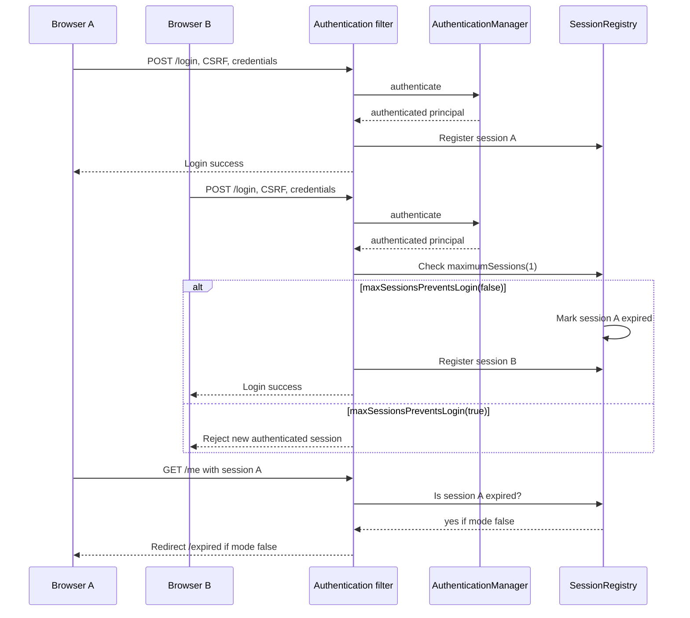

# Limiting concurrent sessions with maximumSessions

> **Scope:** Spring Boot 3.x, Spring Security 6.x on the **Servlet stack** (Spring MVC), Java 17 or later. This lesson explains how to use `maximumSessions` to limit the number of **concurrent authenticated HTTP sessions per principal**: choosing between “new session replaces old session” or “keep existing session, reject new login”, setting up `SessionRegistry`/listeners, testing with two separate sessions, and limitations when running multi-node or using JWT. The example chooses form login because it is tied to Servlet HTTP sessions.

## 1. Precisely understanding “concurrent session limit”

A user can log in across two browsers, two browser profiles, or two devices. Each login with a separate cookie jar normally creates **a different HTTP session**, identified by a cookie such as `JSESSIONID`. Spring Security can track the **number of authenticated sessions tied to one principal** through `SessionRegistry`.

When configuring:

```java
http.sessionManagement(session -> session
        .sessionConcurrency(concurrency -> concurrency
                .maximumSessions(1)
        )
);
```

the intent is that each principal is allowed at most **one active session** within the scope of the registry and the authentication mechanisms applying the policy. `maximumSessions(2)` allows up to two sessions. It does not automatically make every authentication mechanism stateful, nor can you deduce exact physical device counts from session ID counts.

| What is being counted | Is this what `maximumSessions` counts? | Example |
|---|---|---|
| Authenticated sessions of the same principal | **Yes** | Chrome profile A + Firefox profile B logged into the same account |
| Tabs within the same browser profile | **Not directly** | Three tabs sending the same `JSESSIONID` cookie → one session |
| Concurrent in-flight requests | **No** | One session can send multiple requests simultaneously |
| Number of online users across the whole site | **No** | The limit is evaluated **per principal**, not a global quota |
| Failed login attempts within one minute | **No** | Requires rate limiting, brute-force detection |
| Unexpired JWT/Bearer tokens | **Not automatically** | Stateless tokens typically have no `HttpSession` |
| Sessions across multiple instances | **Depends on registry** | `SessionRegistryImpl` only knows the local JVM |
| Number of physical devices | **Not accurate** | One phone can have multiple browsers/profiles |

Therefore, use the term **concurrent authenticated HTTP sessions**, and avoid shorthand like “a single device”. This mechanism does not replace MFA, failed-login throttling, anomalous-session detection, or cookie protection.

## 2. Two policies when a new login session arrives

### 2.1. `maxSessionsPreventsLogin(false)` — new session replaces old session

```java
.maximumSessions(1)
.maxSessionsPreventsLogin(false)
```

This policy allows **the new login to succeed** and **invalidates the old session** when the threshold is exceeded. With the same user `learner`:

1. Browser A logs in and holds active session A.
2. Browser B has a different cookie jar, logs in with the same username/password, and creates session B.
3. Spring Security marks session A as **expired** in the registry; session B is registered.
4. **When A sends its next HTTP request**, `ConcurrentSessionFilter` sees the expired status, processes session A, and can redirect to `/expired`.
5. B continues accessing protected endpoints using session B.

**Subtlety:** “A expired” does not mean Browser A immediately receives a push notification. If tab A sits idle without sending requests, the old screen may stay displayed. WebSocket/SSE connections or long-running tasks need separate revocation mechanisms if immediate disconnection is required.

### 2.2. `maxSessionsPreventsLogin(true)` — block new login

```java
.maximumSessions(1)
.maxSessionsPreventsLogin(true)
```

With this policy, A logs in first and keeps session A. When B attempts to log in **from another session** using the same account, Spring Security refuses to register an authenticated session B. In the default form login flow, the result is typically a redirect to `/login?error`. A continues using the existing session.

Even when B enters the correct password, B's login can still be rejected due to **exceeding the session limit**, not an invalid password. This is a `SessionAuthenticationException` at the session management step. Once A logs out or its session is genuinely destroyed/timed out and the registry is properly cleaned up, B gets a chance to log in.

| Factor | `false` — replace old session | `true` — keep old session |
|---|---|---|
| A logs in first | Succeeds | Succeeds |
| B logs in as same user from another session | Succeeds | **Rejected** |
| Session A after B tries to log in | Marked **expired** | Remains valid |
| Session B | Active | Not authenticated |
| A sends next request | Handled as expired; may go to `/expired` | Still reaches endpoint |
| Suitable UX scenario | Users want seamless device switching | Policy prioritizes protecting the existing session |
| Risk to address | Old session replaced without user's immediate awareness | User locked out if old session is not cleaned up |

Both have limits: neither proves which session belongs to the “legitimate account owner”. If an attacker knows the password, `false` mode can kick out the owner; `true` mode can be abused to lock the owner out from logging in elsewhere. MFA, alerts, session management, and proper support/recovery are still required.

## 3. Internal flow of concurrent session control

`SessionRegistry` is the registry tracking session IDs bound to a principal. `SessionRegistryImpl` is the common implementation in a Servlet application running on **a single JVM**.



Steps to remember:

1. **Authentication filter** such as `UsernamePasswordAuthenticationFilter` handles form login and calls `AuthenticationManager`. The manager verifies credentials and does not decide session counts itself.
2. After successful authentication, the **session authentication strategy** checks the per-principal concurrency limit; it may expire old sessions or reject the current login.
3. If login is permitted, session fixation protection may rotate the session ID; the strategy registers the **final session ID** in the registry.
4. `ConcurrentSessionFilter` inspects the current session on subsequent requests, updates last-request time, and detects sessions marked expired.
5. **Logout, timeout, and invalidation** must cause the registry to drop inactive session IDs so the session count does not drift.

`expiredUrl("/expired")` handles sessions marked expired by concurrency control. It is **not the same** as `invalidSessionUrl(...)` (meant for requests with a no-longer-valid session ID such as after timeout), nor is it the URL handling a rejected new login under `true` mode.

### What role does HttpSessionEventPublisher play?

`HttpSessionEventPublisher` listens to the Servlet Container's session lifecycle and publishes corresponding Spring events, helping `SessionRegistryImpl` receive session destruction/ID-change notifications and perform cleanup.

In embedded Servlet Spring Boot, you can declare the listener bean:

```java
@Bean
HttpSessionEventPublisher httpSessionEventPublisher() {
    return new HttpSessionEventPublisher();
}
```

Ensure the listener is **actually registered with the Servlet Container** in the target deployment environment. Without receiving `sessionDestroyed` events on timeout/logout, `true` mode can keep rejecting new logins because the registry still thinks the old session is alive. Creating `SessionRegistryImpl` while ignoring lifecycle events is an incomplete configuration.

## 4. Runnable Spring Boot 3.x / Java 17+ example

The example uses **default form login**, protects `/me`, and provides `/expired`. The `demo.prevent-second-login` property lets you run both modes without changing code.

### 4.1. Prepare the Gradle project

Create a project from Spring Initializr with Java 17+, Spring Boot 3.x, Gradle Groovy, selecting **Spring Web**, **Spring Security**, **Spring Boot Starter Test**, and **Spring Security Test**. The `dependencies` section of `build.gradle`:

```groovy
dependencies {
    implementation 'org.springframework.boot:spring-boot-starter-web'
    implementation 'org.springframework.boot:spring-boot-starter-security'
    testImplementation 'org.springframework.boot:spring-boot-starter-test'
    testImplementation 'org.springframework.security:spring-security-test'
}
```

This is just the dependencies block; keep the plugins, repositories, and Boot version generated by Initializr.

Source structure:

```text
src/
├── main/java/com/example/concurrent/
│   ├── ConcurrentSessionApplication.java
│   ├── SecurityConfig.java
│   └── DemoController.java
└── test/java/com/example/concurrent/
    ├── ExpireOldSessionTest.java
    └── RejectSecondLoginTest.java
```

### 4.2. Main application

**`src/main/java/com/example/concurrent/ConcurrentSessionApplication.java`**

```java
package com.example.concurrent;

import org.springframework.boot.SpringApplication;
import org.springframework.boot.autoconfigure.SpringBootApplication;

@SpringBootApplication
public class ConcurrentSessionApplication {
    public static void main(String[] args) {
        SpringApplication.run(ConcurrentSessionApplication.class, args);
    }
}
```

### 4.3. SecurityConfig — configuring maximumSessions(1)

**`src/main/java/com/example/concurrent/SecurityConfig.java`**

```java
package com.example.concurrent;

import org.springframework.context.annotation.Bean;
import org.springframework.context.annotation.Configuration;
import org.springframework.core.env.Environment;
import org.springframework.security.config.annotation.web.builders.HttpSecurity;
import org.springframework.security.core.session.SessionRegistry;
import org.springframework.security.core.session.SessionRegistryImpl;
import org.springframework.security.core.userdetails.User;
import org.springframework.security.core.userdetails.UserDetails;
import org.springframework.security.core.userdetails.UserDetailsService;
import org.springframework.security.crypto.bcrypt.BCryptPasswordEncoder;
import org.springframework.security.crypto.password.PasswordEncoder;
import org.springframework.security.provisioning.InMemoryUserDetailsManager;
import org.springframework.security.web.SecurityFilterChain;
import org.springframework.security.web.session.HttpSessionEventPublisher;

@Configuration
public class SecurityConfig {

    @Bean
    PasswordEncoder passwordEncoder() {
        return new BCryptPasswordEncoder();
    }

    @Bean
    UserDetailsService users(PasswordEncoder encoder) {
        UserDetails learner = User.withUsername("learner")
                .password(encoder.encode("demo-pass"))
                .roles("USER")
                .build();
        return new InMemoryUserDetailsManager(learner);
    }

    @Bean
    SessionRegistry sessionRegistry() {
        return new SessionRegistryImpl();
    }

    @Bean
    HttpSessionEventPublisher httpSessionEventPublisher() {
        return new HttpSessionEventPublisher();
    }

    @Bean
    SecurityFilterChain securityFilterChain(
            HttpSecurity http,
            SessionRegistry registry,
            Environment environment
    ) throws Exception {
        boolean rejectNewLogin = Boolean.parseBoolean(
                environment.getProperty("demo.prevent-second-login", "false"));

        return http
                .authorizeHttpRequests(auth -> auth
                        .requestMatchers("/expired").permitAll()
                        .anyRequest().authenticated()
                )
                .formLogin(form -> form.permitAll())
                .sessionManagement(session -> session
                        .sessionConcurrency(concurrency -> concurrency
                                .maximumSessions(1)
                                .maxSessionsPreventsLogin(rejectNewLogin)
                                .expiredUrl("/expired")
                                .sessionRegistry(registry)
                        )
                )
                .build();
    }
}
```

**Reading the components:**

- `maximumSessions(1)` is the per-principal limit. Change to `maximumSessions(2)` to allow up to two sessions.
- `maxSessionsPreventsLogin(rejectNewLogin)` sets the mode from the property: defaults to `false`, set `true` to block new logins.
- `SessionRegistryImpl` stores principal/session info within one JVM; `SessionRegistry` is explicitly passed into the concurrency DSL to avoid accidentally using a different registry.
- `HttpSessionEventPublisher` helps receive session-destroyed and ID-changed events, which is critical for logout and timeout.
- `expiredUrl("/expired")` redirects a session **marked expired**; the endpoint has `permitAll()` to avoid a redirect loop.
- `formLogin(form -> form.permitAll())` uses Spring Security's generated login page; `POST /login` is handled by the Security filter, so no login controller is needed.
- `BCryptPasswordEncoder` stores hashed passwords; use the `learner/demo-pass` account on localhost only.
- `csrf.disable()` is not called. POST form login is protected by CSRF by default; the generated form includes a hidden CSRF token.

**Scope:** this configuration has one `SecurityFilterChain` for a Servlet application. With multiple chains/session repositories, examine which manager/registry tracks sessions. `maximumSessions` does not create a JWT revocation mechanism.

### 4.4. Controller to observe session validity

**`src/main/java/com/example/concurrent/DemoController.java`**

```java
package com.example.concurrent;

import org.springframework.security.core.Authentication;
import org.springframework.web.bind.annotation.GetMapping;
import org.springframework.web.bind.annotation.RestController;

@RestController
public class DemoController {

    @GetMapping("/me")
    public String me(Authentication auth) {
        return "HELLO " + auth.getName();
    }

    @GetMapping("/expired")
    public String expired() {
        return "SESSION_EXPIRED";
    }
}
```

`GET /me` requires login due to `anyRequest().authenticated()`. `GET /expired` requires no login, allowing the browser to receive the message after a session is replaced.

## 5. Browser experiment with two cookie jars

Run the application in the directory containing the Gradle wrapper:

```bash
# macOS / Linux
./gradlew bootRun

# Windows PowerShell
.\gradlew.bat bootRun
```

By default it listens at `http://localhost:8080`. To test properly, use **two independent browser profiles** (or two separate browsers) with two distinct cookie jars. Two tabs in the same browser profile normally share one `JSESSIONID` cookie, so they do not create two sessions.

### Mode A — Let B log in and expire A

When `demo.prevent-second-login` is `false` (default):

1. Browser A opens `http://localhost:8080/me`. Spring Security redirects to the login form. Log in as `learner` / `demo-pass`; `/me` returns `HELLO learner`.
2. Browser B (different profile) opens `/me` and logs into the same account. B logs in successfully.
3. A refreshes `/me`. **Expected:** HTTP redirect to `/expired`; once the browser follows the redirect it displays `SESSION_EXPIRED`.
4. B refreshes `/me`. **Expected:** still sees `HELLO learner`.

A's UI will not necessarily change at the exact moment B logs in; A's expiration is processed when A sends its next request.

### Mode B — Keep A, reject B

Create `src/main/resources/application.properties` (if absent) with:

```properties
demo.prevent-second-login=true
```

Restart the application and use two independent profiles:

1. A logs in as `learner` successfully.
2. B enters the **correct** `learner/demo-pass` and submits.
3. **Expected:** B does not obtain an authenticated session; form login failure typically redirects to `/login?error`.
4. A can still access `/me`.
5. A logs out or its session expires in the container; once the registry updates, B can try again.

Do not call this “B's password is wrong”: password authentication may have succeeded, but the session authentication strategy refuses a new session.

If you want to run Mode B via the command line instead of a properties file:

```bash
./gradlew bootRun --args='--demo.prevent-second-login=true'
```

This argument syntax suits shells supporting it; on Windows, using the properties file can be simpler.

## 6. MockMvc: truly testing two form logins

Concurrent session tests **must pass through the real authentication filter and session strategy**. Using `@WithMockUser` or manually setting `SecurityContextHolder` before calling a controller does not verify `maximumSessions`.

Spring Security Test provides `formLogin()` to submit login requests through the security filters with a valid CSRF token. The tests below use two independent HTTP sessions, extracting each post-login session from `MvcResult`.

### 6.1. Testing false mode: previous session gets expired

**`src/test/java/com/example/concurrent/ExpireOldSessionTest.java`**

```java
package com.example.concurrent;

import org.junit.jupiter.api.Test;
import org.springframework.beans.factory.annotation.Autowired;
import org.springframework.boot.test.autoconfigure.web.servlet.AutoConfigureMockMvc;
import org.springframework.boot.test.context.SpringBootTest;
import org.springframework.mock.web.MockHttpSession;
import org.springframework.test.web.servlet.MockMvc;
import org.springframework.test.web.servlet.MvcResult;

import static org.junit.jupiter.api.Assertions.assertNotEquals;
import static org.junit.jupiter.api.Assertions.assertNotNull;
import static org.springframework.security.test.web.servlet.request.SecurityMockMvcRequestBuilders.formLogin;
import static org.springframework.test.web.servlet.request.MockMvcRequestBuilders.get;
import static org.springframework.test.web.servlet.result.MockMvcResultMatchers.content;
import static org.springframework.test.web.servlet.result.MockMvcResultMatchers.redirectedUrl;
import static org.springframework.test.web.servlet.result.MockMvcResultMatchers.status;

@SpringBootTest(properties = "demo.prevent-second-login=false")
@AutoConfigureMockMvc
class ExpireOldSessionTest {

    @Autowired
    MockMvc mvc;

    @Test
    void secondLoginExpiresPreviousSession() throws Exception {
        MvcResult first = mvc.perform(
                formLogin().user("learner").password("demo-pass"))
                .andExpect(status().is3xxRedirection())
                .andReturn();

        MockHttpSession sessionA =
                (MockHttpSession) first.getRequest().getSession(false);
        assertNotNull(sessionA);

        MvcResult second = mvc.perform(
                formLogin().user("learner").password("demo-pass"))
                .andExpect(status().is3xxRedirection())
                .andReturn();

        MockHttpSession sessionB =
                (MockHttpSession) second.getRequest().getSession(false);
        assertNotNull(sessionB);
        assertNotEquals(sessionA.getId(), sessionB.getId());

        mvc.perform(get("/me").session(sessionA))
                .andExpect(status().is3xxRedirection())
                .andExpect(redirectedUrl("/expired"));

        mvc.perform(get("/me").session(sessionB))
                .andExpect(status().isOk())
                .andExpect(content().string("HELLO learner"));
    }
}
```

**Explanation:** the second `formLogin` uses the same username in a different session, causing session A to be marked expired by the registry. Only on A's next request does `ConcurrentSessionFilter` redirect to `/expired`; B remains valid.

### 6.2. Testing true mode: new login is rejected

**`src/test/java/com/example/concurrent/RejectSecondLoginTest.java`**

```java
package com.example.concurrent;

import org.junit.jupiter.api.Test;
import org.springframework.beans.factory.annotation.Autowired;
import org.springframework.boot.test.autoconfigure.web.servlet.AutoConfigureMockMvc;
import org.springframework.boot.test.context.SpringBootTest;
import org.springframework.mock.web.MockHttpSession;
import org.springframework.test.web.servlet.MockMvc;
import org.springframework.test.web.servlet.MvcResult;

import static org.junit.jupiter.api.Assertions.assertNotNull;
import static org.springframework.security.test.web.servlet.request.SecurityMockMvcRequestBuilders.formLogin;
import static org.springframework.test.web.servlet.request.MockMvcRequestBuilders.get;
import static org.springframework.test.web.servlet.result.MockMvcResultMatchers.content;
import static org.springframework.test.web.servlet.result.MockMvcResultMatchers.redirectedUrl;
import static org.springframework.test.web.servlet.result.MockMvcResultMatchers.status;

@SpringBootTest(properties = "demo.prevent-second-login=true")
@AutoConfigureMockMvc
class RejectSecondLoginTest {

    @Autowired
    MockMvc mvc;

    @Test
    void newLoginIsRejectedWhileCurrentSessionWorks() throws Exception {
        MvcResult first = mvc.perform(
                formLogin().user("learner").password("demo-pass"))
                .andExpect(status().is3xxRedirection())
                .andReturn();

        MockHttpSession sessionA =
                (MockHttpSession) first.getRequest().getSession(false);
        assertNotNull(sessionA);

        mvc.perform(formLogin()
                    .user("learner").password("demo-pass"))
                .andExpect(status().is3xxRedirection())
                .andExpect(redirectedUrl("/login?error"));

        mvc.perform(get("/me").session(sessionA))
                .andExpect(status().isOk())
                .andExpect(content().string("HELLO learner"));
    }
}
```

**Expected:** B's login fails because the session limit was reached; A remains active. If the application changes the failure handler/failure URL, update the redirect assertion to match the new contract. Do not assume every authentication type returns the same status/URL when hitting the limit.

### 6.3. Running tests and reading results

```bash
# macOS / Linux
./gradlew test

# Windows PowerShell
.\gradlew.bat test
```

With the project/configuration above, both tests are **expected** to PASS, each class using `@SpringBootTest(properties=...)` for its respective mode. This is the expected outcome when executed by the learner, **not an assertion that the code was run in the documentation's environment**.

If a test fails, check whether `formLogin()` actually passed through the filter, whether the CSRF token is valid, whether the two sessions have different IDs, whether the registry used in the concurrency DSL is the declared bean, and whether any context/test state was unintentionally reused.

## 7. Details that determine correctness

### 7.1. Principal equality

`SessionRegistryImpl` groups sessions by principal. With Spring Security's `User` in the example, equality is defined compatibly by username. However, a custom `CustomUserDetails` might inherit default **object identity** equality: each DB lookup creates a new object, causing the registry not to recognize two sessions belonging to the same account.

For custom principals, define `equals`/`hashCode` based on a **stable, immutable** identifier properly scoped to the tenant—never using session ID, password hash, object reference, or properties that can change between logins. Never merge two distinct users just because they share an email across independent tenants.

### 7.2. Session lifecycle, timeout, and logout

Closing a tab/browser does not guarantee the container immediately invalidates the session; the server normally waits for timeout. Logging out via Spring Security can invalidate the session, yet proper registry cleanup still requires the appropriate listener/lifecycle hook. If `true` mode keeps blocking logins after A supposedly logged out, check `HttpSessionEventPublisher` and session-destruction events.

`ConcurrentSessionFilter` handles the expired flag in `SessionRegistry`. A session already invalidated by timeout/logout is a different case; do not lump every session error into “logged in elsewhere”.

### 7.3. Session fixation protection

Form login can change the session ID upon authentication to prevent session fixation. Therefore, tests must obtain the session object/ID **after** login succeeds, rather than saving a pre-login session ID and assuming it stays identical.

### 7.4. Maximum sessions greater than one

With `maximumSessions(2)` and `false` mode, A and B can be active simultaneously. When C logs in, the registry selects the older session based on last-request info to mark expired, then registers session C. Do not assume “the earliest logged-in session” is always the one replaced in every situation: last-request timing and concurrency can affect selection.

In `true` mode, once two sessions exist, C is rejected until a slot opens. Changing the property/limit while the application is running does not mean old sessions are immediately revoked; a migration/revocation policy is needed if changing limits for active users.

## 8. When maximumSessions cannot replace other mechanisms

### Stateless APIs and JWT/Bearer

If an API uses `SessionCreationPolicy.STATELESS` and verifies JWTs on every request without creating HTTP sessions, the registry has no awareness of issued JWTs. Old access tokens remain usable until expiration; `maximumSessions(1)` does not revoke Bearer tokens.

If a product needs “single-device login” with JWTs, design it at the authorization server or token/session store: refresh token rotation, revocation, `jti`/token version, short expiry, and proper validation. Do not just add `maximumSessions` to a resource server and claim other machines are blocked.

### Multiple applications or multiple JVM replicas

`SessionRegistryImpl` lives in **one JVM's** memory. One login to node A and another to node B can be counted independently even for the same username. Sticky sessions only pin each client to a node; they do not create a global registry.

In distributed systems, Spring Session can provide `SpringSessionBackedSessionRegistry` backed by a shared session repository (e.g., Redis/JDBC) supporting principal-based queries. Configure matching versions, principal indexing, lifecycle, cleanup, and synchronization properly. Test logins across **two different nodes**, timeout, logout, and near-simultaneous logins; merely “having Redis” does not guarantee every race condition is solved.

### Custom authentication or multiple authentication flows

Session limits apply when the authentication success path invokes the **session authentication strategy**. Form login in the example integrates this path. A custom controller calling `AuthenticationManager.authenticate(...)` and setting `SecurityContextHolder` manually can **bypass** the concurrency strategy and session registry registration.

For OAuth2 Login, SAML, custom authentication filters, or remember-me, inspect specifically which mechanism creates a server-side session and registers with the registry. Do not equate placing an `Authentication` in `SecurityContext` with having registered a concurrent session.

### WebSocket, SSE, background jobs

An expired HTTP session does not mean all open connections immediately disconnect. If immediate force-logout is required on WebSocket/SSE, track session/token state and close connections outside Servlet HTTP filters. For background tasks, re-check permissions at the appropriate time rather than trusting an old context forever.

## 9. Troubleshooting: common errors

| Symptom | Common cause | How to diagnose |
|---|---|---|
| B logs in yet A still accesses normally | Two tabs share one cookie, no separate session created; filter/registry not wired | Use two browser profiles, inspect session IDs |
| A is not redirected to `/expired` immediately when B logs in | No new request sent yet | Refresh `/me` on A |
| B is rejected after A closed the tab | Closing a tab is not logout; session lives until timeout | Actually log out or wait for timeout, check cleanup |
| `true` mode fails to block B's login | Broken principal equality, bypassed session strategy, mismatched registries, multiple nodes | Check `equals/hashCode`, auth flow, and registry |
| POST `/login` returns 403 | Missing/invalid CSRF token | Use generated login form or `formLogin()` helper |
| Request redirects to `/login` instead of `/expired` | Session already invalid/timed out or different filter config | Distinguish concurrency expiry from invalid session |
| `@WithMockUser` test passes yet session control fails | Test does not run real login/strategy | Test with two independent `formLogin()` calls |
| Works on only one server | Local `SessionRegistryImpl` | Test cross-node and Spring Session registry |
| JWT still works after session expired | JWT is not managed by concurrent HttpSession registry | Check revoke/refresh/access-token policy |
| WebSocket still receives messages after session expired | Connection is not intercepted by Servlet request filters | Design separate WebSocket closing/revocation |
| `true` mode keeps rejecting even after timeout | Registry does not receive session-destroy events | Check listener registration and cleanup |
| Limit seems to apply globally across all users | Custom registry counts globally instead of per principal | Check grouping and equality |

### Distinguishing three HTTP branches

- **Old session expired:** A was marked expired by concurrency control because B logged in under `false` mode; the next request hits `ConcurrentSessionFilter` and can redirect to `/expired`.
- **Invalid session:** the client uses a cookie for a timed-out or logged-out session; if `invalidSessionUrl` is configured, it may redirect elsewhere, which does not prove a login on a new device.
- **New login refused:** under `true` mode, B's login creates no authenticated session; the form failure handler typically redirects to `/login?error`. Do not use `expiredUrl` to handle this case.

## 10. Production checklist

1. Define which principal/account/tenant the limit scopes over and which login types must be counted.
2. Choose **`false`/`true`** policy based on UX and risk; provide clear messaging and legitimate session logout/revocation.
3. Choose the right `SessionRegistry`; never use two different registries for counting vs. filtering sessions.
4. For custom principals, implement stable `equals/hashCode` so sessions group accurately.
5. Verify `HttpSessionEventPublisher`/lifecycle listeners actually run; test logout and timeout.
6. Verify the authentication success path invokes the session strategy and registers sessions (not just setting `SecurityContext`).
7. With multiple replicas, deploy a distributed registry/session repository and test cross-node behavior as well as concurrent login races.
8. Maintain HTTPS, `HttpOnly`/`Secure`/`SameSite` cookies, CSRF, session fixation protection, and suitable inactivity timeouts.
9. Never log raw `JSESSIONID`, CSRF tokens, passwords, cookies, or bearer tokens; safely audit login/expire/reject events.
10. Do not use `maximumSessions` as a substitute for login attempt throttling, MFA, authorization, or JWT revocation.
11. Test both cookie-sharing browser tabs and separate-cookie browser profiles to avoid false positives.
12. If instant logout is required on WebSocket/mobile tokens, add revocation/push/close mechanisms per design.

## 11. Self-check questions

**Question 1.** Two tabs in the same Chrome profile share the same `JSESSIONID`. Does `maximumSessions(1)` necessarily lock out one tab?  
**Answer:** No, they share a single HTTP session.

**Question 2.** A logs in, then B logs in as the same user under `false` mode. Why does A not see a change immediately, yet refreshing redirects to `/expired`?  
**Answer:** The registry marks A expired; `ConcurrentSessionFilter` detects and handles it when A sends its next request.

**Question 3.** Under `true` mode, B enters the correct password yet gets a login failure. What kind of error is this?  
**Answer:** A concurrent session policy violation, not necessarily invalid credentials.

**Question 4.** Why is `HttpSessionEventPublisher` directly tied to whether B can log in after A logs out?  
**Answer:** Session-destroy events let the registry remove A's no-longer-valid session, freeing up the quota.

**Question 5.** A custom `UserDetails` does not override `equals/hashCode` and creates a new object on every login: what is the consequence?  
**Answer:** The registry can treat them as different principals, rendering the limit ineffective.

**Question 6.** An app has two replicas using `SessionRegistryImpl` on each node. Why is `maximumSessions(1)` insufficient?  
**Answer:** Each JVM's in-memory registry cannot see sessions on the other node; a distributed mechanism is needed.

**Question 7.** Accessing an API with stateless JWTs, why does `maximumSessions` not revoke old JWTs?  
**Answer:** Bearer tokens are not HTTP sessions inside the registry; a token revocation/expiry policy is required.

## 12. Takeaways

- **`maximumSessions(n)`** limits the number of **authenticated HTTP sessions per principal** within the registry's scope.
- **`maxSessionsPreventsLogin(false)`:** allows the new login, marks the **old session expired**; the old session is handled on its next request.
- **`maxSessionsPreventsLogin(true)`:** rejects the new login, keeping the active session.
- **`SessionRegistryImpl`** tracks sessions within a single JVM; **`HttpSessionEventPublisher`** supports cleanup on session destruction/timeout.
- Form login includes CSRF and session fixation protection; test concurrency using **two form logins and two distinct sessions**, not just `@WithMockUser`.
- Stateless JWTs, multi-node deployments, WebSockets, and custom authentication flows require lifecycle controls beyond the defaults.

**Final principle:** session limits only enforce accurately when the authentication path, registry, and session lifecycle are configured consistently. It is a session-management defense layer, not a substitute for strong authentication or authorization.