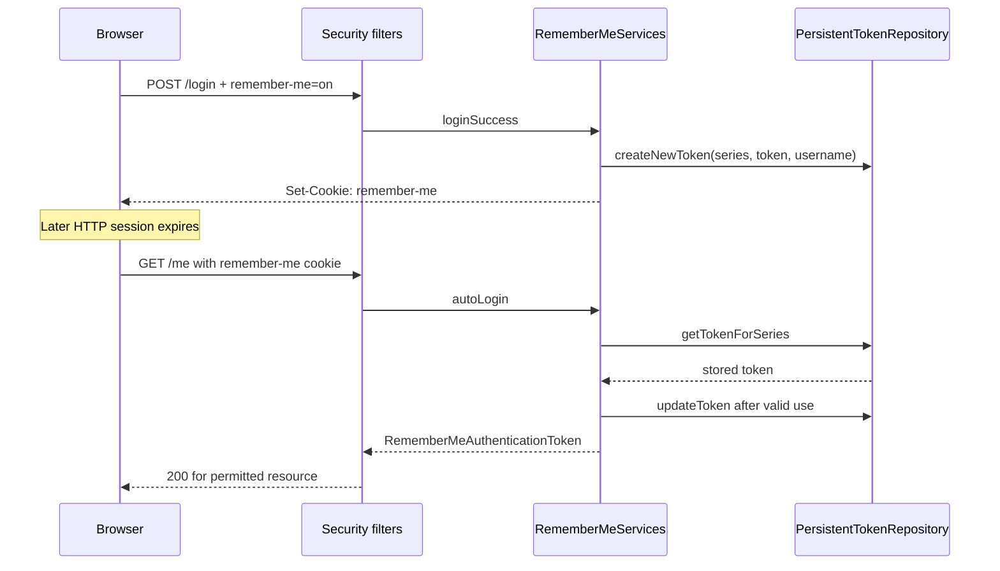

# Revoking Remember-me on Logout, Password Change, or Suspected Compromise

> **Learning environment:** Java 17+, Spring Boot 3.x, Spring Security 6.x on the Servlet stack (Spring MVC). This lesson focuses on **revoking automatic login capability from a remember-me cookie**, which is not synonymous with deleting an HTTP session, changing a password, revoking JWTs, or logging out every device. Includes complete code and MockMvc tests with H2/JDBC to observe a credential remaining valid or being invalidated; accounts, keys, and the in-memory database are for localhost only.

## 1. Why Does Remember-me Need a Revocation Policy?

During standard form login, Spring Security places `Authentication` in `SecurityContext`, which can be stored in `HttpSession`. The `JSESSIONID` cookie lets the browser carry the same session on the next request. With remember-me, the user explicitly checks “Remember me”; besides the session cookie, the server issues a **longer-lived credential** in a separate cookie. When the old session expires, `RememberMeAuthenticationFilter` can recognize this cookie and automatically log the user back in.

Real-world scenario: Alice logs in on her laptop with remember-me enabled; later she loses the laptop, her password is exposed, or she needs to log out all devices. If the app deletes only `JSESSIONID` or removes the cookie only in the active tab, a **copy of the remember-me cookie** on another machine or in an attacker's hands can still re-authenticate.

Principle to understand: **clearing a cookie on the client does not prove the credential was revoked on the server**. For a copy to become useless, the cookie verification mechanism must **stop accepting it**.

Scenarios covered in this lesson:

- **Logout:** ends the current HTTP session; handles the remember-me cookie and server-side tokens per “current device” or “all devices” policy.
- **Password change/reset:** once the account proves authority to change it, updates the password hash and actively revokes remembered logins. Also consider other sessions and refresh tokens.
- **Suspected compromise:** immediately revokes credentials that could be replayed without waiting for expiration; logs audit events, notifies, and investigates root cause.

## 2. Five Components in the Remember-me Flow

| Component | Role | Do not confuse with |
|---|---|---|
| `HttpSession`/`JSESSIONID` | Maintains login across a normal HTTP session | Long-lived remember-me cookie |
| `RememberMeAuthenticationFilter` | Attempts auto-authentication via remember-me when no auth is in context | Provider verifying passwords when user logs in |
| `RememberMeServices` | Issues cookies, auto-logins, handles logout | A central manager for all refresh tokens/JWTs |
| `TokenBasedRememberMeServices` | Verifies remember-me cookies by signature, expiry, and user data | Persistent tokens stored one row per device |
| `PersistentTokenBasedRememberMeServices` | Verifies **series/token** using server-side `PersistentTokenRepository` and rotates tokens | Stateless signed tokens or session cookies |

There are two different implementation styles that govern how revocation works:

### 2.1. Token-Based Remember-me: Signed Cookie, No Per-Token Record

`TokenBasedRememberMeServices` uses data comprising username/expiration/signature based on a key and password data loaded from `UserDetails`. Because there is no per-cookie row in a token table, invalidating **one** issued cookie usually requires adding server-side state or changing designs. If the user's password hash changes and user details are reloaded fresh, old signatures will **usually** stop validating. However, never claim “changing password logged out everything”: HTTP sessions, JWTs/refresh tokens, and certain custom remember-me implementations do not vanish automatically.

Changing the signing key invalidates cookies tied to the old key en masse; this is a broad change requiring UX preparation and operational planning. Never expect clearing a cookie on one device to protect against an already-copied cookie.

### 2.2. Persistent Remember-me: Server-Side Series/Token

`PersistentTokenBasedRememberMeServices` issues a remember-me cookie containing information for a **series** and secret token. The server stores the record via `PersistentTokenRepository` (usually `JdbcTokenRepositoryImpl` using the `persistent_logins` table). When a valid cookie is used for auto-login, the token can be **rotated** and both the cookie and record are updated.



`PersistentTokenRepository` provides `createNewToken(...)`, `updateToken(...)`, `getTokenForSeries(...)`, and—crucially for this lesson—**`removeUserTokens(username)`**. That final API revokes **all persistent-token records of the user** in that repository. An old cookie will fail to find a valid series and cannot be used to auto-login.

Changing a password hash **does not automatically delete** persistent token rows. With the persistent mechanism, you must therefore invoke revocation deliberately.

**Caution about replay:** because tokens rotate, re-sending an old cookie after a successful auto-login can cause failure or trigger a `CookieTheftException`. Do not assume a token-mismatch error proves an attack with 100% certainty; concurrent requests or two clients using a copied cookie can also cause races. Still, treat it as a security event worth monitoring.

## 3. Define Revocation Scope Before Writing Code

| Event | Possible policies | Mechanism required |
|---|---|---|
| User logs out on machine A | Machine A only, or **all remembered devices** | Clear cookie + revoke specific token/series or all user tokens |
| User clicks “Logout all devices” | Revoke all remember-me tokens and handle active sessions | `removeUserTokens(username)` + session registry/invalidation |
| User changes password | Revoke remembered logins on all devices | Update hash then revoke server-side per transaction/policy |
| Forgot-password reset | Revoke remembered logins after reset token verification | Central account recovery service, never skipping proof-of-ownership |
| Suspected cookie leak or lost device | Immediately revoke all remembered logins | Trusted security service, audit, MFA, and session/token revocation |
| Account disabled | Prevent automatic re-login | Disable account and revoke tokens/active access per policy |

**This lesson's example selects an “all-device remember-me revoke” policy for logout, password change, and incidents.** That means logging out in one browser also revokes remembered logins in other browsers for the same account. This is a clear illustrative choice, **not a mandatory rule for every product**.

If the requirement is “log out only this device”, the standard `PersistentTokenRepository` interface **has no method to delete by series**; you must extend the repository/DAO or build a dedicated device-token registry. Only delete series owned by the authenticated user; never accept a client-supplied series/username and delete unconditionally.

## 4. Logout: Deleting a Session Differs From Revoking Remembered Credentials

In form/session apps, `LogoutFilter` coordinates `LogoutHandler` instances to clear `SecurityContext`, sessions, cookies, and remember-me depending on configuration. Yet to enforce an all-device policy independent of defaults, attach an **explicit** handler:

```java
.logout(logout -> logout
    .addLogoutHandler((request, response, authentication) -> {
        if (authentication != null) {
            persistentTokenRepository.removeUserTokens(
                authentication.getName());
        }
    })
)
```

This is a **snippet inside `SecurityFilterChain`**, not a standalone class. The username comes from the server-trusted `Authentication`, **not** `request.getParameter("username")`. Revocation must be idempotent; calling it multiple times should cause no harmful side effects.

Keep **POST /logout with CSRF** for cookie/session apps. Never turn GET into a state-changing logout action to prevent browser/prefetch/cross-site abuse. Do not assume deleting `JSESSIONID` deletes token series; nor assume deleting `persistent_logins` invalidates every active HTTP session.

## 5. Password Change: Revoke Within the Same Business Flow

A sound workflow for user self-service password changes:

1. Require **full/fresh authentication** and potentially step-up/MFA. Spring Security distinguishes `fullyAuthenticated()` from standard remember-me authentication.
2. The user sends the **current password** and new password over HTTPS to a CSRF-protected POST endpoint when using cookies/sessions.
3. The service verifies the old password via `PasswordEncoder.matches(...)`, validates the new password, and hashes it with the encoder.
4. Update the credential store and **delete all persistent remember-me tokens** for the account; ensure consistency via transaction or fail-closed/retry mechanics in production.
5. End the current session and clear the remember-me cookie; revoke other valid sessions/refresh tokens per policy, not just remember-me tokens.
6. Send a password-change notification through a verified channel and record a secret-free audit log.

An easily overlooked case: the user uses **forgot password** instead of knowing the old password. The reset endpoint must verify a separate, *single-use* reset token with TTL and purpose binding, then run the **same revocation step** after updating the password hash. If an admin resets a password or an IdP syncs passwords, wire the policy into the shared domain/service event as well. Do not place revocation only in one controller that other update paths can bypass.

In distributed systems, updating hashes and deleting tokens across two separate stores requires failure handling: never return success and silently ignore a failed revocation. If a shared database transaction is unavailable, design an outbox/retry, temporary account lock, or global security-version check so old tokens are rejected during remediation.

## 6. On Suspected Compromise: Prioritize Server-Side Revocation

If there are signs of a lost device, cookies/headers leaked in logs, malicious extensions, XSS, or anomalous logins:

- Identify the authorized user/account and call `removeUserTokens(username)` immediately from a **trusted security workflow**.
- Invalidate active sessions; revoke refresh tokens, API keys, or other credentials depending on severity.
- Consider requiring a password change, MFA, step-up, or temporary lock if strong credentials may be exposed.
- Log timestamp, actor, reason, outcome, and severity, **never logging raw Cookie/remember-me tokens**.
- Notify the user and provide recovery steps via a trusted channel.
- Identify and fix the root leak: cookie scope, TLS termination, XSS, analytics, reverse-proxy logging, or debug endpoints.
- Independently verify that **a copy of the pre-revocation cookie can no longer auto-authenticate**.

**Never expose an unauthenticated `POST /revoke?username=otherUser` API.** Attackers could cause denial-of-service by mass-logging out other accounts. If the product offers “log out all devices”, account scope must come from the authenticated principal or explicit admin authority, with CSRF/MFA/audit.

## 7. Hands-On With Spring Boot 3.x, Java 17+, and H2

The following sample uses:
- Spring Security form login with `remember-me` checkbox;
- `PersistentTokenBasedRememberMeServices` via `PersistentTokenRepository`;
- JDBC `persistent_logins` so the server has a place to revoke tokens;
- 4 in-memory accounts so tests stay independent;
- a shared service for password changes and incident handling;
- `MockMvc` to separate “using an authenticated session” from “auto-reauthenticating with a remember-me cookie”.

**Limitations:** This is a local demo. Sample passwords, keys, and ephemeral H2 are unsuitable for production. The code does not revoke active sessions on other devices; it revokes remembered credentials only. We highlight that boundary explicitly.

### 7.1. Gradle Dependencies

Create a project via Spring Initializr with Java 17+, Spring Boot 3.x, Gradle Groovy, and Spring Web, Security, JDBC, H2, plus both test starters. The `dependencies` block of `build.gradle`:

```groovy
dependencies {
    implementation 'org.springframework.boot:spring-boot-starter-web'
    implementation 'org.springframework.boot:spring-boot-starter-security'
    implementation 'org.springframework.boot:spring-boot-starter-jdbc'
    runtimeOnly 'com.h2database:h2'
    testImplementation 'org.springframework.boot:spring-boot-starter-test'
    testImplementation 'org.springframework.security:spring-security-test'
}
```

This is a **block**, not a standalone Gradle file. Keep the Boot plugin, repositories, versions, and Gradle wrapper generated by Initializr.

Files:

```text
src/main/java/com/example/remember/
  RememberMeLabApplication.java
  SecurityConfig.java
  AccountSecurityService.java
  AccountController.java
src/main/resources/
  application.properties
  schema.sql
src/test/java/com/example/remember/
  RememberMeRevocationTest.java
```

### 7.2. JDBC Persistent Token Table

**`src/main/resources/schema.sql`**

```sql
CREATE TABLE persistent_logins (
    username VARCHAR(64) NOT NULL,
    series VARCHAR(64) PRIMARY KEY,
    token VARCHAR(64) NOT NULL,
    last_used TIMESTAMP NOT NULL
);
```

`JdbcTokenRepositoryImpl` uses the `persistent_logins` table with these columns by default. `series` identifies a remember-me line, `token` holds the secret matched against cookies, and `last_used` reflects recent usage. Never log or return these values via APIs.

**`src/main/resources/application.properties`**

```properties
spring.sql.init.mode=always
demo.remember.key=local-dev-only-change-me-to-a-long-secret
```

With H2 on the classpath, Boot creates an in-memory datasource. `schema.sql` initializes the table on startup; across restarts H2 loses data. `demo.remember.key` is a **demo key never to be used in production**. In production, supply secrets from the environment/secrets manager with no insecure defaults; verify `Secure`/`HttpOnly` cookies, TLS, and database migrations.

### 7.3. Main Application

**`src/main/java/com/example/remember/RememberMeLabApplication.java`**

```java
package com.example.remember;

import org.springframework.boot.SpringApplication;
import org.springframework.boot.autoconfigure.SpringBootApplication;

@SpringBootApplication
public class RememberMeLabApplication {
    public static void main(String[] args) {
        SpringApplication.run(RememberMeLabApplication.class, args);
    }
}
```

### 7.4. SecurityConfig: Persistent Remember-me and All-Device Logout

**`src/main/java/com/example/remember/SecurityConfig.java`**

```java
package com.example.remember;

import javax.sql.DataSource;

import org.springframework.beans.factory.annotation.Value;
import org.springframework.context.annotation.Bean;
import org.springframework.context.annotation.Configuration;
import org.springframework.http.HttpMethod;
import org.springframework.security.config.annotation.web.builders.HttpSecurity;
import org.springframework.security.core.userdetails.User;
import org.springframework.security.crypto.bcrypt.BCryptPasswordEncoder;
import org.springframework.security.crypto.password.PasswordEncoder;
import org.springframework.security.provisioning.InMemoryUserDetailsManager;
import org.springframework.security.web.SecurityFilterChain;
import org.springframework.security.web.authentication.rememberme.JdbcTokenRepositoryImpl;
import org.springframework.security.web.authentication.rememberme.PersistentTokenRepository;

@Configuration
public class SecurityConfig {

    @Bean
    PasswordEncoder passwordEncoder() {
        return new BCryptPasswordEncoder();
    }

    @Bean
    InMemoryUserDetailsManager users(PasswordEncoder encoder) {
        return new InMemoryUserDetailsManager(
            User.withUsername("alice").password(encoder.encode("alice-pass"))
                .roles("USER").build(),
            User.withUsername("bob").password(encoder.encode("bob-pass"))
                .roles("USER").build(),
            User.withUsername("carol").password(encoder.encode("carol-pass"))
                .roles("USER").build(),
            User.withUsername("dave").password(encoder.encode("dave-pass"))
                .roles("USER").build()
        );
    }

    @Bean
    PersistentTokenRepository persistentTokenRepository(DataSource dataSource) {
        JdbcTokenRepositoryImpl repo = new JdbcTokenRepositoryImpl();
        repo.setDataSource(dataSource);
        return repo;
    }

    @Bean
    SecurityFilterChain securityFilterChain(
            HttpSecurity http,
            InMemoryUserDetailsManager users,
            PersistentTokenRepository repository,
            @Value("${demo.remember.key}") String rememberKey
    ) throws Exception {
        return http
            .authorizeHttpRequests(auth -> auth
                .requestMatchers(HttpMethod.POST, "/account/password")
                    .fullyAuthenticated()
                .anyRequest().authenticated()
            )
            .formLogin(form -> form.permitAll())
            .rememberMe(remember -> remember
                .key(rememberKey)
                .userDetailsService(users)
                .tokenRepository(repository)
                .tokenValiditySeconds(7 * 24 * 60 * 60)
            )
            .logout(logout -> logout
                .addLogoutHandler((request, response, authentication) -> {
                    if (authentication != null) {
                        repository.removeUserTokens(
                                authentication.getName());
                    }
                })
            )
            .build();
    }
}
```

**Why configure it this way?** `.tokenRepository(repository)` enables persistent token storage and `userDetailsService(users)` resolves the user on auto-login. `tokenValiditySeconds` caps cookies to about 7 days in the demo. `formLogin(...permitAll())` provides the `GET /login` form and `POST /login` processing filter. There is no need to write a custom controller checking passwords.

`.fullyAuthenticated()` requires authentication **not solely from remember-me** for the password change endpoint. `logout.addLogoutHandler(...)` takes the username from the trusted `Authentication` and deletes **all remembered sessions of the account** in the repository. Spring Security's remaining logout handlers handle session/context/cookies. **Do not disable CSRF**, as login, logout, and password change are all POST actions.

If a product wants single-device logout only, replace the design with ownership-verified per-series server-side revocation. Do not use `removeUserTokens` for “this browser only”.

### 7.5. Service for Changing Passwords and Incident Revocation

**`src/main/java/com/example/remember/AccountSecurityService.java`**

```java
package com.example.remember;

import org.springframework.http.HttpStatus;
import org.springframework.security.core.userdetails.User;
import org.springframework.security.core.userdetails.UserDetails;
import org.springframework.security.crypto.password.PasswordEncoder;
import org.springframework.security.provisioning.InMemoryUserDetailsManager;
import org.springframework.security.web.authentication.rememberme.PersistentTokenRepository;
import org.springframework.stereotype.Service;
import org.springframework.web.server.ResponseStatusException;

@Service
public class AccountSecurityService {
    private final InMemoryUserDetailsManager users;
    private final PasswordEncoder encoder;
    private final PersistentTokenRepository repository;

    public AccountSecurityService(
            InMemoryUserDetailsManager users, PasswordEncoder encoder,
            PersistentTokenRepository repository) {
        this.users = users;
        this.encoder = encoder;
        this.repository = repository;
    }

    public synchronized void changePassword(
            String username, String currentPassword, String newPassword) {
        UserDetails oldUser = users.loadUserByUsername(username);
        if (!encoder.matches(currentPassword, oldUser.getPassword())) {
            throw new ResponseStatusException(
                    HttpStatus.UNAUTHORIZED, "Invalid current password");
        }
        if (newPassword == null || newPassword.length() < 12) {
            throw new ResponseStatusException(
                    HttpStatus.BAD_REQUEST, "New password too short");
        }

        UserDetails updated = User.withUserDetails(oldUser)
                .password(encoder.encode(newPassword))
                .build();
        users.updateUser(updated);
        repository.removeUserTokens(username);
    }

    // Call ONLY from an authorized security incident workflow.
    public void revokeForIncident(String username) {
        repository.removeUserTokens(username);
    }
}
```

**Production warning:** `synchronized` here applies only within one JVM and **does not** create a transaction across `InMemoryUserDetailsManager` and the H2 token database. In production, use a persistent user repository and coordinate password update and token revocation in the same transaction, or use an audited fail-closed/retry workflow. Admin reset/forgot-password flows should reuse revocation logic after proving authority to change the password.

### 7.6. Controller: Change Password, Invalidate Session, and Clear Cookie

**`src/main/java/com/example/remember/AccountController.java`**

```java
package com.example.remember;

import jakarta.servlet.http.Cookie;
import jakarta.servlet.http.HttpServletRequest;
import jakarta.servlet.http.HttpServletResponse;

import org.springframework.http.ResponseEntity;
import org.springframework.security.core.Authentication;
import org.springframework.security.web.authentication.logout.SecurityContextLogoutHandler;
import org.springframework.web.bind.annotation.GetMapping;
import org.springframework.web.bind.annotation.PostMapping;
import org.springframework.web.bind.annotation.RequestParam;
import org.springframework.web.bind.annotation.RestController;

@RestController
public class AccountController {
    private final AccountSecurityService security;

    public AccountController(AccountSecurityService security) {
        this.security = security;
    }

    @GetMapping("/me")
    public String me(Authentication authentication) {
        return "HELLO " + authentication.getName();
    }

    @PostMapping("/account/password")
    public ResponseEntity<String> changePassword(
            Authentication authentication,
            @RequestParam String currentPassword,
            @RequestParam String newPassword,
            HttpServletRequest request,
            HttpServletResponse response) {

        security.changePassword(authentication.getName(),
                currentPassword, newPassword);

        new SecurityContextLogoutHandler()
                .logout(request, response, authentication);

        Cookie clear = new Cookie("remember-me", "");
        clear.setPath(request.getContextPath().isEmpty()
                ? "/" : request.getContextPath());
        clear.setHttpOnly(true);
        clear.setSecure(request.isSecure());
        clear.setMaxAge(0);
        response.addCookie(clear);
        return ResponseEntity.ok("PASSWORD_CHANGED");
    }
}
```

The controller never accepts a client-supplied `username`; it only changes the password for the currently fully authenticated principal. `SecurityContextLogoutHandler` closes the current session and clears the context; the `remember-me` cookie is cleared so the browser stops resending the old credential. **It is deleting the repository tokens in the service** that prevents a copied cookie from auto-logging in. In production, verify cookie name/path/domain match the issuance policy and HTTPS reverse proxy setup, and also revoke other sessions if true logout-all-devices is required.

An endpoint returning 200 after a password change must not be treated as proof that all devices were logged out. Other active sessions may still access the application; they require `SessionRegistry`/session repository tracking, session invalidation, or separate security versioning.

## 8. MockMvc: Proving Tokens Work Before and Fail After Revocation

The test suite uses **real POST form logins** with `.with(csrf())` and `remember-me=on`, capturing the remember-me cookie from `Set-Cookie`. When exercising the cookie, the tests **omit the HTTP session**: thus success comes solely from remember-me auto-login rather than the old login session.

**`src/test/java/com/example/remember/RememberMeRevocationTest.java`**

```java
package com.example.remember;

import java.util.Arrays;
import jakarta.servlet.http.Cookie;

import org.junit.jupiter.api.Test;
import org.springframework.beans.factory.annotation.Autowired;
import org.springframework.boot.test.autoconfigure.web.servlet.AutoConfigureMockMvc;
import org.springframework.boot.test.context.SpringBootTest;
import org.springframework.mock.web.MockHttpSession;
import org.springframework.test.web.servlet.MockMvc;
import org.springframework.test.web.servlet.MvcResult;

import static org.junit.jupiter.api.Assertions.assertNotNull;
import static org.springframework.security.test.web.servlet.request.SecurityMockMvcRequestPostProcessors.csrf;
import static org.springframework.test.web.servlet.request.MockMvcRequestBuilders.get;
import static org.springframework.test.web.servlet.request.MockMvcRequestBuilders.post;
import static org.springframework.test.web.servlet.result.MockMvcResultMatchers.content;
import static org.springframework.test.web.servlet.result.MockMvcResultMatchers.status;

@SpringBootTest
@AutoConfigureMockMvc
class RememberMeRevocationTest {
    @Autowired MockMvc mvc;
    @Autowired AccountSecurityService accounts;

    private record Login(MockHttpSession session, Cookie remember) {}

    private Login rememberLogin(String username, String password)
            throws Exception {
        MvcResult r = mvc.perform(post("/login")
                        .with(csrf())
                        .param("username", username)
                        .param("password", password)
                        .param("remember-me", "on"))
                .andExpect(status().is3xxRedirection())
                .andReturn();

        MockHttpSession session =
                (MockHttpSession) r.getRequest().getSession(false);
        assertNotNull(session);

        Cookie remember = Arrays.stream(r.getResponse().getCookies())
                .filter(c -> "remember-me".equals(c.getName()))
                .findFirst()
                .orElseThrow(() ->
                    new AssertionError("Missing remember-me cookie"));
        return new Login(session, remember);
    }

    @Test
    void cookieAutoLoginWorksWithoutHttpSession() throws Exception {
        Login carol = rememberLogin("carol", "carol-pass");
        mvc.perform(get("/me").cookie(carol.remember()))
                .andExpect(status().isOk())
                .andExpect(content().string("HELLO carol"));
    }

    @Test
    void logoutRevokesAllRememberedDevicesForUser() throws Exception {
        Login laptop = rememberLogin("alice", "alice-pass");
        Login phone = rememberLogin("alice", "alice-pass");

        mvc.perform(post("/logout")
                        .session(laptop.session())
                        .with(csrf()))
                .andExpect(status().is3xxRedirection());

        mvc.perform(get("/me").cookie(laptop.remember()))
                .andExpect(status().is3xxRedirection());
        mvc.perform(get("/me").cookie(phone.remember()))
                .andExpect(status().is3xxRedirection());
    }

    @Test
    void passwordChangeInvalidatesOldRememberCookie() throws Exception {
        Login bob = rememberLogin("bob", "bob-pass");
        mvc.perform(post("/account/password")
                        .session(bob.session())
                        .with(csrf())
                        .param("currentPassword", "bob-pass")
                        .param("newPassword", "bob-rotated-2026"))
                .andExpect(status().isOk())
                .andExpect(content().string("PASSWORD_CHANGED"));

        mvc.perform(get("/me").cookie(bob.remember()))
                .andExpect(status().is3xxRedirection());
    }

    @Test
    void authorizedIncidentActionRevokesRememberCookie() throws Exception {
        Login dave = rememberLogin("dave", "dave-pass");
        accounts.revokeForIncident("dave");

        mvc.perform(get("/me").cookie(dave.remember()))
                .andExpect(status().is3xxRedirection());
    }
}
```

Run tests:

```bash
# macOS / Linux
./gradlew test

# Windows PowerShell
.\gradlew.bat test
```

**Expected when files are implemented properly:** all four tests PASS. This is an **expected result**, not a claim that the code was executed in the documentation environment. The first test proves a remember-me cookie can establish a new Authentication without a session; the other three prove logout, password change, and incident action cause the old cookie to be rejected. Separate accounts alice/bob/carol/dave keep each test's state isolated.

**Token rotation note:** the tests do not reuse the same old remember-me cookie for auto-login **multiple times in a row** and expect every attempt to succeed. A valid cookie may rotate after the first auto-login, rendering the previous value stale and potentially triggering replay detection. When testing in a real browser, use the new cookie returned by the server after rotation.

### 8.1. Running and Testing in a Browser

```bash
# macOS / Linux
./gradlew bootRun

# Windows PowerShell
.\gradlew.bat bootRun
```

Open `http://localhost:8080/login`, log in with `alice/alice-pass` or `bob/bob-pass`, and tick **Remember me**. The browser holds the remember-me cookie; the HTTP session can expire before that cookie does. On logout via CSRF-protected form/POST, the app deletes the username's tokens per demo policy.

The project does not provide an HTML password-change page; learners can use `MockMvc` above to execute the full CSRF- and session-authenticated POST. If adding a form yourself, include the CSRF token, validation, and full authentication logic. **Never send real passwords over plain HTTP outside localhost; production is always HTTPS**.

## 9. Why Test “Without Sending the Old Session”?

A common testing mistake:

```java
// Does not prove remember-me because it sends the login session:
mvc.perform(get("/me").session(oldSession))
        .andExpect(status().isOk());
```

This request can succeed simply because `SecurityContext` resides in the session, even if the remember-me cookie was already revoked. A proper test sends **only the remembered cookie** and **no authenticated HTTP session**; if `GET /me` is protected, post-revocation it will redirect to `/login` or return 401 depending on the entry point. The tests above therefore assert an HTTP redirect rather than checking an error page body.

To prove true “all-device logout”, beyond remember-me you must also verify:
- Both previously active sessions are invalidated or rejected by Security on subsequent requests;
- refresh tokens for other clients are revoked;
- JWT/access tokens follow appropriate expiry/versioning policies;
- sensitive WebSocket/SSE connections are closed or re-authorized.

`PersistentTokenRepository.removeUserTokens` **does not perform those tasks**. This lesson scopes down to the remembered-credential layer and marks that boundary clearly to prevent false conclusions.

## 10. Testing and Troubleshooting Matrix

| Experiment or symptom | Explanation / diagnostic step |
|---|---|
| Did not tick remember-me at login | No persistent remember-me cookie should be issued |
| Ticked remember-me, received cookie | `persistent_logins` should hold a series/token row for the principal |
| Session expired yet remember cookie remains | Can auto-login again; this is the feature's purpose |
| After revocation, old cookie still enters `/me` | Check whether old session/JWT was sent, or wrong DB/repository selected |
| Logged out A yet B's remember-me still works | Policy did not revoke whole user, or different repo/config |
| Password changed yet persistent token remains | Forgot `removeUserTokens` in one hash-update path |
| Remember cookie rejected before expiration | Could be revoked, rotated, replayed, key/username changed, or account disabled |
| Multiple requests share a stale cookie | Can trigger mismatch/replay detection; test concurrency and rotation |
| Other sessions stay active after revocation | Expected unless a separate session invalidation policy is applied |
| Old JWT keeps access after password change | JWTs are outside the remember-me repo; need versioning/expiry/revocation |
| 403 error on `POST /login` or logout | Missing or invalid CSRF token |
| `persistent_logins` not found | Check `schema.sql`, datasource, `rememberMe.tokenRepository` wiring, and checkbox |
| Restarting H2 causes old cookies to fail | In-memory DB loses series, expected demo behavior |
| Changing cookie Path/Domain breaks clearing | Name/path/domain of the clearing cookie must match the issued cookie |
| Device lost, account has no active session | Trusted incident workflow can still revoke all tokens by user |
| Multi-node server A/B behaves inconsistently | Check shared repository/DB, caching, and other session/JWT stores |

### Difference Between Token-Based and Persistent on Password Change

Do not confuse the mechanics:

- Token-based: signed cookies may become invalid after a password change because signatures verify against the new password data. Still, check custom implementations and signing keys for differences.
- Persistent: a series/token row can survive independently of the password hash; **explicitly call `removeUserTokens`** and verify the DB per policy.
- Either way: an already-authenticated HTTP session can stay active until invalidated, expired, or version-checked. Deleting remember tokens does not automatically sever WebSockets or all sessions.

## 11. Production Checklist

1. Confirm which `SecurityFilterChain` enables `rememberMe(...)`, which service handles cookies, and the cookie's name/path/domain.
2. Choose explicit policies for current-device logout, all-remembered-devices logout, password change, and incident response; document the UX.
3. For persistent tokens, use a shared `PersistentTokenRepository` database across all instances; plan schema, indexes, cleanup, and TTL.
4. Put revocation logic in a shared service for change/reset/admin-reset password flows, not just a single controller.
5. Coordinate transaction/fail-closed guarantees between password updates and token revocation; test races with auto-login/rotation.
6. Keep valid CSRF on login forms, logout, and password changes for browsers; never disable CSRF app-wide just to run tests.
7. Set `Secure`/`HttpOnly` over HTTPS with sensible `SameSite`/domain/path. Never store cookies/tokens in analytics, error reports, or public logs.
8. Require `fullyAuthenticated()` or MFA/step-up for sensitive actions; a remembered cookie does not prove the password was just entered.
9. After an incident, revoke sessions/JWTs/refresh tokens and API keys per risk severity; remember-me revocation is not a substitute.
10. Never expose an endpoint revoking arbitrary usernames or series to unauthorized callers; every revocation needs actor, ownership, and auditing.
11. Test copying a cookie from browser A to browser B **before and after revocation**, without an authenticated session.
12. Across multiple replicas, test DB/cache consistency, auto-login rotation, concurrent requests, and transaction races.
13. Provide alerts for unusual logins/credential changes and a recovery workflow when a device is lost.
14. Do not keep tokens alive too long; choose `tokenValiditySeconds` per threat model to limit the exposure window prior to revocation.

## 12. Self-Check Questions

**1.** Does deleting `JSESSIONID` on logout guarantee the remember-me credential is removed?  
**Answer:** No. Remember-me cookies/tokens have their own lifecycle and must be cleared and revoked per service type.

**2.** Why does clearing the browser cookie not protect if an attacker copied it earlier?  
**Answer:** The copied cookie can still auto-login unless the server rejects it; you must invalidate the signature or persistent token.

**3.** Which API revokes all persistent remember-me tokens for a user?  
**Answer:** `PersistentTokenRepository.removeUserTokens(authenticatedUsername)`.

**4.** After updating the password hash, are persistent series/tokens always deleted automatically?  
**Answer:** Do not assume so. Explicit revocation and verification are needed.

**5.** Why does changing a password require `fullyAuthenticated()` and checking the old password?  
**Answer:** Remember-me is long-lived evidence that can be stolen; sensitive actions require fresh/sufficiently strong verification.

**6.** After logging out all remembered devices, a device with an active session can still call APIs. Why?  
**Answer:** Active sessions do not depend on the remember-me repository; separate session revocation is needed.

**7.** A client sends an old remember cookie twice and the second attempt fails. Is that necessarily a bug?  
**Answer:** No; persistent tokens can rotate, making the previous value stale/replayed.

**8.** Can we expose a public API taking `username` and calling `removeUserTokens`?  
**Answer:** No. It lets strangers force-logout/DoS other accounts.

## 13. Summary

- **Remember-me is an auto-reauthenticating credential**, distinct from `HttpSession` and JWTs.
- **`TokenBasedRememberMeServices`** and **`PersistentTokenBasedRememberMeServices`** have different revocation mechanics; persistent tokens provide `PersistentTokenRepository` to delete series/tokens server-side.
- Under an all-device policy, logout, password changes, and suspected compromise can all invoke **`removeUserTokens(username)`** from an authorized workflow.
- Revocation must coordinate with clearing sessions/cookies and other credentials. Clearing local cookies aids UX only and does not invalidate leaked copies.
- Effective tests must send the **old remember-me cookie without an authenticated HTTP session**; after revocation, protected resources must be inaccessible.
- Real deployments must address transactions, distributed storage, CSRF, cookie security, MFA, auditing, and revocation of other token types.

**Final principle:** the success of revocation is measured by **the server rejecting the issued remember-me credential**, not merely by the browser no longer displaying the cookie.