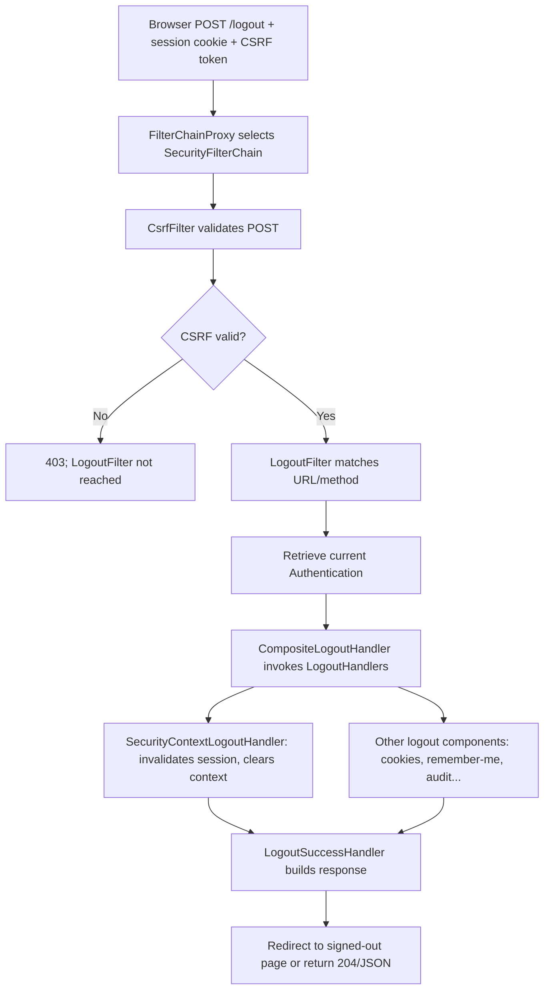

# `LogoutFilter`, `LogoutHandler`, and `LogoutSuccessHandler` in Spring Security Servlet

**Module:** Spring Security – Servlet  
**Group:** Logout  
**Applies to:** Java 17, Spring Boot 3.3.5, Spring Security 6.x, Spring MVC/Servlet, browsers using form login and `HttpSession`.

## 1. Objectives

Logging out is not just redirecting the user back to the login page. Spring Security organizes logout into three responsibilities: **detecting the logout request** (`LogoutFilter`), **cleaning up state/credentials** (`LogoutHandler`), and **deciding the HTTP response after cleanup** (`LogoutSuccessHandler`).

After this lesson, you will be able to:

1. Describe the position of `LogoutFilter` in the Spring Security filter chain and why a standard POST `/logout` **does not need a controller**.
2. Distinguish `LogoutHandler.logout(...)` from `LogoutSuccessHandler.onLogoutSuccess(...)`, including the parameters and purpose of each API.
3. Explain `SecurityContextLogoutHandler`, invalidating `HttpSession`, clearing `SecurityContext`, deleting cookies, remember-me cleanup, and logout events.
4. Understand the interaction with `CsrfFilter`: when CSRF is enabled, logout normally requires a **POST with a CSRF token**, while GET `/logout` may be used to display a confirmation page.
5. Configure the URL, logout handlers, success redirect, and `permitAll` in a **Servlet** `SecurityFilterChain`.
6. Write a safe custom `LogoutHandler`, a custom `LogoutSuccessHandler`, and test result order, session invalidation, CSRF, and avoiding `@PostMapping("/logout")`.
7. Evaluate the limitations of logout with remember-me tokens, HTTP Basic, Bearer/JWT, OIDC, multiple sessions/devices, and multiple security chains.

**Principle:** **Clean up first, return the response second**. Receiving a redirect or status 200/204 in the browser **does not prove** all credentials have been revoked; you must identify the active authentication mechanism and the scope of logout.

## 2. High-Level Overview of the Logout Flow

In a session-based form-login application, an authenticated browser typically carries a `JSESSIONID` cookie. When the user clicks the Log out button, the browser sends a POST to the logout URL. Conceptual flow:



**Conceptual ordering:** Before invoking the success handler, `LogoutFilter` invokes the set of `LogoutHandler` instances. The exact relative order of each default handler and added handler depends on configuration; you should not write business logic based on an unguaranteed assumption that an audit handler always runs before or after a specific handler. What is guaranteed by the overall contract is that `LogoutSuccessHandler` is called only after the handler pipeline completes normally.

### 2.1. Why Can the `/logout` URL Bypass MVC?

`FilterChainProxy` and `SecurityFilterChain` process requests **before** they reach `DispatcherServlet`. `LogoutFilter` has a `RequestMatcher` that identifies logout requests. If the matcher matches, the filter runs the handlers, invokes the success handler, and **terminates processing** without forwarding the request to a `@PostMapping`.

Therefore, the standard configuration:

```java
http.logout(logout -> logout
        .logoutUrl("/logout")
        .logoutSuccessUrl("/sign-in?logout"));
```

is a fragment inside the `HttpSecurity` configuration; you do **not** need:

```java
// Do not write this controller just to replace LogoutFilter.
@PostMapping("/logout")
public String logout() {
    return "redirect:/sign-in";
}
```

If you write your own POST logout controller and redirect without performing cleanup, the user may remain authenticated via the old `SecurityContext`/session. When custom logic is needed, prefer extending the appropriate `LogoutHandler` or `LogoutSuccessHandler` instead of duplicating the logout process in a controller.

## 3. Three Components: Roles and Method Signatures

| Component | Responsibility | When does it run? | What it should be responsible for |
| --- | --- | --- | --- |
| `LogoutFilter` | Recognizes logout requests by method/path/request matcher; coordinates the flow | When the request matches and reaches a chain containing the filter | Invoking handlers and then invoking the success handler |
| `LogoutHandler` | Performs cleanup: invalidate session, clear security context, delete cookies/tokens, safe audit | Inside composite logout handlers | Mutating required state, not controlling the final success response |
| `LogoutSuccessHandler` | Decides the post-logout response: redirect, 204, JSON... | After logout handlers complete | HTTP response/UX, not replacing cleanup |

### 3.1. `LogoutFilter`

The class lives in `org.springframework.security.web.authentication.logout.LogoutFilter`. In modern Spring Security Servlet versions, `LogoutFilter` participates in the chain before the final authorization step (`AuthorizationFilter` in typical configurations). As a result, a logout request recognized by the filter does not necessarily have to pass an `authorizeHttpRequests` rule to be processed.

Even so, using `.logout(...permitAll())` is still useful to make intent explicit, especially for the logout success URL or when using custom chains/matchers. It does not disable CSRF.

**Chain scope is mandatory:** If a chain has `.securityMatcher("/app/**")` while `.logoutUrl("/logout")` is outside `/app/**`, the `/logout` request will **not enter that chain**, so the logout filter cannot process it. `requestMatchers(...).permitAll()` is only an authorization rule inside the chain; it does not expand the chain-selection matcher.

### 3.2. `LogoutHandler`

The interface in `org.springframework.security.web.authentication.logout.LogoutHandler` has the main method:

```java
void logout(
    HttpServletRequest request,
    HttpServletResponse response,
    Authentication authentication
);
```

The imports are `jakarta.servlet.http.HttpServletRequest`, `jakarta.servlet.http.HttpServletResponse`, and `org.springframework.security.core.Authentication` in Spring Boot 3.

`authentication` is the authentication retrieved by the filter at the time of the logout request, and **may be `null`** if the request is anonymous or the user's session has already been lost. A custom handler must check for `null`; do not assume logout always occurs while a user is still logged in.

**Rules for handlers:**

- Focus on cleanup and required side effects; do not issue redirects before all handlers have finished.
- Write them to be **idempotent** whenever possible; repeated requests should not cause hard-to-recover errors or leak secrets.
- Avoid throwing exceptions that interrupt the handler chain. The framework expects logout handlers to perform safe cleanup; auxiliary audit failures should be recorded according to policy without breaking logout.
- Do not log raw `Authentication`, session IDs, cookies, tokens, passwords, `Authorization` headers, or CSRF tokens.
- Avoid relying on the security context remaining in the holder after another handler has cleared it; if you need to identify the user, use the provided `authentication` parameter without exposing sensitive data.
- For high-reliability tasks such as revoking tokens in a DB, design dedicated transactions, retries, monitoring, and a failure policy; do not silently claim all tokens are revoked if the operation fails.

### 3.3. `LogoutSuccessHandler`

The interface in `org.springframework.security.web.authentication.logout.LogoutSuccessHandler` has the method:

```java
void onLogoutSuccess(
    HttpServletRequest request,
    HttpServletResponse response,
    Authentication authentication
) throws IOException, ServletException;
```

Produces the response after cleanup completes. It can:

- Redirect to `/signed-out`.
- Return status `204 No Content` for API clients.
- Return JSON containing no secrets for SPA/API clients.
- Choose a controlled redirect based on UI needs.

**Do not use the success handler as the sole place to invalidate the session.** If a custom success handler completely replaces the default handler without proper cleanup handlers, the redirect will only create the illusion of logging out. In the example below, the custom success handler only sends a redirect; cleanup is guaranteed by the logout configuration/handlers.

Avoid **open redirects**: do not redirect based on a client-supplied `next` or `returnUrl` without an allowlist/validation. A fixed URL or internal relative path is the safe choice for this lesson.

### 3.4. Remember to Distinguish Handlers from Success Handlers

There are many similar-sounding names:

- `SecurityContextLogoutHandler` is a **LogoutHandler** that cleans up the `SecurityContext`/session.
- `CookieClearingLogoutHandler` is a **LogoutHandler** that deletes cookies according to policy.
- `CsrfLogoutHandler` handles CSRF information according to the configured repository.
- `LogoutSuccessEventPublishingLogoutHandler` can publish logout events to listeners when configured/integrated.
- `SimpleUrlLogoutSuccessHandler` is a **LogoutSuccessHandler** that redirects to a URL.
- `HttpStatusReturningLogoutSuccessHandler` is a **LogoutSuccessHandler** that returns an HTTP status code.
- `DelegatingLogoutSuccessHandler` can select a success handler based on a request matcher.
- `CompositeLogoutHandler` coordinates multiple `LogoutHandler` instances; it does **not** replace `LogoutFilter`.

The class names share “Logout” but have **different responsibilities**. Avoid registering a cookie-clearing or event-publishing handler as a success handler just because its name contains *logout*.

## 4. What Does Spring Security Do on Default Logout?

With standard form login/session and `http.logout(...)`, Spring Security already provides appropriate default logout actions. Depending on the version and enabled features, the pipeline may include:

1. **`SecurityContextLogoutHandler`**: invalidates `HttpSession` if present according to policy, clears `Authentication` in `SecurityContext`, clears `SecurityContextHolder`, and saves an empty context when needed by the repository.
2. **`CsrfLogoutHandler`**: clears stored CSRF information/tokens according to the repository when integrated with the CSRF configurer.
3. **Remember-me cleanup** if a remember-me service is present: deletes the remember-me cookie and may clean up the token repository depending on the strategy.
4. **Additional cookie clearing** according to `.deleteCookies(...)`, such as `JSESSIONID` when path/domain are appropriate.
5. **Logout events** when an event-publishing handler is present.
6. **Success response** via the logout success handler, typically redirecting to the login URL with a `logout` query parameter under the default configuration.

Not every application has every item listed above. **Do not assume** that logging out of one session simultaneously revokes all remember-me tokens, JWTs, refresh tokens, sessions at an identity provider, or sessions on other devices.

### 4.1. `SecurityContextLogoutHandler` and `HttpSession`

An explicit configuration:

```java
http.logout(logout -> logout
        .invalidateHttpSession(true)
        .clearAuthentication(true)
        .deleteCookies("JSESSIONID"));
```

- `invalidateHttpSession(true)`: requests invalidation of the current session if one exists.
- `clearAuthentication(true)`: clears the authentication in the security context.
- `deleteCookies("JSESSIONID")`: adds a mechanism instructing the browser to remove the corresponding cookie.
- `SecurityContextRepository`/filter setup determines how the context is restored/saved across other requests.

**Server-side session deletion and client-side cookie deletion are two distinct actions.** Server-side invalidation ensures the old session ID no longer represents a valid session; sending an expired `Set-Cookie` helps the browser discard the cookie. If the cookie domain/path does not match, the old cookie may remain in the browser, yet an invalidated session must still be rejected by the server.

### 4.2. What Happens If `HttpSession` Has Already Expired?

A `POST /logout` request can still be matched by `LogoutFilter`, though the `Authentication` passed in may be `null`. Logout handlers must tolerate this condition. `CsrfFilter` may still require a token for POST, and a client missing a token can receive `403` before reaching logout logic.

If the request is anonymous and the configuration permits POST logout, the success handler may still redirect to the signed-out page. **Do not treat a success redirect as proof that a session previously existed.**

### 4.3. Is `.deleteCookies("JSESSIONID")` Needed If the Session Is Invalidated?

Not always mandatory: the container and security configuration may already have cookie/session cleanup mechanisms. Still, declare it when you need explicit browser cleanup. Test `Set-Cookie`, context path, cookie domain/path, reverse proxies, and container behavior; `.deleteCookies` cannot revoke a bearer token that was already copied.

### 4.4. `permitAll` Is Not Equivalent to Disabling CSRF

`logout.permitAll()` allows access to logout/logout-success URLs appropriately, but does **not** alter the CSRF policy. With CSRF enabled, `POST /logout` requires a valid CSRF token; requests without a token can be rejected with **403** by `CsrfFilter` before logout handlers run. This is why you should use an HTML **form POST**, not a GET link, as the real logout button.

## 5. Methods and URLs: `GET /logout`, `POST /logout`, Custom Paths

### 5.1. Common Default Behavior

When CSRF is enabled, Spring Security uses **POST** as the logout-processing method in standard configurations. In some setups, GET `/logout` may display a framework-generated **logout confirmation page**; it is **not** equivalent to a POST logout action.

Do not write tests asserting “GET `/logout` always returns status 200 in every application,” because the login page generator, CSRF, and filter configuration may differ. The invariant to test is that **only requests matching the actual logout matcher** trigger cleanup.

### 5.2. Custom URL

```java
http.logout(logout -> logout
        .logoutUrl("/auth/logout")
        .logoutSuccessUrl("/sign-in?logout"));
```

The browser form must submit:

```html
<form action="/auth/logout" method="post">
    <!-- Include the request/form CSRF token if CSRF is enabled. -->
    <button type="submit">Log out</button>
</form>
```

This HTML snippet only illustrates the structure; the full Thymeleaf template in section 7 uses `th:action` to support context paths and CSRF integration.

If you use a custom `logoutRequestMatcher(...)`, make sure you understand which methods/paths the matcher accepts. **Do not open logout via GET** just for the convenience of an `<a href>`, especially when browsers use cookie authentication. GET should not cause side effects, and allowing logout via GET can lead to logout CSRF or unintended behavior.

### 5.3. Multiple Security Chains

The fragment below has a problem:

```java
// Illustrates a scope mismatch; not a complete runnable configuration.
http.securityMatcher("/api/**")
    .logout(logout -> logout.logoutUrl("/logout"));
```

Because `/logout` **does not match** `/api/**`, that chain's filter will not receive POST `/logout`. You must place the logout URL within the chain's scope (e.g., `/api/logout`), widen the matcher appropriately, or design another chain explicitly.

With multiple `@Order` chains, the first matching chain is selected. If an earlier chain claims the logout URL without an appropriate logout filter, the request may fall through to MVC or be rejected. `authorizeHttpRequests.requestMatchers("/logout").permitAll()` **does not fix** a mismatched chain matcher.

## 6. Custom Logout Patterns and Ordering of Responsibilities

### 6.1. Adding an Auxiliary `LogoutHandler`

A suitable use case is auditing logout events:

```java
http.logout(logout -> logout
        .addLogoutHandler(auditLogoutHandler));
```

For a safe handler, a missing `Authentication` does not cause errors, it does not log secrets, and it does not take control of the HTTP response. Another custom handler might revoke refresh tokens on the server, delete an application cookie, or trigger cleanup of account-related data.

**Important regarding exceptions:** Logout handlers are designed for cleanup; do not let a secondary logging/metrics error break logout. For real token-revocation operations, decide the behavior when a remote service fails — retry/outbox, report status to the client, or fail closed according to your threat model. Do not swallow credential-revocation errors and claim the token has been revoked.

### 6.2. Replacing `LogoutSuccessHandler`

For browsers:

```java
http.logout(logout -> logout
        .logoutSuccessHandler((request, response, authentication) ->
                response.sendRedirect(
                        request.getContextPath() + "/signed-out")));
```

For API clients expecting an empty response body:

```java
// Alternative variant; do not apply simultaneously in the form-login project.
http.logout(logout -> logout
        .logoutUrl("/api/logout")
        .logoutSuccessHandler((request, response, authentication) ->
                response.setStatus(204)));
```

`204 No Content` only indicates that the server finished the logout handler pipeline and returned an HTTP response; it does **not** automatically revoke issued JWTs or live client tokens. If JSON with status/body is needed, set the content type, write a safe DTO, and pick an appropriate status, but never expose `authentication.getCredentials()` in the response.

### 6.3. Using Built-In Success Handlers

In many scenarios, `.logoutSuccessUrl("/signed-out")` is sufficient without custom code. `SimpleUrlLogoutSuccessHandler` handles redirect mechanics. `HttpStatusReturningLogoutSuccessHandler` is useful for APIs that only need a status code, and `DelegatingLogoutSuccessHandler` fits when one chain must serve multiple client types with clear rules.

Only write a custom handler when there is genuinely additional logic needed. The goal is not “as many handlers as possible” but **accurate separation of responsibilities**.

### 6.4. Do Not Confuse with `AuthenticationSuccessHandler`

`AuthenticationSuccessHandler` is called **after a successful login**; `LogoutSuccessHandler` is called **after logout processing**. The two interfaces differ in semantics and timing even though both can redirect. Do not accidentally reuse a login success handler for logout.

## 7. Runnable Project: Custom `LogoutHandler` + Custom `LogoutSuccessHandler`

The project below uses form login/session with JDK 17, Spring Boot 3.3.5, Thymeleaf, and MockMvc. It demonstrates accurately:

- Demo account `learner / demo-pass` with an encoded BCrypt hash in `InMemoryUserDetailsManager`.
- `GET /sign-in` displays the login form.
- `POST /perform-login` is handled by Spring Security, with no MVC POST login controller.
- `GET /private/home` is only for authenticated users, showing the username and a POST logout button with CSRF.
- `POST /logout` is handled by `LogoutFilter`, invoking the audit handler, default cleanup, and then the custom success handler redirect.
- `GET /signed-out` is public, solely to show the post-logout page.
- `POST /logout` without CSRF must be rejected, and the custom audit handler must not run.

**Note:** The audit counter is in-memory only for the lesson; production should use an audit service with proper data protection, persistence, and failure policy. Do not use the demo password in public environments.

### 7.1. Structure

```text
logout-pipeline-demo/
├── pom.xml
└── src/
    ├── main/
    │   ├── java/demo/logout/
    │   │   ├── LogoutPipelineApplication.java
    │   │   ├── SecurityConfig.java
    │   │   ├── AuditLogoutHandler.java
    │   │   ├── RedirectLogoutSuccessHandler.java
    │   │   └── PageController.java
    │   └── resources/templates/
    │       ├── sign-in.html
    │       └── home.html
    └── test/java/demo/logout/
        └── LogoutPipelineApplicationTests.java
```

Requires JDK 17+, Maven 3.6.3+, and internet access for Maven to download dependencies on the first run.

### 7.2. `pom.xml`

```xml
<?xml version="1.0" encoding="UTF-8"?>
<project xmlns="http://maven.apache.org/POM/4.0.0"
         xmlns:xsi="http://www.w3.org/2001/XMLSchema-instance"
         xsi:schemaLocation="http://maven.apache.org/POM/4.0.0 https://maven.apache.org/xsd/maven-4.0.0.xsd">
    <modelVersion>4.0.0</modelVersion>
    <parent>
        <groupId>org.springframework.boot</groupId>
        <artifactId>spring-boot-starter-parent</artifactId>
        <version>3.3.5</version>
        <relativePath/>
    </parent>
    <groupId>demo</groupId>
    <artifactId>logout-pipeline-demo</artifactId>
    <version>1.0.0</version>
    <properties>
        <java.version>17</java.version>
    </properties>
    <dependencies>
        <dependency>
            <groupId>org.springframework.boot</groupId>
            <artifactId>spring-boot-starter-web</artifactId>
        </dependency>
        <dependency>
            <groupId>org.springframework.boot</groupId>
            <artifactId>spring-boot-starter-security</artifactId>
        </dependency>
        <dependency>
            <groupId>org.springframework.boot</groupId>
            <artifactId>spring-boot-starter-thymeleaf</artifactId>
        </dependency>
        <dependency>
            <groupId>org.springframework.boot</groupId>
            <artifactId>spring-boot-starter-test</artifactId>
            <scope>test</scope>
        </dependency>
        <dependency>
            <groupId>org.springframework.security</groupId>
            <artifactId>spring-security-test</artifactId>
            <scope>test</scope>
        </dependency>
    </dependencies>
    <build>
        <plugins>
            <plugin>
                <groupId>org.springframework.boot</groupId>
                <artifactId>spring-boot-maven-plugin</artifactId>
            </plugin>
        </plugins>
    </build>
</project>
```

The project uses Servlet/MVC rather than WebFlux; the code uses `jakarta.servlet.*` compatible with Spring Boot 3. No separate Spring Security version is needed because the Spring Boot BOM manages compatibility.

### 7.3. `src/main/java/demo/logout/LogoutPipelineApplication.java`

```java
package demo.logout;

import org.springframework.boot.SpringApplication;
import org.springframework.boot.autoconfigure.SpringBootApplication;

@SpringBootApplication
public class LogoutPipelineApplication {
    public static void main(String[] args) {
        SpringApplication.run(LogoutPipelineApplication.class, args);
    }
}
```

### 7.4. `src/main/java/demo/logout/AuditLogoutHandler.java`

```java
package demo.logout;

import java.util.concurrent.atomic.AtomicInteger;

import jakarta.servlet.http.HttpServletRequest;
import jakarta.servlet.http.HttpServletResponse;

import org.springframework.security.core.Authentication;
import org.springframework.security.web.authentication.logout.LogoutHandler;
import org.springframework.stereotype.Component;

@Component
public class AuditLogoutHandler implements LogoutHandler {

    private final AtomicInteger successfulRequests = new AtomicInteger();

    @Override
    public void logout(HttpServletRequest request,
                       HttpServletResponse response,
                       Authentication authentication) {

        // Only count requests with an Authentication; do not log secrets.
        if (authentication != null && authentication.isAuthenticated()) {
            successfulRequests.incrementAndGet();
        }

        // Do not call response.sendRedirect in LogoutHandler.
        // Do not throw exceptions for demo audit functionality.
    }

    public int count() {
        return successfulRequests.get();
    }
}
```

In this example, “successfulRequests” is the number of times **the handler received a logout request with authentication**, **not** the number of sessions or tokens guaranteed to be revoked across all devices. The `Authentication` parameter may be `null`; hence the `if` statement checks it first.

In a real application, a handler might send an audit event or request refresh-token revocation; do not log access tokens, cookies, or passwords. If external auditing fails, do not throw unchecked exceptions that prevent subsequent logout handlers from running.

**Why `AtomicInteger`?** The handler is a singleton bean and can be called concurrently from multiple requests. An atomic counter prevents race conditions in the example, though it is still lost on restart and not synchronized across multiple instances; production auditing requires separate storage/queues.

### 7.5. `src/main/java/demo/logout/RedirectLogoutSuccessHandler.java`

```java
package demo.logout;

import java.io.IOException;

import jakarta.servlet.http.HttpServletRequest;
import jakarta.servlet.http.HttpServletResponse;

import org.springframework.security.core.Authentication;
import org.springframework.security.web.authentication.logout.LogoutSuccessHandler;
import org.springframework.stereotype.Component;

@Component
public class RedirectLogoutSuccessHandler implements LogoutSuccessHandler {

    @Override
    public void onLogoutSuccess(HttpServletRequest request,
                                HttpServletResponse response,
                                Authentication authentication)
            throws IOException {

        // Fixed internal path; avoid open redirects from client input.
        response.sendRedirect(request.getContextPath() + "/signed-out");
    }
}
```

The success handler does not modify `SecurityContext` or call `session.invalidate()`: the logout pipeline has already handled cleanup beforehand. The redirect path uses `request.getContextPath()` so it works when the application is deployed under a context path other than `/`. Do not accept arbitrary redirect URLs from query parameters.

### 7.6. `src/main/java/demo/logout/SecurityConfig.java`

```java
package demo.logout;

import org.springframework.context.annotation.Bean;
import org.springframework.context.annotation.Configuration;

import org.springframework.http.HttpMethod;
import org.springframework.security.config.annotation.web.builders.HttpSecurity;
import org.springframework.security.core.userdetails.User;
import org.springframework.security.core.userdetails.UserDetails;
import org.springframework.security.core.userdetails.UserDetailsService;
import org.springframework.security.crypto.bcrypt.BCryptPasswordEncoder;
import org.springframework.security.crypto.password.PasswordEncoder;
import org.springframework.security.provisioning.InMemoryUserDetailsManager;
import org.springframework.security.web.SecurityFilterChain;

@Configuration
public class SecurityConfig {

    @Bean
    PasswordEncoder passwordEncoder() {
        return new BCryptPasswordEncoder();
    }

    @Bean
    UserDetailsService users(PasswordEncoder encoder) {
        UserDetails learner = User.withUsername("learner")
                .password(encoder.encode("demo-pass"))
                .roles("USER")
                .build();
        return new InMemoryUserDetailsManager(learner);
    }

    @Bean
    SecurityFilterChain securityFilterChain(
            HttpSecurity http,
            AuditLogoutHandler auditHandler,
            RedirectLogoutSuccessHandler successHandler)
            throws Exception {

        http.authorizeHttpRequests(auth -> auth
                .requestMatchers(HttpMethod.GET,
                        "/sign-in", "/signed-out").permitAll()
                .anyRequest().authenticated());

        http.formLogin(form -> form
                .loginPage("/sign-in")
                .loginProcessingUrl("/perform-login")
                .defaultSuccessUrl("/private/home", true)
                .failureUrl("/sign-in?error")
                .permitAll());

        http.logout(logout -> logout
                .logoutUrl("/logout")
                .addLogoutHandler(auditHandler)
                .invalidateHttpSession(true)
                .clearAuthentication(true)
                .deleteCookies("JSESSIONID")
                .logoutSuccessHandler(successHandler)
                .permitAll());

        // CSRF is enabled by default; do not disable CSRF for form login/logout.
        return http.build();
    }
}
```

**Explanation:**

- `logoutUrl("/logout")` registers the filter's logout processing URL. With CSRF enabled, the actual logout request must be a valid POST.
- `addLogoutHandler(auditHandler)` adds the custom audit handler to the logout pipeline, **without replacing** default cleanup.
- `invalidateHttpSession(true)` and `clearAuthentication(true)` request session/security-context cleanup.
- `deleteCookies("JSESSIONID")` helps the browser discard the session cookie when path/domain match; server-side session invalidation remains the core measure.
- `logoutSuccessHandler(successHandler)` replaces the default response with a fixed redirect to `/signed-out`.
- `.permitAll()` permits access to the logout/success URLs; **it does not disable `CsrfFilter`**.
- `formLogin` uses `HttpSession` under the standard policy; **do not enable `SessionCreationPolicy.STATELESS`** in the demo so session login works across requests.
- There is no `POST /logout` or `POST /perform-login` controller bean, as both are the responsibility of security filters.
- The demo account and password are for localhost only. Production requires HTTPS, a secure password store, proper session cookie flags, and monitoring.

**Handler order detail:** Do not manually add a new `SecurityContextLogoutHandler` unnecessarily, because the standard logout configuration already creates the cleanup handler. Attaching multiple instances can cause redundant invalidation, errors when touching an already invalidated session, or harder tracing.

### 7.7. `src/main/java/demo/logout/PageController.java`

```java
package demo.logout;

import org.springframework.security.core.Authentication;
import org.springframework.stereotype.Controller;
import org.springframework.ui.Model;
import org.springframework.web.bind.annotation.GetMapping;
import org.springframework.web.bind.annotation.ResponseBody;

@Controller
public class PageController {

    @GetMapping("/sign-in")
    public String signIn() {
        return "sign-in";
    }

    @GetMapping("/private/home")
    public String home(Authentication authentication, Model model) {
        model.addAttribute("username", authentication.getName());
        return "home";
    }

    @GetMapping("/signed-out")
    @ResponseBody
    public String signedOut() {
        return "Logged out";
    }
}
```

`GET /private/home` is accessible only when authenticated. `GET /signed-out` is public so the browser can reach it after the session has been destroyed. The controller has no `@PostMapping("/logout")`: Spring Security handles that request directly.

### 7.8. `src/main/resources/templates/sign-in.html`

```html
<!DOCTYPE html>
<html lang="en" xmlns:th="http://www.thymeleaf.org">
<head>
    <meta charset="UTF-8">
    <title>Sign in</title>
</head>
<body>
    <h1>Sign in</h1>

    <p th:if="${param.error}">
        Invalid username or password.
    </p>

    <form th:action="@{/perform-login}" method="post">
        <label for="username">Username</label>
        <input id="username" name="username"
               type="text" autocomplete="username" required>

        <label for="password">Password</label>
        <input id="password" name="password"
               type="password" autocomplete="current-password" required>

        <button type="submit">Sign in</button>
    </form>
</body>
</html>
```

The login form submits to `POST /perform-login` with `username` and `password`. `th:action` together with Thymeleaf/Spring MVC/Spring Security integration can add a hidden CSRF field via `RequestDataValueProcessor` when rendering the form. With other template engines or plain HTML, you must supply the token from the active repository; do not hardcode a CSRF token.

### 7.9. `src/main/resources/templates/home.html`

```html
<!DOCTYPE html>
<html lang="en" xmlns:th="http://www.thymeleaf.org">
<head>
    <meta charset="UTF-8">
    <title>Private Home</title>
</head>
<body>
    <h1>Private Home</h1>
    <p th:text="|Hello ${username}|">Hello</p>

    <form th:action="@{/logout}" method="post">
        <button type="submit">Log out</button>
    </form>
</body>
</html>
```

This is a proper **form POST** logout button, not `<a href="/logout">`. The browser sends the session cookie and a valid CSRF token along with the form. Upon success, the custom success handler redirects to `/signed-out`.

If using raw HTML, you must add the hidden CSRF field from `CsrfTokenRepository` and ensure the token/cookie stay paired with the session; do not merely copy the form and omit the token.

## 8. Testing with `MockMvc`: Handlers, Session, CSRF, and Redirect

The test suite is placed in the same `demo.logout` package to inspect the custom handler's counter. `@SpringBootTest` loads the real configuration; `@AutoConfigureMockMvc` runs Spring MVC + Spring Security filters. No HTTP port needs to be opened when running the tests.

### 8.1. `src/test/java/demo/logout/LogoutPipelineApplicationTests.java`

```java
package demo.logout;

import org.junit.jupiter.api.Test;
import org.springframework.beans.factory.annotation.Autowired;
import org.springframework.boot.test.autoconfigure.web.servlet.AutoConfigureMockMvc;
import org.springframework.boot.test.context.SpringBootTest;
import org.springframework.http.MediaType;
import org.springframework.mock.web.MockHttpSession;
import org.springframework.test.web.servlet.MockMvc;
import org.springframework.test.web.servlet.MvcResult;

import static org.hamcrest.Matchers.containsString;
import static org.junit.jupiter.api.Assertions.assertEquals;
import static org.junit.jupiter.api.Assertions.assertFalse;
import static org.junit.jupiter.api.Assertions.assertNotNull;
import static org.junit.jupiter.api.Assertions.assertTrue;
import static org.springframework.security.test.web.servlet.request.SecurityMockMvcRequestPostProcessors.csrf;
import static org.springframework.test.web.servlet.request.MockMvcRequestBuilders.get;
import static org.springframework.test.web.servlet.request.MockMvcRequestBuilders.post;
import static org.springframework.test.web.servlet.result.MockMvcResultMatchers.content;
import static org.springframework.test.web.servlet.result.MockMvcResultMatchers.header;
import static org.springframework.test.web.servlet.result.MockMvcResultMatchers.status;

@SpringBootTest
@AutoConfigureMockMvc
class LogoutPipelineApplicationTests {

    @Autowired
    MockMvc mvc;

    @Autowired
    AuditLogoutHandler audit;

    private MockHttpSession logInAndGetSession() throws Exception {
        MvcResult login = mvc.perform(post("/perform-login")
                        .with(csrf())
                        .param("username", "learner")
                        .param("password", "demo-pass"))
                .andExpect(status().is3xxRedirection())
                .andExpect(header().string("Location",
                        containsString("/private/home")))
                .andReturn();

        MockHttpSession session =
                (MockHttpSession) login.getRequest().getSession(false);
        assertNotNull(session);
        return session;
    }

    @Test
    void loginPageIsAvailableAnonymously() throws Exception {
        mvc.perform(get("/sign-in"))
                .andExpect(status().isOk())
                .andExpect(content().string(
                        containsString("/perform-login")));
    }

    @Test
    void protectedHomeRedirectsAnonymousUser() throws Exception {
        mvc.perform(get("/private/home")
                        .accept(MediaType.TEXT_HTML))
                .andExpect(status().is3xxRedirection())
                .andExpect(header().string("Location",
                        containsString("/sign-in")));
    }

    @Test
    void authenticatedSessionCanOpenProtectedHome() throws Exception {
        MockHttpSession session = logInAndGetSession();
        mvc.perform(get("/private/home").session(session))
                .andExpect(status().isOk())
                .andExpect(content().string(
                        containsString("Hello learner")))
                .andExpect(content().string(
                        containsString("/logout")));
    }

    @Test
    void loginWithoutCsrfIsRejected() throws Exception {
        mvc.perform(post("/perform-login")
                        .param("username", "learner")
                        .param("password", "demo-pass"))
                .andExpect(status().isForbidden());
    }

    @Test
    void logoutWithoutCsrfDoesNotRunHandler() throws Exception {
        MockHttpSession session = logInAndGetSession();
        int countBefore = audit.count();

        mvc.perform(post("/logout").session(session))
                .andExpect(status().isForbidden());

        assertEquals(countBefore, audit.count());
        assertFalse(session.isInvalid());
    }

    @Test
    void logoutWithCsrfInvalidatesSessionAndRedirects() throws Exception {
        MockHttpSession session = logInAndGetSession();
        int countBefore = audit.count();

        mvc.perform(post("/logout")
                        .session(session)
                        .with(csrf()))
                .andExpect(status().is3xxRedirection())
                .andExpect(header().string("Location", "/signed-out"));

        assertTrue(session.isInvalid());
        assertEquals(countBefore + 1, audit.count());
    }

    @Test
    void signedOutPageIsPublic() throws Exception {
        mvc.perform(get("/signed-out"))
                .andExpect(status().isOk())
                .andExpect(content().string("Logged out"));
    }

    @Test
    void wrongPasswordCannotCreateLoggedInSession() throws Exception {
        mvc.perform(post("/perform-login")
                        .with(csrf())
                        .param("username", "learner")
                        .param("password", "wrong"))
                .andExpect(status().is3xxRedirection())
                .andExpect(header().string("Location",
                        containsString("/sign-in?error")));
    }
}
```

Run:

```bash
mvn test
```

**Eight tests are expected to PASS** if the sources/config are created correctly. This is a prediction based on static inspection, not a claim that Maven was executed in this lesson.

**What each test group verifies:**

- GET login / GET protected verifies the authorization and form-login configuration.
- Real login in MockMvc creates the appropriate session; GET home using that session sees the authenticated content.
- Login without CSRF gets `403`.
- Logout without CSRF gets `403`, the custom audit handler **does not increment the counter**, and the session remains valid.
- Logout with CSRF runs the pipeline: `MockHttpSession` is invalidated, audit receives one valid request, and `LogoutSuccessHandler` redirects to `/signed-out`.
- `/signed-out` is public; a user who has lost their session can still view the message.
- A wrong password redirects to the error page; no authenticated session is created.

`.with(csrf())` is a **`spring-security-test`** helper, not data a browser can send as a literal `"csrf()"` string. The browser obtains the real token from the form/repository. To verify that cookies are deleted with the right `Path`/`Domain`, add integration tests against a real servlet container and browser/network traffic; MockMvc is not a complete replacement.

**Be cautious with a singleton counter in tests:** This test compares `countBefore` with `countBefore+1` instead of expecting the total to always equal a constant. Do not enable parallel execution sharing the same Spring context without controlling shared state if asserting on a counter.

## 9. Running in the Browser and Inspecting Requests

From the `logout-pipeline-demo` directory:

```bash
mvn clean test
mvn spring-boot:run
```

With the default port unchanged, the app typically runs at `http://localhost:8080`. The demo credentials `learner/demo-pass` are for localhost learning only. When real data is involved, you must use HTTPS and configure cookies/sessions appropriately.

1. Open `http://localhost:8080/sign-in`.
2. Sign in with `learner / demo-pass`.
3. The browser sends `POST /perform-login` (with CSRF) and navigates to `/private/home`.
4. The home page has a logout form that sends **`POST /logout`** with a CSRF token and session cookie.
5. `LogoutFilter` runs the `LogoutHandler`s, invalidates the session, and clears the context; the custom success handler returns a redirect to `/signed-out`.
6. The browser follows the redirect; `/signed-out` returns `"Logged out"`.
7. Try opening `/private/home` again **without another independent credential**: you should be redirected to the sign-in page instead of seeing the old session's authentication.

### 9.1. Distinguishing Status Codes and Redirects

On a successful logout, the network tab normally shows an initial **302** response with `Location: /signed-out`, after which the browser sends a new GET and receives `200` with the body. These are **two separate HTTP requests**, not `LogoutSuccessHandler` returning both `200` and a redirect in a single response.

A custom success handler for an API can return `204` with no redirect. When using Spring Security form login, a redirect is an easy-to-observe UI choice.

### 9.2. Checking CSRF with `curl`

Do not treat a standalone `curl -X POST` as a “successful logout” in an application with CSRF enabled. For example:

```bash
# Missing CSRF token; normally returns 403:
curl -s -o /dev/null -w '%{http_code}\n' \
  -X POST http://localhost:8080/logout

# The signed-out page is a public GET:
curl -s http://localhost:8080/signed-out
```

Expected:

```text
403
Logged out
```

These are the results of **two separate commands**; the body text may not include a trailing newline. To send a valid POST logout from an HTTP client, you must include the session cookie and matching CSRF token, typically extracted from a GET of the rendered page and sent back with the POST. Do not hardcode tokens or send passwords in the query string.

If you try `GET /logout`, you may see a framework-generated confirmation page depending on configuration; that **does not prove** logout handlers ran. Inspect the HTTP method, status codes, redirects, and session state rather than checking only the URL.

## 10. Security Issues When Customizing Logout

### 10.1. Logout CSRF

**Logout CSRF** can occur if an attacker causes a user's browser to send an unwanted logout request. Forcing a user to be logged out can disrupt UX or business workflows; in some systems, it can also be combined with other attacks.

For applications using session cookies, use a form POST with a CSRF token. Do not switch logout to GET just because the UI wants a hyperlink. `logout.permitAll()` does not bypass `CsrfFilter`, and a `POST` without a token should be tested to ensure rejection.

### 10.2. Session Fixation, Multiple Sessions, and Cookie Scope

Logging out of one `HttpSession` does not mean logging out of **all devices**. If a user signs in on two browsers with two session IDs, logging out in A normally only invalidates the current session in A; B may remain active.

To “log out from all devices,” you need to manage sessions via a session registry/store or equivalent solution, signal invalidation for each session, and test concurrency/replication. Simply calling `invalidateHttpSession(true)` for the current request does not do that automatically.

Never put session IDs in logs, URLs, or API responses. Cookies need `Secure`, `HttpOnly`, and `SameSite` per the threat model, HTTPS, and the right path/domain. Deleting a cookie must use attributes matching the original cookie so the browser accepts the cleanup.

### 10.3. Remember-Me

If remember-me is enabled, Spring Security can attach remember-me logout cleanup to remove the corresponding cookie/token. However:

- With token-based signed cookies, **deleting the cookie in the browser does not revoke a stolen copy** while the token remains valid.
- With a persistent token repository, token records on the server can be deleted per implementation; you must know whether deletion is per user or per device and its actual revocation capability.
- Do not assume `.deleteCookies("JSESSIONID")` automatically deletes the **remember-me cookie**.
- Test requests carrying only the remember-me token after the session has been deleted, especially if business requirements demand the token also be invalidated.

### 10.4. HTTP Basic

HTTP Basic sends username/password repeatedly in the `Authorization` header on the client. With a browser's native Basic prompt, the browser may **keep automatically resending credentials**, even after the server invalidates `HttpSession`. Therefore, **a logout handler cannot reliably force every browser to forget Basic passwords** through a standard mechanism.

If a per-device Logout button is needed, consider session-based login or a separate credential with explicit revocation/expiry rather than merely redirecting to a logged-out page.

### 10.5. Bearer/JWT and Refresh Tokens

With Bearer JWTs, the server may verify the token on every request without needing `HttpSession`. Merely clearing `SecurityContext` and the session does not invalidate an access token. The client can keep sending a valid token until expiry unless an appropriate revocation/versioning/introspection policy is in place.

If the app issues refresh tokens, logout may need to revoke the refresh token at the identity provider/token store, handle refresh-token rotation, protect against replay, and clear client storage appropriately. With stateless access tokens, “instant logout” requires additional server-side state or suitably short token lifetimes; **do not promise** a signed token disappears when receiving a 204 response.

### 10.6. OAuth2/OIDC

Logging out of the local application session does not necessarily log out of the **SSO session at the identity provider**. OIDC RP-initiated logout or back-channel logout has its own protocol/endpoints. An application's `LogoutHandler`/`LogoutSuccessHandler` can be coordinated with the appropriate OIDC flow, but does not automatically clear the IdP session. You need to understand supported client registrations and the provider's logout semantics.

### 10.7. Ordering and Errors in Handlers

Treat handlers as a cleanup pipeline that needs defined error-handling behavior. `LogoutSuccessHandler` runs after the pipeline completes; if a custom `LogoutHandler` throws a runtime exception, subsequent handlers and the success response may not run as expected.

Keep audit handlers simple and non-throwing; for an external revocation service, decide between fail-open and fail-closed based on security requirements, return an honest response, and emit separate telemetry. Do not catch all errors and claim “logged out everywhere” if the DB/token service actually failed.

## 11. Decision Table for Placing Custom Logic

| Requirement | Where should it live? | Why |
| --- | --- | --- |
| Invalidate session, clear authentication | `SecurityContextLogoutHandler` / logout config | Security state cleanup; framework components already exist |
| Delete a custom application cookie | `CookieClearingLogoutHandler` or custom `LogoutHandler` | Browser-side cleanup |
| Revoke persistent remember-me token | RememberMeServices / appropriate custom `LogoutHandler` | Modifies credential state |
| Emit audit event / logout metric | `LogoutHandler` or event listener | Observes the event without controlling the redirect |
| Redirect to `/signed-out` | `LogoutSuccessHandler` or `logoutSuccessUrl` | HTTP response after cleanup |
| Return `204 No Content` for an API | `HttpStatusReturningLogoutSuccessHandler` | API-appropriate response, no HTML redirect |
| Choose success response by client | `DelegatingLogoutSuccessHandler` or separate chains | Request-based HTTP response policy |
| Log out all devices | Session/token registry + dedicated cleanup service | Exceeds invalidation scope of the current request's session |
| OIDC IdP logout | OIDC logout integration/protocol | Not just clearing the local SecurityContext |

## 12. Troubleshooting

### 12.1. `POST /logout` Returns 403

**Most likely:** Missing, expired, mismatched-session, or wrong-repository CSRF token. Check that the POST form was rendered through Thymeleaf/Spring MVC, along with the hidden token and matching cookie/session. Do not disable CSRF just to make the request pass.

### 12.2. `GET /logout` Does Not Log Out

With CSRF enabled, the logout filter normally handles POST; GET may only show a confirmation page or fail to match. Change the UI to a form POST with a CSRF token. Do not relax the matcher to accept GET arbitrarily.

### 12.3. Success Handler Runs, Yet User Can Still Access Protected URLs

Check whether the request carries a still-valid session cookie, remember-me cookie, HTTP Basic credentials, or Bearer token. Session invalidation may have worked while the client **re-authenticates using another credential** on the next request. Do not conclude cleanup failed solely from the redirect UX.

### 12.4. Custom Handler Does Not Run

Check whether `.addLogoutHandler(...)` is in the `SecurityFilterChain` that receives the logout request, whether the path/method matcher matches, whether CSRF blocks it first, and whether another `@Order` chain intercepts the URL earlier.

### 12.5. `.permitAll()` Configured, Yet Still 403

`permitAll` does not bypass CSRF. If the logout filter is not selected and the request falls through to MVC/authorization, check the chain scope. If it is a proper POST with a wrong token, `CsrfFilter` rejects it before any handler runs.

### 12.6. Cookie Deleted, Yet Browser Still Shows `JSESSIONID`

The cookie deletion may use a different `Path`/`Domain`, a reverse proxy may alter attributes, or another part of the app may create a new session. Server-side invalidation is the core control rendering the old session ID invalid; browser cleanup is supplementary. Do not conclude a session still has privileges merely because the cookie is still visible.

### 12.7. `logoutSuccessUrl` Stops Having Effect

If `.logoutSuccessHandler(customHandler)` is configured, the custom handler decides the response. Do not configure both and expect the framework to always combine redirects; choose one approach explicitly and write an HTTP `Location` test.

### 12.8. Returning JSON in a Handler Gets Overwritten by a Redirect

You are writing the response inside `LogoutHandler`, and then `LogoutSuccessHandler` still runs afterward. To return JSON/status, customize **`LogoutSuccessHandler`**, leaving `LogoutHandler` strictly for cleanup.

### 12.9. Audit Handler Throws an Error and Leaves Logout Incomplete

Custom handlers must be safe and designed to be idempotent. For auxiliary audit/metrics, use a non-blocking mechanism where appropriate. For critical revocation, the failure policy must reflect reality; do not fake success.

### 12.10. Clearing `SecurityContextHolder`, Yet Session Still Holds Authentication

If you implement logout manually and only call `SecurityContextHolder.clearContext()`, a repository/session may restore the context on the next request. Use the standard logout pipeline and a repository-compatible `SecurityContextLogoutHandler`.

## 13. Pre-Production Logout QA Checklist

1. **URL and method:** Know the exact request matcher of `LogoutFilter`, usually POST when CSRF is enabled.
2. **CSRF:** Valid token present for POST; test that missing/invalid tokens get 403.
3. **Chain:** Logout URL actually falls within `securityMatcher` and the proper `@Order`.
4. **Cleanup:** `SecurityContext` is cleared; current session is invalidated; cookie cleanup is appropriate.
5. **Success handler:** Response has the right status/redirect, no open redirect, and no leaked credentials.
6. **Custom handler:** Tolerates `authentication == null`, does not throw unnecessary errors, and does not log secrets.
7. **Remember-me:** Has a strategy to clear/revoke cookies and persistent tokens if used.
8. **Bearer/JWT:** Do not treat clearing the session as JWT revocation; tokens/refresh tokens have their own policies.
9. **Multiple sessions:** Current session logout or all-devices logout? Is there a mechanism to revoke the remaining ones?
10. **OIDC/SSO:** Do you need local logout, IdP logout, or both?
11. **Cookie protection:** HTTPS, `Secure`, `HttpOnly`, `SameSite`, path/domain, trusted proxy.
12. **Post-logout:** Requests without valid credentials must return to an unauthenticated state; requests with other independent credentials must be evaluated per policy.
13. **Audit:** Minimal logging, never recording passwords/cookies/tokens; monitoring for critical failures.
14. **Testing:** MockMvc pipeline, browser/session/cookie integration, repeated/anonymous logout, concurrency, and error behavior.
15. **No duplication:** Avoid writing `@PostMapping("/logout")` yourself or adding multiple cleanup handlers when the framework already provides them.

## 14. Exercises and Review Questions

**Q1.** Why does a custom `@PostMapping("/logout")` that only redirects fail to guarantee the user is logged out?  
**Answer:** It can skip `SecurityContext`, session, and cookie cleanup; standard logout must go through `LogoutFilter` + handlers.

**Q2.** If `POST /logout` lacks a CSRF token and the app has CSRF enabled, does a custom audit handler run?  
**Answer:** No, in the default chain `CsrfFilter` rejects it first with `403`. Tests should verify that the audit counter remains unchanged.

**Q3.** Why should `LogoutHandler` not send a redirect itself?  
**Answer:** Other handlers remain in the pipeline; `LogoutSuccessHandler` is the component responsible for deciding the HTTP response after cleanup.

**Q4.** If `LogoutSuccessHandler` returns 302, does that confirm all refresh tokens have been revoked?  
**Answer:** No. A redirect only proves the HTTP response; you need the outcome of the token-revocation logic and corresponding policy.

**Q5.** Why does `GET /logout` differ from `POST /logout` when CSRF is enabled?  
**Answer:** GET may display a confirmation page or not match the matcher, whereas a valid POST triggers cleanup in a standard logout configuration.

**Q6.** Does logging out on browser A automatically log out browser B?  
**Answer:** Usually not; you must manage/invalidate the remaining sessions or tokens under an all-devices logout mechanism.

**Q7.** Once `logoutSuccessHandler` is configured, does `.logoutSuccessUrl` still control the redirect?  
**Answer:** Do not assume the two methods stack; the custom success handler is responsible for producing the response.

**Q8.** If a browser resends a valid `Authorization: Basic` header after logout, what happens?  
**Answer:** The server may re-authenticate the request, because session logout does not erase HTTP Basic credentials cached in the browser.

**Q9.** When using `STATELESS` Bearer JWTs, does calling `SecurityContextHolder.clearContext()` revoke the token?  
**Answer:** No. A valid JWT can still be re-sent; a dedicated expiry/revocation/rotation policy is required.

**Q10.** Why must you check `securityMatcher` when customizing `/auth/logout`?  
**Answer:** The logout filter only runs inside the selected security chain; a URL outside that chain's scope will not be processed by that chain's handlers.

## Conclusion

`LogoutFilter` is the **coordinator**, `LogoutHandler` is the **cleanup phase**, and `LogoutSuccessHandler` is where the **post-cleanup HTTP response** is created. When using Spring Security Servlet with form login, keep POST + CSRF, let the framework invalidate the session and clear the context, add auxiliary handlers with clear responsibilities, and test redirects or 204 responses appropriate to the client. Finally, always distinguish **logging out the current session** from **revoking remember-me tokens, HTTP Basic credentials, JWTs, refresh tokens, or SSO sessions across multiple devices**. Only when the credential scope is clearly defined can a logout feature be declared correct and secure.