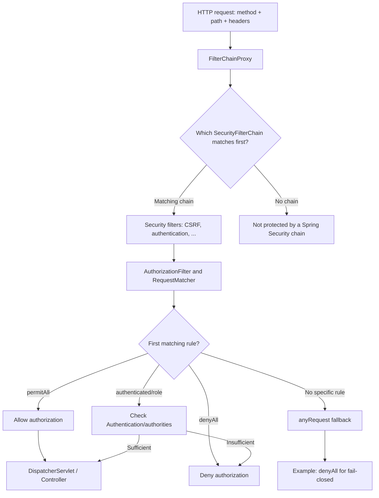

# `permitAll`, `denyAll`, and the `anyRequest` Fallback Rule in HTTP Authorization

**Module:** Spring Security – Servlet  
**Parent Topic:** HTTP Authorization  
**Illustrative Environment:** Java 17, Spring Boot 3.3.5, Spring Security 6.x, Spring MVC on a Servlet container.

## Objectives

This article goes deep into three key options of the `authorizeHttpRequests` DSL:

- `permitAll()`: grants authorization for matching requests **without requiring authorization** for the user.
- `denyAll()`: denies authorization for matching requests, even if the user is logged in or holds a high role.
- `anyRequest()`: fallback matcher for all requests **not yet matched by earlier rules in the same security chain**.

The key point is not memorizing three APIs, but understanding **rule order**, **`SecurityFilterChain` scope**, the difference between **authentication and authorization**, and the **fail-closed** choice when new endpoints appear.

After this lesson, you can design clear policies, avoid accidentally exposing APIs, distinguish `401`/`403`, avoid using `permitAll` to bypass CSRF or security filters, and test policies with a runnable Java 17 project.

## 1. Where Does HTTP Authorization Live?

A request passes through the Servlet filter chain before reaching a Spring MVC controller. In an application with Spring Security, `FilterChainProxy` selects the matching `SecurityFilterChain`; authentication filters can set `Authentication` in `SecurityContext`; `AuthorizationFilter` evaluates the `authorizeHttpRequests` rules.



These stages represent a conceptual flow, not a guarantee that all filters run in the exact order drawn across every custom configuration. Key points:

1. **Select the chain first:** If a request does not match a chain's `securityMatcher`, the rules inside that chain do not run.
2. **Select a rule inside the chain:** The first rule matching the request decides authorization; subsequent rules are not unconditionally accumulated.
3. **The `permitAll`/`denyAll` values only control the authorization decision.** The request still passes through other filters if it belongs to the chain.
4. **The controller runs after authorization** if the request is allowed; `permitAll` does not guarantee the path actually has a controller, as a non-existent route can still return `404`.

### 1.1. An Example Bug Caused by Matcher Order

```java
// Anti-pattern: broad rule placed first, accidentally letting all GET /admin/** through.
http.authorizeHttpRequests(auth -> auth
        .requestMatchers(HttpMethod.GET, "/**").permitAll()
        .requestMatchers("/admin/**").hasRole("ADMIN")
        .anyRequest().denyAll());
```

For `GET /admin/secret`, the `GET /**` matcher already matched first, so `.hasRole("ADMIN")` behind it is not used to tighten access. **`anyRequest` at the end also cannot fix an overly broad earlier rule.**

The right approach: place specific, highly protective matchers before broad matchers, and **avoid** overly broad public rules.

```java
http.authorizeHttpRequests(auth -> auth
        .requestMatchers("/admin/**").hasRole("ADMIN")
        .requestMatchers(HttpMethod.GET, "/docs/**").permitAll()
        .anyRequest().denyAll());
```

This is an illustrative snippet requiring the appropriate Spring Boot imports and configuration; the complete project is in section 7.

## 2. `permitAll()`: Opening Access Without Disabling Security

`permitAll()` returns an **allow authorization** result for matching requests, regardless of whether an authenticated user is present.

Example:

```java
http.authorizeHttpRequests(auth -> auth
        .requestMatchers(HttpMethod.GET, "/healthz", "/docs/intro")
            .permitAll()
        .anyRequest().denyAll());
```

In this example:

- `GET /healthz`: public.
- `GET /docs/intro`: public.
- `POST /docs/intro`: **not** made public by the GET rule; if the request passes earlier filters, the `denyAll` fallback will block it.
- `GET /api/me`: has no dedicated rule, so it is also blocked by the fallback in this condensed configuration.

### 2.1. `permitAll()` Does Not Mean "Bypass Spring Security"

A `permitAll` request can still be affected by:

- `CsrfFilter` for methods requiring CSRF protection.
- `BasicAuthenticationFilter` or other authentication filters when the request carries invalid credentials.
- HTTP security headers and other observability/policy filters.
- Infrastructure rules sitting before or outside the app, such as a reverse proxy.
- `DispatcherServlet` behavior when the route does not exist or the controller returns an error.

For example, if a client sends an **invalid** `Authorization: Basic ...` header to a public endpoint in a chain with `httpBasic`, the authentication filter may return `401` before reaching the `permitAll` step. Conversely, a public GET without credentials can be allowed. Do not think `permitAll` equals "every request is guaranteed HTTP 200".

### 2.2. `permitAll` vs. `web.ignoring()`

| Approach | Passes Through Spring Security Filter Chain? | When to Use? |
| --- | --- | --- |
| `requestMatchers("/public/**").permitAll()` | **Yes**, if the request matches a security chain | Default choice when a public URL is needed while keeping security headers/filter processing |
| `web.ignoring().requestMatchers(...)` | **Skips** the Spring Security filter chain for matching requests | Very rarely needed; must understand effects on security headers, CSRF, authentication, and logging |
| `securityMatcher(...)` | Limits the **scope** of a chain | Used when multiple chains have separate policies, not an access-granting rule |
| `anyRequest().permitAll()` | Yes, but opens every unmatched request in the chain | Easy to create vulnerabilities if used as a thoughtless fallback |

For public CSS/JS resources, `permitAll` is usually easier to control than `web.ignoring`, especially when you want responses to still receive consistent security headers.

### 2.3. Specify the Method When Appropriate

`requestMatchers("/public/**").permitAll()` applies to **all HTTP methods** matching the pattern, not only GET. If a new controller adds a state-changing POST under the same prefix, an overly broad rule can accidentally grant access.

To express the intent of exposing only non-state-changing queries:

```java
.requestMatchers(HttpMethod.GET, "/public/info").permitAll()
```

Note that `HEAD` is not automatically treated as `GET` in every matcher; design and test which methods are supported instead of guessing. `OPTIONS` for CORS preflight requires proper CORS configuration if there is a cross-origin frontend; do not solve it by opening all URLs/methods by default.

## 3. `denyAll()`: An Authorization Denial Barrier

`denyAll()` makes the matched rule **grant access to no authentication whatsoever**, including accounts with `ROLE_ADMIN` or `isAuthenticated() == true`.

Example:

```java
http.authorizeHttpRequests(auth -> auth
        .requestMatchers("/internal/**").denyAll()
        .anyRequest().authenticated());
```

Even if the user is logged in, `/internal/audit` is still denied. Use `denyAll` for:

- Temporarily disabled endpoints.
- Legacy URLs no longer permitted to be served.
- Prefixes reserved for another network/administration path that must not be exposed on the current chain.
- Fail-closed fallback rules for unclassified endpoints.

**`denyAll()` does not remove Spring MVC mappings.** A controller can still exist and be invoked through a different filter chain if the main chain does not apply. To ensure absolute blocking across the whole application, inspect all chains, matchers, reverse proxies, and configuration, not just a single rule.

### 3.1. Why Does `denyAll` Not Always Mean HTTP 403?

This is an easy point to misdiagnose while debugging:

- **Authenticated** user, authorization denied: typically receives **`403 Forbidden`**.
- **Unauthenticated** user, authorization denied: `ExceptionTranslationFilter` may invoke `AuthenticationEntryPoint`, leading to **`401 Unauthorized`** with HTTP Basic or a redirect to form login.
- An invalid CSRF token can produce `403` **even before** the `denyAll` step.

Thus `denyAll` is an **authorization decision**, not an API meaning "return exact status 403 in all circumstances". Test statuses under the same client/authentication mechanism and with proper CSRF handling.

### 3.2. Can `denyAll` Block a Request Even If an Earlier Rule Permitted It?

**No.** Under the first-match-wins model:

```java
// Wrong: GET /api/internal/audit matches the first rule; the later deny rule has no effect.
http.authorizeHttpRequests(auth -> auth
        .requestMatchers(HttpMethod.GET, "/api/**").permitAll()
        .requestMatchers("/api/internal/**").denyAll()
        .anyRequest().denyAll());
```

Fix by placing the specific deny rule first **and** narrowing the public rule:

```java
http.authorizeHttpRequests(auth -> auth
        .requestMatchers("/api/internal/**").denyAll()
        .requestMatchers(HttpMethod.GET, "/api/public/**").permitAll()
        .anyRequest().denyAll());
```

Try to design so every URL has an easy-to-follow policy. When a broad `permitAll` rule can "swallow" a deny rule, that is a sign the configuration needs refactoring.

## 4. `anyRequest()`: The Fallback Rule at the End

`anyRequest()` is the catch-all matcher for **every remaining request in the chain**. It is normally placed at the end of `authorizeHttpRequests`:

```java
http.authorizeHttpRequests(auth -> auth
        .requestMatchers(HttpMethod.GET, "/healthz").permitAll()
        .requestMatchers("/admin/**").hasRole("ADMIN")
        .anyRequest().denyAll());
```

Then:

- `GET /healthz` requires no authentication.
- `/admin/**` requires admin privileges.
- Any other URL/method **matching the chain** that did not match an earlier rule is denied, including new endpoints added later by developers.

`anyRequest` does not know in advance which endpoints will be created in the future; it acts as the **default policy** when no specific rule matches.

### 4.1. Three Fallback Options and Risk Levels

| Fallback | Impact on Newly Added Undeclared Endpoints | Assessment |
| --- | --- | --- |
| `.anyRequest().permitAll()` | Can expose new routes unintentionally | Very dangerous as a default for APIs containing sensitive data |
| `.anyRequest().authenticated()` | Lets any authenticated user access new routes, even ones meant for admin only | Better than broad public, but does not achieve least privilege |
| `.anyRequest().denyAll()` | Blocks new routes until an explicit allowing rule is added | **Fail-closed**, a strong choice when APIs require per-endpoint permission review |

Choosing a fallback has no single absolute answer for every system. A public documentation site might use a public fallback in a strictly scoped chain; admin APIs and sensitive user data should prefer default deny or an explicit role policy. What matters is knowing **the chain scope and the intent of the default**.

### 4.2. `anyRequest()` Must Not Be Placed Before Other Rules

Do not write:

```java
// Wrong idea and may be rejected by the DSL during configuration.
http.authorizeHttpRequests(auth -> auth
        .anyRequest().authenticated()
        .requestMatchers("/admin/**").hasRole("ADMIN"));
```

`anyRequest` must be the final fallback. Rules after it cannot apply as intended; the Spring Security 6 DSL may throw an error if you try adding matchers after `anyRequest`.

### 4.3. "Default Deny" Is a Change-Control Convention

A team can agree on:

1. Every new route must be classified as public, authenticated, role-specific, or denied.
2. Pull requests adding endpoints must include security rules and positive/negative tests.
3. The `.anyRequest().denyAll()` fallback keeps the system rejecting routes forgotten in declarations.
4. CI runs MockMvc/HTTP integration tests to catch new routes returning `403` even when logged in.
5. A public route must be **opened explicitly**, never by changing the fallback to `permitAll` just to make a test pass.

This design supports the principle of least privilege and easier reviews, while accepting extra declaration/testing effort.

## 5. Matcher Order Determines Behavior

Spring Security typically uses `RequestMatcherDelegatingAuthorizationManager` for `authorizeHttpRequests` rules. It evaluates rule mappings in **declaration order**, and the first rule whose `RequestMatcher` matches determines the `AuthorizationManager` to be used.

### 5.1. Specific Rules First, General Rules Later

**Wrong:**

```java
http.authorizeHttpRequests(auth -> auth
        .requestMatchers("/api/**").authenticated()
        .requestMatchers("/api/admin/**").hasRole("ADMIN")
        .anyRequest().denyAll());
```

A normal logged-in user can enter `/api/admin/report` because it matches `.authenticated()` first. The role rule behind it is shadowed.

**Correct:**

```java
http.authorizeHttpRequests(auth -> auth
        .requestMatchers("/api/admin/**").hasRole("ADMIN")
        .requestMatchers("/api/**").authenticated()
        .anyRequest().denyAll());
```

However, for finer control, it is best to group endpoints by method and use case rather than placing an overly broad `/api/**` rule.

### 5.2. Matchers by HTTP Method

The same path does not mean all methods share the same permissions:

```java
http.authorizeHttpRequests(auth -> auth
        .requestMatchers(HttpMethod.GET, "/api/reports/**")
            .hasAnyRole("USER", "ADMIN")
        .requestMatchers(HttpMethod.POST, "/api/reports/**")
            .hasRole("ADMIN")
        .anyRequest().denyAll());
```

- `GET /api/reports/summary`: readable with `ROLE_USER` or `ROLE_ADMIN`.
- `POST /api/reports/summary`: admin only, **and also requires a CSRF token if CSRF is enabled**.
- `DELETE /api/reports/summary`: fallback deny, not "assuming admin has enough permissions".

### 5.3. Path Matchers Do Not Replace Object Policies

HTTP authorization mainly controls requests by method/path and authentication. It **does not automatically check ownership** of individual resources:

```text
GET /api/invoices/1001
GET /api/invoices/1002
```

Even though both match `.authenticated()`, you still need to check which user may view invoice 1001/1002 in the service or via method authorization such as `@PreAuthorize` with an appropriate policy. Do not treat `permitAll`/`authenticated` on a path as sufficient to prevent **IDOR/BOLA**.

### 5.4. Pattern Syntax and Context Path

With Spring MVC Servlet, `requestMatchers(...)` chooses/builds request matchers according to the Spring Security version's API and configuration. Do not assume every pattern always behaves like one Ant path matcher style, especially when the project has multiple servlets, a custom servlet path, or major version upgrades.

Test the **actual URLs** after accounting for context path, servlet path, trailing slashes, encoded paths, and methods. Do not use an overly broad public pattern like `"/**"` expecting later rules to protect some prefixes.

## 6. `permitAll`, `denyAll`, CSRF, and AuthenticationEntryPoint

### 6.1. Authentication vs. Authorization

- **Authentication**: Do we know who the caller is? Are the credentials valid?
- **Authorization**: Is the caller permitted to perform this request?
- **`permitAll`**: does not require the user to hold specific permissions to pass the matching **authorization rule**.
- **`denyAll`**: does not allow passing the matching **authorization rule**.
- **`authenticated()`**: requires an authenticated identity; remember that remember-me authentication can count as authenticated in many flows.
- **`fullyAuthenticated()`**: in Spring Security trust semantics, excludes remember-me; does not automatically guarantee MFA or reauthentication "within 5 minutes".

For example, with HTTP Basic, a protected endpoint requiring `.authenticated()` without the header may return **401 + `WWW-Authenticate`**. When the user has valid credentials but lacks `ROLE_ADMIN`, a `.hasRole("ADMIN")` endpoint typically returns **403**.

### 6.2. CSRF Is Not Bypassed by `permitAll`

With Spring Security Servlet, `CsrfFilter` can require a CSRF token for POST/PUT/DELETE depending on configuration. A `permitAll` endpoint **can still receive 403** if the CSRF token is missing or invalid.

Example:

```java
http.authorizeHttpRequests(auth -> auth
        .requestMatchers(HttpMethod.POST, "/public/contact").permitAll()
        .anyRequest().denyAll());
```

This does not mean every anonymous POST will succeed. If CSRF is enabled, browser forms must send a valid token or you need a different CSRF design fitting your threat model. **`permitAll()` is not a way to disable CSRF**, nor should you use `.csrf(csrf -> csrf.disable())` just to make a POST test pass.

Conversely, a POST with a valid CSRF token **can still** be rejected by `denyAll` due to authorization. The two checks answer two different questions.

### 6.3. Error Statuses Are the Result of Multiple Layers

| Situation | Typical Outcome | Cause |
| --- | --- | --- |
| Public GET matches `permitAll`, valid request | `200` or controller status | Authorization passes, MVC decides response |
| Public GET matches `permitAll` but URL does not exist | `404` | Authorization passes, MVC has no handler |
| Protected GET without credentials, HTTP Basic enabled | `401` | `AuthenticationEntryPoint` challenge |
| Protected GET with valid user missing role | `403` | Access denied by `AuthorizationFilter` |
| POST missing CSRF token | `403` | May be rejected by `CsrfFilter` before authorization |
| Authenticated request matches `denyAll` | `403` | Authorization denied even when logged in |
| Anonymous request matches `denyAll` | May be `401`, redirect, or `403` depending on chain | `AuthenticationEntryPoint`/error handling decides HTTP response |
| New endpoint matches no specific rule, fallback `denyAll` | Usually rejected before controller | Not proof that the controller does not exist |

Do not debug from status alone. Inspect **method, path, chain, first matcher, credentials, and CSRF**.

## 7. Complete Maven Project: Fail-Closed with `anyRequest().denyAll()`

The project uses Spring Boot 3.3.5, Java 17, and HTTP Basic so authorization tests are clear; it is not a guide for building browser login with HTTP Basic. **In real deployments you must use HTTPS**, whereas locally we use demo credentials and `localhost`.

Illustrated routes:

| Method and path | Policy | Result with demo accounts |
| --- | --- | --- |
| `GET /healthz` | `permitAll` | Anonymous allowed |
| `GET /docs/intro` | `permitAll` | Anonymous allowed |
| `GET /api/me` | `authenticated` | `student` or `admin` allowed |
| `GET /api/reports/summary` | `hasAnyRole("USER", "ADMIN")` | `student` and `admin` allowed |
| `POST /api/reports/summary` | `hasRole("ADMIN")` | `admin` only, with a valid CSRF token |
| `GET /internal/audit` | `denyAll` | Even `admin` is blocked |
| `GET /not-listed` | fallback `denyAll` | Authenticated user blocked, never reaches MVC |
| `POST /docs/intro` | fallback `denyAll` | Not permitted by the public GET rule |

**Two sample users:** `student/student-pass` has `ROLE_USER`, `admin/admin-pass` has `ROLE_ADMIN`. Demo passwords are stored as BCrypt hashes in the in-memory user store; plaintext passwords are not stored in the principal.

### 7.1. Directory Structure

```text
http-authorization-demo/
├── pom.xml
└── src/
    ├── main/java/demo/policy/
    │   ├── AuthorizationApplication.java
    │   ├── SecurityConfig.java
    │   └── ApiController.java
    └── test/java/demo/policy/
        └── AuthorizationApplicationTests.java
```

### 7.2. `pom.xml`

```xml
<?xml version="1.0" encoding="UTF-8"?>
<project xmlns="http://maven.apache.org/POM/4.0.0"
         xmlns:xsi="http://www.w3.org/2001/XMLSchema-instance"
         xsi:schemaLocation="http://maven.apache.org/POM/4.0.0 https://maven.apache.org/xsd/maven-4.0.0.xsd">
    <modelVersion>4.0.0</modelVersion>

    <parent>
        <groupId>org.springframework.boot</groupId>
        <artifactId>spring-boot-starter-parent</artifactId>
        <version>3.3.5</version>
        <relativePath/>
    </parent>

    <groupId>demo</groupId>
    <artifactId>http-authorization-demo</artifactId>
    <version>1.0.0</version>

    <properties>
        <java.version>17</java.version>
    </properties>

    <dependencies>
        <dependency>
            <groupId>org.springframework.boot</groupId>
            <artifactId>spring-boot-starter-web</artifactId>
        </dependency>
        <dependency>
            <groupId>org.springframework.boot</groupId>
            <artifactId>spring-boot-starter-security</artifactId>
        </dependency>
        <dependency>
            <groupId>org.springframework.boot</groupId>
            <artifactId>spring-boot-starter-test</artifactId>
            <scope>test</scope>
        </dependency>
        <dependency>
            <groupId>org.springframework.security</groupId>
            <artifactId>spring-security-test</artifactId>
            <scope>test</scope>
        </dependency>
    </dependencies>

    <build>
        <plugins>
            <plugin>
                <groupId>org.springframework.boot</groupId>
                <artifactId>spring-boot-maven-plugin</artifactId>
            </plugin>
        </plugins>
    </build>
</project>
```

The Spring Boot BOM manages compatible Spring Security and JUnit versions. This is **Spring MVC/Servlet** (`spring-boot-starter-web`), not WebFlux.

### 7.3. `src/main/java/demo/policy/AuthorizationApplication.java`

```java
package demo.policy;

import org.springframework.boot.SpringApplication;
import org.springframework.boot.autoconfigure.SpringBootApplication;

@SpringBootApplication
public class AuthorizationApplication {
    public static void main(String[] args) {
        SpringApplication.run(AuthorizationApplication.class, args);
    }
}
```

### 7.4. `src/main/java/demo/policy/SecurityConfig.java`

```java
package demo.policy;

import org.springframework.context.annotation.Bean;
import org.springframework.context.annotation.Configuration;
import org.springframework.http.HttpMethod;
import org.springframework.security.config.Customizer;
import org.springframework.security.config.annotation.web.builders.HttpSecurity;
import org.springframework.security.config.http.SessionCreationPolicy;
import org.springframework.security.core.userdetails.User;
import org.springframework.security.core.userdetails.UserDetails;
import org.springframework.security.core.userdetails.UserDetailsService;
import org.springframework.security.crypto.bcrypt.BCryptPasswordEncoder;
import org.springframework.security.crypto.password.PasswordEncoder;
import org.springframework.security.provisioning.InMemoryUserDetailsManager;
import org.springframework.security.web.SecurityFilterChain;

@Configuration
public class SecurityConfig {

    @Bean
    PasswordEncoder passwordEncoder() {
        return new BCryptPasswordEncoder();
    }

    @Bean
    UserDetailsService users(PasswordEncoder encoder) {
        UserDetails student = User.withUsername("student")
                .password(encoder.encode("student-pass"))
                .roles("USER")
                .build();

        UserDetails admin = User.withUsername("admin")
                .password(encoder.encode("admin-pass"))
                .roles("ADMIN")
                .build();

        return new InMemoryUserDetailsManager(student, admin);
    }

    @Bean
    SecurityFilterChain securityFilterChain(HttpSecurity http)
            throws Exception {

        http.authorizeHttpRequests(auth -> auth
                .requestMatchers(HttpMethod.GET,
                        "/healthz", "/docs/intro").permitAll()

                .requestMatchers("/internal/**").denyAll()

                .requestMatchers(HttpMethod.GET, "/api/reports/**")
                    .hasAnyRole("USER", "ADMIN")

                .requestMatchers(HttpMethod.POST, "/api/reports/**")
                    .hasRole("ADMIN")

                .requestMatchers("/api/me").authenticated()

                // All other endpoints/methods: deny under the fail-closed principle.
                .anyRequest().denyAll());

        http.httpBasic(Customizer.withDefaults());

        http.sessionManagement(session -> session
                .sessionCreationPolicy(SessionCreationPolicy.STATELESS));

        // Keep CSRF at default; admin POST requires a valid token.
        return http.build();
    }
}
```

**Review the configuration before running:**

- **Public GETs are explicitly defined** by method/path, not opened for POST.
- `"/internal/**"` is always denied in this chain, even for admin.
- Report GET and POST have separate policies. `hasAnyRole("USER", "ADMIN")` checks `ROLE_USER` or `ROLE_ADMIN`.
- `/api/me` accepts any authenticated user; to protect per-user data, the service must verify ownership.
- `anyRequest().denyAll()` **at the end** blocks unclassified URLs/methods.
- `httpBasic` enables testing authentication in MockMvc and `curl`; `STATELESS` prevents the API from using `HttpSession` to restore the security context. This is **not** a prerequisite for `permitAll`/`denyAll`; authorization policies work with properly configured form login/session or Bearer tokens as well.
- CSRF is not disabled. For browsers that automatically send credentials, evaluate CSRF separately; the POST demo uses the CSRF helper in tests.
- There is no `securityMatcher`, so this chain acts as a catch-all within the demo configuration scope. If production has other chains, re-verify order and scope.

`hasRole("ADMIN")` checks the `ROLE_ADMIN` authority; do not store `"ROLE_ADMIN"` in `.roles(...)` and add the prefix a second time. With `.roles("ADMIN")`, Spring Security generates the properly prefixed authority `ROLE_`.

### 7.5. `src/main/java/demo/policy/ApiController.java`

```java
package demo.policy;

import org.springframework.http.MediaType;
import org.springframework.security.core.Authentication;
import org.springframework.web.bind.annotation.GetMapping;
import org.springframework.web.bind.annotation.PostMapping;
import org.springframework.web.bind.annotation.RestController;

@RestController
public class ApiController {

    @GetMapping(value = "/healthz",
                produces = MediaType.TEXT_PLAIN_VALUE)
    public String health() {
        return "ok";
    }

    @GetMapping(value = "/docs/intro",
                produces = MediaType.TEXT_PLAIN_VALUE)
    public String intro() {
        return "public-guide";
    }

    @GetMapping("/api/me")
    public MeResponse me(Authentication authentication) {
        return new MeResponse(authentication.getName());
    }

    @GetMapping(value = "/api/reports/summary",
                produces = MediaType.TEXT_PLAIN_VALUE)
    public String readReport() {
        return "report-summary";
    }

    @PostMapping(value = "/api/reports/summary",
                 produces = MediaType.TEXT_PLAIN_VALUE)
    public String regenerateReport() {
        return "report-regenerated";
    }

    @GetMapping(value = "/internal/audit",
                produces = MediaType.TEXT_PLAIN_VALUE)
    public String internalAudit() {
        return "not-for-public-access";
    }

    public record MeResponse(String username) {}
}
```

Although the controller has `GET /internal/audit`, the `denyAll` policy blocks the request **before the method runs**. Writing a controller does not automatically make the URL public. Conversely, `GET /not-listed` has no controller, yet the deny fallback can cause an authenticated client to receive `403` **instead of 404**: authorization blocks before Spring MVC checks whether the route exists.

### 7.6. `src/test/java/demo/policy/AuthorizationApplicationTests.java`

```java
package demo.policy;

import org.junit.jupiter.api.Test;
import org.springframework.beans.factory.annotation.Autowired;
import org.springframework.boot.test.autoconfigure.web.servlet.AutoConfigureMockMvc;
import org.springframework.boot.test.context.SpringBootTest;
import org.springframework.http.MediaType;
import org.springframework.test.web.servlet.MockMvc;

import static org.hamcrest.Matchers.containsString;
import static org.springframework.security.test.web.servlet.request.SecurityMockMvcRequestPostProcessors.csrf;
import static org.springframework.security.test.web.servlet.request.SecurityMockMvcRequestPostProcessors.httpBasic;
import static org.springframework.test.web.servlet.request.MockMvcRequestBuilders.get;
import static org.springframework.test.web.servlet.request.MockMvcRequestBuilders.post;
import static org.springframework.test.web.servlet.result.MockMvcResultMatchers.content;
import static org.springframework.test.web.servlet.result.MockMvcResultMatchers.header;
import static org.springframework.test.web.servlet.result.MockMvcResultMatchers.jsonPath;
import static org.springframework.test.web.servlet.result.MockMvcResultMatchers.status;

@SpringBootTest
@AutoConfigureMockMvc
class AuthorizationApplicationTests {

    @Autowired
    MockMvc mvc;

    @Test
    void healthEndpointAllowsAnonymous() throws Exception {
        mvc.perform(get("/healthz"))
                .andExpect(status().isOk())
                .andExpect(content().string("ok"));
    }

    @Test
    void docsIntroAllowsAnonymous() throws Exception {
        mvc.perform(get("/docs/intro"))
                .andExpect(status().isOk())
                .andExpect(content().string("public-guide"));
    }

    @Test
    void badBasicCredentialsCanStillBeRejectedOnPublicUrl()
            throws Exception {
        mvc.perform(get("/healthz")
                .with(httpBasic("student", "incorrect")))
                .andExpect(status().isUnauthorized());
    }

    @Test
    void privateApiRequiresAuthentication() throws Exception {
        mvc.perform(get("/api/me")
                .accept(MediaType.APPLICATION_JSON))
                .andExpect(status().isUnauthorized())
                .andExpect(header().string("WWW-Authenticate",
                        containsString("Basic")));
    }

    @Test
    void privateApiAllowsAuthenticatedUser() throws Exception {
        mvc.perform(get("/api/me")
                .with(httpBasic("student", "student-pass")))
                .andExpect(status().isOk())
                .andExpect(jsonPath("$.username").value("student"));
    }

    @Test
    void wrongPasswordGetsAuthenticationChallenge() throws Exception {
        mvc.perform(get("/api/me")
                .with(httpBasic("student", "wrong")))
                .andExpect(status().isUnauthorized());
    }

    @Test
    void userCanReadReport() throws Exception {
        mvc.perform(get("/api/reports/summary")
                .with(httpBasic("student", "student-pass")))
                .andExpect(status().isOk())
                .andExpect(content().string("report-summary"));
    }

    @Test
    void adminCanAlsoReadReport() throws Exception {
        mvc.perform(get("/api/reports/summary")
                .with(httpBasic("admin", "admin-pass")))
                .andExpect(status().isOk());
    }

    @Test
    void userCannotPostReportEvenWithValidCsrf() throws Exception {
        mvc.perform(post("/api/reports/summary")
                .with(httpBasic("student", "student-pass"))
                .with(csrf()))
                .andExpect(status().isForbidden());
    }

    @Test
    void adminCanPostReportWithCsrf() throws Exception {
        mvc.perform(post("/api/reports/summary")
                .with(httpBasic("admin", "admin-pass"))
                .with(csrf()))
                .andExpect(status().isOk())
                .andExpect(content().string("report-regenerated"));
    }

    @Test
    void adminPostWithoutCsrfIsForbidden() throws Exception {
        mvc.perform(post("/api/reports/summary")
                .with(httpBasic("admin", "admin-pass")))
                .andExpect(status().isForbidden());
    }

    @Test
    void evenAdminCannotAccessDenyAllPrefix() throws Exception {
        mvc.perform(get("/internal/audit")
                .with(httpBasic("admin", "admin-pass")))
                .andExpect(status().isForbidden());
    }

    @Test
    void fallbackDeniesUnknownUrlForAuthenticatedUser()
            throws Exception {
        mvc.perform(get("/not-listed")
                .with(httpBasic("admin", "admin-pass")))
                .andExpect(status().isForbidden());
    }

    @Test
    void publicGetRuleDoesNotAllowPostToSamePath()
            throws Exception {
        mvc.perform(post("/docs/intro")
                .with(httpBasic("admin", "admin-pass"))
                .with(csrf()))
                .andExpect(status().isForbidden());
    }
}
```

**Expected: 14 tests PASS** when running the project properly. This is an assessment based on the example code, not confirmation of an actual Maven run.

The tests guard two boundaries: **authorization rules** (`permitAll`/`denyAll`/`anyRequest`/role/method) and **independent filters** (wrong HTTP Basic credentials, CSRF). Tests using `.with(csrf())` only exist in `spring-security-test`; real clients must obtain/send CSRF tokens according to the active repository.

The `evenAdminCannotAccessDenyAllPrefix` test ensures `denyAll` **is not** misunderstood as "blocks anonymous but allows admin". The `fallbackDeniesUnknownUrlForAuthenticatedUser` test proves fail-closed behavior per chain. The `publicGetRuleDoesNotAllowPostToSamePath` test proves a method-scoped public rule does not expose every method.

### 7.7. Running and Viewing HTTP Statuses

In the project directory:

```bash
mvn clean test
mvn spring-boot:run
```

With the default configuration, the server listens on `localhost:8080`. In another terminal:

```bash
# Public GET:
curl -s http://localhost:8080/healthz

# Public GET:
curl -s http://localhost:8080/docs/intro

# Private API without credentials: 401:
curl -s -o /dev/null -w '%{http_code}\n' \
  http://localhost:8080/api/me

# Private API with valid Basic:
curl -s -u student:student-pass \
  http://localhost:8080/api/me

# Blocked even for admin:
curl -s -o /dev/null -w '%{http_code}\n' \
  -u admin:admin-pass \
  http://localhost:8080/internal/audit

# Unlisted URL, authenticated: 403 due to anyRequest deny:
curl -s -o /dev/null -w '%{http_code}\n' \
  -u admin:admin-pass \
  http://localhost:8080/not-listed
```

Output (each command separately):

```text
ok
public-guide
401
{"username":"student"}
403
403
```

Commands printing `ok` and JSON bodies do not necessarily append a newline; `-w` prints a newline after the status. On older PowerShell you can use `curl.exe` to avoid aliases with different syntax. Never use real credentials on the command line, in shell history, or in shared scripts.

**Do not use `curl -X POST` without CSRF to claim a POST authorization rule is right or wrong.** A POST may receive `403` right at `CsrfFilter`; MockMvc above uses `csrf()` to separate CSRF from authorization. For browsers using HTTP Basic that automatically send credentials, evaluate CSRF separately before deploying mutation APIs to production.

## 8. Common Configuration Mistakes

### 8.1. Placing `anyRequest()` at the Top

```java
// Anti-pattern: fallback before specific rules.
http.authorizeHttpRequests(auth -> auth
        .anyRequest().authenticated()
        .requestMatchers("/api/admin/**").hasRole("ADMIN"));
```

Every request already matches the fallback; the admin rule has no effect and the DSL may raise a configuration error. **Fix:** `anyRequest()` last.

### 8.2. Using Broad `permitAll` to "Fix a 403 Error"

```java
// Do not open the entire API just because the error has not been diagnosed yet.
.requestMatchers("/api/**").permitAll()
```

Check logs/status/request method, CSRF, `SecurityFilterChain`, authentication, and the specific rule. If `permitAll` is enabled too broadly, new routes may leak data. Scope matchers only to paths/methods that must be public.

### 8.3. Thinking `.anyRequest().authenticated()` Equals Least Privilege

A logged-in user can access new endpoints that have not yet been given `hasRole`/ownership policies. For sensitive resources, **`denyAll` fallback** supports fail-closed behavior. If a business chooses an authenticated fallback, a review and test process for new endpoints is mandatory.

### 8.4. Thinking `denyAll` Only Blocks Unauthenticated Users

`denyAll` negates authorization regardless of role. Use `.hasRole("ADMIN")` if admins should have access. Order it properly so the rule is not "swallowed" by an earlier broad matcher.

### 8.5. Using `web.ignoring()` for Public APIs

`web.ignoring` bypasses the security filter chain, potentially losing security headers and protective filters. For public URLs that should still be filtered normally, use `permitAll` inside the chain. Do not use ignoring as a misguided fix for CSRF errors.

### 8.6. Thinking `.permitAll()` Disables CSRF

POST/PUT/DELETE may still need a CSRF token when CSRF is enabled even though authorization permits anonymous access. Do not disable CSRF just to make a POST return 200; instead use proper forms/tokens or analyze the threat model for non-browser clients.

### 8.7. Thinking Every `denyAll` Returns `403`

Anonymous + HTTP Basic may receive `401`; browser form login may redirect. An authenticated user hitting `denyAll` typically receives `403`; missing CSRF can also produce `403`. Test both before and after authentication.

### 8.8. `anyRequest` in One Chain Does Not Cover the Whole Application

A chain restricted to `/api/**` has no authority over `/admin/**` requests **if the request does not match the chain**. With multiple chains, the **first matching** chain is selected; matchers inside that chain decide, rather than "falling through to the next chain" on denial.

Illustrative example, not a complete project:

```java
@Bean
@Order(1)
SecurityFilterChain api(HttpSecurity http) throws Exception {
    http.securityMatcher("/api/**")
        .authorizeHttpRequests(a -> a.anyRequest().authenticated());
    return http.build();
}

@Bean
@Order(2)
SecurityFilterChain other(HttpSecurity http) throws Exception {
    http.authorizeHttpRequests(a -> a.anyRequest().denyAll());
    return http.build();
}
```

These two beans require imports such as `org.springframework.core.annotation.Order` plus appropriate authentication/CSRF configuration to run for real. Meaning: the API chain has its own fallback for `/api/**`; the later catch-all chain has its own fallback for all remaining requests. If no chain matches a URL, that URL may **not be protected by any Spring Security filter chain**. That is why you must review the whole app policy, not just a single `authorizeHttpRequests` fragment.

### 8.9. `requestMatchers` Does Not Mean Checking User Data Ownership

A route `/api/accounts/{id}` matching `.authenticated()` does not prove the caller has rights to that specific `id`. Service/domain authorization or method security is required to prevent BOLA/IDOR. Role/path rules are the first layer, not a replacement for object-level checks.

### 8.10. Error Dispatches and Forwards Blocked by Fallback

In some Spring MVC apps, requests are forwarded or dispatched to `/error`, template views, or error pages. If a `denyAll` fallback blocks that dispatcher, users may see a secondary error—for example, a real error that should be `404` gets blocked by the security filter when rendering.

Depending on configuration, you may need to allow certain `DispatcherType.ERROR` or `DispatcherType.FORWARD` dispatches **according to assessed scope and risk**, such as `dispatcherTypeMatchers(DispatcherType.ERROR).permitAll()`. Do not open all forward/error dispatches indiscriminately in complex applications; test with your actual controllers, view resolvers, and error handlers.

### 8.11. Mixing CORS Policy into `permitAll` Without Understanding Preflight

Cross-origin frontends can issue `OPTIONS` preflight requests before POST requests. Without proper CORS policies/filters, browsers will block client-side or servers will reject preflight. `anyRequest().denyAll()` can reject OPTIONS if unhandled. The fix is configuring CORS explicitly for origins/methods/headers, not defaulting to `.requestMatchers("/**").permitAll()`.

### 8.12. Testing Only with Admin and Ignoring Regular Users

If you only test admin success, you might fail to detect an `/api/**.authenticated()` rule placed before an admin role rule. You must have **negative tests with a regular user** for admin endpoints, and anonymous tests for protected endpoints.

## 9. Designing a Safe Test Matrix

A small matrix helps QA verify rule ordering and fail-closed behavior:

| Request | Anonymous | `ROLE_USER` | `ROLE_ADMIN` | Intent |
| --- | --- | --- | --- | --- |
| `GET /healthz` | Allow | Allow | Allow | `permitAll` |
| `GET /docs/intro` | Allow | Allow | Allow | `permitAll` |
| `GET /api/me` | Deny/challenge | Allow | Allow | `authenticated` |
| `GET /api/reports/summary` | Deny/challenge | Allow | Allow | `hasAnyRole` |
| `POST /api/reports/summary` | Deny/challenge | Deny | Allow if valid CSRF | `hasRole("ADMIN")` |
| `GET /internal/audit` | Deny/challenge | Deny | Deny | `denyAll` |
| `GET /not-listed` | Deny/challenge | Deny | Deny | `anyRequest().denyAll()` |
| `POST /docs/intro` | Deny/challenge | Deny | Deny | Public GET rule does not apply |

"Allow/deny" in the table refers to **authorization decisions**, not a fixed HTTP status promise. HTTP 200 also depends on the controller, POST can hit CSRF first, and anonymous responses depend on the authentication entry point.

A good test cross-checks **three dimensions**: HTTP method, path matcher, and user type/authorities. For private data, add a fourth dimension: **ownership/specific resource**.

## 10. Process for Reviewing a Real `SecurityFilterChain`

When reviewing code containing `authorizeHttpRequests`, proceed in order:

1. **List chains and `@Order`:** Which chain receives the request first? Is there a `securityMatcher` limiting scope?
2. **List endpoints and methods:** Include controllers, Actuator, servlet mappings, static assets, error endpoints, and API versions.
3. **Read rules top to bottom:** Which rule is the first match for each URL/method?
4. **Verify public endpoints:** Use explicit `permitAll`, avoiding accidentally broad `"/**"` patterns.
5. **Verify deny paths:** Are there legacy/internal paths needing explicit `denyAll`? Are they shadowed by earlier rules?
6. **Check fallback:** Does the final `anyRequest` choose `denyAll`, `authenticated`, or `permitAll` per requirements; document the rationale in code review.
7. **Check role sources:** Which authority does `hasRole("ADMIN")` map to? Are there claims/JWT authority converters or custom prefixes?
8. **Cross-check CSRF and CORS:** Do not diagnose from status 403 alone; test POST with and without CSRF, and OPTIONS preflight if needed.
9. **Check security filters:** `permitAll` still passes through the chain, while `web.ignoring` does not.
10. **Check domain ownership:** URL rules do not replace verifying the user has access to a specific record.
11. **Test errors/forwards:** Does the fallback unintentionally reject error dispatches or view forwards?
12. **Test negative cases:** Anonymous, regular role, admin, undeclared routes, wrong methods, invalid credentials, and non-existent URLs.
13. **Do not open the whole app to fix one endpoint:** If a test fails due to the fallback, fix the rule for the right path/method instead of switching everything to `permitAll`.
14. **Establish conventions:** New routes must come with security tests and owner review; use fail-closed if the organization requires explicit approval per API.

## 11. Self-Practice Exercises

### Exercise 1. Why Does Order Matter?

Given:

```java
.requestMatchers("/api/**").authenticated()
.requestMatchers("/api/admin/**").hasRole("ADMIN")
.anyRequest().denyAll()
```

**Question:** Can a user with `ROLE_USER` but without `ROLE_ADMIN` accessing `/api/admin/users` be permitted?  
**Answer:** Yes, because `/api/**` matches first and only requires authenticated. **Fix:** Move the `/api/admin/**` rule earlier, or avoid broad matchers that can shadow role policies.

### Exercise 2. Does `permitAll` Disable CSRF?

```java
.requestMatchers(HttpMethod.POST, "/public/contact").permitAll()
.anyRequest().denyAll()
```

**Question:** Is an anonymous POST without a CSRF token guaranteed to succeed?  
**Answer:** No. If CSRF is enabled, `CsrfFilter` can reject it with `403` before authorization.

### Exercise 3. Why Can an Authenticated Request Still Be Denied?

```java
.requestMatchers("/internal/**").denyAll()
.anyRequest().authenticated()
```

**Question:** Can a fully logged-in admin call `/internal/debug`?  
**Answer:** No, the `denyAll` rule matches first and grants access to no user.

### Exercise 4. Which Fallback Is Safer for Sensitive APIs?

**Question:** A new route `/api/payments/refund` is added without a dedicated rule. With `anyRequest().authenticated()`, any logged-in user can pass general authorization; with `anyRequest().denyAll()`, the route is blocked until explicitly opened. Which supports fail-closed?  
**Answer:** `anyRequest().denyAll()`, combined with tests and path reviews.

### Exercise 5. Does a GET Rule Grant POST Access?

**Question:** Does `.requestMatchers(HttpMethod.GET, "/docs/intro").permitAll()` make `POST /docs/intro` public?  
**Answer:** No. The method does not match, so the request goes to subsequent rules/fallback; CSRF may block it earlier.

### Exercise 6. Does `denyAll` Guaranteedly Return 403 to Anonymous Users?

**Answer:** No. `AuthenticationEntryPoint` may return HTTP Basic `401` or redirect to login; `denyAll` only states the authorization result.

### Exercise 7. Can Two Chains Have Two Different `anyRequest` Rules?

**Answer:** Yes, if each chain has a clear scope/priority. `anyRequest` belongs to **each** chain, not as an app-wide policy. The first selected chain does not "try the next chain" upon denial.

### Exercise 8. Are `permitAll` and `web.ignoring` the Same?

**Answer:** No. `permitAll` grants authorization inside the chain; `web.ignoring` bypasses the security chain. Except in special cases, public URLs should use `permitAll`.

### Exercise 9. Why Can an Admin Receive 403 on a POST Even with the Right Role?

**Answer:** A missing/invalid CSRF token, shadowing by an earlier rule, belonging to another chain, or another policy error. Use a POST test with `csrf()` to separate CSRF issues from authorization.

### Exercise 10. Is Protecting Private Resources with `.authenticated()` Enough?

**Answer:** No. You must check per-record/object access rights in the service or via method-level authorization to prevent IDOR/BOLA.

## Conclusion

`permitAll()` **allows authorization** for matching requests; `denyAll()` **denies authorization** for all users; `anyRequest()` is the **final fallback rule** inside the **`SecurityFilterChain` handling the request**. In Spring Security Servlet, **matcher order determines the actual policy**, while authentication, CSRF, security filter chain scope, and MVC determine the other HTTP outcomes.

An easily controllable design exposes **only the necessary endpoints/methods**, places special/sensitive rules before broad matchers, and selects **`anyRequest().denyAll()` when fail-closed is needed**. Use both positive and negative tests — with anonymous users, regular users, admins, disallowed methods, new URLs, and CSRF — to ensure the policy actually works instead of merely "looking safe" in configuration.