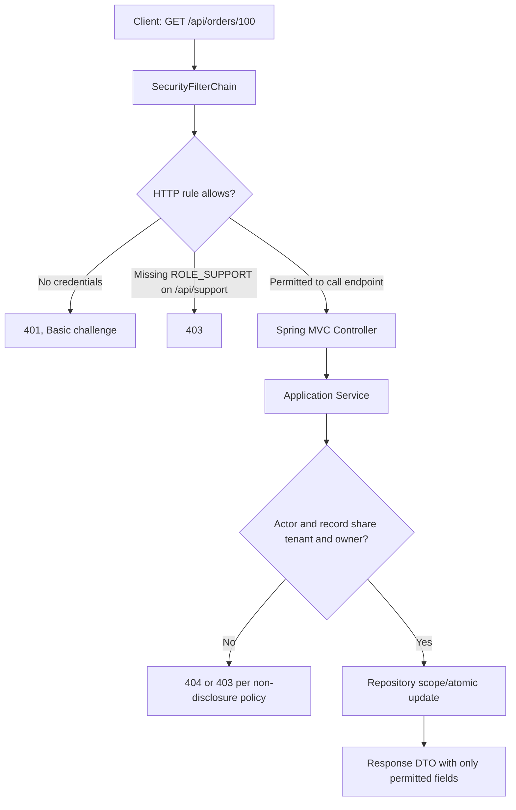

# Distinguishing Endpoint Protection from Internal Business Data Protection

> **Learning Context:** Spring Boot 3.x, Spring Security 6.x on the Servlet stack (Spring MVC), Java 17+. This topic falls under **HTTP Authorization**, yet the most important point is: **an HTTP request allowed through `SecurityFilterChain` does not mean the caller is permitted to read or modify every record the request points to**. This lesson demonstrates combining `authorizeHttpRequests`, method security, service-layer ownership/tenant checks, and constrained DB queries to prevent IDOR/BOLA. The runnable example uses an in-memory data store; tests use `MockMvc` through the real security filter chain.

## 1. Two Completely Different Security Questions

Suppose an API lets customers view orders:

```http
GET /api/orders/100 HTTP/1.1
Authorization: Basic <alice-credentials>
```

The configuration:

```java
.authorizeHttpRequests(auth -> auth
        .requestMatchers("/api/orders/**").authenticated()
        .anyRequest().denyAll())
```

ensures the caller of `/api/orders/**` is **authenticated**. Yet if the caller is Bob and ID `100` belongs to Alice's order, the `authenticated()` rule **does not answer** whether Bob is permitted to read order 100.

This is the core distinction:

- **Endpoint/request-level authorization:** is the caller allowed to use *this category of feature/URL/HTTP method*? For example, only role `SUPPORT` may enter `/api/support/**`, or anyone logged in may call `GET /api/orders/{id}`.
- **Object-level/domain authorization:** for a **specific record**, is the caller permitted to **read, modify, cancel, approve, or export** it? For instance, order 100 belongs to `alice` in tenant `acme`; `bob`, even though logged in, may not view it.
- **Field-level authorization:** even when permitted to view order 100, may the caller receive **cost price, payment details, private email, or internal notes**, or modify `ownerId`/`approved`?
- **Query/list-level authorization:** list APIs must filter all records by principal and permission scope, rather than checking one ID after querying the entire table.

Bugs allowing object access by guessing/tampering with IDs are typically called **IDOR (Insecure Direct Object Reference)** or **BOLA (Broken Object Level Authorization)**. Hard-to-guess UUIDs only reduce discoverability; they are **not proof of access permission**.

### Responsibility Matrix

| Layer | Questions It Should Ask | Example Mechanisms |
|---|---|---|
| Servlet filter / SecurityFilterChain | Does this request have valid authentication? Which role does the URL/method require? | `httpBasic`, `authorizeHttpRequests`, `hasRole` |
| Controller | Parse input, identify action, retrieve principal from Security | `@PathVariable`, `Authentication`; never trust client-supplied owner |
| Application/domain service | Does the principal have rights to this object and action? | Owner/tenant/member/role/state policy, `@PreAuthorize` or explicit checks |
| Repository/DB | Return/update only data within permitted scope | WHERE tenant + owner, row-level security, conditional UPDATE |
| DTO/serializer | Which fields may be included in the response? | Dedicated DTO, projection, masking, never return JPA entities unconditionally |
| Audit/observability | Can we record who tried to access what without leaking secrets? | Audit principal/action/decision, correlation id |

**One layer does not replace another.** URL role checks can be right while object ownership is still broken; queries can be properly scoped while admin endpoints can still be invoked by unauthorized roles if HTTP authorization is misconfigured.

## 2. Easily Missed Exploitation Scenario

An insecure controller:

```java
// INTENTIONALLY INSECURE EXAMPLE — do not use in production.
@GetMapping("/api/orders/{id}")
public OrderEntity get(@PathVariable long id) {
    return orderRepository.findById(id).orElseThrow();
}
```

If `/api/orders/**` only requires `authenticated()`, Bob can request IDs `100`, `101`, `102` to read Alice's orders or another tenant's orders. The fact that the controller does not see passwords does not make this endpoint safe: Bob is **properly authenticated**, yet accesses **the wrong object**.

A preliminary fix:

```java
@GetMapping("/api/orders/{id}")
public OrderView get(Authentication authentication, @PathVariable long id) {
    return orderService.getForOwner(authentication.getName(), id);
}
```

Inside the service, extract the subject from the **Spring Security-verified principal**, look up the record, and return it only if the subject holds permission. Never accept `?user=alice` or an `X-User: alice` header and trust it as identity.

Another fix that is *still insufficient*:

```java
.requestMatchers("/api/orders/**").hasRole("USER")
```

This rule requires the `USER` role, yet **every user with `ROLE_USER`** can still guess each other's IDs if the service/repository does not restrict by owner/tenant. A role grants a **feature category**, not ownership over every record.

## 3. From Request to Data: Where Should Checks Live?



**Recommended placement:**

1. At the **HTTP layer**, enforce authentication, coarse roles/scopes, and reject out-of-scope routes. This is the first line of defense.
2. At the **service/domain layer**, enforce per-object permissions by principal, tenant, relationship, time, business state, and action. This layer must never be skipped because the same service may also be invoked by schedulers, message consumers, or GraphQL.
3. At the **data access layer**, push permission constraints into queries/UPDATEs to reduce fetching unauthorized data and prevent **time-of-check/time-of-use (TOCTOU)** when concurrent requests mutate data.
4. At the **response layer**, return only permitted fields. Permission to read an order does not mean seeing raw payment tokens or internal data.
5. In **tests**, verify both valid cases and **authenticated-but-non-owner** cases. Testing only "right login gets 200" does not prove BOLA protection.

## 4. Access Rights Example: User, Tenant, and Support

We have this learning dataset:

| Principal | Tenant | Role | Sample Permissions |
|---|---|---|---|
| `alice` | `acme` | `ROLE_USER` | View/cancel **Alice's orders** in `acme` |
| `charlie` | `acme` | `ROLE_USER` | View/cancel **Charlie's orders**, not Alice's despite same tenant |
| `bob` | `beta` | `ROLE_USER` | View/cancel **Bob's orders** in `beta` |
| `support-a` | Support scope `acme` | `ROLE_SUPPORT` | View orders in tenant `acme` via **support endpoint**, no automatic access to `beta` |

Sample orders:

| Order ID | Tenant | Owner | State | Amount (in cents) |
|---|---|---|---|---:|
| `100` | acme | alice | OPEN | 120000 |
| `101` | acme | charlie | OPEN | 76000 |
| `102` | acme | alice | OPEN | 45000 |
| `200` | beta | bob | OPEN | 99000 |

Key protective test cases:

- Alice `GET /api/orders/100` -> **200**; Charlie or Bob calling the same URL -> **404**, even though authenticated.
- Bob may send `X-Tenant: acme` or `X-User: alice`, yet the server **ignores** those headers for granting access.
- Alice `GET /api/orders` -> lists only 100 and 102, without Charlie's 101 or Bob's 200.
- Alice `POST /api/orders/102/cancel` -> can return **200** if CSRF and policy pass. Bob trying the same action with valid CSRF -> **404**; sending without CSRF (in browser cookie-based flow) -> **403** before business processing.
- `support-a` via `/api/support/tenants/acme/orders/100` -> **200**. Same principal trying tenant `beta` -> **404**. Alice trying the support endpoint -> **403** for lacking `ROLE_SUPPORT`.

This is an illustrative policy, not a business standard. Real systems may have organizations, delegates, managers, shared orders, or complex roles; model permissions on resources rather than inferring everything from usernames.

## 5. Runnable Spring Boot 3.x / Java 17+ Project

The example consists of a main class, a Security config, a service holding the *source of truth* for permissions and orders, a thin controller, plus integration-style tests with MockMvc.

**Scope note:** the data store is a `ConcurrentHashMap` to stay focused on authorization, not a production database. Accounts and passwords are created in memory; sample requests run only on `localhost`. Production requires a persistent data store, HTTPS, token/session policies, auditing, and proper transactions.

### 5.1. Project Setup

In Spring Initializr, select Java 17+, **Spring Boot 3.x**, Gradle Groovy DSL, and dependencies Spring Web, Spring Security, Spring Boot Starter Test, and Spring Security Test. `dependencies` block in `build.gradle`:

```groovy
dependencies {
    implementation 'org.springframework.boot:spring-boot-starter-web'
    implementation 'org.springframework.boot:spring-boot-starter-security'
    testImplementation 'org.springframework.boot:spring-boot-starter-test'
    testImplementation 'org.springframework.security:spring-security-test'
}
```

This is only the dependencies block; keep plugins, repositories, and wrapper from Initializr. File layout:

```text
src/
├── main/java/com/example/objectauth/
│   ├── ObjectAuthApplication.java
│   ├── SecurityConfig.java
│   ├── OrderService.java
│   └── OrderController.java
└── test/java/com/example/objectauth/
    └── OrderAuthorizationTest.java
```

### 5.2. Main Application

**`src/main/java/com/example/objectauth/ObjectAuthApplication.java`**

```java
package com.example.objectauth;

import org.springframework.boot.SpringApplication;
import org.springframework.boot.autoconfigure.SpringBootApplication;

@SpringBootApplication
public class ObjectAuthApplication {
    public static void main(String[] args) {
        SpringApplication.run(ObjectAuthApplication.class, args);
    }
}
```

The class in the root package `com.example.objectauth` lets component scanning find `SecurityConfig`, `OrderService`, and the Controller.

### 5.3. SecurityConfig: Protecting Routes Without Pretending to Protect Individual Orders

**`src/main/java/com/example/objectauth/SecurityConfig.java`**

```java
package com.example.objectauth;

import jakarta.servlet.DispatcherType;

import org.springframework.context.annotation.Bean;
import org.springframework.context.annotation.Configuration;
import org.springframework.http.HttpMethod;
import org.springframework.security.config.Customizer;
import org.springframework.security.config.annotation.method.configuration.EnableMethodSecurity;
import org.springframework.security.config.annotation.web.builders.HttpSecurity;
import org.springframework.security.config.http.SessionCreationPolicy;
import org.springframework.security.core.userdetails.User;
import org.springframework.security.core.userdetails.UserDetailsService;
import org.springframework.security.crypto.factory.PasswordEncoderFactories;
import org.springframework.security.crypto.password.PasswordEncoder;
import org.springframework.security.provisioning.InMemoryUserDetailsManager;
import org.springframework.security.web.SecurityFilterChain;

@Configuration
@EnableMethodSecurity
public class SecurityConfig {

    @Bean
    PasswordEncoder passwordEncoder() {
        return PasswordEncoderFactories.createDelegatingPasswordEncoder();
    }

    @Bean
    UserDetailsService users(PasswordEncoder encoder) {
        return new InMemoryUserDetailsManager(
                User.withUsername("alice")
                    .password(encoder.encode("alice-pass"))
                    .roles("USER").build(),
                User.withUsername("charlie")
                    .password(encoder.encode("charlie-pass"))
                    .roles("USER").build(),
                User.withUsername("bob")
                    .password(encoder.encode("bob-pass"))
                    .roles("USER").build(),
                User.withUsername("support-a")
                    .password(encoder.encode("support-pass"))
                    .roles("SUPPORT").build()
        );
    }

    @Bean
    SecurityFilterChain securityFilterChain(HttpSecurity http)
            throws Exception {
        return http
                .authorizeHttpRequests(auth -> auth
                    // Allow container error-page handling so error dispatch
                    // does not alter 404/409 outcomes.
                    .dispatcherTypeMatchers(DispatcherType.ERROR).permitAll()

                    // Only SUPPORT may call this endpoint family.
                    .requestMatchers(HttpMethod.GET,
                            "/api/support/tenants/*/orders/*")
                        .hasRole("SUPPORT")

                    // Logged-in users may use the orders feature;
                    // DOES NOT mean they can access every order ID.
                    .requestMatchers("/api/orders", "/api/orders/**")
                        .authenticated()

                    // All other paths are explicitly denied.
                    .anyRequest().denyAll()
                )
                .httpBasic(Customizer.withDefaults())
                .sessionManagement(session -> session
                    .sessionCreationPolicy(SessionCreationPolicy.STATELESS))
                // DO NOT disable CSRF application-wide.
                .build();
    }
}
```

**Why use Basic and stateless?** To test each request independently of others, avoiding "Bob still had Alice's session" obscuring ownership checks. In real browser form/cookie apps, sessions and CSRF need even clearer design. Basic over a real network still requires TLS: Base64 does not encrypt passwords.

**Points to note in the config:**

- `authenticated()` only confirms login; it knows nothing about `orderId`/`owner`.
- `hasRole("SUPPORT")` creates an HTTP protection gate for support lookup functionality; the role corresponds to authority `ROLE_SUPPORT`.
- `dispatcherTypeMatchers(DispatcherType.ERROR).permitAll()` lets **Servlet ERROR dispatches** render errors returned by MVC; it does not intentionally make any business endpoint public. This needs extra control if the app has an error controller exposing sensitive data.
- `anyRequest().denyAll()` is the fail-closed choice for routes without defined policies.
- `@EnableMethodSecurity` enables `@PreAuthorize` at the service layer for the support feature in the next step.
- `SessionCreationPolicy.STATELESS` prevents using an HTTP session to retain `SecurityContext` across requests in the demo. It **does not automatically disable CSRF**; POST attempts will require a CSRF token.
- There is no `csrf.disable()`. Handle CSRF according to the client model rather than disabling it unconditionally because "this is an API".

### 5.4. OrderService: Checking Owner + Tenant Before Returning Data or Updating

**`src/main/java/com/example/objectauth/OrderService.java`**

```java
package com.example.objectauth;

import java.util.Comparator;
import java.util.List;
import java.util.Map;
import java.util.Set;
import java.util.concurrent.ConcurrentHashMap;
import java.util.concurrent.atomic.AtomicReference;

import org.springframework.http.HttpStatus;
import org.springframework.security.access.prepost.PreAuthorize;
import org.springframework.security.core.Authentication;
import org.springframework.stereotype.Service;
import org.springframework.web.server.ResponseStatusException;

@Service
public class OrderService {

    // Trusted directory for demo only. In production, load from
    // verified account/organization membership data.
    private record Actor(String tenant, Set<String> supportTenants) {}

    private record Order(
            long id, String tenant, String owner,
            String state, long totalCents) {}

    // Response exposes no owner, tenant, or internal payment data.
    public record OrderView(long id, String state, long totalCents) {}

    private final Map<String, Actor> actors = Map.of(
            "alice", new Actor("acme", Set.of()),
            "charlie", new Actor("acme", Set.of()),
            "bob", new Actor("beta", Set.of()),
            "support-a", new Actor("acme", Set.of("acme"))
    );

    private final ConcurrentHashMap<Long, Order> orders =
            new ConcurrentHashMap<>(Map.of(
                100L, new Order(100, "acme", "alice", "OPEN", 120000),
                101L, new Order(101, "acme", "charlie", "OPEN", 76000),
                102L, new Order(102, "acme", "alice", "OPEN", 45000),
                200L, new Order(200, "beta", "bob", "OPEN", 99000)
            ));

    private Actor currentActor(Authentication authentication) {
        if (authentication == null || !authentication.isAuthenticated()) {
            throw new ResponseStatusException(HttpStatus.FORBIDDEN);
        }
        Actor actor = actors.get(authentication.getName());
        if (actor == null) {
            throw new ResponseStatusException(HttpStatus.FORBIDDEN);
        }
        return actor;
    }

    private boolean ownedBy(Authentication authentication, Actor actor,
                            Order order) {
        return order != null
                && order.tenant().equals(actor.tenant())
                && order.owner().equals(authentication.getName());
    }

    private static ResponseStatusException notVisible() {
        return new ResponseStatusException(HttpStatus.NOT_FOUND);
    }

    private static OrderView toView(Order order) {
        return new OrderView(
                order.id(), order.state(), order.totalCents());
    }

    // Object-level check: even when authenticated, must match owner + tenant.
    public OrderView getMyOrder(Authentication authentication, long orderId) {
        Actor actor = currentActor(authentication);
        Order order = orders.get(orderId);
        if (!ownedBy(authentication, actor, order)) {
            throw notVisible();
        }
        return toView(order);
    }

    // List-level check: every element must be scoped to the actor.
    public List<OrderView> listMyOrders(Authentication authentication) {
        Actor actor = currentActor(authentication);
        return orders.values().stream()
                .filter(o -> ownedBy(authentication, actor, o))
                .sorted(Comparator.comparingLong(Order::id))
                .map(OrderService::toView)
                .toList();
    }

    // Action-level check: owner + tenant + state allowing cancellation.
    public OrderView cancelMyOrder(
            Authentication authentication, long orderId) {
        Actor actor = currentActor(authentication);
        AtomicReference<OrderView> result = new AtomicReference<>();

        // Atomic within a single-JVM ConcurrentHashMap for the exercise.
        // Production DB needs conditional UPDATE + version/transaction.
        orders.compute(orderId, (id, existing) -> {
            if (!ownedBy(authentication, actor, existing)) {
                throw notVisible();
            }
            if (!"OPEN".equals(existing.state())) {
                throw new ResponseStatusException(HttpStatus.CONFLICT);
            }

            Order updated = new Order(
                    existing.id(), existing.tenant(), existing.owner(),
                    "CANCELLED", existing.totalCents());
            result.set(toView(updated));
            return updated;
        });
        return result.get();
    }

    // HTTP support route already requires role, yet service retains method
    // security so nobody can invoke it directly without the role.
    @PreAuthorize("hasRole('SUPPORT')")
    public OrderView readForSupport(
            Authentication authentication, String tenantFromPath,
            long orderId) {
        Actor actor = currentActor(authentication);

        // Support tenant is not decided by client-supplied headers/queries.
        // This map represents a trusted membership store.
        if (!actor.supportTenants().contains(tenantFromPath)) {
            throw notVisible();
        }

        Order order = orders.get(orderId);
        if (order == null || !order.tenant().equals(tenantFromPath)) {
            throw notVisible();
        }
        return toView(order);
    }
}
```

**Why does service code matter more than a URL matcher?**

- `getMyOrder` enforces both `owner == authentication.getName()` **and** `tenant == actor.tenant`. Charlie shares Alice's tenant yet does not own order 100 and cannot view it. Bob in another tenant also cannot view it.
- `listMyOrders` filters before building DTOs. A list endpoint that forgets to filter can expose thousands of records even when the detail endpoint is protected.
- `cancelMyOrder` checks **permission and state** within the same atomic map update. Checking first and updating later without an ownership guard risks race/TOCTOU bugs.
- `readForSupport` requires the `SUPPORT` role via `@PreAuthorize` **and** verifies the tenant belongs to the system-assigned list. Having the SUPPORT role does not mean supporting every tenant.
- `OrderView` holds only valid fields; never expose full entities, secrets, internal notes, owner contacts, payment instruments, or model fields outside permission scope.
- The actor directory looks up by verified principal. `tenantFromPath` is only the **requested tenant**, which must match authorized membership; clients cannot self-declare belonging to tenant `acme`.

**Especially:** `@PreAuthorize` runs when Spring invokes a method through its bean proxy. Calling the method via `this.readForSupport(...)` from another method in the same class can bypass proxy-based method security. Maintain clean service boundaries and test non-HTTP entry points (jobs/messages) if production has them.

## 6. Controller Only Extracts ID and Principal, Never Decides Ownership

**`src/main/java/com/example/objectauth/OrderController.java`**

```java
package com.example.objectauth;

import java.util.List;

import org.springframework.security.core.Authentication;
import org.springframework.web.bind.annotation.GetMapping;
import org.springframework.web.bind.annotation.PathVariable;
import org.springframework.web.bind.annotation.PostMapping;
import org.springframework.web.bind.annotation.RestController;

@RestController
public class OrderController {

    private final OrderService orders;

    public OrderController(OrderService orders) {
        this.orders = orders;
    }

    @GetMapping("/api/orders")
    public List<OrderService.OrderView> list(Authentication authentication) {
        return orders.listMyOrders(authentication);
    }

    @GetMapping("/api/orders/{id}")
    public OrderService.OrderView details(
            Authentication authentication, @PathVariable long id) {
        return orders.getMyOrder(authentication, id);
    }

    @PostMapping("/api/orders/{id}/cancel")
    public OrderService.OrderView cancel(
            Authentication authentication, @PathVariable long id) {
        return orders.cancelMyOrder(authentication, id);
    }

    @GetMapping("/api/support/tenants/{tenant}/orders/{id}")
    public OrderService.OrderView supportDetails(
            Authentication authentication, @PathVariable String tenant,
            @PathVariable long id) {
        return orders.readForSupport(authentication, tenant, id);
    }
}
```

No `owner` parameter or `X-User` is used by the controller as the principal. Even if the client guesses `id` or tampers with `tenant`, the service still decides access. The controller returns DTOs from the service rather than calling `findById(id)` directly and returning entities.

No custom login controller is needed; Spring Security's Basic filter verifies credentials. Production usually uses different tokens/sessions/IdPs; the business-layer authorization principles remain identical.

## 7. Trying with curl: Permitted Endpoints Can Still Be Blocked in the Service

Run from the project directory containing the Gradle wrapper:

```bash
# macOS / Linux
./gradlew bootRun

# Windows PowerShell
.\gradlew.bat bootRun
```

Default URL is `http://localhost:8080` if unchanged. Use `curl.exe` on older Windows PowerShell if `curl` is an alias. Sample passwords are **for localhost only**; real environments require HTTPS and managed secrets.

### 7.1. Without Credentials

```bash
curl -i http://localhost:8080/api/orders/100
```

**Expected:** `401 Unauthorized`; the Basic entry point may send `WWW-Authenticate: Basic realm="Realm"` or a challenge per configuration. The request never passed authentication/HTTP authorization to reach the service.

### 7.2. Alice Views Alice's Order

```bash
curl -i -u alice:alice-pass http://localhost:8080/api/orders/100
```

**Expected:** 200, JSON response containing fields:

```json
{"id":100,"state":"OPEN","totalCents":120000}
```

Role `USER` suffices to pass the endpoint, and the service verifies both tenant and owner. `OrderView` exposes no internal fields.

### 7.3. Charlie/Bob Guess Order 100

```bash
curl -i -u charlie:charlie-pass http://localhost:8080/api/orders/100
curl -i -u bob:bob-pass http://localhost:8080/api/orders/100
```

**Expected:** both **404**; order 100 is not returned. Charlie shares tenant `acme` yet is **not the owner**; Bob belongs to tenant `beta`. Both requests have valid credentials and are accepted by the HTTP layer, yet rejected by the service.

### 7.4. Forged Identity or Tenant Headers Grant No Access

```bash
curl -i -u bob:bob-pass \
  -H 'X-User: alice' -H 'X-Tenant: acme' \
  http://localhost:8080/api/orders/100
```

**Expected:** 404. Headers here are merely untrusted input; the service ignores them. Never take the actor from `request.getHeader("X-User")` or tenant membership from a caller-supplied `X-Tenant`.

### 7.5. Alice's List Contains Only Alice's Orders

```bash
curl -i -u alice:alice-pass http://localhost:8080/api/orders
```

**Expected:** JSON array with IDs 100 and 102, without 101/200. There is no `?owner=bob` parameter that could leak Bob's list.

### 7.6. Support Permission Remains Bounded by Tenant

```bash
curl -i -u alice:alice-pass \
  http://localhost:8080/api/support/tenants/acme/orders/100

curl -i -u support-a:support-pass \
  http://localhost:8080/api/support/tenants/acme/orders/100

curl -i -u support-a:support-pass \
  http://localhost:8080/api/support/tenants/beta/orders/200
```

**Expected respectively:** 403 (Alice lacks `ROLE_SUPPORT`); 200 (`support-a` is assigned tenant `acme`); 404 (`support-a` is not assigned tenant `beta`). The `SUPPORT` role alone is insufficient to unlock all data.

### 7.7. Canceling Orders: CSRF Required When Config Still Protects POST

`POST /api/orders/102/cancel` illustrates a write action. The demo **does not disable CSRF**, so a POST with Basic credentials yet **without a CSRF token** is blocked with 403. When writing browser clients, send a valid CSRF token per your configured repository/delivery mechanism; in MockMvc we use `.with(csrf())`. Do not run `curl -X POST` without a token and treat 403 as "Bob lacks object permission" — it may have been blocked before reaching the service.

With valid CSRF and Alice as owner, state transitions `OPEN` -> `CANCELLED`. Bob, even with valid CSRF, is still stopped by the object-level check with 404. These are **two independent control layers**: CSRF prevents one class of forged requests, while ownership prevents logged-in users from touching records outside their rights.

## 8. MockMvc Testing Through SecurityFilterChain and Service

**`src/test/java/com/example/objectauth/OrderAuthorizationTest.java`**

```java
package com.example.objectauth;

import org.junit.jupiter.api.Test;
import org.springframework.beans.factory.annotation.Autowired;
import org.springframework.boot.test.autoconfigure.web.servlet.AutoConfigureMockMvc;
import org.springframework.boot.test.context.SpringBootTest;
import org.springframework.http.HttpHeaders;
import org.springframework.test.web.servlet.MockMvc;

import static org.springframework.security.test.web.servlet.request.SecurityMockMvcRequestPostProcessors.csrf;
import static org.springframework.security.test.web.servlet.request.SecurityMockMvcRequestPostProcessors.httpBasic;
import static org.springframework.test.web.servlet.request.MockMvcRequestBuilders.get;
import static org.springframework.test.web.servlet.request.MockMvcRequestBuilders.post;
import static org.springframework.test.web.servlet.result.MockMvcResultMatchers.header;
import static org.springframework.test.web.servlet.result.MockMvcResultMatchers.jsonPath;
import static org.springframework.test.web.servlet.result.MockMvcResultMatchers.status;

@SpringBootTest
@AutoConfigureMockMvc
class OrderAuthorizationTest {

    @Autowired
    MockMvc mvc;

    @Test
    void anonymousRequestIsStoppedAtHttpLayer() throws Exception {
        mvc.perform(get("/api/orders/100"))
                .andExpect(status().isUnauthorized())
                .andExpect(header().exists(HttpHeaders.WWW_AUTHENTICATE));
    }

    @Test
    void ownerCanSeeOwnOrder() throws Exception {
        mvc.perform(get("/api/orders/100")
                    .with(httpBasic("alice", "alice-pass")))
                .andExpect(status().isOk())
                .andExpect(jsonPath("$.id").value(100))
                .andExpect(jsonPath("$.totalCents").value(120000));
    }

    @Test
    void anotherUserInSameTenantCannotSeeOrder() throws Exception {
        mvc.perform(get("/api/orders/100")
                    .with(httpBasic("charlie", "charlie-pass")))
                .andExpect(status().isNotFound());
    }

    @Test
    void userInOtherTenantCannotSeeOrder() throws Exception {
        mvc.perform(get("/api/orders/100")
                    .with(httpBasic("bob", "bob-pass")))
                .andExpect(status().isNotFound());
    }

    @Test
    void spoofedHeadersCannotBecomeTrustedPrincipal() throws Exception {
        mvc.perform(get("/api/orders/100")
                    .with(httpBasic("bob", "bob-pass"))
                    .header("X-User", "alice")
                    .header("X-Tenant", "acme"))
                .andExpect(status().isNotFound());
    }

    @Test
    void listEndpointScopesEveryReturnedRecord() throws Exception {
        mvc.perform(get("/api/orders")
                    .with(httpBasic("alice", "alice-pass")))
                .andExpect(status().isOk())
                .andExpect(jsonPath("$.length()").value(2))
                .andExpect(jsonPath("$[0].id").value(100))
                .andExpect(jsonPath("$[1].id").value(102));
    }

    @Test
    void userCannotCallSupportEndpointWithoutRole() throws Exception {
        mvc.perform(get("/api/support/tenants/acme/orders/100")
                    .with(httpBasic("alice", "alice-pass")))
                .andExpect(status().isForbidden());
    }

    @Test
    void supportCanReadOnlyAssignedTenant() throws Exception {
        mvc.perform(get("/api/support/tenants/acme/orders/100")
                    .with(httpBasic("support-a", "support-pass")))
                .andExpect(status().isOk())
                .andExpect(jsonPath("$.id").value(100));

        mvc.perform(get("/api/support/tenants/beta/orders/200")
                    .with(httpBasic("support-a", "support-pass")))
                .andExpect(status().isNotFound());
    }

    @Test
    void missingCsrfStopsWriteAtFilterLayer() throws Exception {
        mvc.perform(post("/api/orders/102/cancel")
                    .with(httpBasic("alice", "alice-pass")))
                .andExpect(status().isForbidden());
    }

    @Test
    void otherOwnerCannotCancelEvenWithValidCsrf() throws Exception {
        mvc.perform(post("/api/orders/102/cancel")
                    .with(httpBasic("bob", "bob-pass"))
                    .with(csrf()))
                .andExpect(status().isNotFound());
    }

    @Test
    void ownerCanCancelOwnOrderWithCsrf() throws Exception {
        mvc.perform(post("/api/orders/102/cancel")
                    .with(httpBasic("alice", "alice-pass"))
                    .with(csrf()))
                .andExpect(status().isOk())
                .andExpect(jsonPath("$.id").value(102))
                .andExpect(jsonPath("$.state").value("CANCELLED"));
    }

    @Test
    void unknownOrderIsNotVisible() throws Exception {
        mvc.perform(get("/api/orders/999")
                    .with(httpBasic("alice", "alice-pass")))
                .andExpect(status().isNotFound());
    }
}
```

Run:

```bash
# macOS / Linux
./gradlew test

# Windows PowerShell
.\gradlew.bat test
```

**Expected result:** all 12 tests PASS when the project uses the exact classes above. This is an **expectation from the code**, not a claim that the test suite was executed in this document's environment.

**What the tests prove:**

- Anonymous test -> 401 proves the HTTP layer enforces authentication.
- Two Charlie/Bob tests -> 404 prove **validly logged-in** users still cannot view unauthorized objects, even within the same tenant.
- Spoofed headers test -> 404 proves `X-User`/`X-Tenant` are not trusted.
- List test -> only 100/102, catching *list-level authorization* bugs that are often missed.
- Support HTTP role -> 403, support tenant membership -> 404, distinguishing feature access from internal data scope.
- Two POST tests with/without CSRF and owner test -> 403/404/200, separating CSRF, object authorization, and business writes.
- Order 999 test -> 404, exposing no info or stack traces.

Note the test shares one `@SpringBootTest` application context; the test canceling order 102 mutates state. Other tests only read order 100's ID/status or count orders without filtering by status, so they do not depend on execution order. When building larger suites, use fixtures/transaction rollbacks or fresh data stores per test to avoid state leakage.

## 9. How to Push Authorization Down into Data Queries?

The demo's `ConcurrentHashMap` shows the logic, yet database-backed applications should avoid:

```java
// RISK in large data systems: loading the record first then checking elsewhere
// can leak data through logs/caches/serializers or create TOCTOU.
OrderEntity order = repository.findById(id).orElseThrow();
return toResponse(order);
```

A tighter approach is having the repository query itself constrain by **verified** tenant/owner:

```sql
SELECT id, status, total_cents
FROM orders
WHERE id = :orderId
  AND tenant_id = :trustedTenantId
  AND owner_id = :authenticatedUserId;
```

In JPA you can define an **illustrative method, not a standalone class**:

```java
Optional<OrderEntity> findByIdAndTenantIdAndOwnerId(
        Long id, Long tenantId, Long ownerId);
```

`tenantId` and `ownerId` must come from verified server-side membership/principal, **not simply from path/query/body**. If the result is empty, typically return 404 per an existence-hiding policy. Do not distinguish "order exists but you lack permission" from "order does not exist" if doing so leaks sensitive resources.

For **updates**, checking owner then calling `save` later can race. Use a conditional write:

```sql
UPDATE orders
SET status = 'CANCELLED',
    version = version + 1
WHERE id = :orderId
  AND tenant_id = :trustedTenantId
  AND owner_id = :authenticatedUserId
  AND status = 'OPEN'
  AND version = :expectedVersion;
```

Check the **updated row count**; 0 means the record does not exist, is unauthorized, has an invalid state, or the version changed. The service decides how to classify without leaking forbidden info. In production, add transactions/optimistic locking, idempotency, and domain invariants (shipped orders cannot be canceled); authorization does not replace business-state checks.

### 9.1. Why Is "Check in Controller Then Service Does Everything" Error-Prone?

A service can be called from another HTTP endpoint, scheduled job, queue consumer, GraphQL resolver, or batch import. If only controller A checks ownership while service B unconditionally calls `save`, other paths can bypass it. Put core policies in the application/domain service, and where possible encode scope into repositories/queries. Controllers should coordinate, not serve as the sole guard over data.

### 9.2. Can Row Level Security (RLS) Be Used?

Some databases support RLS, allowing the database to enforce tenant/actor context by policy. This can be a **strong defense-in-depth layer** when configured properly, yet you must define how tenant/actor context is set/reset on every pooled connection, which database roles bypass RLS, service-account privileges, and transaction boundaries. Never take an unverified `X-Tenant` and set it directly as DB security context. RLS **complements**, rather than makes redundant, HTTP authorization or service/domain policies.

## 10. What Does Method Security Support and Not Support?

`@EnableMethodSecurity` enables annotations like `@PreAuthorize` on service beans. Example in this lesson:

```java
@PreAuthorize("hasRole('SUPPORT')")
public OrderView readForSupport(Authentication authentication,
                                String tenantFromPath, long id) {
    // ...
}
```

It protects the **support feature category**, even if an internal caller bypasses the controller. However, if the method only has `hasRole('SUPPORT')` without checking whether `tenantFromPath` falls within the support scope, `support-a` could still read tenant `beta`'s orders. That is why the service also checks `supportTenants` and the actual record's tenant.

Permission checks can be centralized in a dedicated bean:

```java
// CONCEPT SNIPPET: requires defining orderPolicy bean and canRead method.
// Does not run as a standalone program.
@PreAuthorize("@orderPolicy.canRead(authentication, #orderId)")
public OrderView readOrder(long orderId) {
    // Load the scoped order and produce safe view.
}
```

If choosing expressions, the `orderPolicy` bean must verify principal, tenant, resource ID, and action; watch out for parameter-name resolution, caching, and query counts. **Never wrap a dangerous policy in an annotation and assume it is automatically safe.** Also check Spring proxy pitfalls: self-invocation (`this.someMethod()`) can skip `@PreAuthorize`.

Using `@PostAuthorize` or `@PostFilter` to filter after returning results can help in some cases, yet for large/sensitive datasets, loading all records first and filtering afterward is usually **resource-intensive** and raises leak risks via logs/caches. Prefer **filtering in the query** upfront whenever possible.

## 11. Frequently Overlooked Data Protection Mistakes

### 11.1. A Valid Parent Does Not Prove a Valid Child

Suppose the API is:

```http
GET /api/orders/100/items/900
```

Alice owns order 100, yet item 900 may belong to Bob's order 200. If the controller only checks permission on parent 100 and then calls `itemRepository.findById(900)`, Alice can access a child belonging to the wrong parent. Queries must constrain **`item.order_id = 100`**, tenant, and parent owner/policy, never trusting that two IDs in a URL imply a valid relationship.

### 11.2. List/Search/Export/Pagination Easily Under-Filter

A list endpoint may return the right count on page one while total-count queries, CSV exports, search suggestions, autocomplete, or background reports use another query and forget the tenant scope. `COUNT`, `GROUP BY`, aggregations, and ordering can sometimes leak sensitive metadata even without returning raw rows. Share policies centrally and test all related data-returning paths.

### 11.3. Hiding Buttons in the UI Is Not Enough

Having the frontend hide the "Cancel" button for Bob does not stop Bob from sending `POST /api/orders/100/cancel` directly. UI only assists UX; the server must verify permissions at operation time.

### 11.4. Mass Assignment / Over-Posting

If a controller accepts a full object from the client:

```json
{"id":100,"owner":"bob","tenant":"beta","state":"APPROVED"}
```

and binds it directly onto an entity and calls `save`, the caller can alter ownership fields or states forbidden by policy. Use command DTOs containing only permitted fields, set owner/tenant from principal/service layer, and validate every state transition. There is never a reason to trust a client-sent `owner` simply because the caller is authenticated.

### 11.5. Caching Must Not Bypass Principal Scope

Caching `GET /api/orders/100` responses under a key containing only `orderId=100` means if Alice's record is cached and later served to Bob, business authorization is bypassed even when the service normally checks properly. Cache keys must include permission/tenant/principal scope and policy; personal data should set proper `Cache-Control` to prevent unintended shared CDN/proxy caching.

### 11.6. Client-Sent Tenant Context

If an application lets users pick a tenant via URL or header, that value is merely the **requested tenant**. Verify the authenticated principal has membership/role in that tenant and the resource belongs to it. An `X-Tenant` header can serve as a *selector* after validation, **never as proof of membership**.

### 11.7. Admin/Support Does Not Mean Global Data Access

`ADMIN` or `SUPPORT` roles may apply only per organization, region, or function. An "admin" of tenant A is not automatically admin of tenant B; a support agent may need to be assigned to a ticket/tenant before viewing data. Do not lump everything under `hasRole('ADMIN')` when scopes must still be enforced.

### 11.8. Permission Changes While a Session Remains Alive

If a user is moved across tenants or loses rights to a resource, old principals/sessions/tokens may hold stale claims. Identify where membership must be re-checked, cache TTLs, and revocation; sensitive actions may need fresh authorization from server data. A cryptographically valid token signature does not prove all business permissions still hold.

## 12. 401, 403, 404, and Related Error Codes

| Scenario | Reference Status | Meaning |
|---|---|---|
| Missing/wrong credentials on auth-required endpoint | **401** | Valid authentication required; Basic usually sends challenge |
| Authenticated USER calls support-only route | **403** | Identity exists yet lacks role for the feature |
| Alice accesses non-existent ID | **404** | Resource not found |
| Bob accesses Alice's order 100 | **404** per example policy | Hides existence of sensitive resources |
| Support-a calls unassigned tenant | **404** per example policy | Does not reveal out-of-scope data/tenants |
| Alice already canceled order 102 and cancels again | **409** per business policy | State disallows transitioning again |
| POST missing CSRF in browser-oriented Security | **403** | Blocked by security filter before service |

**There is no absolute rule** that every unauthorized object access must return 404 or 403. 403 expresses forbidden; 404 is sometimes preferred to avoid disclosing record existence. Pick a policy consistent with your threat model and internal logging. Response timing, result counts, pagination, and exception messages can still cause *side-channel leaks* even with identical statuses.

Errors must never contain full entities, passwords, tokens, internal tenant identifiers, or stack traces. Internal audit logs may record safe denial reasons, while public responses should stay minimal.

## 13. Analyzing Common Symptoms

| Symptom | Possible Cause | How to Verify |
|---|---|---|
| User A sees B's order despite valid login | Only `authenticated()`, no owner/tenant check | MockMvc with A/B calling the same ID |
| Detail API protected properly yet list leaks all records | List query lacks scope, export/search uses another repository | Test list/search/export per principal |
| Changing `X-Tenant` header views another tenant | Service trusts header as identity context | Verify server-side membership mapping |
| Role SUPPORT can view every tenant | Only `hasRole` without checking support assignment | Test `support-a` viewing tenant `beta` |
| POST without CSRF returns 403; team blames owner check | CSRF filter runs before service | Test separately with `with(csrf())` and without CSRF |
| 404 instead of 403 | Resource visibility policy chose 404 | Inspect service throws and HTTP error handling |
| Internal service skips `@PreAuthorize` | Self-invocation or missing `@EnableMethodSecurity` | Call from another bean, integration test |
| Batch export leaks tenant data | Unscoped query or different cache | Test all output paths and aggregates |
| Cache serves Alice's order to Bob | Cache key lacks principal/tenant | Test two users calling the same URL sequentially |
| Child ID under another parent still viewable | Verified only parent, not `child.parentId` | Cross-parent test |
| Query checks then updates wrong owner | TOCTOU/race or update WHERE only checks id | Conditional UPDATE + transaction/version |
| Permissions changed yet old token still works | Stale claims/cache/session | Membership refresh/revocation policy |
| SecurityFilterChain matches wrong route | Matcher/filter chain order, proxy rewrite, path normalization | Test real URLs through gateway + HTTP verbs |

## 14. Checklist for Real Projects

1. Build an **actor - action - resource - tenant** matrix per business flow, without stopping at a role list.
2. Use `SecurityFilterChain` to verify identity and protect endpoint categories by HTTP method/URL; fail closed.
3. Read principal from framework-verified `Authentication`/`SecurityContext`; never take user ID/role/tenant membership from requests and trust it immediately.
4. Place object-level policies in the service/domain layer so every caller obeys the same rules.
5. Scope repository queries by server-side tenant/owner/membership, never fetching the whole table and filtering partially in the controller.
6. Use conditional UPDATE/DELETE, transactions, or optimistic locking to avoid TOCTOU on state-changing operations.
7. Protect parent-child relationships, nested resources, batch exports, and aggregate queries.
8. Restrict response fields with DTOs/projections and prevent mass assignment on input DTOs.
9. Use method security when service entry points need protection; understand proxy/self-invocation limits.
10. Distinguish 401/403/404/409/CSRF, choosing an existence-hiding policy if appropriate.
11. Scope caching to authorization boundaries; never key multi-tenant data solely by object ID.
12. Re-check permissions upon membership revocation; account for token TTL, session invalidation, and trusted claim validation.
13. Add **negative tests** for same-tenant different-owner, cross-tenant, spoofed headers, missing role, missing CSRF, and unknown IDs.
14. Protect logs/audits, ensuring error responses never leak objects, tokens, or stack traces.
15. With RLS or microservices, define trust boundaries across gateway/service/database; never trust "the gateway already checked" if downstream accepts direct calls from other sources.
16. Run production-like tests through the Servlet Container/gateway to catch path rewriting, reverse proxies, multi-chain routing, and session context differences from local environments.

## 15. Practice Questions

**Question 1.** `GET /api/orders/{id}` has `authenticated()`, and Bob logged in validly. Can Bob read Alice's order 100?  
**Answer:** No. The HTTP rule only permits using the feature; the service must verify owner/tenant against the authenticated principal.

**Question 2.** Alice and Charlie share tenant `acme`. Can Alice read Charlie's order 101?  
**Answer:** No under the example policy. Same tenant is necessary but insufficient; she must also be the owner or specifically authorized.

**Question 3.** `support-a` has `ROLE_SUPPORT`. Why can't they view order 200 of `beta`?  
**Answer:** The role allows using the support endpoint; the service checks that tenant `beta` is not in `supportTenants` assigned to the actor by the system.

**Question 4.** If a client sends `X-User: alice` and `X-Tenant: acme` while logged into Bob's account, whom must the backend trust?  
**Answer:** The authenticated principal Bob; the headers are merely self-asserted. Tenant selectors must pass membership validation.

**Question 5.** Why use `WHERE tenant_id = ... AND owner_id = ...` instead of `findById(id)` and letting the controller handle it?  
**Answer:** Pushing scope into the query reduces unauthorized data entering the app, limits leakage, and supports constrained atomic writes.

**Question 6.** Is `@PreAuthorize("hasRole('SUPPORT')")` sufficient to protect multi-tenant data?  
**Answer:** No, because the role does not prove supporting every tenant. Resource/tenant policies and assignment scope are still needed.

**Question 7.** A cancel-order POST returns 403 when missing CSRF; if valid CSRF is added, can Bob cancel Alice's order?  
**Answer:** Still no. CSRF and object authorization are two separate layers; the service must return 404 or deny per policy.

**Question 8.** IDs are random hard-to-guess UUIDs. Can we omit the ownership check?  
**Answer:** No. An opaque ID is neither a secret nor an access-control mechanism.

**Question 9.** Item 900 belongs to order 200. Alice owns order 100 and calls `/orders/100/items/900`. Is checking only order 100 enough?  
**Answer:** No. You must enforce that item 900 actually belongs to order 100 alongside the parent's owner/tenant policy.

**Question 10.** Why not return raw JPA entities directly after a role check?  
**Answer:** Entities can contain internal fields/PII or out-of-scope relationships, causing field-level data leaks; use explicit DTOs/projections.

## 16. End-of-Lesson Takeaways

- **HTTP authorization** answers "may this endpoint/feature be used?"; **business/object authorization** answers "may this specific record/tenant be operated on?".
- `authenticated()` and `hasRole(...)` **do not** replace checks for `owner`, tenant membership, relationships, state transitions, or returned data scope.
- Subjects and permissions must originate from **verified principals + server-controlled permission sources**, never client-supplied headers/queries/bodies.
- Place core policies in the **service**, while scoping **repository queries and conditional writes** by principal/tenant. DTOs restrict exposed fields.
- Tests must cover **positive + negative cases**: same-tenant different-owner, cross-tenant, missing role, spoofed headers, list leaks, CSRF, and mutations.
- Protect nested resources, exports, caches, jobs, and sessions/tokens along the same permission boundaries. Hard-to-guess IDs are only a secondary safeguard.

**Core principle:** **Passing through the API gate does not mean touching every piece of data behind the gate.** A sound authorization system checks both the HTTP gate and every business data access decision.