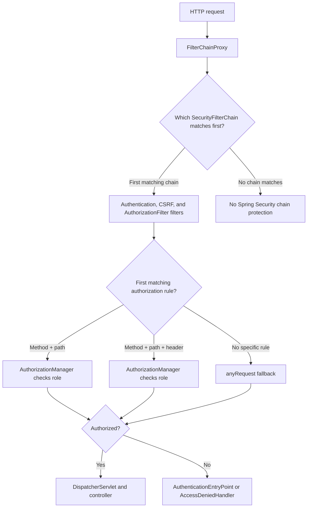

# Matching Requests by HTTP Method, Header, and Custom Conditions in Spring Security Servlet

**Module:** Spring Security – Servlet  
**Parent Topic:** Request Matching  
**Example Environment:** Java 17 · Spring Boot 3.3.5 · Spring Security 6.x · Spring MVC/Servlet (embedded Tomcat).

## 1. Objectives and Knowledge Boundaries

When building an API, comparing only the path (`/api/**`) is often not enough. The same URL may allow `GET` while disallowing `POST`; a request may carry a specific header for a particular workflow; some policies must combine **method + path + header + request state**. Spring Security Servlet provides `RequestMatcher` to determine **which requests match**, and then uses `AuthorizationManager` to decide **whether the caller is authorized**.

After this lesson, you will be able to:

1. Use `.requestMatchers(HttpMethod.GET, "/path")` and other methods inside `authorizeHttpRequests`.
2. Write a custom `RequestMatcher` that inspects `HttpServletRequest` (method, servlet path, headers, other conditions) without confusing a matcher with user authentication.
3. Combine multiple conditions with `AndRequestMatcher`, `OrRequestMatcher`, `NegatedRequestMatcher`, or readable lambdas where appropriate.
4. Explain the **first-match-wins** ordering across authorization rules and distinguish it from selecting the **first matching `SecurityFilterChain`**.
5. Understand why **client-controlled headers can be spoofed**, and therefore never use `X-Role`, `X-Admin`, or `X-User` as proof of identity without a real trust boundary.
6. Distinguish `401` (authentication challenge), `403` (authorization/CSRF), `404` (no MVC mapping), and `Accept`/`Content-Type` errors.
7. Write a complete Java 17 Spring Boot application with a MockMvc test suite covering valid/invalid methods, headers, roles, CSRF, and `anyRequest().denyAll()` fallback.

**Key point:** *Matching* is only the step of selecting a **policy** based on HTTP request attributes; *authentication* verifies the caller, while *authorization* checks what they are allowed to do. Never use custom headers like a password or self-declared role.

## 2. Context: Filters and Two Levels of Matching

A client request is passed by the Servlet container into the filter chain. Spring Security's `FilterChainProxy` selects the appropriate `SecurityFilterChain` per configuration. Inside that chain, `AuthorizationFilter` applies the rules registered via `authorizeHttpRequests`.



This is a conceptual model: the exact ordering of individual filters may vary by configuration, but two points must hold:

- **Level 1: Selecting `SecurityFilterChain`.** `http.securityMatcher(...)` sets the scope for the entire chain. The first matching chain is used; later chains are not retried just because the current chain returns `403`.
- **Level 2: Selecting the authorization rule.** Within a chain, `requestMatchers(...)` are evaluated in declaration order; the first matching rule determines the policy. `anyRequest()` is the fallback for **that chain**, not a global application fallback.

For example, with two chains:

```java
// Illustrative fragment, does not have enough config to run standalone:
@Order(1)
@Bean
SecurityFilterChain api(HttpSecurity http) throws Exception {
    http.securityMatcher("/api/**")
        .authorizeHttpRequests(a -> a.anyRequest().authenticated());
    return http.build();
}

@Order(2)
@Bean
SecurityFilterChain other(HttpSecurity http) throws Exception {
    http.authorizeHttpRequests(a -> a.anyRequest().denyAll());
    return http.build();
}
```

A request to `/api/orders` is evaluated by the first chain and **does not fall through to the second chain** if denied. A request to `/settings` is evaluated by the second chain. This snippet is a **fragment**; a real Spring Boot project needs appropriate beans/configs and an authentication mechanism.

## 3. Matching by HTTP Method With `requestMatchers`

### 3.1. Same URL, Different Method Means Different Permissions

`HttpMethod` is an enum in `org.springframework.http.HttpMethod`. For example:

```java
http.authorizeHttpRequests(auth -> auth
        .requestMatchers(HttpMethod.GET, "/api/orders")
            .hasAnyRole("READER", "EDITOR")
        .requestMatchers(HttpMethod.POST, "/api/orders")
            .hasRole("EDITOR")
        .anyRequest().denyAll());
```

Meaning:

- `GET /api/orders`: `ROLE_READER` or `ROLE_EDITOR`.
- `POST /api/orders`: `ROLE_EDITOR` only, **and** must pass CSRF protection if CSRF is enabled.
- `DELETE /api/orders`: matches neither GET nor POST rule, falls back to `denyAll`.
- `GET /api/other`: falls back to `denyAll` due to a different path.
- `HEAD /api/orders`: **should not be assumed to count as GET** at the authorization matcher step; test/define a dedicated rule if the API genuinely supports HEAD.

With Spring MVC, a `@GetMapping` may automatically support `HEAD` at the controller layer, yet **`requestMatchers(HttpMethod.GET, ...)` inspects the request's method**. Authorization may reject `HEAD` before MVC runs. Do not open methods assuming the controller handles everything automatically.

### 3.2. Method Is an Attribute of the Actual HTTP Request

`request.getMethod()` returns the method on the Servlet request. It is not a form parameter, optional header, or value sent by the client in a JSON body. With features like `HiddenHttpMethodFilter`, forwarding, reverse proxies, and method overrides, you must understand **filter order** and the request Spring Security actually sees; never guess from the URL.

Method-explicit rules make policies easier to audit:

```java
.requestMatchers(HttpMethod.GET, "/public/status").permitAll()
.requestMatchers(HttpMethod.POST, "/api/orders").hasRole("EDITOR")
.anyRequest().denyAll()
```

Compared to:

```java
// Risk: opens POST/DELETE/PATCH for this prefix as well if routes exist.
.requestMatchers("/public/**").permitAll()
```

A rule without a method typically applies to every HTTP method matching the path. If someone later adds a `POST /public/delete-all` endpoint, an overly broad `permitAll` becomes a vulnerability, even if older code "only used GET".

### 3.3. `OPTIONS`, CORS Preflight, and HEAD

Browsers can send a CORS preflight `OPTIONS` request before a request whose headers/method are not in the simple-requests set. An `anyRequest().denyAll()` fallback may reject OPTIONS if CORS is not configured. This **must not** be "quick-fixed" by opening `.requestMatchers("/**").permitAll()`.

The right way is to configure `CorsConfigurationSource`/`http.cors(...)` with allowed origins, methods, headers, and credentials, and then test browser + preflight behavior. **CORS is not authentication and does not replace CSRF.** If an API does not serve cross-origin frontends, you may not need to open CORS at all.

`HEAD` and `OPTIONS` should be decided deliberately according to the API contract. Never assume a GET rule grants permissions for every related method.

## 4. Matching by Request Header

Spring Security does not require every request matcher to be expressed with DSL path strings. Interface:

```java
package org.springframework.security.web.util.matcher;

public interface RequestMatcher {
    boolean matches(jakarta.servlet.http.HttpServletRequest request);
}
```

The interface snippet illustrates the core signature, not code to copy into a file since the framework already provides `RequestMatcher`. You can use a lambda:

```java
RequestMatcher partnerHeader =
        request -> "partner".equals(
                request.getHeader("X-Export-Mode"));
```

**However, a standalone header matcher must not be used as proof of authorization.** It only observes that the request says `"partner"`, not that the caller is genuinely a partner. This header value can be fabricated with `curl`, browser scripts (subject to CORS constraints), Postman, or any HTTP client capable of setting headers.

### 4.1. Header Name and Header Value

HTTP header field names are **case-insensitive** per protocol semantics: `X-Export-Mode` and `x-export-mode` refer to the same field name. Servlet containers normally support case-insensitive lookups via `getHeader(...)`.

However, **header values** can follow stricter rules. In the example we intentionally compare with:

```java
"partner".equals(request.getHeader("X-Export-Mode"))
```

which only accepts the **exact string `"partner"`**. Do not trim, ignore case, or parse tokens differently unless business rules require it. If a header has multiple values or repeats, `getHeader()` typically returns only the first value; such cases require a canonicalization policy if security-relevant.

For complex protocol headers such as `Accept`, `Content-Type`, `Authorization`, `Forwarded`, `If-Match`, or `Range`, do not arbitrarily "split by comma". Use standard Spring/Servlet parsers and APIs for those fields.

### 4.2. Do Not Treat `Accept` or `Content-Type` as Identity

- `Accept`: which **response** media type the client wants, e.g. `application/json`; can have multiple media types and quality factors.
- `Content-Type`: the type of **request body** sent by the client (especially critical for POST/PUT/PATCH), e.g. `application/json`.
- `Authorization`: carries credentials per the active scheme, verified by authentication filters.
- `X-Export-Mode`: an **application-defined** header to choose a workflow or policy, not something that authenticates identity.

Security anti-pattern:

```java
// Anti-pattern: anyone can send X-Role: ADMIN themselves.
RequestMatcher adminHeaderOnly =
        req -> "ADMIN".equals(req.getHeader("X-Role"));

http.authorizeHttpRequests(auth -> auth
        .requestMatchers(adminHeaderOnly).permitAll()
        .anyRequest().denyAll());
```

This is not a "role check". An attacker can attach `X-Role: ADMIN` to any request. Authenticate callers using Basic/Bearer/session/OIDC and check `Authentication.getAuthorities()` or an equivalent policy.

### 4.3. Trusted Proxy Headers and Trust Boundaries

Some systems place a gateway/reverse proxy in front and rely on proxy-added headers like `X-Authenticated-User`, `X-Client-Cert-Subject`, or `X-Forwarded-*`. **Only** treat them as trusted data after ensuring:

1. The backend cannot be reached directly, bypassing the trusted proxy.
2. The proxy **strips/overwrites** same-named headers arbitrarily sent by clients.
3. The proxy → backend connection is secured and peers are authenticated per the threat model.
4. Edge authentication is performed by a controlled system.
5. Spring Security and the application share consistent semantics for identity and authorization.

Even then, prefer standard authentication mechanisms or properly configured pre-authenticated flows rather than writing `req.getHeader("X-User")` and treating it as a logged-in user. A self-asserted header never becomes proof on its own.

## 5. Custom `RequestMatcher`: Combining Method + Path + Header

Example goal: allow only an **authenticated partner with `ROLE_PARTNER`** to call the export endpoint when the request uses GET, a specific path, and the `"partner"` workflow header.

The policy has **two independent stages**:

1. `RequestMatcher` identifies whether the request matches the partner rule: `GET /api/export` + `X-Export-Mode: partner`.
2. `.hasRole("PARTNER")` requires a valid `Authentication` with authority `ROLE_PARTNER`.

```java
RequestMatcher partnerExport = req ->
        "GET".equals(req.getMethod())
        && "/api/export".equals(req.getServletPath())
        && "partner".equals(req.getHeader("X-Export-Mode"));

http.authorizeHttpRequests(auth -> auth
        .requestMatchers(partnerExport).hasRole("PARTNER")
        .requestMatchers(HttpMethod.GET, "/api/export").denyAll()
        .anyRequest().denyAll());
```

**Reading top to bottom:**

- Partner with valid role, method/path/header → rule 1 matches and checks role → allow.
- Partner with valid role but missing header → rule 1 does not match, rule 2 matches → **deny**.
- Regular user spoofing the right header → rule 1 matches, but lacks the role → **deny**.
- Anonymous caller sending the right header → rule 1 matches, but unauthenticated → authentication entry point, typically `401` with HTTP Basic.
- DELETE/POST `/api/export` → matches neither rule 1 nor GET rule 2; fallback denies.
- Requests to `/api/orders` are unaffected by the export rule; they follow their corresponding method/path rules.

**Why add a deny rule for the same path?** It establishes an **explicit failure mode** when the header is missing or wrong. If you omitted rule 2 and had a fallback of `anyRequest().authenticated()` or `.permitAll()`, a request missing the header could slip through the fallback, violating the intent to allow export only under the special condition. While `anyRequest().denyAll()` still blocks it, an explicit path deny makes intent clear to reviewers and prevents future fallback edits from exposing the endpoint.

### 5.1. `getServletPath()` and Routing

`request.getServletPath()` is typically the path portion handled by the Servlet after the context path (in the example's default Spring Boot MVC/Tomcat configuration, it is `/api/export`). If the application sets `spring.mvc.servlet.path`, uses multiple servlets, forwards, or custom mappings, the observed path may differ. **Do not slice substrings from `getRequestURI()` and assume the result always equals `getServletPath()`.**

A custom matcher comparing paths as strings must be tested against the real deployment's context path, servlet path, trailing slashes, encoded URLs, semicolons/path parameters, and dispatcher types. For complex URL matching, consider pairing Spring-provided (MVC-aware) matchers with header matchers rather than handling every edge case manually.

### 5.2. Combining Matchers With Built-in Classes

For explicit composition, Spring Security Servlet provides `AndRequestMatcher`, `OrRequestMatcher`, and `NegatedRequestMatcher`. Sample fragment:

```java
RequestMatcher methodAndPath =
        new AntPathRequestMatcher("/api/export", "GET");

RequestMatcher header =
        req -> "partner".equals(req.getHeader("X-Export-Mode"));

RequestMatcher combined =
        new AndRequestMatcher(methodAndPath, header);
```

Imports include:

```java
import org.springframework.security.web.util.matcher.AndRequestMatcher;
import org.springframework.security.web.util.matcher.AntPathRequestMatcher;
import org.springframework.security.web.util.matcher.RequestMatcher;
```

`AntPathRequestMatcher` works in Spring Security 6.3 used in the example, though in newer Spring Security versions it may be marked deprecated or replaced by another recommended matcher. For long-lived code, verify the API of your project's version and use MVC-aware matching where appropriate. The **runnable** project in section 8 uses a single `RequestMatcher` lambda for method/path/header to avoid extra dependency on a specific matcher class.

**Do not combine matchers in a way that breaks logic**:

- `AndRequestMatcher(A, B)` → matches when **both A and B are true**.
- `OrRequestMatcher(A, B)` → matches when **at least one** condition is true; dangerous if you intended to require both method and header simultaneously.
- `NegatedRequestMatcher(A)` → inverts the result; useful, but can easily create overly broad rules if matcher A is narrow.

For sensitive policies, test every combination of **method × path × header × role** instead of eyeballing code.

### 5.3. Should You Read the Request Body Inside `RequestMatcher`?

**Normally no.** Reading `InputStream`/`Reader` during filter matching can consume the request body before the controller, breaking JSON/form parsing and creating replay/DoS issues. Matchers should rely on metadata safe for early inspection such as normalized method, path, headers, and query metadata.

If policy must depend on **business content** inside the body, authenticate in filters and enforce authorization in the service/controller or via method security after parsing and validating the DTO. Do not try to implement domain authorization by manually parsing JSON inside a `RequestMatcher`.

## 6. First-Match-Wins, Precedence, and Safe Fallbacks

Spring Security's `authorizeHttpRequests` DSL applies rules in declaration order. **The first matching rule** decides authorization; specialized rules below it are not added on as a second condition.

Dangerous example:

```java
// Wrong: GET /api/export is allowed through earlier by overly broad public rule.
http.authorizeHttpRequests(auth -> auth
        .requestMatchers(HttpMethod.GET, "/api/**").permitAll()
        .requestMatchers(partnerExport).hasRole("PARTNER")
        .anyRequest().denyAll());
```

With or without the header, every `GET /api/export` already matches the earlier GET `/api/**` rule. The `partnerExport` rule is shadowed.

Correct version:

```java
http.authorizeHttpRequests(auth -> auth
        .requestMatchers(partnerExport).hasRole("PARTNER")
        .requestMatchers(HttpMethod.GET, "/api/export").denyAll()
        .requestMatchers(HttpMethod.GET, "/public/status").permitAll()
        .anyRequest().denyAll());
```

In real code, you usually place specific rules and deny overrides first, small public groups, role/method groups, and finally the fallback.

### 6.1. Why Is `anyRequest().denyAll()` Useful?

Any route added in the future without a matching rule is blocked (fail-closed), instead of being exposed to anonymous callers or all authenticated users.

| Fallback | New Endpoint Outside Rule List | Risk |
| --- | --- | --- |
| `anyRequest().permitAll()` | Immediately public | High if the API holds sensitive data |
| `anyRequest().authenticated()` | Any logged-in user passes HTTP authorization | May lack role/ownership policy |
| `anyRequest().denyAll()` | Cannot pass authorization unless explicitly opened | Suitable for systems requiring per-endpoint approval |

**Note:** This fallback only applies **inside the matched chain**. If a route matches no `SecurityFilterChain`, it may not be protected by Spring Security; design a catch-all chain or appropriate app-wide coverage.

### 6.2. Conditional Headers Do Not Replace Actual Permissions

With `.requestMatchers(partnerExport).hasRole("PARTNER")`, the role is not read from `X-Export-Mode`. The role comes from `Authentication` verified by Basic/Session/Bearer/OIDC or an auth provider and mapped to authorities. The header only selects **the case** in which the rule applies. This is a safer combination of request conditions and identity than rules relying purely on headers.

However, once an actor holds that role, they can send the matching header themselves. **Headers do not protect resources from authorized actors themselves.** If business requirements demand stronger verification (MFA, device, organization, certificate), enforce the appropriate policy and trusted data instead of expecting a header to act as an extra authentication factor.

## 7. Status Codes and Which Layer Causes Errors

| Request/Scenario | Typical Result | Deciding Layer |
| --- | --- | --- |
| Public GET matching path/method | `200` if controller returns OK | Authorization permits, MVC handles |
| Private GET without Basic credentials | `401` + challenge with HTTP Basic | AuthenticationEntryPoint |
| Private GET with wrong credentials | `401` | BasicAuthenticationFilter/entry point |
| Authenticated private GET missing role | `403` | AuthorizationFilter / AccessDeniedHandler |
| Export GET with valid header but missing role | `403` if authenticated | Role authorization, **not** header parser |
| Partner export GET with role but missing header | `403` if authenticated | Custom matcher misses → deny rule |
| Non-existent URL GET with deny fallback | `403` if authenticated | Authorization can block before MVC 404 |
| Admin POST with valid role but missing CSRF | `403` | CsrfFilter may reject before authorization |
| POST with valid CSRF but missing role | `403` | AuthorizationFilter |
| Valid GET whose `Accept` mismatches response | Possible `406` | Spring MVC content negotiation |
| POST body mismatched with controller `Content-Type` | Possible `415` | MVC/media type handling |
| OPTIONS preflight rejected by CORS policy | Varies by config (`403` or browser block) | CORS filter/browser |

Never assume every `403` means "wrong matcher". Debugging requires knowing whether the request was rejected by **CSRF**, **authorization**, **CORS**, or another component. In tests, use `.with(csrf())` to separate POST authorization from CSRF.

## 8. Complete Spring Boot Project: Method + Header + Role

This project builds an illustrative API:

- `GET /public/status`: public, returns `"UP"`.
- `GET /api/orders`: `ROLE_READER` or `ROLE_EDITOR` only, returns `"orders-read"`.
- `POST /api/orders`: `ROLE_EDITOR` only, requires valid CSRF token, returns `"order-accepted"`.
- `GET /api/export`: `ROLE_PARTNER` **and** header `X-Export-Mode: partner` only, returns `"partner-export"`.
- `GET /api/export` with missing/wrong header: **denyAll**, even for an authenticated partner.
- All other requests: `anyRequest().denyAll()`.

Three demo accounts: `reader / reader-pass`, `editor / editor-pass`, `partner / partner-pass`. Passwords are BCrypt-hashed in an in-memory user store. **Never use demo credentials in public environments**; real HTTP Basic must run over HTTPS.

### 8.1. Project Structure

```text
request-matching-demo/
├── pom.xml
└── src/
    ├── main/java/demo/matching/
    │   ├── MatchingApplication.java
    │   ├── SecurityConfig.java
    │   └── ApiController.java
    └── test/java/demo/matching/
        └── MatchingApplicationTests.java
```

Requires JDK 17+, Maven, and dependency download access on first build.

### 8.2. `pom.xml`

```xml
<?xml version="1.0" encoding="UTF-8"?>
<project xmlns="http://maven.apache.org/POM/4.0.0"
         xmlns:xsi="http://www.w3.org/2001/XMLSchema-instance"
         xsi:schemaLocation="http://maven.apache.org/POM/4.0.0 https://maven.apache.org/xsd/maven-4.0.0.xsd">
    <modelVersion>4.0.0</modelVersion>

    <parent>
        <groupId>org.springframework.boot</groupId>
        <artifactId>spring-boot-starter-parent</artifactId>
        <version>3.3.5</version>
        <relativePath/>
    </parent>

    <groupId>demo</groupId>
    <artifactId>request-matching-demo</artifactId>
    <version>1.0.0</version>
    <properties>
        <java.version>17</java.version>
    </properties>

    <dependencies>
        <dependency>
            <groupId>org.springframework.boot</groupId>
            <artifactId>spring-boot-starter-web</artifactId>
        </dependency>
        <dependency>
            <groupId>org.springframework.boot</groupId>
            <artifactId>spring-boot-starter-security</artifactId>
        </dependency>
        <dependency>
            <groupId>org.springframework.boot</groupId>
            <artifactId>spring-boot-starter-test</artifactId>
            <scope>test</scope>
        </dependency>
        <dependency>
            <groupId>org.springframework.security</groupId>
            <artifactId>spring-security-test</artifactId>
            <scope>test</scope>
        </dependency>
    </dependencies>

    <build>
        <plugins>
            <plugin>
                <groupId>org.springframework.boot</groupId>
                <artifactId>spring-boot-maven-plugin</artifactId>
            </plugin>
        </plugins>
    </build>
</project>
```

This is Spring MVC/Servlet (`spring-boot-starter-web`), not WebFlux. Spring Boot parent manages compatible dependency versions.

### 8.3. `src/main/java/demo/matching/MatchingApplication.java`

```java
package demo.matching;

import org.springframework.boot.SpringApplication;
import org.springframework.boot.autoconfigure.SpringBootApplication;

@SpringBootApplication
public class MatchingApplication {
    public static void main(String[] args) {
        SpringApplication.run(MatchingApplication.class, args);
    }
}
```

### 8.4. `src/main/java/demo/matching/SecurityConfig.java`

```java
package demo.matching;

import org.springframework.context.annotation.Bean;
import org.springframework.context.annotation.Configuration;
import org.springframework.http.HttpMethod;
import org.springframework.security.config.Customizer;
import org.springframework.security.config.annotation.web.builders.HttpSecurity;
import org.springframework.security.config.http.SessionCreationPolicy;
import org.springframework.security.core.userdetails.User;
import org.springframework.security.core.userdetails.UserDetails;
import org.springframework.security.core.userdetails.UserDetailsService;
import org.springframework.security.crypto.bcrypt.BCryptPasswordEncoder;
import org.springframework.security.crypto.password.PasswordEncoder;
import org.springframework.security.provisioning.InMemoryUserDetailsManager;
import org.springframework.security.web.SecurityFilterChain;
import org.springframework.security.web.util.matcher.RequestMatcher;

@Configuration
public class SecurityConfig {

    @Bean
    PasswordEncoder passwordEncoder() {
        return new BCryptPasswordEncoder();
    }

    @Bean
    UserDetailsService users(PasswordEncoder encoder) {
        UserDetails reader = User.withUsername("reader")
                .password(encoder.encode("reader-pass"))
                .roles("READER")
                .build();

        UserDetails editor = User.withUsername("editor")
                .password(encoder.encode("editor-pass"))
                .roles("EDITOR")
                .build();

        UserDetails partner = User.withUsername("partner")
                .password(encoder.encode("partner-pass"))
                .roles("PARTNER")
                .build();

        return new InMemoryUserDetailsManager(reader, editor, partner);
    }

    @Bean
    SecurityFilterChain securityFilterChain(HttpSecurity http)
            throws Exception {

        // Matcher checks request shape, DOES NOT verify the sender.
        // getServletPath() matches the demo's default Spring MVC/Tomcat mapping.
        RequestMatcher partnerExport = request ->
                "GET".equals(request.getMethod())
                && "/api/export".equals(request.getServletPath())
                && "partner".equals(request.getHeader("X-Export-Mode"));

        http.authorizeHttpRequests(auth -> auth

                // Single public URL, and for GET only.
                .requestMatchers(HttpMethod.GET, "/public/status")
                    .permitAll()

                // Custom matcher first, role check second.
                .requestMatchers(partnerExport)
                    .hasRole("PARTNER")

                // Missing/wrong header must not slip through a fallback rule.
                .requestMatchers(HttpMethod.GET, "/api/export")
                    .denyAll()

                // Same URL /api/orders, separate policies by method.
                .requestMatchers(HttpMethod.POST, "/api/orders")
                    .hasRole("EDITOR")

                .requestMatchers(HttpMethod.GET, "/api/orders")
                    .hasAnyRole("READER", "EDITOR")

                // Other routes are not implicitly granted access.
                .anyRequest().denyAll());

        // Basic is only for demo authentication, do not assign roles from self-declared headers.
        http.httpBasic(Customizer.withDefaults());

        http.sessionManagement(session -> session
                .sessionCreationPolicy(SessionCreationPolicy.STATELESS));

        // Keep CSRF enabled. POST in MockMvc uses .with(csrf()).
        return http.build();
    }
}
```

**Why is this configuration safer than a rule that just reads the header?**

- Matcher `partnerExport` only checks `GET`, path, and the value of `X-Export-Mode`.
- `.hasRole("PARTNER")` checks the role already present in the `Authentication` verified by Spring Security.
- Someone with `ROLE_READER` sending `X-Export-Mode: partner` **still cannot export**.
- Someone with `ROLE_PARTNER` who omits the header **is still denied**.
- The `PARTNER` role can only come from the trusted `UserDetailsService`/provider in the demo, not from a request header.
- Fallback `denyAll` prevents new routes from becoming accidentally public.
- `STATELESS` is a choice for per-request HTTP Basic APIs; it is **not a prerequisite** for `RequestMatcher` to work.
- CSRF stays enabled; an API where browsers automatically send Basic credentials can still face CSRF risks on state-changing endpoints. Never disable CSRF merely because an API is stateless.

**Limitation:** `getServletPath()` uses an exact string comparison in the demo project; projects with custom servlet paths, context paths, or multiple servlets should use appropriate matchers and integration tests. Do not copy this lambda verbatim into every deployment and assume path security is guaranteed.

### 8.5. `src/main/java/demo/matching/ApiController.java`

```java
package demo.matching;

import org.springframework.http.MediaType;
import org.springframework.web.bind.annotation.GetMapping;
import org.springframework.web.bind.annotation.PostMapping;
import org.springframework.web.bind.annotation.RestController;

@RestController
public class ApiController {

    @GetMapping(value = "/public/status",
                produces = MediaType.TEXT_PLAIN_VALUE)
    public String status() {
        return "UP";
    }

    @GetMapping(value = "/api/orders",
                produces = MediaType.TEXT_PLAIN_VALUE)
    public String readOrders() {
        return "orders-read";
    }

    @PostMapping(value = "/api/orders",
                 produces = MediaType.TEXT_PLAIN_VALUE)
    public String createOrder() {
        // Illustrates authorization only, does not persist a real order.
        return "order-accepted";
    }

    @GetMapping(value = "/api/export",
                produces = MediaType.TEXT_PLAIN_VALUE)
    public String export() {
        return "partner-export";
    }
}
```

The controller does **not** inspect `X-Export-Mode` or roles itself, because Spring Security filters already enforce permission requirements. If business logic involves specific objects (an order belonging to customer A), ownership checks are still needed at the service/domain layer; HTTP path rules alone do not prevent BOLA/IDOR.

### 8.6. Test `src/test/java/demo/matching/MatchingApplicationTests.java`

```java
package demo.matching;

import org.junit.jupiter.api.Test;
import org.springframework.beans.factory.annotation.Autowired;
import org.springframework.boot.test.autoconfigure.web.servlet.AutoConfigureMockMvc;
import org.springframework.boot.test.context.SpringBootTest;
import org.springframework.http.MediaType;
import org.springframework.test.web.servlet.MockMvc;

import static org.hamcrest.Matchers.containsString;
import static org.springframework.security.test.web.servlet.request.SecurityMockMvcRequestPostProcessors.csrf;
import static org.springframework.security.test.web.servlet.request.SecurityMockMvcRequestPostProcessors.httpBasic;
import static org.springframework.test.web.servlet.request.MockMvcRequestBuilders.get;
import static org.springframework.test.web.servlet.request.MockMvcRequestBuilders.head;
import static org.springframework.test.web.servlet.request.MockMvcRequestBuilders.post;
import static org.springframework.test.web.servlet.result.MockMvcResultMatchers.content;
import static org.springframework.test.web.servlet.result.MockMvcResultMatchers.header;
import static org.springframework.test.web.servlet.result.MockMvcResultMatchers.status;

@SpringBootTest
@AutoConfigureMockMvc
class MatchingApplicationTests {

    @Autowired
    MockMvc mvc;

    @Test
    void publicGetAllowsAnonymous() throws Exception {
        mvc.perform(get("/public/status"))
                .andExpect(status().isOk())
                .andExpect(content().string("UP"));
    }

    @Test
    void publicGetRuleDoesNotOpenPost() throws Exception {
        mvc.perform(post("/public/status")
                .with(httpBasic("editor", "editor-pass"))
                .with(csrf()))
                .andExpect(status().isForbidden());
    }

    @Test
    void ordersGetRequiresCredentials() throws Exception {
        mvc.perform(get("/api/orders")
                .accept(MediaType.TEXT_PLAIN))
                .andExpect(status().isUnauthorized())
                .andExpect(header().string("WWW-Authenticate",
                        containsString("Basic")));
    }

    @Test
    void readerCanReadOrders() throws Exception {
        mvc.perform(get("/api/orders")
                .with(httpBasic("reader", "reader-pass")))
                .andExpect(status().isOk())
                .andExpect(content().string("orders-read"));
    }

    @Test
    void editorCanReadOrders() throws Exception {
        mvc.perform(get("/api/orders")
                .with(httpBasic("editor", "editor-pass")))
                .andExpect(status().isOk());
    }

    @Test
    void partnerCannotReadOrdersWithoutReaderOrEditorRole()
            throws Exception {
        mvc.perform(get("/api/orders")
                .with(httpBasic("partner", "partner-pass")))
                .andExpect(status().isForbidden());
    }

    @Test
    void readerCannotPostOrdersEvenWithValidCsrf()
            throws Exception {
        mvc.perform(post("/api/orders")
                .with(httpBasic("reader", "reader-pass"))
                .with(csrf()))
                .andExpect(status().isForbidden());
    }

    @Test
    void editorCanPostOrdersWithCsrf() throws Exception {
        mvc.perform(post("/api/orders")
                .with(httpBasic("editor", "editor-pass"))
                .with(csrf()))
                .andExpect(status().isOk())
                .andExpect(content().string("order-accepted"));
    }

    @Test
    void editorPostWithoutCsrfFailsBeforeAuthorization()
            throws Exception {
        mvc.perform(post("/api/orders")
                .with(httpBasic("editor", "editor-pass")))
                .andExpect(status().isForbidden());
    }

    @Test
    void partnerWithRequiredHeaderCanExport() throws Exception {
        mvc.perform(get("/api/export")
                .header("X-Export-Mode", "partner")
                .with(httpBasic("partner", "partner-pass")))
                .andExpect(status().isOk())
                .andExpect(content().string("partner-export"));
    }

    @Test
    void partnerWithoutRequiredHeaderIsDenied() throws Exception {
        mvc.perform(get("/api/export")
                .with(httpBasic("partner", "partner-pass")))
                .andExpect(status().isForbidden());
    }

    @Test
    void partnerWithWrongHeaderValueIsDenied() throws Exception {
        mvc.perform(get("/api/export")
                .header("X-Export-Mode", "public")
                .with(httpBasic("partner", "partner-pass")))
                .andExpect(status().isForbidden());
    }

    @Test
    void readerCannotSelfDeclarePartnerViaHeader() throws Exception {
        mvc.perform(get("/api/export")
                .header("X-Export-Mode", "partner")
                .with(httpBasic("reader", "reader-pass")))
                .andExpect(status().isForbidden());
    }

    @Test
    void anonymousHeaderDoesNotCreateAuthentication()
            throws Exception {
        mvc.perform(get("/api/export")
                .header("X-Export-Mode", "partner")
                .accept(MediaType.TEXT_PLAIN))
                .andExpect(status().isUnauthorized());
    }

    @Test
    void headIsNotAutomaticallyOpenedByGetAuthorizationRule()
            throws Exception {
        mvc.perform(head("/api/orders")
                .with(httpBasic("editor", "editor-pass")))
                .andExpect(status().isForbidden());
    }

    @Test
    void unknownUrlFallsBackToDenyAll() throws Exception {
        mvc.perform(get("/api/unknown")
                .with(httpBasic("editor", "editor-pass")))
                .andExpect(status().isForbidden());
    }
}
```

**Expected 16 tests PASS** with the code and configuration above, though this is a **static verification expectation**, not an execution log run inside this article. Run:

```bash
mvn test
```

This test suite distinguishes:

- Public GET does **not** mean public POST.
- GET and POST on the same `/api/orders` have different role policies.
- `403` from missing CSRF differs from `403` from missing `ROLE_EDITOR`.
- Valid header with `ROLE_READER` does not satisfy the partner role.
- Partner with valid role but missing/wrong header is denied.
- Self-declared header from an anonymous caller still triggers an authentication challenge.
- `HEAD` is not automatically authorized by the GET rule.
- Undeclared routes hit `anyRequest().denyAll()`.

**Note:** `.with(csrf())` is a `spring-security-test` utility, not a literal payload a real client can copy. In browsers, the CSRF token must be obtained and sent per the application's token repository. MockMvc does not perform TLS handshakes, does not simulate all browser/proxy behaviors, and does not replace integration tests on real infrastructure.

### 8.7. Manual Testing With `curl`

In the directory containing `pom.xml`:

```bash
mvn clean test
mvn spring-boot:run
```

Then in another terminal (on older Windows PowerShell you may need `curl.exe` to avoid the alias):

```bash
# Public GET:
curl -s http://localhost:8080/public/status

# Unauthenticated protected GET:
curl -s -o /dev/null -w '%{http_code}\n' \
  http://localhost:8080/api/orders

# Reader reads GET orders:
curl -s -u reader:reader-pass \
  http://localhost:8080/api/orders

# Partner with valid role + header:
curl -s -u partner:partner-pass \
  -H 'X-Export-Mode: partner' \
  http://localhost:8080/api/export

# Partner with valid role but missing header:
curl -s -o /dev/null -w '%{http_code}\n' \
  -u partner:partner-pass \
  http://localhost:8080/api/export

# Reader self-declaring partner header:
curl -s -o /dev/null -w '%{http_code}\n' \
  -u reader:reader-pass \
  -H 'X-Export-Mode: partner' \
  http://localhost:8080/api/export
```

Output of each command, in order:

```text
UP
401
orders-read
partner-export
403
403
```

Some response bodies lack a trailing newline; the `-w` commands print the status with a newline. Use `-i`/`-v` when you need to inspect headers, but **never log or share raw `Authorization` headers**.

**Safety limits:** HTTP Basic is just Base64 of username/password, **not encryption of credentials**. The commands use `http://localhost` with fake passwords for learning; with real accounts, HTTPS with certificate validation is mandatory. Never place real passwords into shared scripts or shell history. Never use `curl -k` to skip TLS validation in real environments.

**Why is there no simple successful `curl -X POST` command?** The demo keeps CSRF enabled by default. A POST without a token can return `403` before authorization. To test POST outside MockMvc, the client must obtain/send a CSRF token matching the app's `CsrfTokenRepository` and preserve the corresponding cookie/session; never disable CSRF globally just to make POST work. For non-browser APIs, decide CSRF policy based on the real threat model.

## 9. Matching Multiple Conditions: What Not to Do

### 9.1. Conditional Headers Are Not Authentication Credentials

Even if `X-Export-Mode` looks "special", any client can add it. Roles must still be established by security authentication.

**Wrong:**

```java
.requestMatchers(request ->
        "admin".equals(request.getHeader("X-Role")))
    .permitAll()
```

**Right direction:**

```java
.requestMatchers(partnerExport).hasRole("PARTNER")
```

If using pre-authenticated proxy headers, establish a proper trust boundary before turning them into Authentication; never use `.permitAll()` based on self-sent headers.

### 9.2. Using `OrRequestMatcher` Instead of `AndRequestMatcher`

When intending "method GET **and** header partner", using OR opens the rule to requests that have only GET or only the header. When combined with `.permitAll`, this can become a vulnerability. If the goal is all conditions true, use AND or a lambda with `&&`; review the truth table and test negated combinations.

### 9.3. Placing Broad Rules Before Custom Matchers

```java
// Wrong: broad rule swallows the custom rule below.
.requestMatchers("/api/**").authenticated()
.requestMatchers(partnerExport).hasRole("PARTNER")
.anyRequest().denyAll()
```

A regular authenticated user can reach the export path because the broad rule matches first. Place custom rules and dedicated export deny fallbacks before broad matchers; better yet, minimize broad rules and declare explicit paths.

### 9.4. Mixing API Validation With Authorization

`Content-Type: application/json` does not prove a user has permission to create an order. JSON parsing, DTO validation, and enforcing `produces`/`consumes` belong in MVC/services. Authorization can depend on trusted request metadata, but does not replace input validation.

Similarly, `Accept: application/json` is not an auth token. Use `ContentNegotiationStrategy`/Spring MVC media type matching instead of inventing a "JSON access permission" from the Accept header.

### 9.5. Reading the Body Inside a RequestMatcher

Reading `request.getInputStream()` in a filter can drain the stream so `@RequestBody` can no longer read it. If policy depends on order content or owner ID, enforce authorization at the business layer after parsing/validation, or design deliberate request wrapping; never use a request matcher to arbitrarily parse full JSON.

### 9.6. Ignoring Duplicate Headers and Normalization

With multiple proxy layers, duplicate headers or differing canonicalization can lead to conflicting interpretations. For security-relevant headers, define clear policies for duplicates/multiple values, reject ambiguous input, normalize at the trust boundary, and test how the gateway and servlet container handle them. Never split `getHeader` strings ad hoc without a standard.

### 9.7. Confusing `requestMatchers` With `securityMatcher`

- `securityMatcher`: scope of a `SecurityFilterChain`, deciding whether a request enters the chain.
- `requestMatchers`: selects the authorization rule **inside the chosen chain**.
- `anyRequest`: fallback **within the chain**.
- `RequestMatcher`: shared interface usable in both chain selection and authorization.

If a chain has `.securityMatcher("/api/**")`, a custom matcher for `/public/status` inside that chain **is never evaluated** for `/public/status` requests; you must configure another chain or adjust the scope. A `permitAll` rule does not expand the chain's scope.

### 9.8. Believing a Matcher Blocks Out-of-Path Requests When the Chain Does Not Match

A request that matches no security chain may receive no security filters at all. With multiple chains, ensure a properly configured catch-all chain or complete coverage. Never put `anyRequest().denyAll()` inside `/api/**` and conclude `/admin/**` is blocked.

### 9.9. Forgetting Error Dispatch, Servlet Path, or Context Path

`RequestDispatcher` can trigger `ERROR`/`FORWARD` dispatches; policy and filter invocation can vary by dispatcher type. A deny fallback can turn a 404 into a secondary error when rendering the error page. Only permit `DispatcherType.ERROR` or `FORWARD` after reviewing the threat model and application mappings; never open all forwards by default.

Custom `getServletPath` equality checks must be tested if the Spring MVC servlet sits under `/service`, has a context path, or sits behind proxy rewrites. Never "fix" mismatches by dropping the path check and relying solely on headers/roles.

### 9.10. Skipping CSRF Because the API Uses `STATELESS`

CSRF does not mean server sessions. If browsers automatically send Basic/cookie credentials via ambient authentication and state-changing POST/DELETE endpoints exist, CSRF still needs evaluation. `STATELESS` only tells Spring Security not to use `HttpSession` to identify users across requests; it does not eliminate ambient browser credentials. Test POST with `.with(csrf())` to isolate authorization results, then verify your real CSRF policy.

### 9.11. Missing Negative Unit/Integration Tests

If you only test "partner with right header → 200", you might miss "reader with right header → unexpected 200". The test suite must cover missing headers, wrong headers, anonymous callers, wrong roles, wrong methods, different paths, invalid CSRF, and fallbacks. Denied cases often provide greater security assurance than a single happy path.

## 10. When to Use a Custom Matcher, and When Not To

| Scenario | Recommendation |
| --- | --- |
| Public GET, admin-only POST | Use `.requestMatchers(HttpMethod.GET/POST, path)` directly |
| API prefix with dedicated role | Use a specific path matcher + role, placed before fallbacks |
| Require GET + workflow header + role | Use a `RequestMatcher` combining conditions **and** `.hasRole(...)` |
| Header holds a JWT/Bearer credential | Use authentication filters/resource server, not manual header checks in `permitAll` |
| Header carries identity from reverse proxy | Use pre-auth integration + trust boundary; reject client spoofing |
| Requirements based on resource owner / amount | Use method/service authorization after parsing data |
| API requires exact `Content-Type` or `Accept` | Use MVC `consumes`/`produces` and content negotiation |
| Need `OPTIONS` preflight | Configure CORS deliberately, do not open the whole system |
| Protecting URLs across multiple Servlets | Use matchers matching each servlet path and integration tests |
| Rules combining multiple boolean conditions | Use `AndRequestMatcher`, `OrRequestMatcher`, or clear lambdas with tests |

## 11. Systematic Matcher Debugging Workflow

When a URL returns an unexpected `401`/`403`, check in order:

1. **Exact method:** GET/POST/HEAD/OPTIONS/PATCH, or did a filter override the method?
2. **Actual path:** context path, servlet path, URI, query string, trailing slash, and URL encoding.
3. **Selected chain:** Which `SecurityFilterChain` matched first, and are there other `@Order` and `securityMatcher` beans?
4. **Filters before authorization:** Did CSRF, CORS, Basic/Bearer, HTTPS redirect, or request firewall reject it first?
5. **First matching RequestMatcher in the chain:** Is a broad rule sitting in front of a specific rule?
6. **Headers:** exact name/value, missing, extra whitespace, duplicates, proxy rewrites, or differing case?
7. **Authentication:** Are valid credentials present? Who is the `Authentication` user and what roles do they hold?
8. **Authorization:** Does `hasRole("PARTNER")` correspond to authority `ROLE_PARTNER`? Is prefix/claims conversion customized?
9. **Fallback:** If the custom matcher returns false, where does the request go? Is there a deny path or `anyRequest().denyAll()`?
10. **MVC:** Once authorization passes, does a controller have matching method/path/`consumes`/`produces`?
11. **Ownership:** Does the caller have permission for the specific record/domain object?
12. **Tests:** Compare both positive and negative cases, inspecting response headers and role behavior, not just status codes.

Selectively enable Spring Security logging in dev when inspecting chain/rule decisions, but **never log raw `Authorization` headers, cookies, session IDs, or sensitive data**. An HTTP `403` from CSRF and an HTTP `403` from role denial have very different root causes.

## 12. Practice Exercises

### Exercise 1. Method Matcher

```java
.requestMatchers(HttpMethod.GET, "/api/items").permitAll()
.anyRequest().denyAll()
```

**Question:** Is `POST /api/items` allowed simply because GET is public?  
**Answer:** No. POST does not match the GET rule; if it passes CSRF/other filters, the fallback denies it.

### Exercise 2. Header and Role

```java
RequestMatcher partner = req ->
        "partner".equals(req.getHeader("X-Mode"));
```

**Question:** Does `.requestMatchers(partner).permitAll()` prove the caller is a partner?  
**Answer:** No. Client-sent headers can be spoofed. Use real authentication and roles/authorities (e.g., `.hasRole("PARTNER")`) alongside the routing matcher.

### Exercise 3. AND vs. OR

**Question:** To allow only when method is GET **and** header `X-Mode=partner`, use `AndRequestMatcher` or `OrRequestMatcher`?  
**Answer:** AND or a lambda with `&&`. OR allows when only one condition holds, violating the requirement.

### Exercise 4. Rule Order

```java
.requestMatchers("/api/**").authenticated()
.requestMatchers(partnerExport).hasRole("PARTNER")
.anyRequest().denyAll()
```

**Question:** Is the partner rule guaranteed to execute for `/api/export`?  
**Answer:** No. The `/api/**` rule matches first and can let normal authenticated users through. Put specific rules first and keep a deny fallback.

### Exercise 5. Still 403 Despite Valid Role

**Question:** `POST /api/orders` with `ROLE_EDITOR` returns 403, while GET succeeds. What could be the cause?  
**Answer:** Missing CSRF token, wrong method/path, another rule matching first, different actual authentication/role, or another filter rejecting it. Test POST with `.with(csrf())` to separate authorization from CSRF.

### Exercise 6. `getServletPath`

**Question:** Why does a custom matcher checking `"/api/export".equals(req.getServletPath())` require integration testing when deployed under a custom servlet path?  
**Answer:** Servlet path depends on mappings and dispatches; the string may differ from the root-mapped Tomcat demo, causing the matcher to return false or cover the wrong scope.

### Exercise 7. Is `Accept` Authorization?

**Question:** Is a client setting `Accept: application/json` enough to read a private report?  
**Answer:** No. `Accept` describes response representation, not credentials or roles. Spring MVC handles content negotiation; Security requires separate authentication/authorization.

### Exercise 8. CORS Preflight

**Question:** The browser sends OPTIONS and fails before POST. Should you open `anyRequest().permitAll()`?  
**Answer:** No. Verify CORS policy, allowed origin/method/headers, security chains, and preflight handling. Never open all URLs just to make preflight succeed.

### Exercise 9. Combining Two Chains

**Question:** Does `anyRequest().denyAll()` inside an `/api/**` chain automatically block `/admin/**`?  
**Answer:** No. `anyRequest` only applies to requests entering the selected chain. A catch-all chain or sufficient system-wide configuration is needed.

### Exercise 10. Using Headers to Switch Export Mode

**Question:** A user who already has the PARTNER role can choose the `"partner"` header themselves; what safety layer does the matcher provide?  
**Answer:** It selects the route/policy based on a request attribute, not extra authentication. Critical permissions still come from the verified role, ownership, and business controls.

## 13. Code Review Checklist

1. List all HTTP methods supported by the application; never assume GET and HEAD behave identically.
2. Keep path patterns narrow and test them with real servlet path and context path values.
3. Ensure each chain's `securityMatcher` covers the intended URLs without higher-priority chains shadowing it.
4. Place specific method/path/header rules ahead of general matchers.
5. Client-sent headers must **never** serve as proof of identity or permission.
6. For headers from a trusted gateway, verify anti-spoofing controls and inter-layer authentication.
7. Custom matchers must not read or consume the request body.
8. Define policies for duplicate headers, normalization, and case/value semantics where needed.
9. Verify roles/authorities via `Authentication`, never from raw headers.
10. Provide an explicit fallback (preferring `denyAll` for sensitive APIs).
11. Use `permitAll` for public rules, not `web.ignoring`, when security filters/headers are still desired.
12. Handle CSRF/CORS independently from authorization.
13. Distinguish `401`/`403`/`404`/`406`/`415` when debugging.
14. Include negative tests for wrong roles, missing/wrong headers, wrong methods, anonymous callers, and undeclared routes.
15. Enforce domain ownership/BOLA/IDOR checks at appropriate service/method authorization layers.
16. Only use dummy credentials on localhost, and require HTTPS/certificate validation for real credentials.
17. Never store `Authorization`, cookies, tokens, or secrets in logs/traces.
18. When refactoring matchers/DSL across Spring Security major versions, verify API compatibility and re-run integration tests.

## Conclusion

**Matching HTTP methods, headers, and custom conditions** selects authorization policies from request attributes in Spring Security Servlet. Method/path matchers limit scope; custom `RequestMatcher`s combine specialized conditions; `hasRole`/`authenticated` enforce permissions from verified identity. When combining them, keep **first-match-wins**, chain scope, CSRF/CORS, and **never trusting arbitrary headers as proof of identity** top of mind.

Place sensitive matchers before broad rules, add an `anyRequest().denyAll()` fallback when fail-closed behavior is needed, and test every method × header × role combination. That is the foundation for clear, maintainable HTTP authorization that prevents accidentally exposing endpoints as a codebase evolves.