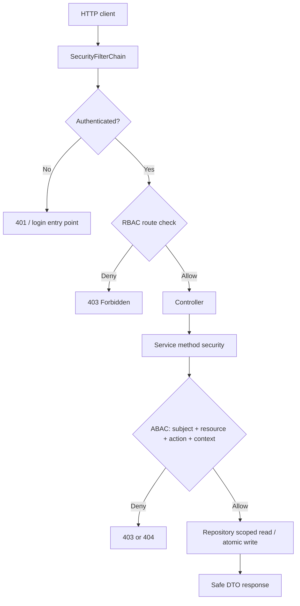

# RBAC and ABAC: Choosing the Right Conditions for Your Application

> **Environment:** Java 17+, Spring Boot 3.x, Spring Security 6.x on the Servlet stack (Spring MVC). This article covers RBAC/ABAC from concepts, model selection, trusted attribute sources, and HTTP/service protection to positive/negative testing. Examples use HTTP Basic for ease of testing, an in-memory document store, and `MockMvc`; demo passwords are for localhost use only. Code results are **expected** outcomes when running a properly configured project, not assertions of compilation/execution in the authoring environment.

## 1. The Problem: Why Roles Alone Are Usually Not Enough

Suppose a company has `VIEWER`, `MANAGER`, and `AUDITOR` groups and an API `POST /api/documents/{id}/approve`. `hasRole("MANAGER")` may rightly restrict **who can use the approval feature**, yet can a manager in tenant `acme` approve a document in tenant `beta`? Can an already approved document or one exceeding an amount limit be approved again? Can the document creator self-approve?

All questions beyond the role check require **specific attributes of the resource and action**. If the MANAGER role is treated as permission to approve any ID, the application can introduce horizontal privilege escalation or violate separation of duties. Conversely, if you create a separate role for every combination such as `MANAGER_ACME_LIMIT_50000_DRAFT`, permissions become very hard to maintain (*role explosion*).

The goal is to understand **choosing the right conditions**, not claiming ABAC is "stronger" than RBAC in every situation. For simple privileges, RBAC is easy to operate. For resources with owners, tenants, limits, classifications, or states, ABAC becomes necessary. The common model is **RBAC at the functional layer + ABAC at specific data-access decisions**.

## 2. What Is RBAC?

**RBAC** (*Role-Based Access Control*) binds users to roles and roles to permissions. A functional permission matrix:

| Role | Functional-level permissions |
|---|---|
| `VIEWER` | Can call APIs to view documents within allowed scope |
| `MANAGER` | Can call APIs to view and submit/approve |
| `AUDITOR` | Can call audit APIs within assigned scope |
| `ADMIN` | Manages accounts/roles within granted scope |

RBAC asks: **"Given a verified role, which kinds of functionality may the actor use?"**

In Spring Security, if you create a user with `roles("MANAGER")`, the actual authority is typically `ROLE_MANAGER`. You can configure:

```java
.requestMatchers(HttpMethod.POST, "/api/documents/*/approve")
    .hasRole("MANAGER")
```

With defaults, `hasRole("MANAGER")` looks for the `ROLE_MANAGER` authority. Meanwhile `hasAuthority("ROLE_MANAGER")` matches the exact authority name. If the system customizes the role prefix, adjust rules consistently; do not confuse `hasRole("ROLE_MANAGER")` with `hasRole("MANAGER")` under default settings.

**Strengths:** RBAC is easy to audit, allows granting access through a centrally managed list of roles, and fits stable capabilities. **Limitations:** a role alone does not prove the caller owns a record, belongs to the right tenant, meets transaction limits, or may act in the current state. Someone with role `MANAGER` may still manage only **one** department.

### How Does Role Explosion Happen?

Try encoding every requirement into role names: `MANAGER_ACME`, `MANAGER_BETA`, `MANAGER_ACME_LIMIT_50000`, `MANAGER_ACME_DAYTIME`, `MANAGER_ACME_APPROVE_DRAFT`... Whenever a tenant, limit, or state changes, roles must be updated continuously. Administrators struggle to answer "what does this combination of roles actually allow?". Let roles express **job capabilities**, and evaluate business data/attributes at decision time.

## 3. What Is ABAC?

**ABAC** (*Attribute-Based Access Control*) evaluates attributes and conditions:

- **Subject:** user ID, tenant membership, department, verified authorities, MFA assurance, assignment list.
- **Resource:** owner, tenant, classification, amount, state, parent/child relationship, creation timestamp.
- **Action:** read, approve, cancel, export, delete, changePermissions.
- **Environment:** time from a trusted clock, security posture, recent step-up events, network signals from a verified proxy.

A policy combining RBAC and ABAC can be expressed as:

```text
ALLOW approve IF
    subject has ROLE_MANAGER
AND subject.tenant == document.tenant
AND document.state == DRAFT
AND document.amountCents <= 50000
AND subject.username != document.owner
OTHERWISE DENY
```

`ROLE_MANAGER` is the RBAC condition; tenant, state, amount, and owner are ABAC conditions. They are evaluated together at execution time.

ABAC excels at **fine-grained policies** per record and context, provided attributes are trusted and up to date. A complex decision engine is not inherently better than a simple, clear, well-tested Java condition.

### ABAC Does Not Mean Trusting Client-Sent Headers

`X-Role: MANAGER`, `X-Tenant: acme`, `owner=alice`, `X-MFA: true`, or a JWT payload **whose signature has not been verified** are not evidence of privilege. Those values can be forged by an attacker. Subject attributes must come from the verified `Authentication` and server-side privilege stores; resource attributes must come from server-managed records; context must be derived from trusted sources. Missing fields, corrupted data, or failing privilege services must **fail closed**.

For JWTs, claims are only trustworthy after verifying signature/issuer/audience/algorithm/expiry per policy; even when verified, membership claims can be stale if a user's privileges were just revoked.

## 4. Choosing RBAC, ABAC, or Hybrid by Requirement

| Business requirement | Suitable conditions |
|---|---|
| Only users with `ROLE_OPS` access general operations pages | **RBAC** may suffice |
| Only `MANAGER` can invoke the approval feature | **RBAC**, though insufficient for specific records |
| User views orders/documents **they own** | **ABAC** owner + tenant |
| Manager approves invoice in matching tenant, still DRAFT, below limit | **Hybrid RBAC + ABAC** |
| Auditor reads INTERNAL records, not SENSITIVE ones | **Hybrid** role + classification |
| Support views assigned tickets | **Hybrid** role + current assignment |
| Deny export without recent MFA | **ABAC** environment/assurance, after authentication |
| Truly global admin allowed to approve across all tenants | **RBAC may suffice**, if global scope is a reviewed policy |
| Tenant admin administers only their own tenant | **Hybrid** admin role + tenant scope |

Practical choice: **RBAC at HTTP** for functional categories, **ABAC at service/domain** for records and actions, and **scoped DB queries/updates** to preserve invariants as data mutates. If no extra attributes exist and a role genuinely covers that whole scope, do not build a policy engine just to overcomplicate the system.

## 5. Execution Model on Spring Security Servlet

`authorizeHttpRequests` uses `SecurityFilterChain` to check authentication, roles, and URL/HTTP method routes. Once a request passes this layer, the Spring MVC controller invokes the service. Method security with `@EnableMethodSecurity` and `@PreAuthorize` can intercept service calls via a Spring proxy. For object-level conditions, the service or policy bean must fetch the resource and real attributes before deciding.



Common points of confusion:

- `authenticated()` only confirms an identity exists; it does **not** protect every document whose ID comes from the request.
- `hasRole("MANAGER")` does not prove the manager has the right tenant or limit.
- `@PreAuthorize` is applied by Spring AOP when calls go through a bean proxy; calling `this.method()` within the same bean can bypass the annotation. Place core business conditions inside the service/policy and test boundaries.
- HTTP filters do not automatically protect service entry points invoked by schedulers, queue consumers, or batch jobs. Those flows must also enforce policies with a trusted actor context.
- DTOs restrict returned fields; a user allowed to read a record is not necessarily allowed to see secrets/PII on the entity.

## 6. Scenario: Approving Documents by Tenant and Limit

The demo project has roles `VIEWER`, `MANAGER`, and `AUDITOR`.

| User | Role | Tenant | Read access |
|---|---|---|---|
| `alice` | VIEWER | acme | Only documents created by Alice |
| `bob` | VIEWER | acme | Only documents created by Bob |
| `carol` | VIEWER | beta | Only documents created by Carol |
| `mai` | MANAGER | acme | All documents in tenant acme |
| `minh` | MANAGER | beta | All documents in tenant beta |
| `an` | AUDITOR | acme | Only INTERNAL documents in acme |

Server-managed sample data:

| ID | Tenant | Owner | State | Amount (cents) | Classification |
|---|---|---|---|---:|---|
| 100 | acme | alice | DRAFT | 30000 | INTERNAL |
| 101 | acme | bob | DRAFT | 80000 | SENSITIVE |
| 102 | acme | bob | APPROVED | 20000 | INTERNAL |
| 200 | beta | carol | DRAFT | 15000 | INTERNAL |
| 201 | beta | carol | DRAFT | 25000 | SENSITIVE |

**Read policy:** the document must belong to the actor's tenant. `VIEWER` reads only documents they own, `MANAGER` reads documents in the tenant, and `AUDITOR` reads only INTERNAL-classified documents in the tenant. If conditions are not met → **404** under an existence-hiding policy.

**Approve policy:** caller has role MANAGER; tenant matches; document is still DRAFT; amount ≤ 50000; owner differs from approver. Wrong state → 409, limit/self-approval violation → 403, different tenant or missing ID → 404. These are illustrative choices, not universal enterprise rules.

## 7. Creating a Java 17+ Spring Boot 3.x Project

Select in Spring Initializr: Java 17+, Spring Boot 3.x, Gradle Groovy, and dependencies Spring Web, Spring Security, Spring Boot Starter Test, Spring Security Test.

The `dependencies` block in `build.gradle`:

```groovy
dependencies {
    implementation 'org.springframework.boot:spring-boot-starter-web'
    implementation 'org.springframework.boot:spring-boot-starter-security'

    testImplementation 'org.springframework.boot:spring-boot-starter-test'
    testImplementation 'org.springframework.security:spring-security-test'
}
```

This is just one **block**; plugins, repositories, versions, and the Gradle wrapper are generated by Initializr. Files to add:

```text
src/main/java/com/example/rbacabac/
    AccessModelApplication.java
    SecurityConfig.java
    DocumentService.java
    DocumentController.java
src/test/java/com/example/rbacabac/
    RbacAbacAuthorizationTest.java
```

### 7.1. Main Application

**`src/main/java/com/example/rbacabac/AccessModelApplication.java`**

```java
package com.example.rbacabac;

import org.springframework.boot.SpringApplication;
import org.springframework.boot.autoconfigure.SpringBootApplication;

@SpringBootApplication
public class AccessModelApplication {
    public static void main(String[] args) {
        SpringApplication.run(AccessModelApplication.class, args);
    }
}
```

### 7.2. RBAC in SecurityFilterChain and Method Security

**`src/main/java/com/example/rbacabac/SecurityConfig.java`**

```java
package com.example.rbacabac;

import jakarta.servlet.DispatcherType;

import org.springframework.context.annotation.Bean;
import org.springframework.context.annotation.Configuration;
import org.springframework.http.HttpMethod;
import org.springframework.security.config.Customizer;
import org.springframework.security.config.annotation.method.configuration.EnableMethodSecurity;
import org.springframework.security.config.annotation.web.builders.HttpSecurity;
import org.springframework.security.core.userdetails.User;
import org.springframework.security.core.userdetails.UserDetailsService;
import org.springframework.security.crypto.factory.PasswordEncoderFactories;
import org.springframework.security.crypto.password.PasswordEncoder;
import org.springframework.security.provisioning.InMemoryUserDetailsManager;
import org.springframework.security.web.SecurityFilterChain;

@Configuration
@EnableMethodSecurity
public class SecurityConfig {

    @Bean
    PasswordEncoder passwordEncoder() {
        return PasswordEncoderFactories.createDelegatingPasswordEncoder();
    }

    @Bean
    UserDetailsService users(PasswordEncoder encoder) {
        return new InMemoryUserDetailsManager(
                User.withUsername("alice")
                    .password(encoder.encode("alice-pass"))
                    .roles("VIEWER").build(),
                User.withUsername("bob")
                    .password(encoder.encode("bob-pass"))
                    .roles("VIEWER").build(),
                User.withUsername("carol")
                    .password(encoder.encode("carol-pass"))
                    .roles("VIEWER").build(),
                User.withUsername("mai")
                    .password(encoder.encode("mai-pass"))
                    .roles("MANAGER").build(),
                User.withUsername("minh")
                    .password(encoder.encode("minh-pass"))
                    .roles("MANAGER").build(),
                User.withUsername("an")
                    .password(encoder.encode("an-pass"))
                    .roles("AUDITOR").build()
        );
    }

    @Bean
    SecurityFilterChain securityFilterChain(HttpSecurity http)
            throws Exception {
        return http
                .authorizeHttpRequests(auth -> auth
                    // Allow Servlet error dispatch to handle 404/409 errors.
                    .dispatcherTypeMatchers(DispatcherType.ERROR).permitAll()
                    .requestMatchers(HttpMethod.POST,
                            "/api/documents/*/approve")
                        .hasRole("MANAGER")
                    .requestMatchers(HttpMethod.GET,
                            "/api/documents", "/api/documents/*")
                        .authenticated()
                    .anyRequest().denyAll()
                )
                .httpBasic(Customizer.withDefaults())
                // Keep CSRF enabled: POST requests require a CSRF token when applicable.
                .build();
    }
}
```

`.hasRole("MANAGER")` is **coarse-grained RBAC**: VIEWER/AUDITOR users cannot invoke the approval endpoint. `.authenticated()` on GET only requires a valid identity; the service must still check tenant and owner/classification. `.anyRequest().denyAll()` avoids public-by-default behavior. `@EnableMethodSecurity` turns on `@PreAuthorize` to protect the service method.

HTTP Basic is used in the lab for stateless, easy-to-test requests. Base64 does not protect passwords — outside localhost, HTTPS is mandatory. CSRF is kept enabled: in browsers holding credentials/cookies, CSRF must be taken seriously; in tests, POST uses `with(csrf())` to evaluate RBAC/ABAC rather than failing at CSRF first with 403.

### 7.3. DocumentService: ABAC from Trusted Sources

**`src/main/java/com/example/rbacabac/DocumentService.java`**

```java
package com.example.rbacabac;

import java.util.Comparator;
import java.util.List;
import java.util.Map;
import java.util.Set;
import java.util.concurrent.ConcurrentHashMap;
import java.util.stream.Collectors;

import org.springframework.http.HttpStatus;
import org.springframework.security.access.prepost.PreAuthorize;
import org.springframework.security.authentication.AnonymousAuthenticationToken;
import org.springframework.security.core.Authentication;
import org.springframework.security.core.GrantedAuthority;
import org.springframework.security.core.context.SecurityContextHolder;
import org.springframework.stereotype.Service;
import org.springframework.web.server.ResponseStatusException;

@Service
public class DocumentService {

    private record Subject(
            String username, String tenant, Set<String> authorities) {
        boolean hasRole(String role) {
            return authorities.contains("ROLE_" + role);
        }
    }

    private record Document(
            long id, String tenant, String owner,
            String state, long amountCents, String classification) {}

    // Public DTO; does not expose the full Document.
    public record DocumentView(
            long id, String state, long amountCents) {}

    // Demo: trusted server-side membership, never taken from request.
    private final Map<String, String> tenantByUsername = Map.of(
            "alice", "acme", "bob", "acme", "carol", "beta",
            "mai", "acme", "minh", "beta", "an", "acme"
    );

    private final ConcurrentHashMap<Long, Document> documents =
            new ConcurrentHashMap<>(Map.of(
                100L, new Document(
                        100, "acme", "alice", "DRAFT", 30000, "INTERNAL"),
                101L, new Document(
                        101, "acme", "bob", "DRAFT", 80000, "SENSITIVE"),
                102L, new Document(
                        102, "acme", "bob", "APPROVED", 20000, "INTERNAL"),
                200L, new Document(
                        200, "beta", "carol", "DRAFT", 15000, "INTERNAL"),
                201L, new Document(
                        201, "beta", "carol", "DRAFT", 25000, "SENSITIVE")
            ));

    private Subject subject() {
        Authentication auth =
                SecurityContextHolder.getContext().getAuthentication();

        if (auth == null || !auth.isAuthenticated()
                || auth instanceof AnonymousAuthenticationToken) {
            throw new ResponseStatusException(HttpStatus.FORBIDDEN);
        }

        String tenant = tenantByUsername.get(auth.getName());
        if (tenant == null) {
            throw new ResponseStatusException(HttpStatus.FORBIDDEN);
        }

        Set<String> authorities = auth.getAuthorities().stream()
                .map(GrantedAuthority::getAuthority)
                .collect(Collectors.toUnmodifiableSet());

        return new Subject(auth.getName(), tenant, authorities);
    }

    private boolean canRead(Subject s, Document d) {
        if (d == null || !s.tenant().equals(d.tenant())) {
            return false;
        }
        if (s.hasRole("MANAGER")) {
            return true;
        }
        if (s.hasRole("AUDITOR")
                && "INTERNAL".equals(d.classification())) {
            return true;
        }
        return s.hasRole("VIEWER") && s.username().equals(d.owner());
    }

    private static ResponseStatusException notVisible() {
        return new ResponseStatusException(HttpStatus.NOT_FOUND);
    }

    private static DocumentView toView(Document d) {
        return new DocumentView(d.id(), d.state(), d.amountCents());
    }

    public DocumentView read(long id) {
        Subject s = subject();
        Document d = documents.get(id);
        if (!canRead(s, d)) {
            throw notVisible();
        }
        return toView(d);
    }

    public List<DocumentView> listVisible() {
        Subject s = subject();
        return documents.values().stream()
                .filter(d -> canRead(s, d))
                .sorted(Comparator.comparingLong(Document::id))
                .map(DocumentService::toView)
                .toList();
    }

    @PreAuthorize("hasRole('MANAGER')")
    public DocumentView approve(long id) {
        Subject s = subject();

        // Atomic per id within a single ConcurrentHashMap/JVM.
        Document updated = documents.compute(id, (key, old) -> {
            if (old == null || !s.tenant().equals(old.tenant())) {
                throw notVisible();
            }
            if (!s.hasRole("MANAGER")) {
                throw new ResponseStatusException(HttpStatus.FORBIDDEN);
            }
            if (!"DRAFT".equals(old.state())) {
                throw new ResponseStatusException(HttpStatus.CONFLICT);
            }
            if (old.amountCents() > 50000
                    || s.username().equals(old.owner())) {
                throw new ResponseStatusException(HttpStatus.FORBIDDEN);
            }
            return new Document(
                    old.id(), old.tenant(), old.owner(),
                    "APPROVED", old.amountCents(), old.classification());
        });

        return toView(updated);
    }
}
```

Reading the policy inside the service:

1. `subject()` obtains the principal and authorities from `SecurityContext`, and looks up tenant membership in a server-controlled directory. If authentication/tenant is invalid, **deny**.
2. `canRead` checks tenant first, then role and resource classification/owner. Being in the same tenant is not enough for VIEWER; holding AUDITOR is not enough to view SENSITIVE.
3. `listVisible` filters **every document** before returning DTOs so list/search never leaks documents blocked by the detail endpoint.
4. `approve` has `@PreAuthorize("hasRole('MANAGER')")` to protect the method through the proxy, and also checks role and resource state/amount/tenant/owner inside the operation.
5. `documents.compute` prevents check-vs-update races for **one key within one JVM**. In production, use DB transactions/conditional UPDATE/optimistic locking and policy versioning.
6. `DocumentView` contains only `id/state/amountCents`; real applications must evaluate field-level policies separately and never expose raw JPA entities containing PII, tokens, or internal notes.
7. Not a single attribute in the decision is sourced from `X-Role`, `X-Tenant`, or client-chosen payload data.

**Technical limitation:** This project uses in-memory data and Spring proxy method security. Calling `this.approve()` from inside the same class can bypass `@PreAuthorize`; internal callers must invoke the service through the bean properly and never fabricate a `SecurityContext`. Business rules live in the service so non-HTTP use cases are also protected.

### 7.4. Thin Controller

**`src/main/java/com/example/rbacabac/DocumentController.java`**

```java
package com.example.rbacabac;

import java.util.List;

import org.springframework.web.bind.annotation.GetMapping;
import org.springframework.web.bind.annotation.PathVariable;
import org.springframework.web.bind.annotation.PostMapping;
import org.springframework.web.bind.annotation.RestController;

@RestController
public class DocumentController {
    private final DocumentService service;

    public DocumentController(DocumentService service) {
        this.service = service;
    }

    @GetMapping("/api/documents")
    public List<DocumentService.DocumentView> list() {
        return service.listVisible();
    }

    @GetMapping("/api/documents/{id}")
    public DocumentService.DocumentView detail(
            @PathVariable long id) {
        return service.read(id);
    }

    @PostMapping("/api/documents/{id}/approve")
    public DocumentService.DocumentView approve(
            @PathVariable long id) {
        return service.approve(id);
    }
}
```

The controller only handles mapping, never taking role/owner/tenant as a source of privilege. All read/approve policies are enforced in `DocumentService` and the `@PreAuthorize`-annotated method. Having the frontend hide the "Approve" button only improves UX and **does not** replace server-side policy.

## 8. Hands-On Run: Distinguishing 200, 401, 403, 404, 409

In the Gradle project root:

```bash
# Linux / macOS
./gradlew bootRun

# Windows PowerShell
.\gradlew.bat bootRun
```

The default port is `http://localhost:8080`, unless `server.port` is changed. On some Windows PowerShell setups, use `curl.exe` instead of the `curl` alias. Passwords are for localhost only; production requires HTTPS.

### Anonymous Fails Authentication

```bash
curl -i http://localhost:8080/api/documents/100
```

**Expected:** 401 with `WWW-Authenticate` Basic challenge. Never reaches ABAC logic inside the service.

### User with VIEWER Role: Still Checked for Owner and Tenant

```bash
curl -i -u alice:alice-pass http://localhost:8080/api/documents/100
curl -i -u bob:bob-pass http://localhost:8080/api/documents/100
curl -i -u carol:carol-pass http://localhost:8080/api/documents/100
```

**Expected:** Alice gets 200 and JSON for document 100; Bob is in the same tenant acme but is not the owner → 404; Carol is in a different tenant beta → 404.

```json
{"id":100,"state":"DRAFT","amountCents":30000}
```

### MANAGER and AUDITOR Are Still Constrained by ABAC

```bash
curl -i -u mai:mai-pass http://localhost:8080/api/documents/101
curl -i -u mai:mai-pass http://localhost:8080/api/documents/200
curl -i -u an:an-pass http://localhost:8080/api/documents/100
curl -i -u an:an-pass http://localhost:8080/api/documents/101
```

**Expected:** Mai reading SENSITIVE 101 in acme → 200; Mai reading 200 in beta → 404. An reading INTERNAL 100 → 200, yet SENSITIVE 101 → 404. Those are tenant/classification conditions, not just roles.

### Spoofed Headers Do Not Unlock Privileges

```bash
curl -i -u bob:bob-pass \
  -H 'X-Role: MANAGER' -H 'X-Tenant: acme' \
  http://localhost:8080/api/documents/100
```

**Expected:** 404. Request fields are untrusted input; the server still sees principal Bob and owner Alice.

### Why Can POST Without CSRF Return 403 Before ABAC?

```bash
curl -i -u mai:mai-pass -X POST \
  http://localhost:8080/api/documents/100/approve
```

**Expected:** 403 due to CSRF when no valid token is sent, **not proof** that Mai failed approval conditions. In tests use `with(csrf())` to isolate the policy. For browser apps using cookies/Basic, do not blindly disable CSRF; for stateless Bearer APIs, evaluate your specific threat model.

## 9. MockMvc: Must Verify DENY Cases

**`src/test/java/com/example/rbacabac/RbacAbacAuthorizationTest.java`**

```java
package com.example.rbacabac;

import org.junit.jupiter.api.Test;
import org.springframework.beans.factory.annotation.Autowired;
import org.springframework.boot.test.autoconfigure.web.servlet.AutoConfigureMockMvc;
import org.springframework.boot.test.context.SpringBootTest;
import org.springframework.http.HttpHeaders;
import org.springframework.test.web.servlet.MockMvc;

import static org.springframework.security.test.web.servlet.request.SecurityMockMvcRequestPostProcessors.csrf;
import static org.springframework.security.test.web.servlet.request.SecurityMockMvcRequestPostProcessors.httpBasic;
import static org.springframework.test.web.servlet.request.MockMvcRequestBuilders.get;
import static org.springframework.test.web.servlet.request.MockMvcRequestBuilders.post;
import static org.springframework.test.web.servlet.result.MockMvcResultMatchers.header;
import static org.springframework.test.web.servlet.result.MockMvcResultMatchers.jsonPath;
import static org.springframework.test.web.servlet.result.MockMvcResultMatchers.status;

@SpringBootTest
@AutoConfigureMockMvc
class RbacAbacAuthorizationTest {

    @Autowired
    MockMvc mvc;

    @Test
    void anonymousDoesNotEnterBusinessPolicy() throws Exception {
        mvc.perform(get("/api/documents/100"))
                .andExpect(status().isUnauthorized())
                .andExpect(header().exists(HttpHeaders.WWW_AUTHENTICATE));
    }

    @Test
    void viewerCanReadOwnDocument() throws Exception {
        mvc.perform(get("/api/documents/100")
                    .with(httpBasic("alice", "alice-pass")))
                .andExpect(status().isOk())
                .andExpect(jsonPath("$.id").value(100));
    }

    @Test
    void viewerCannotReadOtherOwnerInSameTenant() throws Exception {
        mvc.perform(get("/api/documents/100")
                    .with(httpBasic("bob", "bob-pass")))
                .andExpect(status().isNotFound());
    }

    @Test
    void viewerCannotReadOtherTenant() throws Exception {
        mvc.perform(get("/api/documents/100")
                    .with(httpBasic("carol", "carol-pass")))
                .andExpect(status().isNotFound());
    }

    @Test
    void forgedHeadersAreNotAuthoritative() throws Exception {
        mvc.perform(get("/api/documents/100")
                    .with(httpBasic("bob", "bob-pass"))
                    .header("X-Role", "MANAGER")
                    .header("X-Tenant", "acme"))
                .andExpect(status().isNotFound());
    }

    @Test
    void listIsFilteredByPrincipal() throws Exception {
        mvc.perform(get("/api/documents")
                    .with(httpBasic("alice", "alice-pass")))
                .andExpect(status().isOk())
                .andExpect(jsonPath("$.length()").value(1))
                .andExpect(jsonPath("$[0].id").value(100));

        mvc.perform(get("/api/documents")
                    .with(httpBasic("bob", "bob-pass")))
                .andExpect(status().isOk())
                .andExpect(jsonPath("$.length()").value(2))
                .andExpect(jsonPath("$[0].id").value(101))
                .andExpect(jsonPath("$[1].id").value(102));
    }

    @Test
    void managerReadsSensitiveOnlyInOwnTenant() throws Exception {
        mvc.perform(get("/api/documents/101")
                    .with(httpBasic("mai", "mai-pass")))
                .andExpect(status().isOk());

        mvc.perform(get("/api/documents/200")
                    .with(httpBasic("mai", "mai-pass")))
                .andExpect(status().isNotFound());
    }

    @Test
    void auditorReadsInternalButNotSensitive() throws Exception {
        mvc.perform(get("/api/documents/100")
                    .with(httpBasic("an", "an-pass")))
                .andExpect(status().isOk());

        mvc.perform(get("/api/documents/101")
                    .with(httpBasic("an", "an-pass")))
                .andExpect(status().isNotFound());
    }

    @Test
    void postWithoutCsrfIsRejectedAtFilter() throws Exception {
        mvc.perform(post("/api/documents/100/approve")
                    .with(httpBasic("mai", "mai-pass")))
                .andExpect(status().isForbidden());
    }

    @Test
    void viewerCannotApproveEvenWithCsrf() throws Exception {
        mvc.perform(post("/api/documents/100/approve")
                    .with(httpBasic("alice", "alice-pass"))
                    .with(csrf()))
                .andExpect(status().isForbidden());
    }

    @Test
    void auditorCannotApprove() throws Exception {
        mvc.perform(post("/api/documents/100/approve")
                    .with(httpBasic("an", "an-pass"))
                    .with(csrf()))
                .andExpect(status().isForbidden());
    }

    @Test
    void managerCannotApproveOutsideTenant() throws Exception {
        mvc.perform(post("/api/documents/200/approve")
                    .with(httpBasic("mai", "mai-pass"))
                    .with(csrf()))
                .andExpect(status().isNotFound());
    }

    @Test
    void managerCannotApproveOverAmountLimit() throws Exception {
        mvc.perform(post("/api/documents/101/approve")
                    .with(httpBasic("mai", "mai-pass"))
                    .with(csrf()))
                .andExpect(status().isForbidden());
    }

    @Test
    void managerCannotApproveAlreadyApprovedRecord() throws Exception {
        mvc.perform(post("/api/documents/102/approve")
                    .with(httpBasic("mai", "mai-pass"))
                    .with(csrf()))
                .andExpect(status().isConflict());
    }

    @Test
    void managerCanApproveEligibleRecord() throws Exception {
        mvc.perform(post("/api/documents/100/approve")
                    .with(httpBasic("mai", "mai-pass"))
                    .with(csrf()))
                .andExpect(status().isOk())
                .andExpect(jsonPath("$.id").value(100))
                .andExpect(jsonPath("$.state").value("APPROVED"));
    }

    @Test
    void unknownDocumentIsNotVisible() throws Exception {
        mvc.perform(get("/api/documents/999")
                    .with(httpBasic("alice", "alice-pass")))
                .andExpect(status().isNotFound());
    }
}
```

Run:

```bash
# macOS / Linux
./gradlew test

# Windows PowerShell
.\gradlew.bat test
```

**Expected result:** 16 tests PASS when the project matches the illustrative files, not a pre-executed test run. One test transitions document 100's state to APPROVED; the remaining tests do not depend on that state, checking only IDs or using other records to test state. As the test suite grows, reset fixtures/transactions between tests to avoid execution-order dependencies.

The tests prove not only the happy paths (Alice 200, Mai approve 200), but also that **same tenant different owner**, **cross-tenant**, **classification**, **amount limits**, **state**, **roles**, **forged headers**, **missing CSRF**, and **list responses** never grant access outside policy.

## 10. Expected Decision Matrix

| Action | Role / actor | ABAC condition | HTTP status |
|---|---|---|---|
| GET document 100 | anonymous | Not authenticated | **401** |
| GET document 100 | Alice VIEWER | acme + owner Alice | **200** |
| GET document 100 | Bob VIEWER | Same tenant, different owner | **404** |
| GET document 100 | Carol VIEWER | Different tenant | **404** |
| GET document 101 | Mai MANAGER | Same tenant, allowed to view SENSITIVE | **200** |
| GET document 200 | Mai MANAGER | Tenant beta differs from acme | **404** |
| GET document 100 | An AUDITOR | Classification INTERNAL | **200** |
| GET document 101 | An AUDITOR | SENSITIVE not permitted | **404** |
| POST approve 100 | Alice VIEWER | Missing MANAGER role | **403** |
| POST approve 100 | Mai MANAGER, missing CSRF | Filter blocks before service | **403** |
| POST approve 101 | Mai MANAGER + CSRF | amount 80000 > 50000 | **403** |
| POST approve 102 | Mai MANAGER + CSRF | State APPROVED | **409** |
| POST approve 200 | Mai MANAGER + CSRF | Different tenant | **404** |
| POST approve 100 | Mai MANAGER + CSRF | DRAFT, 30000, acme | **200** + APPROVED |

A 403 response is not necessarily from RBAC: it can come from CSRF or an ABAC condition. Returning **404 instead of 403** for out-of-scope data is an existence-hiding choice; another system may return 403 if its threat model permits. Internal audits still need to know the denial reason, while public responses must not leak sensitive information.

## 11. ABAC in Production: Designing Policies That Are Easy to Change

### 11.1. Separating PEP, PDP, and PIP by Scale

You can apply these architectural roles:

- **Policy Enforcement Point (PEP):** where requests are blocked or allowed, such as HTTP filters, method interceptors, and service boundaries.
- **Policy Decision Point (PDP):** where ALLOW/DENY is computed from subject/action/resource/context; this can simply be a Java bean.
- **Policy Information Point (PIP):** where trusted attributes come from: membership DB, identity directory, resource metadata, risk engine.
- **Policy Administration Point (PAP):** where policy versions, reviews, audits, and policy-editing permissions are managed.

A small application can implement its PDP as a well-tested Java class; there is no need to route requests through a distributed policy service. If a service must call a policy engine over the network, account for latency, timeouts, caching, and **fail closed** when a trusted decision is unavailable.

### 11.2. Avoid Protecting Only at the Controller

Controllers may be called via REST, while business logic can also be invoked from workers, message queues, scheduled jobs, or GraphQL. If tenant checks sit in one controller while the service runs `findById`/`save` unconditionally, a new entry point can bypass them. Place policies at the service/domain boundary and, for critical data, scope DB queries as well. Use input DTOs to prevent mass assignment into `owner`, `tenant`, `classification`, or `approved`.

### 11.3. Method-Security Expressions Are a Tool, Not the Policy Design Itself

This example is a **snippet**, not standalone-runnable without the `documentPolicy` bean:

```java
@PreAuthorize("@documentPolicy.canRead(authentication, #id)")
public DocumentView read(long id) {
    // The service must still load the scoped record and build a safe DTO.
}
```

This requires `@EnableMethodSecurity`, a `documentPolicy` bean with a compatible method, resolvable parameter names, and performance/transaction planning. Watch out for Spring AOP proxy/self-invocation; annotations also do not prevent TOCTOU if a record changes after the check. With multiple roles, clearly define **deny-overrides** vs. **allow-union**; the demo lets MANAGER view documents within their tenant, which is not automatically right for every enterprise.

## 12. Scoped Database Queries and TOCTOU

With a real database, do not simply call `repository.findById(id)` and return the entity if the caller lacks access. Push principal/tenant scoping into the query:

```sql
SELECT id, state, amount_cents
FROM documents
WHERE id = :documentId
  AND tenant_id = :trustedTenant
  AND owner_id = :trustedOwner;
```

This example is specifically for VIEWER; managers/auditors may require different queries per policy, but **trustedTenant/Owner** must be computed server-side from the verified principal. List, search, export, counts, and pagination queries must all enforce equivalent scoping.

For approval, checking tenant/limit/state and then updating by ID in a separate transaction can introduce **time-of-check/time-of-use (TOCTOU)**. Use a conditional update + version:

```sql
UPDATE documents
SET state = 'APPROVED',
    version = version + 1
WHERE id = :documentId
  AND tenant_id = :trustedTenant
  AND state = 'DRAFT'
  AND amount_cents <= :approvedLimit
  AND owner_id <> :trustedApprover
  AND version = :expectedVersion;
```

Treat the operation as successful only when the updated row count equals 1. A count of 0 could mean the record does not exist, belongs to another tenant, exceeds the limit, changed state, or hit a version conflict; the service maps errors without leaking out-of-scope data. For financial flows, also enforce transactions, auditing, idempotency, and a state machine.

**Row Level Security** in the database can add defense in depth, but you must set and reset actor/tenant context properly with connection pools and never use a DB role that bypasses RLS. It does not eliminate HTTP authentication or service-level policies.

## 13. Dynamic Attributes and Trust Boundaries

### 13.1. Subject Claims Can Become Stale

`ROLE_MANAGER` or tenant memberships in a JWT/session can persist after privileges are revoked. Define when fresh permissions are required (especially for approve/delete/export), token/session lifetimes, policy versions, and cache invalidation when privileges change. A valid signature **does not prove** all current privileges remain valid.

### 13.2. Request Attributes Can Be Selectors, Not Privileges

A client may pass `tenantId` in the URL to specify which tenant it wants to view; that is only the **target tenant**. The server must verify that the principal belongs to that tenant and that the document actually belongs to that tenant. Sending `X-Role` does not elevate roles, and `X-MFA` does not prove MFA occurred. Forwarded IP headers are trustworthy only when coming from a controlled reverse proxy that strips client-forged values.

### 13.3. Environmental Context

A policy may require business hours, recent MFA, device trust, or network zone. When implementing this, rely on standard server clocks/timezones, authentication assurance from trusted logins, and verified risk signals. If a risk service fails to respond, specify fail-closed vs. degraded behavior explicitly per action type; never allow sensitive transactions by default just to avoid downtime.

### 13.4. Attribute Changes and Caching

Versioning/invalidation is required when owner, tenant, classification, or roles change. A shared cache keyed only by `documentId` could replay a response read by Mai to Bob, even though the service would normally deny Bob. Cache keys must include authorization scope, active privileges, and an appropriate TTL; sensitive data typically needs `Cache-Control: private, no-store` or no shared caching.

### 13.5. Child Resources and Bulk Exports

Having access to project 10 does not prove file 200 belongs to project 10 when a client sends `GET /projects/10/files/200`. Check the parent/child relationship in the DB. List endpoints, exports, search suggestions, and aggregate counts must obey the same policy; otherwise the detail endpoint returns 404 while other endpoints still leak names, counts, or records.

## 14. Common Mistakes When Choosing RBAC/ABAC

| Symptom | Cause | Verification/fix |
|---|---|---|
| Manager in tenant A can view tenant B | Only `hasRole("MANAGER")`, no tenant check | Test cross-tenant 404; load membership from server |
| Viewer reads another user's record | Only `authenticated()`, missing owner check | Test same tenant, different owner |
| Auditor sees SENSITIVE documents | Classification ignored or metadata stale | Test INTERNAL/SENSITIVE and classification changes |
| Client changes `X-Role` and gains access | Trusting unverified header | Read roles from `Authentication` |
| POST returns 403 and team blames ABAC | Missing CSRF before service | Test separately with `with(csrf())` |
| Role names proliferate rapidly | Stuffing tenant/amount/state into role names | Separate functional roles and resource attributes |
| Method security does not execute | Missing `@EnableMethodSecurity` or self-invocation | Test through bean proxy and service boundaries |
| Same record gets approved twice | Separate check and update, race condition | Conditional UPDATE + version |
| List/export data leaks cross-tenant | Detail checked, list query unscoped | Negative tests across all data paths |
| New permissions take too long to apply | JWT/cache holds old claims | TTL/revocation/fresh lookup |
| Cache returns Alice's record to Bob | Key omits principal/tenant scope | Scope caches/responses |
| Auditor with multiple roles reads too broadly | Unreviewed allow-union policy | Define deny-overrides where needed |
| Policy service times out and app allows | Fail-open | Fail closed for sensitive actions |

## 15. Production Readiness Checklist

1. Write an **actor–action–resource–context** matrix and define default-deny cases.
2. Bind roles/permissions to clear functions, consistent with authorities verified by the identity provider.
3. Use RBAC alone only when access truly does not depend on resource/tenant; add ABAC when owner, assignment, amount, classification, or state matters.
4. Never trust client-declared role, tenant, owner, or MFA assertions; use authoritative data sources.
5. Protect HTTP via `authorizeHttpRequests`, protect services via policy/method security, and protect the DB via scoped queries.
6. Never return raw entities or let clients mass-assign `owner`/`tenant`/`state`; use DTOs and field-level authorization.
7. Check ABAC policy performance: N+1 queries, stale caches, timeouts, and policy engine availability.
8. Use transactions/locking/optimistic versioning on writes; prevent TOCTOU on mutable records.
9. In multi-tenant systems, verify both user membership and record tenant, not just a `tenantId` query parameter.
10. Test **negative cases**: right role wrong tenant, right tenant wrong owner, over limit, wrong state, classification, forged headers, missing CSRF.
11. Version policies and audit ALLOW/DENY, actor/action/resource type; never log passwords, cookies, tokens, or unnecessary PII.
12. Audit non-HTTP entry points, background tasks, service self-invocation, and gateway rewriting.
13. Review role hierarchies, global admin vs. tenant admin privileges, role conflicts, and separation of duties.
14. When privileges/memberships change, plan refresh, revocation, and session/token/cache invalidation for sensitive operations.
15. In user-facing UIs, you may display hints like `canApprove`, while the server always makes the final decision.

## 16. Practice Questions

**1.** Mai has the MANAGER role. Can she approve document 200 belonging to beta?  
**Answer:** No; Mai is only assigned to tenant acme. Role is a necessary condition, while tenant ABAC fails.

**2.** Bob and Alice share tenant acme and the VIEWER role. Can Bob view document 100?  
**Answer:** No; Alice owns 100, and Bob does not.

**3.** Why can An (AUDITOR) read 100 but not 101?  
**Answer:** Classification is a resource attribute; policy allows AUDITOR to view only INTERNAL documents.

**4.** An OPS configuration page is restricted to one small group with no per-user resources. Is an ABAC engine needed?  
**Answer:** Not necessarily. Clear, reviewed, and tested RBAC may be appropriate.

**5.** MANAGER is in the right tenant, yet the document is already APPROVED. Is this an authentication error or an authorization/business state error?  
**Answer:** Authentication may be valid; business rules forbid re-approval, and the demo returns 409.

**6.** Can client-sent `X-Tenant` be trusted as membership proof?  
**Answer:** No. The header can at most be a selector; membership must be verified against the principal.

**7.** Why is `@PreAuthorize` not enough against TOCTOU?  
**Answer:** Because resource state/amount/tenant can change after the check; conditional updates or transactions/locking are needed.

**8.** Does `hasRole("MANAGER")` let a manager view all tenants?  
**Answer:** No, unless the application intentionally grants global scope and enforces an appropriate policy.

**9.** Does a POST returning 403 without CSRF prove the amount check works?  
**Answer:** No. You must supply a valid CSRF token and test ABAC separately.

**10.** A role inside a validly signed JWT was just revoked in the DB. What must be handled?  
**Answer:** Depending on risk, enforce fresh membership lookups, token TTL/revocation, policy versioning, and cache invalidation.

**11.** Is having the UI hide the "Approve" button sufficient?  
**Answer:** No. Clients can send requests directly; policies must live on the server.

**12.** Can using random UUIDs for documents replace owner/tenant checks?  
**Answer:** No. Hard-to-guess IDs are not authorization.

## 17. Summary

- **RBAC** answers "which features may the user access?", based on verified roles and permissions.
- **ABAC** answers "may this person perform this action on this resource in this context?", using subject/resource/action/environment attributes.
- Spring Security Servlet apps typically use a **hybrid**: `authorizeHttpRequests`/`hasRole` at HTTP, `@PreAuthorize` when needed at method boundaries, and **service/domain policies** for tenant, owner, state, amount, and classification.
- Attribute values are trustworthy only when their source and freshness are verified; never treat headers or unverified JWTs as privilege proof.
- Testing must cover **allow + deny**: same-tenant cross-owner, cross-tenant, over-limit, wrong state, forged headers, roles, CSRF, and list filtering.
- With real databases, combine scoped queries, conditional writes, transactions/locking, DTOs, and controls for stale memberships/caches.
- Avoid role explosion, ABAC overengineering, fail-open behavior, and treating admin roles as cross-tenant bypasses without policy.

**Principle:** Roles group capabilities; attributes set concrete boundaries. Pick the smallest granularity **sufficient to justify** each access decision while keeping it testable, auditable, and maintainable.