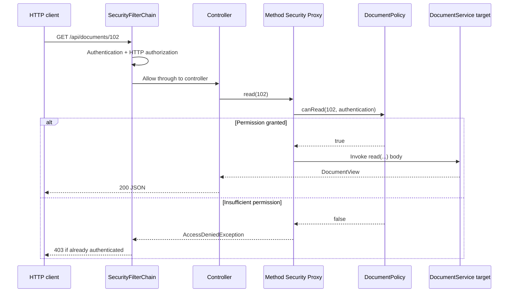

# `@PreAuthorize` and Checking Permissions Before Method Invocation

**Module:** Spring Security – Servlet  
**Section:** Method Security  
**Example:** Java 17, Spring Boot 3.3.5, Spring Security 6.x, Spring MVC/Servlet.

## Objectives

`authorizeHttpRequests` enforces authorization at the HTTP layer: which requests may reach a controller. `@PreAuthorize` enforces authorization at the **method boundary**, typically placed on a service: whether the caller may execute a business method with specific arguments. It is especially useful when two users are both logged in yet may only access **their own documents**.

After this lesson, you will be able to:

- Enable method security with `@EnableMethodSecurity`.
- Use `@PreAuthorize("hasRole('ADMIN')")`, `hasAuthority(...)`, `authentication`, method parameters, and a policy bean in SpEL.
- Understand why checking **before the method body runs** differs from HTTP authentication, `@PostAuthorize`, or controller checks after side effects have already occurred.
- Use `@P("id")` so SpEL parameters have stable names.
- Avoid self-invocation, `new` object instantiation, private/final methods, and AOP proxy pitfalls.
- Place ownership policies in services, separating client-supplied data from trusted server data.
- Write a Java 17 Spring Boot project with security tests proving **a denied caller does not execute the service method body**.
- Consider `401`, `403`, transactions, CSRF, and issues when a system has multiple entrypoints.

**Key takeaway:** `@PreAuthorize` only takes effect when the call goes through Spring's method-security mechanism. It is not a Java statement that runs automatically merely upon seeing the annotation.

## 1. How Do HTTP Protection and Method Protection Differ?

Consider a document-reading API:

```text
GET /api/documents/101   → owner: alice
GET /api/documents/102   → owner: bob
```

In a `SecurityFilterChain`, you might write:

```java
http.authorizeHttpRequests(auth -> auth
        .requestMatchers(HttpMethod.GET, "/api/documents/{id}")
            .authenticated()
        .anyRequest().denyAll());
```

This requires the user to be **authenticated**. However, it does not know that document 101 belongs to Alice and document 102 belongs to Bob. If the controller/service simply calls `findById(id)` and returns the data, Bob can try ID 101 to view Alice's document. That is an IDOR/BOLA risk.

Authorization at the method level:

```java
@PreAuthorize("@documentPolicy.canRead(#id, authentication)")
public DocumentView read(@P("id") long id) {
    return store.findById(id).orElseThrow();
}
```

This is a **fragment**; the complete class is in section 8. Before the body of `read(...)` runs, the method interceptor evaluates the expression. The `documentPolicy` bean looks up the owner in a trusted data store and compares it against `Authentication`. If disallowed, an access-denied exception is raised and the body of `read` does not run.



The diagram illustrates the authorization decision, not every internal filter/advisor in exact execution order.

| Layer | Responsibility | Does Not Solve Alone |
| --- | --- | --- |
| Authentication | Username/password, session, JWT, or identity provider verifying identity | Who owns a specific document |
| HTTP authorization | Method/path/role in `authorizeHttpRequests` | Ownership and fine-grained domain rules |
| Method authorization | Permission to call public Spring bean methods using parameters/caller | Entrypoints that do not pass through the proxy |
| Transaction/data authorization | Invariants when reading/writing DB, tenant, and concurrency | Automatically configuring HTTP authentication |

Thus `.authenticated()` can coexist with `@PreAuthorize("@documentPolicy.canRead(...)")`: **no contradiction**, rather two complementary layers.

## 2. Enabling `@PreAuthorize`: `@EnableMethodSecurity`

In Spring Security 6, method security must be enabled explicitly:

```java
import org.springframework.context.annotation.Configuration;
import org.springframework.security.config.annotation.method.configuration.EnableMethodSecurity;

@Configuration
@EnableMethodSecurity
public class MethodSecurityConfiguration {
}
```

This is a standalone configuration class that can compile in a suitable Spring Boot project. In the runnable project in section 8, the annotation is placed directly on `SecurityConfig`, rather than creating both classes.

Keep in mind:

- Having `spring-boot-starter-security` does not mean `@PreAuthorize` is automatically enabled without configuring method security.
- `@EnableMethodSecurity` supports `@PreAuthorize`/`@PostAuthorize` through the method-security infrastructure. In Spring Security 6, `prePostEnabled` defaults to enabling pre/post annotations.
- The default mechanism typically uses Spring AOP proxies. Methods must be invoked **through a Spring-managed bean proxy**.
- Manually calling `new DocumentService(...)` instead of receiving a container-managed bean will not automatically attach method-security advice.
- Place annotations on public service methods actually called from outside the bean, rather than relying on private/final/self-invocation.
- If there are multiple Spring contexts, custom proxies, Java/Kotlin final classes, or multiple interfaces, test the exact runtime call path.

### 2.1. What Does `@PreAuthorize` Run Before?

It runs **before the protected method body** once the call passes through the method interceptor. However, that does **not** mean nothing has executed yet:

1. Servlet filters may already have authenticated and processed security headers/CSRF.
2. MVC may already have matched the route, parsed path variables, and bound parameters.
3. The controller may already have executed code before calling the service.
4. The authorization expression may call a policy bean that queries the database.
5. Other advisors such as transactions, caching, or tracing may have order depending on configuration.

Therefore, if a controller writes data before calling a `@PreAuthorize`-annotated method, the annotation cannot "undo" earlier side effects. Place sensitive operations **behind the appropriate guard**, preferring business services and combining with data-layer checks when needed.

## 3. Common SpEL Expressions with `@PreAuthorize`

`@PreAuthorize` accepts a Spring Expression Language (*SpEL*) expression written by the developer.

| Expression | Intended Result | Notes |
| --- | --- | --- |
| `hasRole('ADMIN')` | User has the admin role | Looks for authority `ROLE_ADMIN` by default |
| `hasAnyRole('USER','ADMIN')` | Has at least one matching role | Default prefix `ROLE_` |
| `hasAuthority('SCOPE_documents.read')` | Has exact authority | Useful for JWT/OAuth scopes when converter produces this authority |
| `hasAnyAuthority('DOC_READ','DOC_EDIT')` | Has one matching authority | Does not automatically add prefix |
| `isAuthenticated()` | Caller is not anonymous per trust semantics | Remember-me may count as authenticated |
| `isFullyAuthenticated()` | Neither anonymous nor remember-me | Does not replace MFA or "logged in within the last 5 minutes" |
| `#username == authentication.name` | Compares parameter to current identity | Use canonical/trusted data for ownership |
| `@documentPolicy.canRead(#id, authentication)` | Calls a Spring policy bean | Bean can look up owner, tenant, record state |

Fragment examples:

```java
@PreAuthorize("hasRole('ADMIN')")
public String rebuildReport() {
    return "rebuild-ok";
}

@PreAuthorize("hasAuthority('DOC_READ')")
public String listDocuments() {
    return "list-ok";
}

@PreAuthorize("#username == authentication.name")
public String profile(@P("username") String username) {
    return username;
}
```

These methods must reside in a Spring-managed class and be invoked through a proxy; this is only an expression illustration.

### 3.1. `hasRole` vs `hasAuthority`

Spring Security `User.withUsername(...).roles("ADMIN")` typically creates a `GrantedAuthority` named `ROLE_ADMIN`. Therefore:

```text
roles("ADMIN")            → ROLE_ADMIN
hasRole('ADMIN')          → checks ROLE_ADMIN
hasAuthority('ROLE_ADMIN')→ checks exact ROLE_ADMIN
hasAuthority('ADMIN')     → does not match default ROLE_ADMIN
```

If an identity provider issues `"ADMIN"` without `ROLE_`, standardize authority naming or use `hasAuthority('ADMIN')`. Never "fix" a prefix mismatch by disabling method security. With JWTs, authorities may carry the `SCOPE_` prefix; inspect the real system's `JwtAuthenticationConverter`/mapper.

### 3.2. Parameter `#id` in SpEL and `@P`

SpEL method security needs to resolve exact parameter names. The Java compiler may omit parameter names without `-parameters` or suitable metadata. Use the annotation:

```java
import org.springframework.security.access.method.P;
import org.springframework.security.access.prepost.PreAuthorize;

@PreAuthorize("#username == authentication.name")
public String getProfile(@P("username") String username) {
    return username;
}
```

`@P("username")` lets the policy reference `#username` unambiguously. Never dynamically construct expressions from request strings and evaluate them as code; expressions in annotations are **developer-controlled policies**.

### 3.3. Ownership Should Rely on Server Data

Dangerous example:

```java
// Do not trust an owner sent by the client alongside the request.
@PreAuthorize("#owner == authentication.name")
public void edit(long id, String owner) {
    // If owner is self-declared, the guard can pass even if names match spuriously.
}
```

A client could supply their own username as `owner`, even though the actual record belongs to someone else. The right approach is looking up the owner associated with `id` from a trusted repository:

```java
@PreAuthorize("@documentPolicy.canRead(#id, authentication)")
public DocumentView read(@P("id") long id) {
    return store.findById(id).orElseThrow();
}
```

`@documentPolicy` references **the Spring bean named documentPolicy**; `authentication` is the identity verified via the security context. You can check role/admin and ownership in standalone Java policy code, which is easier to test than a long SpEL string.

## 4. Why Is the Spring AOP Proxy Part of Security?

Call diagram:

```text
Controller → Spring AOP proxy(DocumentService)
               ├── evaluate @PreAuthorize
               │    ├── allow → target DocumentService.read(...)
               │    └── deny  → AccessDeniedException
               └── if unauthorized, target body does not run
```

### 4.1. Self-Invocation Can Bypass Guards

This is an **illustrative anti-pattern**, not a source file from the runnable project:

```java
@Service
class UnsafeService {
    @PreAuthorize("hasRole('ADMIN')")
    public String sensitive() {
        return "secret";
    }

    public String wrapper() {
        return this.sensitive(); // Does not go through the Spring proxy in proxy mode.
    }
}
```

If `wrapper()` is called through the proxy while `wrapper` **has no guard**, `this.sensitive()` is an internal Java call and can bypass `sensitive()`'s advice. Extract sensitive methods into another injected service, or place the guard at the true entrypoint / check policy directly at the domain boundary.

### 4.2. Situations Where Annotations Are Skipped

- Forgetting `@EnableMethodSecurity`.
- Calling an object created with `new` instead of a Spring bean.
- One method calling another method on the same instance via `this`.
- Placing annotations on private methods, final methods, or sites proxies do not intercept.
- Calling from constructors or lifecycle hooks before a proxy is ready.
- Calling a different implementation/interface than the annotated target.
- Calling from an async/background thread lacking a valid `SecurityContext`.
- Custom AOP advisor ordering or caching causing unexpected behavior.

**Test in reality** rather than merely seeing the annotation in code. Have at least one test with an unauthorized user asserting that the method body does not execute.

### 4.3. `@PreAuthorize` vs `@PostAuthorize`

- `@PreAuthorize`: checks before the target method body, suited for preventing side effects.
- `@PostAuthorize`: checks after the method returns; can inspect `returnObject`, but the method may already have written data.
- `@PreFilter`/`@PostFilter`: filters collections by policy before/after the method, with distinct performance and data-exposure considerations.
- `@Secured` and `@RolesAllowed`: other annotation styles with their own enable flags and semantics.

Do not use `@PostAuthorize` to "protect" a payment transfer if you need to reject **before** transferring funds. Never assume transaction rollback alone can undo external side effects.

## 5. `AccessDeniedException`: Why Can It Result in 401 or 403?

When pre-authorization denies access, the method interceptor typically throws `AccessDeniedException` or a subtype. The HTTP response is determined by `ExceptionTranslationFilter`/entrypoint/access-denied handler and the security chain.

| Scenario | Typically Seen | Explanation |
| --- | --- | --- |
| Protected HTTP Basic endpoint, no credentials | `401` + `WWW-Authenticate: Basic` | HTTP layer challenges before reaching service |
| Wrong Basic password | `401` | Authentication failed |
| Authenticated user, service method lacks role | `403` | Method authorization denied |
| Authenticated user, document belongs to another user | `403` | Ownership policy denied |
| Admin with sufficient permissions, controller returns data | `200` | Guard allowed, method body executed |
| POST missing CSRF token | `403` | May be blocked by `CsrfFilter` before method |
| Form login unauthenticated | Redirect to login depending on config | Not necessarily Basic 401 |
| Method allowed but business logic errors | Per exception handler | Not a `@PreAuthorize` failure |

In the project, a non-existent record causes the policy to return `false`; an authenticated user gets `403` (fail-closed) before entering the method. In other systems, you may need a `404` contract to hide existence; design that explicitly and consistently. Status codes are not directly "written" by the annotation.

## 6. Timing Boundaries: Checking Beforehand Does Not Make the Whole Transaction Safe

The policy may look up the owner at T1, and then the service fetches the document again at T2. With a mutable database, ownership or state can change between those two moments — **time-of-check/time-of-use (TOCTOU)**.

```text
T1: @PreAuthorize policy determines document 101 belongs to Alice
T2: another transaction transfers ownership of document 101 to Bob
T3: target service proceeds to operate on document 101
```

For sensitive mutations, consider transactions/locking, owner- and tenant-scoped queries, optimistic locking, or DB row-level security. Conceptual example:

```sql
UPDATE documents
SET title = :newTitle
WHERE id = :id
  AND owner_username = :authenticatedUsername;
```

`:authenticatedUsername` must come from a trusted identity, never a self-declared header/JSON field. Check the updated row count and tenant boundary. `@PreAuthorize` remains valuable, but it does not replace transaction/data consistency.

Likewise, a policy bean may query the database **to evaluate the guard**, so "the service body does not run when denied" **does not mean** "zero DB queries occurred".

## 7. Project: Document Reading API with Ownership Permissions

The example uses 3 demo accounts:

| Account | Sample Password | Authority | Allowed |
| --- | --- | --- | --- |
| `alice` | `alice-pass` | `ROLE_USER` | Read document `101` |
| `bob` | `bob-pass` | `ROLE_USER` | Read document `102` |
| `admin` | `admin-pass` | `ROLE_ADMIN` | Read any existing document, view admin summary |

Endpoints:

- `GET /public/ping`: public.
- `GET /api/documents/{id}`: HTTP requires authenticated; method guard verifies ownership/admin.
- `GET /api/admin/summary`: HTTP requires authenticated; method guard requires `ROLE_ADMIN`.
- All other URLs/methods: HTTP fallback `.anyRequest().denyAll()`.

The demo includes an in-memory `DocumentStore` and `AtomicInteger` counters tracking executions of the service method **body**. If a user is denied before the method, the counter does not increment. Passwords are stored with BCrypt in `InMemoryUserDetailsManager`; never use demo accounts in production.

### 7.1. Structure

```text
method-security-demo/
├── pom.xml
└── src/
    ├── main/java/demo/method/
    │   ├── MethodSecurityApplication.java
    │   ├── SecurityConfig.java
    │   ├── DocumentView.java
    │   ├── DocumentStore.java
    │   ├── DocumentPolicy.java
    │   ├── DocumentService.java
    │   └── DocumentController.java
    └── test/java/demo/method/
        └── MethodSecurityApplicationTests.java
```

Requires JDK 17+, Maven, and reachable Maven repositories on the first build.

### 7.2. `pom.xml`

```xml
<?xml version="1.0" encoding="UTF-8"?>
<project xmlns="http://maven.apache.org/POM/4.0.0"
         xmlns:xsi="http://www.w3.org/2001/XMLSchema-instance"
         xsi:schemaLocation="http://maven.apache.org/POM/4.0.0 https://maven.apache.org/xsd/maven-4.0.0.xsd">
    <modelVersion>4.0.0</modelVersion>
    <parent>
        <groupId>org.springframework.boot</groupId>
        <artifactId>spring-boot-starter-parent</artifactId>
        <version>3.3.5</version>
        <relativePath/>
    </parent>
    <groupId>demo</groupId>
    <artifactId>method-security-demo</artifactId>
    <version>1.0.0</version>
    <properties>
        <java.version>17</java.version>
    </properties>
    <dependencies>
        <dependency>
            <groupId>org.springframework.boot</groupId>
            <artifactId>spring-boot-starter-web</artifactId>
        </dependency>
        <dependency>
            <groupId>org.springframework.boot</groupId>
            <artifactId>spring-boot-starter-security</artifactId>
        </dependency>
        <dependency>
            <groupId>org.springframework.boot</groupId>
            <artifactId>spring-boot-starter-test</artifactId>
            <scope>test</scope>
        </dependency>
        <dependency>
            <groupId>org.springframework.security</groupId>
            <artifactId>spring-security-test</artifactId>
            <scope>test</scope>
        </dependency>
    </dependencies>
    <build>
        <plugins>
            <plugin>
                <groupId>org.springframework.boot</groupId>
                <artifactId>spring-boot-maven-plugin</artifactId>
            </plugin>
        </plugins>
    </build>
</project>
```

The Spring Boot parent manages compatible Spring Security/JUnit versions. Using `spring-boot-starter-web` makes this **Servlet/Spring MVC**, not WebFlux.

### 7.3. `src/main/java/demo/method/MethodSecurityApplication.java`

```java
package demo.method;

import org.springframework.boot.SpringApplication;
import org.springframework.boot.autoconfigure.SpringBootApplication;

@SpringBootApplication
public class MethodSecurityApplication {
    public static void main(String[] args) {
        SpringApplication.run(MethodSecurityApplication.class, args);
    }
}
```

### 7.4. `src/main/java/demo/method/SecurityConfig.java`

```java
package demo.method;

import org.springframework.context.annotation.Bean;
import org.springframework.context.annotation.Configuration;
import org.springframework.http.HttpMethod;
import org.springframework.security.config.Customizer;
import org.springframework.security.config.annotation.method.configuration.EnableMethodSecurity;
import org.springframework.security.config.annotation.web.builders.HttpSecurity;
import org.springframework.security.config.http.SessionCreationPolicy;
import org.springframework.security.core.userdetails.User;
import org.springframework.security.core.userdetails.UserDetails;
import org.springframework.security.core.userdetails.UserDetailsService;
import org.springframework.security.crypto.bcrypt.BCryptPasswordEncoder;
import org.springframework.security.crypto.password.PasswordEncoder;
import org.springframework.security.provisioning.InMemoryUserDetailsManager;
import org.springframework.security.web.SecurityFilterChain;

@Configuration
@EnableMethodSecurity
public class SecurityConfig {

    @Bean
    PasswordEncoder passwordEncoder() {
        return new BCryptPasswordEncoder();
    }

    @Bean
    UserDetailsService users(PasswordEncoder encoder) {
        UserDetails alice = User.withUsername("alice")
                .password(encoder.encode("alice-pass"))
                .roles("USER")
                .build();

        UserDetails bob = User.withUsername("bob")
                .password(encoder.encode("bob-pass"))
                .roles("USER")
                .build();

        UserDetails admin = User.withUsername("admin")
                .password(encoder.encode("admin-pass"))
                .roles("ADMIN")
                .build();

        return new InMemoryUserDetailsManager(alice, bob, admin);
    }

    @Bean
    SecurityFilterChain securityFilterChain(HttpSecurity http)
            throws Exception {

        http.authorizeHttpRequests(auth -> auth
                .requestMatchers(HttpMethod.GET, "/public/ping")
                    .permitAll()
                .requestMatchers(HttpMethod.GET, "/api/documents/{id}")
                    .authenticated()
                .requestMatchers(HttpMethod.GET, "/api/admin/summary")
                    .authenticated()
                .anyRequest().denyAll());

        http.httpBasic(Customizer.withDefaults());

        http.sessionManagement(session -> session
                .sessionCreationPolicy(SessionCreationPolicy.STATELESS));

        // Only GET in the demo; default CSRF remains enabled.
        return http.build();
    }
}
```

`@EnableMethodSecurity` is the key piece ensuring `@PreAuthorize` on the service is actually processed by Spring method security. Do not place `@PreAuthorize` on the controller and assume callers from batch/scheduler jobs are protected; place it on reusable services when that is the domain boundary.

HTTP rules only require authenticated; **method rules hold the role/ownership information**. A new endpoint is not left open by accident thanks to the deny fallback.

### 7.5. `src/main/java/demo/method/DocumentView.java`

```java
package demo.method;

public record DocumentView(long id, String owner, String title) {
}
```

Java 17 `record` is supported; demo JSON contains `id`, `owner`, and `title`. With real data, DTOs should return only the fields the client needs, without leaking raw `Authentication`, password hashes, or access tokens.

### 7.6. `src/main/java/demo/method/DocumentStore.java`

```java
package demo.method;

import java.util.Map;
import java.util.Optional;

import org.springframework.stereotype.Repository;

@Repository
public class DocumentStore {

    private final Map<Long, DocumentView> docs = Map.of(
            101L, new DocumentView(101L, "alice", "Alice summary"),
            102L, new DocumentView(102L, "bob", "Bob summary"));

    public Optional<DocumentView> findById(long id) {
        return Optional.ofNullable(docs.get(id));
    }
}
```

The owner source is server-side data; clients cannot self-declare whom a document belongs to. An immutable Map suits the lesson but does not simulate real concurrency/DB/multi-tenancy.

### 7.7. `src/main/java/demo/method/DocumentPolicy.java`

```java
package demo.method;

import org.springframework.security.authentication.AnonymousAuthenticationToken;
import org.springframework.security.core.Authentication;
import org.springframework.stereotype.Component;

@Component("documentPolicy")
public class DocumentPolicy {

    private final DocumentStore store;

    public DocumentPolicy(DocumentStore store) {
        this.store = store;
    }

    public boolean canRead(long id, Authentication authentication) {
        if (authentication == null
                || !authentication.isAuthenticated()
                || authentication instanceof AnonymousAuthenticationToken) {
            return false;
        }

        return store.findById(id)
                .map(doc -> isAdmin(authentication)
                        || doc.owner().equals(authentication.getName()))
                .orElse(false);
    }

    private boolean isAdmin(Authentication authentication) {
        return authentication.getAuthorities().stream()
                .anyMatch(a -> "ROLE_ADMIN".equals(a.getAuthority()));
    }
}
```

`DocumentPolicy` is invoked **from the SpEL expression**. It uses the verified `authentication.getName()` and the owner from `DocumentStore`. For an unknown ID, it returns false — fail-closed. Role ADMIN only allows reading **existing** documents.

Never use `request.getHeader("X-Role")` or a client-sent `owner` as permission-verification data. If a real system has multi-tenancy, you must add tenant/organization checks from a trusted identity, not just compare usernames.

### 7.8. `src/main/java/demo/method/DocumentService.java`

```java
package demo.method;

import java.util.concurrent.atomic.AtomicInteger;

import org.springframework.http.HttpStatus;
import org.springframework.security.access.method.P;
import org.springframework.security.access.prepost.PreAuthorize;
import org.springframework.stereotype.Service;
import org.springframework.web.server.ResponseStatusException;

@Service
public class DocumentService {

    private final DocumentStore store;
    private final AtomicInteger readCalls = new AtomicInteger();
    private final AtomicInteger adminCalls = new AtomicInteger();

    public DocumentService(DocumentStore store) {
        this.store = store;
    }

    @PreAuthorize("@documentPolicy.canRead(#id, authentication)")
    public DocumentView read(@P("id") long id) {
        readCalls.incrementAndGet();

        return store.findById(id)
                .orElseThrow(() -> new ResponseStatusException(
                        HttpStatus.NOT_FOUND, "Document not found"));
    }

    @PreAuthorize("hasRole('ADMIN')")
    public String adminSummary() {
        adminCalls.incrementAndGet();
        return "admin-summary";
    }

    public int readCount() {
        return readCalls.get();
    }

    public int adminCount() {
        return adminCalls.get();
    }
}
```

Explanation:

- Before `read(...)`, the Spring method interceptor calls `documentPolicy.canRead` with `#id` named via `@P("id")` and `authentication` from SecurityContext.
- When the guard returns false, `readCalls.incrementAndGet()` **does not run**. Two dedicated tests below will prove this.
- `adminSummary()` runs only with `ROLE_ADMIN`.
- `ResponseStatusException(404)` is defensive in case data disappears after the policy lookup; with the demo's immutable map, this will not happen once the policy passes.
- Counters are only for the lesson; do not expose them as sensitive endpoints/metrics.
- With a mutable DB, performing two lookups requires transactions/locking or conditional queries to avoid TOCTOU.

### 7.9. `src/main/java/demo/method/DocumentController.java`

```java
package demo.method;

import org.springframework.http.MediaType;
import org.springframework.web.bind.annotation.GetMapping;
import org.springframework.web.bind.annotation.PathVariable;
import org.springframework.web.bind.annotation.RestController;

@RestController
public class DocumentController {

    private final DocumentService service;

    public DocumentController(DocumentService service) {
        this.service = service;
    }

    @GetMapping(value = "/public/ping",
                produces = MediaType.TEXT_PLAIN_VALUE)
    public String ping() {
        return "pong";
    }

    @GetMapping("/api/documents/{id}")
    public DocumentView getDocument(@PathVariable long id) {
        return service.read(id);
    }

    @GetMapping(value = "/api/admin/summary",
                produces = MediaType.TEXT_PLAIN_VALUE)
    public String adminSummary() {
        return service.adminSummary();
    }
}
```

The controller receives path variables and calls the **constructor-injected Spring-managed `DocumentService` bean**, without instantiating it with `new`. This gives the method interceptor the opportunity to evaluate `@PreAuthorize` when the controller invokes the service.

## 8. Running and Observing HTTP 401/403

In the directory containing `pom.xml`:

```bash
mvn clean test
mvn spring-boot:run
```

By default, Spring Boot uses `http://localhost:8080` locally unless the port is changed. The following commands use demo credentials; never pass real passwords over plain HTTP. When deploying, **HTTP Basic should only be used over HTTPS with certificate validation**; Base64 does not encrypt passwords.

```bash
# Public:
curl -s http://localhost:8080/public/ping

# Protected without credentials:
curl -s -o /dev/null -w '%{http_code}\n' \
  http://localhost:8080/api/documents/101

# Alice views document 101:
curl -s -u alice:alice-pass \
  http://localhost:8080/api/documents/101

# Alice tries to view Bob's document 102:
curl -s -o /dev/null -w '%{http_code}\n' \
  -u alice:alice-pass \
  http://localhost:8080/api/documents/102

# Admin views document 102:
curl -s -u admin:admin-pass \
  http://localhost:8080/api/documents/102

# Alice tries to call admin service:
curl -s -o /dev/null -w '%{http_code}\n' \
  -u alice:alice-pass \
  http://localhost:8080/api/admin/summary

# Admin calls admin service:
curl -s -u admin:admin-pass \
  http://localhost:8080/api/admin/summary
```

Expected output of the **seven separate commands**:

```text
pong
401
{"id":101,"owner":"alice","title":"Alice summary"}
403
{"id":102,"owner":"bob","title":"Bob summary"}
403
admin-summary
```

Some bodies do not end with a newline; `curl -w` prints a newline after the status. In PowerShell, use `curl.exe` if `curl` is aliased to another command. Never put real passwords in shell history or process metadata.

The `403` for Alice reading 102 and `403` for Alice calling the admin method are **two forms of method authorization denial**; the HTTP layer only required authenticated and let the requests reach the controller. Conversely, `401` due to missing Basic credentials can occur **before** the service is called.

## 9. Testing with MockMvc and `@WithMockUser`

Create `src/test/java/demo/method/MethodSecurityApplicationTests.java`:

```java
package demo.method;

import org.junit.jupiter.api.Test;
import org.springframework.beans.factory.annotation.Autowired;
import org.springframework.boot.test.autoconfigure.web.servlet.AutoConfigureMockMvc;
import org.springframework.boot.test.context.SpringBootTest;
import org.springframework.http.MediaType;
import org.springframework.security.access.AccessDeniedException;
import org.springframework.security.test.context.support.WithMockUser;
import org.springframework.test.web.servlet.MockMvc;

import static org.hamcrest.Matchers.containsString;
import static org.junit.jupiter.api.Assertions.assertEquals;
import static org.junit.jupiter.api.Assertions.assertThrows;
import static org.springframework.security.test.web.servlet.request.SecurityMockMvcRequestPostProcessors.httpBasic;
import static org.springframework.test.web.servlet.request.MockMvcRequestBuilders.get;
import static org.springframework.test.web.servlet.result.MockMvcResultMatchers.content;
import static org.springframework.test.web.servlet.result.MockMvcResultMatchers.header;
import static org.springframework.test.web.servlet.result.MockMvcResultMatchers.jsonPath;
import static org.springframework.test.web.servlet.result.MockMvcResultMatchers.status;

@SpringBootTest
@AutoConfigureMockMvc
class MethodSecurityApplicationTests {

    @Autowired
    MockMvc mvc;

    @Autowired
    DocumentService service;

    @Test
    void pingAllowsAnonymous() throws Exception {
        mvc.perform(get("/public/ping"))
                .andExpect(status().isOk())
                .andExpect(content().string("pong"));
    }

    @Test
    void missingCredentialsReceiveBasicChallenge() throws Exception {
        mvc.perform(get("/api/documents/101")
                        .accept(MediaType.APPLICATION_JSON))
                .andExpect(status().isUnauthorized())
                .andExpect(header().string("WWW-Authenticate",
                        containsString("Basic")));
    }

    @Test
    void badPasswordIsRejected() throws Exception {
        mvc.perform(get("/api/documents/101")
                        .with(httpBasic("alice", "wrong")))
                .andExpect(status().isUnauthorized());
    }

    @Test
    void aliceCanReadOwnDocument() throws Exception {
        mvc.perform(get("/api/documents/101")
                        .with(httpBasic("alice", "alice-pass")))
                .andExpect(status().isOk())
                .andExpect(jsonPath("$.id").value(101))
                .andExpect(jsonPath("$.owner").value("alice"))
                .andExpect(jsonPath("$.title").value("Alice summary"));
    }

    @Test
    void bobCanReadOwnDocument() throws Exception {
        mvc.perform(get("/api/documents/102")
                        .with(httpBasic("bob", "bob-pass")))
                .andExpect(status().isOk())
                .andExpect(jsonPath("$.owner").value("bob"));
    }

    @Test
    void aliceCannotReadBobsDocument() throws Exception {
        mvc.perform(get("/api/documents/102")
                        .with(httpBasic("alice", "alice-pass")))
                .andExpect(status().isForbidden());
    }

    @Test
    void bobCannotReadAlicesDocument() throws Exception {
        mvc.perform(get("/api/documents/101")
                        .with(httpBasic("bob", "bob-pass")))
                .andExpect(status().isForbidden());
    }

    @Test
    void adminCanReadExistingDocument() throws Exception {
        mvc.perform(get("/api/documents/102")
                        .with(httpBasic("admin", "admin-pass")))
                .andExpect(status().isOk())
                .andExpect(jsonPath("$.owner").value("bob"));
    }

    @Test
    void aliceCannotCallAdminService() throws Exception {
        mvc.perform(get("/api/admin/summary")
                        .with(httpBasic("alice", "alice-pass")))
                .andExpect(status().isForbidden());
    }

    @Test
    void adminCanCallAdminService() throws Exception {
        mvc.perform(get("/api/admin/summary")
                        .with(httpBasic("admin", "admin-pass")))
                .andExpect(status().isOk())
                .andExpect(content().string("admin-summary"));
    }

    @Test
    void deniedReadDoesNotEnterMethodBody() throws Exception {
        int before = service.readCount();

        mvc.perform(get("/api/documents/102")
                        .with(httpBasic("alice", "alice-pass")))
                .andExpect(status().isForbidden());

        assertEquals(before, service.readCount());
    }

    @Test
    void deniedAdminCallDoesNotEnterMethodBody() throws Exception {
        int before = service.adminCount();

        mvc.perform(get("/api/admin/summary")
                        .with(httpBasic("bob", "bob-pass")))
                .andExpect(status().isForbidden());

        assertEquals(before, service.adminCount());
    }

    @Test
    void unknownDocumentIsDeniedByPolicy() throws Exception {
        mvc.perform(get("/api/documents/999")
                        .with(httpBasic("alice", "alice-pass")))
                .andExpect(status().isForbidden());
    }

    @Test
    @WithMockUser(username = "alice", roles = "USER")
    void directSpringBeanCallStillDeniesCrossOwner() {
        assertThrows(AccessDeniedException.class,
                () -> service.read(102L));
    }

    @Test
    @WithMockUser(username = "alice", roles = "USER")
    void directSpringBeanCallAllowsOwner() {
        DocumentView doc = service.read(101L);
        assertEquals("alice", doc.owner());
        assertEquals(101L, doc.id());
    }

    @Test
    @WithMockUser(username = "alice", roles = "USER")
    void directSpringBeanCallStillDeniesAdminMethod() {
        assertThrows(AccessDeniedException.class,
                () -> service.adminSummary());
    }
}
```

With this project, **16 tests are expected to PASS**, though this is a static expectation, **not an observed Maven execution result**.

Run:

```bash
mvn test
```

Key takeaways from the tests:

- `missingCredentials...` and `badPassword...` prove HTTP authentication is handled before the method.
- The owner tests show that an already logged-in user still cannot read someone else's document.
- The two `DoesNotEnterMethodBody` tests record the counter before/after a denial; **no increment** proves the service method body did not run.
- The three `@WithMockUser` tests directly invoke the **Spring-injected bean**, yet method security still operates. They do not depend on HTTP routes.
- `unknownDocumentIsDeniedByPolicy` proves fail-closed policy behavior when the ID does not exist.

`@WithMockUser` is a `spring-security-test` helper, not a way to "fabricate permissions" in production. These tests share a Spring context; compare the counter before/after rather than demanding the counter always start at 0. Do not enable parallel execution while using a shared counter without isolating fixtures.

MockMvc tests the filter chain, method interceptor, and HTTP status; it does not test TLS handshakes, real browser cookie behavior, or transactions/concurrency across multiple nodes.

## 10. Common Mistakes

### 10.1. `@PreAuthorize` Is Present, Yet Access Still Succeeds

**Likely causes:** Forgot `@EnableMethodSecurity`, called an object instantiated with `new`, self-invocation, annotation on a private/final method, or called another entrypoint not going through a Spring proxy.

**Fix:** Place annotations on public Spring-managed service methods, invoke through bean injection, and use negative tests with counters/spies verifying the method body does not run.

### 10.2. `hasRole('ADMIN')` Denies Even Though the User "Has ADMIN"

**Likely cause:** The actual GrantedAuthority is `"ADMIN"` rather than `"ROLE_ADMIN"`.

**Fix:** Check the authorities mapping; use `hasAuthority('ADMIN')` if the policy genuinely expects that string, or standardize roles with prefixes.

### 10.3. SpEL Cannot Find `#id`

**Likely cause:** Missing Java parameter name metadata due to compiler flags.

**Fix:** Use `@P("id")` or configure compiler `-parameters` and check compiled classes. Test both valid and invalid IDs.

### 10.4. Checking Identity Only, Not Object Ownership

HTTP `.authenticated()` is not enough against BOLA. If a record has an owner/tenant, use a policy bean looking up from a trusted store and check record-level permissions. Never trust an owner sent from JSON or query parameters.

### 10.5. `@PreAuthorize` Returns 403 Yet the DB Was Already Written

Side effects may have occurred in the controller before the service call, or custom logic ran before the guard. `@PreAuthorize` does not roll back already-executed side effects. Move mutations inside guarded methods and reinforce transaction/data authorization.

### 10.6. Using `@PostAuthorize` to Prevent Mutations

`@PostAuthorize` runs **after** the method; it is unsuitable once the action has executed. Use pre-authorization or transactional guards before irreversible operations.

### 10.7. Repeated Policy Bean Lookups Slow Down the API

In the demo, both the policy and method body read the store. With a real DB, consider role/owner-scoped queries, transactions, safe tenant/user-partitioned caching, or aggregate-bound policies. Never remove ownership checks just to save a query.

### 10.8. Method Security Missing Under `@Async`

`SecurityContext` is typically thread-bound; background workers may lack authentication. Use explicit context propagation/identities and never assign admin credentials simply because denials occur.

### 10.9. Wrong Cache/AOP Ordering

If a cache advisor returns sensitive results without method security applying to that path, users can receive unauthorized data. Test both cached/uncached paths and advisor ordering; never assume security advice is always outermost.

### 10.10. Confusing 403 from CSRF with Method Denial

With POST, `CsrfFilter` can block before the method. Test POST with valid CSRF to distinguish authorization from CSRF. Never disable CSRF just to make a method-security test pass.

## 11. Security Design Checklist

1. `@EnableMethodSecurity` is genuinely present in the Spring application context being protected.
2. Every sensitive method has a Spring-managed public entrypoint invoked through a proxy.
3. Do not use `this.secureMethod()` and bypass the proxy unintentionally.
4. `hasRole`/`hasAuthority` are checked against **actual** authorities, not guessed role names.
5. SpEL parameters have `@P` metadata or reliable compiler setup.
6. Policies fetch ownership and tenant from a trusted DB/service.
7. HTTP authorization still restricts methods/paths and has an appropriate fallback.
8. CSRF/CORS, TLS, cookies, or token authentication are handled separately.
9. Sensitive side effects occur only after the guard has actually been enforced.
10. When writing to the DB, use transactions and strategies to prevent TOCTOU.
11. Do not return raw `Authentication`/principals or log credentials when denied.
12. Batch/scheduler/async calls also have explicitly designed policies/contexts.
13. Include negative tests for anonymous, wrong role, cross-owner, unknown ID, and unexecuted method body.
14. Include positive tests so SpEL mistakes do not accidentally reject everyone.
15. Security exceptions are handled properly by the HTTP layer; never disclose data details upon denial.
16. Do not rely solely on controller annotations if services have other callers.
17. Review cache keys/tenancy and AOP interceptor ordering.
18. Re-evaluate method security when refactoring service interfaces/classes or upgrading Spring versions.

## 12. Self-Check Questions

**1.** HTTP already has `.authenticated()`. Is `@PreAuthorize` still needed?  
**Answer:** Yes, whenever requirements go beyond identity, such as owner/role/tenant. HTTP authentication only proves who the caller is.

**2.** Does `@PreAuthorize("hasRole('ADMIN')")` accept the authority `ADMIN` by default?  
**Answer:** No; by default it requires `ROLE_ADMIN`.

**3.** Does calling `this.secure()` from another method in the same bean guarantee the guard runs?  
**Answer:** Not in standard Spring AOP proxy mode; self-invocation can bypass the advice.

**4.** Does `@PreAuthorize` prevent all DB queries before checking permissions?  
**Answer:** No. A policy bean may need to query the DB to decide; only the target method body is blocked upon denial.

**5.** Why use `@P("id")`?  
**Answer:** It lets SpEL resolve `#id` reliably when Java parameter name metadata is unavailable.

**6.** Alice can read 101, but requesting 102 returns 403; is Basic login broken?  
**Answer:** No. Alice authenticated successfully; the method policy denied access because ownership did not match.

**7.** Why should `@PostAuthorize` not be used to protect a payment operation?  
**Answer:** The method has already run before the check; side effects may already have happened.

**8.** Is a test asserting only 403 sufficient to prove the method body did not run?  
**Answer:** It does not prove which filter produced 403. Add a counter/spy and positive tests to verify the pre-invocation guard.

**9.** Should a document-viewing policy trust an `owner` field in the client's JSON?  
**Answer:** No; owner must come from server data and the verified authenticated identity.

**10.** Does `@PreAuthorize` guarantee an update transaction is race-free?  
**Answer:** No. Transactions, DB constraints, or conditional updates/locking are still required as appropriate.

## Conclusion

`@PreAuthorize` enables **authorization before the body of a Spring-managed method runs**, based on roles, authorities, `Authentication`, parameters, and policy beans. Combined with `@EnableMethodSecurity`, Spring AOP proxies, trusted ownership checks, and the HTTP filter chain, it protects business operations from logged-in users who lack permission on specific data.

The most important lesson is not about a single annotation, but the **invocation boundary**: calls must go through the proxy, check permissions **before side effects**, avoid self-invocation, and include negative tests proving the method body does not run on denial. In systems with databases, multi-tenancy, caching, or async execution, method security is essential yet does not replace data/transaction authorization.