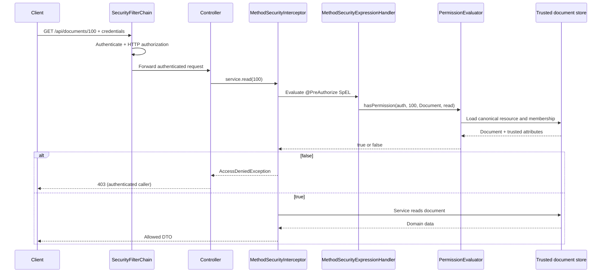

# MethodSecurityExpressionHandler and PermissionEvaluator

> **Scope:** Spring Security **6.x**, Spring Boot **3.x**, Java **17+**, **Servlet/Spring MVC** applications. This lesson explores how Spring Security evaluates method-authorization expressions, how to customize `MethodSecurityExpressionHandler` to wire in a `PermissionEvaluator`, and how to check permissions on **specific resources** using `hasPermission`. The example uses in-memory document data, HTTP Basic, and MockMvc to observe actual behavior; all test results are noted as **expected**, without claiming Java execution in the authoring environment.

## 1. Starting Problem: We Already Have Roles, Why Do We Need hasPermission?

A document system has three types of users: `VIEWER`, `MANAGER`, `AUDITOR`. The URL `GET /api/documents/100` may be configured with `authenticated()`, meaning any authenticated user can invoke the read *feature*. Yet Bob should not necessarily view Alice's document 100. A manager in tenant `acme` must not automatically approve documents in tenant `beta`. Permissions may also depend on **owner, tenant, classification, state, and amount**.

Spring Security already provides expressions such as:

```java
@PreAuthorize("isAuthenticated()")
@PreAuthorize("hasRole('MANAGER')")
@PreAuthorize("hasAuthority('DOCUMENT_READ')")
```

These are useful for checking authentication status and authorities, but for **object-level authorization**, we need a function that inspects a specific resource:

```java
@PreAuthorize("hasPermission(#p0, 'Document', 'read')")
public DocumentView read(long documentId) { ... }
```

Here:

- `#p0` is the **first parameter** of the method, i.e., `documentId`; this does not depend on whether the compiler preserves parameter names.
- `'Document'` is an application-defined resource type name (not an HTTP parameter chosen by the client).
- `'read'` is the permission/action to check, not an SQL statement.
- `hasPermission` delegates to the application's policy through a `PermissionEvaluator` wired into the expression handler.
- If the caller lacks permission or the document does not exist, the call is denied **before the method body runs**.

**Main point:** `hasRole` answers questions about **functional permissions**; `hasPermission` can answer about **an action on a specific object or ID**. Both are commonly used together rather than being mutually exclusive.

## 2. Classes Participating in Method Security

In Spring Security Servlet, a request flows through `SecurityFilterChain` to obtain Authentication and check HTTP-layer permissions; then the controller calls a **Spring bean** annotated with `@PreAuthorize`. Spring Method Security interceptors check the annotation via Spring AOP before forwarding the call to the service.



**Naming note:** In Spring Security 6 with `@EnableMethodSecurity`, the default mechanism uses modern **authorization method interceptors/managers** per annotation type; the diagram uses "interceptor" generically and does not imply the older `MethodSecurityInterceptor` class. Do not copy legacy `GlobalMethodSecurityConfiguration` or `@EnableGlobalMethodSecurity` configs from earlier versions.

### Distinguishing Responsibilities

| Component | Role | Does Not Replace |
|---|---|---|
| `@EnableMethodSecurity` | Enables annotation-checking infrastructure on Spring beans | Does not define resource policies |
| `@PreAuthorize` | SpEL evaluated **before calling the method** | Does not discover owner/tenant without a policy |
| `@PostAuthorize` | SpEL evaluated **after the method returns** | Does not prevent the method body/side effects from running |
| `MethodSecurityExpressionHandler` | Creates the expression evaluation context/root and connects evaluation components | Does not inherently understand app domain documents |
| `DefaultMethodSecurityExpressionHandler` | Built-in handler with common expressions and a setter to plug in an evaluator | Not an authorization server, not a DB |
| `PermissionEvaluator` | Interface to check permissions on an object or on an ID/type | Does not authenticate users itself |
| `SecurityContextHolder` / `Authentication` | Verified identity and authorities | Does not prove ownership of every record |
| Domain service/repository | Enforces data rules, transactions/atomic writes, and scoping | Never assume HTTP rules protect every call path |

A `PermissionEvaluator` bean does not automatically constitute a sound policy; its logic must be trustworthy, complete, efficient, and tested.

## 3. What Does MethodSecurityExpressionHandler Actually Do?

`MethodSecurityExpressionHandler` is the contract Spring Security uses to handle **method-security expressions**. The standard implementation is `DefaultMethodSecurityExpressionHandler`. It builds the SpEL evaluation context with `Authentication`, method invocation, method arguments, root expressions, and strategies such as the permission evaluator, role hierarchy, or trust resolver.

When you write:

```java
@PreAuthorize("hasRole('MANAGER') and hasPermission(#p0, 'Document', 'approve')")
public DocumentView approve(long documentId) { ... }
```

Spring Security must resolve `hasRole`, `hasPermission`, and `#p0` in the context of the **current invocation**. The handler bridges SpEL and authorization execution components. With `DefaultMethodSecurityExpressionHandler`, you call `setPermissionEvaluator(...)` to supply your domain rules.

**Do not confuse with `DefaultWebSecurityExpressionHandler`:** the handler for HTTP/web expressions belongs to a different context. When using `@PreAuthorize` with `@EnableMethodSecurity`, configure the **method-security** handler; customizing only the web expression handler does not wire `hasPermission` for services.

### 3.1. Registering the Handler in Spring Security 6

A concise configuration (snippet):

```java
@Bean
static MethodSecurityExpressionHandler methodSecurityExpressionHandler(
        PermissionEvaluator permissionEvaluator) {
    DefaultMethodSecurityExpressionHandler handler =
            new DefaultMethodSecurityExpressionHandler();
    handler.setPermissionEvaluator(permissionEvaluator);
    return handler;
}
```

Here **`static @Bean`** is used so Spring registers the expression handler early for the method-security infrastructure. This approach fits Spring Security 6 and avoids legacy configuration base classes. `PermissionEvaluator` is a bean provided by your application.

Do not override the entire handler just to add one permission function without understanding defaults; when customizing, preserve default behaviors you did not intend to alter, such as role hierarchy, permission caching, or parameter-name discovery if your app relies on them. Because the handler initializes early, avoid injecting dependencies that accidentally cause bean cycles or require passing through method-security proxies during bootstrap.

### 3.2. Built-In Expressions and Application Expressions

Common method-security expressions:

- `isAuthenticated()`: authenticated (depending on auth type; remember-me may also count as authenticated).
- `isFullyAuthenticated()`: not merely remembered authentication.
- `hasRole('MANAGER')`: role at the Spring authorities level, typically compared against `ROLE_MANAGER`.
- `hasAuthority('DOCUMENT_READ')`: exact authority, no prefix added.
- `hasAnyRole(...)`, `hasAnyAuthority(...)`: multiple choices.
- `principal`, `authentication`: identity and auth context.
- `#p0`, `#a0`: positional method arguments; `#id` requires parameter-name metadata/annotations.
- `returnObject`: return value in post-check expressions like `@PostAuthorize`.
- `hasPermission(...)`: delegates resource decisions to `PermissionEvaluator`.

**Do not depend on parameter names accidentally.** For example, `@PreAuthorize("hasPermission(#documentId, 'Document', 'read')")` may require compiling with `-parameters`, or Spring Security's `@P("documentId")`. This lesson uses `#p0` for consistency. When a method's parameter order changes, update both expressions and tests.

## 4. PermissionEvaluator: Two Important Overloads

The `org.springframework.security.access.PermissionEvaluator` interface has two methods:

```java
boolean hasPermission(Authentication authentication,
                      Object targetDomainObject,
                      Object permission);

boolean hasPermission(Authentication authentication,
                      java.io.Serializable targetId,
                      String targetType,
                      Object permission);
```

### 4.1. Checking by Object

Expression:

```java
@PreAuthorize("hasPermission(#p0, 'read')")
public DocumentView inspect(Document document) { ... }
```

uses the `hasPermission(Authentication, Object, Object)` overload. The second argument is **the object passed into the method**. This is error-prone if the object was deserialized from client JSON with forged `owner`/`tenant`: the evaluator **must not trust all fields on an object merely because it is a Java object**. Extract the ID and re-fetch the canonical record from the repository, or ensure the object came from an authenticated server-side workflow in the same transaction.

If `targetDomainObject == null` or the object type is unsupported, return **false**. Never write a fallback like "unknown type → true".

### 4.2. Checking by ID and Type

Expression:

```java
@PreAuthorize("hasPermission(#p0, 'Document', 'read')")
public DocumentView read(long id) { ... }
```

uses the `hasPermission(Authentication, Serializable, String, Object)` overload. `id` must be Serializable; `Long` satisfies this. `targetType` is an application-defined domain namespace distinguishing `Document` from an `Invoice` sharing ID 100. Never accept type from the user and splice it into SpEL unvalidated.

**Advantage:** the service receives an ID instead of forcing the controller to load the full object. **Cost:** the evaluator may need to query the DB to decide, and the service may load it again afterward; consider query scoping, request-scoped caching, or an appropriate policy service rather than dropping the check to save one query.

### 4.3. What Happens When PermissionEvaluator Returns False?

`@PreAuthorize` vetoes the call before the body runs; Spring Security typically throws `AccessDeniedException`. When originating from an authenticated HTTP request, the result is typically **403 Forbidden** (depending on entry point/exception handling). For unauthenticated requests, Security may return **401** or redirect to login depending on the mechanism. For non-HTTP method calls, the exception propagates to the internal caller; it **does not automatically turn into an HTTP status**.

If the evaluator throws a DB/timeout exception, ensure fail-closed handling and safe logging. A **false** result does not necessarily prove the resource does not exist; it could mean wrong tenant, missing role, wrong action, wrong resource type, or untrusted data.

## 5. Sample Policy: Owner, Tenant, Classification, State, and Amount Limit

We have these accounts:

| Account | Role | Server Tenant |
|---|---|---|
| `alice` | VIEWER | acme |
| `bob` | VIEWER | acme |
| `carol` | VIEWER | beta |
| `mai` | MANAGER | acme |
| `minh` | MANAGER | beta |
| `an` | AUDITOR | acme |

And these documents:

| ID | Tenant | Owner | Classification | State | amountCents |
|---|---|---|---|---|---:|
| 100 | acme | alice | INTERNAL | DRAFT | 30000 |
| 101 | acme | bob | SENSITIVE | DRAFT | 90000 |
| 102 | acme | bob | INTERNAL | APPROVED | 12000 |
| 200 | beta | carol | INTERNAL | DRAFT | 20000 |
| 201 | acme | mai | INTERNAL | DRAFT | 9000 |

**`read`** policy:

1. Only when Authentication is valid and username has a system-assigned tenant membership.
2. Document must belong to the same tenant.
3. MANAGER reads documents in the tenant; AUDITOR reads only INTERNAL classification; VIEWER reads only documents they own.
4. Outside valid branches → DENY.

**`approve`** policy:

1. Caller must have `ROLE_MANAGER`.
2. Document belongs to caller's tenant and owner differs from caller (no self-approval).
3. State must be `DRAFT` and amountCents ≤ 50000.
4. Any condition unmet → DENY.

**This is hybrid RBAC + ABAC.** Roles bound capability types; resource attributes and owner/tenant govern specific decisions. When a system needs policy changes, version and test the allow/deny matrix rather than scattering ad-hoc conditions across controllers.

## 6. Runnable Spring Boot 3.x Sample Project

### 6.1. Project Setup and Dependencies

Create a Java 17+, Spring Boot 3.x Gradle Groovy project with Spring Initializr, selecting **Spring Web**, **Spring Security**, **Spring Boot Starter Test**, and **Spring Security Test**. The `dependencies` block in `build.gradle`:

```groovy
dependencies {
    implementation 'org.springframework.boot:spring-boot-starter-web'
    implementation 'org.springframework.boot:spring-boot-starter-security'
    testImplementation 'org.springframework.boot:spring-boot-starter-test'
    testImplementation 'org.springframework.security:spring-security-test'
}
```

This is only the dependencies block; keep the plugins/repositories/version and Gradle wrapper from Initializr. Files:

```text
src/
├── main/java/com/example/methodperm/
│   ├── MethodPermissionApplication.java
│   ├── SecurityConfig.java
│   ├── DocumentStore.java
│   ├── DocumentPolicy.java
│   ├── DocumentPermissionEvaluator.java
│   ├── DocumentService.java
│   └── DocumentController.java
└── test/java/com/example/methodperm/
    └── DocumentPermissionTest.java
```

The files below are **standalone Java classes in the right package**, not cobbled-together snippets; you can drop them directly into the Initializr-generated project structure.

### 6.2. Main Application

**`src/main/java/com/example/methodperm/MethodPermissionApplication.java`**

```java
package com.example.methodperm;

import org.springframework.boot.SpringApplication;
import org.springframework.boot.autoconfigure.SpringBootApplication;

@SpringBootApplication
public class MethodPermissionApplication {
    public static void main(String[] args) {
        SpringApplication.run(MethodPermissionApplication.class, args);
    }
}
```

### 6.3. Domain Store: Trusted Data Source

**`src/main/java/com/example/methodperm/DocumentStore.java`**

```java
package com.example.methodperm;

import java.util.Map;
import java.util.concurrent.ConcurrentHashMap;
import java.util.concurrent.atomic.AtomicReference;

import org.springframework.http.HttpStatus;
import org.springframework.security.core.Authentication;
import org.springframework.stereotype.Component;
import org.springframework.web.server.ResponseStatusException;

@Component
public class DocumentStore {

    public record Doc(
            long id, String tenant, String owner,
            String classification, String state, long amountCents) {}

    public record View(long id, String state, long amountCents) {}

    private final ConcurrentHashMap<Long, Doc> documents =
            new ConcurrentHashMap<>(Map.of(
                100L, new Doc(
                        100, "acme", "alice", "INTERNAL", "DRAFT", 30000),
                101L, new Doc(
                        101, "acme", "bob", "SENSITIVE", "DRAFT", 90000),
                102L, new Doc(
                        102, "acme", "bob", "INTERNAL", "APPROVED", 12000),
                200L, new Doc(
                        200, "beta", "carol", "INTERNAL", "DRAFT", 20000),
                201L, new Doc(
                        201, "acme", "mai", "INTERNAL", "DRAFT", 9000)
            ));

    public Doc find(long id) {
        return documents.get(id);
    }

    public Doc approveIfAllowed(
            long id, Authentication authentication, DocumentPolicy policy) {
        AtomicReference<Doc> output = new AtomicReference<>();

        documents.compute(id, (key, current) -> {
            // Do not rely solely on @PreAuthorize from earlier:
            // data state can change between the two steps.
            if (!policy.canApprove(authentication, current)) {
                throw new ResponseStatusException(HttpStatus.FORBIDDEN);
            }

            Doc updated = new Doc(
                    current.id(), current.tenant(), current.owner(),
                    current.classification(), "APPROVED",
                    current.amountCents());
            output.set(updated);
            return updated;
        });

        return output.get();
    }
}
```

With `ConcurrentHashMap.compute`, checking and updating **one key within a single JVM** run as one operation. `AtomicReference` is used only to extract the updated document out of the lambda. In a real database, use transactions/conditional UPDATEs and check the updated row count. Never use an in-memory HashMap to represent a production permission store.

### 6.4. DocumentPolicy: One Place Defining Business Conditions

**`src/main/java/com/example/methodperm/DocumentPolicy.java`**

```java
package com.example.methodperm;

import java.util.Map;

import org.springframework.security.authentication.AnonymousAuthenticationToken;
import org.springframework.security.core.Authentication;
import org.springframework.security.core.GrantedAuthority;
import org.springframework.stereotype.Component;

@Component
public class DocumentPolicy {

    // Demo: trusted membership directory. Never read tenant from X-Tenant
    // header or from a client-supplied DTO.
    private final Map<String, String> tenantByUser = Map.of(
            "alice", "acme",
            "bob", "acme",
            "carol", "beta",
            "mai", "acme",
            "minh", "beta",
            "an", "acme"
    );

    private boolean valid(Authentication authentication) {
        return authentication != null
                && authentication.isAuthenticated()
                && !(authentication instanceof AnonymousAuthenticationToken)
                && tenantByUser.containsKey(authentication.getName());
    }

    private static boolean hasRole(
            Authentication authentication, String role) {
        return authentication.getAuthorities().stream()
                .map(GrantedAuthority::getAuthority)
                .anyMatch(("ROLE_" + role)::equals);
    }

    private boolean sameTenant(
            Authentication authentication, DocumentStore.Doc doc) {
        return valid(authentication)
                && doc != null
                && tenantByUser.get(authentication.getName())
                        .equals(doc.tenant());
    }

    public boolean canRead(
            Authentication authentication, DocumentStore.Doc doc) {
        if (!sameTenant(authentication, doc)) {
            return false;
        }
        if (hasRole(authentication, "MANAGER")) {
            return true;
        }
        if (hasRole(authentication, "AUDITOR")
                && "INTERNAL".equals(doc.classification())) {
            return true;
        }
        return hasRole(authentication, "VIEWER")
                && authentication.getName().equals(doc.owner());
    }

    public boolean canApprove(
            Authentication authentication, DocumentStore.Doc doc) {
        return sameTenant(authentication, doc)
                && hasRole(authentication, "MANAGER")
                && "DRAFT".equals(doc.state())
                && doc.amountCents() <= 50000
                && !authentication.getName().equals(doc.owner());
    }

    // Only two actions are defined; any other permission name is denied.
    public boolean allows(
            Authentication authentication, DocumentStore.Doc doc,
            Object permission) {
        if (!(permission instanceof String action)) {
            return false;
        }
        return switch (action) {
            case "read" -> canRead(authentication, doc);
            case "approve" -> canApprove(authentication, doc);
            default -> false;
        };
    }
}
```

**Notable invariants:**

- `sameTenant` denies if Authentication is invalid, tenant is unassigned, or document does not exist.
- No `hasRole` ever implicitly bypasses the tenant check.
- `SENSITIVE` is never automatically exposed to AUDITOR; VIEWER must still match owner.
- `approve` requires state, amount limit, and no self-approval in addition to the role.
- `allows` uses an **action allowlist**: unknown, null, or mistyped permissions → false. There is no "unknown → allow" branch.
- The policy does not accept username, role, or tenant from unauthenticated requests. Spring Authentication and the server membership directory are the trusted data sources in this demo.

`tenantByUser` in production must be replaced with a managed membership/entitlement store featuring access control, cache invalidation, and auditing. Never conflate identical usernames across multiple identity providers or tenants.

### 6.5. PermissionEvaluator: Checking Both by Object and by ID

**`src/main/java/com/example/methodperm/DocumentPermissionEvaluator.java`**

```java
package com.example.methodperm;

import java.io.Serializable;

import org.springframework.security.access.PermissionEvaluator;
import org.springframework.security.core.Authentication;
import org.springframework.stereotype.Component;

@Component
public class DocumentPermissionEvaluator implements PermissionEvaluator {

    private final DocumentStore store;
    private final DocumentPolicy policy;

    public DocumentPermissionEvaluator(
            DocumentStore store, DocumentPolicy policy) {
        this.store = store;
        this.policy = policy;
    }

    @Override
    public boolean hasPermission(
            Authentication authentication,
            Object targetDomainObject,
            Object permission) {
        if (!(targetDomainObject instanceof DocumentStore.Doc submitted)) {
            return false;
        }
        // Important: the passed object may have forged owner/tenant.
        // Use only its ID to fetch the canonical record from a trusted source.
        DocumentStore.Doc actual = store.find(submitted.id());
        return policy.allows(authentication, actual, permission);
    }

    @Override
    public boolean hasPermission(
            Authentication authentication,
            Serializable targetId,
            String targetType,
            Object permission) {
        if (!"Document".equals(targetType)
                || !(targetId instanceof Long id)) {
            return false;
        }
        DocumentStore.Doc actual = store.find(id);
        return policy.allows(authentication, actual, permission);
    }
}
```

The two overloads are the **core** of this lesson:

- **Object overload:** `hasPermission(documentObject, 'read')`. The evaluator does not trust `submitted.owner()` or `submitted.tenant()`; it extracts the ID and reads the original record from `store`. If an attacker constructs a fake object with ID 101 and owner Alice, the policy still checks the real record 101 belonging to Bob.
- **ID/type overload:** `hasPermission(100L, 'Document', 'read')`. The evaluator only accepts exact targetType `"Document"` and ID type `Long`. A `String` ID, `"Invoice"` type, or `"delete"` action is rejected. Strict type checks prevent accidental cross-type permission confusion between two object types sharing an ID.

In real apps you can support UUIDs or other IDs via explicit mappings, while validating namespace/type rather than blindly casting or loading another tenant's resource and returning data. **Never write an evaluator that always returns true just to "get the app running".**

### 6.6. Configuring MethodSecurityExpressionHandler and HTTP Security

**`src/main/java/com/example/methodperm/SecurityConfig.java`**

```java
package com.example.methodperm;

import jakarta.servlet.DispatcherType;

import org.springframework.context.annotation.Bean;
import org.springframework.context.annotation.Configuration;
import org.springframework.http.HttpMethod;
import org.springframework.security.access.PermissionEvaluator;
import org.springframework.security.access.expression.method.DefaultMethodSecurityExpressionHandler;
import org.springframework.security.access.expression.method.MethodSecurityExpressionHandler;
import org.springframework.security.config.Customizer;
import org.springframework.security.config.annotation.method.configuration.EnableMethodSecurity;
import org.springframework.security.config.annotation.web.builders.HttpSecurity;
import org.springframework.security.core.userdetails.User;
import org.springframework.security.core.userdetails.UserDetailsService;
import org.springframework.security.crypto.factory.PasswordEncoderFactories;
import org.springframework.security.crypto.password.PasswordEncoder;
import org.springframework.security.provisioning.InMemoryUserDetailsManager;
import org.springframework.security.web.SecurityFilterChain;

@Configuration
@EnableMethodSecurity
public class SecurityConfig {

    @Bean
    PasswordEncoder passwordEncoder() {
        return PasswordEncoderFactories.createDelegatingPasswordEncoder();
    }

    @Bean
    UserDetailsService users(PasswordEncoder encoder) {
        return new InMemoryUserDetailsManager(
                User.withUsername("alice")
                        .password(encoder.encode("alice-pass"))
                        .roles("VIEWER").build(),
                User.withUsername("bob")
                        .password(encoder.encode("bob-pass"))
                        .roles("VIEWER").build(),
                User.withUsername("carol")
                        .password(encoder.encode("carol-pass"))
                        .roles("VIEWER").build(),
                User.withUsername("mai")
                        .password(encoder.encode("mai-pass"))
                        .roles("MANAGER").build(),
                User.withUsername("minh")
                        .password(encoder.encode("minh-pass"))
                        .roles("MANAGER").build(),
                User.withUsername("an")
                        .password(encoder.encode("an-pass"))
                        .roles("AUDITOR").build()
        );
    }

    // static @Bean lets method-security infrastructure discover the handler early.
    @Bean
    static MethodSecurityExpressionHandler methodSecurityExpressionHandler(
            PermissionEvaluator permissionEvaluator) {
        DefaultMethodSecurityExpressionHandler handler =
                new DefaultMethodSecurityExpressionHandler();
        handler.setPermissionEvaluator(permissionEvaluator);
        return handler;
    }

    @Bean
    SecurityFilterChain securityFilterChain(HttpSecurity http)
            throws Exception {
        return http
                .authorizeHttpRequests(auth -> auth
                    .dispatcherTypeMatchers(DispatcherType.ERROR).permitAll()
                    // HTTP RBAC: only MANAGER may invoke the approve endpoint.
                    .requestMatchers(HttpMethod.POST,
                            "/api/documents/*/approve")
                        .hasRole("MANAGER")
                    // Document reading: endpoint open to authenticated callers.
                    // Specific ID permissions live in @PreAuthorize.
                    .requestMatchers(HttpMethod.GET,
                            "/api/documents/*")
                        .authenticated()
                    .anyRequest().denyAll()
                )
                .httpBasic(Customizer.withDefaults())
                // Do not disable CSRF. POST requires a CSRF token in the demo.
                .build();
    }
}
```

**Explanation:**

1. `@EnableMethodSecurity` enables pre/post method-security interceptors. Without it, `@PreAuthorize` may not be enforced.
2. `static @Bean MethodSecurityExpressionHandler` uses the default implementation and calls `setPermissionEvaluator(...)`. This is where you **plug domain policy into expressions**, not where user data is stored.
3. Spring injects `DocumentPermissionEvaluator` as `PermissionEvaluator` because it matches the type; only **one** bean of this type is declared in the demo.
4. `.hasRole("MANAGER")` on POST is coarse-grained RBAC. `@PreAuthorize` on the service still blocks when the service is called from another path through the proxy (and adds domain conditions).
5. `.authenticated()` on GET **does not grant read access to all documents**; object permissions are decided at the method layer.
6. `.anyRequest().denyAll()` locks down unpermitted routes; `DispatcherType.ERROR` is permitted so Spring/Servlet error handling works, not to make error details public.
7. `httpBasic` is for demo purposes and must use HTTPS on real networks. CSRF stays enabled: to test POST with a valid CSRF token, use `with(csrf())` in MockMvc.

**Version warning:** Spring Security 6 uses `@EnableMethodSecurity`, unlike the older `@EnableGlobalMethodSecurity`/`GlobalMethodSecurityConfiguration` syntax. When replacing a custom method expression handler in an app that already has a role hierarchy, trust resolver, or bean resolver, check all settings first; never overwrite the global handler blindly and lose other customizations.

### 6.7. Service: @PreAuthorize Invokes Evaluator, Business Logic Preserves Invariants

**`src/main/java/com/example/methodperm/DocumentService.java`**

```java
package com.example.methodperm;

import org.springframework.http.HttpStatus;
import org.springframework.security.access.prepost.PreAuthorize;
import org.springframework.security.core.Authentication;
import org.springframework.security.core.context.SecurityContextHolder;
import org.springframework.stereotype.Service;
import org.springframework.web.server.ResponseStatusException;

@Service
public class DocumentService {

    private final DocumentStore store;
    private final DocumentPolicy policy;

    public DocumentService(DocumentStore store, DocumentPolicy policy) {
        this.store = store;
        this.policy = policy;
    }

    private static DocumentStore.View toView(DocumentStore.Doc d) {
        return new DocumentStore.View(
                d.id(), d.state(), d.amountCents());
    }

    private static Authentication authentication() {
        return SecurityContextHolder.getContext().getAuthentication();
    }

    @PreAuthorize("hasPermission(#p0, 'Document', 'read')")
    public DocumentStore.View read(long documentId) {
        DocumentStore.Doc current = store.find(documentId);
        // Recheck trusted record: permission could change between
        // initial check and use (TOCTOU / stale policy).
        if (!policy.canRead(authentication(), current)) {
            throw new ResponseStatusException(HttpStatus.FORBIDDEN);
        }
        return toView(current);
    }

    @PreAuthorize("hasRole('MANAGER') and hasPermission(#p0, 'Document', 'approve')")
    public DocumentStore.View approve(long documentId) {
        DocumentStore.Doc updated = store.approveIfAllowed(
                documentId, authentication(), policy);
        return toView(updated);
    }

    // Illustrates the object overload for trusted internal callers.
    // Never expose raw Doc from client JSON as an authoritative permission source.
    @PreAuthorize("hasPermission(#p0, 'read')")
    public DocumentStore.View inspect(DocumentStore.Doc supplied) {
        DocumentStore.Doc current = store.find(supplied.id());
        if (!policy.canRead(authentication(), current)) {
            throw new ResponseStatusException(HttpStatus.FORBIDDEN);
        }
        return toView(current);
    }
}
```

Both ID-based expressions sit on **public service methods** invoked by the controller via a Spring bean proxy. `hasPermission` evaluates before the body runs. `DocumentService.read` also re-checks the loaded record to avoid serving a document whose owner/tenant changed after the pre-check. For `approve`, `DocumentStore.approveIfAllowed` re-checks the policy **inside the atomic per-key update**. This demo pattern avoids the illusion of "check once then update by ID regardless of concurrent changes".

`inspect(Doc)` only illustrates the **object overload**; it is not an API for users to send JSON `Doc` payloads and trust those fields. It is tested with a forged object to prove the evaluator reloads the canonical record. Returned resources use the `DocumentStore.View` DTO instead of exposing full entities containing owner/tenant/classification or private fields.

**Note:** `@PreAuthorize` uses Spring proxies by default. Calling `this.read(...)`/`this.approve(...)` within the same class can bypass the interceptor, even though explicit policy checks remain in the body. In real applications, keep core policies in a consistently used component and test all entry points.

### 6.8. Controller: Routing Without Authority to Decide Ownership

**`src/main/java/com/example/methodperm/DocumentController.java`**

```java
package com.example.methodperm;

import org.springframework.web.bind.annotation.GetMapping;
import org.springframework.web.bind.annotation.PathVariable;
import org.springframework.web.bind.annotation.PostMapping;
import org.springframework.web.bind.annotation.RestController;

@RestController
public class DocumentController {

    private final DocumentService documents;

    public DocumentController(DocumentService documents) {
        this.documents = documents;
    }

    @GetMapping("/api/documents/{id}")
    public DocumentStore.View read(@PathVariable long id) {
        return documents.read(id);
    }

    @PostMapping("/api/documents/{id}/approve")
    public DocumentStore.View approve(@PathVariable long id) {
        return documents.approve(id);
    }
}
```

The controller never treats `owner`, `tenant`, or `role` from JSON/headers as evidence; method security gets the current principal from `SecurityContext` and the policy queries a trusted source. A request carrying `X-User: alice` with Basic principal Bob remains Bob.

## 7. Running and Testing HTTP with curl

From the directory with the Initializr-created Gradle wrapper:

```bash
# Linux / macOS
./gradlew bootRun

# Windows PowerShell
.\gradlew.bat bootRun
```

Defaults to `http://localhost:8080` unless `server.port` is changed. In older Windows PowerShell, use `curl.exe` to avoid the alias. Sample credentials are for localhost only; never send passwords over plain HTTP on the Internet.

### 7.1. Missing Credentials → HTTP 401

```bash
curl -i http://localhost:8080/api/documents/100
```

**Expected:** `401 Unauthorized` with Basic challenge `WWW-Authenticate`. The request did not pass authentication.

### 7.2. Alice Reads Her Own Document → 200

```bash
curl -i -u alice:alice-pass http://localhost:8080/api/documents/100
```

**Expected:** HTTP 200 and JSON:

```json
{"id":100,"state":"DRAFT","amountCents":30000}
```

GET passed HTTP `authenticated()`, and then `hasPermission(100L,'Document','read')` returned true because Alice has role VIEWER, tenant acme, and owner Alice.

### 7.3. Bob in the Same Tenant Is Still Denied

```bash
curl -i -u bob:bob-pass http://localhost:8080/api/documents/100
curl -i -u carol:carol-pass http://localhost:8080/api/documents/100
```

**Expected:** Both `403 Forbidden`. Bob is in acme yet does not own document 100; Carol is in beta. Both **logged in validly**, yet the permission evaluator denied access. HTTP responses could be designed to conceal resources as 404 in another policy; this example keeps `@PreAuthorize`'s default access-denied status of 403.

### 7.4. Right Role Still Restricted by Scope

```bash
curl -i -u mai:mai-pass http://localhost:8080/api/documents/101
curl -i -u mai:mai-pass http://localhost:8080/api/documents/200
curl -i -u an:an-pass http://localhost:8080/api/documents/100
curl -i -u an:an-pass http://localhost:8080/api/documents/101
```

**Expected:** Mai reading acme's 101 gets 200; Mai reading beta's 200 gets 403. Auditor An reading INTERNAL 100 gets 200; reading SENSITIVE 101 gets 403.

### 7.5. Forged Headers Do Not Elevate Permissions

```bash
curl -i -u bob:bob-pass \
  -H 'X-User: alice' -H 'X-Tenant: acme' \
  http://localhost:8080/api/documents/100
```

**Expected:** 403. `PermissionEvaluator` only uses Authentication and the trusted store, never trusting those headers.

### 7.6. POST Command Without a CSRF Token

```bash
curl -i -u mai:mai-pass \
  -X POST http://localhost:8080/api/documents/100/approve
```

**Expected:** 403 due to missing CSRF token in the demo. This **does not prove** the permission evaluator ran; `CsrfFilter` can block before method security. To test the approve policy properly, use MockMvc POST with `with(csrf())` below, or build a valid form/token endpoint. Never disable CSRF application-wide just to run curl examples.

## 8. Integration Testing with MockMvc

This section proves **the handler actually invoked the evaluator**, rather than merely unit-testing isolated Java logic. Requests use Spring Security Test `httpBasic(...)` to authenticate through real filters, and `csrf()` for POST. Beyond HTTP tests, two method/service tests cover the object overload and fail-closed handling on invalid inputs.

**`src/test/java/com/example/methodperm/DocumentPermissionTest.java`**

```java
package com.example.methodperm;

import org.junit.jupiter.api.Test;
import org.springframework.beans.factory.annotation.Autowired;
import org.springframework.boot.test.autoconfigure.web.servlet.AutoConfigureMockMvc;
import org.springframework.boot.test.context.SpringBootTest;
import org.springframework.http.HttpHeaders;
import org.springframework.security.access.AccessDeniedException;
import org.springframework.security.core.Authentication;
import org.springframework.security.core.context.SecurityContextHolder;
import org.springframework.security.test.context.support.WithMockUser;
import org.springframework.test.web.servlet.MockMvc;

import static org.junit.jupiter.api.Assertions.assertEquals;
import static org.junit.jupiter.api.Assertions.assertFalse;
import static org.junit.jupiter.api.Assertions.assertThrows;
import static org.junit.jupiter.api.Assertions.assertTrue;
import static org.springframework.security.test.web.servlet.request.SecurityMockMvcRequestPostProcessors.csrf;
import static org.springframework.security.test.web.servlet.request.SecurityMockMvcRequestPostProcessors.httpBasic;
import static org.springframework.test.web.servlet.request.MockMvcRequestBuilders.get;
import static org.springframework.test.web.servlet.request.MockMvcRequestBuilders.post;
import static org.springframework.test.web.servlet.result.MockMvcResultMatchers.header;
import static org.springframework.test.web.servlet.result.MockMvcResultMatchers.jsonPath;
import static org.springframework.test.web.servlet.result.MockMvcResultMatchers.status;

@SpringBootTest
@AutoConfigureMockMvc
class DocumentPermissionTest {

    @Autowired
    MockMvc mvc;

    @Autowired
    DocumentService service;

    @Autowired
    DocumentStore store;

    @Autowired
    DocumentPermissionEvaluator evaluator;

    @Test
    void anonymousCannotRead() throws Exception {
        mvc.perform(get("/api/documents/100"))
                .andExpect(status().isUnauthorized())
                .andExpect(header().exists(HttpHeaders.WWW_AUTHENTICATE));
    }

    @Test
    void viewerCanReadOwnedDocument() throws Exception {
        mvc.perform(get("/api/documents/100")
                    .with(httpBasic("alice", "alice-pass")))
                .andExpect(status().isOk())
                .andExpect(jsonPath("$.id").value(100));
    }

    @Test
    void viewerCannotReadOtherOwnerSameTenant() throws Exception {
        mvc.perform(get("/api/documents/100")
                    .with(httpBasic("bob", "bob-pass")))
                .andExpect(status().isForbidden());
    }

    @Test
    void viewerCannotReadCrossTenant() throws Exception {
        mvc.perform(get("/api/documents/100")
                    .with(httpBasic("carol", "carol-pass")))
                .andExpect(status().isForbidden());
    }

    @Test
    void managerReadsOnlyWithinOwnTenant() throws Exception {
        mvc.perform(get("/api/documents/101")
                    .with(httpBasic("mai", "mai-pass")))
                .andExpect(status().isOk());
        mvc.perform(get("/api/documents/200")
                    .with(httpBasic("mai", "mai-pass")))
                .andExpect(status().isForbidden());
    }

    @Test
    void auditorCannotReadSensitiveDocument() throws Exception {
        mvc.perform(get("/api/documents/100")
                    .with(httpBasic("an", "an-pass")))
                .andExpect(status().isOk());
        mvc.perform(get("/api/documents/101")
                    .with(httpBasic("an", "an-pass")))
                .andExpect(status().isForbidden());
    }

    @Test
    void forgedHeadersCannotBecomeTrustedAttributes() throws Exception {
        mvc.perform(get("/api/documents/100")
                    .with(httpBasic("bob", "bob-pass"))
                    .header("X-User", "alice")
                    .header("X-Tenant", "acme"))
                .andExpect(status().isForbidden());
    }

    @Test
    void unknownDocumentIsDenied() throws Exception {
        mvc.perform(get("/api/documents/999")
                    .with(httpBasic("alice", "alice-pass")))
                .andExpect(status().isForbidden());
    }

    @Test
    void viewerCannotApproveEvenWithCsrf() throws Exception {
        mvc.perform(post("/api/documents/100/approve")
                    .with(httpBasic("alice", "alice-pass"))
                    .with(csrf()))
                .andExpect(status().isForbidden());
    }

    @Test
    void managerRequestMissingCsrfIsRejected() throws Exception {
        mvc.perform(post("/api/documents/100/approve")
                    .with(httpBasic("mai", "mai-pass")))
                .andExpect(status().isForbidden());
    }

    @Test
    void managerCannotApproveCrossTenant() throws Exception {
        mvc.perform(post("/api/documents/200/approve")
                    .with(httpBasic("mai", "mai-pass"))
                    .with(csrf()))
                .andExpect(status().isForbidden());
    }

    @Test
    void managerCannotApproveOverLimit() throws Exception {
        mvc.perform(post("/api/documents/101/approve")
                    .with(httpBasic("mai", "mai-pass"))
                    .with(csrf()))
                .andExpect(status().isForbidden());
    }

    @Test
    void managerCannotApproveAlreadyApproved() throws Exception {
        mvc.perform(post("/api/documents/102/approve")
                    .with(httpBasic("mai", "mai-pass"))
                    .with(csrf()))
                .andExpect(status().isForbidden());
    }

    @Test
    void managerCannotApproveOwnDocument() throws Exception {
        mvc.perform(post("/api/documents/201/approve")
                    .with(httpBasic("mai", "mai-pass"))
                    .with(csrf()))
                .andExpect(status().isForbidden());
    }

    @Test
    void managerCanApproveEligibleDocument() throws Exception {
        mvc.perform(post("/api/documents/100/approve")
                    .with(httpBasic("mai", "mai-pass"))
                    .with(csrf()))
                .andExpect(status().isOk())
                .andExpect(jsonPath("$.id").value(100))
                .andExpect(jsonPath("$.state").value("APPROVED"));
    }

    @Test
    @WithMockUser(username = "alice", roles = "VIEWER")
    void objectOverloadLoadsCanonicalRecord() {
        // Object overload is also invoked via the Method Security interceptor.
        assertEquals(100L, service.inspect(store.find(100)).id());

        // Attacker crafts an object with owner Alice while real id=101
        // is Bob's document. Evaluator loads canonical id=101.
        DocumentStore.Doc forged = new DocumentStore.Doc(
                101, "acme", "alice", "INTERNAL", "DRAFT", 1);
        assertThrows(AccessDeniedException.class,
                () -> service.inspect(forged));
    }

    @Test
    @WithMockUser(username = "alice", roles = "VIEWER")
    void evaluatorDeniesUnknownTypeIdAndAction() {
        Authentication auth =
                SecurityContextHolder.getContext().getAuthentication();
        assertTrue(evaluator.hasPermission(
                auth, 100L, "Document", "read"));
        assertFalse(evaluator.hasPermission(
                auth, "100", "Document", "read"));
        assertFalse(evaluator.hasPermission(
                auth, 100L, "Invoice", "read"));
        assertFalse(evaluator.hasPermission(
                auth, 100L, "Document", "delete"));
        assertFalse(evaluator.hasPermission(
                auth, (Object) null, "read"));
    }
}
```

Run:

```bash
# Linux / macOS
./gradlew test

# Windows PowerShell
.\gradlew.bat test
```

**Expected result:** **17 tests PASS** when using the exact configuration and classes above. This is an **expected outcome, not output from a live execution in the article environment**. One test approves document 100, updating its state from DRAFT to APPROVED; other tests inspect/approve different IDs so they do not depend on ordering. When expanding the suite, reset fixtures or use transaction/DB isolation to avoid state leakage.

### 8.1. Meaning of Each Test Group

- **Missing credentials → 401**: verifies HTTP authentication, before reaching the method.
- **Right VIEWER/owner → 200**: `hasPermission(...,'read')` genuinely permits.
- **Bob/Carol denied → 403**: distinguishes same-tenant non-owner from cross-tenant.
- **MANAGER/AUDITOR restricted → 200/403**: roles do not automatically cross tenants or classifications.
- **Forged headers → 403**: never trusts request-supplied identity/tenant.
- **Non-existent ID → 403**: evaluator finds no canonical record → false.
- **Approve tests → 403 or 200**: role, CSRF, limit, state, self-approval, tenant, and success are all verified.
- **Object-overload test**: invokes `service.inspect` through the Spring bean proxy with `@WithMockUser` to verify `hasPermission(#p0,'read')` rejects a forged Doc.
- **ID/type/action tests**: do not test only allow paths; wrong-type, wrong-namespace, and disallowed-action variants must return false.

`@WithMockUser` in the two service tests **is not used to prove HTTP Basic**, yet is appropriate for isolating method security and exercising the evaluator. The other MockMvc tests use `httpBasic(...)` to exercise real security filters.

## 9. Comparing @PreAuthorize and @PostAuthorize

### PreAuthorize

`@PreAuthorize` evaluates expressions **before the method body runs**. This is the best choice for sensitive operations and commands with side effects, as it prevents invoking the method upfront.

```java
@PreAuthorize("hasPermission(#p0, 'Document', 'approve')")
public DocumentView approve(long id) { /* ... */ }
```

Limitation: the evaluator may need to load the document by ID, and then the service loads it again after the method is allowed. This is a real cost, yet you **must not** drop the permission check. For writes, use re-checks/conditional updates to prevent the resource from changing between check and use.

### PostAuthorize

`@PostAuthorize` evaluates after the method has run, when `returnObject` is available. It is useful when the method is a **pure read** and only after loading the resource can the object be evaluated:

```java
// Illustrative SNIPPET; requires Service and PermissionEvaluator beans.
// Do not use with methods performing writes/side effects.
@PostAuthorize("hasPermission(returnObject, 'read')")
public Document loadDocument(long id) {
    return repository.findById(id).orElse(null);
}
```

However, **the body has already run** before `@PostAuthorize` can deny. If the method sent an email, transferred money, wrote to the DB, or logged secrets beforehand, post-checking cannot undo those effects. You must also prevent sensitive data from leaking through caches/logs/side channels once loaded into memory. For sensitive read endpoints, scoped queries are usually better than loading everything and post-checking.

### PostFilter / PreFilter

`@PostFilter` can filter elements out of a collection based on an expression, yet if millions of records are loaded first and then filtered, the app wastes resources and risks leaking via logs, caching, or pagination totals. Prefer **filtering in repository queries** by principal/tenant. `@PreFilter` filters input collections in some use cases; never treat filtering request payloads as proving IDs are authorized without server-side ownership checks.

## 10. Common Mistakes Configuring Handlers and Evaluators

| Symptom | Possible Cause | How to Verify |
|---|---|---|
| `hasPermission` always denies despite declaring evaluator bean | Not wired into the active `MethodSecurityExpressionHandler`, wrong method-security config | Check static `@Bean` handler, wiring, and method integration tests |
| `@PreAuthorize` does nothing | Missing `@EnableMethodSecurity`, not called through Spring bean proxy | Call via bean from controller/test, check annotations and AOP |
| `hasPermission(#id,...)` receives null | Missing parameter names, compiler options differ | Use `#p0` or `@P("id")`/`-parameters` |
| Accessing wrong-tenant object still returns 200 | Evaluator trusts caller-supplied tenant/owner | Load canonical object from trusted repository |
| Overload does not run as expected | 2-arg vs 3-arg mismatch, wrong targetType or ID Java type | Test both overloads, verify strict type checks |
| Tests with only `@WithMockUser` miss missing HTTP guard | Method test skips servlet filters | Add MockMvc tests with httpBasic/anonymous |
| POST returns 403 yet team thinks evaluator denied | CSRF filter blocked before method | Pass `with(csrf())` for permission tests |
| User with MANAGER cannot approve | Domain conditions (tenant/owner/state/limit) unmet | Audit reasons safely and test each condition |
| Internal method calls are unprotected | Self-invocation bypasses proxy | Extract bean/call through proxy; enforce policy at service |
| Stale permissions after tenant/role change | Stale auth claims/caches, not invalidated | Fresh membership, TTL/revocation/versioning |
| Request slow when listing 1000 records | Evaluator queries DB per record causing N+1 | Scoped batch SQL, properly scoped cache |
| Approve succeeds even though permission revoked mid-flight | TOCTOU, check then unconditional update | Atomic conditional update, transaction/lock |
| Unknown permission returns true | Unsafe default allow / catch-all | Allowlist actions, false for unknown/null |
| Object evaluator trusts fields from fake DTO | Only checks target.owner on client-deserialized object | Look up canonical record by ID |
| 403 and 404 handled inconsistently | Inconsistent exception mapping | Document visibility policy, HTTP tests |

### 10.1. Spring Security 5 vs 6: Do Not Copy Old Tutorials Blindly

Some older resources mention `@EnableGlobalMethodSecurity(prePostEnabled = true)` or extending `GlobalMethodSecurityConfiguration`. With Spring Security 6 and this sample app, use `@EnableMethodSecurity` and provide an expression handler bean. Do not just paste a `PermissionEvaluator` bean and assume every Spring Security 6 component automatically wires it into all authorization managers.

### 10.2. Java Parameter Names and SpEL

If you write `@PreAuthorize("@policy.canRead(#documentId)")` and `#documentId` is null, inspect build metadata. Options:

- Use `#p0`/`#a0` when positional arguments are clear enough.
- Build with `-parameters`; the Spring Boot Gradle plugin typically supports it, yet verify in your project.
- Use Spring Security's `@P("documentId")` on the parameter when a stable public name is needed.
- Extract complex expressions into policy methods with explicit arguments rather than cramming multi-line logic into annotations.

Regardless of approach, **test real method security** with callers and resources of differing permissions, not merely compiling annotations.

### 10.3. Do Not Put Business Policies in the Web Expression Handler

`DefaultWebSecurityExpressionHandler`/`WebExpressionAuthorizationManager` handles security expressions in the HTTP request context, while the method-security handler resolves method invocations. Changes to the web handler do not guarantee `@PreAuthorize` gets a new evaluator. Separate the two layers to avoid assuming "the URL let it through so the service surely allows it".

## 11. Trust Boundaries and Production PermissionEvaluator Design

### 11.1. Authentication Is Not the Object Owner

If `Authentication.getName()` is Bob, a request carrying `owner=alice` or `X-User: alice` cannot switch identity. Resource-specific permissions must use the verified principal, server-managed memberships, and current object metadata. Some systems allow mutable usernames; prefer immutable account IDs when recording owner/tenant in a real database.

### 11.2. Never Let Clients Control SpEL

Never concatenate an expression string from a request (such as `"hasPermission(...)"`) and ask the framework to evaluate it as policy. SpEL can access objects/methods; accepting expressions from untrusted sources creates injection risks. Allow clients to choose actions/types only via an **allowlist** if business logic requires it, while security expressions themselves must be application-defined and reviewed.

### 11.3. Unknown Permissions and Null Objects Must Deny

Writing `return true` in a default branch for an unsupported resourceType is a severe bug. This lesson uses a strict `switch` on `read` and `approve`, checking type `Document` and `Long` IDs. Never let type `Invoice` share record ID 100 without explicit mapping.

### 11.4. Scoped Data Queries

An evaluator that reads a record to check owner/tenant is useful, yet application services/repositories still need **scoped queries**:

```sql
SELECT id, state, amount_cents
FROM documents
WHERE id = :documentId
  AND tenant_id = :trustedTenant
  AND (
      owner_id = :trustedUser
      OR :canReadWholeTenant = TRUE
  );
```

`:trustedTenant`, `:trustedUser`, and `:canReadWholeTenant` **must be determined server-side** from Authentication and memberships. Never take `X-Tenant` from the browser and bind it directly into a parameter called "trusted". For AUDITOR there is also a classification restriction, so queries must cover the entire policy rather than copying a simplified snippet and dropping a condition.

### 11.5. Transactions and TOCTOU

`hasPermission` typically runs **before** the method's transaction or in an advisor ordering that must be verified. If someone's permission is revoked or the document changes state between the pre-check and the update, pre-checking alone is insufficient.

One way to prevent races with conditional SQL:

```sql
UPDATE documents
SET state = 'APPROVED',
    version = version + 1
WHERE id = :documentId
  AND tenant_id = :trustedTenant
  AND state = 'DRAFT'
  AND amount_cents <= :limitCents
  AND owner_id <> :trustedApprover
  AND version = :expectedVersion;
```

The application considers the command successful only when exactly 1 row is updated. If 0 rows, do not disclose whether the record exists before applying the visibility policy. Financial systems also require auditing, transactions, idempotency, and other business invariants.

### 11.6. Permissions for List, Search, and Export

`@PreAuthorize("hasPermission(#id,...)")` is handy for detail endpoints, yet **does not automatically protect lists**. List/search/export methods must filter records by scope or enforce per-element policies with appropriate efficiency. Using `@PostFilter` after loading an entire table can cause N+1 queries and leaks through counts/pagination/caches. Push predicates into SQL/JPA projections and use authorization-aware queries.

### 11.7. Stale Authorization Data

Sessions/JWTs can hold outdated roles/claims. Resource metadata/memberships can also be cached. Define TTLs/revocation, policy versions, and which actions require fresh permission lookups. A valid JWT signature does not prove MANAGER privileges were not revoked after token issuance.

### 11.8. Auditing and Observability

Logs should distinguish:

- verified actor ID (or pseudonym), resource type, action, decision;
- timestamp, policy version, correlation ID, and attribute source;
- denial reason as a safe code, never disclosing records to unauthorized clients.

Never log raw passwords, bearer/JSESSIONID/CSRF tokens, payment data, or sensitive document contents. Upon denied access, responses may uniformly return `403` or `404` per policy, while controlled internal logs retain detailed reasons.

## 12. When to Use PermissionEvaluator vs When a Policy Bean Suffices

**Use `PermissionEvaluator` when** the application has many resource types, wants uniform `hasPermission(target,'action')` and `hasPermission(id,type,'action')` syntax, or needs a reusable bridge between method-security expressions and a permission service. It fits well when resource-based authorization is a broad pattern across the application.

**Use a policy bean invoked in SpEL when** needs are smaller, you want semantically rich methods, and you prefer not squeezing every decision into an action string. Snippet example:

```java
// Illustrative only. Requires documentPolicy bean and canApprove method.
@PreAuthorize("@documentPolicy.canApprove(authentication, #p0)")
public DocumentView approve(long id) { ... }
```

This only works if `documentPolicy.canApprove` accepts an ID and loads the trusted document by ID. In our lab code, `DocumentPolicy.canApprove` takes a `Doc` rather than a `Long`, so **you cannot copy this snippet without writing a matching method**.

**Creating a PermissionEvaluator is not mandatory in every project.** `hasRole` and a plain policy service may suffice for smaller applications; the best tool is whichever keeps authorization rules **easy to test, free of duplication, backed by trusted data, and enforced at every entry point**.

### When Should You Avoid Deep Handler Customization?

If you only need a `canAccessDocument` method, you may not need to customize deep parts of the SpEL root. Replacing the whole expression handler risks affecting role hierarchies, permission caches, or existing customizations. Extend only as needed; run integration tests on existing behavior afterward.

## 13. Decision Reference Table in the Example

| Request / call | Expected result | Reason |
|---|---:|---|
| Anonymous GET document 100 | **401** | Blocked by HTTP authentication |
| Alice VIEWER GET 100 | **200** | Same tenant, matching owner |
| Bob VIEWER GET 100 | **403** | Same tenant, different owner |
| Carol VIEWER GET 100 | **403** | Tenant beta, document acme |
| Mai MANAGER GET 101 | **200** | MANAGER in tenant acme |
| Mai MANAGER GET 200 | **403** | MANAGER cannot cross tenants |
| An AUDITOR GET 100 | **200** | INTERNAL in the same tenant |
| An AUDITOR GET 101 | **403** | SENSITIVE not permitted |
| Alice VIEWER POST approve 100 + CSRF | **403** | Denied by HTTP hasRole MANAGER |
| Mai MANAGER POST approve 100 without CSRF | **403** | Blocked by CSRF filter before method |
| Mai MANAGER POST approve 101 + CSRF | **403** | Amount 90000 > 50000 |
| Mai MANAGER POST approve 102 + CSRF | **403** | State is already APPROVED |
| Mai MANAGER POST approve 201 + CSRF | **403** | Manager self-approving own document |
| Mai MANAGER POST approve 200 + CSRF | **403** | Cross tenant |
| Mai MANAGER POST approve 100 + CSRF | **200** | DRAFT, tenant acme, amount 30000, not self-approval |
| Unknown ID/type/action or null object | **DENY** | Evaluator fails closed |

The table reflects **policy expectations**; if a real project uses a different entry point, exception handler, or route matchers, the HTTP status/redirect must be re-verified. Do not confuse a request blocked by CSRF with a request denied by `PermissionEvaluator`.

## 14. Operational Pitfalls and Systematic Debugging

When an annotated method does not block a caller, ask yourself these questions in order:

1. **Is `@EnableMethodSecurity` present?** Is it on a configuration class in the active Spring context?
2. **Is the Spring bean/proxy actually being invoked?** Or was the service created with `new` or called via `this.method()`, causing the interceptor to be bypassed?
3. **Is the right expression handler being used?** Was the static bean discovered? Was it overridden by another handler? Which evaluator was injected?
4. **Does the expression use the right overload?** `hasPermission(#p0,'read')` vs `hasPermission(#p0,'Document','read')`; is `#p0` the parameter holding the ID?
5. **Is there a real Authentication?** `IsAuthenticated`, `ROLE_` role mapping, tenant membership, and ID?
6. **Are `targetType` and `targetId` the right types?** The demo accepts `Long`, not the string `"100"`.
7. **Why did the policy return false?** Owner, tenant, classification, state, amount, or unrecognized action?
8. **Did a filter block it first?** Missing CSRF, no credentials, wrong HTTP matcher, `denyAll`?
9. **Is there cached/stale data?** Cached role/tenant, changed resource owner, action race?
10. **Is the call coming from async/background code or another Spring proxy?** Context propagation and service identity need to be designed.

To debug, use small tests: one case that must ALLOW and multiple cases that must DENY. Do not "fix" it with `permitAll()` or `return true` in the evaluator just to get past an error.

## 15. Production Checklist

1. Only use `@EnableMethodSecurity` and the DSL matching your Spring Security version; do not copy legacy method security configuration verbatim.
2. Wire `MethodSecurityExpressionHandler` cleanly to the `PermissionEvaluator` you need; test real method security through the bean proxy.
3. Use an allowlist for permissions and domain types; null/unknown → **DENY**.
4. Obtain the principal from a verified `Authentication` and membership/roles from a trusted source; do not use self-asserted headers.
5. For the object overload, do not trust owner/tenant fields on client-supplied objects; always rely on the canonical record.
6. For the ID overload, validate `targetType` and the ID Java type to protect against cross-type confusion.
7. Place core policy in the service/repository, not only in the controller and not only in annotations.
8. Check transactions and atomic writes for state changes; avoid TOCTOU between precheck and update.
9. Ensure list/search/export/aggregate/caches also apply proper scoping; do not only protect GET detail.
10. Avoid N+1 policy lookups; only cache decisions when reliable scoping/versioning/invalidation is in place.
11. Include negative tests for same-tenant/cross-tenant, forged objects/headers, role, action, null, unknown ID/type, CSRF, self-approval, and state.
12. Distinguish 401/403/404, write safe internal audit logs, and do not expose raw credentials or PII.
13. Check method proxy self-invocation, `@PostAuthorize` side effects, asynchronous entry points, and service calls from internal systems.
14. Account for tenant/role changes in the IdP/DB; use policy versioning, TTL/revocation, or fresh lookups for sensitive actions.
15. Evaluate complexity: `PermissionEvaluator` is not mandatory if a simple policy bean suffices; choose an abstraction that is easy to review and test.

## 16. Practice Exercises

**Question 1.** Why is `hasRole('MANAGER')` insufficient to approve every document?  
**Answer:** It checks role only, not tenant, state, amount, or specific owner.

**Question 2.** Which overload does `hasPermission(#p0,'Document','read')` invoke?  
**Answer:** `hasPermission(Authentication, Serializable targetId, String targetType, Object permission)`.

**Question 3.** When `#p0` is a Document, which overload does `hasPermission(#p0,'read')` invoke?  
**Answer:** `hasPermission(Authentication, Object targetDomainObject, Object permission)`.

**Question 4.** User Bob submits a forged Doc with ID 101 and owner Alice. Can it be viewed via the object overload?  
**Answer:** No. The evaluator should load canonical Doc 101 from the server and check the real owner Bob; e.g., a test forging owner Alice even under principal Alice is still denied.

**Question 5.** What is the impact of omitting `@EnableMethodSecurity`?  
**Answer:** Method-annotation interception infrastructure may not be enabled; `@PreAuthorize` will not execute as expected.

**Question 6.** Why use `static @Bean MethodSecurityExpressionHandler`?  
**Answer:** It registers the handler early so method-security infrastructure receives the custom evaluator, following Spring Security 6 configuration practices.

**Question 7.** If `@PreAuthorize` returns true, what if the document changes owner before the update?  
**Answer:** TOCTOU occurs; you need re-checks inside transactions/conditional updates or proper snapshots/locking.

**Question 8.** Is there a difference between calling `service.approve(...)` from a controller and `this.approve(...)` inside the same bean?  
**Answer:** Possibly. Spring AOP typically intercepts only through proxies; self-invocation can bypass annotations.

**Question 9.** A POST missing CSRF returns 403. Does that prove PermissionEvaluator denied it?  
**Answer:** No; `CsrfFilter` may have blocked before the method. Add valid CSRF and then test business policies.

**Question 10.** When targetType is `Invoice` and its ID matches a Document, what should the evaluator do?  
**Answer:** Deny if there is no explicit Invoice policy, avoiding cross-type permission confusion.

**Question 11.** Is `@PostAuthorize` an appropriate choice for a money-transfer method?  
**Answer:** No; the body runs before post-checking, so side effects may already have occurred. Use pre-checks and atomic domain transactions.

**Question 12.** If an application has only two roles and does not check owner/tenant, is creating a PermissionEvaluator mandatory?  
**Answer:** No. `hasRole`/`hasAuthority` and a simple policy may be enough.

## 17. Summary

- `MethodSecurityExpressionHandler` connects **method security** SpEL expressions with evaluation components; `DefaultMethodSecurityExpressionHandler` can be customized with `setPermissionEvaluator`.
- `PermissionEvaluator` has **two overloads**: by **target object** and by **target ID + type**. `hasPermission` routes calls to the corresponding overload.
- `@EnableMethodSecurity` enables interceptors; `@PreAuthorize` executes before the body (via bean proxies). Spring Security 6 should use a **static expression handler bean** instead of legacy method-security base configuration classes.
- Decisions should **DENY** on nulls, unknown actions/types, missing Authentication, mismatched owner/tenant, or invalid states.
- **Never trust client-sent objects/attributes**; evaluators should use canonical domain data. Services/DBs must still enforce scoping and atomic updates against TOCTOU.
- Test both HTTP and services: logged-in callers lacking permissions, cross-tenant, spoofed objects, missing CSRF, invalid action/ID types, bounded approvals, and happy paths.

**Principle:** `MethodSecurityExpressionHandler` is the infrastructure for Spring to understand expressions, while `PermissionEvaluator` is where the application expresses resource-level permissions. A secure system does not merely **wire up** an evaluator—it also uses the right data source, the right overload, the right execution boundary, and tests denial paths.