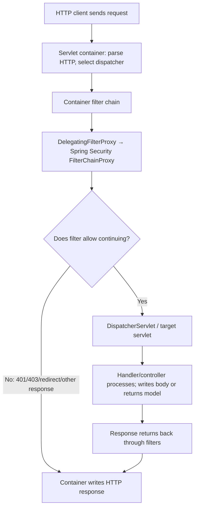

# `HttpServletRequest`, `HttpServletResponse`, and the Lifecycle of an HTTP Request

**Scope:** Jakarta Servlet foundation in Java web applications, focusing on how request/response objects flow through Spring MVC and Spring Security (Servlet stack). Examples use Java 17, Spring Boot 3.3.x, Spring Security 6.x, and the `jakarta.servlet.*` namespace.

## 1. The Big Picture

When a browser or HTTP client sends a request, the **Servlet container** (for example, Tomcat) accepts and handles the connection, parses the HTTP message, and creates or attaches objects representing the request and response for one processing pass:

- **`HttpServletRequest`** is the interface for *reading HTTP input*: method, path, query string, headers, cookies, parameters, body content, session information, and internal request attributes.
- **`HttpServletResponse`** is the interface for *building HTTP output*: status code, headers, cookies, content type/charset, and body; the container actually writes the data out over the connection.
- Both interfaces belong to the **Jakarta Servlet API** (`jakarta.servlet.http`); the application normally receives implementation/wrapper objects provided by the container or filters. Do not instantiate them yourself like ordinary DTOs.
- An **HTTP request** and a **Servlet dispatch** are not always one-to-one: `forward`, error dispatch, and async dispatch can cause a request to pass through different components. For a normal synchronous request, the container assigns a processing thread to the filter chain and servlet; with asynchronous processing, work may continue on a different thread.

Example:

```http
GET /api/hello?name=An HTTP/1.1
Host: localhost:8080
Accept: text/plain
```

In a controller, `request.getMethod()` is `GET`, `request.getRequestURI()` is `/api/hello`, and `request.getQueryString()` is `name=An`; after processing, `response` can carry `200 OK`, `Content-Type: text/plain;charset=UTF-8`, and the greeting body.

**Distinguish three lifecycles:** servlets/filters are typically managed by the container as components reused across many requests; request/response objects are bound to a single processing pass; an HTTP session (if used) can persist across multiple requests. Do not store request/response objects in `static` fields or singleton beans for later reuse.

## 2. Lifecycle from Receiving HTTP to Returning the Response



Key stages to remember:

1. **Receiving and routing:** the container reads the request line/headers, selects the application, URL mapping, and dispatch type, and binds request/response to the processing pass. The body may be read on demand rather than eagerly preloaded into a string.
2. **Entering filters (`chain.doFilter`)**: a filter can inspect/modify the request or response, set headers, log, wrap the objects using `HttpServletRequestWrapper`/`HttpServletResponseWrapper`, or stop the chain by writing its own response.
3. **Spring Security (if configured):** `DelegatingFilterProxy` delegates the call to `FilterChainProxy`; this object selects the matching `SecurityFilterChain` to run security filters such as security context restoration, authentication, CSRF, and authorization. Order, matchers, and configuration determine which filters run. Only requests passing through a registered chain are subject to its corresponding rules.
4. **Target servlet:** in Spring MVC this is typically `DispatcherServlet`, followed by handler mapping, controller, and data conversion (`@RequestBody`, `@ResponseBody`, `ResponseEntity`, etc.). Servlets not using Spring MVC can still handle requests directly.
5. **Return path:** after `chain.doFilter` returns, the `finally`/post-chain code of filters executes in reverse order. `status`, headers, and body are sent/finalized by the container; when the response is **committed** depends on flushing, buffer capacity, or operations such as `sendError`/`sendRedirect`, and must not be inferred solely from the controller having returned.
6. **Completion or further dispatch:** the container cleans up resources and releases the synchronous request scope. `forward`, `ERROR`, and `ASYNC` can trigger further dispatches; some filters do not participate in every dispatch type.

The happy path is typically `client → filters → security filters → servlet/controller → filters → client`. A blocked path (for example, insufficient permissions) can return `401`/`403` directly from a security filter **without executing the controller**.

## 3. Reading `HttpServletRequest` Properly

| Need | Commonly used API | Meaning / notes |
| --- | --- | --- |
| HTTP method | `getMethod()` | `GET`, `POST`, `PUT`…; do not infer permissions from the method. |
| Path | `getRequestURI()` | Request URI path, **excluding query string**; may include context path. |
| Context and servlet mapping | `getContextPath()`, `getServletPath()`, `getPathInfo()` | Depends on deployment/mapping; `getPathInfo()` can be `null`. |
| Raw query | `getQueryString()` | Raw string after `?`, can be `null`; not yet a decoded map. |
| Parameters | `getParameter("name")`, `getParameterValues(...)` | Returns query parameters and, depending on content type, URL-encoded form parameters; does not represent a JSON body. |
| Headers | `getHeader("Accept")`, `getHeaders("X-Tag")` | Header names are case-insensitive; a header may not exist. |
| Body | `getInputStream()` **or** `getReader()` | The body is a stream; normally consumed once. Do not mix both on the same request. |
| Cookies | `getCookies()` | Can be `null`; do not trust cookie data by default. |
| Session | `getSession(false)` | Gets existing session or `null`; `getSession()`/`getSession(true)` can **create a new session**. |
| Internal data | `getAttribute(...)`, `setAttribute(...)` | Shared between filters/servlets within the same request, distinct from query/form parameters. |
| Client/proxy | `getRemoteAddr()` | May be the reverse proxy address; do not blindly trust client-sent `X-Forwarded-For`. |

### URLs and parameters: avoiding confusion

For a hypothetical request to `https://example.test/shop/api/items?id=7`, with the application deployed at context `/shop`:

- `getContextPath()` → `/shop`.
- `getRequestURI()` → `/shop/api/items`.
- `getQueryString()` → `id=7`.
- `getParameter("id")` → `"7"`.
- `getRequestURL()` returns a `StringBuffer` containing the URL **without the query**, based on request information seen by the container; the external hostname/scheme behind a proxy may differ if forwarded headers are not configured properly.

`getParameter` can return `null`; for multiple values with the same name, use `getParameterValues`. For JSON `{"name":"An"}` sent with `Content-Type: application/json`, `getParameter("name")` **does not automatically parse JSON**; in Spring MVC, use `@RequestBody` and the appropriate message converter.

### Reading the body, encoding, and request attributes

- If reading the body yourself as characters, choose an appropriate charset before calling `getReader()`; `setCharacterEncoding(...)` must be performed before parameter/body data is decoded to take effect where applied by the container.
- `getInputStream()` reads bytes; `getReader()` reads characters. After a filter reads the entire body, a downstream `@RequestBody` may have nothing left to read. `ContentCachingRequestWrapper` only caches bytes that have already been read and **does not turn the input stream into a replayable stream on its own**; to re-read the body, you need a properly designed wrapper.
- `request.setAttribute("traceId", id)` shares data with downstream filters/servlets in the *current request*. `session.setAttribute(...)` persists across multiple requests in the session. Do not put per-request data into singleton beans or static fields.
- Never log raw `Authorization` headers, cookies, access tokens, passwords, or sensitive bodies. All client-supplied data must be validated before use.

## 4. Building `HttpServletResponse` Properly

An HTTP response consists of a **status line, headers, and body**. Important operations:

| API | Effect | Remember |
| --- | --- | --- |
| `setStatus(201)` | Sets the HTTP status code | Body can still be written; choose a code reflecting the actual outcome. |
| `sendError(400)` | Reports an error via the container | May trigger an error page/dispatch; does not inherently guarantee your app's custom error JSON. |
| `sendRedirect("/login")` | Redirect response (typically 302) | Client sends a **new request** to `Location`; different from `RequestDispatcher.forward(...)`. |
| `setHeader("X-Trace-Id", id)` | Sets/overwrites header with that name | Use `addHeader` when you want to append a value instead of replacing. |
| `setContentType(...)`, `setCharacterEncoding(...)` | Declares media type and charset | Set **before** obtaining the writer or committing the response. |
| `getWriter()` | Writes text body | Do not combine with `getOutputStream()` on the same response. |
| `getOutputStream()` | Writes binary body | For example, streaming files; manage flushing and client disconnect errors. |
| `addCookie(cookie)` | Adds `Set-Cookie` | For sensitive cookies, consider `HttpOnly`, `Secure`, `SameSite`, `Path`, and expiration. |
| `isCommitted()` | Indicates whether headers/status have been committed | After commit, changing status/headers may have no effect or raise an error. |

**Buffering and commit:** Writing a few characters to the writer does not necessarily send headers over the network immediately. Responses are usually buffered; flushing the writer/stream, filling the buffer, or control operations like `sendError` can commit the response. Do not try to write new error JSON after the response is already committed. In Spring MVC, use `ResponseEntity`, `@ResponseStatus`, or an exception handler for most use cases; let the framework choose the converter and manage the response.

**Forward vs redirect:** `RequestDispatcher.forward(req, resp)` transfers processing internally on the server (typically keeping the same request and attributes) and must happen before the response is committed. `sendRedirect(...)` returns a status + `Location`, and the browser/client makes a new request; old request attributes do not carry over automatically.

## 5. Relationship to Spring Security Servlet

Security filters read information from `HttpServletRequest` (headers, cookies/session, path, method, credentials) and decide whether processing should continue to the controller. They can also modify `HttpServletResponse` (for example `WWW-Authenticate`, redirect to login, `401 Unauthorized`, `403 Forbidden`, security headers).

- **Authentication** answers “who is calling?”; after authentication, `Authentication` is typically accessed via `SecurityContextHolder` in the appropriate processing context. `request.getUserPrincipal()` can reflect the principal through the Servlet integration layer, but you should not assume every configuration produces the same principal type.
- **Authorization** answers “is this caller allowed to access this endpoint?”; request matchers and `authorizeHttpRequests` configure the policy. `permitAll()` does not mean all other filters are disabled.
- **Exception handling:** depending on authentication state, `ExceptionTranslationFilter` coordinates `AuthenticationEntryPoint` (typically triggering authentication/401 or a redirect) and `AccessDeniedHandler` (typically 403). The actual outcome depends on the authentication mechanism and configuration.
- **CSRF:** for cookie/session-based applications, state-changing requests like POST/PUT/DELETE typically require CSRF protection. The CSRF filter can reject a request **before** it reaches the controller, even for endpoints configured with `permitAll()`. Do not disable CSRF out of habit; evaluate the authentication mechanism and how clients send credentials.
- **Session and async:** do not assume HTTP Basic automatically makes a system stateless. `SecurityContextHolder` defaults to a thread-bound context; with `@Async`, executors, or Servlet async, an appropriate context propagation mechanism is needed rather than reading the ThreadLocal directly on another thread.

Therefore, when diagnosing `401`, `403`, redirects, or a controller not being invoked, check the **selected filter chain, matchers, filter order, authentication, CSRF, and dispatch type** before looking only at controller code.

## 6. Runnable Example: Filter → Spring Security → Controller

Example using Spring Boot 3.3.5, Java 17. Create the files in the exact structure below, then run Maven. The public endpoint `GET /api/hello` lets you observe the method/URI. The filter generates `X-Request-Id` and logs on both sides of `chain.doFilter`; the security config requires authentication for all remaining paths.

**`pom.xml`**

```xml
<project xmlns="http://maven.apache.org/POM/4.0.0"
         xmlns:xsi="http://www.w3.org/2001/XMLSchema-instance"
         xsi:schemaLocation="http://maven.apache.org/POM/4.0.0 https://maven.apache.org/xsd/maven-4.0.0.xsd">
    <modelVersion>4.0.0</modelVersion>
    <parent>
        <groupId>org.springframework.boot</groupId>
        <artifactId>spring-boot-starter-parent</artifactId>
        <version>3.3.5</version>
        <relativePath/>
    </parent>
    <groupId>demo</groupId>
    <artifactId>servlet-lifecycle</artifactId>
    <version>0.0.1-SNAPSHOT</version>
    <properties>
        <java.version>17</java.version>
    </properties>
    <dependencies>
        <dependency>
            <groupId>org.springframework.boot</groupId>
            <artifactId>spring-boot-starter-web</artifactId>
        </dependency>
        <dependency>
            <groupId>org.springframework.boot</groupId>
            <artifactId>spring-boot-starter-security</artifactId>
        </dependency>
    </dependencies>
    <build>
        <plugins>
            <plugin>
                <groupId>org.springframework.boot</groupId>
                <artifactId>spring-boot-maven-plugin</artifactId>
            </plugin>
        </plugins>
    </build>
</project>
```

**`src/main/java/demo/Application.java`**

```java
package demo;

import org.springframework.boot.SpringApplication;
import org.springframework.boot.autoconfigure.SpringBootApplication;

@SpringBootApplication
public class Application {
    public static void main(String[] args) {
        SpringApplication.run(Application.class, args);
    }
}
```

**`src/main/java/demo/SecurityConfig.java`**

```java
package demo;

import org.springframework.context.annotation.Bean;
import org.springframework.context.annotation.Configuration;
import org.springframework.http.HttpMethod;
import org.springframework.security.config.Customizer;
import org.springframework.security.config.annotation.web.builders.HttpSecurity;
import org.springframework.security.web.SecurityFilterChain;

@Configuration
public class SecurityConfig {
    @Bean
    SecurityFilterChain security(HttpSecurity http) throws Exception {
        http.authorizeHttpRequests(auth -> auth
                .requestMatchers(HttpMethod.GET, "/api/hello").permitAll()
                .anyRequest().authenticated());
        http.httpBasic(Customizer.withDefaults());
        return http.build();
    }
}
```

**`src/main/java/demo/TraceFilter.java`**

```java
package demo;

import java.io.IOException;
import java.util.UUID;

import jakarta.servlet.FilterChain;
import jakarta.servlet.ServletException;
import jakarta.servlet.http.HttpServletRequest;
import jakarta.servlet.http.HttpServletResponse;

import org.springframework.core.Ordered;
import org.springframework.core.annotation.Order;
import org.springframework.stereotype.Component;
import org.springframework.web.filter.OncePerRequestFilter;

@Component
@Order(Ordered.HIGHEST_PRECEDENCE)
public class TraceFilter extends OncePerRequestFilter {
    @Override
    protected void doFilterInternal(HttpServletRequest request,
                                    HttpServletResponse response,
                                    FilterChain chain)
            throws ServletException, IOException {
        String id = UUID.randomUUID().toString();
        request.setAttribute("traceId", id);
        response.setHeader("X-Request-Id", id);

        System.out.printf("[%s] ENTER %s %s%n",
                id, request.getMethod(), request.getRequestURI());
        try {
            chain.doFilter(request, response);
        } finally {
            System.out.printf("[%s] EXIT status=%d committed=%s%n",
                    id, response.getStatus(), response.isCommitted());
        }
    }
}
```

**`src/main/java/demo/HelloController.java`**

```java
package demo;

import java.nio.charset.StandardCharsets;

import jakarta.servlet.http.HttpServletRequest;

import org.springframework.http.MediaType;
import org.springframework.http.ResponseEntity;
import org.springframework.web.bind.annotation.GetMapping;
import org.springframework.web.bind.annotation.RequestParam;
import org.springframework.web.bind.annotation.RestController;

@RestController
public class HelloController {
    @GetMapping(value = "/api/hello", produces = MediaType.TEXT_PLAIN_VALUE)
    public ResponseEntity<String> hello(
            @RequestParam(name = "name", defaultValue = "bạn") String name,
            HttpServletRequest request) {
        String body = "Xin chào, " + name
                + " | method=" + request.getMethod()
                + " | uri=" + request.getRequestURI();
        return ResponseEntity.ok()
                .contentType(new MediaType("text", "plain", StandardCharsets.UTF_8))
                .header("X-Handled-By", "HelloController")
                .body(body);
    }
}
```

**Run and test (in the directory containing `pom.xml`):**

```bash
mvn spring-boot:run

# In another terminal:
curl -s 'http://localhost:8080/api/hello?name=An'
curl -si 'http://localhost:8080/api/hello?name=An'
curl -s -o /dev/null -w '%{http_code}\n' http://localhost:8080/api/private
curl -s -o /dev/null -w '%{http_code}\n' -X POST http://localhost:8080/api/hello
```

The first `curl -s` command returns the **exact body** (with no trailing newline added by the controller):

```text
Xin chào, An | method=GET | uri=/api/hello
```

- The `curl -si` command shows status `200`, `Content-Type: text/plain;charset=UTF-8`, and headers such as `X-Request-Id` (a UUID changing on every request) and `X-Handled-By: HelloController`; header order and casing are determined by the server.
- An unauthenticated request to `/api/private` returns **401** via HTTP Basic before reaching any controller. The route `/api/private` is not declared; if authentication succeeded, the MVC step could return `404`, which is a separate scenario.
- `POST /api/hello` without a CSRF token typically returns **403** from `CsrfFilter` under the configuration above; this does not prove the controller supports POST (the controller only declares GET).
- `TraceFilter` logs an `ENTER` line before `chain.doFilter` and an `EXIT` line in `finally`; `status` reflects the status observed when the filter exits. `committed` may be `true` or `false` depending on timing and how the response is written, so **do not hardcode this value as an expected output**.
- Because the filter is registered at the Servlet level with `@Order(Ordered.HIGHEST_PRECEDENCE)`, this example places it ahead of the security filter proxy. In real systems, always check registration order and dispatcher types of filters.
- The example uses Basic auth only to make `401` easy to observe; the default password generated by Spring Boot in the logs is for testing purposes. Real applications need proper authentication and appropriate session/CSRF policies.

## 7. Common Pitfalls

### A. `401` and `403` can happen before the controller

If an authentication, authorization, or CSRF filter ends processing, the `@GetMapping`/`@PostMapping` method will not run. Put a breakpoint in the filter chain, inspect matchers and protection configuration, and do not jump to concluding that the URL mapping is wrong.

### B. Reading the body for logging breaks `@RequestBody`

A filter that directly calls `request.getInputStream().readAllBytes()` can consume the body before Spring MVC sees it. Use a bounded, privacy-compliant logging strategy that fits async flows and a wrapper designed for re-reading if truly necessary. `ContentCachingRequestWrapper` does not automatically allow replaying an already-read body.

### C. Writing the response too early

If a filter calls `response.getWriter().write(...)` and flushes before `chain.doFilter`, the controller may be unable to modify the status or headers. If a filter has already handled the response itself (for example, returning 401), it should normally `return` and **not** continue the chain. Do not call `sendError` after the response is already committed.

### D. Confusing data scopes

`getParameter` comes from HTTP input; `getAttribute` is data attached to the request; `getSession(false)` is session-scoped state if one exists. A session is not equivalent to a single HTTP request, and `request.getSession()` can create a session unintentionally.

### E. Forgetting proxies and input security

`getRemoteAddr()` is often a proxy. `Host` and `X-Forwarded-*` headers are untrusted without a trusted proxy configuration; misconfiguration can corrupt URLs, redirects, or security decisions. Never log credentials and never build unescaped HTML from user parameters.

### F. Confusing `javax` and `jakarta`

Spring Boot 3 / Spring Framework 6 use `jakarta.servlet.*` imports. Copying `javax.servlet.*` examples from the older ecosystem can break compilation or introduce dependency mismatches. Align the Servlet, Spring, and library generations.

### G. Assuming every request runs on exactly one thread / one filter pass

Async processing, `forward`, `ERROR` dispatch, and dispatcher type configuration can cause code to run on a different thread or dispatch. `OncePerRequestFilter` has its own policies for async/error dispatches; do not infer that every filter executes exactly once across the entire HTTP network lifecycle.

## 8. Self-Check Checklist When Debugging a Request

1. Record **method + URI + query** without logging secrets; identify context path, proxies, and the expected target handler.
2. Check which Servlet filters are registered, their order, and dispatcher types; verify whether each filter calls `chain.doFilter` or writes its own response.
3. If using Spring Security, identify which `SecurityFilterChain` matches, the current authentication, authorization matchers, and CSRF.
4. Once at MVC, check handler mapping, binding (`@RequestParam`, `@RequestBody`), and exception handlers.
5. Determine who sets status, headers, and body; check `response.isCommitted()` before modifying the response.
6. For async/error/forward, trace each dispatch and the security/request context propagation mechanism.

**Practice exercise:** Add a `GET /api/inspect` endpoint that reads `getQueryString()` and `getAttribute("traceId")`; compare with `getHeader("X-Request-Id")` (this header belongs to the *response*, not the request). Then try sending a `POST` without a CSRF token and observe why the controller does not run. Finally, change the filter so it only calls `response.setHeader(...)` before `chain.doFilter`, and explain why that is the right place to add a request-ID header.