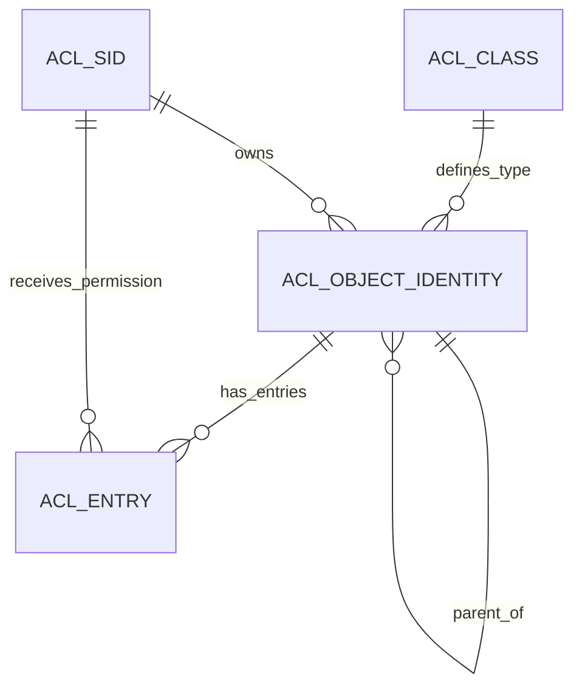

# `AclService`, `MutableAclService`, and JDBC ACL Storage

**Module:** Spring Security – Servlet  
**Category:** Resource Authorization  
**Demonstrated Stack:** Java 17, Spring Boot 3.3.5, Spring Security ACL 6.x, Spring MVC/Servlet, Spring JDBC, and H2.

## 1. Objectives

`authorizeHttpRequests(...).authenticated()` only requires the caller to have an authenticated identity. It **does not** answer whether Alice may read a document belonging to Bob. Spring Security ACL (*Access Control List*) solves authorization **per resource**, per user or authority. Three core components in this topic are:

- **`AclService`**: reads ACLs for one or more `ObjectIdentity` instances.
- **`MutableAclService`**: extends the read API with operations to create, update, and delete ACLs/ACEs.
- **JDBC ACL storage**: persists resource identities, SIDs, and ACE lists across four constrained relational tables.

After this lesson, you will understand `Sid`, `ObjectIdentity`, `Acl`, `AccessControlEntry`, `Permission` masks, `granting`, `owner`, `parent`, and `entriesInheriting`; read/write ACLs with `JdbcMutableAclService`; configure `BasicLookupStrategy`, `AclCache`, and the JDBC schema; integrate method security; test grants and revocations; and manage transactions, caching, and tenant isolation.

**Key takeaway:** ACLs store only **policy data**. They do not protect controllers automatically: the system must authenticate the caller, query ACLs, and enforce authorization decisions at the HTTP, method, or domain boundary.

## 2. When Do You Need ACLs Instead of Simple Roles/Ownership?

Suppose an application has documents:

| Document | Owner | READ Permission | WRITE Permission |
| --- | --- | --- | --- |
| 101 | Alice | Alice, Bob | Alice |
| 102 | Bob | Bob | Bob |
| 103 | Carol | Carol, REVIEWER group | Carol |

An HTTP rule:

```java
.requestMatchers("/api/documents/**").authenticated()
```

checks only identity, not object ID. A method:

```java
@PreAuthorize("hasRole('USER')")
public Document read(long id) { ... }
```

also fails to stop a regular user from reading someone else's document. Without per-ID authorization checks, the system is vulnerable to **IDOR/BOLA**.

ACLs let you express:

```text
ObjectIdentity(Document, 101)
    ACE 0: PrincipalSid("alice"), READ, allow
    ACE 1: PrincipalSid("alice"), WRITE, allow
    ACE 2: PrincipalSid("bob"),   READ, allow
    ACE 3: GrantedAuthoritySid("ROLE_ADMIN"), READ, allow
```

When user Bob requests to read document 101, the system builds `PrincipalSid("bob")` and authority SIDs from `Authentication`, then checks the READ ACEs.

**Choose ACLs intentionally:** If the app only has a rule like "the record creator may edit", a database query `WHERE owner_id = :currentUser` can be simpler than ACLs. ACLs shine when you have document sharing, group permissions, multiple permissions per resource, parent inheritance, or per-object grants/revocations.

## 3. Six Foundational ACL Objects

### 3.1. `ObjectIdentity`: Which Object?

```java
ObjectIdentity oid =
        new ObjectIdentityImpl(Document.class, 101L);
```

Imports:

```java
import org.springframework.security.acls.model.ObjectIdentity;
import org.springframework.security.acls.domain.ObjectIdentityImpl;
```

An object identity consists of a **class/type name** and an **identifier**. For class `demo.acl.Document`, the database typically records `acl_class.class = 'demo.acl.Document'` and object ID `101`. If you rename the package/class without migrating ACL data, lookups may fail to find existing ACLs.

Never reuse the ID of a deleted document for a new document if stale ACLs might remain. In multi-tenant systems, `(Document.class, 101)` may not distinguish document 101 across two tenants; use globally unique IDs, explicit tenant namespacing, or an appropriate object-identity strategy.

### 3.2. `Sid`: Who Receives Permission?

Two common types:

```java
Sid alice = new PrincipalSid("alice");
Sid admins = new GrantedAuthoritySid("ROLE_ADMIN");
```

Imports:

```java
import org.springframework.security.acls.model.Sid;
import org.springframework.security.acls.domain.PrincipalSid;
import org.springframework.security.acls.domain.GrantedAuthoritySid;
```

`PrincipalSid` represents a specific identity. `GrantedAuthoritySid` represents an authority/role shared by a group of users. Both are stored in `acl_sid`; the `principal` column distinguishes the two types.

**SID sources must be trusted:** take username from `authentication.getName()` and authorities from `authentication.getAuthorities()`; never use raw `X-User`, `X-Role`, or a client-supplied username string to **decide the caller's own permissions**.

### 3.3. `Permission`: Allowed to Do What?

Spring ACL provides `BasePermission` with standard bit masks:

| Permission | Mask | Suggested Meaning |
| --- | ---: | --- |
| `BasePermission.READ` | 1 | Read |
| `BasePermission.WRITE` | 2 | Edit |
| `BasePermission.CREATE` | 4 | Create |
| `BasePermission.DELETE` | 8 | Delete |
| `BasePermission.ADMINISTRATION` | 16 | Manage ACL/permissions |

```java
import org.springframework.security.acls.domain.BasePermission;
import org.springframework.security.acls.model.Permission;

Permission permission = BasePermission.READ;
int mask = permission.getMask(); // 1
```

A permission mask is an integer value representing a right. **`ROLE_ADMIN` does not implicitly imply `BasePermission.READ`** on every object. For admins to read all documents, you must have an ACE for the admin authority, a trusted policy override, or an intentional permission-granting strategy.

Custom permissions need stable, non-colliding masks, tests, and migrations when changed. Never assume a string `"READ"` is understood by every `PermissionEvaluator` as you expect without configuring the mapping.

### 3.4. `AccessControlEntry`: A Single Grant or Deny Row

An ACE includes the ACL object identity, SID, permission mask, `granting`, order, and audit flags.

```text
acl_object_identity = 10
ace_order = 0
sid = PrincipalSid("alice")
mask = 1
granting = true
audit_success = false
audit_failure = false
```

`granting=true` grants permission per the permission-granting strategy's semantics; `granting=false` can represent denial. **ACE order can affect the outcome**. Do not assume simply that an ALLOW anywhere always permits, or that any DENY always beats every ALLOW. Evaluate according to the actual strategy and ACE order, with positive and negative tests for the combinations you use.

### 3.5. `Acl`: The Permission Set for an Object

An `Acl` brings together the object identity, owner SID, entries, parent ACL, and `entriesInheriting`. Two easily confused owners:

- **Domain owner**: the document owner in the business table.
- **ACL owner**: the owner of the ACL, which `AclAuthorizationStrategy` may inspect when modifying the ACL.

Do not automatically assume these two owners are the same person; the demo project sets the ACL owner to a separate seed identity, while the domain owner is Alice/Bob.

### 3.6. Parent and Inheritance

A child object can inherit permissions from a parent ACL if the parent relation and `entriesInheriting` are configured properly. For example, folders and files can share an inheritance policy. However, merely having a `parent_object` column in the DB **does not automatically build** a permission hierarchy if code never sets the parent ACL.

For revoked permissions, a user may still be granted access via a **role ACE** or **parent ACL**, even after their personal principal ACE is removed. Inspect all grant sources, not just a single row.

## 4. `AclService`: Reading ACLs by ObjectIdentity

`AclService`, in `org.springframework.security.acls.model`, is a **read-only** interface. Key methods:

```java
Acl acl = aclService.readAclById(
        new ObjectIdentityImpl(Document.class, 101L));
```

There is an overload taking the relevant SID list:

```java
List<Sid> sids = List.of(
        new PrincipalSid("alice"),
        new GrantedAuthoritySid("ROLE_USER"));
Acl acl = aclService.readAclById(oid, sids);
```

In addition, `readAclsById(...)` supports reading multiple object identities, which helps when evaluating permissions for a list of documents. Avoid calling `readAclById` individually thousands of times in a loop without considering batch reads, caching, and N+1 queries.

### 4.1. Evaluating `isGranted`

```java
boolean allowed = acl.isGranted(
        List.of(BasePermission.READ),
        sids,
        false);
```

The three parameters are the permission list, SID list, and `administrativeMode`. For ordinary READ checks, pass `false`; never interpret `administrativeMode=true` as an admin bypass switch.

`Acl.isGranted(...)` or `readAclById(...)` can throw `NotFoundException` if no matching ACL/ACE is found. When building policies, typically handle this **fail-closed**—lacking proof of permission means denying access.

### 4.2. Building SIDs from Authentication

```java
List<Sid> sids = new ArrayList<>();
sids.add(new PrincipalSid(authentication.getName()));

for (GrantedAuthority authority : authentication.getAuthorities()) {
    sids.add(new GrantedAuthoritySid(authority.getAuthority()));
}
```

Imports are `java.util.ArrayList`, `org.springframework.security.core.Authentication`, and `org.springframework.security.core.GrantedAuthority`.

If a user is granted READ via a role, the corresponding authority SID must be in the list. Creating only the principal SID may silently miss permissions granted through groups.

## 5. `MutableAclService`: Creating, Updating, and Deleting ACLs

`MutableAclService` extends `AclService`. Beyond read methods, it provides operations such as:

```java
MutableAcl createAcl(ObjectIdentity identity);
MutableAcl updateAcl(MutableAcl acl);
void deleteAcl(ObjectIdentity identity, boolean deleteChildren);
```

These are conceptual signatures; exception declarations are omitted. Real calls can throw `AlreadyExistsException`, `NotFoundException`, ACL administration check failures, or JDBC exceptions.

### 5.1. Creating an ACL

```java
ObjectIdentity identity = new ObjectIdentityImpl(Document.class, 101L);
MutableAcl acl = mutableAclService.createAcl(identity);
```

`JdbcMutableAclService` may use the current `Authentication` as the **ACL owner**. When running from a bootstrap thread without a security context, provide a safe way to seed the owner. The project uses `AclSeeder` to create a bootstrap authentication **only during demo initialization**, then clears the context; never turn this pattern into a backdoor that elevates privileges over HTTP.

`createAcl` does not create the domain document itself. It creates the ACL structure tied to the object identity. Do not create ACLs for non-existent objects unless business rules allow it; keep lifecycles consistent.

### 5.2. Granting Read Permission

```java
MutableAcl acl = (MutableAcl) mutableAclService.readAclById(identity);
acl.insertAce(
        acl.getEntries().size(),
        BasePermission.READ,
        new PrincipalSid("bob"),
        true);
mutableAclService.updateAcl(acl);
```

**Distinguish clearly:**

- `insertAce` mutates the mutable ACL object in memory.
- `updateAcl` persists changes via the implementation (JDBC, cache sync/eviction).
- `@Transactional` should wrap a read-modify-write operation.
- The caller must hold **ACL management permission**, not merely document read permission.

Design idempotency to avoid creating duplicate ACEs on request retries, and handle concurrent modifications when two admins edit the same ACL simultaneously.

### 5.3. Revoking an ACE

Fragment to delete Bob's READ entry:

```java
MutableAcl acl = (MutableAcl) mutableAclService.readAclById(identity);

for (int i = acl.getEntries().size() - 1; i >= 0; i--) {
    AccessControlEntry ace = acl.getEntries().get(i);
    if (ace.getSid().equals(new PrincipalSid("bob"))
            && ace.getPermission().equals(BasePermission.READ)) {
        acl.deleteAce(i);
    }
}
mutableAclService.updateAcl(acl);
```

Import `org.springframework.security.acls.model.AccessControlEntry`. Iterate backward so indexes do not shift. Even so, Bob might **still get READ** from a GrantedAuthoritySid or parent ACL. Test actual post-revocation behavior, including caches.

### 5.4. Deleting an ACL

```java
mutableAclService.deleteAcl(identity, false);
```

`deleteAcl` deletes ACL permissions, **not** the business document. `deleteChildren` requires understanding parent/child ACL relationships beforehand; if true, it can affect child ACLs. When deleting a domain object, clean up its ACL synchronously or via a compensation workflow; leaving stale ACLs and reusing IDs can grant unintended access.

## 6. Four ACL Tables with JDBC



| Table | Key Fields | Role |
| --- | --- | --- |
| `acl_class` | `id`, `class` | Identifies object type, e.g., `demo.acl.Document` |
| `acl_sid` | `id`, `principal`, `sid` | User/role receiving permissions |
| `acl_object_identity` | `id`, `object_id_class`, `object_id_identity`, `owner_sid`, `parent_object`, `entries_inheriting` | One ACL bound to an object instance |
| `acl_entry` | `id`, `acl_object_identity`, `ace_order`, `sid`, `mask`, `granting`, `audit_success`, `audit_failure` | Ordered ACEs |

Constraints to remember: unique on `acl_class.class`, unique `(acl_sid.sid, acl_sid.principal)`, unique `(acl_object_identity.object_id_class, object_id_identity)`, and unique `(acl_entry.acl_object_identity, ace_order)`. Foreign keys prevent permission rows from pointing to invalid classes, SIDs, or ACLs.

### 6.1. Sample Data

```text
acl_class
  id=1 class=demo.acl.Document

acl_sid
  id=1 principal=true sid=acl-bootstrap
  id=2 principal=true sid=alice
  id=3 principal=true sid=bob
  id=4 principal=false sid=ROLE_ADMIN

acl_object_identity
  id=1 object_id_class=1 object_id_identity=101 owner_sid=1

acl_entry
  acl_object_identity=1 ace_order=0 sid=2 mask=1 granting=true
  acl_object_identity=1 ace_order=1 sid=4 mask=1 granting=true
```

This dataset is illustrative; generated IDs may vary with actual insert order. `owner_sid` is the ACL owner created during bootstrap, not necessarily the domain owner `alice`.

### 6.2. Consistency of DDL and Java Class Names

`ObjectIdentityImpl(Document.class, 101L)` uses `Document`'s class name as the object type. If you rename the `demo.acl` package in source code without migrating `acl_class`, existing permissions can "disappear" on lookup. When using UUID/string IDs, a default bigint schema may be insufficient; design a stable object ID mapping compatible with the JDBC implementation.

In multi-tenant setups, if two tenants both have `Document.id=101`, prevent collisions in `acl_object_identity`. Use globally unique IDs or tenant-namespaced object keys. Never let tenant A's SID `alice` receive permissions on tenant B's object due to colliding keys.

### 6.3. Why Transactions Matter

Creating an ACL may insert into `acl_class`, `acl_sid`, and `acl_object_identity`; updating an ACL may delete/insert multiple entries. Without a transaction, mid-flight failures can leave half-written data.

Wrapping the entire operation in `@Transactional` keeps Spring JDBC on the same transaction/connection and supports identity queries in certain dialects. It **does not** automatically prevent lost updates when two admins edit the same ACL concurrently; use locking, versioning, or serialized command handling.

## 7. JDBC Implementations and Caching

- `JdbcAclService`: **read-only** ACL implementation, suited when ACLs are managed elsewhere.
- `JdbcMutableAclService`: implements `MutableAclService`, inheriting read capability and adding mutations.
- `BasicLookupStrategy`: reads ACL/ACE/owner/parent data via JDBC.
- `AclCache`, `SpringCacheBasedAclCache`: caches loaded ACLs.
- `AclAuthorizationStrategy`: decides who may modify ACL owners/entries.
- `PermissionGrantingStrategy`: evaluates ACEs during `isGranted`.
- `AclService`/`MutableAclService`: interfaces to inject into the corresponding services.

Never inject `MutableAclService` into every controller if you only need read checks. Follow least privilege: policy classes take `AclService`, while admin classes take `MutableAclService`.

### 7.1. Database-Specific Identity Queries

`JdbcMutableAclService` needs to fetch newly generated IDs for `acl_class` and `acl_sid`. Queries depend on the SQL dialect. For example, H2 uses:

```java
service.setClassIdentityQuery(
        "SELECT CURRENT VALUE FOR acl_class_seq");
service.setSidIdentityQuery(
        "SELECT CURRENT VALUE FOR acl_sid_seq");
```

This is H2 sequence syntax matching the schema below, **not** cross-database SQL. PostgreSQL may require `currval(...)` with the appropriate sequence name and transaction; MySQL uses a different last-insert-identity mechanism. When changing databases, use migrations and integration tests on the target dialect.

### 7.2. ACL Cache Does Not Sync Across Nodes Automatically

`JdbcMutableAclService.updateAcl` interacts with the configured ACL cache. However, a `ConcurrentMapCache` is **single-JVM**. In multi-instance deployments, other nodes can keep serving stale ACLs after one node revokes access. Use distributed invalidation/versioning/TTL and test against revocation-latency requirements.

Pay special attention to parent ACL inheritance, object type+ID cache keys, multi-tenant keys, and read/write/transaction ordering.

## 8. Runnable Demo Project: Spring Boot + H2 JDBC ACL

The demo has two documents and three accounts:

- `alice / alice-pass`, `ROLE_USER`, allowed to READ document 101.
- `bob / bob-pass`, `ROLE_USER`, allowed to READ document 102.
- `admin / admin-pass`, `ROLE_ADMIN`, allowed to READ both 101 and 102 via a role ACE.
- `POST /api/docs/{id}/shares?username=bob`: admin can grant Bob READ on document 101 using `MutableAclService`.

The HTTP layer requires authentication; `@PreAuthorize` on the service checks ACLs or protects admin operations. Document data uses an in-memory Map, while ACL metadata is persisted in H2 via JDBC. In-memory H2 does **not** survive process restarts; durable storage requires a persistent database server/file and migrations.

### 8.1. Directory Tree

```text
jdbc-acl-demo/
├── pom.xml
└── src/
    ├── main/
    │   ├── java/demo/acl/
    │   │   ├── AclApplication.java
    │   │   ├── SecurityConfig.java
    │   │   ├── AclInfrastructure.java
    │   │   ├── Document.java
    │   │   ├── DocumentStore.java
    │   │   ├── AclBootstrap.java
    │   │   ├── AclSeeder.java
    │   │   ├── AclPolicy.java
    │   │   ├── DocumentService.java
    │   │   ├── AclAdministration.java
    │   │   └── DocumentController.java
    │   └── resources/
    │       ├── application.properties
    │       └── schema.sql
    └── test/java/demo/acl/
        └── AclApplicationTests.java
```

Requires JDK 17+, Maven, and initial Maven dependency download access.

### 8.2. `pom.xml`

```xml
<?xml version="1.0" encoding="UTF-8"?>
<project xmlns="http://maven.apache.org/POM/4.0.0"
         xmlns:xsi="http://www.w3.org/2001/XMLSchema-instance"
         xsi:schemaLocation="http://maven.apache.org/POM/4.0.0 https://maven.apache.org/xsd/maven-4.0.0.xsd">
    <modelVersion>4.0.0</modelVersion>
    <parent>
        <groupId>org.springframework.boot</groupId>
        <artifactId>spring-boot-starter-parent</artifactId>
        <version>3.3.5</version>
        <relativePath/>
    </parent>
    <groupId>demo</groupId>
    <artifactId>jdbc-acl-demo</artifactId>
    <version>1.0.0</version>
    <properties>
        <java.version>17</java.version>
    </properties>
    <dependencies>
        <dependency>
            <groupId>org.springframework.boot</groupId>
            <artifactId>spring-boot-starter-web</artifactId>
        </dependency>
        <dependency>
            <groupId>org.springframework.boot</groupId>
            <artifactId>spring-boot-starter-security</artifactId>
        </dependency>
        <dependency>
            <groupId>org.springframework.security</groupId>
            <artifactId>spring-security-acl</artifactId>
        </dependency>
        <dependency>
            <groupId>org.springframework.boot</groupId>
            <artifactId>spring-boot-starter-jdbc</artifactId>
        </dependency>
        <dependency>
            <groupId>com.h2database</groupId>
            <artifactId>h2</artifactId>
            <scope>runtime</scope>
        </dependency>
        <dependency>
            <groupId>org.springframework.boot</groupId>
            <artifactId>spring-boot-starter-test</artifactId>
            <scope>test</scope>
        </dependency>
        <dependency>
            <groupId>org.springframework.security</groupId>
            <artifactId>spring-security-test</artifactId>
            <scope>test</scope>
        </dependency>
    </dependencies>
    <build>
        <plugins>
            <plugin>
                <groupId>org.springframework.boot</groupId>
                <artifactId>spring-boot-maven-plugin</artifactId>
            </plugin>
        </plugins>
    </build>
</project>
```

`spring-security-acl` is a separate module that must be declared; `spring-boot-starter-security` does not automatically create JDBC ACL tables.

### 8.3. `src/main/resources/application.properties`

```properties
spring.datasource.url=jdbc:h2:mem:acldemo;DB_CLOSE_DELAY=-1
spring.datasource.driver-class-name=org.h2.Driver
spring.datasource.username=sa
spring.datasource.password=
spring.sql.init.mode=always
spring.sql.init.schema-locations=classpath:schema.sql
```

In-memory H2 is for single-process testing/demos. Never treat it as **restart-durable** JDBC persistence. Production needs a durable database, protected credentials, and schema migrations.

### 8.4. `src/main/resources/schema.sql`

```sql
CREATE SEQUENCE acl_class_seq START WITH 1 INCREMENT BY 1;
CREATE SEQUENCE acl_sid_seq START WITH 1 INCREMENT BY 1;
CREATE SEQUENCE acl_object_identity_seq START WITH 1 INCREMENT BY 1;
CREATE SEQUENCE acl_entry_seq START WITH 1 INCREMENT BY 1;

CREATE TABLE acl_class (
    id BIGINT DEFAULT NEXT VALUE FOR acl_class_seq PRIMARY KEY,
    class VARCHAR(255) NOT NULL,
    CONSTRAINT uq_acl_class UNIQUE (class)
);

CREATE TABLE acl_sid (
    id BIGINT DEFAULT NEXT VALUE FOR acl_sid_seq PRIMARY KEY,
    principal BOOLEAN NOT NULL,
    sid VARCHAR(255) NOT NULL,
    CONSTRAINT uq_acl_sid UNIQUE (sid, principal)
);

CREATE TABLE acl_object_identity (
    id BIGINT DEFAULT NEXT VALUE FOR acl_object_identity_seq PRIMARY KEY,
    object_id_class BIGINT NOT NULL,
    object_id_identity BIGINT NOT NULL,
    parent_object BIGINT,
    owner_sid BIGINT NOT NULL,
    entries_inheriting BOOLEAN NOT NULL,
    CONSTRAINT uq_acl_object UNIQUE (
        object_id_class, object_id_identity),
    CONSTRAINT fk_acl_class FOREIGN KEY (object_id_class)
        REFERENCES acl_class(id),
    CONSTRAINT fk_acl_parent FOREIGN KEY (parent_object)
        REFERENCES acl_object_identity(id),
    CONSTRAINT fk_acl_owner FOREIGN KEY (owner_sid)
        REFERENCES acl_sid(id)
);

CREATE TABLE acl_entry (
    id BIGINT DEFAULT NEXT VALUE FOR acl_entry_seq PRIMARY KEY,
    acl_object_identity BIGINT NOT NULL,
    ace_order INTEGER NOT NULL,
    sid BIGINT NOT NULL,
    mask INTEGER NOT NULL,
    granting BOOLEAN NOT NULL,
    audit_success BOOLEAN NOT NULL,
    audit_failure BOOLEAN NOT NULL,
    CONSTRAINT uq_acl_order UNIQUE (
        acl_object_identity, ace_order),
    CONSTRAINT fk_acl_entry_object FOREIGN KEY (
        acl_object_identity) REFERENCES acl_object_identity(id),
    CONSTRAINT fk_acl_entry_sid FOREIGN KEY (sid)
        REFERENCES acl_sid(id)
);
```

`schema.sql` creates fresh tables. Never re-run this script verbatim to "migrate" an existing populated database. Constraints and indexes matching queries on `acl_class`, `acl_sid`, `acl_object_identity`, and `acl_entry` must be maintained in real deployments.

### 8.5. `src/main/java/demo/acl/AclApplication.java`

```java
package demo.acl;

import org.springframework.boot.SpringApplication;
import org.springframework.boot.autoconfigure.SpringBootApplication;

@SpringBootApplication
public class AclApplication {
    public static void main(String[] args) {
        SpringApplication.run(AclApplication.class, args);
    }
}
```

### 8.6. `src/main/java/demo/acl/SecurityConfig.java`

```java
package demo.acl;

import org.springframework.context.annotation.Bean;
import org.springframework.context.annotation.Configuration;
import org.springframework.http.HttpMethod;
import org.springframework.security.config.Customizer;
import org.springframework.security.config.annotation.method.configuration.EnableMethodSecurity;
import org.springframework.security.config.annotation.web.builders.HttpSecurity;
import org.springframework.security.config.http.SessionCreationPolicy;
import org.springframework.security.core.userdetails.User;
import org.springframework.security.core.userdetails.UserDetails;
import org.springframework.security.core.userdetails.UserDetailsService;
import org.springframework.security.crypto.bcrypt.BCryptPasswordEncoder;
import org.springframework.security.crypto.password.PasswordEncoder;
import org.springframework.security.provisioning.InMemoryUserDetailsManager;
import org.springframework.security.web.SecurityFilterChain;

@Configuration
@EnableMethodSecurity
public class SecurityConfig {

    @Bean
    PasswordEncoder passwordEncoder() {
        return new BCryptPasswordEncoder();
    }

    @Bean
    UserDetailsService users(PasswordEncoder encoder) {
        UserDetails alice = User.withUsername("alice")
                .password(encoder.encode("alice-pass"))
                .roles("USER").build();
        UserDetails bob = User.withUsername("bob")
                .password(encoder.encode("bob-pass"))
                .roles("USER").build();
        UserDetails admin = User.withUsername("admin")
                .password(encoder.encode("admin-pass"))
                .roles("ADMIN").build();
        return new InMemoryUserDetailsManager(alice, bob, admin);
    }

    @Bean
    SecurityFilterChain securityFilterChain(HttpSecurity http)
            throws Exception {

        http.authorizeHttpRequests(auth -> auth
                .requestMatchers(HttpMethod.GET, "/public/ping")
                    .permitAll()
                .requestMatchers(HttpMethod.GET, "/api/docs/{id}")
                    .authenticated()
                .requestMatchers(HttpMethod.POST,
                        "/api/docs/{id}/shares")
                    .authenticated()
                .anyRequest().denyAll());

        http.httpBasic(Customizer.withDefaults());
        http.sessionManagement(session -> session
                .sessionCreationPolicy(SessionCreationPolicy.STATELESS));

        // CSRF remains enabled, as POST must be tested separately.
        return http.build();
    }
}
```

HTTP Basic is used strictly for local demos with dummy passwords. Real credentials require HTTPS and certificate validation; Base64 does not encrypt passwords. `STATELESS` does not enforce ACLs automatically, and `authenticated()` does not disable CSRF.

### 8.7. `src/main/java/demo/acl/AclInfrastructure.java`

```java
package demo.acl;

import javax.sql.DataSource;

import org.springframework.cache.concurrent.ConcurrentMapCache;
import org.springframework.context.annotation.Bean;
import org.springframework.context.annotation.Configuration;
import org.springframework.security.acls.domain.AclAuthorizationStrategyImpl;
import org.springframework.security.acls.domain.ConsoleAuditLogger;
import org.springframework.security.acls.domain.DefaultPermissionGrantingStrategy;
import org.springframework.security.acls.domain.SpringCacheBasedAclCache;
import org.springframework.security.acls.jdbc.BasicLookupStrategy;
import org.springframework.security.acls.jdbc.JdbcMutableAclService;
import org.springframework.security.acls.model.AclAuthorizationStrategy;
import org.springframework.security.acls.model.AclCache;
import org.springframework.security.acls.model.LookupStrategy;
import org.springframework.security.acls.model.MutableAclService;
import org.springframework.security.acls.model.PermissionGrantingStrategy;
import org.springframework.security.core.authority.SimpleGrantedAuthority;

@Configuration
public class AclInfrastructure {

    @Bean
    AclAuthorizationStrategy aclAuthorizationStrategy() {
        return new AclAuthorizationStrategyImpl(
                new SimpleGrantedAuthority("ROLE_ADMIN"));
    }

    @Bean
    PermissionGrantingStrategy permissionGrantingStrategy() {
        return new DefaultPermissionGrantingStrategy(
                new ConsoleAuditLogger());
    }

    @Bean
    AclCache aclCache(
            PermissionGrantingStrategy granting,
            AclAuthorizationStrategy strategy) {
        return new SpringCacheBasedAclCache(
                new ConcurrentMapCache("aclCache"),
                granting, strategy);
    }

    @Bean
    LookupStrategy lookupStrategy(
            DataSource dataSource,
            AclCache aclCache,
            AclAuthorizationStrategy strategy,
            PermissionGrantingStrategy granting) {
        return new BasicLookupStrategy(
                dataSource, aclCache, strategy, granting);
    }

    @Bean
    MutableAclService mutableAclService(
            DataSource dataSource,
            LookupStrategy lookupStrategy,
            AclCache aclCache) {
        JdbcMutableAclService service =
                new JdbcMutableAclService(
                        dataSource, lookupStrategy, aclCache);

        // Identity queries depend on the H2 sequences in schema.sql.
        service.setClassIdentityQuery(
                "SELECT CURRENT VALUE FOR acl_class_seq");
        service.setSidIdentityQuery(
                "SELECT CURRENT VALUE FOR acl_sid_seq");
        return service;
    }
}
```

`JdbcMutableAclService` is a `MutableAclService` and also an `AclService`. Therefore the read policy can inject `AclService` and the admin service can inject `MutableAclService` from the **same bean**.

`SpringCacheBasedAclCache` here uses a single-JVM cache, sufficient for the demo. With multiple nodes, invalidation/versioning is required so revoked permissions do not linger in another node's cache. Spring ACL also provides `JdbcAclService` for read-only apps, but this project performs mutations so it uses `JdbcMutableAclService`.

### 8.8. `src/main/java/demo/acl/Document.java`

```java
package demo.acl;

public record Document(long id, String owner, String title) {
}
```

Java 17 record. `ObjectIdentityImpl(Document.class, id)` uses class `demo.acl.Document`; keep the namespace stable or migrate `acl_class` if renaming packages.

### 8.9. `src/main/java/demo/acl/DocumentStore.java`

```java
package demo.acl;

import java.util.Map;
import java.util.Optional;

import org.springframework.stereotype.Repository;

@Repository
public class DocumentStore {
    private final Map<Long, Document> docs = Map.of(
            101L, new Document(101L, "alice", "Alice notes"),
            102L, new Document(102L, "bob", "Bob notes"));

    public Optional<Document> findById(long id) {
        return Optional.ofNullable(docs.get(id));
    }
}
```

Domain data sits in a Map to keep the example easy to follow; ACL data is written to H2. Production should maintain a transaction/consistency policy between domain records and ACLs.

### 8.10. `src/main/java/demo/acl/AclBootstrap.java`

```java
package demo.acl;

import org.springframework.security.acls.domain.BasePermission;
import org.springframework.security.acls.domain.GrantedAuthoritySid;
import org.springframework.security.acls.domain.ObjectIdentityImpl;
import org.springframework.security.acls.domain.PrincipalSid;
import org.springframework.security.acls.model.MutableAcl;
import org.springframework.security.acls.model.MutableAclService;
import org.springframework.security.acls.model.ObjectIdentity;
import org.springframework.stereotype.Service;
import org.springframework.transaction.annotation.Transactional;

@Service
public class AclBootstrap {
    private final MutableAclService acls;

    public AclBootstrap(MutableAclService acls) {
        this.acls = acls;
    }

    @Transactional
    public void seed() {
        createAcl(101L, "alice");
        createAcl(102L, "bob");
    }

    private void createAcl(long id, String owner) {
        ObjectIdentity identity =
                new ObjectIdentityImpl(Document.class, id);
        MutableAcl acl = acls.createAcl(identity);

        acl.insertAce(0, BasePermission.READ,
                new PrincipalSid(owner), true);
        acl.insertAce(1, BasePermission.READ,
                new GrantedAuthoritySid("ROLE_ADMIN"), true);
        acls.updateAcl(acl);
    }
}
```

In in-memory H2, seeding runs on app startup against an empty DB. With durable databases, avoid calling `createAcl` repeatedly when records already exist and use migrations/idempotent provisioning instead of swallowing `AlreadyExistsException`.

### 8.11. `src/main/java/demo/acl/AclSeeder.java`

```java
package demo.acl;

import java.util.List;

import org.springframework.boot.ApplicationArguments;
import org.springframework.boot.ApplicationRunner;
import org.springframework.security.authentication.UsernamePasswordAuthenticationToken;
import org.springframework.security.core.Authentication;
import org.springframework.security.core.authority.SimpleGrantedAuthority;
import org.springframework.security.core.context.SecurityContext;
import org.springframework.security.core.context.SecurityContextHolder;
import org.springframework.stereotype.Component;

@Component
public class AclSeeder implements ApplicationRunner {
    private final AclBootstrap bootstrap;

    public AclSeeder(AclBootstrap bootstrap) {
        this.bootstrap = bootstrap;
    }

    @Override
    public void run(ApplicationArguments args) {
        // Dummy seed identity used ONLY for demo startup.
        Authentication seedUser =
                new UsernamePasswordAuthenticationToken(
                        "acl-bootstrap", "n/a",
                        List.of(new SimpleGrantedAuthority("ROLE_ADMIN")));

        SecurityContext ctx =
                SecurityContextHolder.createEmptyContext();
        ctx.setAuthentication(seedUser);
        SecurityContextHolder.setContext(ctx);

        try {
            // Separate Spring bean -> transaction interceptor runs.
            bootstrap.seed();
        } finally {
            SecurityContextHolder.clearContext();
        }
    }
}
```

Reason: `createAcl` can use the current `Authentication` as the ACL owner, so the bootstrap thread needs a controlled seed identity. This is **not** a way to grant admin permissions to HTTP users; never set admin in `SecurityContextHolder` on a request path to "fix a 403". Placing `bootstrap.seed()` in a separate bean ensures `@Transactional` runs through the Spring proxy.

### 8.12. `src/main/java/demo/acl/AclPolicy.java`

```java
package demo.acl;

import java.util.ArrayList;
import java.util.List;

import org.springframework.security.acls.domain.BasePermission;
import org.springframework.security.acls.domain.GrantedAuthoritySid;
import org.springframework.security.acls.domain.ObjectIdentityImpl;
import org.springframework.security.acls.domain.PrincipalSid;
import org.springframework.security.acls.model.Acl;
import org.springframework.security.acls.model.AclService;
import org.springframework.security.acls.model.NotFoundException;
import org.springframework.security.acls.model.ObjectIdentity;
import org.springframework.security.acls.model.Sid;
import org.springframework.security.authentication.AnonymousAuthenticationToken;
import org.springframework.security.core.Authentication;
import org.springframework.security.core.GrantedAuthority;
import org.springframework.stereotype.Component;

@Component("aclPolicy")
public class AclPolicy {
    private final AclService acls;
    private final DocumentStore documents;

    public AclPolicy(AclService acls, DocumentStore documents) {
        this.acls = acls;
        this.documents = documents;
    }

    public boolean canRead(long id, Authentication authentication) {
        if (authentication == null
                || !authentication.isAuthenticated()
                || authentication instanceof AnonymousAuthenticationToken) {
            return false;
        }

        if (documents.findById(id).isEmpty()) {
            return false;
        }

        List<Sid> sids = new ArrayList<>();
        sids.add(new PrincipalSid(authentication.getName()));
        for (GrantedAuthority granted :
                authentication.getAuthorities()) {
            sids.add(new GrantedAuthoritySid(
                    granted.getAuthority()));
        }

        ObjectIdentity identity =
                new ObjectIdentityImpl(Document.class, id);

        try {
            Acl acl = acls.readAclById(identity, sids);
            return acl.isGranted(
                    List.of(BasePermission.READ), sids, false);
        } catch (NotFoundException missingAclOrAce) {
            return false; // Fail-closed, never allow by default.
        }
    }
}
```

The policy builds SIDs from the authenticated user, never from raw request headers. `AclService.readAclById(...)` fetches the ACL, and `Acl.isGranted(READ, sids, false)` evaluates the permission. For unknown objects/ACLs, it returns false. Never catch broad DB exceptions and return true; if JDBC fails, fail closed and emit safe telemetry.

### 8.13. `src/main/java/demo/acl/DocumentService.java`

```java
package demo.acl;

import org.springframework.http.HttpStatus;
import org.springframework.security.access.method.P;
import org.springframework.security.access.prepost.PreAuthorize;
import org.springframework.stereotype.Service;
import org.springframework.web.server.ResponseStatusException;

@Service
public class DocumentService {
    private final DocumentStore docs;

    public DocumentService(DocumentStore docs) {
        this.docs = docs;
    }

    @PreAuthorize("@aclPolicy.canRead(#id, authentication)")
    public Document read(@P("id") long id) {
        return docs.findById(id)
                .orElseThrow(() -> new ResponseStatusException(
                        HttpStatus.NOT_FOUND, "Document not found"));
    }
}
```

Method security requires `@EnableMethodSecurity` and invocation through a Spring-managed bean. `@P("id")` helps SpEL resolve the `#id` parameter even when compiler parameter-name metadata is absent. Avoid self-invocation (`this.read(...)`) bypassing the proxy in standard mode.

### 8.14. `src/main/java/demo/acl/AclAdministration.java`

```java
package demo.acl;

import org.springframework.http.HttpStatus;
import org.springframework.security.acls.domain.BasePermission;
import org.springframework.security.acls.domain.ObjectIdentityImpl;
import org.springframework.security.acls.domain.PrincipalSid;
import org.springframework.security.acls.model.MutableAcl;
import org.springframework.security.acls.model.MutableAclService;
import org.springframework.security.acls.model.ObjectIdentity;
import org.springframework.security.access.prepost.PreAuthorize;
import org.springframework.stereotype.Service;
import org.springframework.transaction.annotation.Transactional;
import org.springframework.web.server.ResponseStatusException;

@Service
public class AclAdministration {
    private final MutableAclService acls;
    private final DocumentStore docs;

    public AclAdministration(
            MutableAclService acls, DocumentStore docs) {
        this.acls = acls;
        this.docs = docs;
    }

    @PreAuthorize("hasRole('ADMIN')")
    @Transactional
    public void grantRead(long id, String recipientUsername) {
        if (docs.findById(id).isEmpty()) {
            throw new ResponseStatusException(
                    HttpStatus.NOT_FOUND, "Document not found");
        }

        ObjectIdentity identity =
                new ObjectIdentityImpl(Document.class, id);
        MutableAcl acl =
                (MutableAcl) acls.readAclById(identity);

        acl.insertAce(acl.getEntries().size(),
                BasePermission.READ,
                new PrincipalSid(recipientUsername),
                true);
        acls.updateAcl(acl);
    }
}
```

The demo assumes admin grants once per username. Production must prevent duplicate grants, restrict recipients within the tenant, validate account existence, design idempotency, handle concurrency locking, and log audits. **Never** let regular users arbitrarily specify permission masks, ACE order, or owners to grant themselves permissions.

### 8.15. `src/main/java/demo/acl/DocumentController.java`

```java
package demo.acl;

import org.springframework.http.HttpStatus;
import org.springframework.http.MediaType;
import org.springframework.web.bind.annotation.GetMapping;
import org.springframework.web.bind.annotation.PathVariable;
import org.springframework.web.bind.annotation.PostMapping;
import org.springframework.web.bind.annotation.RequestParam;
import org.springframework.web.bind.annotation.ResponseStatus;
import org.springframework.web.bind.annotation.RestController;

@RestController
public class DocumentController {
    private final DocumentService documents;
    private final AclAdministration admin;

    public DocumentController(
            DocumentService documents, AclAdministration admin) {
        this.documents = documents;
        this.admin = admin;
    }

    @GetMapping(value = "/public/ping",
                produces = MediaType.TEXT_PLAIN_VALUE)
    public String ping() {
        return "pong";
    }

    @GetMapping("/api/docs/{id}")
    public Document read(@PathVariable long id) {
        return documents.read(id);
    }

    @PostMapping("/api/docs/{id}/shares")
    @ResponseStatus(HttpStatus.NO_CONTENT)
    public void share(
            @PathVariable long id,
            @RequestParam String username) {
        admin.grantRead(id, username);
    }
}
```

`DocumentController` never reads ACL tables directly and never builds roles from client parameters. It delegates to Spring service beans so method-security and transaction interceptors operate properly.

## 9. MockMvc and JDBC Tests

File `src/test/java/demo/acl/AclApplicationTests.java`:

```java
package demo.acl;

import javax.sql.DataSource;

import org.junit.jupiter.api.Test;
import org.springframework.beans.factory.annotation.Autowired;
import org.springframework.boot.test.autoconfigure.web.servlet.AutoConfigureMockMvc;
import org.springframework.boot.test.context.SpringBootTest;
import org.springframework.http.MediaType;
import org.springframework.jdbc.core.JdbcTemplate;
import org.springframework.test.annotation.DirtiesContext;
import org.springframework.test.web.servlet.MockMvc;

import static org.hamcrest.Matchers.containsString;
import static org.junit.jupiter.api.Assertions.assertEquals;
import static org.junit.jupiter.api.Assertions.assertTrue;
import static org.springframework.security.test.web.servlet.request.SecurityMockMvcRequestPostProcessors.csrf;
import static org.springframework.security.test.web.servlet.request.SecurityMockMvcRequestPostProcessors.httpBasic;
import static org.springframework.test.web.servlet.request.MockMvcRequestBuilders.get;
import static org.springframework.test.web.servlet.request.MockMvcRequestBuilders.post;
import static org.springframework.test.web.servlet.result.MockMvcResultMatchers.content;
import static org.springframework.test.web.servlet.result.MockMvcResultMatchers.header;
import static org.springframework.test.web.servlet.result.MockMvcResultMatchers.jsonPath;
import static org.springframework.test.web.servlet.result.MockMvcResultMatchers.status;

@SpringBootTest
@AutoConfigureMockMvc
class AclApplicationTests {

    @Autowired
    MockMvc mvc;

    @Autowired
    DataSource dataSource;

    @Test
    void pingIsPublic() throws Exception {
        mvc.perform(get("/public/ping"))
                .andExpect(status().isOk())
                .andExpect(content().string("pong"));
    }

    @Test
    void unauthenticatedCannotRead() throws Exception {
        mvc.perform(get("/api/docs/101")
                .accept(MediaType.APPLICATION_JSON))
                .andExpect(status().isUnauthorized())
                .andExpect(header().string(
                        "WWW-Authenticate", containsString("Basic")));
    }

    @Test
    void aliceCanReadHerDocument() throws Exception {
        mvc.perform(get("/api/docs/101")
                .with(httpBasic("alice", "alice-pass")))
                .andExpect(status().isOk())
                .andExpect(jsonPath("$.id").value(101))
                .andExpect(jsonPath("$.owner").value("alice"));
    }

    @Test
    void bobCannotReadAlicesDocumentInitially() throws Exception {
        mvc.perform(get("/api/docs/101")
                .with(httpBasic("bob", "bob-pass")))
                .andExpect(status().isForbidden());
    }

    @Test
    void bobCanReadOwnDocument() throws Exception {
        mvc.perform(get("/api/docs/102")
                .with(httpBasic("bob", "bob-pass")))
                .andExpect(status().isOk())
                .andExpect(jsonPath("$.title").value("Bob notes"));
    }

    @Test
    void adminReadsBothDocumentsByRoleAce() throws Exception {
        mvc.perform(get("/api/docs/101")
                .with(httpBasic("admin", "admin-pass")))
                .andExpect(status().isOk());
        mvc.perform(get("/api/docs/102")
                .with(httpBasic("admin", "admin-pass")))
                .andExpect(status().isOk());
    }

    @Test
    void missingDocumentFailsClosed() throws Exception {
        mvc.perform(get("/api/docs/999")
                .with(httpBasic("admin", "admin-pass")))
                .andExpect(status().isForbidden());
    }

    @Test
    void aclRowsReallyExistInJdbc() {
        JdbcTemplate jdbc = new JdbcTemplate(dataSource);
        Integer nObjects = jdbc.queryForObject(
                "SELECT COUNT(*) FROM acl_object_identity",
                Integer.class);
        Integer nEntries = jdbc.queryForObject(
                "SELECT COUNT(*) FROM acl_entry",
                Integer.class);

        assertEquals(2, nObjects);
        assertTrue(nEntries >= 4);
    }

    @Test
    void normalUserCannotGrantReadEvenWithCsrf() throws Exception {
        mvc.perform(post("/api/docs/101/shares")
                .with(httpBasic("bob", "bob-pass"))
                .with(csrf())
                .param("username", "bob"))
                .andExpect(status().isForbidden());
    }

    @Test
    void adminWithoutCsrfCannotGrantRead() throws Exception {
        mvc.perform(post("/api/docs/101/shares")
                .with(httpBasic("admin", "admin-pass"))
                .param("username", "bob"))
                .andExpect(status().isForbidden());
    }

    @Test
    @DirtiesContext(methodMode =
            DirtiesContext.MethodMode.AFTER_METHOD)
    void adminGrantsBobReadAndCacheReflectsMutation()
            throws Exception {
        mvc.perform(get("/api/docs/101")
                .with(httpBasic("bob", "bob-pass")))
                .andExpect(status().isForbidden());

        mvc.perform(post("/api/docs/101/shares")
                .with(httpBasic("admin", "admin-pass"))
                .with(csrf())
                .param("username", "bob"))
                .andExpect(status().isNoContent());

        mvc.perform(get("/api/docs/101")
                .with(httpBasic("bob", "bob-pass")))
                .andExpect(status().isOk())
                .andExpect(jsonPath("$.owner").value("alice"));
    }
}
```

**Expected: 11 tests PASS** when code, dependencies, and H2 sequence queries align. This is a **static** assessment, not a claim that `mvn test` was executed while authoring.

What the tests prove:

- HTTP authentication is required to reach the controller.
- `AclService` reads distinct owner/role ACEs per object.
- A logged-in user cannot READ every document.
- Real JDBC tables are created and hold ACEs, not a fake permission list.
- Admin grants READ via `MutableAclService`, and the user gains access after commit/cache update.
- POST missing CSRF is rejected before method/ACL evaluation.
- `@DirtiesContext` on the mutating test reduces interference across tests; parallel runs require stronger isolation.

MockMvc does not fully simulate browsers, TLS, multi-node caches, database failover, or concurrent ACL updates. Real systems require integration tests against a production-like DB and matching infrastructure.

### 9.1. Running the Project

Inside the `jdbc-acl-demo` directory:

```bash
mvn clean test
mvn spring-boot:run
```

A few requests to observe from another terminal:

```bash
curl -s http://localhost:8080/public/ping

curl -s -o /dev/null -w '%{http_code}\n' \
  http://localhost:8080/api/docs/101

curl -s -u alice:alice-pass \
  http://localhost:8080/api/docs/101

curl -s -o /dev/null -w '%{http_code}\n' \
  -u bob:bob-pass http://localhost:8080/api/docs/101

curl -s -u admin:admin-pass \
  http://localhost:8080/api/docs/102
```

Expected results in order:

```text
pong
401
{"id":101,"owner":"alice","title":"Alice notes"}
403
{"id":102,"owner":"bob","title":"Bob notes"}
```

Response bodies may not automatically append a trailing newline. On older PowerShell versions, use `curl.exe` instead of the `curl` alias when needed. All credentials here are local-only. Basic auth over plain HTTP is unsafe for real accounts.

**Do not issue a POST via `curl` without CSRF and conclude the ACL mutation was denied.** The demo keeps `CsrfFilter`, so an admin POST missing a token may return 403 **before entering ACL code**. Tests use `.with(csrf())` from `spring-security-test`, not a real HTTP client payload; real clients must fetch/send tokens per the configured repository, or design non-browser APIs with an appropriate CSRF policy.

## 10. Connecting to `hasPermission(...)`

Spring Method Security supports the expression:

```java
@PreAuthorize("hasPermission(#id, 'demo.acl.Document', 'READ')")
public Document read(@P("id") long id) {
    // Domain logic...
}
```

This is a **fragment** requiring a configured `PermissionEvaluator`; it does not work automatically just by adding the Spring ACL dependency. You can wire `AclPermissionEvaluator` and `DefaultMethodSecurityExpressionHandler` appropriate for your Spring Security version. When integrating, ensure:

1. The type string `demo.acl.Document` matches `acl_class.class`.
2. The permission string is mapped properly by `PermissionFactory`/evaluator to `BasePermission.READ`.
3. `SidRetrievalStrategy` extracts principal/authorities from the real authentication.
4. Missing ACLs are denied and exceptions never convert into allow.
5. Tests cover principal ACEs, role ACEs, denials, unknown IDs, and caching.

The main project uses `@PreAuthorize("@aclPolicy.canRead(#id, authentication)")`: this approach is **explicit with less magic**, helping the lesson showcase `AclService`, SIDs, and `Acl.isGranted` clearly.

## 11. Transactions, Caching, Concurrency, and Revocation

### 11.1. Domain and ACL Lifecycles Must Coordinate

A document may be saved to the DB while ACL creation fails, or a document may be deleted while its ACL lingers. Put both in the same transaction when using the same DB; across separate stores use an outbox, saga, or explicit compensation. Policies encountering missing ACLs must fail closed.

### 11.2. Two Admins Updating the Same ACL

```text
Admin A: read ACL #101
Admin B: read ACL #101
Admin A: add ACE for Bob, updateAcl
Admin B: add ACE for Carol on stale snapshot, updateAcl
```

One update can overwrite the other's entry depending on implementation. `@Transactional` **does not automatically solve** all lost-update races. You may need per-object-identity locks, versioning/optimistic locking, isolation levels, or serialized command handlers.

### 11.3. Revoked Permissions with Stale Caches

After deleting an ACE, the DB may be updated while another instance still holds the cached ACL. Use distributed eviction, versioning, TTLs, or authoritative-source lookups for sensitive data. Never assume a local `ConcurrentMapCache` syncs across nodes.

### 11.4. DB Errors Are Not Proof of Authorization

Never catch `DataAccessException` broadly and return `true`. When ACL verification fails, fail closed. Distinguish "no ACL/ACE exists" from "database unavailable" for proper logging and monitoring without leaking data to callers.

### 11.5. ACE Order and Inheritance

Deleting a principal ACE is insufficient if a role ACE or parent ACL still grants access. Test `granting=false`, entry ordering, permission masks, and `entriesInheriting`. With multiple permissions in one request, avoid interpreting `isGranted` as a simple OR if your strategy differs.

### 11.6. Safety in Multi-Tenancy

SID `"alice"` and object ID `101` must reside in trusted namespaces. If two tenants share usernames or IDs, the ACL schema may need surrogate object IDs or partitioned SID names; every method policy must also verify the tenant from the authenticated identity.

## 12. Troubleshooting

### `NotFoundException` on `readAclById`

The class name or object ID may mismatch, the ACL was not seeded, the row was deleted, or a migration is missing. Return deny in the policy and verify `acl_class`/`acl_object_identity` and domain lifecycles; never default to allow.

### `createAcl` Fails Right at Startup

There may be no authentication to assign as ACL owner, the schema is not ready yet, or identity queries use the wrong SQL dialect. The demo uses `AclSeeder` to temporarily set a bootstrap identity before calling the transactional bean.

### `AlreadyExistsException` When Creating an ACL

An ACL already exists for that class/type+ID, or concurrent creation occurred; never drop the UNIQUE constraint. Use idempotent provisioning and proper locking.

### Admin Has the Role Yet `isGranted(READ)` Is False

`ROLE_ADMIN` does not automatically equal READ; you need an ACE for `GrantedAuthoritySid("ROLE_ADMIN")` or an explicitly defined policy.

### `insertAce` Runs Yet No Row Appears in the DB

You may have forgotten `MutableAclService.updateAcl(acl)`, or the transaction rolled back. Mutating `MutableAcl` in memory alone does not persist changes.

### ACE Revoked Yet User Still Has Access

Another ACE remains via role/parent, the cache is stale, or the policy does not call the real ACL service. Check `AclCache` and test the user after revocation.

### After Refactoring a Class, All ACLs Disappear

`ObjectIdentityImpl(Document.class,id)` binds the type using the Java class name. Changing packages requires migrating `acl_class` or adopting a stable object-type strategy.

### H2 Demo Works but PostgreSQL Fails

Identity queries, column types, sequences, indexes, locks, and JDBC behavior differ. Run integration tests on the real target database and use migrations; never copy H2 schemas/SQL verbatim to another DB.

### HTTP Authenticated Yet Still 403

The method ACL may have denied access, CSRF may have rejected the request, or an admin role guard denied it. Isolate causes by testing with/without CSRF and inspecting authorities and ACEs. `permitAll` does not disable CSRF.

### Injecting `MutableAclService` Directly into a Public API

That creates a privilege-escalation risk. Expose only narrow business operations, protect admin policies, and use an ACL authorization strategy; never let clients arbitrarily set SIDs, masks, or owners.

## 13. Practical Implementation Checklist

1. Clearly evaluate the need for per-object permissions versus simple owner queries.
2. Keep ObjectIdentity class/type and IDs stable, cleanly separated per tenant.
3. Build SIDs from verified `Authentication`; never trust `X-Role`/`X-User`.
4. Separate read `AclService` from write `MutableAclService` in DI.
5. Ensure the four tables have proper PK/FK/unique constraints, migrations, and indexes.
6. Consistently configure `JdbcMutableAclService`, `LookupStrategy`, and `AclCache`.
7. Match identity queries to the database dialect and verify with integration tests.
8. Enable `@EnableMethodSecurity` whenever using `@PreAuthorize`.
9. Enforce policies calling `Acl.isGranted` or `PermissionEvaluator`; never store DB ACLs and forget to evaluate them.
10. Model ACL owners and domain owners separately.
11. Restrict ACL mutation commands with authorization, transactions, and auditing.
12. Sharing APIs validate recipient, tenant, action, role, and idempotency.
13. Missing ACLs/ACEs and database errors never result in default allow.
14. Revocation tests check role ACEs, parent inheritance, and stale caches.
15. Cache invalidation fits multi-instance deployments and security SLAs.
16. Mask-based permissions and ACE ordering are explicitly tested.
17. Document and ACL creation/deletion lifecycles prevent orphans and unsafe ID reuse.
18. Concurrency controls prevent lost updates.
19. Never log credentials, cookies, tokens, or sensitive ACL data contents.
20. Include positive and negative tests for owners, outsiders, admins, and missing objects.
21. Production uses HTTPS and durable databases with backup/recovery.
22. Evaluate CSRF/CORS per client authentication style independently of ACLs.
23. Upgrading Spring Security/H2 versions includes build tests and DB migrations.
24. Consider `readAclsById`/batch reads when returning long lists.
25. Never treat the `ADMINISTRATION` mask as "unlimited power" without an explicit granting strategy.

## 14. Practice Questions

**1. Can `AclService` create ACLs?** No, create/update/delete APIs belong to `MutableAclService`.

**2. What does `ObjectIdentity` contain?** Object type/class and a stable ID, not the caller's permissions.

**3. How does `PrincipalSid` differ from `GrantedAuthoritySid`?** One SID represents a specific identity; the other represents an authority/role.

**4. What mask does `BasePermission.READ` have?** 1.

**5. Can `ROLE_ADMIN` always READ every object?** No; an explicit ACE/policy is required.

**6. Does inserting an ACE into a mutable ACL save it to the DB?** No, you must call `updateAcl`.

**7. What are the four JDBC ACL tables?** `acl_class`, `acl_sid`, `acl_object_identity`, and `acl_entry`.

**8. Why must caches be invalidated after revocation?** Stale cached ACLs can keep granting access even after the DB changed.

**9. If no ACL is found, should READ be allowed?** No, fail closed.

**10. Is the ACL owner necessarily the document owner?** Not necessarily.

**11. Does in-memory H2 survive restarts?** No.

**12. Does deleting a principal ACE guarantee access is revoked?** No, role or parent ACEs may still grant access.

**13. Can `.authenticated()` replace an ACL object policy?** No, it only proves the caller logged in.

**14. Does `AclService.readAclById` block controllers automatically?** No; you must call `isGranted` or integrate a method policy.

**15. What error happens when two admins update an ACL concurrently?** Risk of lost updates; concurrency/locking policies and tests are required.

## Conclusion

`AclService` **reads ACLs**, `MutableAclService` **creates/updates/deletes ACLs**, and JDBC persistence manages the four tables `acl_class`, `acl_sid`, `acl_object_identity`, and `acl_entry`. Given an object identity and a set of SIDs built from `Authentication`, the ACL determines whether permissions like READ/WRITE are granted per resource.

A secure design completes the full chain: **authentication → object identity → ACL lookup → permission decision → method/domain guard → transaction/cache consistency**. When an ACL is missing, SIDs do not match, or infrastructure lacks proof of permission, never allow access by default. For projects needing simple ownership, keep policies concise in repositories; for complex sharing and permissions, ACLs paired with JDBC and revocation tests are a strong choice.