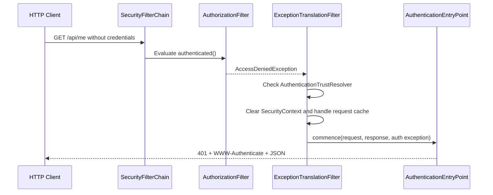

# AuthenticationEntryPoint When a Request Requires Authentication

> **Scope:** Spring Boot 3.x, Spring Security 6.x, Java 17+ on the **Servlet stack** (Spring MVC). This topic belongs to the **Error Responses** group: when Spring Security needs to initiate authentication, which mechanism generates HTTP **401 Unauthorized**, why 401 differs from 403, the meaning of `WWW-Authenticate`, how to configure `AuthenticationEntryPoint` properly for a REST API using HTTP Basic, and how to test the path through the security filters. Runnable examples use Spring Web, Spring Security, and MockMvc. Outputs listed are **expected** results, not claims that they were executed in the documentation environment.

## 1. Real-World Scenario: An Unauthenticated Request

A client calls an endpoint that requires login:

```http
GET /api/me HTTP/1.1
Host: localhost:8080
Accept: application/json
```

The endpoint is configured with `authenticated()`. If the client has no valid login credentials, the application cannot return private data. Yet **who** decides whether to return 401, redirect to a login form, or send a protocol-appropriate challenge? The core answer is **`AuthenticationEntryPoint`**.

For example, an API using HTTP Basic might respond:

```http
HTTP/1.1 401 Unauthorized
WWW-Authenticate: Basic realm="LabAPI", charset="UTF-8"
Content-Type: application/json;charset=UTF-8
Cache-Control: no-store

{"error":"AUTHENTICATION_REQUIRED"}
```

A form-login web UI, by contrast, typically redirects to `/login` rather than returning JSON. Both cases mean **initiating authentication**, yet the appropriate behavior depends on the authentication mechanism and client type.

### Learning Objectives

After this lesson, you will be able to:

1. Explain precisely what `AuthenticationEntryPoint` is, when `commence(...)` is invoked, and how it differs from an authentication filter/provider.
2. Describe the flow from `ExceptionTranslationFilter` to the entry point when an unauthenticated request hits a protected resource.
3. Distinguish `401` requiring authentication, `403` access denied, and missing CSRF cases.
4. Design a valid Basic challenge using `WWW-Authenticate` even when the response body is JSON.
5. Integrate a custom entry point with `httpBasic` and `exceptionHandling`, paired with an `AccessDeniedHandler` for 403.
6. Write tests covering anonymous requests, wrong credentials, valid credentials lacking a role, CSRF, and public endpoints.
7. Avoid pitfalls such as mixing form login/Basic/Bearer, breaking protocol challenges, or returning 200 for authentication errors.

## 2. What Contract Is AuthenticationEntryPoint?

In Spring Security Servlet, `AuthenticationEntryPoint` is an interface:

```java
package org.springframework.security.web;

public interface AuthenticationEntryPoint {
    void commence(
            jakarta.servlet.http.HttpServletRequest request,
            jakarta.servlet.http.HttpServletResponse response,
            org.springframework.security.core.AuthenticationException authException
    ) throws java.io.IOException, jakarta.servlet.ServletException;
}
```

The code above **shows the interface signature**, not a separate Java file you need to create in your project.

`commence` is called by the framework when it needs to **initiate the authentication process** or respond to an authentication error. It receives:

- `request`: the HTTP request needing proof of identity.
- `response`: the response whose status, headers, body, or redirect the entry point can set.
- `authException`: the error/condition requiring authentication to start; do not return stack traces or raw exception messages directly to the client.

**Not the job of an entry point:** verifying passwords, reading account databases, granting roles, deciding record-level permissions, saving the `SecurityContext` itself, or managing refresh/JWT revocation. Credential verification belongs to authentication filters/providers; authorization belongs to authorization rules and method/domain policies.

### Common Implementations

| Entry point / mechanism | Typical behavior | When appropriate |
|---|---|---|
| `BasicAuthenticationEntryPoint` | HTTP 401 + `WWW-Authenticate: Basic ...` | APIs/clients using HTTP Basic |
| `LoginUrlAuthenticationEntryPoint` | HTTP 302 redirect to the login page | Browser-interactive apps with form login |
| `BearerTokenAuthenticationEntryPoint` | HTTP 401 + standard Bearer challenge | OAuth2 Resource Server accepting bearer tokens |
| `HttpStatusEntryPoint` | Sets a fixed HTTP status without building a full protocol challenge | APIs handling protocol/challenge separately or special environments |
| Custom `AuthenticationEntryPoint` | Application-defined structured status/headers/body | When consistent JSON responses are needed while keeping authentication mechanism semantics |

Do not replace every entry point with a `401` JSON response that drops `WWW-Authenticate` for Basic/Bearer when clients rely on the challenge protocol to know how to authenticate next.

## 3. How Does 401 Differ from 403?

### 3.1. HTTP 401 — Missing or Invalid Authentication

HTTP 401 is historically named **Unauthorized**, though in practice it usually means **no suitable authentication is present**. In an HTTP authentication challenge, a 401 must send a `WWW-Authenticate` header containing at least one challenge applicable to the resource. For example:

```http
WWW-Authenticate: Basic realm="LabAPI", charset="UTF-8"
```

`realm` describes the Basic *protection space*. `charset="UTF-8"` is a parameter supported by Basic; it does not turn Base64 into encryption. Basic credentials use Base64 for `username:password`, so **HTTPS must be used** in real environments.

401 does not necessarily mean the user entered a wrong password; a request that **sent no credentials at all** can also receive 401.

### 3.2. HTTP 403 — Authenticated but Insufficient Permissions

HTTP 403 **Forbidden** applies when the identity has been authenticated but lacks permission to use the feature or resource. For example, `ROLE_USER` calling `/api/admin`, which is restricted to `ROLE_ADMIN`:

```http
HTTP/1.1 403 Forbidden
Content-Type: application/json;charset=UTF-8

{"error":"ACCESS_DENIED"}
```

This is normally the responsibility of `AccessDeniedHandler`, **not** `AuthenticationEntryPoint`. Clients must not try to "fix" every 403 by repeatedly prompting for a password; the issue may lie in roles, tenants, ownership, policies, or CSRF.

### 3.3. Quick Classification Table

| Request/scenario | Authentication state | Typical outcome |
|---|---|---|
| Anonymous GET `/api/me` | No credentials | **401** + challenge for Basic |
| Wrong Basic username/password | Authentication failed | **401** + challenge |
| Valid Basic, USER GET `/api/me` | Valid authentication | **200** |
| Valid Basic, USER GET `/api/admin` | Authenticated, missing ROLE_ADMIN | **403** |
| Valid Basic, ADMIN GET `/api/admin` | Role satisfies policy | **200** |
| GET `/api/public` without credentials | `permitAll` endpoint | **200** |
| POST requiring CSRF with missing token | Request blocked by CSRF filter | **403**, even if credentials look valid |
| Request denied while anonymous | Not yet authenticated to decide permissions | Usually routed to entry point (401/redirect) |
| Request denied while remember-me auth | Authenticated but below required level for sensitive action | Spring may re-initiate authentication instead of 403 depending on trust resolver |

**Subtlety:** Spring Security uses `AuthenticationTrustResolver` in some access-denied paths. For anonymous or remember-me authentications deemed below the required trust level, `ExceptionTranslationFilter` can invoke the entry point to require stronger authentication. Do not write a false rule like "if any `Authentication` object exists, it is guaranteed to be 403". The outcome also depends on the security mechanism, trust level, and exception path.

## 4. Flow by Which Spring Security Invokes the Entry Point

For a URL `/api/me` requiring `authenticated()`, a request without credentials typically flows through:



`ExceptionTranslationFilter` is **not** a filter that verifies credentials itself; it is a bridge between exceptions in the security chain and the appropriate **HTTP response**. It typically handles two critical branches:

1. An `AuthenticationException` requiring authentication to start → dispatch to `AuthenticationEntryPoint`.
2. An `AccessDeniedException` → if the caller is anonymous or lacks sufficient authentication level, start authentication via the entry point; if sufficiently authenticated yet lacking permissions, forward to `AccessDeniedHandler`.

### BasicAuthenticationFilter Is an Easily Misunderstood Exception

When a request sends `Authorization: Basic ...` with a **wrong** password, `BasicAuthenticationFilter` typically catches its own authentication failure and invokes **the entry point configured for HTTP Basic**. This does not require the error to bubble back up through `ExceptionTranslationFilter`.

Therefore, when you want a consistent JSON response for both **missing credentials** and **invalid credentials**, wire **the same custom entry point** into both `httpBasic(...)` and `exceptionHandling(...)`:

```java
.httpBasic(basic -> basic.authenticationEntryPoint(json401))
.exceptionHandling(exceptions -> exceptions
    .authenticationEntryPoint(json401)
    .accessDeniedHandler(json403))
```

This is a snippet inside `HttpSecurity` configuration; `json401`/`json403` are the corresponding beans. If you configure only one of the two places, some error paths may fall back to a different default handler and produce inconsistent bodies/headers.

### RequestCache and Session

When starting authentication, Spring Security may save the prior request in `RequestCache` so that after a successful login it can redirect back to the requested page. This is useful for web form login, but may not suit stateless APIs. For a Basic API using `SessionCreationPolicy.STATELESS`, the goal is typically for clients to send credentials on **every request** without relying on a server-side login session. If the API does not need saved requests, consider `NullRequestCache`; do not build a redirect-login workflow for a Basic API merely because the framework supports it by default.

## 5. WWW-Authenticate: Do Not Drop the Protocol Challenge

The `WWW-Authenticate` header is a required/key part of 401 under HTTP authentication schemes. For example:

```http
HTTP/1.1 401 Unauthorized
WWW-Authenticate: Basic realm="LabAPI", charset="UTF-8"
Content-Type: application/json

{"error":"AUTHENTICATION_REQUIRED"}
```

The `charset="UTF-8"` parameter tells the client that Basic credentials are interpreted as UTF-8 within the protocol scope; it is **not the body's Content-Type**. The body can be JSON for frontend readability while the challenge header preserves interoperability with HTTP clients.

**Do not attach `WWW-Authenticate: Basic ...` to a Bearer-only API.** For an OAuth2 Resource Server, the Bearer challenge must conform to RFC 6750 and the token state; Spring Security provides `BearerTokenAuthenticationEntryPoint`. With form login, browsers typically expect a redirect to the login page, not a Basic prompt. Configuration must match the **scheme** the application actually implements.

### When Should Error Details Not Be Sent?

Do not respond with:

```json
{"error":"USER_ALICE_EXISTS_BUT_PASSWORD_WRONG"}
```

That can enable account enumeration and expose login logic. For public APIs, use a stable error code such as `AUTHENTICATION_REQUIRED` or `INVALID_CREDENTIALS` (if your threat model permits), without putting `authException.getMessage()`, tokens, the `Authorization` header, passwords, or stack traces into the response. Record failure events in internal audits/logs at an appropriate security level.

## 6. Runnable Example: Spring Boot 3.x Java 17+ with JSON AuthenticationEntryPoint

The goal of this example is to observe **two distinct flows**:

- Anonymous or invalid Basic credentials → custom **401 entry point** and Basic challenge.
- Validly logged-in user lacking the ADMIN role → custom **403 access-denied handler**, **without** re-initiating authentication.

The project also keeps **CSRF** protection enabled for POST requests to distinguish CSRF errors from missing authentication or roles.

### 6.1. Preparing the Gradle Project

Create a Java 17+ Spring Boot 3.x project with Gradle Groovy DSL from Spring Initializr, selecting Spring Web, Spring Security, Spring Boot Starter Test, and Spring Security Test. The `dependencies` block in `build.gradle`:

```groovy
dependencies {
    implementation 'org.springframework.boot:spring-boot-starter-web'
    implementation 'org.springframework.boot:spring-boot-starter-security'

    testImplementation 'org.springframework.boot:spring-boot-starter-test'
    testImplementation 'org.springframework.security:spring-security-test'
}
```

This is only the `dependencies` **block**; keep the plugins, repositories, Boot version, and wrapper generated by Initializr intact.

Structure:

```text
src/
├── main/java/com/example/entrypoint/
│   ├── EntryPointApplication.java
│   ├── SecurityConfig.java
│   └── ApiController.java
└── test/java/com/example/entrypoint/
    └── EntryPointIntegrationTest.java
```

### 6.2. Main Application

**`src/main/java/com/example/entrypoint/EntryPointApplication.java`**

```java
package com.example.entrypoint;

import org.springframework.boot.SpringApplication;
import org.springframework.boot.autoconfigure.SpringBootApplication;

@SpringBootApplication
public class EntryPointApplication {
    public static void main(String[] args) {
        SpringApplication.run(EntryPointApplication.class, args);
    }
}
```

### 6.3. SecurityConfig: 401 Entry Point, 403 Handler, HTTP Basic

**`src/main/java/com/example/entrypoint/SecurityConfig.java`**

```java
package com.example.entrypoint;

import java.nio.charset.StandardCharsets;

import jakarta.servlet.DispatcherType;
import jakarta.servlet.http.HttpServletResponse;

import org.springframework.context.annotation.Bean;
import org.springframework.context.annotation.Configuration;
import org.springframework.http.HttpHeaders;
import org.springframework.http.HttpMethod;
import org.springframework.http.MediaType;
import org.springframework.security.config.annotation.web.builders.HttpSecurity;
import org.springframework.security.config.http.SessionCreationPolicy;
import org.springframework.security.core.userdetails.User;
import org.springframework.security.core.userdetails.UserDetailsService;
import org.springframework.security.crypto.factory.PasswordEncoderFactories;
import org.springframework.security.crypto.password.PasswordEncoder;
import org.springframework.security.provisioning.InMemoryUserDetailsManager;
import org.springframework.security.web.AuthenticationEntryPoint;
import org.springframework.security.web.SecurityFilterChain;
import org.springframework.security.web.access.AccessDeniedHandler;

@Configuration
public class SecurityConfig {

    @Bean
    PasswordEncoder passwordEncoder() {
        return PasswordEncoderFactories.createDelegatingPasswordEncoder();
    }

    @Bean
    UserDetailsService users(PasswordEncoder encoder) {
        return new InMemoryUserDetailsManager(
                User.withUsername("alice")
                    .password(encoder.encode("alice-pass"))
                    .roles("USER").build(),
                User.withUsername("admin")
                    .password(encoder.encode("admin-pass"))
                    .roles("USER", "ADMIN").build()
        );
    }

    @Bean
    AuthenticationEntryPoint json401EntryPoint() {
        return (request, response, exception) -> {
            response.setStatus(HttpServletResponse.SC_UNAUTHORIZED);
            response.setCharacterEncoding(StandardCharsets.UTF_8.name());
            response.setContentType(MediaType.APPLICATION_JSON_VALUE);
            response.setHeader(HttpHeaders.WWW_AUTHENTICATE,
                    "Basic realm=\"LabAPI\", charset=\"UTF-8\"");
            response.setHeader(HttpHeaders.CACHE_CONTROL, "no-store");
            response.getWriter().write(
                    "{\"error\":\"AUTHENTICATION_REQUIRED\"}");
        };
    }

    @Bean
    AccessDeniedHandler json403Handler() {
        return (request, response, exception) -> {
            response.setStatus(HttpServletResponse.SC_FORBIDDEN);
            response.setCharacterEncoding(StandardCharsets.UTF_8.name());
            response.setContentType(MediaType.APPLICATION_JSON_VALUE);
            response.setHeader(HttpHeaders.CACHE_CONTROL, "no-store");
            response.getWriter().write("{\"error\":\"ACCESS_DENIED\"}");
        };
    }

    @Bean
    SecurityFilterChain securityFilterChain(
            HttpSecurity http,
            AuthenticationEntryPoint json401EntryPoint,
            AccessDeniedHandler json403Handler
    ) throws Exception {
        return http
                .authorizeHttpRequests(auth -> auth
                    // Servlet error dispatch allows errors to be rendered.
                    .dispatcherTypeMatchers(DispatcherType.ERROR).permitAll()
                    .requestMatchers(HttpMethod.GET, "/api/public")
                        .permitAll()
                    .requestMatchers(HttpMethod.GET, "/api/me")
                        .authenticated()
                    .requestMatchers(HttpMethod.GET, "/api/admin")
                        .hasRole("ADMIN")
                    .requestMatchers(HttpMethod.POST, "/api/notes")
                        .authenticated()
                    .anyRequest().denyAll()
                )
                .httpBasic(basic -> basic
                    // Bad Basic credentials are handled directly at the filter.
                    .authenticationEntryPoint(json401EntryPoint))
                .exceptionHandling(exceptions -> exceptions
                    // Anonymous reaching a protected endpoint:
                    .authenticationEntryPoint(json401EntryPoint)
                    // Authenticated but lacking permissions:
                    .accessDeniedHandler(json403Handler))
                .sessionManagement(session -> session
                    .sessionCreationPolicy(SessionCreationPolicy.STATELESS))
                // Do not call csrf.disable(): POST still checks CSRF.
                .build();
    }
}
```

**Why does this code work according to proper responsibilities?**

1. `json401EntryPoint()` implements `AuthenticationEntryPoint.commence(...)` via a Java lambda. It does not call `AuthenticationManager` and does not verify passwords.
2. It sets `401`, a fixed JSON body, and the header `WWW-Authenticate: Basic realm="LabAPI", charset="UTF-8"`. The header is an HTTP Basic challenge; JSON is merely the presentation for the client.
3. `json403Handler()` handles `AccessDeniedException` for a principal who is authenticated but lacks the required role; it sets `403` and a distinct JSON response, intentionally omitting a Basic challenge.
4. `.httpBasic(...authenticationEntryPoint(json401EntryPoint))` covers the **invalid** Basic credentials path inside `BasicAuthenticationFilter`.
5. `.exceptionHandling(...authenticationEntryPoint(json401EntryPoint))` covers the path where authentication must begin, typically an anonymous request hitting `authenticated()`.
6. `SessionCreationPolicy.STATELESS` configures the Basic demo not to rely on HTTP session login; clients send credentials on every request. It does **not** disable CSRF automatically.
7. `anyRequest().denyAll()` protects undeclared routes, preventing accidental endpoint exposure. `DispatcherType.ERROR` is permitted so the servlet can render errors, not as a public data route.
8. Both accounts have hashed passwords via the encoder; plaintext passwords exist only in the localhost demo user initialization snippet.

**Important:** if you add `formLogin()` or `oauth2ResourceServer()` to the **same** chain, entry point selection and client behavior become more complex. Never leave a Basic challenge as an accidental default for browser login or a JWT resource server.

### 6.4. Controller for 200, 401, and 403 Scenarios

**`src/main/java/com/example/entrypoint/ApiController.java`**

```java
package com.example.entrypoint;

import java.util.Map;

import org.springframework.security.core.Authentication;
import org.springframework.web.bind.annotation.GetMapping;
import org.springframework.web.bind.annotation.PostMapping;
import org.springframework.web.bind.annotation.RestController;

@RestController
public class ApiController {

    @GetMapping("/api/public")
    public String publicInfo() {
        return "PUBLIC_OK";
    }

    @GetMapping("/api/me")
    public Map<String, String> me(Authentication authentication) {
        return Map.of("user", authentication.getName());
    }

    @GetMapping("/api/admin")
    public Map<String, String> admin() {
        return Map.of("message", "ADMIN_ONLY");
    }

    @PostMapping("/api/notes")
    public Map<String, String> createNote() {
        // Illustrates POST with CSRF; does not persist real data.
        return Map.of("message", "NOTE_ACCEPTED");
    }
}
```

`/api/public` requires no credentials. `/api/me` requires any authenticated user. `/api/admin` requires `ROLE_ADMIN`; Alice only has `ROLE_USER` so she gets `403`. `/api/notes` is a POST example: without a CSRF token it is blocked by the filter even when HTTP Basic credentials are valid.

## 7. Running Manually and Reading Responses

Start from the Gradle project root:

```bash
# Linux / macOS
./gradlew bootRun

# Windows PowerShell
.\gradlew.bat bootRun
```

Unless you change the port configuration, the application listens on `http://localhost:8080`. On older Windows PowerShell, you may need `curl.exe` instead of the `curl` alias. **All credentials here are for localhost only**; never use HTTP Basic without TLS over the Internet.

### 7.1. Public Endpoint

```bash
curl -i http://localhost:8080/api/public
```

**Expected:** status 200 and body `PUBLIC_OK`. `AuthenticationEntryPoint` does not need to run because the URL is `permitAll()`.

### 7.2. Protected Endpoint, No Credentials

```bash
curl -i http://localhost:8080/api/me
```

**Expected:** status 401, `WWW-Authenticate` containing `Basic realm="LabAPI"`, and JSON:

```json
{"error":"AUTHENTICATION_REQUIRED"}
```

This is the clearest case of "the request needs to be authenticated": HTTP authorization determines the request cannot pass, and `ExceptionTranslationFilter` routes it to the entry point.

### 7.3. Wrong Basic Password

```bash
curl -i -u alice:wrong-pass http://localhost:8080/api/me
```

**Expected:** status 401 and the same JSON error code as above. Unlike the anonymous case, the request **has** credentials, but authentication failed. `BasicAuthenticationFilter` uses the entry point specifically configured under `httpBasic`.

### 7.4. Valid Basic

```bash
curl -i -u alice:alice-pass http://localhost:8080/api/me
```

**Expected:** status 200 with JSON:

```json
{"user":"alice"}
```

No entry point is needed because `Authentication` is valid and the endpoint only requires `authenticated()`.

### 7.5. Valid User Missing ADMIN Role

```bash
curl -i -u alice:alice-pass http://localhost:8080/api/admin
```

**Expected:** 403 and:

```json
{"error":"ACCESS_DENIED"}
```

This is the responsibility of `AccessDeniedHandler`, not a prompt to "please re-enter your password". If a client receives 401 instead of 403 for this case, check role mapping, the trust resolver, the `Authentication` type, and exception handling configuration.

### 7.6. Admin with Valid Role

```bash
curl -i -u admin:admin-pass http://localhost:8080/api/admin
```

**Expected:** 200 and JSON:

```json
{"message":"ADMIN_ONLY"}
```

### 7.7. POST Missing CSRF

```bash
curl -i -u alice:alice-pass -X POST \
  http://localhost:8080/api/notes
```

**Expected:** 403 due to missing CSRF token in the demo configuration. Because `CsrfFilter` runs before some authorization steps, this response does not prove the user lacks a role or that the entry point is misconfigured. To test a successful POST, use MockMvc with `with(csrf())` in the next section. Do not disable CSRF just to make a curl POST command convenient.

### 7.8. Wrong Basic Credentials on a Public URL?

If a client sends `Authorization: Basic ...` with a wrong password **even when the URL has `permitAll()`**, `BasicAuthenticationFilter` may still attempt to authenticate the header and return 401 before reaching the authorization rule. `permitAll()` permits anonymous access; it **does not tell the filter to ignore an invalid credentials header**. Testing this path prevents surprises when a frontend attaches a stale `Authorization` header to every request.

## 8. MockMvc: Testing Each Error-Producing Path Separately

Use `@SpringBootTest` and `@AutoConfigureMockMvc` so requests traverse the security filters. Spring Security Test's `httpBasic(...)` builds a valid HTTP Basic Authorization header; `csrf()` supplies a valid token for POST.

**`src/test/java/com/example/entrypoint/EntryPointIntegrationTest.java`**

```java
package com.example.entrypoint;

import org.junit.jupiter.api.Test;
import org.springframework.beans.factory.annotation.Autowired;
import org.springframework.boot.test.autoconfigure.web.servlet.AutoConfigureMockMvc;
import org.springframework.boot.test.context.SpringBootTest;
import org.springframework.http.HttpHeaders;
import org.springframework.http.MediaType;
import org.springframework.test.web.servlet.MockMvc;

import static org.springframework.security.test.web.servlet.request.SecurityMockMvcRequestPostProcessors.csrf;
import static org.springframework.security.test.web.servlet.request.SecurityMockMvcRequestPostProcessors.httpBasic;
import static org.springframework.test.web.servlet.request.MockMvcRequestBuilders.get;
import static org.springframework.test.web.servlet.request.MockMvcRequestBuilders.post;
import static org.springframework.test.web.servlet.result.MockMvcResultMatchers.content;
import static org.springframework.test.web.servlet.result.MockMvcResultMatchers.header;
import static org.springframework.test.web.servlet.result.MockMvcResultMatchers.jsonPath;
import static org.springframework.test.web.servlet.result.MockMvcResultMatchers.status;

@SpringBootTest
@AutoConfigureMockMvc
class EntryPointIntegrationTest {

    @Autowired
    MockMvc mvc;

    @Test
    void publicEndpointNeedsNoAuthentication() throws Exception {
        mvc.perform(get("/api/public"))
                .andExpect(status().isOk())
                .andExpect(content().string("PUBLIC_OK"));
    }

    @Test
    void anonymousProtectedRequestInvokesEntryPoint() throws Exception {
        mvc.perform(get("/api/me"))
                .andExpect(status().isUnauthorized())
                .andExpect(header().string(
                        HttpHeaders.WWW_AUTHENTICATE,
                        "Basic realm=\"LabAPI\", charset=\"UTF-8\""))
                .andExpect(content().contentTypeCompatibleWith(
                        MediaType.APPLICATION_JSON))
                .andExpect(jsonPath("$.error")
                        .value("AUTHENTICATION_REQUIRED"));
    }

    @Test
    void wrongBasicPasswordAlsoInvokesEntryPoint() throws Exception {
        mvc.perform(get("/api/me")
                    .with(httpBasic("alice", "wrong-pass")))
                .andExpect(status().isUnauthorized())
                .andExpect(header().exists(HttpHeaders.WWW_AUTHENTICATE))
                .andExpect(jsonPath("$.error")
                        .value("AUTHENTICATION_REQUIRED"));
    }

    @Test
    void authenticatedUserCanAccessProtectedEndpoint()
            throws Exception {
        mvc.perform(get("/api/me")
                    .with(httpBasic("alice", "alice-pass")))
                .andExpect(status().isOk())
                .andExpect(jsonPath("$.user").value("alice"));
    }

    @Test
    void userWithoutAdminRoleGetsAccessDeniedHandler()
            throws Exception {
        mvc.perform(get("/api/admin")
                    .with(httpBasic("alice", "alice-pass")))
                .andExpect(status().isForbidden())
                .andExpect(jsonPath("$.error")
                        .value("ACCESS_DENIED"))
                .andExpect(header().doesNotExist(
                        HttpHeaders.WWW_AUTHENTICATE));
    }

    @Test
    void administratorCanAccessAdminEndpoint()
            throws Exception {
        mvc.perform(get("/api/admin")
                    .with(httpBasic("admin", "admin-pass")))
                .andExpect(status().isOk())
                .andExpect(jsonPath("$.message")
                        .value("ADMIN_ONLY"));
    }

    @Test
    void anonymousAdminRequestBeginsAuthentication()
            throws Exception {
        mvc.perform(get("/api/admin"))
                .andExpect(status().isUnauthorized())
                .andExpect(jsonPath("$.error")
                        .value("AUTHENTICATION_REQUIRED"));
    }

    @Test
    void postWithoutCsrfIsForbidden() throws Exception {
        mvc.perform(post("/api/notes")
                    .with(httpBasic("alice", "alice-pass")))
                .andExpect(status().isForbidden());
    }

    @Test
    void postWithValidCsrfAndBasicCredentialsSucceeds()
            throws Exception {
        mvc.perform(post("/api/notes")
                    .with(httpBasic("alice", "alice-pass"))
                    .with(csrf()))
                .andExpect(status().isOk())
                .andExpect(jsonPath("$.message")
                        .value("NOTE_ACCEPTED"));
    }

    @Test
    void anonymousPostWithCsrfStillNeedsAuthentication()
            throws Exception {
        mvc.perform(post("/api/notes")
                    .with(csrf()))
                .andExpect(status().isUnauthorized())
                .andExpect(jsonPath("$.error")
                        .value("AUTHENTICATION_REQUIRED"));
    }

    @Test
    void invalidCredentialsOnPublicUrlDoNotBecomeValid()
            throws Exception {
        mvc.perform(get("/api/public")
                    .with(httpBasic("alice", "wrong-pass")))
                .andExpect(status().isUnauthorized());
    }
}
```

Run:

```bash
# Linux / macOS
./gradlew test

# Windows PowerShell
.\gradlew.bat test
```

**Expected:** 11 tests PASS if the project is created as shown above. This is a **prediction based on the configuration and assertions, not an actual execution result**. Do not replace all assertions with `status().is4xxClientError()`: doing so fails to distinguish a 401 entry point, a 403 denied handler, and a 403 CSRF rejection.

**What does each test prove?**

- `anonymousProtectedRequestInvokesEntryPoint` proves missing authentication returns 401 with a **Basic challenge**, not just a status code.
- `wrongBasicPasswordAlsoInvokesEntryPoint` proves the authentication failure path inside the Basic filter routes to the same entry point.
- `userWithoutAdminRoleGetsAccessDeniedHandler` proves an authenticated caller receives **403** with its own JSON and receives no Basic challenge.
- `administratorCanAccessAdminEndpoint` ensures the configuration does not deny everything.
- `postWithoutCsrfIsForbidden` and `postWithValidCsrfAndBasicCredentialsSucceeds` separate CSRF request errors from authentication/authorization.
- `anonymousPostWithCsrfStillNeedsAuthentication` proves a valid CSRF token does not substitute for user credentials.
- `invalidCredentialsOnPublicUrlDoNotBecomeValid` shows `permitAll` does not turn an invalid authentication header into a valid one.

### Why Not Only Unit-Test commence() with Mocks?

You can write a unit test for an isolated entry point to verify its status/headers/body, yet that **does not guarantee** the real `SecurityFilterChain` selects that bean for both anonymous requests and invalid HTTP Basic credentials. The MockMvc integration tests above verify wiring, filter order, response status, and related error paths; you should include these tests as well.

## 9. When the App Uses Form Login: Behavior Differs

On an interactive website, an unauthenticated user visiting a page that requires login is normally redirected to a form:

```http
GET /account/settings
```

Typically receives:

```http
HTTP/1.1 302 Found
Location: /login
```

This comes from `LoginUrlAuthenticationEntryPoint`, not the demo's custom JSON Basic entry point. The prior request may be saved by `RequestCache` so that after logging in, the browser returns to the target page.

**Separate illustrative** configuration example for a website—do not merge into the runnable Basic chain above:

```java
http
    .authorizeHttpRequests(auth -> auth
        .requestMatchers("/login", "/assets/**").permitAll()
        .anyRequest().authenticated())
    .formLogin(form -> form.permitAll());
```

This is only a snippet using an already-initialized `http`. Do not enable `formLogin` while forcing a JSON 401 Basic entry point for every request and expect the browser to redirect as before. If an application serves both a web UI and an API, you can split them into **two `SecurityFilterChain` beans** partitioned by `securityMatcher(...)` with defined ordering, or use `defaultAuthenticationEntryPointFor(...)` with explicit `RequestMatcher`s. Test actual URLs to prevent a web chain from catching API requests and returning HTML.

### Redirect Loop Issue

If `/login` is not `permitAll()`, an anonymous request to the login page redirects back to itself, creating a redirect loop. Spring Security's `formLogin(form -> form.permitAll())` normally permits the related login/success/failure URLs; when customizing endpoints, test to avoid infinite 302s.

## 10. When the API Uses JWT/Bearer: Do Not Send a Basic Challenge

An OAuth2 Resource Server receives:

```http
Authorization: Bearer eyJ...
```

If the token is missing, expired, has an invalid signature, or fails acceptance conditions, Spring Security has its own mechanism, typically via `BearerTokenAuthenticationEntryPoint`. The challenge uses **Bearer**, not Basic:

```http
HTTP/1.1 401 Unauthorized
WWW-Authenticate: Bearer
```

For an invalid token, `WWW-Authenticate` may include valid error parameters per RFC 6750, but **must not echo back the token** or any secrets in the response. When a token is valid yet lacks the required scope/permissions, `BearerTokenAccessDeniedHandler` can handle it, returning 403 and Bearer insufficient-scope semantics where appropriate.

Illustrative snippet (requires the Spring Security OAuth2 Resource Server dependency and a JWT decoder configuration; **does not run standalone in the Basic project above**):

```java
http.oauth2ResourceServer(oauth2 -> oauth2
        .jwt(jwt -> {})
);
```

**Do not replace the Bearer entry point with `WWW-Authenticate: Basic ...` just to give the API a uniform JSON body.** If a shared JSON error format is needed, preserve the scheme-appropriate challenge/status and add the body via the appropriate handler. Choosing Bearer or Basic is an authentication architecture decision, not merely a styling choice for error messages.

## 11. Multiple Filter Chains and Choosing the Right Entry Point

One server might serve all of:

- `/api/**` for machine clients using Basic/JWT;
- `/app/**` for browsers using form login;
- `/admin/**` with stricter requirements, possibly MFA.

If you configure a global `AuthenticationEntryPoint` without matchers, APIs might unexpectedly receive HTML redirects, browsers might show Basic popups, or Bearer clients might receive the wrong challenge. Two common approaches exist:

1. **Multiple `SecurityFilterChain` beans**: attach `securityMatcher`/`@Order` to select chains per request. Each chain gets the appropriate authentication mechanism and entry point. Ensure there are no gaps in matchers or fallback chains.
2. **Single chain with entry-point matchers**: `exceptionHandling(ex -> ex.defaultAuthenticationEntryPointFor(..., matcher))` when per-request dispatch is genuinely required. Understand interactions with authentication filters like `BasicAuthenticationFilter`; configure each filter's entry point individually if necessary.

Do not equate `requestMatchers(...)` inside authorization rules with `securityMatcher(...)`, which selects an entire chain. A chain with `securityMatcher("/api/**")` applies only to requests it matches; if no other chain handles the remaining URLs, unintended areas may be left unprotected.

### Content Negotiation: Accept Is Not the Sole Yardstick

Relying solely on the `Accept: application/json` header to choose between JSON 401 and login redirect can yield unpredictable results. Browsers, `fetch`, and other clients often send varied `Accept` values. It is better to partition by path/client contract and authentication scheme, optionally combining a content-type `RequestMatcher` where appropriate. Testing different `Accept` headers remains useful to catch inconsistent behavior.

## 12. Response Bodies, Errors, and Information Disclosure

### 12.1. Do Not Return Raw Exception Messages

Wrong:

```java
// Do not use in production:
response.getWriter().write(
        "{\"error\":\"" + authException.getMessage() + "\"}");
```

Beyond leaking internal details, concatenating strings into JSON without escaping can produce invalid JSON or injection if the message contains unexpected characters. The demo uses a constant JSON string. If the API needs an error schema with `code`, `message`, and `traceId`, use `ObjectMapper`/a serializer or a reliable response-writing component—never embed raw exceptions in the body.

### 12.2. Do Not Use 200 for Authentication Errors

Some legacy APIs return:

```http
HTTP/1.1 200 OK
Content-Type: application/json

{"success":false,"error":"NEED_LOGIN"}
```

This breaks HTTP semantics: clients, proxies, monitoring, retry/interceptor code, and security tests cannot rely on standard status codes. When re-authentication is required, use 401/challenge or the appropriate redirect mechanism; when authenticated but lacking permission, use 403 or a visibility policy.

### 12.3. Cache-Control Headers

Responses containing protected data or user-contextual error details should carry appropriate `Cache-Control` headers. The demo returns `Cache-Control: no-store` for custom 401/403 responses to prevent unintended caching. However, caching also depends on the full set of headers and middleboxes; do not treat one header as a cure-all for every leak.

### 12.4. Error Traces and Auditing

Audit logs should distinguish:

- authentication request missing credentials;
- invalid credentials (without disclosing whether the username exists);
- disabled/locked accounts under an authorized internal code;
- authenticated caller denied access;
- CSRF rejection;
- resource-specific authorization failure.

You may record a correlation ID, normalized request path, policy name, status, and verified actor ID (if present). **Never log** plaintext passwords, the `Authorization` header, `JSESSIONID`, CSRF tokens, refresh tokens, responses containing secrets, or send unnecessary stack traces to clients.

## 13. Easily Confused Edge Cases

### 13.1. Syntactically Invalid Basic Header

An `Authorization: Basic ...` header that fails decoding or lacks a username/password separator may be rejected by the Basic filter. The status/body for this error depends on version, parser, and handler wiring; write explicit tests for your app's parsing behavior. **Do not** differentiate parse errors from wrong passwords in the response body if that could help attackers probe valid usernames.

### 13.2. permitAll Endpoint Receiving Invalid Basic Credentials

`permitAll()` means no authentication is required to pass the URL rule; **if a client actively sends a bad Basic header**, the filter may still attempt authentication and return 401. The right way to test an anonymous endpoint is **not sending** an `Authorization` header.

### 13.3. Confusing CSRF 403 with Access-Denied 403

`CsrfFilter` can reject a POST before `AuthorizationFilter` or the controller runs. In some configurations, `CsrfFilter` uses its own access-denied handling; therefore, do not assume **every 403** is necessarily produced by the custom `AccessDeniedHandler` in `exceptionHandling`. Test the status first; if the API requires a unified error schema for CSRF, configure the appropriate CSRF handler and test it separately.

### 13.4. Custom Authentication Filter Throwing Exceptions Elsewhere

Not every `AuthenticationException` is automatically caught by `ExceptionTranslationFilter`: this depends on filter order in the chain and where the exception propagates. For instance, `BasicAuthenticationFilter` has its own entry point. With a custom `OncePerRequestFilter`, verify filter ordering, error handling, and where the entry point is invoked; do not simply throw an exception from any filter and assume it becomes JSON 401.

### 13.5. @ControllerAdvice Does Not "Catch Everything" for Security Errors

`@RestControllerAdvice` handles many MVC/controller exceptions, yet authentication and authorization typically happen **before MVC** in servlet filters. A global controller exception handler does not replace `AuthenticationEntryPoint` or `AccessDeniedHandler` in `SecurityFilterChain`.

### 13.6. AnonymousAuthenticationToken Can Make isAuthenticated() Misleading

Spring Security may put an `AnonymousAuthenticationToken` into `SecurityContext`. Do not write custom middleware checking `authentication != null && authentication.isAuthenticated()` and assume the user is logged in; the framework's `authenticated()` uses trust-resolver logic to separate anonymous users. For URL control, use the Spring Security DSL instead of checking a bare boolean yourself.

### 13.7. Remember-Me and Authentication Levels

If a user is auto-logged in via remember-me while an endpoint requires `fullyAuthenticated()`, Spring Security may initiate stronger authentication. Depending on the mechanism, the result is a login redirect or challenge. This does not mean a wrong password was entered; the current trust level simply does not meet the action's requirement.

### 13.8. Basic Credentials Over Plain HTTP

`Authorization: Basic` is Base64, not encryption. A custom entry point returning clean JSON does not solve sending credentials without TLS; HTTPS and credential management are separate requirements. For Internet-facing APIs, consider an authentication mechanism suited to your threat model rather than defaulting to Basic everywhere.

### 13.9. CORS Preflight

Browsers send an `OPTIONS` preflight before cross-origin requests carrying an `Authorization` header. If CORS is not configured to handle preflight properly, the `OPTIONS` request may receive a challenge/denial and the frontend will never send the main request. Configure `http.cors(...)` and controlled allowed origins/headers/methods; **never** open `permitAll` across the whole API or disable CSRF to "fix CORS". Test both preflight and actual requests.

### 13.10. API Gateways and Reverse Proxies

A gateway may rewrite `WWW-Authenticate`, 401/403, or redirects, or perform authentication before Spring. If a request is blocked at the gateway, the application's entry point **does not run**. Understand the trust boundary and align error contracts and logs/correlation between gateway and service. Never trust `X-User`/`X-Role` headers sent directly by external clients as valid identities.

## 14. Comparison of Common Configurations

| Configuration | Application | Behavior when unauthenticated |
|---|---|---|
| `.httpBasic(Customizer.withDefaults())` | Simple HTTP Basic API | Basic 401 challenge |
| `.formLogin(form -> form.permitAll())` | Browser app | Redirect to login page |
| `.oauth2ResourceServer(oauth -> oauth.jwt(...))` | Bearer JWT API | Scheme-appropriate Bearer challenge |
| `.exceptionHandling(ex -> ex.authenticationEntryPoint(json401))` | Customizing authentication start point | Uses declared entry point on paths selected by the chain |
| `.httpBasic(basic -> basic.authenticationEntryPoint(json401))` | Customizing bad-Basic-credentials response | Basic filter invokes that entry point |
| `.exceptionHandling(ex -> ex.accessDeniedHandler(json403))` | Customizing body for authenticated/unauthorized **permission** failure | 403 JSON for `AccessDenied` paths handled by that handler |
| `.sessionManagement(s -> s.sessionCreationPolicy(STATELESS))` | API not using session login | Does not disable Basic/CSRF or replace entry point |
| `.authorizeHttpRequests(a -> a.anyRequest().permitAll())` | Testing public routes only | Unsuitable for protecting APIs with private data |

**Remark:** a custom error shape should not obscure the authentication contract. API consumers rely on **HTTP status + the proper challenge scheme**, with the JSON body serving as convenient supplementary detail.

## 15. Symptom-Based Troubleshooting

| Symptom | Common cause | Check / remediation |
|---|---|---|
| `/api/me` without credentials returns 403 instead of 401 | Wrong entry point/different matcher, or `SecurityContext` treated as authenticated | Test anonymous access and which chain matched |
| Wrong Basic password gets HTML instead of JSON | Configured only `exceptionHandling`, Basic filter uses another entry point | Attach custom entry point in `httpBasic` |
| User missing ADMIN gets 401 instead of 403 | Authentication did not actually succeed, or wrong custom exception handler | Check Basic auth, role mapping, and 401/403 handlers |
| 401 missing `WWW-Authenticate` | Custom JSON entry point omitted the header | Add challenge per Basic/Bearer contract |
| Browser pops up Basic login dialog | API returned `WWW-Authenticate: Basic` | Use form login/redirect for web routes |
| JWT client receives Basic challenge | Used a Basic entry point on a Bearer chain | Use `BearerTokenAuthenticationEntryPoint` |
| POST Basic + missing CSRF token → 403 | Blocked by `CsrfFilter` | Separate CSRF and auth tests; send valid token |
| `/login` infinite redirect | Login URL is protected | Permit login route and inspect form config |
| All 401s unexpectedly cached | Improper headers/proxy cache config | Set `Cache-Control: no-store`, check proxy contract |
| Custom handler does not run for filter errors | Filter order or filter handles exception itself | Inspect actual filter chain, wire handler where needed |
| `@RestControllerAdvice` misses 401 | Request blocked by filter before MVC | Use `AuthenticationEntryPoint` |
| Public endpoint with invalid Basic header returns 401 | Basic filter validates the sent header | Omit `Authorization` header on anonymous requests |
| CORS preflight gets 401/403 | CORS unconfigured/OPTIONS blocked | Integrate CORS properly at the trust boundary |
| API returns different errors across nodes | Inconsistent `SecurityFilterChain`/config | Verify rollout, properties, and gateway behavior |

### Repeatable Debugging Process

1. Confirm **which `SecurityFilterChain`** handles the request. With multiple chains, inspect `securityMatcher` and order.
2. Confirm whether the request has an `Authorization` header; avoid accidentally sending stale headers.
3. Identify which authentication filter processes credentials: Basic, form, Bearer, or custom.
4. Check whether authentication succeeded; if not, is the right entry point invoked?
5. If authentication succeeded, check `hasRole`/authorities/permissions and `AccessDeniedHandler`.
6. For POST, check CSRF before interpreting 403 as a role error.
7. Inspect `WWW-Authenticate`, `Location`, `Content-Type`, cache headers, and body on the **actual HTTP response**.
8. Test across browsers/clients/gateways, not just a single localhost curl.

## 16. Production Deployment Checklist

1. Choose the client/authentication scheme explicitly: form, Basic, Bearer, or separate chains.
2. Use `AuthenticationEntryPoint` to **initiate authentication**; use `AccessDeniedHandler` when authenticated but lacking permissions.
3. For Basic/Bearer, keep a protocol-compliant `WWW-Authenticate` in 401; never alter the challenge arbitrarily.
4. Do not return `authException.getMessage()`, passwords, tokens, the `Authorization` header, or stack traces in JSON errors.
5. Test both the missing-credentials path **and** the invalid-credentials path, as they may traverse different filters.
6. Never use `permitAll`, `csrf.disable`, or turn 401 into 200 to "hide errors" in production.
7. For browsers, define redirect/login URLs, `RequestCache`, and CSRF/session behavior; avoid redirect loops.
8. For stateless APIs, verify request cache, proxy headers, and response consistency.
9. Distinguish 401, 403, 404 (visibility policy), and validation/business errors; do not lump everything into one JSON status.
10. Test "authenticated but missing role" separately to prove 403 is not converted into 401.
11. With multiple `SecurityFilterChain`s, inspect `securityMatcher`/`defaultAuthenticationEntryPointFor` and wildcard routes.
12. Implement audit/correlation IDs, rate limiting, and account lockout per threat model, and protect logs/PII.
13. Enforce HTTPS for Basic and secure cookie/CSRF handling for browser flows.
14. Have at least one integration test per error path through the filter chain, not just controller unit tests.
15. Ensure error responses are not cached unintentionally; configure gateways/CDNs/proxies accordingly.
16. Consider impact on mobile/frontend clients: 401 may trigger refresh/reauth, whereas 403 is a policy denial—do not loop refreshes infinitely on 403.

## 17. Self-Check Questions

**Question 1.** A client sends no Basic credentials to `GET /api/me`. Which component creates the response that initiates authentication?  
**Answer:** The `AuthenticationEntryPoint` configured in the security chain, typically invoked via `ExceptionTranslationFilter` when an anonymous request hits a rule requiring authentication.

**Question 2.** Alice logs in validly but calls `/api/admin` without `ROLE_ADMIN`. Should the entry point produce 401?  
**Answer:** No. Authentication is already valid; normally `AccessDeniedHandler` produces 403.

**Question 3.** Why does a Basic 401 JSON response still need `WWW-Authenticate`?  
**Answer:** The HTTP authentication challenge tells the client the scheme/protection space; JSON is only the body describing the error.

**Question 4.** Why is configuring custom 401 only in `exceptionHandling` sometimes insufficient for a wrong password?  
**Answer:** `BasicAuthenticationFilter` may directly invoke the entry point configured under `httpBasic` when Basic authentication fails.

**Question 5.** Does `permitAll` on a public endpoint make a wrong Basic header valid?  
**Answer:** No. If credentials are sent, the Basic filter can still process and reject them.

**Question 6.** A POST returns 403 when CSRF is missing—does that prove the authenticated user lacks a role?  
**Answer:** Not yet. CSRF can block before role checks; test the POST with a valid token to distinguish them.

**Question 7.** A resource server accepts Bearer tokens. Should it return `WWW-Authenticate: Basic`?  
**Answer:** No. It must use a Bearer challenge/entry point matching the protocol.

**Question 8.** Is `@RestControllerAdvice` guaranteed to catch all authentication errors from filters?  
**Answer:** No. Security filters typically run before MVC; entry points/handlers must be configured in the chain.

**Question 9.** An app has both web forms and REST APIs. Why can a single default entry point for all requests cause bugs?  
**Answer:** Browsers need a login redirect, while Basic/Bearer APIs need challenges/JSON; separate chains or explicit request matchers should be used.

**Question 10.** Can you return HTTP 200 with `{"error":"NEED_LOGIN"}` instead of 401?  
**Answer:** You should not. It breaks HTTP semantics and affects clients, caches, retries, monitoring, and security tests.

**Question 11.** A user has remember-me auth and a resource requires full authentication. Is the result always 403?  
**Answer:** No. Some access-denied paths caused by insufficient authentication level can be routed to the entry point to require stronger authentication.

**Question 12.** When `AuthenticationEntryPoint.commence` runs, should it log the user in itself and set `SecurityContext`?  
**Answer:** No. It builds the response requesting authentication; credential validation and establishing authentication belong to other filters/providers.

## 18. Summary

- **`AuthenticationEntryPoint`** is the entry point for initiating authentication when a protected resource lacks a sufficiently trusted identity or receives invalid credentials. Its core method is `commence(request, response, authException)`.
- **`ExceptionTranslationFilter`** typically dispatches authorization errors to either the entry point or the access-denied handler; **`BasicAuthenticationFilter`** may invoke its own entry point directly when a password is wrong.
- **401** means valid authentication is needed/missing, and HTTP authentication must preserve the `WWW-Authenticate` challenge. **403** typically means an authenticated caller is forbidden by role/policy or a request security layer such as CSRF.
- For an **HTTP Basic** API returning JSON, configure the same custom entry point in both **`httpBasic`** and **`exceptionHandling`**, and use a separate **`AccessDeniedHandler`** for 403.
- For **form login**, the entry point typically redirects to `/login`. For **OAuth2 Resource Server**, use a Bearer challenge—do not send a Basic challenge.
- To verify properly, test anonymous requests, bad credentials, role denials, admin allowed, public endpoints, CSRF, and response headers with **MockMvc through the `SecurityFilterChain`**.
- Never turn security errors into 200, never leak logs/tokens, and never use JSON messages in a way that breaks the authentication protocol.

**Closing principle:** **401 asks "please authenticate using this mechanism"; 403 says "your identity is known, but this action is denied."** `AuthenticationEntryPoint` and `AccessDeniedHandler` are the two extension points that let Spring Security express that boundary consistently, testably, and in compliance with the protocol.