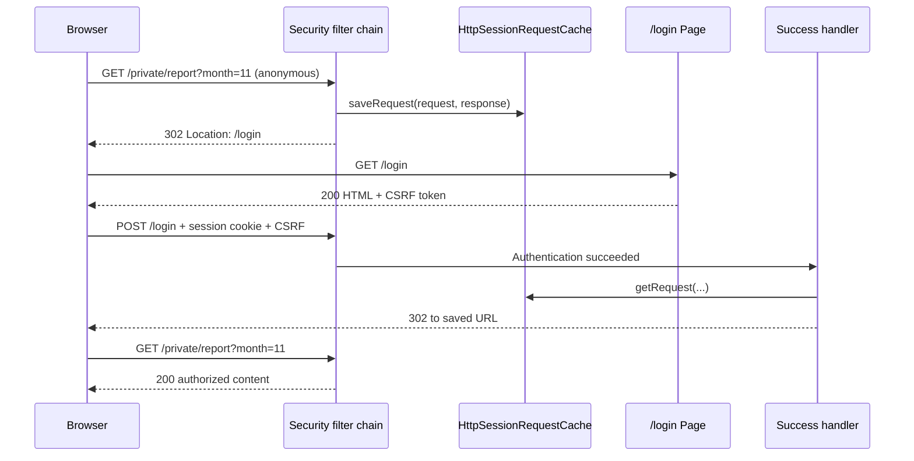

# RequestCache and Avoiding Redirect Loops to Error and Login Pages

> **Scope:** Spring Security on the Servlet stack (Spring MVC, Spring Boot 3.x / Spring Security 6.x). This lesson belongs to the **Error Responses** group: handling unauthenticated flows, access denials, application errors, and post-login navigation properly.

## 1. Learning Outcomes

After this lesson, you will be able to:

- Explain why a `GET` request to a protected resource can be remembered before redirecting to the login page, and why that differs from returning HTTP 401/403/500.
- Distinguish the responsibilities of `ExceptionTranslationFilter`, `AuthenticationEntryPoint`, `RequestCache`, `RequestCacheAwareFilter`, `SavedRequestAwareAuthenticationSuccessHandler`, and `AccessDeniedHandler`.
- Configure `HttpSessionRequestCache` to save only navigation requests that should be restored; always permit access to the login page, error page, and `DispatcherType.ERROR` flow appropriately.
- Detect and prevent redirect loops; inspect HTTP status, `Location`, session cookies, and saved requests through a reproducible test sequence.

## 2. Three Distinct Security Outcomes

Suppose a guest visits `GET /private/report?month=11`:

| Scenario | Handling component | Typical web behavior |
| --- | --- | --- |
| Unauthenticated, requesting protected page | `ExceptionTranslationFilter` invokes `AuthenticationEntryPoint` | Saves eligible request, then responds `302 Location: /login` (with form login); APIs typically return `401`. |
| Authenticated, lacking `ADMIN` permission | `AccessDeniedHandler` | `403 Forbidden` or a 403 page preserving status. Must never keep redirecting to login. |
| Controller/app throws error outside security mechanics | Servlet container/Spring Boot error dispatch | 4xx/5xx error response via `/error`; do not turn 500 errors into 302 loops. |

`RequestCache` is **not** a response cache, does not cache arbitrary POST payloads, does not grant permissions, and does not handle exceptions itself. It retains request information needed to return after authentication, usually in `HttpSession`. Only when an authentication flow asks to save the request does `saveRequest` matter; normal requests are not automatically cached just because this filter exists.

## 3. Flow of Saving and Restoring a Request



In the initial step, `ExceptionTranslationFilter` catches `AuthenticationException` or an anonymous `AccessDeniedException` and initiates authentication. For eligible mechanisms, it calls `requestCache.saveRequest` before invoking `AuthenticationEntryPoint`. `LoginUrlAuthenticationEntryPoint` issues the redirect to the login page.

`HttpSessionRequestCache` typically stores a `DefaultSavedRequest` in the session, including the target URL and reconstructible request metadata; **do not assume it replays POST bodies**. After authentication, `SavedRequestAwareAuthenticationSuccessHandler` prioritizes the saved URL if present and permitted by configuration; if the user opened `/login` directly with no saved request, it uses the default target path.

`RequestCacheAwareFilter` assists in reusing the saved request when the returning request matches conditions. Exact timing of session reads and continuation parameters can differ between Spring Security 5 and 6; do not build business logic on internal parameters or attribute names. At the application level, ensure URLs are valid, session/cookies persist, and authorization is still re-evaluated on the returning request.

**Distinguish two requests:** `GET /login` renders the form, while `POST /login` is handled by the authentication filter. Avoid writing your own POST controller on the exact path managed by `UsernamePasswordAuthenticationFilter`.

## 4. Why Do Redirect Loops Happen?

### 4.1. The Login Page Itself Is Protected

Misconfiguration: `anyRequest().authenticated()` applies to `GET /login` as well, while `AuthenticationEntryPoint` redirects unauthenticated users to `/login`. The result can be:

```text
GET /private/report   -> 302 /login
GET /login            -> 302 /login
GET /login            -> 302 /login
... (ERR_TOO_MANY_REDIRECTS)
```

**Fix:** permit anonymous `GET` access to the login page; when using a custom login, configure `formLogin(...loginPage("/login").permitAll())` and provide a real `GET /login` MVC route/view. This does not mean permitting every `POST` in the application.

### 4.2. Error Dispatches or Error Pages Require Login Again

An exception in a controller or a 404 error can cause the container to dispatch to `/error` with `DispatcherType.ERROR`. If security filters keep enforcing authorization and block `/error`, building the error response turns into a login request; if login also hits an error, the loop becomes even harder to trace.

**Fix:** permit `ERROR` dispatcher types and the `/error` route if the app uses the Spring Boot error endpoint. Preserve the original error status; never use `redirect:/login` as the default handler for all errors. In apps using view forwarding, consider `FORWARD` only after understanding your routing and access boundaries; never grant broad permissions just to make errors disappear.

### 4.3. Wrong Login, Failure, Success, or Access-Denied Paths

- `loginPage("/signin")` while the controller only maps `/login`, or the login page itself redirects to `/login` endlessly.
- `failureUrl("/private/login-error")` points to a route requiring authentication: every wrong password sends the user back to the entry point.
- `defaultSuccessUrl("/private/admin", true)` always sends `USER` accounts to a 403 page while overriding the saved request; 403 must never redirect back to login.
- A custom success handler reads a saved request that points to `/login` or `/error` itself; or a reverse proxy generates mismatched HTTP/HTTPS URLs, bouncing redirects back and forth.
- Mixing browser form login with JSON APIs; an API client auto-follows a 302 to an HTML page and treats it as an authentication failure.

**Fix:** login, login failure, and error pages must be self-contained and accessible; success URLs must match user permissions; distinguish authorization failures from authentication requirements; eliminate cycles across controllers, filters, and proxies.

### 4.4. Request Cache Saves Targets That Should Not Be Revisited

If the application saves requests to `/login`, `/error`, `/logout`, API endpoints, or state-mutating POSTs, the success handler may send the user somewhere inappropriate. Opening multiple tabs can also cause a later request in the same session to overwrite an earlier saved request.

**Fix:** explicitly define what to save (e.g., `GET`/`HEAD` for protected navigation pages), excluding `ERROR` dispatches, login/error routes, and APIs; for APIs/stateless flows, use `NullRequestCache`. In the demo below, only `GET` requests under `/private/**` on `REQUEST` dispatch are saved.

## 5. Spring Boot Demo: Form Login and Scoped Request Cache

This **standalone runnable** example uses JDK 17+ and Maven with Spring Boot 3.3.0 (Spring Security 6.x line). It includes a custom login page, a login-required route, an `ADMIN`-only route, and a form with a CSRF token. In-memory accounts are for learning only.

Structure:

```text
request-cache-demo/
├── pom.xml
└── src/main/
    ├── java/demo/security/
    │   ├── DemoApplication.java
    │   ├── SecurityConfig.java
    │   └── PageController.java
    └── resources/templates/login.html
```

**`pom.xml`**

```xml
<project xmlns="http://maven.apache.org/POM/4.0.0"
         xmlns:xsi="http://www.w3.org/2001/XMLSchema-instance"
         xsi:schemaLocation="http://maven.apache.org/POM/4.0.0 https://maven.apache.org/xsd/maven-4.0.0.xsd">
    <modelVersion>4.0.0</modelVersion>
    <parent>
        <groupId>org.springframework.boot</groupId>
        <artifactId>spring-boot-starter-parent</artifactId>
        <version>3.3.0</version>
        <relativePath/>
    </parent>
    <groupId>demo</groupId>
    <artifactId>request-cache-demo</artifactId>
    <version>0.0.1-SNAPSHOT</version>
    <properties>
        <java.version>17</java.version>
    </properties>
    <dependencies>
        <dependency>
            <groupId>org.springframework.boot</groupId>
            <artifactId>spring-boot-starter-web</artifactId>
        </dependency>
        <dependency>
            <groupId>org.springframework.boot</groupId>
            <artifactId>spring-boot-starter-security</artifactId>
        </dependency>
        <dependency>
            <groupId>org.springframework.boot</groupId>
            <artifactId>spring-boot-starter-thymeleaf</artifactId>
        </dependency>
    </dependencies>
    <build>
        <plugins>
            <plugin>
                <groupId>org.springframework.boot</groupId>
                <artifactId>spring-boot-maven-plugin</artifactId>
            </plugin>
        </plugins>
    </build>
</project>
```

**`src/main/java/demo/security/DemoApplication.java`**

```java
package demo.security;

import org.springframework.boot.SpringApplication;
import org.springframework.boot.autoconfigure.SpringBootApplication;

@SpringBootApplication
public class DemoApplication {
    public static void main(String[] args) {
        SpringApplication.run(DemoApplication.class, args);
    }
}
```

**`src/main/java/demo/security/SecurityConfig.java`**

```java
package demo.security;

import jakarta.servlet.DispatcherType;
import org.springframework.context.annotation.Bean;
import org.springframework.context.annotation.Configuration;
import org.springframework.security.config.annotation.web.builders.HttpSecurity;
import org.springframework.security.core.userdetails.User;
import org.springframework.security.core.userdetails.UserDetailsService;
import org.springframework.security.crypto.bcrypt.BCryptPasswordEncoder;
import org.springframework.security.crypto.password.PasswordEncoder;
import org.springframework.security.provisioning.InMemoryUserDetailsManager;
import org.springframework.security.web.SecurityFilterChain;
import org.springframework.security.web.savedrequest.HttpSessionRequestCache;
import org.springframework.security.web.savedrequest.RequestCache;

@Configuration
public class SecurityConfig {
    @Bean
    RequestCache requestCache() {
        HttpSessionRequestCache cache = new HttpSessionRequestCache();
        cache.setRequestMatcher(request ->
                request.getDispatcherType() == DispatcherType.REQUEST
                && "GET".equals(request.getMethod())
                && request.getServletPath().startsWith("/private/"));
        return cache;
    }

    @Bean
    SecurityFilterChain securityFilterChain(
            HttpSecurity http, RequestCache requestCache) throws Exception {
        return http
            .authorizeHttpRequests(auth -> auth
                .dispatcherTypeMatchers(DispatcherType.ERROR).permitAll()
                .requestMatchers("/", "/login", "/error").permitAll()
                .requestMatchers("/private/admin").hasRole("ADMIN")
                .requestMatchers("/private/**").authenticated()
                .anyRequest().denyAll())
            .requestCache(cache -> cache.requestCache(requestCache))
            .formLogin(form -> form
                .loginPage("/login")
                .loginProcessingUrl("/login")
                .failureUrl("/login?error")
                .permitAll())
            .build();
    }

    @Bean
    PasswordEncoder passwordEncoder() {
        return new BCryptPasswordEncoder();
    }

    @Bean
    UserDetailsService users(PasswordEncoder encoder) {
        return new InMemoryUserDetailsManager(
            User.withUsername("learner")
                .password(encoder.encode("demo-pass"))
                .roles("USER")
                .build());
    }
}
```

**Configuration explanation:**

1. `dispatcherTypeMatchers(DispatcherType.ERROR).permitAll()` lets error-response rendering pass through the security chain's authorization. `requestMatchers("/error").permitAll()` also permits the error URL for direct requests; this grants access to the error endpoint, not permission to expose stack traces.
2. `formLogin(...loginPage("/login").permitAll())` makes the `GET` login page renderable to unauthenticated users; the filter still enforces CSRF on `POST` login.
3. `requestCache(...)` uses `HttpSessionRequestCache` but saves only `GET /private/**` when the dispatcher is `REQUEST`. `GET /login` and `/error` cannot become saved requests in this demo.
4. `hasRole("ADMIN")` requires `ROLE_ADMIN`; account `learner` only has `ROLE_USER`, so requesting `/private/admin` after logging in returns 403.
5. `alwaysUseDefaultTargetUrl=true` is not set, so form login can still prioritize the saved request. When no saved request exists, the handler uses the framework default.
6. `anyRequest().denyAll()` at the end keeps the example from accidentally exposing extra routes. Real applications must add proper public routes (static assets, health endpoints, etc.) as needed, keeping specific rules before general ones.

**`src/main/java/demo/security/PageController.java`**

```java
package demo.security;

import org.springframework.security.core.Authentication;
import org.springframework.stereotype.Controller;
import org.springframework.web.bind.annotation.GetMapping;
import org.springframework.web.bind.annotation.RequestParam;
import org.springframework.web.bind.annotation.ResponseBody;

@Controller
public class PageController {
    @GetMapping("/")
    @ResponseBody
    public String home() {
        return "Home";
    }

    @GetMapping("/login")
    public String login() {
        return "login";
    }

    @GetMapping("/private/report")
    @ResponseBody
    public String report(
            @RequestParam(defaultValue = "all") String month,
            Authentication authentication) {
        return "Report " + month + " for " + authentication.getName();
    }

    @GetMapping("/private/admin")
    @ResponseBody
    public String admin() {
        return "Admin only";
    }
}
```

**`src/main/resources/templates/login.html`**

```html
<!doctype html>
<html lang="en" xmlns:th="http://www.thymeleaf.org">
<head>
    <meta charset="utf-8">
    <title>Sign In</title>
</head>
<body>
    <h1>Sign In</h1>
    <p th:if="${param.error != null}">Invalid credentials.</p>
    <form method="post" th:attr="action=@{/login}">
        <label>Username <input name="username" required></label>
        <label>Password <input type="password" name="password" required></label>
        <input type="hidden"
               th:name="${_csrf.parameterName}"
               th:value="${_csrf.token}">
        <button type="submit">Sign In</button>
    </form>
</body>
</html>
```

The form uses `th:attr` to generate the context-path-aware action and inserts the CSRF token once via a hidden input. If using a view engine's automatic CSRF hidden field insertion via `th:action`, understand how it works to avoid accidentally duplicating the field. Never disable CSRF just to make `POST` login work.

**Run and verify:**

```bash
cd request-cache-demo
mvn spring-boot:run
```

Open an incognito window to `http://localhost:8080/private/report?month=11`. The browser is redirected to `/login`; sign in as `learner` / `demo-pass`, then return to `/private/report?month=11` and receive exact output:

```text
Report 11 for learner
```

Visiting `/private/admin` after logging in returns **403** (which may display the default error page). Visiting `/login?error` while unauthenticated still renders the 200 login page. Opening `/login` directly to log in has no saved request, so the post-login target is the default (typically `/` in this setup) rather than arbitrarily redirecting to the report.

You can observe the first redirect without sending a password:

```bash
curl -i -c cookies.txt "http://localhost:8080/private/report?month=11"
curl -i -b cookies.txt "http://localhost:8080/login"
```

The first command is expected to return `302` with `Location: http://localhost:8080/login` (exact URL depends on host/port/context path); the second returns 200 HTML. When testing the full POST with an HTTP client, you must send the right session cookie **and** the CSRF token from the login page; if CSRF is missing, 403 is normal defensive behavior, not a redirect loop.

## 6. Request Caching Policies in Real Applications

| Request type | Recommended policy | Reason |
| --- | --- | --- |
| `GET` HTML page requiring login | May save | Users expect to return to their original page after login. |
| `GET` `/login`, `/error`, `/logout`, CSS/JS | Do not save | Avoids meaningless navigation targets or loops. |
| `DispatcherType.ERROR` | Do not save; allow rendering proper error response | Prevents replacing real errors with auth redirects. |
| `POST`/`PUT`/`PATCH`/`DELETE` | Normally do not auto-replay | Bodies, CSRF, idempotency, and side effects are not guaranteed. |
| JSON API or stateless JWT | `NullRequestCache`; return status directly | Clients need meaningful status codes, not HTML login pages. |

Example **optional configuration snippet** for an application with a separate security chain for APIs (not a required file in the demo above):

```java
@Bean
@org.springframework.core.annotation.Order(1)
SecurityFilterChain apiChain(HttpSecurity http) throws Exception {
    return http.securityMatcher("/api/**")
        .authorizeHttpRequests(auth -> auth.anyRequest().authenticated())
        .requestCache(cache -> cache.requestCache(
            new org.springframework.security.web.savedrequest.NullRequestCache()))
        .sessionManagement(session -> session.sessionCreationPolicy(
            org.springframework.security.config.http.SessionCreationPolicy.STATELESS))
        .exceptionHandling(errors -> errors
            .authenticationEntryPoint(
                new org.springframework.security.web.authentication.HttpStatusEntryPoint(
                    org.springframework.http.HttpStatus.UNAUTHORIZED))
            .accessDeniedHandler(
                new org.springframework.security.web.access.HttpStatusAccessDeniedHandler(
                    org.springframework.http.HttpStatus.FORBIDDEN)))
        .httpBasic(org.springframework.security.config.Customizer.withDefaults())
        .csrf(csrf -> csrf.disable())
        .build();
}
```

This snippet is an **optional example**: integrate it into a configuration with proper `@Bean`/imports, keep the remaining web chain at lower priority, and disable CSRF only when the API genuinely does not rely on session cookies for authentication. For APIs receiving cookies/sessions from browsers, CSRF may still be required. Without enabling appropriate Basic/JWT mechanisms, the API will not authenticate even though 401/403 statuses are right; choose the credential mechanism to match your real architecture.

## 7. Systematically Testing Loops and Statuses

Test starting from a fresh anonymous session, then a `USER` session, then higher-privileged sessions if your app has them:

| Scenario | Expected | Error signal |
| --- | --- | --- |
| Anonymous `GET /private/report?month=11` | Single 302 to `/login` | Repeated 302s looping through the same URL. |
| Anonymous `GET /login` | 200 + form/CSRF | 302 to `/login` itself or 403 from misconfigured CSRF. |
| Wrong password `POST /login` with valid CSRF | Back to `/login?error`, then 200 | `/login?error` is protected or loops infinitely. |
| Right password after saved `GET` | 302 to report URL; subsequent `GET` 200 | Returns to `/login`, `/error`, or drops query string. |
| Right password, opened login directly | Lands on valid default URL | Success redirects to an unauthorized route. |
| `USER` `GET /private/admin` | 403, no re-login | 302 `/login` for an already-authenticated user. |
| Anonymous `GET /error` or dispatched app error | Stable error response; no loop | 500 error masked by 302 `/login`. |
| Unauthenticated API (when using API chain) | 401, no HTML login | API gets 302/HTML causing client parse errors. |

Do not draw conclusions from the final URL alone when a client follows redirects automatically. Use the Network tab with **Preserve log** or an HTTP client that does not auto-follow redirects to observe each status and `Location` header. Also check the `JSESSIONID` cookie across the protected GET, login GET, and login POST: losing the cookie can lose the saved request or break CSRF.

## 8. Diagnosing and Fixing Common Failures

1. **Loop `/login → /login`:** inspect `authorizeHttpRequests`, custom login page/controller, error view, and redirects inside custom filters. Ensure `GET` login is `permitAll` and renders a view instead of redirecting to itself.
2. **`/error → /login → /error`:** check dispatcher types, rules for `/error`, and exceptions inside the error template/controller itself. When logs show `ERROR` dispatch blocked by authorization, permit `DispatcherType.ERROR` as appropriate.
3. **Wrong post-login destination:** verify whether a saved request exists, whether the session changed/dropped unexpectedly, whether login started directly or from a protected page, and whether a custom `AuthenticationSuccessHandler` or `defaultSuccessUrl(..., true)` overrides it. With multiple tabs, a newer request can overwrite the saved target.
4. **403 on `POST` login:** first check CSRF token, session cookie, form action, and field names; do not blame `RequestCache` for everything. Never use `csrf.disable()` as a default fix for browser apps.
5. **Too many 302s between HTTP and HTTPS / across hosts:** check trusted proxies, TLS termination, context paths, and forwarded headers. Accept `Forwarded`/`X-Forwarded-*` only from trusted proxies and configure reverse proxy and Spring Boot consistently.
6. **403 responses redirecting to login:** inspect custom `AccessDeniedHandler` or MVC code handling 403. Authenticated yet missing permission is an access denial, not a request to re-authenticate.
7. **Saved request pointing to a stale URL after logout or canceled flow:** consider calling `requestCache.removeRequest(request, response)` in custom flows and ensure logout clears/invalidates sessions per policy. Never store sensitive data in saved or logged query strings.

When local debugging is needed, temporarily enable:

```properties
logging.level.org.springframework.security=DEBUG
```

Look for the sequence of authentication entry point, saving/matching requests, successful authentication, access denied, and `ERROR` dispatches. Never leave debug logging enabled long-term in production when it risks exposing headers, session identifiers, or security details. Also trace request paths across all `SecurityFilterChain`s: incorrect matcher order can prevent intended rules from ever running.

## 9. Safe Design Checklist

- Login, failure, and error routes work even when unauthenticated; they never redirect to themselves.
- Distinguish **401/challenge**, **403/access denied**, and **4xx/5xx application errors**; browsers may use 302 login for anonymous, while APIs should use explicit statuses.
- Cache only navigation `GET`s that genuinely need returning; never cache error dispatches, login, logout, APIs, or state-changing operations.
- Preserve query strings and session cookies of saved requests; always **re-verify authentication and authorization** upon return.
- Prefer standard success handlers when custom logic is unnecessary; do not enable `alwaysUseDefaultTargetUrl` if returning to the original request is needed.
- Configure CSRF properly for form login; distinguish token errors from redirect loops.
- Inspect the status/`Location`/cookie chain hop by hop; also test errors originating in controllers and proxies.

**Key takeaway:** `RequestCache` serves the post-login return experience; access rights and error responses are still governed by authentication, authorization, and error handling. An accessible login/error page, combined with a narrow request-caching policy and hop-by-hop status inspection, eliminates most redirect loops.
