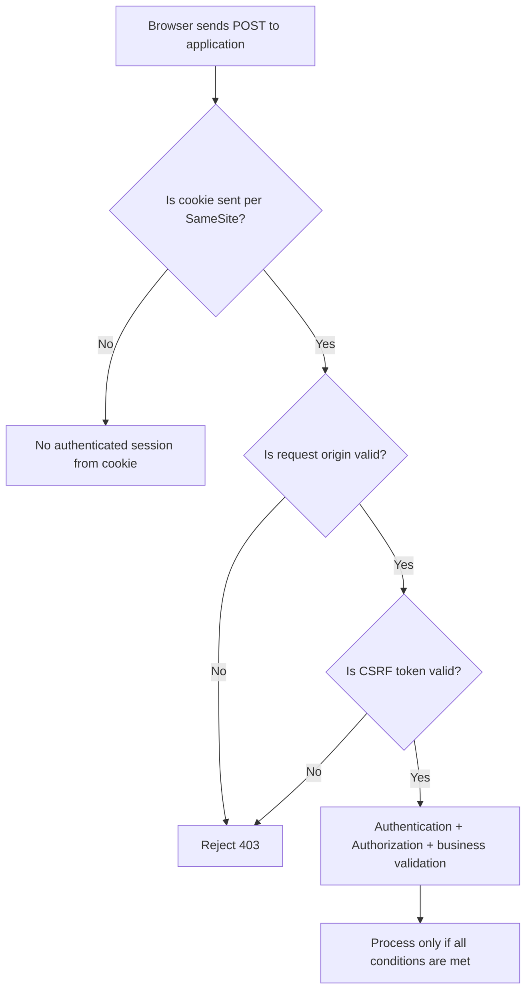

# SameSite and Request Origin Checks as Supporting Layers for CSRF Protection

> **Scope:** **Spring Security applications on the Servlet stack** (Spring MVC / Spring Boot 3.x, Spring Security 6.x), especially when browsers automatically attach session cookies to requests. The focus is on understanding and combining `SameSite`, `Origin`/`Referer` verification, and Fetch Metadata as **supplementary defense layers** alongside the CSRF token mechanism; do not equate these layers or treat them as replacements for authentication/authorization.

## 1. Learning Objectives

After this lesson, you will be able to:

1. Explain the CSRF mechanism when browsers automatically send authentication cookies, and distinguish **same-site** from **same-origin**.
2. Choose `SameSite=Strict`, `Lax`, or `None; Secure` based on user flows, understanding the limits of each policy and the impact on cross-domain login.
3. Verify the origin of **state-changing requests** using `Origin`; optionally use `Referer` as a fallback with exact origin matching, handling empty/`null` headers intentionally.
4. Use `Sec-Fetch-Site` as a supplementary signal to block unwanted requests from external sites; know when exceptions are required.
5. Configure Spring Boot + Spring Security: keep **CSRF tokens** on POST forms, set SameSite on session cookies, add an origin-checking filter, and test each layer independently.

## 2. Context: Why Do Cookies Open the Door to CSRF?

Suppose a user is logged into `https://bank.example` via a session cookie. When they open `https://attacker.test`, the attacking page can attempt to send a request to the target application, such as via an HTML form:

```html
<form method="post" action="https://bank.example/transfer">
  <input type="hidden" name="to" value="attacker">
  <input type="hidden" name="amount" value="100">
</form>
<script>document.forms[0].submit()</script>
```

This is a **risk illustration**, not a method for testing unauthorized systems. If the browser automatically attaches the session cookie and the server checks only whether the user is logged in, the server may mistake a request initiated by another page for the account owner's intent. CSRF does not require the attacker to read the response.

Spring Security's standard defense layer for cookie-based browser applications is the **CSRF token**: a token bound to the session/authentication context, rendered to legitimate pages, and required back on state-changing actions. External pages cannot freely read tokens in same-origin responses thanks to the same-origin policy (assuming no XSS or dangerous CORS configuration).

The remaining controls further reduce the attack surface:



The diagram is a **conceptual defense model**, not a guarantee of filter execution order or behavior across all browsers. Attackers can still send raw HTTP outside a browser, crafting headers and cookies they own. Hence `Origin` and `Sec-Fetch-*` are meaningful only as signals protecting requests from **browsers**, not proof of identity.

## 3. Same-Origin and Same-Site Are Two Different Boundaries

**Origin** consists of the triple **scheme + host + port**. Two URLs are same-origin only when all three components match.

**Site** in modern cookie policies typically considers **scheme + registrable domain** (eTLD+1 based on the Public Suffix List), ignoring port and same-site subdomains. This is **schemeful same-site**: switching `https` to `http` can turn it cross-site even with the same host. For `localhost`, IP addresses, and special suffixes, exact rules follow browser algorithms rather than naive string slicing.

| URL pair | Same-origin? | Same-site? (schemeful, typical) |
| --- | --- | --- |
| `https://app.example.com/a` ↔ `https://app.example.com/b` | Yes | Yes |
| `https://app.example.com` ↔ `https://api.example.com` | No (different host) | Yes |
| `https://app.example.com` ↔ `https://app.example.com:8443` | No (different port) | Yes |
| `https://app.example.com` ↔ `http://app.example.com` | No (different scheme) | No |
| `https://app.example.com` ↔ `https://evil.example.net` | No | No |

**Important implication:** `SameSite` can still send session cookies for requests from **another subdomain on the same site**. If `preview.example.com` is compromised, requests it initiates to `app.example.com` are cross-origin yet potentially same-site. Therefore `SameSite=Lax/Strict` is **not sufficient** to defend against untrusted subdomains. Exact `Origin` verification and CSRF tokens remain valuable.

A `Domain=.example.com` cookie allows sharing cookies across matching hosts in the domain and increases risk from subdomains; **host-only** cookies (omitting `Domain`) are usually the safer choice when sharing is not needed. `SameSite` and `Domain` solve different problems.

## 4. SameSite Modes and Practical Impact

`SameSite` is an attribute on **Set-Cookie** returned by the server; the browser decides whether to attach the cookie on subsequent requests.

| Attribute | Typical cross-site subresource / fetch | Cross-site top-level navigation GET | Cross-site form POST | When to use |
| --- | --- | --- | --- | --- |
| `SameSite=Strict` | Not sent | Not sent | Not sent | Purely same-site flows requiring high isolation; mind UX when following external links. |
| `SameSite=Lax` | Not sent | **Sent** on top-level navigation using safe methods like GET | Usually **not sent** | Practical choice for many web apps using sessions and external navigation. |
| `SameSite=None; Secure` | May be sent if other cookie policies allow | May be sent | May be sent | Cross-site integrations genuinely needing cookies, e.g., certain SSO/iframes; requires HTTPS and proper CSRF tokens. |

**Important notes:**

- `SameSite=None` requires `Secure` in modern browsers; `Secure` cookies are sent only over secure connections, with certain browser exceptions for localhost.
- Browsers may **block third-party cookies** even when the server sets `SameSite=None; Secure`; policies vary by browser, user, and environment.
- Do not rely on **defaults when omitting SameSite**. Some browsers apply a default Lax with a temporary exception for POSTs right after a new cookie is set (often called `Lax-allowing-unsafe`); an explicitly declared `SameSite=Lax` behaves more strictly. Never use "modern browsers protect automatically" instead of CSRF tokens.
- `Lax` allows cookies on certain cross-site **GET** navigations. GET/HEAD/OPTIONS/TRACE must have **safe** semantics; never implement `GET /delete-account` or `GET /transfer` as state-changing operations.
- `Strict` may cause users opening a link from an email/external site to arrive without the cookie on the initial navigation, forcing a re-login or requiring a subsequent same-site navigation.
- OAuth2/OIDC/SAML flows with cross-site callbacks (especially POST binding), federated login, and embedded widgets may require tailored exceptions and cookie design. Never set `Strict` system-wide and then fix issues by disabling CSRF. Authentication protocols also have protocol-specific `state`, `nonce`, or `InResponseTo` checks.

### Configuring Session Cookies in Spring Boot

For Servlet applications using session cookies managed by the embedded server, Spring Boot 3.x can configure:

**`src/main/resources/application.properties`**

```properties
server.servlet.session.cookie.same-site=lax
server.servlet.session.cookie.http-only=true

# Enable only in genuine HTTPS environments; production deployments require HTTPS.
# server.servlet.session.cookie.secure=true
```

Observe `Set-Cookie` on responses that actually create a session. **Illustrative** example (session value varies per session, names/attributes depend on container):

```http
Set-Cookie: JSESSIONID=<session-id>; Path=/; HttpOnly; SameSite=Lax
```

`HttpOnly` prevents JavaScript from reading cookies, `Secure` requires HTTPS transport, and `SameSite` restricts cookie-sending contexts; these three attributes **do not replace one another** and cannot fix XSS or authorization bugs. If the application creates additional login cookies, changes session stores, or a proxy rewrites `Set-Cookie`, inspect each authentication cookie individually rather than checking only `JSESSIONID`.

In production, prefer HTTPS, `Secure` cookies, restricted `Domain`, appropriate session lifetimes, and avoid placing session IDs in URLs. If a proxy terminates TLS in front of the application, configure proxy/forwarded headers **only from trusted proxies** so the app sees the accurate public scheme and URL.

## 5. Checking Request Origin Using Origin and Referer

### Origin: Preferred Signal When Present

On many browser-generated state-changing requests, `Origin` indicates the origin of the context initiating the request, e.g.:

```http
POST /profile HTTP/1.1
Host: app.example.com
Origin: https://app.example.com
Cookie: JSESSIONID=...
Content-Type: application/x-www-form-urlencoded
```

The application accepts the operation only if `Origin` is in the **server-managed list of allowed origins**, e.g., `https://app.example.com`. Match **scheme, host, and port**; never check with `startsWith("https://app.example.com")` because `https://app.example.com.attacker.test` can bypass a prefix check. Whitelist only origins genuinely trusted for the feature; `*.example.com` is not automatically trustworthy since controlled subdomains or tenant accounts may exist.

`Origin: null` can occur from sandboxed contexts, file URLs, or specific redirects/policies. Do not treat `null` or an empty header as "same-origin" by default. The `Host` header identifies **the target receiving the request**, not which page originated the request.

### Referer: Limited Fallback Path

When `Origin` is absent, the server **may** inspect `Referer` and extract scheme/host/port to compare against the target origin. `Referer` holds a full URL and may be absent due to `Referrer-Policy`, privacy settings, navigation, or client behavior; string-prefix matching is highly error-prone. Never log full Referer URLs if query strings carry sensitive data.

There are two valid policies depending on the product:

- **Fail closed** when both headers are absent: high strictness, though it may reject legacy clients, privacy browsers, HTTP tools, and legitimate integrations.
- **Fall through to the CSRF token** when origin headers are missing: less disruptive, though the origin-checking layer is no longer a mandatory gate in that case. This decision must be documented and tested against target clients.

Never use `Origin`/`Referer` as the sole means to identify a user or accept operations missing a CSRF token. For browsers, they are an **origin-checking layer**, not an authentication mechanism.

## 6. Fetch Metadata: Additional Browser Context Information

`Sec-Fetch-*` headers are emitted by modern browsers on requests, e.g.:

```http
Sec-Fetch-Site: cross-site
Sec-Fetch-Mode: navigate
Sec-Fetch-Dest: document
```

`Sec-Fetch-Site` has common values:

| Value | Interpretation |
| --- | --- |
| `same-origin` | Request initiated from the exact same origin. |
| `same-site` | Same site, possibly a different origin/subdomain. |
| `cross-site` | Initiating context belongs to another site. |
| `none` | No initiating site, e.g., navigation from address bar/bookmark in applicable contexts. |

A simple **supplementary** policy for state-changing routes can reject `Sec-Fetch-Site: cross-site`. A stricter policy can require `same-origin` for critical actions, since `same-site` does not exclude untrusted subdomains. For `none` or missing headers, define an explicit rule; never treat them as automatic proof of a safe request.

Note that `Sec-Fetch-*` may not be sent by older browsers or non-browser HTTP clients. They are browser-generated signals within a browser environment and can be spoofed by custom-written HTTP clients. Certain requests from payment providers, webhooks, OAuth callbacks, SAML POSTs, or cross-site embeds are legitimate; policies need **narrow, endpoint- and protocol-specific exceptions**, not site-wide openings. Do not turn valid requests into 403s just by checking a header without auditing business flows.

**CORS differs from CSRF:** CORS controls browser scripts reading cross-origin responses and restricts certain requests requiring preflight. Cross-site HTML forms using simple content types can still be sent **without CORS preflight**. Blocking CORS or omitting `@CrossOrigin` is insufficient to prevent CSRF.

## 7. Runnable Demo: Spring Boot + Session SameSite + CSRF Token + Origin Guard

The demo uses **Java 17+**, Maven, **Spring Boot 3.3.0 / Spring Security 6.x**, and a browser visiting `http://localhost:8080`. This is a learning example storing mutations in memory; production needs TLS, proper storage, and origin policies.

Directory structure:

```text
csrf-origin-demo/
├── pom.xml
└── src/
    ├── main/
    │   ├── java/demo/csrf/
    │   │   ├── DemoApplication.java
    │   │   ├── SecurityConfig.java
    │   │   ├── SameOriginGuardFilter.java
    │   │   └── PageController.java
    │   └── resources/
    │       ├── application.properties
    │       └── templates/
    │           ├── login.html
    │           └── profile.html
    └── test/java/demo/csrf/
        └── SecurityFlowTest.java
```

### 7.1. Dependencies and Configuration

**`pom.xml`**

```xml
<project xmlns="http://maven.apache.org/POM/4.0.0"
         xmlns:xsi="http://www.w3.org/2001/XMLSchema-instance"
         xsi:schemaLocation="http://maven.apache.org/POM/4.0.0 https://maven.apache.org/xsd/maven-4.0.0.xsd">
    <modelVersion>4.0.0</modelVersion>
    <parent>
        <groupId>org.springframework.boot</groupId>
        <artifactId>spring-boot-starter-parent</artifactId>
        <version>3.3.0</version>
        <relativePath/>
    </parent>
    <groupId>demo</groupId>
    <artifactId>csrf-origin-demo</artifactId>
    <version>0.0.1-SNAPSHOT</version>
    <properties>
        <java.version>17</java.version>
    </properties>
    <dependencies>
        <dependency>
            <groupId>org.springframework.boot</groupId>
            <artifactId>spring-boot-starter-web</artifactId>
        </dependency>
        <dependency>
            <groupId>org.springframework.boot</groupId>
            <artifactId>spring-boot-starter-security</artifactId>
        </dependency>
        <dependency>
            <groupId>org.springframework.boot</groupId>
            <artifactId>spring-boot-starter-thymeleaf</artifactId>
        </dependency>
        <dependency>
            <groupId>org.springframework.boot</groupId>
            <artifactId>spring-boot-starter-test</artifactId>
            <scope>test</scope>
        </dependency>
        <dependency>
            <groupId>org.springframework.security</groupId>
            <artifactId>spring-security-test</artifactId>
            <scope>test</scope>
        </dependency>
    </dependencies>
    <build>
        <plugins>
            <plugin>
                <groupId>org.springframework.boot</groupId>
                <artifactId>spring-boot-maven-plugin</artifactId>
            </plugin>
        </plugins>
    </build>
</project>
```

**`src/main/resources/application.properties`**

```properties
server.port=8080
server.servlet.session.cookie.same-site=lax
server.servlet.session.cookie.http-only=true

# Server-controlled trusted origin used by the filter below.
app.public-origin=http://localhost:8080
```

`app.public-origin` is a **trusted target configuration**, never read from an arbitrary client-sent header. When deploying to production, change it to e.g., `https://app.example.com` and enable `server.servlet.session.cookie.secure=true` alongside HTTPS and proper forwarded headers. If the app supports multiple public origins, manage an explicit allowlist rather than wildcards.

**`src/main/java/demo/csrf/DemoApplication.java`**

```java
package demo.csrf;

import org.springframework.boot.SpringApplication;
import org.springframework.boot.autoconfigure.SpringBootApplication;

@SpringBootApplication
public class DemoApplication {
    public static void main(String[] args) {
        SpringApplication.run(DemoApplication.class, args);
    }
}
```

### 7.2. Origin/Referer Comparison Filter

**`src/main/java/demo/csrf/SameOriginGuardFilter.java`**

```java
package demo.csrf;

import jakarta.servlet.DispatcherType;
import jakarta.servlet.FilterChain;
import jakarta.servlet.ServletException;
import jakarta.servlet.http.HttpServletRequest;
import jakarta.servlet.http.HttpServletResponse;
import org.springframework.web.filter.OncePerRequestFilter;

import java.io.IOException;
import java.net.URI;
import java.util.Set;

final class SameOriginGuardFilter extends OncePerRequestFilter {
    private static final Set<String> SAFE_METHODS =
            Set.of("GET", "HEAD", "OPTIONS", "TRACE");

    private final URI expectedOrigin;

    SameOriginGuardFilter(String expectedOrigin) {
        this.expectedOrigin = URI.create(expectedOrigin);
        URI u = this.expectedOrigin;
        if (u.getHost() == null
                || !(u.getScheme().equalsIgnoreCase("http")
                     || u.getScheme().equalsIgnoreCase("https"))
                || u.getRawUserInfo() != null
                || (u.getRawPath() != null && !u.getRawPath().isEmpty())
                || u.getRawQuery() != null
                || u.getRawFragment() != null) {
            throw new IllegalArgumentException(
                    "app.public-origin must be an HTTP(S) origin");
        }
    }

    @Override
    protected boolean shouldNotFilter(HttpServletRequest request) {
        // Inspect only client-initiated requests with unsafe methods.
        return request.getDispatcherType() != DispatcherType.REQUEST
                || SAFE_METHODS.contains(request.getMethod());
    }

    @Override
    protected void doFilterInternal(
            HttpServletRequest request,
            HttpServletResponse response,
            FilterChain chain) throws ServletException, IOException {
        String origin = request.getHeader("Origin");
        String referer = request.getHeader("Referer");

        boolean trusted;
        if (origin != null) {
            // Origin present: do not fall back to Referer if Origin is wrong.
            trusted = isTrusted(origin, true);
        } else if (referer != null) {
            trusted = isTrusted(referer, false);
        } else {
            // Demo policy: fail closed if both headers are absent.
            trusted = false;
        }

        if (!trusted) {
            response.sendError(HttpServletResponse.SC_FORBIDDEN,
                    "Unexpected request origin");
            return;
        }
        chain.doFilter(request, response);
    }

    private boolean isTrusted(String value, boolean strictOriginHeader) {
        try {
            URI candidate = URI.create(value);
            if (candidate.getHost() == null
                    || candidate.getScheme() == null
                    || candidate.getRawUserInfo() != null) {
                return false;
            }
            // Origin header must contain only scheme://host[:port].
            if (strictOriginHeader
                    && ((candidate.getRawPath() != null
                          && !candidate.getRawPath().isEmpty())
                        || candidate.getRawQuery() != null
                        || candidate.getRawFragment() != null)) {
                return false;
            }
            return candidate.getScheme()
                        .equalsIgnoreCase(expectedOrigin.getScheme())
                    && candidate.getHost()
                        .equalsIgnoreCase(expectedOrigin.getHost())
                    && port(candidate) == port(expectedOrigin);
        } catch (IllegalArgumentException ex) {
            // E.g., Origin: null, malformed URL, or multiple origins on one line.
            return false;
        }
    }

    private static int port(URI uri) {
        if (uri.getPort() != -1) {
            return uri.getPort();
        }
        return "https".equalsIgnoreCase(uri.getScheme()) ? 443 : 80;
    }
}
```

**Points to understand in the filter:**

- Structured URL comparison via `URI`, not string prefixes. Distinguishes default HTTP port 80 and HTTPS port 443.
- If `Origin` is present yet untrusted, **reject immediately**; do not let a valid `Referer` "rescue" a bad Origin.
- If `Origin` is absent and `Referer` is present, extract the origin of the Referer URL; the path portion may differ so do not require an empty path.
- The demo **fails closed** when both are missing. This is a security and compatibility decision of the demo; some valid clients will receive 403. Real apps may choose to fall back to the CSRF token or separate routes for non-browser APIs.
- The filter runs only on original HTTP requests with unsafe methods. `ERROR` dispatches are skipped so original errors are not masked.
- Never apply this filter as a replacement for CSRF tokens; the filter mainly protects browser requests. An adversary able to craft direct HTTP requests can set headers however they want.

### 7.3. SecurityFilterChain Keeping Default CSRF

**`src/main/java/demo/csrf/SecurityConfig.java`**

```java
package demo.csrf;

import jakarta.servlet.DispatcherType;
import org.springframework.beans.factory.annotation.Value;
import org.springframework.context.annotation.Bean;
import org.springframework.context.annotation.Configuration;
import org.springframework.security.config.Customizer;
import org.springframework.security.config.annotation.web.builders.HttpSecurity;
import org.springframework.security.core.userdetails.User;
import org.springframework.security.core.userdetails.UserDetailsService;
import org.springframework.security.crypto.bcrypt.BCryptPasswordEncoder;
import org.springframework.security.crypto.password.PasswordEncoder;
import org.springframework.security.provisioning.InMemoryUserDetailsManager;
import org.springframework.security.web.SecurityFilterChain;
import org.springframework.security.web.csrf.CsrfFilter;

@Configuration
public class SecurityConfig {
    @Bean
    SecurityFilterChain filterChain(
            HttpSecurity http,
            @Value("${app.public-origin}") String publicOrigin)
            throws Exception {
        return http
            .authorizeHttpRequests(auth -> auth
                .dispatcherTypeMatchers(DispatcherType.ERROR).permitAll()
                .requestMatchers("/", "/login", "/error").permitAll()
                .requestMatchers("/profile").authenticated()
                .anyRequest().denyAll())
            .addFilterBefore(
                new SameOriginGuardFilter(publicOrigin), CsrfFilter.class)
            .csrf(Customizer.withDefaults())
            .formLogin(form -> form
                .loginPage("/login")
                .loginProcessingUrl("/login")
                .failureUrl("/login?error")
                .permitAll())
            .build();
    }

    @Bean
    PasswordEncoder passwordEncoder() {
        return new BCryptPasswordEncoder();
    }

    @Bean
    UserDetailsService users(PasswordEncoder encoder) {
        return new InMemoryUserDetailsManager(
            User.withUsername("student")
                .password(encoder.encode("demo-pass"))
                .roles("USER")
                .build());
    }
}
```

**Why is this filter registration approach meaningful?**

1. `.csrf(Customizer.withDefaults())` maintains standard CSRF protection for unsafe methods. Never add `csrf.disable()` for session-based web apps.
2. `addFilterBefore(..., CsrfFilter.class)` allows rejecting invalid Origins before processing tokens. Both a valid Origin and a valid token **are required** when the demo policy is active.
3. `new SameOriginGuardFilter(...)` is not declared as a `@Component` or a servlet-Filter Spring `@Bean`, avoiding Spring Boot auto-registering a second filter instance in the **container filter chain** outside the Spring Security chain. This keeps execution order clear.
4. `/login` is accessible without logging in, **yet POST `/login` still has both the CSRF token and Origin guard**. `permitAll` only removes the authentication requirement; it does not disable CSRF checks.
5. Permits `DispatcherType.ERROR` so internal error-page rendering dispatches are not turned into login redirects.
6. When adding routes that can mutate data, ensure requests still pass through the right security chain, verify authorization, and enforce business invariants. Do not treat a 403 from a filter as a substitute for authorization.

### 7.4. MVC Controller and Two Forms with CSRF Tokens

**`src/main/java/demo/csrf/PageController.java`**

```java
package demo.csrf;

import org.springframework.security.core.Authentication;
import org.springframework.stereotype.Controller;
import org.springframework.ui.Model;
import org.springframework.web.bind.annotation.GetMapping;
import org.springframework.web.bind.annotation.PostMapping;
import org.springframework.web.bind.annotation.RequestParam;
import org.springframework.web.bind.annotation.ResponseBody;

import java.util.Map;
import java.util.concurrent.ConcurrentHashMap;

@Controller
public class PageController {
    private final Map<String, String> names = new ConcurrentHashMap<>();

    @GetMapping("/")
    @ResponseBody
    public String home() {
        return "Home: open /profile to sign in and edit your display name.";
    }

    @GetMapping("/login")
    public String login() {
        return "login";
    }

    @GetMapping("/profile")
    public String profile(Authentication auth, Model model) {
        model.addAttribute("username", auth.getName());
        model.addAttribute("displayName",
                names.getOrDefault(auth.getName(), "(unset)"));
        return "profile";
    }

    @PostMapping("/profile")
    @ResponseBody
    public String update(
            Authentication auth,
            @RequestParam String displayName) {
        names.put(auth.getName(), displayName);
        return "Updated displayName to " + displayName;
    }
}
```

In production, persist changes in a service/database scoped to the authenticated account, validate input size/content, and avoid echoing unencoded data into HTML. The demo uses an in-RAM map to prove the POST operation genuinely mutates application state.

**`src/main/resources/templates/login.html`**

```html
<!doctype html>
<html lang="en" xmlns:th="http://www.thymeleaf.org">
<head>
    <meta charset="utf-8">
    <title>Log In</title>
</head>
<body>
    <h1>Log In</h1>
    <p th:if="${param.error != null}">Invalid credentials.</p>
    <form method="post" th:attr="action=@{/login}">
        <label>Username <input name="username" required></label>
        <label>Password <input name="password" type="password" required></label>
        <input type="hidden"
               th:name="${_csrf.parameterName}"
               th:value="${_csrf.token}">
        <button type="submit">Log In</button>
    </form>
</body>
</html>
```

**`src/main/resources/templates/profile.html`**

```html
<!doctype html>
<html lang="en" xmlns:th="http://www.thymeleaf.org">
<head>
    <meta charset="utf-8">
    <title>Profile</title>
</head>
<body>
    <h1>Profile</h1>
    <p>Account: <strong th:text="${username}">student</strong></p>
    <p>Current name: <span th:text="${displayName}">(unset)</span></p>
    <form method="post" th:attr="action=@{/profile}">
        <label>Display name
            <input name="displayName" maxlength="80" required>
        </label>
        <input type="hidden"
               th:name="${_csrf.parameterName}"
               th:value="${_csrf.token}">
        <button type="submit">Save name</button>
    </form>
</body>
</html>
```

`th:attr` sets the action URL with context path; the hidden input puts the Spring Security-provided CSRF token into the form. In some Thymeleaf integrations, `th:action` can automatically insert the hidden CSRF field via Spring MVC's `RequestDataValueProcessor`; if choosing that approach, do not accidentally insert a duplicate field. The example uses `th:attr` and explicit token insertion for learner visibility.

### 7.5. Running the Demo and Observing Behavior

In the `csrf-origin-demo` directory:

```bash
mvn test
mvn spring-boot:run
```

1. Open `http://localhost:8080/profile` in a browser. Because you are not logged in, you are redirected to `/login`.
2. Log in with `student` / `demo-pass`. The browser sends the session cookie, `Origin` or `Referer`, and CSRF token; after authentication it returns to `/profile`.
3. Enter `Lan` and click save. The HTTP POST returns the exact illustrative text:

```text
Updated displayName to Lan
```

4. Go back to `/profile`; the page shows `Lan` from the in-memory map. Open DevTools → Network: verify `POST /profile` includes the token, `Origin`, and cookie; inspect the session-creating response to confirm `SameSite=Lax`. Browsers normally forbid JavaScript from reading `HttpOnly` cookie values; DevTools still lets you inspect cookies in the storage panel.

**Testing the origin-checking layer with curl (no password needed):**

```bash
curl -i -X POST "http://localhost:8080/profile"   -H "Origin: https://attacker.test"   --data-urlencode "displayName=Unexpected"

curl -i -X POST "http://localhost:8080/profile"   -H "Origin: http://localhost:8080"   --data-urlencode "displayName=MissingCsrf"
```

Both expect **403**, yet for different reasons: the first request is rejected by the **Origin guard**; the second passes the Origin guard and is rejected by the **CSRF filter** for missing a valid token. Never conclude which layer fired from the 403 code alone; use filter logs, MockMvc, or debugging to confirm.

The `curl` commands above use single-line or Bash/Linux/macOS shell syntax; in PowerShell adjust line continuation or run as one line. Responses may have varying body/HTML error formats depending on Spring Boot configuration, yet status 403 is expected in the demo.

## 8. Testing Each Layer Independently with Spring Security Test

**`src/test/java/demo/csrf/SecurityFlowTest.java`**

```java
package demo.csrf;

import org.junit.jupiter.api.Test;
import org.springframework.beans.factory.annotation.Autowired;
import org.springframework.boot.test.autoconfigure.web.servlet.AutoConfigureMockMvc;
import org.springframework.boot.test.context.SpringBootTest;
import org.springframework.test.web.servlet.MockMvc;

import static org.springframework.security.test.web.servlet.request
        .SecurityMockMvcRequestPostProcessors.csrf;
import static org.springframework.security.test.web.servlet.request
        .SecurityMockMvcRequestPostProcessors.user;
import static org.springframework.test.web.servlet.request.MockMvcRequestBuilders.post;
import static org.springframework.test.web.servlet.result.MockMvcResultMatchers.content;
import static org.springframework.test.web.servlet.result.MockMvcResultMatchers.status;

@SpringBootTest
@AutoConfigureMockMvc
class SecurityFlowTest {
    @Autowired
    MockMvc mvc;

    @Test
    void crossSiteOriginRejectedEvenWithValidCsrfToken() throws Exception {
        mvc.perform(post("/profile")
                .with(user("student"))
                .with(csrf())
                .header("Origin", "https://attacker.test")
                .param("displayName", "X"))
            .andExpect(status().isForbidden());
    }

    @Test
    void validOriginButMissingCsrfTokenRejected() throws Exception {
        mvc.perform(post("/profile")
                .with(user("student"))
                .header("Origin", "http://localhost:8080")
                .param("displayName", "X"))
            .andExpect(status().isForbidden());
    }

    @Test
    void validOriginAndCsrfTokenAllowAuthorizedPost() throws Exception {
        mvc.perform(post("/profile")
                .with(user("student"))
                .with(csrf())
                .header("Origin", "http://localhost:8080")
                .param("displayName", "Lan"))
            .andExpect(status().isOk())
            .andExpect(content().string("Updated displayName to Lan"));
    }

    @Test
    void missingOriginAndRefererRejectedByDemoPolicy() throws Exception {
        mvc.perform(post("/profile")
                .with(user("student"))
                .with(csrf())
                .param("displayName", "X"))
            .andExpect(status().isForbidden());
    }

    @Test
    void trustedRefererCanBeUsedWhenOriginAbsent() throws Exception {
        mvc.perform(post("/profile")
                .with(user("student"))
                .with(csrf())
                .header("Referer", "http://localhost:8080/profile")
                .param("displayName", "Mai"))
            .andExpect(status().isOk())
            .andExpect(content().string("Updated displayName to Mai"));
    }
}
```

These tests prove **layering**: a valid CSRF token is still rejected when Origin is wrong; a valid Origin is still rejected when the token is missing; same origin + valid token + authentication lets the operation succeed. `MockMvc` is an application-layer test and **does not verify how browsers apply SameSite when sending cookies**. To verify SameSite, run browser tests or inspect real network requests.

## 9. Applying to Different Endpoint Types

| Endpoint / client | SameSite and CSRF | Origin checks |
| --- | --- | --- |
| Same-origin HTML form using session cookie | Typically `Lax`; CSRF token on POST/PUT/PATCH/DELETE | Can block non-matching Origin, intentional Referer fallback. |
| Same-origin SPA calling API with cookies | Keep CSRF token (possibly via header) and appropriate cookies | Origin check, supplementary Fetch Metadata; note SPA tokens need specific config. |
| SPA on a different origin within the same site | SameSite may allow sending cookies, yet this is **cross-origin** | Specific origin allowlist; must design CORS/credentials and CSRF tokens properly. |
| Third-party iframe / cross-site integration with session cookies | May need `None; Secure`, cookies also depend on browser policies | Protocol-authenticated exceptions, Origin allowlist, appropriate CSRF/state; never drop checks globally. |
| Bearer-token API sent only via `Authorization`, not relying on ambient cookies | CSRF may be unnecessary for that endpoint if browser does not auto-attach credentials | Authorization tokens and API permissions still mandatory; CORS and Origin per client model. |
| Server-to-server webhooks | Do not rely on browser SameSite and Origin | Verify signature/HMAC, token, mTLS, or dedicated server-to-server mechanism; do not rely on Origin header. |

**With Spring Security, never disable CSRF for the entire application just because one endpoint needs an exception.** If multiple endpoint groups exist, separate them with `SecurityFilterChain` beans using clear `securityMatcher` rules or a **narrow, tested** `csrf.ignoringRequestMatchers(...)` configuration. Form login, account actions, and cookie-based APIs must retain appropriate protection.

## 10. Limitations That Should Not Be Overlooked

### SameSite Does Not Handle Every Case

- **Same-site yet cross-origin:** sibling subdomains can generate same-site requests to the app; Lax/Strict will not block them by default.
- **Top-level GET:** Lax can send cookies; if GET causes side effects, the risk remains intact.
- **Non-uniformly controlled cookies:** apps with multiple cookies/sessions, proxies, or subdomains; audit actual cookies rather than a single property.
- **Inconsistent browsers:** third-party cookie blocking, schemeful same-site, older browsers, and SSO callbacks can differ; test in target environments.

### Origin/Referer and Fetch Metadata Also Have Limits

- `Origin`/`Referer` can be absent or `null`; fail-closed can break valid clients. Every exception must specify target clients, authentication, and endpoints.
- Do not conclude `Sec-Fetch-Site: same-site` is trustworthy when uncontrolled subdomains exist. `Sec-Fetch-Site: none` does not mean "same-origin".
- HTTP clients or adversaries controlling the browser/client can freely set headers not restricted like website JavaScript; never use those headers as authentication tokens.
- Never match strings by suffix or prefix, and never use the request's `Host` as the expected origin without accounting for Host header spoofing/proxies; trusted origins must come from server configuration or verified tenant lists.
- **XSS** within the same origin can access CSRF tokens or initiate valid requests that pass Origin/SameSite. Prevent XSS via output encoding, proper CSP, dependency hygiene, and never injecting untrusted HTML.

### Misconfiguration Can Also Break Legitimate Flows

Certain payment flows, OAuth2/OIDC redirects, SAML POSTs, opening pages from email, iframe embeds, and cross-site logins require cookies/navigation across site boundaries. Choosing `Strict` or rejecting all `cross-site` requests in a global filter can cause **login loops**, lost session/state, or rejected valid callbacks. Analyze protocol flows and apply scoped exceptions, verifying `state`/`nonce`/signatures/one-time codes per protocol.

## 11. Testing and Diagnostic Checklist

1. In DevTools → Application/Storage, inspect **every authentication cookie**: `SameSite`, `Secure`, `HttpOnly`, `Domain`, `Path`. In Network, inspect actual `Set-Cookie` headers and cookies sent on requests.
2. From a **cross-site** website, try submitting a POST form to a state-changing route in an authorized test environment: confirm no mutation occurs and note which layer rejected it.
3. From a **same-site yet cross-origin subdomain**, test a request with cookies: confirm the Origin allowlist/CSRF token still prevents unauthorized actions.
4. Test all scenarios: valid/invalid/`null`/missing Origin; valid/invalid/missing Referer; `Sec-Fetch-Site`: `same-origin`/`same-site`/`cross-site`/`none`/missing.
5. Test normal clients: login form has CSRF, POST succeeds when authenticated, error page still shows proper status, GET only reads data.
6. Test integrations: HTTPS proxy, OAuth/SAML callbacks, CORS credentials, cookie-free APIs, signed webhooks, browser privacy mode, and third-party cookie policies.
7. When encountering 403, determine which component blocked it: Origin filter, `CsrfFilter`, authorization rule, CORS/preflight, expired session, or proxy. Never fix by disabling security filters wholesale.
8. Log **error type and route** rather than writing raw cookies, CSRF tokens, or full URLs containing secrets. With Spring Security, `logging.level.org.springframework.security=DEBUG` can be temporarily enabled in test environments, yet must be turned off after analysis.

## 12. Takeaways

**CSRF tokens are the mechanism verifying the validity of state-changing actions in cookie-based browser applications.** `SameSite` reduces the scope where browsers auto-send cookies; `Origin`/`Referer` verify the request's initiating origin per policy; `Sec-Fetch-*` adds request context. Combining these layers with authentication, authorization, HTTPS, secure cookies, and XSS defenses reduces CSRF risk while preserving legitimate login/integration flows.

**Implementation principle:** keep CSRF tokens per Spring Security's mechanism, define **trusted origins via server configuration**, verify cookies and headers in real browsers, and grant only narrowly scoped exceptions.