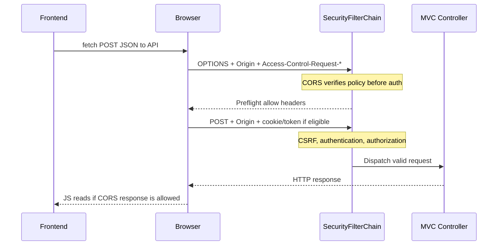

# Combining Spring MVC CORS Configuration with Spring Security

## 1. The Problem to Solve

A Spring Boot application using **Spring MVC on the Servlet stack** and **Spring Security** often needs two things at once: defining which frontend origins can call APIs via a browser, and keeping authentication, authorization, and CSRF steps accurate. When a frontend at `http://localhost:5173` calls a backend at `http://localhost:8080`, the request is **cross-origin** because the ports differ despite having the same hostname.

**CORS (Cross-Origin Resource Sharing)** is the mechanism for a server to allow JavaScript running from another origin to read HTTP responses in the browser. Spring MVC can declare policy via `WebMvcConfigurer#addCorsMappings` or `@CrossOrigin`; Spring Security needs to process that policy **before authentication steps** so `OPTIONS` preflight is not wrongly rejected. The common configuration for Spring Security 6 is:

```java
http.cors(Customizer.withDefaults());
```

When Spring MVC is present, without configuring a separate `CorsConfigurationSource` and using MVC's CORS config, Security can automatically leverage MVC's CORS mappings. **MVC defines permitted origins/methods/headers; Security ensures CORS is handled at the right position in the filter chain.**

Goal after this lesson: configure a runnable Java 17+/Spring Boot 3.x demo, test preflight and actual requests, understand when to use `@CrossOrigin` vs. `CorsConfigurationSource`, handle 401/403/CORS errors, and avoid confusing CORS with CSRF or cookie policies.

## 2. How Does the Browser Send CORS Requests?

An origin is the tuple `scheme + host + port`. Browsers treat `https://app.example.com` and `https://api.example.com` as two different origins (different host); `http://localhost:5173` and `http://localhost:8080` as different origins (different port); and `http://api.example.com` and `https://api.example.com` as different origins (different scheme).

**Same-Origin Policy (SOP)** restricts scripts on origin A from reading data from origin B. CORS is a **permission decision from server B**; it is not login, not endpoint authorization, and does not prevent all cross-origin requests from being sent. For instance, an HTML form can submit a POST to another server even if the script cannot read the response.

A typical CORS request carries a header set by the browser:

```http
GET /api/ping HTTP/1.1
Host: localhost:8080
Origin: http://localhost:5173
```

If the origin is allowed, the backend response may contain:

```http
Access-Control-Allow-Origin: http://localhost:5173
Vary: Origin
```

**The final decision is checked by the browser.** `curl` can supply an `Origin` header to test policy, yet does not enforce CORS itself like a browser.

### 2.1. Simple Requests and Preflight

Not every cross-origin request triggers a preflight. An ordinary GET or a form POST using a "simple" content type, with allowed headers, can send the actual request immediately. When JavaScript wants to send JSON `Content-Type: application/json` or a custom header `X-CSRF-TOKEN`, the browser usually needs an **OPTIONS preflight**:

```http
OPTIONS /api/notes HTTP/1.1
Host: localhost:8080
Origin: http://localhost:5173
Access-Control-Request-Method: POST
Access-Control-Request-Headers: content-type,x-csrf-token
```

The browser asks "is this origin allowed to send POST carrying those intended headers?". The server evaluates the policy and returns a response like the following; exact status or formatting of the header list may vary by framework:

```http
HTTP/1.1 200 OK
Access-Control-Allow-Origin: http://localhost:5173
Access-Control-Allow-Methods: GET,POST
Access-Control-Allow-Headers: content-type,x-csrf-token
Access-Control-Allow-Credentials: true
Access-Control-Max-Age: 1800
```

Preflight **is not the actual POST**, normally **does not carry login cookies**, and must not be treated as a completed user operation. If preflight does not pass CORS, the browser may not send the actual POST.

### 2.2. Why Must Spring Security Participate?

Spring Security sits in the **Servlet filter chain**, typically running before `DispatcherServlet` and MVC controllers. If an authentication filter handles `OPTIONS` preflight before the CORS mechanism, it may reject it because preflight has no cookie/credentials. Adding `@CrossOrigin` on a controller only defines MVC policy; that policy needs to be consumed early enough by Security.



From Spring MVC's perspective, `CorsRegistry` and `@CrossOrigin` provide configuration attached to `HandlerMapping` instances. When an application has MVC and declares no other source for Security, `HandlerMappingIntrospector` lets Security's CORS mechanism reuse that mapping/policy information. That is why `.cors(Customizer.withDefaults())` pairs naturally with `WebMvcConfigurer` in a Spring MVC Servlet application.

## 3. Runnable Java 17+ Demo with Spring Boot and Spring Security

Assume the trusted frontend runs at `http://localhost:5173` and the API runs at `http://localhost:8080`. The demo has three endpoints:

| API | Purpose | Permissions and protection |
| --- | --- | --- |
| `GET /api/ping` | Test a simple CORS GET | Public |
| `GET /api/csrf` | Return CSRF token to permitted client | Public; token bound to request/session |
| `POST /api/notes` | Test a state-changing JSON request | Requires logged-in session, CSRF token, and permission |

Use Spring Boot 3.x with `spring-boot-starter-web` (MVC) and `spring-boot-starter-security` (Security). Example Gradle Groovy configuration for a standalone demo, in `build.gradle`:

```groovy
plugins {
    id 'java'
    id 'org.springframework.boot' version '3.3.5'
    id 'io.spring.dependency-management' version '1.1.6'
}

group = 'com.example'
version = '0.0.1-SNAPSHOT'

java {
    toolchain {
        languageVersion = JavaLanguageVersion.of(17)
    }
}

repositories {
    mavenCentral()
}

dependencies {
    implementation 'org.springframework.boot:spring-boot-starter-web'
    implementation 'org.springframework.boot:spring-boot-starter-security'
}
```

This is an illustrative Spring Boot 3.3.x baseline. If your module already has project-owned plugin/dependency management, use the managed versions rather than declaring duplicate plugins.

**File `src/main/java/com/example/corsdemo/CorsDemoApplication.java`**

```java
package com.example.corsdemo;

import org.springframework.boot.SpringApplication;
import org.springframework.boot.autoconfigure.SpringBootApplication;

@SpringBootApplication
public class CorsDemoApplication {
    public static void main(String[] args) {
        SpringApplication.run(CorsDemoApplication.class, args);
    }
}
```

This is the Spring Boot entry point; `@SpringBootApplication` scans classes in the same package and subpackages.

**File `src/main/java/com/example/corsdemo/MvcCorsConfig.java`**

```java
package com.example.corsdemo;

import org.springframework.context.annotation.Configuration;
import org.springframework.web.servlet.config.annotation.CorsRegistry;
import org.springframework.web.servlet.config.annotation.WebMvcConfigurer;

@Configuration
public class MvcCorsConfig implements WebMvcConfigurer {
    @Override
    public void addCorsMappings(CorsRegistry registry) {
        registry.addMapping("/api/**")
                .allowedOrigins("http://localhost:5173")
                .allowedMethods("GET", "POST")
                .allowedHeaders("Content-Type", "X-CSRF-TOKEN")
                .allowCredentials(true)
                .maxAge(1800);
    }
}
```

This MVC configuration is the **primary CORS policy source of the demo**. Its parts:

- `addMapping("/api/**")` scopes the policy to APIs under `/api/`.
- `allowedOrigins` contains the **full origin** consisting of scheme/hostname/port, not a URL with a path or trailing `/`.
- `allowedMethods("GET", "POST")` allows the two actual request methods. Preflight uses `OPTIONS` to *ask permission* to send POST; it is not mandatory to add OPTIONS to the CORS business method list.
- `allowedHeaders` allows the frontend to declare `Content-Type` to send JSON and `X-CSRF-TOKEN` when sending the anti-CSRF token. Open only the headers the application genuinely needs.
- `allowCredentials(true)` supports CORS responses for credentialed requests; **does not force the browser to send cookies**.
- `maxAge(1800)` suggests caching preflight results for 1800 seconds, still subject to browser caps.

**File `src/main/java/com/example/corsdemo/SecurityConfig.java`**

```java
package com.example.corsdemo;

import org.springframework.context.annotation.Bean;
import org.springframework.context.annotation.Configuration;
import org.springframework.http.HttpMethod;
import org.springframework.security.config.Customizer;
import org.springframework.security.config.annotation.web.builders.HttpSecurity;
import org.springframework.security.web.SecurityFilterChain;

@Configuration
public class SecurityConfig {
    @Bean
    SecurityFilterChain securityFilterChain(HttpSecurity http) throws Exception {
        return http
                .cors(Customizer.withDefaults())
                .authorizeHttpRequests(auth -> auth
                        .requestMatchers(HttpMethod.GET, "/api/ping", "/api/csrf")
                        .permitAll()
                        .anyRequest().authenticated()
                )
                .formLogin(Customizer.withDefaults())
                .build();
    }
}
```

`.cors(Customizer.withDefaults())` enables Security's CORS integration and allows using the declared MVC configuration. `permitAll` on the two GETs only skips login requirements for those URLs; POST still requires login. This configuration **preserves default CSRF protection** since it does not call `csrf.disable()`. A POST request can pass CORS yet still be rejected by Security for a wrong CSRF token, not being logged in, or lacking permissions.

**File `src/main/java/com/example/corsdemo/ApiController.java`**

```java
package com.example.corsdemo;

import java.util.Map;

import org.springframework.security.web.csrf.CsrfToken;
import org.springframework.web.bind.annotation.GetMapping;
import org.springframework.web.bind.annotation.PostMapping;
import org.springframework.web.bind.annotation.RequestAttribute;
import org.springframework.web.bind.annotation.RequestBody;
import org.springframework.web.bind.annotation.RequestMapping;
import org.springframework.web.bind.annotation.RestController;

@RestController
@RequestMapping("/api")
public class ApiController {
    @GetMapping("/ping")
    public Map<String, String> ping() {
        return Map.of("message", "pong");
    }

    @GetMapping("/csrf")
    public Map<String, String> csrf(
            @RequestAttribute("_csrf") CsrfToken csrfToken) {
        return Map.of(
                "token", csrfToken.getToken(),
                "headerName", csrfToken.getHeaderName()
        );
    }

    @PostMapping("/notes")
    public Map<String, String> saveNote(
            @RequestBody Map<String, String> input) {
        return Map.of("saved", input.getOrDefault("text", ""));
    }
}
```

The classes are **separate Java files in the same package** and can be compiled in a Spring Boot application with the dependencies above. The controller returns sample data without calling a database. `@RequestAttribute("_csrf")` reads the `CsrfToken` placed in the request by Spring Security; calling `getToken()` retrieves the token when needed. The token-fetching endpoint here is for a demo with a controlled frontend; real applications must decide their own public/session/cache policy and verify their login flow.

To run with the Gradle Wrapper in an initialized project:

```bash
# Linux or macOS
./gradlew bootRun

# Windows PowerShell
.\gradlew.bat bootRun
```

If no different `server.port` is configured, the server runs on port 8080 by default. Spring Security's default form login is accessible at `/login`; with the default demo user, the password is printed in the startup log if no other account configuration exists. This is a test account, unsuitable for a real deployment environment.

### 3.1. Verifying Preflight with curl

Run on a machine with the demo backend:

```bash
curl -i -X OPTIONS "http://localhost:8080/api/notes" \
  -H "Origin: http://localhost:5173" \
  -H "Access-Control-Request-Method: POST" \
  -H "Access-Control-Request-Headers: content-type,x-csrf-token"
```

On Windows PowerShell 5.1, `curl` may be an alias for `Invoke-WebRequest`; use `curl.exe` to ensure real curl is invoked:

```powershell
curl.exe -i -X OPTIONS "http://localhost:8080/api/notes" -H "Origin: http://localhost:5173" -H "Access-Control-Request-Method: POST" -H "Access-Control-Request-Headers: content-type,x-csrf-token"
```

Expected response: successful preflight with headers confirming `http://localhost:5173`, `POST`, `content-type,x-csrf-token`, and `Access-Control-Allow-Credentials: true`. Do not insist on exact status 200 or exact ordering/casing of lists: verify the **meaning** of the headers. Preflight needs no session cookie. If `OPTIONS` gets redirected to login or receives 401/403, check Security CORS and mappings.

### 3.2. Verifying GET in the Browser

On a real frontend page with origin `http://localhost:5173`, run in the DevTools Console:

```javascript
const response = await fetch("http://localhost:8080/api/ping", {
  credentials: "include"
});
console.log(response.status, await response.json());
```

When properly configured, the browser can read response status 200 with JSON equivalent to:

```json
{"message":"pong"}
```

How DevTools formats the object may vary. `credentials: "include"` makes the browser **consider sending cookies** for cross-origin requests if eligible; it does not guarantee a cookie or logged-in session exists. Since `GET /api/ping` is public, no session is needed to return a result.

### 3.3. POST with Cookie, CSRF Token, and CORS

In a browser already validly logged into the backend (same profile, active session cookie), the frontend can fetch the CSRF token and send POST:

```javascript
const base = "http://localhost:8080";

const tokenResponse = await fetch(base + "/api/csrf", {
  credentials: "include"
});
if (!tokenResponse.ok) throw new Error("Failed to fetch token");
const csrf = await tokenResponse.json();

const saveResponse = await fetch(base + "/api/notes", {
  method: "POST",
  credentials: "include",
  headers: {
    "Content-Type": "application/json",
    [csrf.headerName]: csrf.token
  },
  body: JSON.stringify({ text: "Test note" })
});

console.log(saveResponse.status, await saveResponse.text());
```

This snippet **only succeeds when the browser has a valid backend session, the token belongs to the same session, and Security permits POST**. Under the right conditions, the response can be HTTP 200 and JSON `{"saved":"Test note"}`. When not logged in, the server may redirect to the login form or return a rejection status; when the CSRF token is missing/wrong, Spring Security normally returns 403 even though CORS is properly configured.

**Four completely separate checks:**

1. CORS tells the browser whether the origin, method, and headers are permitted.
2. The browser decides whether to send session cookies/credentials per `credentials` and cookie policy.
3. Security checks CSRF, authentication, and authorization on the actual request.
4. The controller executes business logic; the browser only lets the script read the response if CORS headers are valid.

## 4. @CrossOrigin Is Spring MVC's Local Configuration Approach

Instead of a policy across all of `/api/**`, `@CrossOrigin` can be placed on a handler needing cross-origin access:

```java
package com.example.corsdemo;

import java.util.Map;
import org.springframework.web.bind.annotation.CrossOrigin;
import org.springframework.web.bind.annotation.GetMapping;
import org.springframework.web.bind.annotation.RestController;

@RestController
public class StatusController {
    @CrossOrigin(origins = "http://localhost:5173")
    @GetMapping("/status")
    public Map<String, String> status() {
        return Map.of("status", "ok");
    }
}
```

This is a **standalone variant to explain the annotation**, not meant to be added to the Section 3 demo. Security still needs CORS enabled properly. If an endpoint receives both global `addCorsMappings` and a `@CrossOrigin` annotation, policies may be **combined** per `CorsConfiguration#combine`: list-valued attributes may be merged, while single-valued attributes may be overridden by the local value. Therefore do not assume the annotation automatically narrows all globally configured permissions; verify the effective result with a preflight check.

| Need | Commonly suitable approach |
| --- | --- |
| Many `/api/**` endpoints serving one frontend | MVC `WebMvcConfigurer` + Security `cors()` |
| A few controllers needing distinct origins | MVC `@CrossOrigin` on controller/handler |
| APIs not going through Spring MVC HandlerMapping | Dedicated `CorsConfigurationSource`/`CorsFilter` |
| Multiple `SecurityFilterChain` beans in app | Place CORS on chains that may match CORS requests; verify which chain handles the path |

## 5. When Using CorsConfigurationSource Instead of MVC CORS

Another option is supplying a CORS source directly to Security. The example below is an **alternative** to `MvcCorsConfig`, not a configuration to place alongside the Section 3 example:

```java
package com.example.corsdemo;

import java.util.List;
import org.springframework.context.annotation.Bean;
import org.springframework.context.annotation.Configuration;
import org.springframework.web.cors.CorsConfiguration;
import org.springframework.web.cors.UrlBasedCorsConfigurationSource;

@Configuration
public class AlternativeCorsSource {
    @Bean
    UrlBasedCorsConfigurationSource corsConfigurationSource() {
        CorsConfiguration cfg = new CorsConfiguration();
        cfg.setAllowedOrigins(List.of("http://localhost:5173"));
        cfg.setAllowedMethods(List.of("GET", "POST"));
        cfg.setAllowedHeaders(List.of("Content-Type", "X-CSRF-TOKEN"));
        cfg.setAllowCredentials(true);
        cfg.setMaxAge(1800L);

        UrlBasedCorsConfigurationSource source =
                new UrlBasedCorsConfigurationSource();
        source.registerCorsConfiguration("/api/**", cfg);
        return source;
    }
}
```

When a `CorsConfigurationSource` bean is used by Security, Security may take the policy from this bean **instead of MVC HandlerMapping**. If `@CrossOrigin` annotations and global MVC config are inconsistent with the dedicated source, actual behavior may differ from what you read on the controller. If there are **multiple `CorsConfigurationSource` sources**, Security may not be able to auto-select the right one; specify explicitly on each chain, e.g., `http.cors(cors -> cors.configurationSource(source))`.

Do not register multiple `CorsFilter` instances and inconsistent CORS sources repeatedly just to "try to clear errors". Clearly choose one policy owner or define each specific chain/endpoint, then verify preflight and actual requests. If you want to use Spring MVC's policy, the most common setup remains `WebMvcConfigurer`/`@CrossOrigin` plus `.cors(Customizer.withDefaults())`.

## 6. Credentials, Wildcards, and SameSite

### 6.1. Do Not Use Access-Control-Allow-Origin: '*' with Credentials

When a CORS request uses credentials and the response has `Access-Control-Allow-Credentials: true`, the browser **rejects** a response containing:

```http
Access-Control-Allow-Origin: *
Access-Control-Allow-Credentials: true
```

Therefore **do not use `allowedOrigins("*")` with `allowCredentials(true)`**. Spring Framework also checks for this invalid combination. Use full origins, such as `http://localhost:5173` and `https://app.example.com`. If patterns are genuinely needed, Spring supports `allowedOriginPatterns`, yet you must tightly control subdomain scope; `https://*.example.com` can include untrusted subdomains. When a pattern matches, the server can return the **concrete verified origin**, without needing a wildcard.

`Access-Control-Allow-Origin` accepts only one concrete origin or `*`, **not** a comma-separated list. Do not blindly reflect any received `Origin` header.

### 6.2. credentials: "include" Does Not Force Cookies to Be Sent

`fetch` defaults to `credentials: "same-origin"`. When a browser on frontend `:5173` calls API `:8080`, fetch by default **does not automatically send cookies on cross-origin requests**. When `credentials: "include"` is set, backend cookies can be attached if all of the following hold simultaneously:

- The cookie is still valid, and the server session is still active.
- The request's host/`Domain` and `Path` match the cookie.
- `Secure`/HTTPS is satisfied.
- `SameSite` permits it in the request's **site context**.
- Browser policy does not block third-party cookies, partitioned cookies, or related cases.

`localhost:5173` and `localhost:8080` are **cross-origin yet usually same-site** when scheme/hostname match. Therefore do not conclude "different port always requires `SameSite=None`". Conversely, with a truly cross-site frontend/backend, cookies often require `SameSite=None; Secure` and remain subject to third-party cookie restrictions.

`allowCredentials(true)` allows the browser to read credentialed CORS responses from valid origins; it **does not configure cookies**, does not log users in, and does not replace `credentials: "include"` on the JavaScript side. `Set-Cookie` is a forbidden response header for JavaScript; listing it in `exposedHeaders` does not allow scripts to read this header.

### 6.3. CORS Does Not Replace CSRF, Authentication, or Authorization

**CORS** governs **JavaScript's permission to read cross-origin responses**. **CSRF** defends against state-changing requests initiated by another site while carrying automatically sent credentials. The browser can still send a cross-origin form POST even if the attacking page cannot read the response. A strict CORS configuration **does not mean** all CSRF has been blocked.

In the session-cookie example, Spring Security keeps CSRF protection for POST/PUT/PATCH/DELETE under default policy. A POST missing a CSRF token can receive 403; that is no reason for `csrf.disable()`. State-changing endpoints must also check login and authorization. If an API uses only bearer tokens explicitly attached by trusted JavaScript in the `Authorization` header and accepts no other automatically sent credentials, the CSRF assessment may differ; you must verify the **entire** authentication mechanism before excluding CSRF.

## 7. Diagnosing Errors via Network: OPTIONS or Actual Request?

Open DevTools → Network, enable Preserve log if needed, retry the action, and inspect **two separate requests**: `OPTIONS` preflight (if any) and the actual GET/POST method.

| Symptom | Cause to check | Solution |
| --- | --- | --- |
| `OPTIONS` gets 401 or 302 to `/login` | Preflight has no cookies; auth filter runs before CORS handling | Enable `http.cors()` on the chain matching the URL, check CORS policy from MVC/source |
| `OPTIONS` gets 403 `Invalid CORS request` | Origin, method, header, or path does not match policy | Compare `Origin`, `Access-Control-Request-Method`, `Access-Control-Request-Headers`, and mapping |
| `OPTIONS` succeeds yet POST gets 403 | Wrong/missing CSRF token, user not logged in, or insufficient permissions | Inspect response/logs of the **actual POST** and Security layers; do not blindly disable CSRF |
| GET/POST returns 200 on server yet browser reports CORS | Actual response missing CORS headers or wrong credentials/wildcard | Check headers of the **actual response**, including error/redirect responses |
| Browser says wildcard invalid with credentials | `Access-Control-Allow-Origin: *` paired with credentials | Specify exact origin; do not use `*` with credentials |
| `fetch` has `credentials: "include"` yet backend has no session | Cookie mismatches Domain/Path/Secure/SameSite or blocked by third-party policy | Inspect DevTools Cookies tab, login/session, and host/scheme |
| `Authorization`/`X-CSRF-TOKEN` header causes preflight to fail | Actual header not in `allowedHeaders` | Add the exact needed header; do not blindly open all headers |
| Only a few URLs fail | `/api/**` mapping misses or hits a different SecurityFilterChain | Identify the MVC handler/path and selected chain |
| Fails only after adding a `CorsConfigurationSource` bean | Security picks the dedicated source instead of MVC mappings | Align policy sources or configure the source explicitly |
| Browser reports CORS when backend redirects | Redirect response and CORS mismatch frontend flow | Handle login/redirect/API responses cleanly |

You can test an untrusted origin via `curl`:

```bash
curl -i -X OPTIONS "http://localhost:8080/api/notes" \
  -H "Origin: http://untrusted.example" \
  -H "Access-Control-Request-Method: POST"
```

This origin **must not receive allow headers**. However `curl` does not simulate browser SOP/CORS enforcement, SameSite cookies, top-level navigation, or third-party cookie restrictions. Always draw final conclusions after testing in a real browser.

### Common Wrong Fixes

1. Only adding `@CrossOrigin` in a controller without handling preflight before auth filters.
2. Only adding `requestMatchers(HttpMethod.OPTIONS, "/**").permitAll()` without creating a proper CORS policy. Opening OPTIONS may alter the auth result, yet the browser still needs valid CORS headers.
3. Enabling `http.cors()` without configuring the frontend's allowed origins, methods, and headers.
4. Leaving global MVC, `@CrossOrigin`, a custom `CorsFilter`, and a `CorsConfigurationSource` bean coexisting with conflicting policies.
5. Using `allowedOrigins("*")` and `allowCredentials(true)`.
6. Adding `http://localhost:5173/page` or `http://localhost:5173/` to allowed origins. The `Origin` header contains only scheme/host/port, without path or trailing slash.
7. Assuming CORS success means already logged in or authorized; or disabling CSRF to treat an undiagnosed CORS error.
8. Concluding from `curl` working that cross-origin requests will definitely work in the browser.

## 8. Checklist for Deploying Configuration to a Real App

- Identify **exact frontend origins** for local, test, and production, including scheme and port. Do not open broad wildcards when credentials are used.
- Apply CORS to the **right endpoints/paths**: `addMapping("/api/**")` or appropriate `@CrossOrigin`; when using both, verify the combined result.
- Declare **allowedMethods** and **allowedHeaders** from real requests; minimize scope to known needs.
- For Spring MVC applications, prefer **MVC policy + `http.cors(Customizer.withDefaults())`** so Security reads the same policy.
- Verify which chain matches; if there is a separate `CorsConfigurationSource` or multiple sources, know clearly which source is used.
- If cookies are used, simultaneously verify `credentials: "include"`, `allowCredentials(true)`, concrete origin, cookie attributes, session, and SameSite.
- Keep **CSRF protection** for session-based unsafe methods; `GET` must not cause business state changes.
- Test **preflight, actual requests, error responses, and disallowed origins** via the Network tab; do not look only at terminal responses.

**Key Takeaways:** **Spring MVC declares CORS policy → Spring Security `cors()` applies the policy before authentication for preflight → actual requests still go through CSRF/auth/authorization → the browser uses the CORS response to decide whether JavaScript may read the result.** A successful preflight only indicates CORS was approved; it does not mean the endpoint skipped authentication or the user has permission to perform the action.
