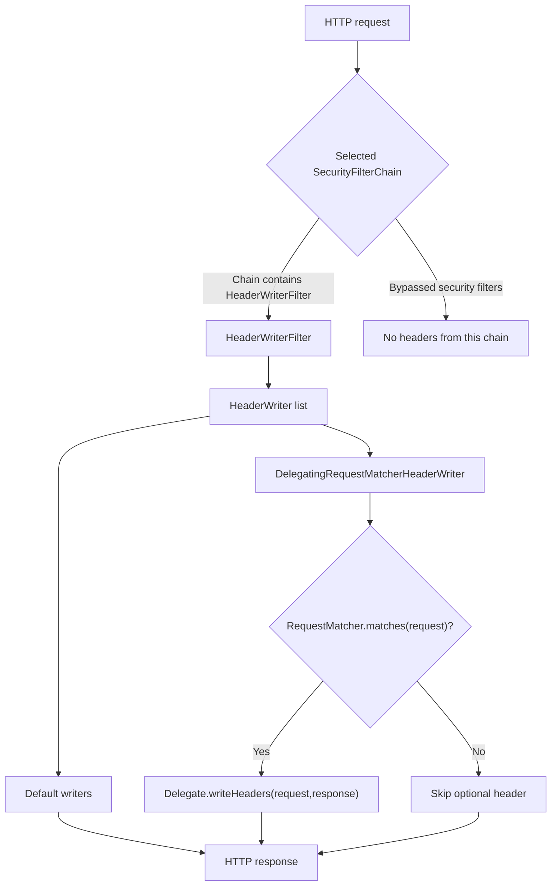

# HeaderWriter, DelegatingRequestMatcherHeaderWriter, and Per-Endpoint HTTP Headers

> **Scope:** Spring Security on the **Servlet stack** (Spring MVC / Spring Boot 3.x, Spring Security 6.x). This lesson belongs to the **HTTP Protection** group: understanding how security response headers are written, applying different policies per endpoint, and verifying actual headers. Examples use Java 17+, Spring Boot 3.3.0, and the `SecurityFilterChain` DSL.

## 1. Learning outcomes

After this lesson, you will be able to:

1. Explain what security HTTP **response headers** do and why headers form a defensive layer distinct from authentication, authorization, CSRF, and validation.
2. Describe the roles of `HeaderWriter`, `HeaderWriterFilter`, and `DelegatingRequestMatcherHeaderWriter` in the Servlet filter chain.
3. Preserve Spring Security's default security headers while conditionally adding **Content-Security-Policy** and **Referrer-Policy** per endpoint without accidentally dropping the baseline.
4. Write Java configuration using `HttpSecurity.headers(...)` together with `RequestMatcher` to send headers only for designated URLs.
5. Distinguish wrong matchers, overwritten headers, multiple coexisting CSPs, redirect/error responses missing headers, and headers added by reverse proxies.
6. Test with `MockMvc` and `curl -I/-i` to verify **status + headers + path** rather than merely checking whether a page loads.

## 2. Why care about security response headers?

An HTTP response might include:

```http
HTTP/1.1 200 OK
Content-Type: text/html;charset=UTF-8
X-Content-Type-Options: nosniff
X-Frame-Options: DENY
Referrer-Policy: no-referrer
Content-Security-Policy: default-src 'self'; object-src 'none'; base-uri 'self'; frame-ancestors 'none'
Cache-Control: no-cache, no-store, max-age=0, must-revalidate
```

These headers instruct the **browser** to enforce specific policies when processing the response:

| Header | Role | Notes |
| --- | --- | --- |
| `X-Content-Type-Options: nosniff` | Restricts browsers from guessing MIME types in certain scenarios. | Server must still return the right `Content-Type` and validate uploads. |
| `X-Frame-Options: DENY` | Prevents framing the document in supporting browsers. | Does not replace CSRF tokens; `CSP frame-ancestors` is the modern, more flexible mechanism. |
| `Content-Security-Policy` (CSP) | Restricts script/style/image sources, plugins, embedding ancestors, base URI, form targets, etc. | **Not included automatically in the default configuration**; policy must fit the page's resources. |
| `Referrer-Policy` | Controls how much URL information is sent in `Referer` during navigation/resource loads. | Can affect analytics or integrations; is not authorization. |
| `Strict-Transport-Security` (HSTS) | Instructs browsers to use HTTPS for a set period for the host. | Only meaningful when received over HTTPS; be cautious with `includeSubDomains`/preload. |
| `Cache-Control`, `Pragma`, `Expires` | Reduces caching of sensitive responses. | Cannot replace application-layer permissions; configure separately if public caching is needed. |
| `Permissions-Policy` | Permits or restricts browser features such as camera, microphone, geolocation. | Must check browser support and policy syntax. |

**Headers are not magic:** CSP does not fix broken authorization, `X-Frame-Options` does not stop forged requests directly, HSTS does not protect when an origin still serves untrusted content, and cache headers do not replace sensitive-data controls. Security requires defense in depth, where headers help the browser reduce the impact of certain risks.

### Spring Security's default headers

When a request passes through a `SecurityFilterChain` with default header configuration enabled, Spring Security typically adds `Cache-Control`/`Pragma`/`Expires`, `X-Content-Type-Options: nosniff`, `X-Frame-Options: DENY`, and `X-XSS-Protection: 0` (depending on version). HSTS is configured for HTTPS responses under appropriate conditions and configuration; **do not expect HSTS over plain local HTTP**.

`X-XSS-Protection: 0` **disables** the legacy XSS filter in certain browsers; it is not a claim that the server prevents XSS. Use proper output encoding, validation, and CSP instead of re-enabling obsolete browser filters.

**CSP, Referrer-Policy, and Permissions-Policy do not appear automatically just by adding `spring-boot-starter-security`.** You must configure them to fit your needs and test them yourself.

The `headers(...)` Security DSL operates on the **response**; it does not automatically alter cookies, sessions, or **request** headers.

## 3. HeaderWriter mechanism in Spring Security Servlet

The `org.springframework.security.web.header.HeaderWriter` interface has a single method:

```java
void writeHeaders(HttpServletRequest request, HttpServletResponse response);
```

This is an **interface signature** explaining the mechanism, not a standalone Java program. From the request and response, the writer decides which headers to write. Common implementations include:

- `StaticHeadersWriter`: writes a fixed header name and value; handy for explicit policies like CSP or Referrer-Policy.
- `ContentSecurityPolicyHeaderWriter`: dedicated writer for CSP when you want its specialized API.
- `HstsHeaderWriter`: writes HSTS conditionally as appropriate, tied to HTTPS by default.
- `CacheControlHeadersWriter`, `ContentTypeOptionsHeaderWriter`, `XFrameOptionsHeaderWriter`: handle their respective baseline headers.
- `DelegatingRequestMatcherHeaderWriter`: evaluates a `RequestMatcher`, invoking the wrapped writer only when the request **matches the condition**.

`HeaderWriterFilter` lives inside the Servlet `SecurityFilterChain`; it invokes configured writers when preparing to commit the response. Thus writers can affect controller responses, redirects, or error flows **if the request traverses that security chain and the writer/matcher actually runs**. Never assume every response in the system passes through the same chain.

### Relationship between components



`DelegatingRequestMatcherHeaderWriter` works conceptually like:

```java
if (requestMatcher.matches(request)) {
    delegate.writeHeaders(request, response);
}
```

This is **conceptual code**, not library source code to copy as an implementation. It does not alter conditions of other writers, does not select the `SecurityFilterChain` itself, does not grant permissions, and does not modify the response body.

### Three matcher layers that are easily confused

1. **`securityMatcher(...)` on `SecurityFilterChain`:** determines **which chain** handles the request. If a request does not enter this chain, writers inside it never run.
2. **`requestMatchers(...)` inside `authorizeHttpRequests(...)`:** determines which authentication/role/permission a request requires. `permitAll()` still traverses the chain and can receive security headers; `web.ignoring()` skips the chain.
3. **`RequestMatcher` passed to `DelegatingRequestMatcherHeaderWriter`:** determines **which optional header** is written. It does not decide whether to allow or deny the request.

A "missing" header can stem from misconfiguring **any** of these three layers; diagnose them in order.

## 4. When are different headers needed per endpoint?

Not every response requires identical policies:

| Example path | Purpose | Candidate policy |
| --- | --- | --- |
| `/public/home` | Public HTML page with same-origin assets | CSP permitting same-origin assets, blocking plugins and external framing. |
| `/account/dashboard` | Personal HTML page | Stricter CSP, `Referrer-Policy: no-referrer` to minimize path sharing. |
| `/api/**` | JSON API | Primarily authentication, CORS, caching, and Content-Type; CSP does not replace API security. |
| `/assets/**` | Static CSS, JS, images | Different cache policy from personal content; never accidentally place confidential responses in public caches. |
| `/download/**` | File downloads | `Content-Disposition`, Content-Type, MIME sniffing, and caching per data classification. |

Every custom header should map to a **concrete threat model**. CSP on HTML has much clearer impact than CSP on JSON. For cross-origin embeddable content, default `X-Frame-Options: DENY` can conflict with product needs; do not simply add `frame-ancestors` and expect every legacy browser to allow the iframe.

### Choosing matcher scope

- Use **exact** path matching or clear prefixes (`/account/**`) when a group of pages shares the same policy.
- Consider method, `DispatcherType`, and host **if genuinely needed**, especially when one URL serves HTML GET while also serving API POST.
- Headers depending on response content type or status **cannot be inferred from path alone** if a route returns multiple formats. A matcher inspecting only the request cannot distinguish whether HTML or JSON was rendered.
- Track path changes: adding a new endpoint outside the matcher means optional policies may not apply. Tests must cover important new routes.
- Do not misread request paths behind a reverse proxy or context path; verify matchers with tests matching real deployment paths.

## 5. Complete runnable example: headers for two page groups

The demo uses **Spring Boot 3.3.0**, **Spring Security 6.x**, **Java 17+**, Maven, and Thymeleaf. Two endpoints:

- `GET /public/home`: public; receives CSP suited for public content.
- `GET /account/dashboard`: requires HTTP Basic login; receives a **stricter CSP** and `Referrer-Policy: no-referrer`.

Default security headers **remain enabled**. Controllers do not need to call `response.setHeader(...)` manually.

### 5.1. Directory structure

```text
endpoint-headers-demo/
├── pom.xml
└── src/
    ├── main/
    │   ├── java/demo/headers/
    │   │   ├── DemoApplication.java
    │   │   ├── SecurityConfig.java
    │   │   └── PageController.java
    │   └── resources/
    │       └── templates/
    │           ├── public-home.html
    │           └── account-dashboard.html
    └── test/java/demo/headers/
        └── HeaderPolicyTest.java
```

### 5.2. Maven and application

**`pom.xml`:**

```xml
<project xmlns="http://maven.apache.org/POM/4.0.0"
         xmlns:xsi="http://www.w3.org/2001/XMLSchema-instance"
         xsi:schemaLocation="http://maven.apache.org/POM/4.0.0 https://maven.apache.org/xsd/maven-4.0.0.xsd">
    <modelVersion>4.0.0</modelVersion>
    <parent>
        <groupId>org.springframework.boot</groupId>
        <artifactId>spring-boot-starter-parent</artifactId>
        <version>3.3.0</version>
        <relativePath/>
    </parent>
    <groupId>demo</groupId>
    <artifactId>endpoint-headers-demo</artifactId>
    <version>0.0.1-SNAPSHOT</version>
    <properties>
        <java.version>17</java.version>
    </properties>
    <dependencies>
        <dependency>
            <groupId>org.springframework.boot</groupId>
            <artifactId>spring-boot-starter-web</artifactId>
        </dependency>
        <dependency>
            <groupId>org.springframework.boot</groupId>
            <artifactId>spring-boot-starter-security</artifactId>
        </dependency>
        <dependency>
            <groupId>org.springframework.boot</groupId>
            <artifactId>spring-boot-starter-thymeleaf</artifactId>
        </dependency>
        <dependency>
            <groupId>org.springframework.boot</groupId>
            <artifactId>spring-boot-starter-test</artifactId>
            <scope>test</scope>
        </dependency>
        <dependency>
            <groupId>org.springframework.security</groupId>
            <artifactId>spring-security-test</artifactId>
            <scope>test</scope>
        </dependency>
    </dependencies>
    <build>
        <plugins>
            <plugin>
                <groupId>org.springframework.boot</groupId>
                <artifactId>spring-boot-maven-plugin</artifactId>
            </plugin>
        </plugins>
    </build>
</project>
```

**`src/main/java/demo/headers/DemoApplication.java`:**

```java
package demo.headers;

import org.springframework.boot.SpringApplication;
import org.springframework.boot.autoconfigure.SpringBootApplication;

@SpringBootApplication
public class DemoApplication {
    public static void main(String[] args) {
        SpringApplication.run(DemoApplication.class, args);
    }
}
```

### 5.3. Configuring SecurityFilterChain with DelegatingRequestMatcherHeaderWriter

**`src/main/java/demo/headers/SecurityConfig.java`:**

```java
package demo.headers;

import org.springframework.context.annotation.Bean;
import org.springframework.context.annotation.Configuration;
import org.springframework.security.config.Customizer;
import org.springframework.security.config.annotation.web.builders.HttpSecurity;
import org.springframework.security.core.userdetails.User;
import org.springframework.security.core.userdetails.UserDetailsService;
import org.springframework.security.crypto.bcrypt.BCryptPasswordEncoder;
import org.springframework.security.crypto.password.PasswordEncoder;
import org.springframework.security.provisioning.InMemoryUserDetailsManager;
import org.springframework.security.web.SecurityFilterChain;
import org.springframework.security.web.header.writers.DelegatingRequestMatcherHeaderWriter;
import org.springframework.security.web.header.writers.StaticHeadersWriter;
import org.springframework.security.web.util.matcher.AntPathRequestMatcher;

@Configuration
public class SecurityConfig {
    static final String PUBLIC_CSP =
            "default-src 'self'; object-src 'none'; "
            + "base-uri 'self'; frame-ancestors 'none'";

    static final String ACCOUNT_CSP =
            "default-src 'self'; script-src 'none'; object-src 'none'; "
            + "base-uri 'self'; frame-ancestors 'none'; form-action 'self'";

    @Bean
    SecurityFilterChain securityFilterChain(HttpSecurity http) throws Exception {
        var publicPages = new AntPathRequestMatcher("/public/**");
        var accountPages = new AntPathRequestMatcher("/account/**");

        return http
            .authorizeHttpRequests(auth -> auth
                .requestMatchers("/public/**").permitAll()
                .requestMatchers("/account/**").authenticated()
                .anyRequest().denyAll())
            .headers(headers -> headers
                .addHeaderWriter(new DelegatingRequestMatcherHeaderWriter(
                    publicPages,
                    new StaticHeadersWriter(
                        "Content-Security-Policy", PUBLIC_CSP)))
                .addHeaderWriter(new DelegatingRequestMatcherHeaderWriter(
                    accountPages,
                    new StaticHeadersWriter(
                        "Content-Security-Policy", ACCOUNT_CSP)))
                .addHeaderWriter(new DelegatingRequestMatcherHeaderWriter(
                    accountPages,
                    new StaticHeadersWriter(
                        "Referrer-Policy", "no-referrer"))))
            .httpBasic(Customizer.withDefaults())
            .build();
    }

    @Bean
    PasswordEncoder passwordEncoder() {
        return new BCryptPasswordEncoder();
    }

    @Bean
    UserDetailsService users(PasswordEncoder encoder) {
        return new InMemoryUserDetailsManager(
            User.withUsername("learner")
                .password(encoder.encode("demo-pass"))
                .roles("USER")
                .build());
    }
}
```

**Explanation of each decision:**

1. `authorizeHttpRequests` sets permissions: public is `permitAll`; account requires authentication; other paths are denied. Header matchers have a different role from authorization matchers, even though the example reuses the same prefixes.
2. `new AntPathRequestMatcher("/public/**")` and `new AntPathRequestMatcher("/account/**")` match the corresponding Servlet paths. This API is available in the demo's Spring Security 6.x version; when upgrading major versions, check the target version's recommended matcher API.
3. Each `DelegatingRequestMatcherHeaderWriter` runs its wrapped writer only when the request path matches. The `public` and `account` groups do not overlap, so each page receives **one application CSP value**.
4. `StaticHeadersWriter` is used for fixed string values. CSP is enforced **on the response**, not via controller annotations. The account policy forbids scripts via `script-src 'none'`; the demo page intentionally uses no JavaScript.
5. `Referrer-Policy: no-referrer` is applied only to `/account/**`, reducing exposure of personal page URLs via `Referer` when navigating elsewhere. Public pages retain the browser's default referrer policy unless a proxy adds another header.
6. Calling `.headers(headers -> headers.addHeaderWriter(...))` **adds** optional writers to the header configuration; it **does not call** `defaultsDisabled()` and **does not disable** default writers. HSTS only appears in HTTPS environments under the appropriate rules.
7. `httpBasic` provides concise authentication for the demo. Production apps can use session/form login or another mechanism; changing how login works does not change the role of `DelegatingRequestMatcherHeaderWriter`.
8. The in-memory account and `demo-pass` password are for learning only; real applications need proper identity, credential management, and authorization.

> **Note:** we do not declare `StaticHeadersWriter` as a Servlet `Filter`. It is a writer inside the security chain; registering an extra filter in the container can cause headers to be applied in an unexpected order.

### 5.4. Controller and templates

**`src/main/java/demo/headers/PageController.java`:**

```java
package demo.headers;

import org.springframework.stereotype.Controller;
import org.springframework.web.bind.annotation.GetMapping;

@Controller
public class PageController {
    @GetMapping("/public/home")
    public String publicHome() {
        return "public-home";
    }

    @GetMapping("/account/dashboard")
    public String dashboard() {
        return "account-dashboard";
    }
}
```

**`src/main/resources/templates/public-home.html`:**

```html
<!doctype html>
<html lang="en">
<head>
    <meta charset="utf-8">
    <title>Public page</title>
</head>
<body>
    <h1>Public page</h1>
    <p>Content-Security-Policy header for the /public/** group.</p>
    <a href="/account/dashboard">Open dashboard</a>
</body>
</html>
```

**`src/main/resources/templates/account-dashboard.html`:**

```html
<!doctype html>
<html lang="en">
<head>
    <meta charset="utf-8">
    <title>Dashboard</title>
</head>
<body>
    <h1>Personal dashboard</h1>
    <p>Only authenticated users can open this page.</p>
    <a href="/public/home">Back to public page</a>
</body>
</html>
```

The demo pages contain only static HTML, needing no inline scripts, inline CSS, or CDN origins. In apps using scripts, images, fonts, or cross-origin APIs, design CSP accordingly: use `nonce`/`hash` or minimal allowlisted origins when needed; never add `unsafe-inline` casually to "fix" CSP. Check the browser console because CSP can prevent a feature from running while the server still returns 200.

### 5.5. Running and observing responses

In `endpoint-headers-demo`:

```bash
mvn test
mvn spring-boot:run
```

**Public page:**

```bash
curl -i http://localhost:8080/public/home
```

Expect status `200 OK`, along with headers such as:

```http
X-Content-Type-Options: nosniff
X-Frame-Options: DENY
Content-Security-Policy: default-src 'self'; object-src 'none'; base-uri 'self'; frame-ancestors 'none'
```

**Account page with credentials:**

```bash
curl -i -u learner:demo-pass http://localhost:8080/account/dashboard
```

Expect status `200 OK` with:

```http
X-Content-Type-Options: nosniff
X-Frame-Options: DENY
Content-Security-Policy: default-src 'self'; script-src 'none'; object-src 'none'; base-uri 'self'; frame-ancestors 'none'; form-action 'self'
Referrer-Policy: no-referrer
```

**Unauthenticated account page:**

```bash
curl -i http://localhost:8080/account/dashboard
```

Expect `401 Unauthorized` and `WWW-Authenticate: Basic ...`. In this configuration, the path still matches `/account/**`, so optional headers are also written to the 401 response passing through the chain; **having headers written** does not mean the request was authorized.

The sample responses **omit** other headers like `Content-Type`, `Cache-Control`, `Date`, and the body for readability. The `WWW-Authenticate` value, header-name casing, ordering, and some values depend on the framework/container. Verify via Network tab or curl rather than comparing entire raw responses verbatim.

`curl -I` sends a **HEAD** request, while `curl -i` sends GET and prints both headers and body. If the app handles HEAD differently or a controller handles only one method, test HEAD separately; do not assume HEAD output fully represents GET.

## 6. Automated testing with MockMvc

The goal here is not only that the controller returns 200, but that **the right request path receives the right policy**, public endpoints do not receive private policies, and the baseline is preserved.

**`src/test/java/demo/headers/HeaderPolicyTest.java`:**

```java
package demo.headers;

import org.junit.jupiter.api.Test;
import org.springframework.beans.factory.annotation.Autowired;
import org.springframework.boot.test.autoconfigure.web.servlet.AutoConfigureMockMvc;
import org.springframework.boot.test.context.SpringBootTest;
import org.springframework.test.web.servlet.MockMvc;

import static org.springframework.security.test.web.servlet.request
    .SecurityMockMvcRequestPostProcessors.user;
import static org.springframework.test.web.servlet.request.MockMvcRequestBuilders.get;
import static org.springframework.test.web.servlet.result.MockMvcResultMatchers.header;
import static org.springframework.test.web.servlet.result.MockMvcResultMatchers.status;

@SpringBootTest
@AutoConfigureMockMvc
class HeaderPolicyTest {
    @Autowired
    MockMvc mvc;

    @Test
    void publicPageHasPublicCspAndRetainsDefaults() throws Exception {
        mvc.perform(get("/public/home"))
            .andExpect(status().isOk())
            .andExpect(header().string(
                "Content-Security-Policy", SecurityConfig.PUBLIC_CSP))
            .andExpect(header().doesNotExist("Referrer-Policy"))
            .andExpect(header().string(
                "X-Content-Type-Options", "nosniff"))
            .andExpect(header().string("X-Frame-Options", "DENY"));
    }

    @Test
    void accountPageHasStrictCspAndReferrerPolicy() throws Exception {
        mvc.perform(get("/account/dashboard").with(user("learner")))
            .andExpect(status().isOk())
            .andExpect(header().string(
                "Content-Security-Policy", SecurityConfig.ACCOUNT_CSP))
            .andExpect(header().string("Referrer-Policy", "no-referrer"))
            .andExpect(header().string(
                "X-Content-Type-Options", "nosniff"));
    }

    @Test
    void anonymousAccountRequestIsUnauthorizedWithHeaders() throws Exception {
        mvc.perform(get("/account/dashboard"))
            .andExpect(status().isUnauthorized())
            .andExpect(header().string(
                "Content-Security-Policy", SecurityConfig.ACCOUNT_CSP))
            .andExpect(header().string("Referrer-Policy", "no-referrer"));
    }
}
```

With Maven, the command:

```bash
mvn test
```

compiles the sources and runs JUnit 5 via Spring Boot test infrastructure. The first test proves the public policy and baseline remain intact; the second proves the writers target the private endpoint; the third checks policy on a security-rejected response. If you have custom error handling, redirects, exceptions, or multiple chains, add tests for those response types too.

**Test limitations:** `MockMvc` verifies HTTP headers emitted by the application, but **does not simulate full browser enforcement of CSP/HSTS**. Verify CSP with browser DevTools/Console, HTTPS/HSTS in an HTTPS environment, and proxy/CDN responses with an HTTP client against the real deployed URL.

## 7. Custom HeaderWriter and more complex matchers

`StaticHeadersWriter` handles fixed values very well. When a header depends on the request, you can use a lambda implementing `HeaderWriter` (the snippet below is an **illustration** to insert in `SecurityConfig`, not a standalone application):

```java
org.springframework.security.web.header.HeaderWriter writer =
    (request, response) -> {
        if (!response.containsHeader("X-Request-Policy")) {
            response.setHeader("X-Request-Policy", "reviewed");
        }
    };
```

This is a custom illustrative header, **not a browser security standard**. In real deployments, emit only needed headers, ensure values are safe (no CR/LF or arbitrary user data), and never use a "marker header" as proof that the server authenticated a request.

You can wrap this writer in `DelegatingRequestMatcherHeaderWriter` so it applies only on selected paths. You can also write a custom `RequestMatcher` checking **path + method**:

```java
org.springframework.security.web.util.matcher.RequestMatcher matcher =
    request -> "GET".equals(request.getMethod())
        && request.getServletPath().startsWith("/account/");
```

The snippet above illustrates Java 17 syntax, not an optimal production matcher. `startsWith("/account/")` enforces the trailing slash so `/accounting` is not counted as part of `/account/`; you must still consider servlet mapping, context path, encoded paths, trailing slashes, and real routing rules. Use tested framework matchers whenever possible.

### When should you write your own writer?

Write your own only if the header requires logic standard writers cannot express: for instance, applying part of a policy based on pre-classified endpoint groups. For global headers or fixed values, the standard DSL or `StaticHeadersWriter` is clearer and easier to test.

Avoid reading untrusted parameters and concatenating them into CSP, redirect targets, or `Access-Control-Allow-Origin`. Writing headers must never accidentally turn untrusted data into part of a policy enforced by the browser.

## 8. Per-endpoint headers, multiple SecurityFilterChains, and proxies

### 8.1. Multiple ordered chains

A real application may have separate chains for `/api/**` and the web UI:

```text
/api/**         → API SecurityFilterChain (authentication, CORS, API headers)
/public/**      → Web SecurityFilterChain (public CSP)
/account/**     → Web SecurityFilterChain (private CSP)
```

Spring Security uses **the first chain matching** the request. Therefore a writer only takes effect within the selected chain. If a high-priority API chain omits necessary headers, configuring writers on the web chain will not "compensate" for the API. Test `@Order` and `securityMatcher` on each chain.

`web.ignoring()` excludes requests from the Spring Security chain, meaning that chain's `HeaderWriterFilter` does not run either. So that public resources still receive security headers, prefer `permitAll()` inside a chain rather than skipping it altogether, unless there is a clear reason.

### 8.2. Reverse proxies/CDNs can add or alter headers

If Nginx, ingress, an API gateway, or a CDN adds CSP/X-Frame-Options/HSTS, responses reaching users can differ markedly from local `MockMvc` tests. Define **a single owner per policy** or establish clear merging rules.

Common scenarios:

- App writes CSP A, proxy writes CSP B: the browser may enforce **multiple policies simultaneously**, blocking more resources than expected. Do not think a second CSP automatically "overwrites" or loosens the first CSP.
- Writers using `setHeader` differ from `addHeader`; they may replace or append headers depending on execution order. Never rely on the last writer to silently patch an incorrect policy.
- Default `X-Frame-Options: DENY` can impede framing even when CSP `frame-ancestors` allows another domain. Modern browsers prioritize enforcing CSP `frame-ancestors`, whereas older browser compatibility varies; decide on a consistent framing policy strategy.
- `Content-Security-Policy-Report-Only` only reports violations and **does not enforce blocking**. Use it to measure impact before rollout, then move to enforced CSP when ready.
- Security headers can be lost on 304s, 302 redirects, 404/500 error responses, static assets, or proxy-generated redirects. Test each path directly instead of checking only 200 controllers.

### 8.3. HSTS requires special caution

`Strict-Transport-Security` is remembered by browsers when received over HTTPS. Directives like `max-age`, `includeSubDomains`, and `preload` impact behavior over a long duration. Enable subdomain scope and preload only when all related hosts are HTTPS-ready and a corresponding rollback procedure exists. HSTS in Spring Security does not appear over plain HTTP connections by default, which is normal.

## 9. Common errors and root-cause analysis

| Symptom | Causes to check | Remediation |
| --- | --- | --- |
| CSP missing on `/account/dashboard` | Matcher didn't match, route hits another chain, request bypasses security, or proxy strips header. | Test matcher and chain with real paths; inspect network both before and after proxy. |
| Header present on `/public/home`, missing on new page | New path falls outside `/public/**`. | Design clear route groups, add tests for new endpoints; avoid overly broad matchers. |
| Lost `nosniff`, `X-Frame-Options`, cache headers | Used `defaultsDisabled()` or `headers.disable()`/another chain. | Keep baseline and add writers; disable a single header only with justification and compensating controls. |
| CSP blocks valid CSS/JS or images | Policy lacks source, uses inline scripts/styles, CDN, data/blob URLs, or wrong hash/nonce. | Inspect CSP violations in browser; adjust policy/asset architecture using minimal allowlists. |
| CSP appears twice | Default/custom writer, gateway/CDN both write header, multiple layers set policy. | Assign policy ownership, eliminate duplicates; remember browsers can enforce both concurrently. |
| 401/403 has different headers than 200 | Entry point, error dispatch, different chain/matcher, or different error handler flow. | Test denied, error, and redirect responses explicitly. |
| Headers pass in MockMvc but missing on live site | Reverse proxy/CDN/ingress rewrites or static routing bypasses app. | Curl the real domain, compare headers per layer and proxy configs. |
| HSTS missing on localhost HTTP | HSTS is tied to HTTPS. | Test via HTTPS test environment rather than forcing it onto plain HTTP. |
| Setting `Referrer-Policy` globally breaks analytics | Policy too strict for all endpoints. | Classify sensitive pages and pick a product-approved policy. |

### Ordered diagnostic checklist

1. Identify the **actual URL, method, and status** of the response and which `SecurityFilterChain` handles it.
2. Check whether the request matches the writer's `RequestMatcher` (path, method, dispatcher, context path).
3. Inspect config for `defaultsDisabled()`, `headers.disable()`, another writer setting the same header, or multiple chains.
4. Use `curl -i`/DevTools to inspect headers on 200, 302, 401, 403, 404/500, and 304 responses across actual code paths.
5. Compare responses directly from the internal app vs. through gateway/CDN; watch for duplicated, replaced, or stripped headers.
6. If CSP behaves unexpectedly, read violations in the browser console; separate browser policy errors from authentication, authorization, CSRF, and app content bugs.
7. Write regression tests for key endpoints before changing routing, chain order, proxies, or security configuration.

## 10. Review questions

**1. When `permitAll()` is configured, do header writers run?**

Yes, provided the request still enters the security chain containing `HeaderWriterFilter` and the writer's condition matches. `permitAll()` only permits authorization, unlike bypassing the entire chain.

**2. Does `DelegatingRequestMatcherHeaderWriter` decide whether a user can access an endpoint?**

No. It only decides whether to invoke its wrapped writer to emit headers. Access permissions are decided separately by authentication/authorization and related filters.

**3. Why shouldn't you add both a global CSP and an endpoint CSP to "loosen permissions" for one page?**

Multiple CSPs can apply concurrently and tighten restrictions; an endpoint policy is not guaranteed to loosen a global policy. Design consistent policies and verify exact headers returned by the app/proxy.

**4. Why doesn't `HeaderWriter` replace authentication, authorization, or CSRF tokens?**

Security headers mainly instruct the browser on handling the **response**. The server must still validate data access permissions, request validity, and state-changing actions; non-browser HTTP clients may ignore policies.

**5. When should per-endpoint security headers be considered?**

When page groups have distinct characteristics: dashboards holding personal data, public pages with specific assets, embeddable pages, file downloads, or APIs. Matchers must be exact and consistent with routing/chains.

## 11. Takeaways

- **`HeaderWriter`** writes security response headers; **`HeaderWriterFilter`** invokes writers inside the Spring Security Servlet chain.
- **`DelegatingRequestMatcherHeaderWriter`** pairs a writer with a `RequestMatcher`, enabling per-path/endpoint policies without altering access rules.
- **`HttpSecurity.headers(...)`** is the configuration point. When adding custom writers, **preserve default headers** unless a clear, analyzed requirement dictates otherwise.
- CSP/Referrer-Policy must be configured explicitly; CSP must fit HTML resources and can be affected by proxies or coexisting policies.
- Verify with tests checking **the right route, right status, and right headers**, including denied/error/redirect responses and responses from deployment infrastructure.

**Practical principle:** define the browser policies required for each endpoint group, choose clear matchers, let the security chain emit headers consistently, and use tests plus real HTTP response inspection to ensure policies take effect.