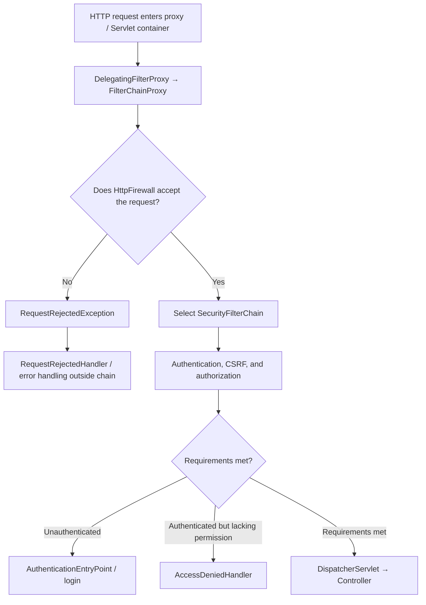

# Difference Between Rejecting Dangerous Requests and Returning Insufficient-Permission Errors

> **Context:** Spring Security on the **Servlet stack**, focusing on `HttpFirewall`, `StrictHttpFirewall`, `FilterChainProxy`, and distinguishing requests blocked for suspicious structure from requests denied due to missing authentication or insufficient permissions.

## 1. Two Completely Different Security Questions

When an HTTP request is not processed, you must determine **which layer rejected the request and for what reason** before interpreting the HTTP status.

1. **HttpFirewall:** "Is the request representation itself acceptable to process safely?" For example, an unnormalized URL, path patterns prone to parsing discrepancies, disallowed HTTP methods, or forbidden headers/parameters. This is a check on **request shape**, occurring before Spring Security selects and runs authentication/authorization filters.
2. **Authentication/authorization:** "Who is this, have they logged in, and does this identity have permission to access the resource?" A request can be completely valid syntactically yet still be denied due to missing identity or insufficient permissions.
3. **Other mechanisms:** CSRF, CORS, validation, or business logic can also reject requests. **Looking only at 400/401/403 is not enough** to conclude which mechanism caused the error.

A valid `GET /admin/report` sent by an account holding only the `USER` role is an **insufficient-permission error**. A request such as `GET /admin//report` can be blocked by `StrictHttpFirewall` for a suspicious path **even when the sender is an ADMIN**. Conversely, the firewall accepting `GET /admin/report` does not mean the user is allowed to read the report.

**"Dangerous request" in the `HttpFirewall` context is not proof that the sender has been identified as an attacker.** It is a request violating safe representation/normalization policy; it may result from an attack, a buggy client, an inconsistent proxy, or misconfiguration.

## 2. Processing Order in Spring Security Servlet

Spring Security receives requests from the Servlet container via `DelegatingFilterProxy` and `FilterChainProxy`. `HttpFirewall` operates at the `FilterChainProxy` layer before selecting the appropriate `SecurityFilterChain`. Only if the request passes the firewall do the security filters proceed with authentication, CSRF, and authorization, and then potentially pass to `DispatcherServlet` and the controller.



The diagram shows only **typical** branches. Individual filters can handle errors via their own mechanisms—especially CSRF, HTTP Basic, CORS, or apps with multiple security chains. Reverse proxies and Servlet containers can also reject requests before they reach Spring.

### 2.1. When HttpFirewall Rejects

Conceptual steps:

1. `FilterChainProxy` calls `HttpFirewall#getFirewalledRequest(...)` to obtain a request safe for matching/selecting a filter chain.
2. With `StrictHttpFirewall`, a rule-violating request throws `RequestRejectedException`.
3. Because the error happens **before ordinary security filters**, do not assume `ExceptionTranslationFilter`, `AuthenticationEntryPoint`, `AccessDeniedHandler`, or a controller `@ExceptionHandler` will handle it.
4. The relevant component is `RequestRejectedHandler` at the `FilterChainProxy` level, or error handling outside the chain. `HttpStatusRequestRejectedHandler` can be configured to return an explicit HTTP code (often 400). **Do not assert that firewall rejection always yields 400**: the response also depends on handler version/configuration, Servlet container, reverse proxy, and external exception handlers.

### 2.2. When Authentication or Permissions Are Missing

A request that passed the firewall and reached endpoint protection:

- **Not logged in / invalid credentials:** authentication triggers `AuthenticationEntryPoint` or equivalent error handling. With HTTP Basic, this is usually **401 Unauthorized** with `WWW-Authenticate`; with form login, browsers may receive a **302 redirect** to the login page.
- **Authenticated but lacking authority/role:** the `AccessDeniedException` and `AccessDeniedHandler` path typically returns **403 Forbidden**.
- **Request data violates business rules:** controller/validation may return **400** or another code; this does not mean the firewall rejected it.
- **Missing or invalid CSRF token:** the CSRF filter can return **403** even with valid authentication. Distinguish this from missing authority.
- **CORS preflight failure:** can return **403** due to disallowed origin/method/headers; do not infer the user lacks roles.

`ExceptionTranslationFilter` translates `AuthenticationException` and `AccessDeniedException` thrown by filters/objects within its scope into corresponding authentication/access-denied responses. **It is not a catch-all handler for every `RequestRejectedException` thrown before the filter chain.**

## 3. Core Comparison Table

| Criterion | Firewall Rejects Suspicious Request | Unauthenticated | Authenticated but Lacking Permission |
| --- | --- | --- | --- |
| Question | Is the request structure safe to parse/match? | Does the request carry a valid identity? | Does the identity hold sufficient authority? |
| Typical location | `HttpFirewall` inside `FilterChainProxy`, before chain selection | Authentication filters | Authorization filter, method security, or business layer |
| Deciding data | Method, URL/path, path encoding/normalization, policy headers/parameters | Session, Basic credentials, bearer token, auth mechanism | Role/authority, `requestMatchers` rules, `@PreAuthorize`, ownership |
| Does user login need to occur for the error? | No | No | Usually holds a valid identity lacking permission |
| Typical exception | `RequestRejectedException` | `AuthenticationException` or auth entry point | `AccessDeniedException` |
| Responding component | `RequestRejectedHandler` / container handler | `AuthenticationEntryPoint` or authentication mechanism | `AccessDeniedHandler` |
| Common HTTP status | 400 when handler is configured for Bad Request; not fixed | 401 Basic/API or 302 form login | 403 |
| Primary fix | Fix request, align proxy/URL parsing, or review firewall policy with care | Provide valid credentials / log in | Grant proper permissions or update access rules per business policy |
| Common misconception | "An ADMIN can bypass the firewall." | "401 means missing role." | "403 always comes from the firewall or a dangerous URL." |

**Order matters:** a request whose path is rejected by the firewall never reaches authentication. Adding a bearer token, cookie, or extra role cannot "fix" that error.

## 4. What Does StrictHttpFirewall Check?

`StrictHttpFirewall` is the strict implementation Spring Security uses as its default in modern Servlet versions. It mitigates risks when different components (proxy, container, MVC, matchers, server) interpret the same URL or method **differently**, causing a request to be authorized under one path yet handled as another.

Notable check categories:

- **HTTP methods:** by default permits only common methods such as `DELETE`, `GET`, `HEAD`, `OPTIONS`, `PATCH`, `POST`, `PUT`; other methods may be rejected immediately at the firewall. The container may also block methods earlier.
- **Unnormalized paths:** strings such as extra `//`, non-canonical path forms, dots, and path components that can cause URL-matching mismatches.
- **Disallowed characters/representations:** under default policy, semicolons `;` in paths, backslashes, certain URL-encoded characters such as encoded slashes, encoded backslashes, encoded percents, control characters, or suspicious encodings can be rejected.
- **Headers, parameters, and hostnames:** the firewall provides checks/limits on content where configuration can customize allowed name/value predicates. Do not treat the firewall as a replacement for business validation.
- **Canonicalization:** checking before security matchers prevents the authorization layer from reading one path while MVC or the server handles another.

**Do not assume mechanically that every specific representation always returns 400.** A reverse proxy may normalize or reject before Spring; the Servlet container may interpret path/encoding before filters; `StrictHttpFirewall` settings may be customized. Always check the actual path and active configuration.

### 4.1. Why Can Arbitrary Unblocking Be Dangerous?

Suppose a system enforces "only ADMIN may call `/admin/**`." If the proxy, firewall, matcher, and controller normalize URLs differently, discrepancies can arise between **the path checked for permissions** and **the path executed**. A strict firewall policy aims to reduce this class of risk, not merely keep logs clean.

Spring Security provides flexible setters such as `setAllowSemicolon` or `setAllowUrlEncodedSlash`. **Do not enable them merely to "get rid of 400."** Before relaxing:

1. Prove the feature genuinely needs that syntax—for example, a legacy app using matrix variables.
2. Verify whether the reverse proxy, load balancer, Servlet container, URL matcher, Spring MVC, and downstream components interpret paths identically.
3. Test both permitted paths and sensitive look-alike paths, especially `/admin/**`, `/api/**`, different methods, and repeated encoding.
4. Prefer changing the API so values with slashes or semicolons live in **query parameters/body** when appropriate, instead of requiring encoded delimiters in the path.
5. If policy adjustment is required, keep it narrow and document why; never disable or replace a strict firewall with a globally permissive policy.

## 5. Runnable Demo: One API, Three Rejection Types

Create a Spring Boot 3.x project with Java 17+ and two dependencies: Spring MVC web starter and Spring Security starter. The example uses `HTTP Basic` to easily observe **401/403** without a frontend or session cookies. The demo includes:

- `GET /public`: accessible to everyone.
- `GET /private/profile`: requires authentication.
- `GET /admin/report`: requires the `ADMIN` role.
- Any request with a path deemed unsafe by `StrictHttpFirewall` is blocked **before authorization**, regardless of credentials.

### 5.1. build.gradle

```groovy
plugins {
    id 'java'
    id 'org.springframework.boot' version '3.3.5'
    id 'io.spring.dependency-management' version '1.1.6'
}

group = 'com.example'
version = '0.0.1-SNAPSHOT'

java {
    toolchain {
        languageVersion = JavaLanguageVersion.of(17)
    }
}

repositories {
    mavenCentral()
}

dependencies {
    implementation 'org.springframework.boot:spring-boot-starter-web'
    implementation 'org.springframework.boot:spring-boot-starter-security'
}
```

Plugin versions are only for a standalone demo on the Spring Boot 3.3.x branch. If integrating into a module with existing dependency management, use the versions/plugins defined by your project.

### 5.2. Spring Boot Application

File `src/main/java/com/example/firewalldemo/FirewallDemoApplication.java`:

```java
package com.example.firewalldemo;

import org.springframework.boot.SpringApplication;
import org.springframework.boot.autoconfigure.SpringBootApplication;

@SpringBootApplication
public class FirewallDemoApplication {
    public static void main(String[] args) {
        SpringApplication.run(FirewallDemoApplication.class, args);
    }
}
```

### 5.3. SecurityConfig

File `src/main/java/com/example/firewalldemo/SecurityConfig.java`:

```java
package com.example.firewalldemo;

import org.springframework.context.annotation.Bean;
import org.springframework.context.annotation.Configuration;
import org.springframework.security.config.Customizer;
import org.springframework.security.config.annotation.web.builders.HttpSecurity;
import org.springframework.security.config.annotation.web.configuration.WebSecurityCustomizer;
import org.springframework.security.core.userdetails.User;
import org.springframework.security.core.userdetails.UserDetailsService;
import org.springframework.security.crypto.factory.PasswordEncoderFactories;
import org.springframework.security.crypto.password.PasswordEncoder;
import org.springframework.security.provisioning.InMemoryUserDetailsManager;
import org.springframework.security.web.SecurityFilterChain;
import org.springframework.security.web.firewall.StrictHttpFirewall;

@Configuration
public class SecurityConfig {
    @Bean
    SecurityFilterChain securityFilterChain(HttpSecurity http) throws Exception {
        return http
                .authorizeHttpRequests(auth -> auth
                        .requestMatchers("/public").permitAll()
                        .requestMatchers("/admin/**").hasRole("ADMIN")
                        .anyRequest().authenticated()
                )
                .httpBasic(Customizer.withDefaults())
                .build();
    }

    @Bean
    PasswordEncoder passwordEncoder() {
        return PasswordEncoderFactories.createDelegatingPasswordEncoder();
    }

    @Bean
    UserDetailsService users(PasswordEncoder encoder) {
        return new InMemoryUserDetailsManager(
                User.withUsername("viewer")
                        .password(encoder.encode("viewer-demo"))
                        .roles("USER")
                        .build(),
                User.withUsername("admin")
                        .password(encoder.encode("admin-demo"))
                        .roles("ADMIN")
                        .build()
        );
    }

    @Bean
    WebSecurityCustomizer webSecurityCustomizer() {
        return web -> web.httpFirewall(new StrictHttpFirewall());
    }
}
```

Explanation:

- `requestMatchers("/public").permitAll()` opens only the public route.
- `requestMatchers("/admin/**").hasRole("ADMIN")` requires authority `ROLE_ADMIN` (Spring Security prepends `ROLE_` when calling `hasRole("ADMIN")`).
- `anyRequest().authenticated()` requires login for remaining routes.
- `httpBasic()` makes CLI clients receive `401` when unauthenticated and `403` when authenticated without the required role.
- Two accounts with passwords encoded via `DelegatingPasswordEncoder` are for local demo only. **Never use example accounts/passwords in production.**
- `WebSecurityCustomizer` explicitly configures `StrictHttpFirewall` here to show the configuration hook. This is also the default strict firewall in standard Spring Security Servlet setups, so this bean is primarily **illustrative**, not required in every project.
- CSRF is not disabled: all tests below use GET, which is a safe method under default CSRF configuration.

### 5.4. Controller

File `src/main/java/com/example/firewalldemo/AccessDemoController.java`:

```java
package com.example.firewalldemo;

import java.util.Map;
import org.springframework.web.bind.annotation.GetMapping;
import org.springframework.web.bind.annotation.RestController;

@RestController
public class AccessDemoController {
    @GetMapping("/public")
    public Map<String, String> publicInfo() {
        return Map.of("result", "public");
    }

    @GetMapping("/private/profile")
    public Map<String, String> privateInfo() {
        return Map.of("result", "authenticated");
    }

    @GetMapping("/admin/report")
    public Map<String, String> adminReport() {
        return Map.of("result", "admin-only");
    }
}
```

These are four Java classes in package `com.example.firewalldemo` alongside the application class, security config, controller, and Spring-provided dependencies; the code runs in a Spring Boot application with matching dependencies. The controller contains no authentication/role logic because Security enforces URL rules in the filter chain.

### 5.5. Run and Observe Three Outcomes

Use the Gradle Wrapper included in a Spring Boot project initialized with the setup above:

```bash
# Linux / macOS
./gradlew bootRun

# Windows PowerShell
.\gradlew.bat bootRun
```

Unless the port was changed, the backend listens on `http://localhost:8080`. Test with these commands:

```bash
# Public, no account needed: HTTP 200
curl -i "http://localhost:8080/public"

# Protected endpoint, no Basic credentials sent: typically HTTP 401
curl -i "http://localhost:8080/private/profile"

# Valid USER account, authorized to view profile: HTTP 200
curl -i -u viewer:viewer-demo "http://localhost:8080/private/profile"

# USER attempting ADMIN route: HTTP 403 Forbidden
curl -i -u viewer:viewer-demo "http://localhost:8080/admin/report"

# ADMIN permitted: HTTP 200
curl -i -u admin:admin-demo "http://localhost:8080/admin/report"
```

For the first command and the three role-permitted commands as described, the successful JSON responses are respectively:

```json
{"result":"public"}
```

```json
{"result":"authenticated"}
```

```json
{"result":"admin-only"}
```

**Observation:** `viewer`'s request to `/admin/report` has a normal URL and method and passed the firewall, yet lacks `ROLE_ADMIN`; therefore the **403** result has nothing to do with a dangerous URL. The unauthenticated request to `/private/profile` enters the authentication branch; `HTTP Basic` can return **401** and a `WWW-Authenticate` header.

### 5.6. Firewall-Rejected Request: Suspicious Address

Try a request containing `;` in the URL path, which default `StrictHttpFirewall` rejects if the request reaches the filter in that form:

```bash
curl --path-as-is -i -u admin:admin-demo "http://localhost:8080/private/profile;mode=debug"
```

Next, try a URL containing an unnormalized `//`:

```bash
curl --path-as-is -i -u admin:admin-demo "http://localhost:8080/private//profile"
```

**Outcomes to verify:** the server/proxy/container may block or normalize the URL before Spring; if it reaches `StrictHttpFirewall` in the disallowed form, the request is rejected with `RequestRejectedException` **before checking the ADMIN role**. Do not assume a single fixed HTTP status without knowing the application's `RequestRejectedHandler`, container, and proxy. When `HttpStatusRequestRejectedHandler` is configured to return Bad Request, you can see **400**; other environments may return a different response.

A request rejected for a suspicious path **does not become valid by adding ADMIN Basic credentials**. Conversely, a syntactically valid `/admin/report` still requires `ROLE_ADMIN`. These two experiments pair the same credentials with two distinct rejection causes.

Note: `curl --path-as-is` prevents the *client* from normalizing the path; it **does not control** how a server-side reverse proxy or Servlet container processes the URL.

## 6. Which Handler Handles Which Error?

### 6.1. RequestRejectedException and RequestRejectedHandler

When `HttpFirewall` rejects a request, `RequestRejectedException` is raised at the `FilterChainProxy` layer. A `RequestRejectedHandler` can be attached to `FilterChainProxy` to handle this rejection; for instance, `HttpStatusRequestRejectedHandler` sets a specific status. When customizing, verify that the handler is **actually wired into `FilterChainProxy` in your application's version/configuration**.

Do not assume an MVC `@RestControllerAdvice` will catch this exception. `DispatcherServlet` and controllers may **not have been invoked yet**. Similarly, configuring an `AccessDeniedHandler` does not automatically alter the firewall's response: the two handlers operate at different positions.

### 6.2. AuthenticationEntryPoint and AccessDeniedHandler

For the authentication/authorization path:

- `AuthenticationEntryPoint` initiates authentication when needed. HTTP Basic usually returns 401 with a challenge; form login may redirect 302; REST apps may customize a JSON 401.
- `AccessDeniedHandler` typically handles an authenticated identity lacking permissions, returning 403 and optionally writing an API-friendly response body.
- `ExceptionTranslationFilter` translates authentication/access exceptions thrown inside the chain segment it wraps. Do not treat it as a global catcher for every Servlet error.
- `CsrfFilter` can also reject with 403 when the CSRF token is invalid; a "Forbidden" response body **does not prove** missing roles.

Troubleshooting flow diagram:

```text
Request rejected?
  ├─ RequestRejectedException / abnormal path-method-header?
  │    └─ Check HttpFirewall, RequestRejectedHandler, container/proxy
  ├─ Missing or wrong credentials?
  │    └─ Check authentication filter and AuthenticationEntryPoint
  ├─ Authenticated but lacking role/authority?
  │    └─ Check authorization rule, AccessDeniedException/Handler
  ├─ Missing/wrong CSRF token on unsafe method?
  │    └─ Check CsrfFilter and CSRF policy
  └─ Controller already ran before reporting an error?
       └─ Check validation, handler, service, and business error mapping
```

Do not rely on status code as sole proof. Inspect the **actual exception type and the component that wrote the response**.

## 7. When Are 400, 401, and 403 Reliable Signals?

| Scenario | Typical Status | Caution When Concluding |
| --- | --- | --- |
| URL or HTTP method blocked by `StrictHttpFirewall` | Often configurable as 400, not fixed | Proxy/container/handler may return another status; exception is stronger evidence |
| HTTP Basic missing/wrong credentials | 401 | Check `WWW-Authenticate`; form login may return 302 |
| User has `ROLE_USER` but endpoint requires `ROLE_ADMIN` | 403 | Inspect `AuthorizationFilter`/method security and actual authorities |
| Session-backed POST with missing or invalid CSRF token | Usually 403 | Do not conclude insufficient authority |
| Disallowed CORS preflight | May be 403 | Inspect `Origin`, method, headers, and Security CORS |
| Malformed JSON request or validation error | Usually 400 | Controller/MVC reports data error, not necessarily `HttpFirewall` |
| Reverse proxy rejects URL before forwarding to app | Depends on proxy, often 400/4xx | Spring logs may show no request at all |
| 404 due to nonexistent route | 404 | Firewall may have accepted request; endpoint simply has no mapping |

An HTTP code is the **response interface** for the client. The root cause must be identified via the request, execution path, exception, configuration, and logs.

### 7.1. Do Not Arbitrarily Turn 403 Into 400, or Vice Versa

Clients and monitoring systems need to distinguish three meanings:

- **Bad Request (400):** the request is unacceptable due to syntax/format/input-level request policy. Firewall rejections *can* be mapped to 400 when explicitly configured.
- **Unauthorized (401):** the client must supply valid credentials, especially in HTTP Basic/Bearer challenge contexts or 401 APIs.
- **Forbidden (403):** the server understood the request but refuses the action, usually due to insufficient permissions; can also result from CSRF or CORS depending on layer.

If every error returns 403 with "Access denied," operators easily adjust the wrong roles instead of checking path encoding or firewall policy. At the same time, client messages must not expose internal firewall rule names or URLs containing sensitive data.

## 8. Orderly and Safe Debugging

### Step 1 — Confirm Whether the Request Reached the Application

Inspect reverse proxy / Servlet container access logs, request method/path, and any discrepancy between the browser-displayed URL and the actual request. A 400 from a proxy may leave no corresponding log in Spring Security. If a security rejection log exists, check whether it contains `RequestRejectedException`.

### Step 2 — Identify the Processing Path

- **HttpFirewall:** look for signs of pre-chain rejection, such as paths with semicolons, unnormalized paths, or disallowed methods; inspect `StrictHttpFirewall` settings and upstream URL-normalizing components.
- **Authentication:** verify whether the client sent valid credentials and whether the session/token is still valid; Basic 401 typically includes a challenge.
- **Authorization:** check which rule the endpoint actually matched, which authorities were granted, and whether the user is authenticated.
- **CSRF/CORS:** for POST/PUT/PATCH/DELETE or cross-origin browser requests, check the CSRF token, OPTIONS preflight, and CORS headers before concluding missing roles.

### Step 3 — Use a Controlled Comparison Suite

Against one known endpoint, test systematically:

1. **Canonical URL, no credentials:** likely 401 or redirect on protected routes.
2. **Canonical URL, valid credentials lacking role:** likely 403.
3. **Canonical URL, credentials with required role:** must reach controller and return business output.
4. **Suspicious URL, credentials with required role:** if the firewall rejects it, the outcome does not depend on roles and the controller never runs.
5. **Suspicious URL, no credentials:** compare the same rejection source to prove failure occurs **before authentication**.
6. **A POST request requiring CSRF:** test valid/invalid tokens separately so CSRF errors are not mixed into firewall/role tests.

When testing via browser, DevTools → Network helps inspect redirects, actual requests, and preflight calls. When testing URL encoding with `curl --path-as-is`, remember proxies/containers can still alter paths before Spring.

### Step 4 — Observe and Log at the Right Layer

- Track `RequestRejectedException` rates separately from authentication/authorization 401/403s.
- Log correlation/request IDs when feasible, source component, normalized route/method for metrics, and the status returned by the handler.
- Limit and sanitize log data: raw request paths, queries, and headers may hold malicious strings, control characters, or sensitive info; never log full tokens or passwords.
- If using a custom `RequestRejectedHandler`, test the returned body/status/headers and ensure no internal security structure is leaked.
- Run tests for normal cases and edge cases before relaxing `StrictHttpFirewall`; do not rely solely on a drop in 400/403 counts after a change.

## 9. Common Misconceptions

| Misconception | Reality |
| --- | --- |
| "With ADMIN, every request must go through." | The firewall evaluates request acceptability **before** checking ADMIN permissions. |
| "403 always means missing permission." | 403 can also come from CSRF, CORS, or error handlers; check the error source. |
| "400 always comes from HttpFirewall." | 400 can come from proxies, containers, MVC JSON parsing, validation, or a firewall mapped to 400. |
| "RequestRejectedException is AccessDeniedException." | They are distinct error types with different positions and handlers. |
| "Just add permitAll for the rejected URL." | `permitAll` governs authorization; it does not bypass `HttpFirewall` checks. |
| "Adding a requestMatcher for the strange URL fixes the firewall." | Matchers run after the request must be accepted by the firewall. |
| "Just remove StrictHttpFirewall." | Unassessed relaxation can introduce URL normalization inconsistencies and rule bypasses. |
| "Getting 401/403 means the request reached the controller." | Security can reject before `DispatcherServlet`; the controller has not run. |
| "Converting all errors to one JSON 403 is simpler." | That hides the cause and makes authentication, authorization, and request rejection indistinguishable to clients and monitoring. |

## 10. Self-Check Questions

**1.** An `ADMIN` user sends `GET /admin//report`. Why can it still fail?  
Because `StrictHttpFirewall` can reject unnormalized URLs before the role check; it does not mean the account lacks `ROLE_ADMIN`.

**2.** A `USER` account calls syntactically valid `GET /admin/report` and receives 403. What should be checked first?  
Verify the user is authenticated, what authority `/admin/**` requires, and what authorities the user actually holds. If the exception is `AccessDeniedException`, it is an authorization branch, and no firewall changes are needed.

**3.** A client calls `GET /private/profile` without Basic credentials and receives 401. Did `HttpFirewall` detect an attack?  
No. 401 is the HTTP Basic authentication branch; the request may be completely valid syntactically.

**4.** Can `@RestControllerAdvice` reliably catch `RequestRejectedException`?  
Not reliably, because the exception occurs before the request enters `DispatcherServlet`; inspect error handling in `FilterChainProxy`, `RequestRejectedHandler`, the container, or the proxy.

**5.** Why inspect both the proxy and Servlet container when an encoded slash is rejected?  
Because those layers can decode, normalize, or reject before Spring, changing the observed status and exception; the goal is ensuring all layers see the URL consistently.

**6.** Should `setAllowUrlEncodedSlash(true)` be enabled just because the frontend gets 400?  
No. You must prove the business requirement and test path normalization/bypass risks across layers before relaxing.

## 11. Final Takeaway

An HTTP request passes through two distinct checkpoints:

**Gate 1 — HttpFirewall:** *Is a request represented like this acceptable?* If not, `RequestRejectedException` is thrown regardless of whether the sender is logged in or holds any role.

**Gate 2 — Spring Security authorization:** *Who is making this valid request, and what are they permitted to do?* If unauthenticated, 401/redirect may occur; if authenticated without sufficient permission, usually 403. CSRF and other filters can still reject independently.

**Diagnose using the exception type, processing location, and actual request—never status codes alone.** Keep `StrictHttpFirewall` strict, and rely on authentication/authorization to enforce identity and access rights.
